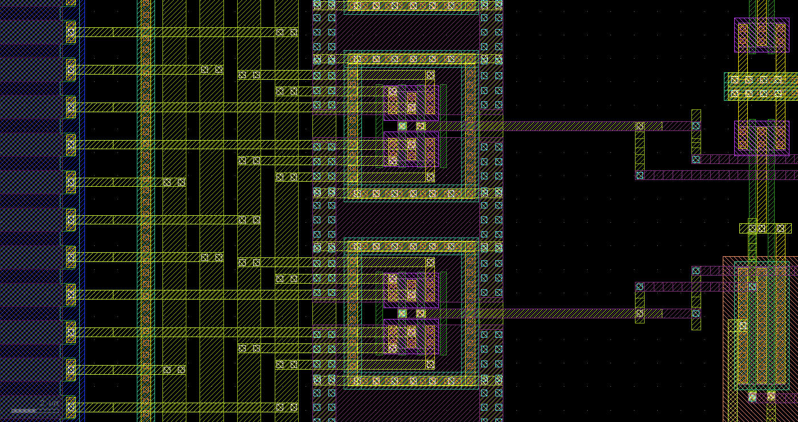
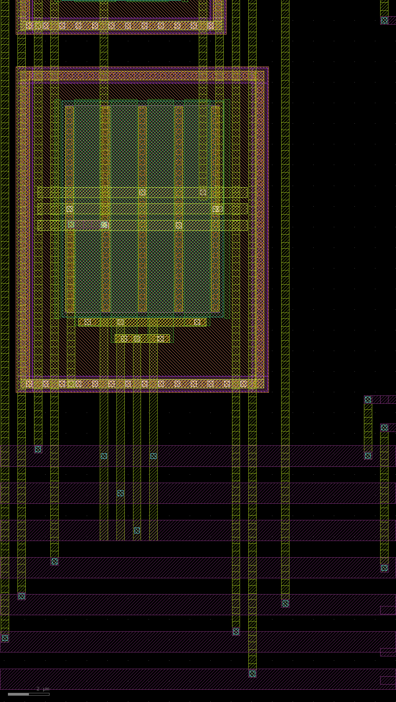
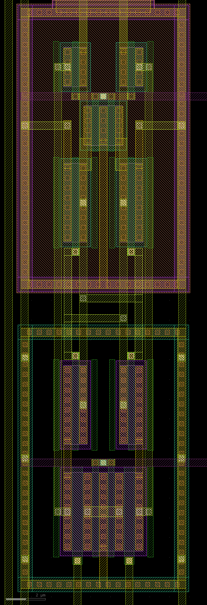

# ADC のレイアウトの直し：DAC1 の偶成分と量子化器の入力の結合（D6 の 6、7、2026-10-23）

重要ブロックの PEX（D6、`gf180_pex_20261023.md`）で見つかった ADC 側の 2 件を、レイアウトで直した記録。回路（ネットリスト）は変えていない。

- **DAC1 の偶成分（ISI）**：寄生込みで 1 素子 0.47 fC、31 素子同時 0.69 fC／切り替え。要求は 2·Iu·T（0.81 pC）の 1e-5 = 0.008 fC。
- **量子化器の入力の結合**：クロック CLKQ が O2P に 32.5 fF、O2N に 5.3 fF。各比較器の前置増幅器の出力 VOP が O2N に約 6 fF ずつ、ラッチの節点 OB が O2P に約 4.4 fF ずつ。ループの中の判定が理想のしきい値と 9 % しか合わない（回路図 97 %）。

スクリプトは `gf180/tapeout/layout/rdac1_lay.py`（adc_rdac）、`quant_lay.py`（eeg_quantizer）、`adc_lay.py`（adc_top、変更なし）。確かめるスクリプトは `gf180/tapeout/pex/`（`pex.py`、`pex_benches.py`、`pex_adc.py`）。チップの組み立てと precheck は、AFE 側の直しと合わせて別に回す。

10/24 に、残っていた量子化器の比較器のラッチの対称（OA／OB、X／Y の配線容量の差、B4）も直した（量子化器の節の最後、「ラッチの対称」）。

## 結論

- **DAC1 の偶成分は要求の約 1/6 になった。** 寄生込みで 1 素子 −0.00139 fC、31 素子同時 −0.00124 fC／切り替え（2·Iu·T の −1.7e-6、−1.5e-6。D6 は 0.47、−0.69 fC）。行動モデルで SNDR 122.8〜123.8 dB（要求の 1e-5 で 107.5 dB、16.5 bit に要るのは 101 dB）。
  - 抽出（1 aF まで残す）で、XP と XN の結合は、切り替わるどの線でも素子ごとに等しい（差 0.00 aF）。ほかの素子の線、SEL、ラッチ、ブレークの線との結合は 1 aF 未満。
- **量子化器の入力の非対称な結合はほぼなくなった。** CLKQ との結合は O2P 2.127 fF、O2N 2.123 fF（前は 32.5／5.3 fF）。ラッチの節点 OA／OB との結合は 1 aF 未満（前は O2P に合計 135 fF）。前置増幅器の出力 VOP／VON との結合は、トランジスタの Cgd と同じ向き（VON–INP、VOP–INN）が残るだけ。
  - 直す途中で、比較器のユニットの中の CLK の配線が VON の配線の隣を通り、どの比較器でも CLK と VON の結合が VOP より 3 fF 大きくなった。ストローブのたびに判定が同じ向きにずれ、しきい値がそろって約 +8.5 mV（2.7 LSB）動いた（量子化器のブロックの抽出で確かめた。素子だけでは起きない）。CLK も手で引いて DVSS の線で挟み、差を 0.01 fF にした。
  - ループ（寄生込み、100 µs）：残差 0.0267（回路図 0.0203、D6 0.0455）、O2 の振れ −36.0〜32.9 mV（D6 −49.6 mV、量子化器の範囲 ±46.9 mV の内側）。判定が理想のしきい値と合うフレームは 65.0 %（D6 11.2 %）で、ずれはしきい値のそろった +1.0 mV（ラッチの OA／OB の負荷の差による静的なもの）。これを除くと 92.5 % で、素子だけの版（93.8 %）と同じ。このずれは 10/24 にラッチを直してなくなった（次）。
- **ラッチの対称（10/24）は目標の内側になった。** ラッチ（StrongARM と出力の 2 つのインバータ）を軸で鏡像に描き直し、OA／OB、X／Y の配線をすべて手で引いた鏡像の対にした。OA − OB −0.003 fF、X − Y +0.009 fF（目標 0.2 fF、前は +1.29〜+2.64、−0.01〜+1.64 fF）で、31 個とも同じ。CLKQ との結合の差は OA／OB 0.002 fF、X／Y 0.0003 fF、VOP／VON 0.003 fF。
  - ストローブの押し（`pex_benches.py quant`）で 7 つの入力とも理想のコード（前は −45、+0.05、+47 mV で 1 低い）。
  - ループ（寄生込み、20 kHz）で、判定が理想のしきい値と合うフレームは 93.8 %（前 65.0 %）、最良の共通のずれは −0.1 mV（前 +1.0 mV）で、素子だけの版と同じになった。
  - 残差（80 フレーム）は 10/23 より 1 割大きい（20 kHz で 0.0267 → 0.0306、15 kHz で 0.0271 → 0.0300）。増えたのは窓の周波数の上の帯で、下 1/4（帯域に近い側）は同じか小さい。量子化器の外の寄生、ループの節点と切り替わるネットの結合、前置増幅器の遅れは、どれも 10/23 と同じか小さい。行動モデルでは、しきい値の形を変えるだけで 80 フレームの残差が入力ごとに ±18 % 動く。そのため、この差は量子化雑音の出方の違いとみる（長いランでは確かめていない）。
- ブロックはどちらも DRC 違反なし、LVS 一致。組み直した adc_top も DRC 違反なし、LVS 一致（10/24 の量子化器でも同じ。外形と端子の位置は変えていない）。

## DAC1（adc_rdac、`rdac1_lay.py`）

### 何が問題だったか

素子の節点 XP／XN（抵抗の下端、2 つのスイッチの共通の節点）は、共通ブレーク（約 1.5 ns）の間すべてのスイッチが開いて浮く。この間とその前後に切り替わる線から結合で入った電荷は、届く先（古い側か新しい側の出力）が切り替えの向きで決まるので、向きによらない誤差（偶成分）になる。効くのは線ごとの「XP との結合と XN との結合の差」で、3.3 V の振れで 2.5 aF の差が要求 0.008 fC にあたる。

前のレイアウトでは、X 節点は抵抗の配列の東端から、2 列に並べたスイッチの帯まで、配線器（route.Router）で数十 µm 引かれ、ほかの素子の X 節点、D／DB、SEL の横を通っていた。D6 の抽出（31 素子の和、XP／XN）で、ほかの素子の X 節点と 235／215 fF、ほかの素子の D／DB／SEL と 29／37 fF、自分の DB と 1.5／3.2 fF。

### 直した形

- **素子を軸で鏡像にした。** 抵抗の行を、素子ごとに下から [RIN_P] RPA RPB | RNB RNA [RIN_N] にした（RIN は偶数番の素子に 1 本ずつ、計 16 本ずつ）。RPB（XP の端）と RNB（XN の端）の間が素子の軸で、上下が鏡像になる。軸の間隔は 8 µm（5 行）で一定。RIN と DAC1 の単位抵抗は前と同じく配列の中で混ざっている。
- **4 つのスイッチを抵抗の端に置いた（dac1_quad）。** 行の東端のすぐ外に、2 本の NMOS の帯（W 1 µm、L 0.28 µm）。軸の下が [OUTN DB XP D OUTP]、上が [OUTP DB XN D OUTN]。DB と D の指は 2 本の帯で共通で、ゲートのコンタクトは軸の上。XP は RPB の頭から、XN は RNB の頭から、まっすぐの Metal2 で帯に入る。帯は、XP↔XN、OUTP↔OUTN を入れ替えるとそれ自身の鏡像になる。周りは AVSS の基板タップの環。
- **D／DB は軸の上を出す。** D は Metal2、DB は Metal4 で、軸の上を東へ 13〜15 µm 出し、そこで配線器に渡す。軸の上の線は XP と XN に同じだけ結合する。
- **遮蔽。** スイッチの列の西と東に AVSS の Metal3、DB の線の間（列の上）に AVSS の Metal4。
- **ほかの線を近づけない。** 配線器は、スイッチの列から東へ 8 µm より先でだけ動く（magic の結合の範囲は横 8 µm）。論理（ラッチの TG、インバータ、NOR、共通ブレークのドライバ）は東の行に置き、素子 2r と 2r+1 の論理を行 r（その 2 つの軸の横）に、NOR を行の西寄りに、ブレークのドライバを中ほどの 4 行に分けた。SEL1／DAC_CLK の端子は論理の下に移した。
- **静的な線は手で描いた。** 配列とスイッチの列の間に Metal3 のバス VREFP、VREFN、I1N、I1P（スイッチの出力と RIN の東端）、配列の西に INN、INP。I1P／I1N は論理の上の Metal4 で東端の端子へ（端子の位置は前と同じ）。静的な線との結合は XP と XN で違うが、偶成分にはならない（ブレークのあと X 節点は元の電位に戻り、届く電荷が残らない）。
- ブロックは 395.8 × 274.4 µm（前と同じ幅、2.8 µm 低い）。DRC 違反なし、LVS 一致。

### 抽出（`pex.py adc_rdac --cthresh 0.001`）

aF の差を見るため、ext2spice の閾値を D6 の 10 aF から 1 aF に下げた。XP／XN と切り替わる線の結合（31 素子の和、aF）：

| 相手 | XP（直した後） | XN（直した後） | XP（D6） | XN（D6） |
|---|---|---|---|---|
| 自分の DB | 1458.0 | 1458.0 | 1494 | 3248 |
| 自分の D | 289.0 | 289.0 | 2972 | 2406 |
| 自分の SEL | 1 未満 | 1 未満 | 383 | 1610 |
| ほかの素子の D／DB／SEL | 1 未満 | 1 未満 | 29 344 | 36 673 |
| ほかの素子のラッチ（Q／QB／N1） | 1 未満 | 1 未満 | 0 | 2 610 |
| ブレークの線（BRK／BRKL／BRKLB） | 1 未満 | 1 未満 | 0 | 1 575 |
| ほかの素子の X 節点 | 1 未満 | 1 未満 | 234 603 | 214 832 |

- 素子ごとの XP と XN の差は、どの線でも 0.00 aF。素子どうしの結合が抽出されないので、素子ごとのばらつき（要求 3e-4 以下）も同じく 0 になる。
- 残る自分の D／DB との結合（素子あたり 47 aF と 9.3 aF）は、帯の中のゲートの指とコンタクトによる。鏡像なので XP と XN で同じ。

### ベンチ（`pex_benches.py dac1`、`dac1_check.py`）

出力は理想の仮想接地、基準電圧は VCM ± 0.25 V。偶成分の要求は 0.008 fC／切り替え。

| DUT | 偶成分、1 素子 (fC／切り替え) | 偶成分、31 素子同時 (fC／切り替え) | VRP の電流 k = 0／15／31 (µA) | 切り替えごとの VRP の余分な電荷 (fC) |
|---|---|---|---|---|
| sch（D6、回路は同じ） | +0.00005 | −0.00003 | 12.8525／12.8527／12.8525 | +0.047 |
| dev（直した後） | −0.00010 | −0.00014 | — | — |
| pex（直した後） | **−0.00139** | **−0.00124** | 12.8524／12.8524／12.8512 | +0.053 |
| pex（D6） | +0.473 | −0.687 | 12.8543／12.8568／12.8570 | +0.014 |

- 寄生込みで要求の約 1/6（2·Iu·T の −1.7e-6、−1.5e-6）。1 素子と 31 素子同時でほぼ同じなのは、素子どうしの結合がないため。
- 基準電流は符号によらない（k = 0〜31 で 12.8511〜12.8524 µA、差 0.01 %）。
- 1 素子の試験を素子 0 以外でも回した（`--cells`）：素子 15 で −0.00090 fC、配列の端の素子 30 で −0.00068 fC。素子ごとの差は 2·Iu·T の約 5e-7（要求 3e-4 以下）。

### 行動モデル（`gf180/behavioral/ct2_dac2_options.py`）

s = 10、DWA、DAC の不一致 0.5／2 %、0.5〜100 Hz の SNDR、乱数 3 通り。

| DAC1 の偶成分（2·Iu·T に対する比） | SNDR (dB) |
|---|---|
| なし | 170.9 / 174.0 / 166.7 |
| 直した後、1 素子（−1.72e-6） | 122.8 / 122.8 / 122.8 |
| 直した後、31 素子同時（−1.53e-6） | 123.8 / 123.8 / 123.8 |
| 要求（1e-5） | 107.5 |
| D6（+5.8e-4、−8.5e-4） | 72.2、68.9 |

## 量子化器（eeg_quantizer、`quant_lay.py`）

### 何が問題だったか

D6 の抽出（adc_top）で、量子化器の入力 O2P（= INP）／O2N（= INN）に、次の非対称な結合があった。

- **CLKQ**：O2P 32.5 fF、O2N 5.3 fF。ブロックの西端で、配線器が O2P と CLKQ の縦の配線を 0.42 µm 離して 385 µm 並べていた。
- **比較器の中**：配線器が INP／INN の縦の配線（バスの行からユニットの上の方の前置増幅器のゲートまで約 85 µm）を隣り合う 2 列に置き、その片側をラッチの節点 OB（O2P に 135 fF）、反対側を前置増幅器の出力 VOP（O2N に 189 fF）が並んで通っていた。

### 直した形

- **比較器のユニット。** 部品の順を、下からバスの行、前置増幅器の対 A（INP／INN）、尾、対 B（RP／RN）、StrongARM、ラッチの PMOS、出力の論理にした（前は StrongARM、ラッチ、尾、対 A、対 B、論理）。対 A のゲートの帯を下（バスの側）に向けた。
  - INP と INN は隣り合う 2 本の Metal3 で、それぞれのバスの行から帯まで約 10 µm まっすぐ上がる。両外側に AVDD の線。配線器は、その外側 1 列と、バスの行と帯の間に入らない。
  - クロック、ラッチ、その出力はユニットの上半分にあり、入力の近くを通らない。
  - **CLK も手で引いた。** CLK はユニットの東端から 2 列目の Metal3 で CLK のバスの行から上がり、両側に DVSS の線、その外側 1 列は配線器が使わない。StrongARM とラッチの PMOS の CLK の端子（3 か所）へは、端子の高さの Metal4 で西へ入る。ほかの縦の配線（VOP／VON など）とは直角に交わるだけ。配線器に任せたときは、CLK の縦の配線が VON の配線の 0.42 µm 横を 53 µm、VOP の配線の 1.22 µm 横を 82 µm 並び、CLK と VON の結合が VOP より 3 fF 大きかった（全部の比較器で同じ）。
  - バスの行の順は DVSS、CLK、DVDD、VBQ、INN、INP、AVDD（INN と INP の隣は静的な VBQ と AVDD）。
  - 対 A の指の並び（共通重心）とゲートの帯の段（INP が内側の段、INN が外側の段）は前と同じ。
- **ブロックの入力。** 2 列のユニットの INN／INP のバスを、列の東端で 1 組の Metal3 の対（INN、INP を AVSS の線で挟む）につないだ。対は負荷抵抗とラダーの間を通って上の列まで行き、途中から Metal4 の対（AVSS で挟む）で東の端子へ行く。
  - 切り替わる線（TH、CLK、RP／RN など）は、対を直角に横切るだけなので、INP と INN に同じだけ結合する。配線器は対の外側 1 列も使わない。
  - CLK は列の西端から入れる（前と同じ）。入力とは反対の端。
  - 上の列は比較器が 15 個なので、16 個目の場所までバスの行を延ばした。
- ブロックは 505.4 × 403.6 µm（2.8 µm 広い）。INP／INN の端子は東辺のバイアスより上（y 212 µm 付近）へ移した。DRC 違反なし、LVS 一致。

### 抽出（量子化器のブロック、`pex.py eeg_quantizer --cthresh 0.001`）

INP（= O2P）、INN（= O2N）との結合（31 個の和、fF）：

| 相手 | INP | INN | D6（adc_top）：O2P | O2N |
|---|---|---|---|---|
| CLKQ | 2.127 | 2.123 | 32.52 | 5.25 |
| 比較器の OB | 0.00 | 0.00 | 135.4 | 5.2 |
| 比較器の OA | 0.00 | 0.00 | 0.65 | 11.1 |
| 比較器の VOP | 6.4 | 19.8 | 13.3 | 189.5 |
| 比較器の VON | 17.1 | 1.2 | 24.2 | 8.7 |
| VBQ／AVDD（静的。2 pF の MIM でつながる） | 5.2／72.0 | 38.2／33.7 | 74.0／12.5 | 33.0／13.4 |

- CLKQ の差は 0.004 fF（前は 27 fF、ストローブごとに約 90 fC）。残る CLKQ との結合は、ユニットの CLK の縦の配線が INN と INP のバスの行の下をくぐる所で、両方に同じだけある。
- VOP／VON との結合は、前置増幅器のトランジスタの Cgd と同じ向き（VON–INP、VOP–INN）が大部分で、対 A の帯の中のゲートの帯と S/D の列による。回路図にも Cgd としてある形。
- ラッチの出力の負荷の差 OA − OB は 1.4〜2.6 fF（前は −4.7〜−0.8 fF）。比較器のオフセットで約 0.94 mV/fF（`gf180_quantizer_20261022.md`）なので約 1.3〜2.4 mV、全部が同じ向きなので量子化器のしきい値のそろったずれになる（行動モデルではしきい値の誤差 σ 10 mV でも 147 dB）。

### ストローブの押し（`pex_benches.py quant`、`quantizer_check.py timing`）

量子化器のブロックだけで、入力を理想の電圧源（電流計つき）で与え、8 回のストローブで入力をコードの間で動かす。ストローブから 150 ns の間に INP、INN から出入りした電荷の最大と、その差（判定の瞬間に入力を差動に押す量）、コード。

| 入力 (mV) | 理想のコード | sch：コード、差 (fC) | dev：コード、差 | pex（CLK を手で引く前）：コード、差 | pex（直した後）：コード、差 |
|---|---|---|---|---|---|
| −1.60 | 15 | 15、−0.26 | 15、−0.12 | 13、−7.12 | 15、−0.06 |
| +20.00 | 22 | 22、+3.48 | 22、+2.63 | 20、−6.89 | 22、+0.96 |
| −45.00 | 1 | 1、−7.37 | 1、−5.74 | 0、−7.83 | 0、−5.65 |
| +0.05 | 16 | 16、+0.12 | 16、+0.11 | 13、+1.07 | 15、+0.07 |
| +47.00 | 31 | 31、+8.09 | 31、+6.08 | 28、−6.46 | 30、+2.01 |
| −0.05 | 15 | 15、+0.10 | 15、+0.09 | 13、−7.13 | 15、0（1 fC 以内） |
| +3.10 | 16 | 16、+0.51 | 16、+0.49 | 14、−7.07 | 16、+0.16 |

- 共通の押しは INP、INN とも約 −60（sch）、−103（dev）、−65 fC（pex）。差はコードの端で ±6〜8 fC（前置増幅器の Cgd による。回路図と同じ形）、真ん中で 1 fC 以下。
- CLK を手で引く前の pex は、差がどのコードでも約 −7 fC で、コードが 2〜3 低い（しきい値がそろって約 +8.5 mV）。
- 直した後の pex は、7 つのうち 3 つ（−45 mV で 0、+0.05 mV で 15、+47 mV で 30）でコードが 1 低い。どれも入力がしきい値のすぐ上（1.9、0.05、0.13 mV）で、ラッチの OA／OB の負荷の差によるしきい値のずれ（+1.3〜2.4 mV、上の節）の範囲。
- −0.05 mV の行は、INP と INN の電荷がどの時刻でも 1 fC 以内でそろっている（表の元の出力で INP が +64.6 fC になるのは、ほぼ同じ大きさの正と負の山のどちらを最大と拾うかの違い）。

### ループ（`pex_adc.py`、20 kHz・0.3 V pk、100 µs、20〜100 µs で評価）

組み直した adc_top を抽出し（`pex.py adc_top`、10 aF まで。D6 と同じ）、ループのデッキ（`adc_deck.py`）の eeg_adc を差し替えた。回路図（sch）は回路が同じなので D6 のラン。寄生込みの 100 µs は約 1.5 時間。

| 項目 | sch | dev（D6） | pex（D6） | dev（直した後） | pex（直した後） |
|---|---|---|---|---|---|
| ループの利得 | 1.0075 | 1.0061 | 1.0046 | 1.0061 | 1.0021 |
| 残差 (rms、DAC の段) | 0.0203 | 0.0219 | 0.0455 | 0.0225 | **0.0267** |
| O1 の振れ (mV) | −92.4〜91.2 | −92.4〜92.7 | −96.0〜93.3 | −92.4〜93.0 | −95.2〜91.5 |
| O2 の振れ (mV) | −32.8〜31.5 | −32.4〜32.2 | −49.6〜32.6 | −32.4〜32.7 | **−36.0〜32.9** |
| 仮想接地の乱れ、DAC1 の更新ごと：最大の平均／最大 (µV) | 372／610 | 360／588 | 559／1073 | 359／587 | 363／659 |
| 同、50 ns 後の残り (µV) | 49 | 56 | 84 | 55 | 57 |
| 判定が理想のしきい値と合うフレーム（`pex_adc.py codes`） | 98.8 % | 95.0 % | 11.2 % | 92.5 % | **65.0 %** |
| 最良の共通のずれ：合うフレーム | +0.2 mV：98.8 % | +0.2 mV：96.2 % | −2.7 mV：46.2 % | −0.2 mV：93.8 % | **+1.0 mV：92.5 %** |

- O1／O2 の CM（1.6486／1.6489 V）と AVDD（4.71 mA）はどれも同じ。
- **判定。** しきい値に共通のずれ +1.0 mV を入れると、寄生込みの判定は素子だけの版と同じだけ（92.5 %）理想に合う。残る共通のずれは、上の節のラッチの OA／OB の負荷の差（しきい値 +1.3〜2.4 mV）による静的なもので、ストローブの押しや入力の結合（D6 で判定を動かしていたもの）はほぼ残っていない。素子だけの版と回路図の差（93.8 % と 98.8 %）は、レイアウトの素子の形による。
- **残差と O2。** 残差は回路図の 2.2 倍から 1.3 倍になった。O2 の振れは量子化器の範囲（±46.9 mV）の内側に戻った（−49.6 → −36.0 mV）。
- **仮想接地の乱れ。** DAC1 の更新ごとの尖りは回路図と同程度に戻った（D6 の 1.5 倍がなくなった）。DAC1 の X 節点の結合がなくなったため。

### ラッチの対称（10/24）

上の形では、比較器のラッチの節点の配線容量が OA − OB +1.29〜+2.64 fF、X − Y −0.01〜+1.64 fF（全部の比較器で同じ向き）で、しきい値がそろって +1.3〜2.4 mV ずれていた（ループで共通のずれ +1.0 mV）。抽出を相手の節点ごとに分けると、原因は 3 つあった。

- **ユニットの配線器。** OA／OB／X／Y の縦の配線の隣が対称でなかった。比較器 5 で OA–Y 1.57 fF に対し OB–X 0.44 fF（OB が Y の 0.42 µm 横を 20 µm、OA が Y の横を 8 µm）。RP（T5）の線が OA の横を 12 µm 通り、OA–T5 1.22 fF に対し OB–T25（RN）0.23 fF。
- **ブロックの配線。** ほかの比較器の TH の線がユニットの中を通り、OA にだけ近づいた（比較器 5 で OA–TH4 0.54 fF、OB 0.003 fF）。西の端のユニット（0、1、16、17）は電源と CLK の縦の線も通り、OA − OB +2.6 fF、X − Y +1.6 fF。
- **部品の帯の並び。** ラッチの PMOS で、OA の帯は COMP の上、OB の帯は COMP の下（列を延ばして届く）、交差対のゲートの帯は OB が 0 段・OA が 1 段、プリチャージの CLK のゲートの帯の隣は OA の帯だった（CLKQ–OA 0.33 fF、OB 0.15 fF）。NMOS の入力対でも、X の帯は TL の帯の隣、Y の帯はゲートの帯の隣。

#### 直した形（`quant_lay.py` の `latch()`、`unit_cell()`）

- **ラッチを軸で鏡像にした。** StrongARM（XM0〜XM6、XS1〜XS4）と出力の 2 つのインバータ（XIA、XIB）を 1 つのセル `qcmp_latch` にまとめ、ユニットの列 x = 9.84 µm を軸に、OA↔OB、X↔Y、VOP↔VON、SETQ↔RSTQ で鏡像に描いた（OA の側が西）。回路は同じ。下から：
  - NMOS（DVSS の環）：入力の帯 [X VOP TL CLK DVSS CLK TL VON Y]（尾の 2 本の指を真ん中に入れた。VOP／VON のゲートの帯は下、CLK は上）と、交差対の 2 つの島 [X OB OA] | [OB OA Y]（ゲートの帯は上）。
  - PMOS（DVDD の環、Nwell）：交差対の島 [DVDD OB OA] | [OB OA DVDD]（ゲートの帯は下で、NMOS の対の帯と向き合う）、OA／OB のプリチャージ [OA CLK DVDD CLK OB]、X／Y のプリチャージの島 [X CLK DVDD] | [DVDD CLK Y]（CLK のポリを下のプリチャージと共有）。
  - 2 つのインバータは上下を逆さに（入力が PMOS の環の隣、出力は上へ）、OB の側は左右も反転して置いた。
- **OA／OB、X／Y の配線はすべて手で引いた鏡像の対。**
  - OA／OB：x ∓1.02 µm の Metal3。NMOS の対の内側のドレインから、PMOS の対のドレイン（OA／OB のプリチャージはそこへ Metal1）を通って、インバータの入力まで。
  - X／Y：x ∓2.3 µm の Metal3。入力の帯から X／Y のプリチャージまで（交差対の外側の列は入力の帯の端の列と Metal1 でつなぐ）。
  - 交差：各側の NMOS と PMOS のゲートを Metal2 の縦の線（x ∓1.8 µm）でつなぎ、反対の側の OA／OB の縦の線へ、2 つの環の間（2 µm）の Metal2 の横の線で渡す。鏡像にならないのはこの 2 本だけ（OB の線は NMOS の環の 0.5 µm 上、OA の線は PMOS の環の 0.5 µm 下）。
  - TL は入力の帯を横切る Metal2 の帯 1 本。
- **CLK。** ユニットの東の縦の線（両側に DVSS、前と同じ）から、2 つの CLK のゲートの帯（入力の帯の上と、2 つのプリチャージの間）の高さの Metal4 でラッチを横切り、軸の上で帯へ下ろす。OA／OB、X／Y の縦の線とは直角に交わるだけ。
- **遮蔽と配線器。** 環の両側の上に DVSS の Metal3（x ∓4.0 µm）。ユニットとブロックの配線器は、ラッチの中、ラッチの東（CLK が入る所）、ラッチの入力（対 B の帯から VOP／VON のゲートへ上がる Metal3）の周りに入らない。
- **ユニットの西の帯。** 端子へ上がる VOP、RP、RN、VON（この順）を手で引き、両外側に DVSS の線を置いた。VOP と VON はそれぞれ DVSS の線とタップの線の間にあり、隣り合わない（隣り合わせた最初の形では、VOP と VON の間の容量が 2 倍になった）。VOP／VON の線は対 A と対 B の帯もつなぐ。RP／RN は Metal4 で対 B のゲートへ入り、その線は VOP と VON を 1 回ずつ横切る。
- SR ラッチ（NOR 2 つ）、TH と QD のインバータはラッチの上の行（配線器）。DVSS はラッチの遮蔽から、DVDD は東の手描きの縦の線（DVDD のバスの行から、ラッチと SR ラッチの行の VDD へ）。
- ユニット（19.2 × 135.9 µm）とブロック（505.4 × 403.6 µm）の外形と端子の位置は同じ。DRC 違反なし、LVS 一致。

#### ブロックの配線

ブロックの配線器をユニットの中に入れないようにすると（前は TH がユニットの中を通っていた）、配線器は CLK と TH をチャネル（比較器の行と中央の帯の間）に引き、比較器 0 の VOP の線の横に CLKQ（10.7 fF）と TH6（15.2 fF）が並んだ。そこで次も手で引いた。

- **TH。** 各比較器の端子から、その行の隣のチャネルに 1 本ずつ Metal4 の行（西の比較器ほどユニットに近い）、東へ入力の対の先まで、そこから自分の列で東辺の端子の高さへ。TH どうしは交わらない。ユニットの VOP、VON、RP、RN の端子は、TH の行を直角に横切るところまで手で延ばし（VOP と VON は同じ行を横切る）、配線器はその先から引く。
- **バスの行の給電を東端にした。** DVSS、DVDD、VBQ、AVDD の行を東へ、入力の対の下端の下（AVDD は対を直角に横切る）まで延ばし、そこで配線器に渡す。CLK の行はさらに東へ（DVSS の行の上、DVDD と VBQ の行の下）延ばし、ストローブのバッファの東の手描きの縦の線（x 497.8 µm、両側に DVSS の線、配線器は Metal3 で入らない）で 2 つの行をつなぐ。バッファの出力からその線までも手描き。前は CLK を列の西端から入れ、中央の帯で負荷の抵抗の上を横切っていた（比較器 12 の VOP／VON に 5.8／5.6 fF）。
  - 縦の線を遮蔽しないと、adc_top の配線器が O2P／O2N をその 3〜4 µm 東（量子化器の東の端子へ上がる所）に通し、CLKQ–O2P が O2N より 0.50 fF 大きくなった。同じ所に量子化器の配線器が DVDD を通していたため、O2P–DVDD も 8.7 → 20.3 fF に増えた。どちらも遮蔽と配線器の障害物でなくなった（下の表）。
- 上の 10/23 の説明のうち、ユニットの部品の順（StrongARM 以降）、CLK の給電（西端から）、ブロックの配線器がユニットの中を通ることは、この形で置き換わった。

#### 抽出（`pex.py eeg_quantizer --cthresh 0.001`、adc_top は `pex.py adc_top`）

比較器ごとの値（31 個とも差 1 aF 以下で同じ）：

| 項目 | 10/23 | 10/24 |
|---|---|---|
| OA − OB（合計容量の差） | +1.29〜+2.64 fF | −0.003〜−0.002 fF |
| X − Y | −0.01〜+1.64 fF | +0.009 fF |
| OA／OB の合計 | 16.0〜17.2／14.5〜15.0 fF | 7.79／7.79 fF |
| X／Y の合計 | 9.3〜10.9／9.3〜9.4 fF | 4.59／4.59 fF |
| CLKQ–VOP／VON | 0.16〜5.84／0.16〜5.61 fF（差 最大 0.24） | 0.024／0.025 fF（差 0.003 以下） |
| CLKQ–X／Y | 0.16〜0.17／0.13〜0.16 fF（差 最大 0.034） | 0.201／0.202 fF（差 0.0003 以下） |
| CLKQ–OA／OB | 0.31〜0.34／0.14〜0.15 fF（差 0.17〜0.18） | 0.212／0.214 fF（差 0.002） |
| OA、OB、X、Y と TH の結合 | 最大 1.15 fF | 1 aF 未満 |
| VOP／VON と TH の結合の差 | −2.41〜−0.10 fF | 0〜+0.18 fF |

ブロックと ADC：

| 項目 | 10/23 | 10/24 |
|---|---|---|
| CLKQ–INP／INN（量子化器のブロック） | 2.127／2.123 fF | 2.008／2.005 fF |
| CLKQ–O2P／O2N（adc_top、10 aF まで） | 2.128／2.124 fF | 2.011／2.007 fF |
| CLKQ–VREFP | 14.5 fF | 0.13 fF |
| CLKQ の合計 | 943 fF | 764 fF |
| O2P／O2N の合計（adc_top） | 697.6／693.9 fF | 707.0／695.5 fF |
| 比較器の VOP／VON の合計（31 個の平均） | 46.4／46.3 fF | 51.6／50.3 fF |
| VOP–VON（平均）、差動の負荷 C + 2 Cm（平均） | 12.6 fF、71.7 fF | 8.5 fF、68.6 fF |

- OA − OB の残りは環の間の交差の 2 本の位置による。OA は DVDD に 87 aF 多く、DVSS（抽出では AVSS）に 80 aF 少ない（どちらも静的）。X − Y の残りは X と RN のタップの 9 aF。
- adc_top の中でも、ラッチの節点の差は OA − OB −0.010 fF、X − Y 0.000 fF（10 aF まで。10/23 は +1.28〜+2.63／最大 +1.65 fF）。
- O2P が O2N より 11.5 fF 大きい（10/23 3.7 fF）のは、adc_top の配線器の O2P の線が CLK の縦の線の東の DVSS の線の 1.2 µm 横を 213 µm 通るため（静的な負荷）。
- VOP／VON は西の帯の手描きの線の分だけ増え、VOP と VON の間は減った。隣の比較器どうしの VON(k)–VOP(k+1)（最大 21 fF、10/23 19 fF）は、前と同じくブロックの配線器のチャネルの線による。

#### ストローブの押し（`pex_benches.py quant`）

| 入力 (mV) | 理想のコード | pex 10/23：コード、差 (fC) | dev 10/24：コード、差 | pex 10/24：コード、差 |
|---|---|---|---|---|
| −1.60 | 15 | 15、−0.06 | 15、−0.13 | 15、−0.30 |
| +20.00 | 22 | 22、+0.96 | 22、+2.73 | 22、+1.00 |
| −45.00 | 1 | 0、−5.65 | 1、−5.65 | 1、−3.29 |
| +0.05 | 16 | 15、+0.07 | 16、+0.12 | 16、−0.15 |
| +47.00 | 31 | 30、+2.01 | 31、+6.36 | 31、+2.60 |
| −0.05 | 15 | 15、0 | 15、+0.09 | 15、−0.29 |
| +3.10 | 16 | 16、+0.16 | 16、+0.49 | 16、−0.00 |

- 7 つとも理想のコード。+0.05 mV（しきい値の 50 µV 上）で 16、−0.05 mV で 15 なので、比較器 15 のしきい値のずれは ±50 µV の内側。
- 共通の押しは INP、INN とも約 −68 fC（10/23 −65 fC）。VREFP の押しは最大 10 fC（10/23 +48 fC。CLKQ–VREFP がほぼなくなったため）。
- 最後の TH までの時間は 2.4〜3.1 ns（10/23 2.7〜3.0 ns）。

#### ループ（`pex_adc.py`、20 kHz・0.3 V pk、100 µs、20〜100 µs で評価）

組み直した adc_top の抽出（`pex.py adc_top`、10 aF まで）で、上の節と同じデッキを回した。sch は D6 のラン（回路が同じ）、10/23 の列は上の節の値。

| 項目 | sch | dev 10/23 | pex 10/23 | dev 10/24 | pex 10/24 |
|---|---|---|---|---|---|
| 判定が理想のしきい値と合うフレーム（`pex_adc.py codes`） | 98.8 % | 92.5 % | 65.0 % | 92.5 % | **93.8 %** |
| 最良の共通のずれ：合うフレーム | +0.2 mV：98.8 % | −0.2 mV：93.8 % | +1.0 mV：92.5 % | −0.2 mV：93.8 % | **−0.1 mV：95.0 %** |
| コード − 理想（平均、LSB） | — | 0.00 | +0.35 | 0.00 | −0.06 |
| ループの利得 | 1.0075 | 1.0061 | 1.0021 | 1.0061 | 1.0040 |
| 残差 (rms、DAC の段) | 0.0203 | 0.0225 | 0.0267 | 0.0225 | **0.0306** |
| O1 の振れ (mV) | −92.4〜91.2 | −92.4〜93.0 | −95.2〜91.5 | −92.4〜93.0 | −94.9〜96.2 |
| O2 の振れ (mV) | −32.8〜31.5 | −32.4〜32.7 | −36.0〜32.9 | −32.4〜32.7 | −34.1〜36.9 |
| 仮想接地の乱れ、DAC1 の更新ごと：最大の平均／最大 (µV) | 372／610 | 359／587 | 363／659 | 359／587 | 368／627 |
| 同、50 ns 後の残り (µV) | 49 | 55 | 57 | 55 | 63 |

- **判定。** 寄生込みの判定は、ずれを入れずに素子だけの版の最良（93.8 %）と同じだけ理想のしきい値に合う。残る共通のずれは −0.1 mV（0.03 LSB）で、10/23 の +1.0 mV（ラッチの OA／OB の負荷の差）はなくなった。dev は 10/23 と同じ値（素子の形の違いは判定に出ない）。
- **残差は 0.0267 → 0.0306 で、この窓では悪くなった。** 内訳（`fit` に HD2／HD3 を足す、窓の周波数を分ける、同じ O2 の標本を理想のしきい値で量子化する）：
  - HD2／HD3 を合わせても 0.0305（歪みではない）。
  - 窓の周波数の下 1/4（128 kHz 未満）は 0.0021（10/23 0.0032、dev 0.0015、sch 0.0019）で減り、増えたのは上の帯（整形された量子化雑音）。
  - 同じ O2 の標本を理想のしきい値で量子化しても 0.0296 で、判定の違い（6 % のフレーム）によるものではない。
  - 80 フレームの残差は窓の取り方で大きく変わる：前半 20〜60 µs／後半 60〜100 µs で、sch 0.0246／0.0152、pex 10/23 0.0330／0.0184、pex 10/24 0.0305／0.0295、dev 0.0227／0.0225。差（0.004）はこの揺れより小さい。
  - 別の入力（15 kHz、0.3 V pk、100 µs）で、10/23 と 10/24 の抽出を同じデッキで回して比べた（次の表）。

| 項目（15 kHz・0.3 V pk） | pex 10/23 | pex 10/24 |
|---|---|---|
| 判定が理想のしきい値と合うフレーム | 65.0 % | **91.2 %** |
| 最良の共通のずれ：合うフレーム | +1.2 mV：88.8 % | −0.1 mV：92.5 % |
| コード − 理想（平均、LSB） | +0.35 | −0.06 |
| ループの利得 | 1.0081 | 1.0083 |
| 残差 (rms、DAC の段) | 0.0271 | **0.0300** |
| 同、前半 20〜60 µs／後半 60〜100 µs | 0.0262／0.0279 | 0.0299／0.0306 |
| 同、窓の周波数の下 1/4（128 kHz 未満） | 0.0019 | 0.0019 |
| O1 の振れ (mV) | −95.6〜94.7 | −95.6〜94.7 |
| O2 の振れ (mV) | −33.5〜35.2 | −34.2〜34.6 |
| 仮想接地の乱れ、DAC1 の更新ごと：最大の平均／最大 (µV) | 374／603 | 375／603 |
| 同、50 ns 後の残り (µV) | 53 | 56 |

- **15 kHz でも、残差は 10/24 のほうが 1 割大きい**（0.0271 → 0.0300。20 kHz では 0.0267 → 0.0306）。下 1/4 は同じで、増えたのは上の帯。判定はずれを入れずに最良に近い（91.2 %、最良の −0.1 mV で 92.5 %）。2 つのランは 5 µs（3 フレーム目）から判定が分かれ、窓の中では別の量子化雑音の列になっている（20 kHz では 8 µs から）。
- **レイアウトの寄生に原因は見つからない。**
  - adc_top の抽出で、量子化器の外のネットの容量は 10/23 と同じ。変わったのは量子化器につながるネットだけ（AVDD −67、AVSS −19、VREFP −13.5、VREFN −7.7、O2P +9.3、O2N +1.6 fF）。
  - ループの節点（I1P／I1N、O1P／O1N、I2P／I2N、O2P／O2N、VREFP／VREFN）とストローブごとに切り替わるネット（CLKQ、TH、ラッチの節点）の結合は、10/24 のほうが同じか小さい。O2P／O2N と TH の合計は 9.3 → 5.5 fF、TH ごとの O2P − O2N は最大 0.040 → 0.005 fF。
  - 前置増幅器の遅れ（入力の段 −2 → +2 mV に対し VOP − VON が 63 % に届くまでの時間、ストローブなし）は 10/23 と同じ。比較器 15 で 35.1 → 34.4 ns、比較器 5 で 43.6 → 44.0 ns（素子だけの版 22.4 ns、回路図 12.0 ns）。
- **しきい値の形を変えるだけで、80 フレームの残差はこのくらい動く。** 行動モデルで確かめた（`ct2_dac2_options.py` のループ、s = 10、ループの遅れ 0.25 T、理想の DAC）。しきい値を 10/23 の形（+1.3 mV、比較器 0、1、16、17 は +2.4 mV）から理想に変えると、80 フレームの残差の比は入力ごと（13〜22 kHz、0.3 V pk の 37 通り）に平均 1.00、ばらつき ±18 % で、1.11 倍以上になる入力が 27 % ある。しきい値を 0.1 mV の乱数で動かすだけでも ±8 %。
- **判断。** 残差の 1 割の差は、しきい値を直したことで、量子化雑音の 80 フレームの出方が変わったためとみる。寄生による劣化は見つからず、帯域に近い側（下 1/4）は同じか小さい。100 µs の窓では 1 割の差は決められない。確かめるなら数百 µs のランが要る（寄生込みで 100 µs あたり約 1.75 時間）。
- **前置増幅器の遅れ（10/23 からある）。** 寄生込みの前置増幅器は回路図の約 3 倍遅い（上）。ループの判定は、O2 をストローブの約 50 ns 前で量子化したものと最もよく合う（99 %、ストローブの瞬間では 91〜94 %）。素子だけの版も同じ。ループの遅れが 1 フレームの約 5 % 増えるのと同じだが、ループは安定で、O2 は量子化器の範囲の内側にある。

## 残っていること

- ~~ラッチの対称（B4）~~：10/24 に直した（量子化器の節の「ラッチの対称」）。
- **ループの残差（要判断）。** 10/24 の量子化器で、80 フレームの残差が 10/23 より 1 割大きい（20 kHz で 0.0306、15 kHz で 0.0300）。寄生の原因は見つからず、しきい値の形による量子化雑音の出方の違いとみている。受け入れるか、長いラン（数百 µs、10/23 と 10/24 を同じデッキで）で確かめるかを決める。
- **TH0／TH1 と第 2 積分器の入力の結合（adc_top、10/23 からある）。** TH0–I2P 30.7 fF、TH1–I2N 31.0 fF（ほかの TH は 0.04 fF 以下）。TH0／TH1 が切り替わるのは O2 が −43.75 mV より下（量子化器の範囲の端）のときだけなので、このループの振れでは効かない。過入力のあとは、切り替わるたびに約 100 fC が第 2 積分器に入る（O2 で約 5 mV、1.7 LSB）。直すなら、adc_top で TH0／TH1 の配線を C2 から離す。
- **O2P／O2N の静的な負荷の差。** adc_top の配線器の O2P の線が、量子化器の CLK の縦の線の東の DVSS の線の 1.2 µm 横を 213 µm 通り、O2P の合計が O2N より 11.5 fF 大きい（10/23 3.7 fF、合計は約 700 fF）。静的な負荷で、ループの判定（共通のずれ −0.1 mV）には出ていない。減らすなら、adc_top で O2P／O2N を量子化器の東の端子まで対で手で引く。
- **隣の比較器の VON(k)–VOP(k+1)。** 最大 21 fF（10/23 19 fF）。ブロックの配線器が前置増幅器の出力をチャネルで負荷の抵抗へ引く線による（前からある）。判定には出ていない（素子だけの版と同じ一致）。
- **チップでの確認。** 量子化器（と、それを入れた adc_top）を 10/24 に組み直したので、チップも組み直しが要る。チップの組み立て、チップの DRC／LVS、穴埋め、precheck は AFE 側の直し（B7 の DC 経路）と合わせて回す（E7、E8）。
- **帯域内の確認。** ループは 100 µs の窓だけ。帯域内の影響（量子化器の静的なずれの整形）は行動モデルの見積もり。

## 道具の注意

- `dac1_check.py` は `np.trapezoid`（numpy 2）を使う。`gf180/tools/venv310` の numpy は 1.26 なので、`pex_benches.py` は system の python3 で回す（`pex_benches.py` に numpy 1 でも動く互換を入れた）。
- `pex_benches.py dac1 --cells k ...`：素子 k だけを切り替える 1 素子の試験（ほかは 15 個オン、16 個オフ）。`dac1_check.py` の 1 素子の試験は素子 0 だけ。
- `pex_benches.py quant`：量子化器のブロックの抽出で `quantizer_check.py` の timing（と `--static` でしきい値）を回す。
- `pex_adc.py codes <run>`：ループの各ストローブの瞬間の O2 を理想のしきい値で量子化したコードと、ループが使ったコード（DAC1 の水準 norm1）の一致。D6 の 3 つのランをこの定義で計算し直すと、回路図 98.8 %、素子だけ 95.0 %、寄生込み 11.2 %（最良の共通のずれ −2.7 mV で 46 %）。
