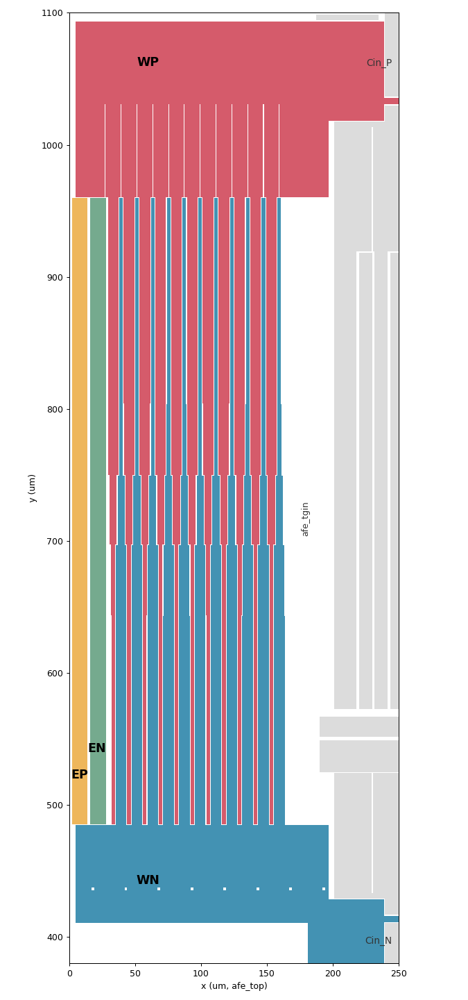

# AFE のレイアウトの直し：入力の信号経路の配線抵抗、DC 経路のスイッチの結合、INP と出力の結合（D6、2026-10-24）

重要ブロックの PEX（D6、`gf180_pex_20261023.md`）で見つかった AFE 側の 3 件を、レイアウトで直した記録。回路（ネットリスト）は変えていない。

- **入力の信号経路の配線抵抗**（「直し方」1〜4）：片側 76／119 Ω（P／N）が信号に直列に入り、AFE の雑音 19.1 nVrms、約 14.8 bit。目標は 3 区間（E＋W＋T）の合計で片側 0.35 Ω（両側 0.7 Ω、16.50 bit）。
- **DC 経路のスイッチの結合**（「直し方」5）：P 側の CIB2 と SCP の結合 0.57 fF（N 側 0.04 fF）で、AFE の出力に 39 mV p-p。目標は差 0.05 fF 以下、リップル 4 mV p-p 以下。
- **INP と ONI／OPI の結合**（上の 2 件を直したチップの PEX で見つかったもの。「INP と ONI／OPI の結合の直し」）：INP–ONI 617 fF、INP–OPI 526 fF（N 側の INN–OPI 7.4 fF、INN–ONI 0.5 fF）で、フルスケールの正弦波の HD2 −70.4 dBc、HD4 −82 dBc。目標は 4 つの結合をどれも 20 fF 以下、P と N の差 5 fF 以下、HD2〜HD5 −111 dBc 以下。

スクリプトは `gf180/tapeout/layout/` の `afecore_lay.py`（コア）、`afetg_lay.py`（入力チョッパ）、`afe_lay.py`（afe_top）、`gf180lay.py`（`mim_array()` の新しい引数。既定は前と同じ形で、C1／C2 は変わらない）、`mim_arrays_lay.py`（eeg_cin だけ新しい引数を使う）、`chip_lay.py`（`electrodes()`。チップはまだ組んでいない）。確かめるスクリプトは `gf180/tapeout/pex/`（`pex_rin.py --afe`、`pex.py afe_top`、`pex_afe.py`）。チップの組み立て、チップの DRC／LVS、穴埋め、precheck は、ADC 側の直し（`gf180_adc_d6_fix_20261023.md`）と合わせて別に 1 回だけ回す。

## 結論

- **配線抵抗は片側 約 0.6 Ω になった（P 0.62、N 0.65。前は 76／119 Ω）。目標の片側 0.35 Ω には届いていない。** E はチップのストラップ込み（PEX のセッションのチップでの測定から）、W は Cin の下の Metal3 の面を Tesselation で解いた値（SquareCounting では面の広がりの抵抗を見落とし、W が 0.14 Ω 低く出る）、T は SquareCounting。両側 約 1.27 Ω で、D6 の表から 16.48 bit。太い帯で入力の節点の容量が増え、AFE の雑音（寄生容量込み）が 4.701 → 4.781 nVrms になった分を合わせて 約 16.47 bit（D6 で「1〜4 で 16.47〜16.49 bit」とした見込みの下の端）。
- 残りの大半は、レイアウトの今の構成では下げ幅の小さいところにある：チョッパの中の WP／WN の Metal5 の縞（W の約半分）、入力対のゲートのポリ（T の約 4 割、素子の描き方で決まる）、チョッパの背骨と帯（E）。0.35 Ω にするには構成の変更が要る。D6 の判断で、今回はこの形を最終値とした（「判断と次の手段」）。
- **DC 経路のスイッチのゲート線との結合は P と N で同じになり、リップルは目標の内側に戻った。** SCP–CIB2、SCN–CIB2 とも 0.03 fF（前は 0.57／0.04 fF）。AFE の出力のリップルは 3.44 mV p-p（0 mV 入力、0.1〜1.5 ms。D6 は 39 mV、目標 4 mV 以下）。
- **INP と ONI／OPI の結合は 4 つとも 9 fF 以下、P と N の差は 2 fF 以下になった**（INP–ONI 8.29、INN–OPI 6.35、INP–OPI 1.18、INN–ONI 0.39 fF。前は 617／7.4／526／0.5 fF）。コアの出力の幹線をカスコードの上の帯に移して Metal4 で覆い、出力部の P 側を N 側の鏡映にした（「INP と ONI／OPI の結合の直し」）。HD2〜HD5 は −113.8／−117.2／−120.9／−137.7 dBc（既定の窓、仕様 −111 dBc 以下。直す前 HD2 −70.4 dBc）、利得は sch に戻った（過渡解析 290.60、sch 290.68）。リップルは 4.00 mV p-p（目標 4 mV、直す前 3.62 mV）で、クロックの線と出力の結合の P／N の差（前からあるもの）でとげが残る。
- ブロックはすべて DRC 違反なし、LVS 一致：eeg_afe_core、afe_tgin（188.3 × 480.1 µm、前と同じ大きさ）、eeg_cin（860.6 × 422.2 µm、636.03 pF、前と同じ）、afe_top（1100 × 1447 µm）。

### 配線抵抗（片側、P／N、typical）

`pex_rin.py --afe`（afe_top の lvsdb）。E はチップのストラップが付く所から（AFE だけで測るため、ストラップの分は入らない）。チップ（10/24、PEX のセッションの組み立て）では E がストラップ込みで 0.174／0.215 Ω（SquareCounting）：ストラップの分は P 0.035、N 0.092（ELN の Metal4 の継ぎが 13 µm × 2 本と細い。前の設計は 0.05）。

| 区間 | 10/23（D6） | 10/24、SquareCounting | 10/24、Tesselation | 主な所在（10/24） |
|---|---|---|---|---|
| E | 0.318／0.260 | 0.139／0.123 | 0.114／0.098 | 背骨の Metal5 0.061／0.055、帯の Metal4 0.037／0.029、レーンの Metal3 0.027／0.025 |
| W | 3.970／3.935 | 0.204／0.198 | 0.344／0.339（Cin の下の Metal3 の面だけ Tesselation） | Cin の下の Metal3 の面 0.128、チョッパの中の Metal5 の縞 0.093、Cin のバスと背骨 0.041、入口 0.05（P、面を Tesselation にした解） |
| T | 71.6／114.6 | 0.125／0.124 | — | 入力対のゲートのポリ 0.052／0.054、コアのゲートの帯 0.041／0.047、Cin のバスと配列 0.021／0.016 |
| 計 | 75.9／118.8 | 0.468／0.445 | 0.583／0.561（E、W を Tesselation） | チップのストラップ込み（E をチップの値から Tesselation の差 −0.025 で）：0.62／0.65 |

- `pex_afe.py` の `RIN_EXTRACTED` を SquareCounting の値（E にストラップの見込み 0.04／0.05 を足した値）に直した（その後 PEX のセッションがチップの E に差し替え中）。下の雑音はその値で解いた。W を Tesselation の値にすると、配線抵抗の雑音は 1.29 → 約 1.45 nVrms、pex＋配線抵抗は 4.965 → 約 5.0 nVrms になる見込み。

### 雑音（`pex_afe.py noise`、相 A と B で同じ）

| DUT | 雑音、チョッパ動作の推定 (nVrms) | 熱雑音 | 1/f | 利得（高調波和） |
|---|---|---|---|---|
| sch | 4.637 | 3.873 | 2.550 | 287.28 |
| sch＋配線抵抗（10/24） | 4.822 | 4.092 | 2.550 | 287.28 |
| pex（10/23、D6） | 4.701 | 3.922 | 2.590 | 284.99 |
| pex（10/24） | 4.781 | 3.991 | 2.632 | 287.34 |
| pex＋配線抵抗（10/24） | 4.965 | 4.209 | 2.632 | 287.34 |

- 配線抵抗の増分 √(4.822² − 4.637²) = 1.32 nVrms は、4kT·R（両側 1.0 Ω）の 1.29 nVrms とほぼ同じ（10/23 は 19.10 nVrms）。
- **寄生容量だけで 4.701 → 4.781 nVrms（+1.7 %）に増えた。** コアのゲートの帯を太くした分、入力の節点の容量が増えた：INP–INN 4.41 pF（D6 1.72）、INN–AVDD 4.12 pF、INN–AVSS 3.37 pF、コアの内部節点（CORE.SP など）と 1〜2.6 pF ずつ。INP と INN の帯が 0.6 µm で交互に並ぶ所と、尾部やブースタの上を通る INN の板が主と見る（INP–INN は差動の入力容量として片側に 2 倍で効く）。帯の間を広げる、INN の板を電源の行から離すなどで減らせるが、T の抵抗とのかね合いになる（まだ試していない）。
- 抽出の WP–INP、WN–INN が 21.3 pF ずつ（D6 は 1.2 pF）になった。Cin の下の Metal3 の面（WP）と上の板（INP）の間には下の板（Metal4、WP）があり、物理では遮られる。magic の MIM の重なりの扱い（上の板の層と Metal3 の間で、Metal4 を遮蔽と見ていない）による見かけの値と考える。Cin と並列なので、雑音と利得への影響は小さい（Cin が 3 % 増えたのと同じ向き）。
- 16.5 bit の総残差（D6 の表の内訳で、AFE を 4.781 × 1.01 にし、配線抵抗を両側 1.27 Ω にする）：約 6.03 nVrms、16.47 bit（目標 5.88 nVrms、16.50 bit）。
- **10/24 追記（チップを組んだあとの PEX の回し直し、`gf180_pex_20261023.md` の「直したあとの確認」）。** WP–INP、WN–INN の 21.3 pF は見かけの値だった（magic の MIM の扱い）。`pex.py` の MIM の補正を、上の板の下の導体への容量まで下の板へ移すように広げ、19.27 pF ずつを消した（残る 2.06 pF は上の板の継ぎと橋が面の上を通る分で、実在）。見かけの容量が Cin と並列に入っていた分だけ、上の表の pex は雑音が低く、利得が高く出ていた。補正後は pex 4.821 nVrms、pex＋配線抵抗 5.058 nVrms（チップで測った配線抵抗、片側 0.640／0.676 Ω：E は Metal3〜5、W は Cin の下の Metal3 の面を Tesselation、T は SquareCounting）、利得（高調波和）279.55（sch 287.28 から −2.7 %）、総残差 6.06〜6.08 nVrms（16.45〜16.46 bit）。下の INP と出力の結合を直した最終の形では、pex 4.811、pex＋配線抵抗 5.047 nVrms（片側 0.634／0.676 Ω）、総残差 6.05〜6.07 nVrms。利得の差の大半は、コアの上端で INP を Cin のバスへつなぐ Metal5 の下を ONI／OPI の Metal4 の線が通ること（INP–ONI 617 fF、INP–OPI 526 fF。N 側は 7.4／0.5 fF）による。**この結合で、フルスケールの正弦波の HD2 が −70 dBc、HD4 が −82 dBc になる**（仕様 −111 dBc 以下。抽出からこの結合だけを除くと HD2 −114 dBc）。ONI／OPI を INP の板の下から外して直す。

## 直した形

### T：コアのゲート配線（`afecore_lay.py`、直し方 1）

- INP／INN を自動配線（route.Router）から外した。配線器にはブースタのピンと、レーンのネットごとに最寄りのレーン 1 本だけを渡す（ほかのレーンはセルの Metal2 の帯でつながっている）。
- 各ストリップのゲートの帯（Metal2）に、空いた所ごとに via2＋via3 の積み上げ（`vias_fit`：ビアの列を 5 nm の格子に乗せる）。
- 列ごとに、電源のレーンの間を幅 約 11 µm（`STRAP_W`）の帯に分け、INP と INN を交互に置く（`strap_plan`）。帯は Metal4＋Metal5 で、via4 を 11.5 µm おき。
- INP の帯はコアの上端、INN は下端で、Metal5 の縁の棒（`EDGE_BAR` 4 µm）に束ねる。INN は尾部の上を Metal4／Metal3 の切れ端で通し、ブースタの上は Metal5 の板。
- 電源は尾部の上の Metal4 の行（高さ 6 µm、5 行）にまとめ、afe_top の Metal5 のレール（東端から）につなぐ（`PWR_W`、`N_PWR`、`RAIL_GROW`、`AVDD_RAIL_X0`）。

### T：Cin の上の板とコアのつなぎ（`gf180lay.py`、`mim_arrays_lay.py`、`afe_lay.py`、直し方 2）

- Cin（`mim_array(..., bridge=True, jumper_w=80.0)`）：各列の上の板の Metal5 を、行の間（2.6 µm）の上で Metal5 の橋でつなぎ、列を幅 約 100 µm の 1 本にした。下の板のバスの下をくぐる上の板の継ぎ（Metal4）を、列の西寄り 80 µm の幅にし、両端の via4 も 80 µm 幅。
- afe_top：コアの上端／下端の INP／INN の Metal5 の棒を、Cin の上の板のバスに、コアの幅全体で Metal5（下に Metal4 と via4）でつないだ。コアの東（出力部の上）でも、Cin のバスに沿って同じ Metal5 を出力部の MIM から 2 µm 離して延ばした（東の 2 列の電流が幅 5 µm のバスを 150 µm 流れていた：T で 約 0.02 Ω）。その下の Metal4 には、INP／INN の口と WP／WN の口の間で、ほかのネットを通さない（配線器の障害物。増幅器の入力にクロックの線を近づけない）。
- そのため、出力部の N 側の行（CFB_N、CPF_N、トリムの MIM、リセットと DC 経路のスイッチ）を 8.16 µm 上げた（y 425 → 433.16。配線器の行の 12 本分で、セルの Metal2 のピンが行に乗る位置を保つ）。

### W：チョッパから Cin の下の板へ（`afetg_lay.py`、`gf180lay.py`、`afe_lay.py`、直し方 3、4）

- **Cin の下に Metal3 の面**（`mim_array(..., feet=True, plane=True)`）：配列の下全体に下の板のネットの Metal3 の板（2 µm の穴を 25 µm おき、MSLOT3.1）。下の板のバスの下に、上の板の継ぎの間ごとに Metal4 の島（via4 でバスへ、via3 で面へ）。面は下の板とは直接つながらない（MIMTM.10：下の板へは via4 だけ）。
- **チョッパの縞を上下で太さを変えた**（`WP_TAPER`）。WP の電流は上の端へ、WN は下の端へ集まるので、各縞を電流の多い所で太くした。区間は下の PMOS セル、NMOS セルの 3 等分、上の PMOS セルで、WP の幅は下から 2.7、2.9、5.4、7.9、8.1 µm（WN は残りの 10.8 µm − WP）。幅は 2 本の縞の電力の和が最小になる比（区間ごとに WP と WN の電流の実効値の比）で、NMOS のフィンガが電流の 7 割を持つことから決めた。W で 片側 約 0.026 Ω 下がった（SquareCounting。チョッパの中では Tesselation と一致する）。
- **チョッパの下の WN の入口を Metal5 の 1 枚の面にした。** 前は、チョッパの下で WN の縞が 1 本ずつ広がり、幅 5 µm の Cin_N のバスだけで東へつながっていた（W の N 側だけ 0.2 Ω 多かった）。チョッパの下端から Cin_N のバスまで、西端からコアの手前まで 1 枚にし、via の列のない帯（クロックドライバのゲートの継ぎの上）に 2 µm の穴を並べた（MSLOT5.1）。W は N 側 0.435 → 0.225 Ω（SquareCounting）。
- **チョッパの上と下の入口**（`w_entry`）：WP はチョッパの上とコアの西上の隅を通って Cin_P のバスへ、Metal3／Metal4／Metal5 の板を 15 µm おきの via の列でつなぐ（`W_ROW`）。offdac_p を約 60 µm 上へ移して（`OD_P_Y` 1100）入口を空けた。チョッパの n ウェルのバイアス（AVDD の棒）は、入口の脇を通して offdac_p の AVDD の帯へ手でつないだ。WN はクロックドライバのゲートの継ぎの上（Metal3 は継ぎの間の 3 本）を通す。
- **Cin の配列の中**は、SquareCounting では 約 0.035 Ω（片側）、Metal3 の面を Tesselation にすると 約 0.17 Ω（面 0.128、バスと背骨 0.041）。面の電流は面の下端に集まる（「測り方について分かったこと」）。背骨は D6 の見込み（0.24 Ω）より 1 桁小さい：行の中では下の板そのもの（Metal4、約 100 µm 角）が背骨と並列に電流を通すため。

### E：チョッパの中（`afetg_lay.py`、直し方 4）

- EP／EN の Metal4 の帯を高さ 7 µm（前は 2 µm、44 µm おき）にし、21 µm おきに並べた（`band_rows`：W の積み上げの行 2.5 µm、EP の帯、W の行、EN の帯、間は 0.5 µm）。帯には各レーンに via3、自分の背骨の上に via4。E は 0.318／0.260 → 0.139／0.123 Ω。
- 背骨（Metal5 12 µm）は広げていない。チョッパの東はコアまで 8 µm しかなく、20 µm にする余地がない。

### DC 経路のスイッチ（`afe_lay.py` の `sc_wiring`、直し方 5）

- P 側と N 側で同じ手描き：中間節点 SCP／SCN は Metal2／Metal4 で MIM の上の板へ（配線器の立ち入り禁止の下）。ゲート CIA2／CIB2 と、信号のピン（ONI／OPI はゲートの西、INP／INN は東）を、ピンからまっすぐ上へ Metal3 の短い線（21 µm）で出し、配線器はその上端から先だけを引く。
- 抽出（最終形、`pex.py afe_top`）：SCP–CIB2 0.03 fF、SCN–CIB2 0.03 fF、SCN–CIA2 0.02 fF（SCP–CIA2 は 0.01 fF 未満）。前は SCP–CIB2 0.57 fF。
- 信号の節点との結合は P と N でまだ違う：SCP–ONI 0.80／SCN–OPI 0.58 fF、SCP–INP 0.10／SCN–INN 0.63 fF（N 側の行のすぐ下を INN の板が通る）、SCP–RST2 0.22 fF（RST2 は動作中は動かない）。信号のピンを手描きにしても ONI／OPI の差は変わらなかったので、原因はセルの外の配線器の線と見る。切り替わる線との結合ではないので、リップルへの効きは小さい（下の表）。
- 過渡解析（`pex_afe.py tran --variants pex --vin 0 --tstop 1.5e-3`、ブランキングの外の p-p）：

| DUT | リップル p-p（AFE 出力） | 増幅器の出力（OPI − ONI）の平均 |
|---|---|---|
| sch | 0.0001 mV | 0.002 mV |
| pex（10/23、D6） | 39 mV（定常） | −23 mV |
| pex（10/24、途中：CIB2 だけ直した形） | 4.07 mV（0.1〜1.5 ms。区間ごとには 3.55〜3.70） | −0.28 → +0.87 mV（ゆっくり動く） |
| pex（10/24、最終形） | 3.44 mV（区間ごとに 3.38〜3.42） | +1.7〜+1.9 mV |

- 残るリップルは、増幅器の出力の約 +1.8 mV のずれを出力チョッパが方形波にしたもの（±1.7 mV）。ずれは、上の結合の P／N の差（CIA2 の 0.02 fF、信号の節点の 0.2〜0.5 fF）が DC 経路（143 MΩ）で積もったものと見る。ADC の入力の余裕 40 mV に対して小さい。
- 10/24 の B7 の (d) で、DC 経路は片側 2 本の枝（相を入れ替えたもの）になり、8 個のスイッチのゲートは出力チョッパの相 CDA2／CDB2 に替わった（`gf180_electrode_dc_20261022.md` の「(d) を実装した結果」）。この節の CIA2／CIB2 の結合とリップルの値は、(d) の前の形のもの。

### チップの `electrodes()`（`chip_lay.py`、まだ流していない）

- チョッパの帯の行が変わったので（2 µm × 44 µm おき → 7 µm × 21 µm おき）、パッドのストラップのつなぎを直した。背骨の位置と長さは AFE の Metal5 から読み（ラベルの付く形は背骨の上の via の島のことがある）、帯の行は `afetg_lay.band_rows()` で求める。
- ELN のストラップは、EP の帯の間ごとに Metal4 の継ぎで EP の背骨の下をくぐり、そのまま EN の帯（EN の背骨の上に自分の via4 を持つ）に重なる。継ぎは EN の帯に 3 µm 以上重なるものだけ置く（パッド 1 つに 2 本）。
- AFE だけ（ストラップを描いたもの）で、継ぎが EN の帯だけに、ELP の Metal4 が EP の帯だけに触れること、AFE の Metal4 との間隔が 0.3 µm 以上あることを確かめ、その周りの切り出しの DRC で違反がない（切り口の違反を除く）ことを確かめた。チップの DRC／LVS は組み立てのときに確かめる。
- `pex_rin.py` の `AFE_STRAP`（背骨の上のストラップの y の帯）は変えていない。背骨の位置と幅は前と同じ。ELN は前も今も、ストラップの帯の高さで EN の背骨と帯に入る。

## INP と ONI／OPI の結合の直し（10/24、D6 の追加の依頼）

上の直しでチップを組み直した PEX（`gf180_pex_20261023.md` の「直したあとの確認」）で、INP–ONI 617 fF、INP–OPI 526 fF（N 側 7.4／0.5 fF）が見つかった。HD2 はこの結合の P／N の非対称に比例する（対称にすると −114.5 dBc）。相手はコアの出力の幹線（Metal4、カスコードの上）で、その上をコアの上端で INP を Cin のバスへつなぐ Metal5 が通っていた。依頼の条件：4 つの結合をどれも 20 fF 以下、P と N の差 5 fF 以下、HD2〜HD5 −111 dBc 以下（既定の窓 4 ms）、T を変えない、コアと afe_top の外形と端子を変えない（INP–AVSS の増加は受け入れる）。

### 結果

`pex.py afe_top`（MIM の補正込み、493f9753 の形）。「1 回目」は幹線を帯へ移して覆ったが、遮蔽に切れ目が残り、出力部はそのままだった形。

| 結合（fF） | D6（チップ） | 1 回目 | 最終 |
|---|---|---|---|
| INP–ONI | 617 | 37.64 | 8.29 |
| INN–OPI | 7.4 | 6.35 | 6.35 |
| 差（P − N） | 610 | 31.29 | 1.94 |
| INP–OPI | 526 | 12.77 | 1.18 |
| INN–ONI | 0.5 | 0.39 | 0.39 |
| 差（P − N） | 526 | 12.38 | 0.79 |

| DUT | 雑音（nVrms、相 A／B で同じ） | 熱雑音 | 1/f | 利得（高調波和） | 利得（過渡、±0.5 mV） |
|---|---|---|---|---|---|
| sch | 4.637 | 3.873 | 2.550 | 287.28 | 290.68（10/23） |
| pex（チップ、直す前） | 4.821 | | | 279.55 | 285.02 |
| pex（最終） | 4.811 | 4.013 | 2.654 | 284.95 | 290.60 |
| pex＋配線抵抗（最終） | 5.049 | 4.295 | 2.654 | 284.95 | |

- 歪み（`pex_afe.py sine --variants pex`、フルスケール 0.943 mV、2 kHz、既定の窓 2〜4 ms）：**HD2 −113.8、HD3 −117.2、HD4 −120.9、HD5 −137.7 dBc**（直す前 HD2 −70.4、HD4 −82 dBc。sch は同じ窓で HD2 −137.7 dBc）。HD2 は、PEX のセッションが INP と出力の結合を P／N で揃えて見た −114.5 dBc とほぼ同じで、残る非対称の大半はこの結合の外にある。短い窓（`--fft0 1e-3 --periods 2`）では −105.9／−109.3／−107.2／−110.4 dBc で、この窓の床（約 −105 dBc）に当たっている。
- リップル（`tran --variants pex --vin 0 --tstop 1.5e-3`、ブランキングの外の p-p）：4.00 mV（0.1〜1.5 ms。0.1 ms ごとの区間では 3.84〜3.94 mV。チップの直す前は 3.62 mV）。保持の間の出力は ±0.23 mV（増幅器の出力のずれ +0.6〜0.9 mV、前は +1.8 mV）で、p-p を決めているのは出力チョッパがつながった直後の 0.3 µs ほどのとげ（−2.5／+1.4 mV）：ブランキングの間の増幅器の出力の振れ（±20 mV）の残りと、クロックの線と出力の結合の P／N の差による。この結合は直す前と同じ値（配線器の線で、今回の直しでは変わっていない）：NCDB2–OUTN 13.2 fF と NCDB2–OUTP 5.0 fF、CIA2–OUTN 6.6 fF と CIA2–OUTP 0.2 fF（AFE の東端で、CIA2 の Metal3 が OUTN の線と 0.42 µm で 87 µm 並ぶ）など。抽出でクロックと出力の結合だけを P と N で等しくすると 3.06 mV（CIA2／CIB2 だけで 3.15、出力チョッパのクロックだけで 3.19 mV。0.1〜0.3 ms）。出力の遮蔽への容量を前の値まで減らすと 4.19 mV で、遮蔽はとげを増やしていない。直す前より 0.2〜0.4 mV 増えたのは、INP と出力の結合（帰還に足されていた分）がなくなって利得と応答が sch に戻ったためと見る。余裕を取るなら、次の手段は CIA2 と出力チョッパのクロックの線を出力の線から離すこと（配線器の障害物。リップル 約 3.1 mV の見込み）。
- 利得は sch に戻った（過渡で −0.03 %、高調波和で −0.8 % は 10/23 の pex 284.99 と同じ）。直す前の −2.7 % は、INP と出力の結合が帰還の容量 CFB に足されていた分。
- T（`pex_rin.py --afe`、SquareCounting）：0.119／0.124 Ω（前 0.126／0.124）。P 側が 7 mΩ 下がったのは、CFB_P の上の板の Metal5 を INP の埋めにつないだ所で、埋めを東の列の電流が流れる幅が広がったため。
- 入力の節点の容量：INP の合計 20.03 pF（前 19.96）、INP–AVSS 4.80 pF（前 5.20）、INP–AVDD 2.57 pF（前 1.99、P 列の遮蔽が VDD のため）。INN は変わらない（25.04 pF）。出力：ONI の合計 3.27 pF、OPI 2.93 pF、そのうち遮蔽へ ONI 1.28 pF（AVSS 0.67、AVDD 0.61）、OPI 0.95 pF。
- DRC 違反なし、LVS 一致：eeg_afe_core（712.6 × 588.4 µm、前と同じ）、afe_top（1100 × 1447 µm、端子は前と同じ）。

### 直した形

コア（`afecore_lay.py`）：

- 出力の幹線を、両列のカスコードの上の帯に置いた：OUTP は Metal2、OUTN は Metal3、幅 11 µm（`TRUNK_W`）、東端が端子。カスコードの OUT のレーンが帯へ上がる。帯を空けるため、N のブースタを 4 本のストリップにまとめて列 N を低くした（afec_nboost 174.2 × 86.8 → 293.1 × 51.0 µm）。
- 遮蔽（Metal4）を、帯の上（コアの上端の 0.4 µm 手前まで）と、カスコードのセルの全幅（セルの下端の 1 µm 上から、`SHIELD_OPEN`）に置いた。N 列の側と帯の西（P 列の 3 µm 手前まで）は VSS、P 列と帯の東は VDD。列の電源のレーンを OUTP の幹線の上端まで上げて via3 の列でつなぎ、その列が MSLOT4.1 の切れ目にもなる（切れ目の足りない所に 1 × 2 µm の穴を開ける関数 `mslot_openings` を置いたが、今の形では穴は要らなかった）。offdac_p の INP の継ぎが着くコアの西の上隅（`STUB_X` 26 µm の西）だけ、遮蔽を上端から EDGE_BAR＋0.4 µm 下げた。
- 配線器は、P 列のカスコードのゲートの帯へ、遮蔽の下のレーンの間を Metal3 で下から上がって入る。GPCN の 2 本の帯は GPCP の 2 本に挟まれるので、ピンを GPCP は帯の東半分、GPCN は西半分にした（同じ所だと、GPCP のピンの予約が GPCN の出口の列をふさぐ）。
- 1 回目の形（遮蔽を P 列のゲートの帯に沿って切り、セルの両端を出し、上端の 4 µm を空けた）では、コアの中で INP–ONI 16.5 fF、INP–OPI 8.8 fF が残った（下の切り出しの抽出で：OUTN の幹線の上の縁から上端の INP までの 4 µm で 7.4 fF（ONI だけ）、切れ目で 3.4／4.0 fF、セルの端で 0.8／1.2 fF）。

afe_top（`afe_lay.py`）：

- 出力部の P 側の MIM（CFB_P、CPF_P、トリムの MIM）を上下に裏返し、N 側の鏡映にした：TOP の板（INP、WP）が INP の埋めの側、BOT の板（ONI、OPI、トリムの節点）が CC の側。
- CFB_P の TOP の棒を INP の埋めへ Metal5 でつないだ。リセットと DC 経路のスイッチの INP のピンは、Metal3 でまっすぐ上の埋めへ上げた（`fill_drop`、`sc_wiring(..., fill)`）。P 側の INP は配線器から外し、出力部への INP の口（Cin の継ぎからの Metal4）もなくした。N 側は前と同じ。
- 1 回目の形では、出力部の P 側で INP–ONI 18.0 fF（N 側の INN–OPI 6.35 fF）：配線器の INP の線が P の行の下で ONI の線と 0.3 µm で並ぶ所 7.6 fF、CFB_P の ONI の棒（行の上端）と INP の埋め 約 1.6 fF、INP の口からの立ち上がり（コアの ONI の口の脇）1.3 fF。CFB の中（上の板の Metal5 と BOT の棒、1.6 µm）は P と N で同じ。

### 測り方

- 寄与の切り分けは、afe_top の GDS を窓で切り出し、lvsdb のネットの形ごとにラベルを付けて magic で抽出した（窓 1 つで数秒。窓の縁を横切る分は落ちる）。窓の和は全体の抽出と 1 割以内で合った（INP–ONI 34.5 対 37.6 fF）。さらに、窓の中で形を足し引きして（遮蔽を足す、あるネットの線を消す）、どの形がどれだけ効くかを見た。
- 浮いた遮蔽は結合を減らさず、かえって増やす（浮いた導体は両側を直列の容量でつなぐ。`pex.py` も浮いた節点を両側の結合へ畳み込む）。途中の形で遮蔽の切れ端が浮き、INP–ONI が 205 fF になった。遮蔽は必ず電源につなぐ。

## 測り方について分かったこと

- **SquareCounting と Tesselation。** 細い配線では一致し、広い面では大きく違う。
  - チョッパの E（帯と背骨）：Tesselation が 18〜20 % 低い（0.114／0.098 Ω、SquareCounting 0.139／0.123）。
  - チョッパの W だけ（afe_tgin の lvsdb、縞の端を束ねる）：87.6 対 88.0 mΩ で一致。
  - Cin だけ（下の板のバスの西端と Metal3 の面の西の縁から、32 枚の下の板へ）：Tesselation 195 対 SquareCounting 67 mΩ。差はほとんど Metal3 の面（137 対 13 mΩ）。
  - afe_top の W で Metal3 の面だけを三角分割（ほかは SquareCounting）：0.344／0.339 Ω（SquareCounting 0.204／0.198）。面の損失 0.128 Ω（P）は、面の下端の 約 50 µm（バスの下の足の近く）に集まる。面と下の板の背骨は、バスの下の足（列ごとに 1 か所）でしかつながらないので、電流は面の下端を東へ流れ、面の上の大部分はほとんど使われない。
  - 全層を三角分割すると、W の Metal5（縞、入口、バスが 1 つの形）や T の Metal5（上の板の via4 の海）が 1 万を超えるビアの節点を持ち、縮約した網が密になって 1 本で 40〜56 GB を使い、終わらなかった。ビアの列を 1 つにまとめる（merge 1 µm）と E では +9〜11 % 高く出て、W と T では網が特異になった。T は SquareCounting の値（D6 では T の両者の差は 2 % 以内）。
- **ポートの扱い。** klayout.pex のポリゴンのポートは 1 点（中心）として解かれる。入力対のゲートのチャネルをポートにすると、指のポリの分布抵抗が R/2 で入る（物理は片端から給電して R/3）。T のゲートのポリ（片側 0.052／0.054 Ω）は、物理ではその約 2/3（約 0.035 Ω）と見込む。
- **Cin の下の板は導体として働く。** 行の中では、背骨（Metal5 3 µm）の電流の大半が、via4 の列でつながった下の板の Metal4 を通る。背骨だけで見積もると 1 桁大きく出る。

## 判断と次の手段

**10/24 の判断（D6）：計画の範囲（＋offdac_p を上へ）で仕上げ、その値を最終値とした。** 片側 約 0.6 Ω（E、W を Tesselation で数えて P 0.62、N 0.65。SquareCounting だけなら 0.50／0.54）、両側 約 1.27 Ω、約 16.47 bit。 16.50 bit との差は 0.01 bit 程度で、AFE の雑音のコーナーの幅（4.17〜5.06 nVrms）より小さい。構成の変更にはそれぞれ副作用がある。

片側 0.35 Ω（チップのストラップ込み）には、いまの 0.62／0.65 Ω（E、W を Tesselation）から 0.27〜0.30 Ω 下げる要がある。下の案はその候補として残す。見込みは片側、手計算か今の抽出（面を Tesselation にした W の内訳）から。

| 案 | 下がる量（片側） | 変えるもの | 副作用 |
|---|---|---|---|
| (a) チョッパの WP 側と WN 側の TG を分ける（上半分に XIP_A／XIP_B、下半分に XIN_A／XIN_B）。各半分で縞を 1 つのネットの Metal5 にでき、縞が半分の長さになる | W 0.05〜0.07 | `afetg_lay.py`、`afe_lay.py` の入口 | 4 つの TG が同じストリップに並ぶ交互配置が崩れ、電荷注入とオフセットの P／N の対称が保てない。E の帯と背骨も組み直し |
| (b) Cin の単位の形を変え、行の間を 2.6 → 5 µm に広げて、背骨の下の島で Metal3 の面とつなぐ（D6 の 3(b)） | W 0.08〜0.10（面の電流が全部の行へ広がり、面の 0.128 と行の間の背骨がほぼ消える） | `mim_arrays_lay.py`（単位の寸法）、Cin のネットリスト | 単位の容量の式が変わり、ネットリストと LVS、雑音・利得の確かめ直し。配列の高さを保つには単位を横長にする |
| チョッパの間取りを変え、縞を短くする（例：チョッパを 2 つに分けて縦の長さを半分に、あるいは横長に） | W 0.05〜0.07 | AFE の配置（チョッパ、Cin、コアの位置） | AFE の組み直し。E の背骨と帯も変わる |
| (d) ELP と ELN のパッドを交互に並べる（いまは ELP が上の 2 つ、ELN が下の 2 つ）。各電極が背骨の上下の 2 か所から給電される | E 約 0.03 | パッドの割り当て、`chip_lay.py` | ゲート 1 で決めたパッドの割り当ての変更で、基板側にも関わる（ユーザーの判断） |
| (e) Cin の下に Metal2（と Metal1）の面を足す | W 約 0.06（Metal2：面の 0.128 が約半分） | `gf180lay.mim_array` | WP／WN の基板への容量が Metal2 で 約 +6 pF、Metal1 で 約 +10 pF。電極から見た入力インピーダンスが下がる |
| (e') (e) を面の下端（バスの近く、高さ 約 50 µm）だけにする | W 約 0.05 | `gf180lay.mim_array` | 容量は 約 +1.3 pF（(e) の約 1/5） |
| ELN のストラップの Metal4 の継ぎの下に Metal3 の継ぎ（ストラップの高さ全体、EN の帯へ via3） | E（N 側だけ）約 0.03 | `chip_lay.py` の `electrodes()` | チップの組み直し。10/24 の判断で今回は入れない（両側 1.04 → 1.01 Ω、ENOB で約 0.001 bit） |
| 入力対のゲートを両端から給電 | T 0.015〜0.025（モデル値。物理では 0.01〜0.015） | コアの素子の描き方（ゲートの帯を指の上下に） | コアの描き直し、入力対の容量が少し増える |
| チップの西で、ELP の背骨に Metal5 の帯を並べる（幅 14 µm、ELN のストラップの所は切る） | E（P 側だけ）約 0.02 | `chip_lay.py` の `electrodes()` | ELP の下を通るチップの配線との結合を見る。EN は内側の背骨なので同じことができない |
| チョッパの背骨を 12 → 15 µm | E 約 0.008 | `afetg_lay.py`（チョッパが 6 µm 広がる） | コアまでの隙間が 2 µm になる。AVSS のレールの西端とチョッパの基板のパッドを詰める |
| コアのゲートの帯（片側 0.041／0.047）を詰める：上端／下端の Metal5 の縁の棒の太さ、帯の幅 | T 約 0.01〜0.02 | `afecore_lay.py` | 入力の節点の容量がさらに増える（いまも INP–INN 4.4 pF） |

- (c)（offdac_p を約 60 µm 上へ移して WP の入口を空ける）は今回入れた。
- (a)、(b)、(d)、(e) を全部入れても片側 約 0.4 Ω で、効果は ENOB で約 0.01 bit。0.35 Ω にはさらにほかの案まで要る。
- いまの形のままなら、配線抵抗と入力の節点の容量の増分を合わせて 約 16.47 bit（総残差 約 6.03 nVrms、目標 5.88 nVrms）。

## 入力チョッパのクロックの結合をそろえた直し（10/25、電極の DC 電流）

信号がなくても電極に流れていた差動 ±36.6 nA（3 回目のチップ）を ±1.65 nA に下げた。原因、要求、測った値は `gf180_pex_20261023.md` の「電極に流れる DC 電流（10/25）」。形の変更（回路と afe_top の外形・端子は同じ）：

- `afetg_lay.py`：ストリップを 1 本おきに P／N の鏡像にした（S/D の並びとストラップの並びの EP↔EN、WP↔WN。上の PMOS セルは反対の偶奇から）。各ストリップの一番上のストラップが自分の CIA／NCIA のゲートピンと 0.64 µm で並ぶので、どのストリップも同じ並びでは WN だけがその隣にいた。WN の縞を最上段のストリップのゲートピンの上まで伸ばし、ゲートのレーンの並びを CIA CIB NCIB NCIA にした。
- `afe_lay.py`：ゲートの折り返しを Metal4 から Metal2 にして、WN の面の下からクロックドライバのすぐ上へ移した。レーンは WN のない通路を上る（WN の板の東の縁を西のレーンから 6 µm、東の板を 6.5 µm 離した）。チョッパの上の WP の Metal3／Metal4 の板と Metal5 の縞の広がりを、ブロックの上端の 0.6 µm 上から始めた。西の端子の列で OFPH と CHOP_EN を入れ替えた（OFPH の縁は新しい相の TG が閉じた直後なので、WN の面の下では 1 周期に C·VDD を運ぶ）。
- 旧い折り返しと、外した W の板の Metal3／Metal4 の跡は、配線器の障害物として残した。配線器の結果は 3 回目と同じ（GDS の XOR で、変わったのは上の場所と OFPH／CHOP_EN の西の列だけ）。afe_tgin と afe_top は DRC 違反なし、LVS 一致。雑音 4.811 nVrms（配線抵抗込み 5.048）、利得 297.89 は変わらない。
