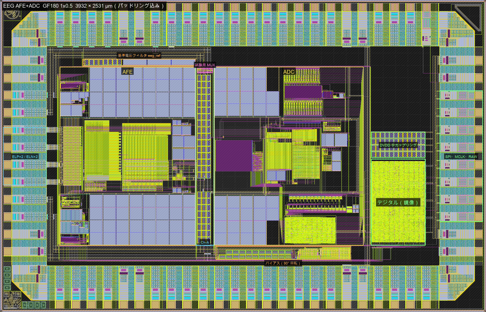
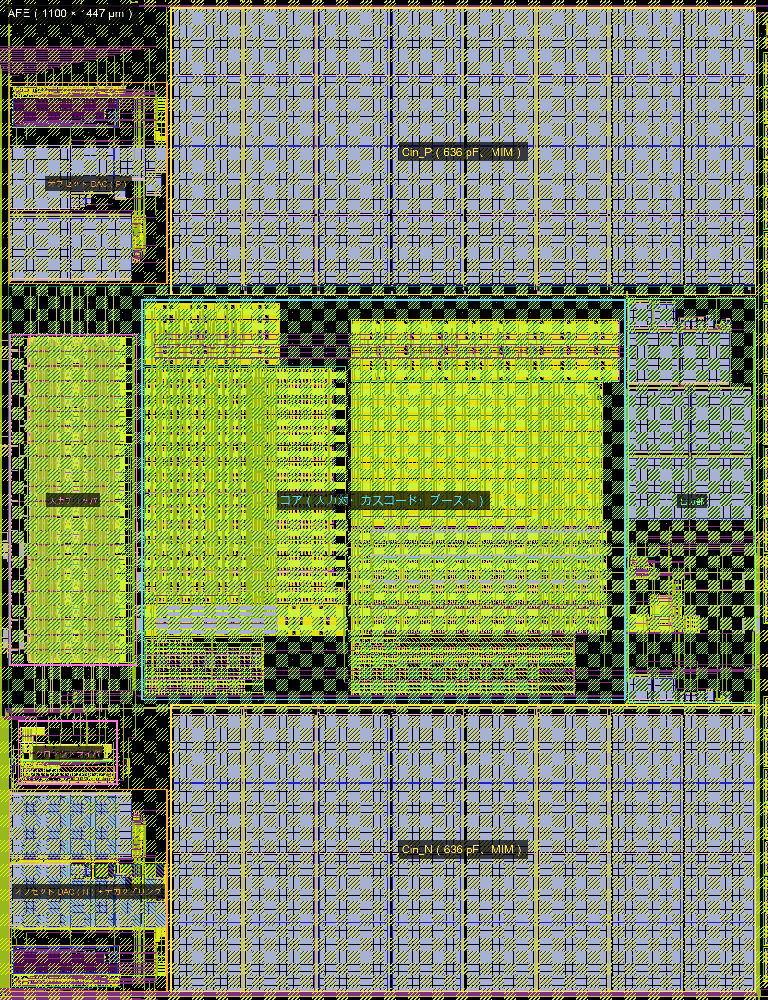
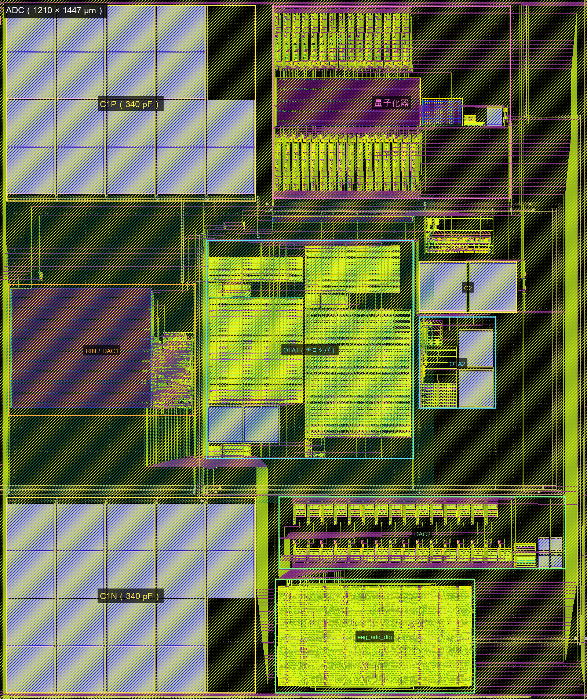

# GF180 チップの組み立て（E6／E7、2026-10-23）

パッドリングと各ブロック（AFE、ADC、デジタル、バイアス、基準電圧、試験用マルチプレクサ）を 1 つのチップにまとめる段階の記録。スクリプトは `gf180/tapeout/layout/chip_lay.py`、チップのコアのネットリストは `gf180/tapeout/chip/eeg_core.spice`（`make_core_netlist.py` で生成）。

座標はダイ座標（µm、ダイ 3932 × 2531 µm）。パッドのセルの内側の端は、西 x = 376、東 x = 3556、南 y = 376、北 y = 2155。

## パッドリングの変更（10/23）

使わない信号パッド 33 本（南 20 本、北 13 本）を、すべてアナログパッド（asig_5p0）に変えた。

- **理由**：双方向パッド（bi_24t）と入力パッド（in_c／in_s）は、使わなくても制御端子（A、OE、IE、CS、SL、PU、PD）を DVDD／DVSS につなぐ必要がある。浮いたままだと入力バッファが不定になる。アナログパッドには制御端子がなく、ESD ダイオードだけなので、つながなくてよい。
- **パッドの位置と数、電源パッドは変えていない**（README の制約のとおり）。変えたのはセルの種類だけ。
- **使うデジタルパッドは 9 本**：東辺の bidir[0..7]（下から MCLK、RESET_N、SCLK、CS_N、MOSI、MISO、DRDY_N、RAW_DATA）と北東の bidir[8]（RAW_CLK）。インスタンス名は、テンプレートの bidir[18..26] から bidir[0..8] に変わった。
- **作業コピーで変えたファイル**（`/Users/noah/Codings/ws_gf180/eeg_padring`、元は `*.bak_20261023`）
  - `src/slot_defines.svh`：NUM_BIDIR_PADS 9、NUM_ANALOG_PADS 45。
  - `src/chip_top.sv`：`clk_pad`／`rst_n_pad` を asig_5p0 にした。テンプレートのコアのクロックとリセットは bidir[0]／bidir[1] から取る（パッドリングの生成に使うだけ）。
  - `librelane/slots/slot_1x0p5.yaml`：南辺の未使用 = analog[14..31]、北辺の未使用 = analog[32..44]、東辺 = bidir[0..7]、北東 = bidir[8]。
  - `librelane/config.yaml`／`chip_top.sdc`：クロックを bidir_PAD[0]（MCLK）に、入力専用パッドの制約を外した。
  - `scripts/annotate_pads.py`：信号名の対応を新しい番号にした。
- **ラン**：`RUN_2026-10-23_13-27-25`（約 10 秒、警告は前と同じ種類＋クロックポートへの入力遅延の警告）。パッドの座標は前の版とすべて同じ。

## 配置

| ブロック | x | y | 備考 |
|---|---|---|---|
| AFE（afe_top） | 482 〜 1582 | 542 〜 1989 | 1100 × 1447 µm |
| Ch-A | 1582 〜 1732.4 | 542 〜 1989 | AVDD／AVSS の幹線、デカップリング、配線の通り道、試験用マルチプレクサ |
| ADC（adc_top） | 1732.4 〜 2942.4 | 542 〜 1989 | 1210 × 1447 µm |
| 分離帯 | 2942.4 〜 3002 | | DVSS の幹線、ADC とデジタルの間の信号 |
| デジタル（eeg_digital_top） | 3002 〜 3442 | 542 〜 1242 | x 軸で鏡像にして置く（制御出力が南辺に来る） |
| DVDD のデカップリング | 3003 〜 3441 | 1252 〜 1463 | |
| バイアス（eeg_bias） | 1745 〜 2837 | 425 〜 535 | 90° 回して南の帯に置く（端子は西、Ch-A 側） |
| 基準電圧のフィルタ（eeg_ref） | 669 〜 1582 | 1995 〜 2054 | 北の帯。出力は東端から Ch-A へ |
| 試験用マルチプレクサ（eeg_testmux） | 1595 〜 1721 | 1940 〜 1980 | Ch-A の上端 |

- **AFE と ADC の配線の格子をそろえた**：ADC は x = 1732.4 に置く（0.8 µm の格子に合わせるため）。チップの配線格子は x = 0.64 + 0.8 i、y = 0.04 + 0.68 j。
- **AFE の出力 OUTP／OUTN は ADC の入力 INP／INN と同じ行**（y 1411.72／1417.16）に移した。Ch-A をまっすぐ横切る。
- **ADC の第 2 積分器の出力 O2P／O2N** を ADC の上辺に出した（試験用マルチプレクサのコード 14／15 用）。eeg_adc の端子に O2P O2N を加え、シミュレーションの 2 つのデッキも直した。
- **バイアスを Ch-A から南の帯に移した**：Ch-A に AVDD／AVSS の幹線と、そこから AFE の電源レールへの Metal4 のジャンパを置くため。ジャンパの下にバイアスの Metal4 があると短絡するので、バイアスはジャンパのない南の帯へ移した（幅 110 µm にして 90° 回転）。

配置図（GDS をそのまま描き、ブロック名を書き足したもの）：

## 電源

**AVDD／AVSS**（Metal5、どれも幅 30 µm 未満の帯の組。スロット規則 MSLOT5.1）

- **6 本のパッドから Ch-A の幹線まで**
  - 西辺の上の AVDD／AVSS は西の隙間を上って北の帯へ、下の AVDD／AVSS は南の帯へ。
  - 北辺の AVDD／AVSS は、そのまま北の帯へ（AVDD は Metal4 で AVSS の帯の下をくぐる）。
  - 北と南の帯で、AVDD をブロック側、AVSS をその外側に置いた。
- **Ch-A の幹線**：AVDD（x 1592 〜 1646）と AVSS（x 1650 〜 1704）が、南の帯から北の帯まで通る。南の帯の AVDD は、AVSS の幹線の下を Metal4 でくぐる。
- **ブロックへ**
  - AFE の東端の電源レール（AVSS 2 本、AVDD 3 本）：AVDD はそのまま Metal5 で幹線へ。AVSS は Metal4 で AVDD の幹線の下をくぐる（電流密度 約 0.59 mA/µm、Metal4 の上限 0.67 mA/µm の内側）。
  - ADC の西端のレール：AVSS はそのまま、AVDD は Metal4 で AVSS の幹線の下をくぐる。
- **デカップリング**：Ch-A の幹線の下に MOS 容量（cap_nmos_03v3、28.6 × 44 µm）72 個、約 380 pF（AFE 200 pF と ADC 100 pF の分。`gf180_test_decap_20261022.md`）。10/24 の組み直し（2 回目）で 75 個、約 400 pF（下の節）。クロックドライバの AVDD_CLK 用（約 105 pF）は offdac_n の MIM の下。
- **パッドごとの電流の見込み**（AVDD。パッドの中 1.2 Ω、Metal5 0.06 Ω/□。AFE の電源レールまで）
  - 経路の抵抗：西辺の下（analog[7]）約 3.8 Ω。北辺（analog[12]）と西辺の上（analog[0]）は、Ch-A の北の入口までそれぞれ約 1.9 Ω と 3.5 Ω、そこから AFE まで共通で約 1.0 Ω。
  - 分担：北辺 約 41 %、西辺の下 約 37 %、西辺の上 約 22 %。どのパッドも全体の 49 % 以下に収まる。合計 28 mA のとき、北辺のパッドで約 11.5 mA（上限 13.6 mA）。
  - 電圧降下：AFE まで約 40 mV。AVSS も同じ程度なので、AFE にかかる電源は約 80 mV 下がる（約 2.5 %）。
  - AVSS も同じ形（西辺の下 analog[6]、西辺の上 analog[1]、北辺 analog[13]）。

**DVDD／DVSS**

- **DVSS の幹線**：分離帯（x 2950 〜 2992）。南辺と北辺の dvss パッド（dvss_pads[1]、[4]）から入れる。
- **DVDD の幹線**：東の隙間（x 3500 〜 3542）。東辺の dvdd パッド（dvdd_pads[2]、[3]）から入れる。
- **デジタルブロックの上に Metal5 の帯**を通した。DVSS は西の幹線へ、DVDD は東の幹線へ延ばし、どちらも相手の幹線を横切らない。
- ADC の DVDD レールと DVSS レールには、分離帯で Metal4 のジャンパを通した。
- DVDD のデカップリングは、デジタルブロックの上に MOS 容量 48 個、約 250 pF。

## 電極（ELP／ELN）のストラップ

- 各パッドから入力チョッパの Metal5 の背骨（EP が外側、EN が内側）へ、Metal5 と Metal4 を重ねて引く（間を via4 で並列につなぐ）。
- ELN は EP の背骨の下を Metal4 でくぐる。背骨の上には EP の Metal4 の横帯が 44 µm おきにあるので、その間の隙間（約 39 µm）を通す。
- 片側の抵抗の見込み：ELP 約 0.04 Ω、ELN 約 0.08 Ω（パッド 2 本が並列）。目標の 0.1 Ω 以下に収まる。

## デジタルパッドの制御端子

- 各端子をパッドのセルの外へ Metal2 で引き出し、配線ツールで信号または DVDD／DVSS につなぐ（1 = DVDD、0 = DVSS）。

| パッド | 信号 | OE | IE | CS | SL | PU | PD | A |
|---|---|---|---|---|---|---|---|---|
| MCLK | Y | 0 | 1 | 0 | 0 | 0 | 0 | 0 |
| RESET_N | Y | 0 | 1 | 1（シュミット） | 0 | 1 | 0 | 0 |
| SCLK | Y | 0 | 1 | 0 | 0 | 0 | 1 | 0 |
| CS_N | Y | 0 | 1 | 0 | 0 | 1 | 0 | 0 |
| MOSI | Y | 0 | 1 | 0 | 0 | 0 | 1 | 0 |
| MISO | A | MISO_OE | 0 | 0 | 1 | 0 | 0 | MISO |
| DRDY_N | A | 1 | 0 | 0 | 1 | 0 | 0 | DRDY_N |
| RAW_DATA | A | 1 | 0 | 0 | 1 | 0 | 0 | RAW_DATA |
| RAW_CLK | A | 1 | 0 | 0 | 1 | 0 | 0 | RAW_CLK |

- 出力はすべてスルーレートを落とした（SL = 1）。RAW_CLK は MCLK/4 = 8.192 MHz、SPI は 2 MHz 以下なので足りる（`gf180/tapeout/rtl/README.md`）。アナログへのスイッチングの雑音も減る。
- 入力のプルは、浮いたときに無効側に倒れる向きにした。RESET_N と CS_N はプルアップ、SCLK と MOSI はプルダウン、MCLK はなし。

## 検証の方針

- **DRC**：パッドリングを含むチップ全体を、PDK の KLayout デッキで確認する（アンテナと密度の確認は、穴埋めを入れたあと）。
- **LVS**：パッドリングを外したコア（最上位のセル名 eeg_core）を、`eeg_core.spice` と比べる。
  - コアの端子のラベルは、パッドへの接続点に置く。
  - p 基板でつながる AVSS、AVSS_CLK、DVSS は、1 つのネットとして扱う。
  - ADC の OTA1 の判別用ラベル（`ADC.OTA1.*`）は、チップの最上位にも置く。
- **パッドとの接続**（制御端子の固定、信号、アナログパッド）は、別に形で確かめる。
- **穴埋め（fill）**：全面の被覆率の下限が、COMP 25 %、Poly2 14 %、Metal1 〜 5 で各 30 %。PDK の `fill_all.rb` で入れる。
  - AFE の帯（Cin のバスの間：入力チョッパ、コア、出力部）と、ADC の第 1・第 2 段（C1 のバスの間）には PMNDMY をかけて、ポリとメタルの穴埋めを入れない。浮いたメタルを増幅器の入力や積分器の仮想接地の近くに置かないため。
  - NDMY（ダミー COMP を入れない印）は使えない。1 つの NDMY は 15,000 µm² 以下か、辺の 1 つが 80 µm 以下、NDMY どうしは 20 µm 以上離す決まり（DE.3、DE.4）がある。ダミー COMP はこれらの領域にも入る。
- **結果（10/23）**：直したあとのチップ全体（パッドリング込み、穴埋め前）で DRC 違反なし（アンテナ、密度、CUP を除く。テンプレートの DRC の設定と同じ）。パッドリングを外したコア（eeg_core）の LVS は `eeg_core.spice` と一致。配線は約 2 分、DRC 約 6 分、LVS 約 7 分。
- **穴埋めのあとの密度（10/23）**：COMP 49.8 %、Poly2 39.6 %、Metal1 40.4 %、Metal2 38.3 %、Metal3 45.4 %、Metal4 54.9 %、Metal5 61.6 %。どれも下限（25／14／30 %）を超え、COMP の上限 70 % にも収まる。
- **アンテナ（10/23）**：穴埋めのあとの全 DRC で、アンテナの違反が 16 個出た。比は「配線の側面の面積 ÷（ゲートの面積 ＋ 2 × ダイオードの面積）」で、上限は 400。デジタルブロックの出力の拡散（1.4 µm²）だけでは、2〜4 mm の配線には足りない。
  - チップの配線（Metal4、比 401〜748）：AFE のクロックドライバの入力 4 本、AFE_RST、オフセット DAC の 1 本、試験用マルチプレクサの選択の 1 本。→ デジタルからアナログへの長い制御線 37 本すべてに、デジタルブロックの南辺の下で N+ のダイオード（2.4 × 2.4 µm、P+ のタップの輪の中）をつないだ。
  - バイアスの中（Metal3、比 約 565）：選択入力 IB1 と BP1 の長い Metal3（ゲート 1.1 µm²）。→ デコーダの論理の行を、バイアスの上端（端子のすぐ下）へ移した。長い配線はデコーダの出力側になり、出力の拡散がつながる。
  - AFE の中（Metal3、比 約 1680）：出力部の DC 経路のスイッチのゲート CIA2／CIB2（0.14 µm²）へ東端の端子から下りる Metal3。→ スイッチのすぐ上に N+ のダイオードを置き、ゲートの端子から Metal2 でつないだ（タップはスイッチのガードリング）。
  - ダイオードには diode_mk を付けていない。LVS ではただの導体になり、ネットリストは変わらない。アンテナの確認では N+ の拡散として数えられる。
  - 直したあとの結果：配線と DRC（穴埋め前）は違反なし、コアの LVS は一致（13.5 分）。穴埋めのあとの全 DRC（アンテナと密度を含む全デッキ、CUP を除く）も違反なし（16 分）。
- **最初のチップ DRC（10/23）**：パッドリング単体は違反なし。違反はすべて組み立てで足した形から出た。
  - 電極のストラップの via4 が、入力チョッパの背骨の上の via4 と重なった（V4.1、V4.2a）。
  - チップの配線が Cin_N／C1N の MIM の下の板から 1.2 µm 以内に Metal4 を引いた（MIMTM.1）。
  - ELN のジャンパの切れ目にチョッパの EN の横帯が入った（M4.2a/b、MT.2b）。
  - NDMY が大きすぎた（DE.3）。
  - 深いモードの報告は、違反をそのセルの座標で返す。afe_tgin の中に出た違反も、原因はチップ側の形。
- **wafer.space の precheck**：下の節。

## wafer.space の precheck（10/23）

- **使ったもの**：公式のイメージ `ghcr.io/wafer-space/gf180mcu-precheck`（7/22 版、digest `sha256:e24fd396…`、revision 8d58ff75、PDK d658698b）。ネットワークを切って動かす。手順は `gf180/tapeout/chip/precheck/run_precheck.sh`。10/26 の pre_20261026 まではこの版で回した。GitHub の 10/20 版は PDK と LibreLane を上げたもので、PDK の更新で検査の中身も変わる（密度のデッキに DCF.1a が入るなど）。10/27 に 10/20 版と `--cob` で回し直した（いちばん下の節）。
  - ishi-kai の環境のイメージ（`gf180-ishi-analog:20261015`）は解析用で、precheck は入っていない。
- **入力**：穴埋めのあとの `chip_top_fill.gds`（最上位 chip_top、スロット 1x0p5、`--cob` なし）。約 45 分（Apple Silicon で amd64 のイメージを動かす）。
- **結果**：「Precheck successfully completed」。
  - 最上位セル、原点、寸法 3932 × 2531 µm、Via5／MetalTop なし、シールリング、ID の挿入（FFFFFFFF）：通過。
  - 密度、ゼロ面積の図形、アンテナ（13 デッキ）、KLayout DRC（162 デッキ）：違反なし。
  - CoB で実装する場合の確認も通る：パッドマスク（`mask_1x0p5.gds`）が一致し、ID 用の 4 つのセルもテンプレートの位置にある。
- **新しい PDK（792ef670）での確認**：precheck と同じくダミーのメタルとポリを本物の層に移して、CUP 以外の全デッキ：違反なし。
- **Magic DRC は結果になっていない**
  - precheck の Magic DRC は「違反なし」と出るが、Magic は途中で落ちている（segmentation fault、終了コード 139）。LibreLane は Magic を `check=False` で動かし、空の報告を 0 件と数える。precheck は Magic の違反では止めない設定（ERROR_ON_MAGIC_DRC が False）。
  - 落ちる場所：`drc listall why` の中の bpBinArrayBuild（DRCInteractionCheck → drcSubCheckPaint）。Magic 8.3 の 660 版（イメージ）でも 677 版（テンプレートの nix）でも落ち、スタックを 64 MB にしても落ちる。イメージの 660 版は、ダミー COMP を除いても落ちる（677 版は最後まで走る）。
  - 引き金：precheck が chip_top へ展開するダミー COMP（COMP_FILL）。AFE の Cin の上のダミー COMP を両方とも残すと落ちる。chip_top に COMP_FILL と afe_top だけを置いても落ちる。
  - 効かなかったこと：Cin を NDMY の区画で覆う（13,479 µm² × 21 個、間 20 µm。DE.3／DE.4 を満たす。間にダミー COMP が残る）、重なったインスタンス 16,433 個（PDK の穴埋めのタイルの重なりと IO セル）を除く、Cin や AFE の階層を平らにする。NDMY は 1 つ 15,000 µm² 未満（DE.3）なので、Cin の下からダミー COMP をなくすことはできない。
  - 代わりの確認（`gf180/tapeout/chip/precheck/magic_check.py`、テンプレートの nix の 677 版）：ダミー COMP を除いたチップ全体の Magic DRC は最後まで走る。出るのは 2 種類だけで、どちらも Magic の規則の書き方による。KLayout の対応する規則は通る。
    - MIMTM.2（MIM の下の板による via4 の囲み 0.4 µm）：設計規則では FuseTop から 1.06 µm 以内の via だけが対象。Magic は下の板の Metal4 の上のすべての via4 を対象にする。指摘 331 個は、どれも FuseTop から 1.25 µm 以上離れている。
    - PRES／HRES.7（抵抗の SAB とコンタクトの間 0.22 µm）：描いた形では、抵抗のポリの上のコンタクト 3,860 個がすべて SAB から 0.25 µm（KLayout の HRES.7／8／10 は通る）。Magic の指摘 3,874 個は、どれも幅 0.03 µm の重なりで、Magic が内部で作り直したコンタクトと SAB の形による。
  - ダミー COMP そのものの規則は、KLayout の dummy_comp と density のデッキで確かめていて違反なし。

## 組み直し（10/24、D6 の直しのあと）

重要ブロックの PEX（D6、`gf180_pex_20261023.md`）で見つかった 4 件をブロックのレイアウトで直したので、チップを組み直した。

- **入れた変更**
  - AFE（e4536b67、`gf180_afe_d6_fix_20261024.md`）：コアの入力対のゲート配線、Cin の上下の板の網と下の Metal3 の面、チョッパの帯、DC 経路のスイッチ。afe_top の外形（1100 × 1447 µm）と端子の位置は同じ。
  - ADC（252c62a4、`gf180_adc_d6_fix_20261023.md`）：DAC1 の素子（adc_rdac）、量子化器の入力と CLK。adc_top の外形と端子は同じ。
  - `chip_lay.py`：`electrodes()` だけ。チョッパの帯の行が変わった（2 µm × 44 µm おき → 7 µm × 21 µm おき）ので、ELP／ELN のストラップのつなぎを合わせた。
  - ネットリスト（`eeg_core.spice`、ブロックのネットリスト）は変わっていない。
- **結果**：配線 114 秒、チップ全体（パッドリング込み、穴埋め前）の DRC 違反なし、コアの LVS は `eeg_core.spice` と一致（合わせて 16 分）。穴埋めのあとの全 DRC（アンテナと密度を含む全デッキ、CUP を除く）も違反なし（21 分）。
- **穴埋めのあとの密度（10/24、precheck の density の段）**：COMP 49.7 %、Poly2 39.6 %、Metal1 40.4 %、Metal2 38.4 %、Metal3 53.6 %、Metal4 57.9 %、Metal5 65.0 %。10/23 から Metal3（Cin の下の面）、Metal4、Metal5（入力の信号経路の太い帯）が増えた。どれも下限を超え、密度のデッキで違反なし。
- **Magic DRC（ダミー COMP を除く、`magic_check.py pre_20261024`、9 分）**：最後まで走った。出たのは 10/23 と同じ 2 種類だけ（PRES／HRES.7 が 3,872 個、MIMTM.2 が 327 個。10/23 は 3,874 個と 331 個）。どちらも Magic の規則の書き方によるもので、KLayout の対応する規則は通る（上の節）。MIMTM.2 の 327 個は、どれも FuseTop から 1.25 µm 以上離れている（110 個が 1.25〜2 µm、217 個が 2〜5 µm。規則の対象は 1.06 µm 以内）。
- **wafer.space の precheck（10/24、`run_precheck.sh`、タグ pre_20261024）**：「Precheck successfully completed」。密度、ゼロ面積の図形、アンテナ、KLayout DRC はどれも 0 件、CoB のパッドマスクも一致。Magic DRC は 10/23 と同じく途中で落ちていて結果になっていない（上の Magic DRC が代わりの確認）。
- **このあと**：PEX の確認（D6）で、AFE の INP と ONI／OPI の結合によるフルスケールの HD2 −70 dBc が見つかった。AFE を直してから、組み立て、DRC／LVS、穴埋め、precheck をもう一度流した（下の節）。

## 組み直し（10/24、2 回目：AFE の INP と出力の結合を直したあと）

- **入れた変更**：AFE（7b30c762）のコアの出力の幹線の移動と遮蔽、出力部の P 側の鏡映。afe_top の外形と端子は同じ。`chip_lay.py` は変えていない。
- **コアの LVS が一度だけ不一致になった。** 原因はデカップリングの数：`decaps()` は、行の Metal2 の帯が電源の Metal4 の継ぎに当たる行を外して置くので、AFE の電源の継ぎの位置が変わって 1 行（3 個）多く置けた（AVDD–AVSS 72 → 75 個）。LVS では並列の MOS 容量が 1 つにまとまり、その面積（94,380 µm²、ネットリストは 90,604.8 µm²、ちょうど 75／72）だけが食い違い、AVDD／AVSS が不一致と出た。`make_core_netlist.py` の `N_DECAP_A` を 75 にして `eeg_core.spice` を作り直し（差はデカップリングの 3 行だけ）、LVS は一致。組み立ては同じ GDS を作る（sha256 が同じ）ので、DRC はその前の実行の結果（違反なし）がそのまま使える。
- **結果（2 回目）**：配線 105 秒、チップ全体（穴埋め前）の DRC 違反なし、コアの LVS 一致（ネットリストを作り直したあと）。穴埋め（14 秒）のあとの全 DRC（アンテナと密度を含む全デッキ、CUP を除く）も違反なし。
- **Magic DRC（2 回目、ダミー COMP を除く、`magic_check.py pre_20261024b`）**：最後まで走り、出たのは同じ 2 種類だけ（PRES／HRES.7 が 3,872 個、MIMTM.2 が 334 個）。MIMTM.2 はどれも FuseTop から 1.25 µm 以上（110 個が 1.25〜2 µm、224 個が 2〜5 µm）。
- **wafer.space の precheck（2 回目、タグ pre_20261024b）**：「Precheck successfully completed」。密度、ゼロ面積の図形、アンテナ、KLayout DRC はどれも 0 件、CoB のパッドマスクも一致。Magic DRC は同じく途中で落ちていて、上の `magic_check.py` が代わりの確認。穴埋めのあとの密度：COMP 49.7 %、Poly2 39.6 %、Metal1 40.4 %、Metal2 38.4 %、Metal3 53.8 %、Metal4 58.6 %、Metal5 65.0 %。この形（`chip_top_fill.gds`、sha256 2e0209b3…）は、下の 3 回目で置き換えた。

## 組み直し（10/24、3 回目：B7 の DC 経路の対称化と B4 のラッチの対称化のあと）

- **入れた変更**：AFE（0cb0fff4、B7 の (d)：DC 経路の片側に相を入れ替えた枝を足し、8 個のスイッチを出力チョッパの相 CDA2／CDB2 で動かす。回路も変わった）、量子化器（dbb2d657、B4：比較器のラッチを軸で鏡像に描き直し）。afe_top と adc_top の外形と端子は同じ。`chip_lay.py` は変えていない。
- **コアのネットリスト**：`make_core_netlist.py` で作り直したが、`eeg_core.spice` は変わらなかった（ブロックのネットリストを読み込む形なので、AFE の回路の変更はそのまま LVS に入る）。デカップリングは 75 個のまま。
- **結果**：チップ全体（穴埋め前）の DRC 違反なし、コアの LVS 一致。穴埋めのあとの全 DRC（アンテナと密度を含む全デッキ、CUP を除く）も違反なし。配線は 559 秒（ほかの解析と並べて回したため、前の 105〜114 秒より長い）。
- **Magic DRC（3 回目、ダミー COMP を除く、`magic_check.py pre_20261024c`）**：最後まで走り、出たのは同じ 2 種類だけ（PRES／HRES.7 が 3,872 個、MIMTM.2 が 340 個）。MIMTM.2 はどれも FuseTop から 1.25 µm 以上（114 個が 1.25〜2 µm、226 個が 2〜5 µm）。
- **wafer.space の precheck（3 回目、タグ pre_20261024c）**：「Precheck successfully completed」。密度、ゼロ面積の図形、アンテナ、KLayout DRC はどれも 0 件、CoB のパッドマスクも一致。Magic DRC は同じく途中で落ちていて、上の `magic_check.py` が代わりの確認。穴埋めのあとの密度：COMP 49.7 %、Poly2 39.6 %、Metal1 40.4 %、Metal2 38.4 %、Metal3 53.8 %、Metal4 58.6 %、Metal5 65.1 %。**この形（`chip_top_fill.gds`、sha256 40e021fd…）が、D6 の直しと B7、B4 の直しをすべて入れた今のチップ。**

## 組み直し（10/25、4 回目：電極の DC 電流の直しのあと）

- **入れた変更**：AFE の入力チョッパとその周り（`afetg_lay.py`、`afe_lay.py`。信号がなくても電極に流れていた差動 ±36.6 nA を ±1.65 nA に下げた。`gf180_pex_20261023.md` の「電極に流れる DC 電流（10/25）」）。afe_top の外形と端子の位置は同じで、変わったのは西の端子の列の OFPH と CHOP_EN の入れ替えだけ（チップの配線器は端子を名前で引くので `chip_lay.py` は変えていない）。回路は変えていないので、コアのネットリスト（`eeg_core.spice`）もそのまま。
- **結果**：配線 215 秒、チップ全体（穴埋め前）の DRC 違反なし、コアの LVS 一致（デカップリングは AVDD–AVSS 75 個のまま。合わせて 24 分）。穴埋め（14 秒）のあとの全 DRC（アンテナと密度を含む全デッキ、CUP を除く）も違反なし（18 分）。
- **Magic DRC（4 回目、ダミー COMP を除く、`magic_check.py pre_20261025`）**：最後まで走り、出たのは同じ 2 種類だけ（PRES／HRES.7 が 3,872 個、MIMTM.2 が 340 個で、3 回目と同じ。7 分）。MIMTM.2 はどれも FuseTop から 1.25 µm 以上（114 個が 1.25〜2 µm、226 個が 2〜5 µm）。
- **wafer.space の precheck（4 回目、タグ pre_20261025）**：「Precheck successfully completed」（40 分）。密度、ゼロ面積の図形、アンテナ、KLayout DRC はどれも 0 件、CoB のパッドマスクも一致。Magic DRC は同じく途中で落ちていて、上の `magic_check.py` が代わりの確認。穴埋めのあとの密度：COMP 49.7 %、Poly2 39.6 %、Metal1 40.4 %、Metal2 38.4 %、Metal3 53.8 %、Metal4 58.6 %、Metal5 65.0 %。**この形（`chip_top_fill.gds`、sha256 b0d0b34f…）が、D6 の直し、B7 と B4 の直し、電極の DC 電流の直しをすべて入れた今のチップ。**

## 組み直し（10/25、5 回目：WN の配線抵抗の直しのあと）

- **入れた変更**：AFE の `afe_lay.py`（`w_entry`）だけ。4 回目でゲートのレーンの通路から外した WN の Metal5 の面を、通路の上に戻した（Metal3／Metal4 は外したまま）。WN の W の配線抵抗が 0.570 → 0.354 Ω に戻った（`gf180_pex_20261023.md` の「WN の配線抵抗の直し（10/25 夜、5 回目のチップ）」）。afe_top の GDS で変わったのは Metal5 だけで、外形と端子は 4 回目と同じ。`chip_lay.py` とコアのネットリストは変えていない。
- **結果**：配線 124 秒（最上位の配線は 4 回目と同じ：`extract.py` の CSV が変わらない）、チップ全体（穴埋め前）の DRC 違反なし、コアの LVS 一致（デカップリングは AVDD–AVSS 75 個のまま。合わせて 19 分）。穴埋め（17 秒）のあとの全 DRC（アンテナと密度を含む全デッキ、CUP を除く）も違反なし（17 分）。密度は Metal5 が 65.07 → 65.09 % になっただけ。
- **Magic DRC（5 回目、ダミー COMP を除く、`magic_check.py pre_20261025b`）**：ダミー COMP を除いただけでは、Magic が同じ不具合（`bpBinArrayBuild`、`drc listall why` の DRCInteractionCheck の中、SIGBUS）で落ちるようになった（2 回試して同じ）。切り分け：ダミー COMP と Metal5、COMP と Metal1〜4、COMP と全部の金属の穴埋めを除いても落ち、**COMP と Poly2 の穴埋めを除くと最後まで走る**（金属の穴埋めは全部入れたまま）。4 回目との違いは afe_top の中の Metal5 だけ（穴埋めのセルの数は 4 回目と同じ）なので、Magic の不具合の出方が配置で変わったもの。`magic_check.py` は COMP と Poly2 の穴埋めを除く形にした（どちらも KLayout の dummy_comp と密度のデッキで見ている）。出たのは同じ 2 種類だけ（PRES／HRES.7 が 3,872 個、MIMTM.2 が 340 個で、4 回目と同じ。7 分）。MIMTM.2 はどれも FuseTop から 1.25 µm 以上（114 個が 1.25〜2 µm、226 個が 2〜5 µm）。
- **wafer.space の precheck（5 回目、タグ pre_20261025b）**：「Precheck successfully completed」（50 分、Magic の切り分けと並べて回した）。密度、ゼロ面積の図形、アンテナ、KLayout DRC はどれも 0 件、CoB のパッドマスクも一致。Magic DRC は同じく途中で落ちていて、上の `magic_check.py` が代わりの確認。穴埋めのあとの密度：COMP 49.7 %、Poly2 39.6 %、Metal1 40.4 %、Metal2 38.4 %、Metal3 53.8 %、Metal4 58.6 %、Metal5 65.05 %（4 回目 65.03 %）。**この形（`chip_top_fill.gds`、sha256 2b7926ee…）が、D6 の直し、B7 と B4 の直し、電極の DC 電流の直し、WN の配線抵抗の直しをすべて入れた今のチップ。**（OrbStack が止まっていて、1 回目は docker が動かず exit 125 で終わった。`orb start` で起こして流し直した。）

## 組み直し（10/26、6 回目：Magic DRC の直し）

10/23 から precheck の Magic DRC は毎回途中で落ちていて（precheck の「0 件」は結果なし）、ダミー COMP（5 回目は Poly2 も）を除いた `magic_check.py` で代わりに確かめていた。そこで出る 2 種類（PRES／HRES.7、MIMTM.2）も、ファウンドリの KLayout の規則は満たしているが Magic では残っていた。10/26 のユーザーの判断で、落ちる不具合も 2 種類の指摘も形で直し、穴埋めをすべて入れた Magic DRC を 0 件にした。

- **落ちる原因（Magic 8.3 の不具合）**
  - Magic はセルの中のインスタンスを区画（`bplane` の bin）に分けて持つ。探索で、大きすぎる要素を入れる区画（oversized bin）の要素が 10 個以上外れると、その区画をその場で分け直す（`bplane/bpEnum.h` の `bpEnumNextBin`）。そのとき基準にする範囲が `bpBinArea(ba, numBins)` で、配列の外（上）の区画になっている。区画と幅か高さがちょうど同じ要素は、分け直した区画では大きすぎない扱いになり、添字が負になって配列の前のメモリに書き込む。あとで別の区画を作り直すときに壊れたリストを読み、`bpBinArrayBuild` で落ちる（SIGBUS／SIGSEGV）。
  - precheck の `drc.tcl` は `gds readonly true` で読むので、flatglob のセル（COMP_FILL、POLY2_FILL とその中身）は、平らな形とインスタンスの両方で残る。COMP_FILL には穴埋めの配列が 5,986 個、POLY2_FILL には 5,288 個あり、その多くが幅か高さ 38,401 単位（192.005 µm）で、区画の寸法と同じになっていた。どの穴埋めのどの区画が当たるかは配置で変わるので、5 回目は Poly2 でも落ちるようになった。
  - 確かめ方：Magic 8.3.677 のソース（テンプレートの nix の store にあるもの）に、区画の添字の範囲の検査と、その場の分け直しの空打ち（範囲外になる要素の数え上げ）を足した版を、scratch でビルドした。5 回目のチップ（穴埋めすべて）で、範囲外の添字は COMP_FILL と POLY2_FILL だけで 10 回、危ない区画は 4 つだった。範囲外を大きすぎる側に入れて続ける版では、穴埋めすべての Magic DRC が最後まで走り（5 分 51 秒）、指摘は 2 種類（PRES／HRES.7 3,872、MIMTM.2 340）だけだった。
- **落ちないようにした直し**：`chip_lay.fill_tree()`（`--fill` の中）で、COMP_FILL と POLY2_FILL のインスタンスを、1 つのセルに 9 個以下の木に組み替える（Magic は 10 個未満のセルでは区画を作らない）。形は同じで、組み替えのセルは 819 個ずつ。
  - 中間のセルの名前は `<cell>$$G<n>` にして、precheck の flatglob（`*$$*`）で平らにされるようにした。元と同じく、ダミーの COMP とポリは chip_top の平らな形にもなる。名前が flatglob にかからない形では、COMP とポリの穴埋めが別のセルどうしの重なりになり、「Can't overlap those layers」が 76,168 件出た。
  - 金属の穴埋め（METAL1〜5_FILL）は組み替えていない。木にすると KLayout の階層の DRC が 1 時間を超えた。調べた版では、金属の穴埋めのセルもその場の分け直しをするが、範囲外になる要素はない（6 回目のチップで確かめた）。
- **2 種類の指摘の直し**
  - PRES／HRES.7：Magic はコンタクトが SAB からちょうど 0.22 µm の帯（抵抗の本体から 0.32〜0.54 µm）に入っていることを求める（`res_cont_space_min`／`res_cont_space_max`）。こちらはコンタクトが本体から 0.35〜0.57 µm で、外側の 0.03 µm が遠すぎだった。`fets.RES_CO` を 0.35 → 0.32 にした（KLayout の HRES.8 の 0.22 µm 以上をちょうど満たす）。試験で 0.30〜0.35 µm を格子のずれ 47 通りで振ると、Magic で通るのは 0.32 だけ、KLayout の HRES.8 で落ちるのは 0.30 と 0.31 だった。抵抗の頭のコンタクトと Metal1 のパッドが本体に 0.03 µm 寄る（`res_array`、`ladder_cell`）。
  - MIMTM.2：Magic は MIM の下の板につながる Metal4 の上のすべての Via4 に 0.4 µm の囲みを求める（DRM は FuseTop から 1.06 µm 以内の Via4 だけ）。`gf180lay.mim_array` は下の板のタブの東の縁から 0.35 µm 手前で Via4 を止めた（1 行 5 個 → 4 個、囲み 0.13 → 0.615 µm）。`analog.mim_cell` はタブを Via4 より左右 0.3 µm 広げ、Via4 をタブの上端から 0.5 µm 下げた（囲み 0.25／0.06 → 0.55／0.56 µm）。
  - 組み直したブロック：MIM 配列 3 つ（eeg_cin、eeg_c1、eeg_c2）、offdac_p／n、adc_rdac、OTA 2 つ、eeg_quantizer、eeg_dac2、eeg_bias、afe_top、adc_top。どれも DRC 違反なし、LVS 一致、外形と端子は同じ（Cin 636.026 pF、C1 340.299 pF で同じ）。GDS の XOR で変わったのは、抵抗の頭（コンタクト、Metal1、つながる Via1／Metal2 のパッド）と、MIM の Via4・タブ・その上の Metal5 だけで、配線は同じ。`extract.py` の CSV も変わらない。
  - 抽出での確かめ直し：AFE の雑音 4.811 nVrms（配線抵抗込み 5.050）、利得 297.89、リップル 2.37 mV p-p、電極の DC 電流 −1.55／+1.57 nA、DAC1 の偶成分 −0.00135／−0.00125 fC で、5 回目と同じ（`gf180_pex_20261023.md` の「Magic DRC の直しのあと（10/26、6 回目のチップ）」）。
- **結果**：配線 110 秒、チップ全体（穴埋め前）の DRC 違反なし、コアの LVS 一致（合わせて 14 分）。穴埋め（15 秒）のあとの全 DRC（アンテナと密度を含む全デッキ、CUP を除く）も違反なし（15 分）。
- **Magic DRC（6 回目、穴埋めすべて、`magic_check.py pre_20261026`）**：テンプレートの nix の Magic 8.3.677 で最後まで走り、違反 0 件（7 分）。調べた版でも、範囲外の添字と危ない区画は 0。
- **wafer.space の precheck（6 回目、タグ pre_20261026）**：「Precheck successfully completed」（43 分）。密度、ゼロ面積の図形、アンテナ、KLayout DRC は 0 件、CoB のパッドマスクも一致。**Magic DRC が初めて最後まで走り（`drc listall why` のあとの「DRC Checking DONE」まで、8 分 17 秒）、0 件**（`run_precheck.sh` の「did NOT finish」の警告も出ない）。穴埋めのあとの密度：COMP 49.73 %、Poly2 39.58 %、Metal1 40.41 %、Metal2 38.42 %、Metal3 53.80 %、Metal4 58.57 %、Metal5 65.05 %。**この形（`chip_top_fill.gds`、sha256 1343e9cc…）が、D6 の直し、B7 と B4 の直し、電極の DC 電流の直し、WN の配線抵抗の直し、Magic DRC の直しをすべて入れた今のチップ。**

## 最新の precheck と `--cob` での確認（10/27）

事務局の指定：今回は CoB（Chip on Board）で発注しているので、ローカルで回すときは `--cob` を付け、Half Height のスロット（`--slot 1x0p5`）にする（例：`python3 precheck.py --input chip_top.gds --slot 1x0p5 --cob`）。wafer.space は waiver を受け付けず、チェックを通った設計だけが製造される。pre_20261024〜pre_20261026 は `--cob` なしで、CoB の確認（パッドマスク、ID の 4 つのセルの位置）は precheck の外で別に確かめていた。そこで、提出する 6 回目の GDS を、指定どおりの引数と最新の precheck で回し直した。

- **`--cob` で増える検査**（`precheck.py`）
  - KLayout.CheckPadMask：CheckSize のあとに入る。スロットのパッドマスク（`mask_1x0p5.gds`）の Pad の開口が、すべて GDS にあること（中央などに足した開口はかまわない）。
  - GenerateID：ID の 4 つのセル（`gf180mcu_ws_ip__qrcode_id`、`__shuttle_id`、`__project_id`、`__marker`）が、それぞれ 1 つだけ、テンプレートの座標に置いてあること（assert）。
  - どちらも、落ちると precheck がそこで止まる。段の番号は 1 つずれる（ID を入れた形は `05-klayout-generateid/chip_top.gds`）。
- **使ったもの**：10/20 版のイメージ（digest `sha256:104d9ccb…`、revision 9b4e7dab、PDK open_pdks 792ef670、Magic 8.3.677、KLayout 0.30.12、LibreLane 3.1.0.dev3、10.1 GB）。
  - 7/22 版からの変更は Makefile の PDK と flake.lock（LibreLane、nix-eda 6.24.0 → 7.11.0 など）だけで、`precheck.py` とスクリプトは同じ。
  - PDK の更新で検査が変わる。密度のデッキに DCF.1a が入った（COMP もダミー COMP もない 20 µm 角以上の場所が違反。除くのは NDMY、RES_MK、Pad、IND_MK と、ウェルと DUALGATE の縁の帯）。CO.5a／b はコンタクトの囲みを NPLUS／PPLUS で見るようになり（緩くなる側）、DF.11 は接する辺の長さで見るようになった。Magic の tech ファイルも変わった（NPLUS／PPLUS の生成、compose、MIM の既定値、FILLOBS の読み込み）。
  - 手元の PDK（テンプレート。穴埋めと全 DRC に使っている）はもともと 792ef670 で、10/26 の穴埋めのあとの全 DRC でも、DCF.1a、新しい CO.5a／b、DF.11 は通っていた。
- **`run_precheck.sh` の変更**
  - `--cob` を付け、イメージを 10/20 版にした（`PRECHECK_IMAGE` で 7/22 版も回せる）。
  - precheck は Magic の違反では止まらない（ERROR_ON_MAGIC_DRC が False）。そこで、`metrics.json` の数がすべて 0 であることを確かめるようにした。
  - 段のフォルダは番号で決め打ちしない。
  - 別に回していたパッドマスクの確認は、precheck の中の段に置き換えた。
- **結果（タグ pre_20261027_cob、54 分）**：「Precheck successfully completed」。入力は `chip_top_fill.gds`（sha256 1343e9cc…）。
  - パッドマスク一致（「Success: Pad mask matches!」）。ID の 4 つのセルの位置の検査も通った（「Inserted ID: FFFFFFFF」。本番の ID は wafer.space が入れる）。
  - 密度（DCF.1a を含む）、ゼロ面積の図形、アンテナ（13 デッキ）、Magic DRC、KLayout DRC（162 デッキ、29 分）は、どれも 0 件。Magic DRC は 8.3.677 で、「DRC Checking DONE」まで走った（8 分 39 秒）。
  - LibreLane の `warning.log` と `error.log` は空。
  - 密度は 10/26 と同じ（COMP 49.73 %、Poly2 39.58 %、Metal1 40.41 %、Metal2 38.42 %、Metal3 53.80 %、Metal4 58.57 %、Metal5 65.05 %）。
- **Magic が GDS を読むときの警告**：「placed on top of itself. Ignoring the extra one.」が 16,175 件出る（10/26 も同じ数）。
  - 同じセルを同じ位置に 2 つ置いたインスタンスで、内訳は金属の穴埋め 15,270、COMP の穴埋め 376、ポリの穴埋め 358、ビアのセル（`*_CDNS_*`）171。
  - Magic は片方を無視するだけで、形は同じなので DRC の結果は変わらない。precheck の検査の対象でもない。それでも警告を残さないため、同じ日の夜に直した（次の節）。

## Magic の警告をなくす組み直し（10/27 夜）

警告を残さないため、Magic が GDS を読むときに出していた 3 種類を、GDS の側で消した。マスクの形は変えていない。

- **重なったインスタンス**（`chip_lay.drop_copies()`）：同じセル、同じ変換、同じ配列のインスタンスを 1 つだけ残す。出どころは 2 つ。
  - 穴埋め：KLayout 0.30.12 の `fill_region` は、PDK のずらした穴埋めの格子を直交する部分格子に分けるとき、一部を 3 回数える（`dbFillTool.cc`。Metal1〜4 は 999 の部分格子に 32 × 32 + 5 × 5 = 1,049 のずらし、Metal5 は 63 に 8 × 8 + 1、COMP と Poly2 は 24 に 5 × 5 + 1）。そのため、穴埋めのセルの 1.6〜4.3 % が 3 回入っていた。穴埋めのあとで消す。
  - パッドリング：PDK の IO ライブラリが、ビアのセルを 171 か所で重ねて置いている（moscap_routing 132、Bondpad_5LM 33、gf180mcu_fd_io__fill1／5／10 が 2 ずつ）。パッドリングを読み込んだあとで消す。
- **5 nm の格子から外れた頂点**（`chip_lay.snap_padring()`）：IO ライブラリの 5 つの図形の頂点が、5 nm の格子から 2 nm ずれていた（3LM_METAL_RAIL の Metal1 2 つと、POWER_RAIL_COR／_0／_1 の 45 度の角）。Magic は gf180mcuD の 5 nm の格子で読むので、「units rescaled」と「snapped to grid」を出していた。いちばん近い 5 nm に丸めた。動いたのは 2 つの箱の継ぎ目と、ほかの図形の中に入っている辺だけで、マスクは変わらない。
- **`RLIMIT_NOFILE`**：`run_precheck.sh` で docker のファイル数の上限を 1024 にした。
- **XOR**：r6（10/26）と比べて、穴埋め前は 45 層、穴埋め後は 52 層、すべて同じ。確かめとして、穴埋め前と穴埋め後の GDS どうしでは、穴埋めの層だけに差が出た。差の数は穴埋めの位置の数と同じで、どの穴埋めも 1 回だけになっている。
- **結果（タグ pre_20261027b、最新のイメージ、`--slot 1x0p5 --cob`、49 分）**：「Precheck successfully completed」。全項目 0 件、パッドマスク一致、ID の 4 つのセルの位置も通った。Magic DRC は最後まで走って 0 件。
  - 警告の数：重なったインスタンス 16,175 → 0、格子 2 → 0、`RLIMIT_NOFILE` 1 → 0。
  - 残るのは 2 種類で、どちらも GDS の中身とは関係しない。Magic が GDS を読むたびに出す「Calma reading is not undoable!」（1 行）と、公式の precheck の設定から LibreLane が出す `KLAYOUT_*_OPTIONS` の deprecated（3 行）。
  - LibreLane の `warning.log` と `error.log` は空。
- **密度**：COMP 48.27 %、Poly2 38.07 %、Metal1 39.89 %、Metal2 37.96 %、Metal3 53.36 %、Metal4 58.27 %、Metal5 64.88 %。
  - 10/26 の数字（COMP 49.73 % など）より下がった。形は XOR で同じなので、10/26 は重なった穴埋めのセルを重ねて数えていたとみられる（密度のデッキは `(comp + comp_dummy).area / chip_area`）。
  - どれも下限（COMP 25 %、Poly2 14 %、金属 30 %）と、COMP の上限 70 % の内。
- **GDS**：`chip_top_fill.gds` は sha256 74468c9f…（224,082,796 バイト）。形が同じなので、性能は r6 のまま。

## 組み直し（10/29、7 回目：ADC の C1・C2 を 1.25 倍）

R ff と MIM ff の組で ADC のループがリミットサイクルになる（`gf180_realistic_eval_20261028.md` の「ADC」）。10/29 のユーザーの判断で、C1 と C2 を 1.25 倍にした。

- 抵抗と DAC の電流は変えないので、ループのすべての時定数が 1.25 倍になり、RIN の雑音は変わらない。
- ADC の中と、その下の電源レールのほかは変えていない。

**ネットリスト（`gf180/tapeout/adc/eeg_adc.spice`）**

- C1（片側）：340.30 → 425.37 pF。主配列 eeg_c1a（98.33 µm 角 20 個、386.69 pF）と、残りの eeg_c1x（69.47 µm 角 4 個、38.68 pF）を並列にした。
- C2（片側）：19.53 → 24.41 pF。61.68 × 98.83 µm を 2 個。

**レイアウト**

- `mim_arrays_lay.py`
  - eeg_c1（97.23 µm 角 18 個）を、eeg_c1a（5 × 4）と eeg_c1x（4 × 1）に分けた。MIM 1 個は 10,000 µm² 以下（MIMTM.8b）なので、98.33 µm 角は上限に近い。
  - eeg_c2 は 2 個の長方形にした。そのため、`analog.mim_cell` に長さの引数を足した。
  - 3 つとも DRC 違反なし、LVS 一致。
- `adc_lay.py`
  - C1 の主配列は前と同じ西の端の上下に置く（C1P が上、C1N が鏡で下）。高さは 412.32 → 416.72 µm になった。
  - 残りの eeg_c1x は、上下の主配列のあいだの帯の西の端に、主配列とバスを向かい合わせて置いた。C1PX は C1P のすぐ下に鏡で置き、TOP のバスどうしが接する。C1NX は下の電源レールの上に置く。
  - 2 つの部分は Metal4 の渡り（両端に Via4）でつなぐ。O1N は接した I1P のバスの下、I1N と O1P は下のレールの下を通す。
  - C2N を x 975 → 1002.5 µm に動かした。2 段目のリセットの TG（XR2P／XR2N）は OTA2 の東（1050, 760／730）に移した。
  - 下の電源レール（AVSS、AVDD）を 4.4 µm 上げた。C1N が 4.4 µm 高くなり、O1P の Metal4 の取り出しが AVSS の Metal4 の橋に重なるため。
  - adc_top の外形（1210 × 1447 µm）と端子は同じ。DRC 違反なし、LVS 一致。
- `chip_lay.py`：`ADC_RAIL` を同じ 4.4 µm 上げた（Ch-A から ADC の下のレールへのストラップ）。

**結果**

- 配線 180 秒、チップ（穴埋め前）の DRC 違反なし、コアの LVS 一致。
- **XOR（10/27 夜の r6 と比べる、穴埋め前）**：45 層のうち 27 層は同じ。
  - 違う 18 層は、ADC の中（MIM の配列とマーカー、C1 の渡り、C2、2 段目のリセットの TG、下のレール）か、Ch-A の x 1640〜1732 µm、y 960〜1002 µm（ADC の下のレールへのストラップの Metal4、Via4、Metal5）だけにある。
  - AFE、デジタル、バイアス、基準、パッドリングは変わっていない（`gf180/tapeout/layout/runs/chip_top/xor_r6_r7_chip_top_20261029.log`）。
- 穴埋め（30 秒）のあとの全 DRC も違反なし（30 分）。
  - 重なった写しを消した数：COMP 440、Poly2 412、Metal1〜5 は 3,386／3,284／4,384／3,142／654。
  - COMP と Poly2 は、819 個ずつのセルの木に組み替えた。
- **wafer.space の precheck（タグ pre_20261029_r7）**：「Precheck successfully completed」。
  - 最新のイメージ（10/20 版。10/29 にも `latest` の digest が 104d9ccb… のままと確かめた）を、`--slot 1x0p5 --cob` で回した。
  - 2 時間 19 分かかった（ほかの計算と並べて回したため。Magic DRC 22 分、KLayout DRC 1 時間 25 分）。
  - 密度、ゼロ面積の図形、アンテナ、Magic DRC、KLayout DRC は、どれも 0 件。パッドマスク一致、ID の 4 つのセルの位置も通った。Magic DRC は「DRC Checking DONE」まで走った。
  - Magic の警告（重なり、格子、`RLIMIT_NOFILE`）は 0 件。LibreLane の `warning.log` と `error.log` は空。10/27 夜と同じ。
- **密度**：COMP 48.27 %、Poly2 38.07 %（どちらも同じ）。Metal1 39.68 %、Metal2 37.75 %、Metal3 53.16 %（どれも −0.2 ポイント）。Metal4 59.07 %（+0.80）、Metal5 65.77 %（+0.89）。MIM が広がった分、Metal4 と Metal5 が増えた。
- **GDS**：`chip_top_fill.gds` は sha256 b1a260ee…（224,076,194 バイト）。
  - gz を `gf180/tapeout/chip/gds/chip_top_fill_r7_20261029.gds.gz` に置いた（41,885,093 バイト、sha256 43b767ef…）。
  - この形（sha256 b1a260ee…）が C1・C2 の直しを入れたチップだったが、コアの DVDD がパッドにつながっていなかった（次の節）。
- 抽出と性能の確かめは別の文書にある。
  - ADC のループ（トランジスタの角とモンテカルロ）：`gf180_realistic_eval_20261028.md` の「ADC」。
  - チップの配線：`gf180/tapeout/pex/runs/chipnets_r7/README.md`。ADC への AVDD の抵抗は 1.454 Ω（r6 1.453 Ω）で、ほかは同じ。

## 組み直し（10/29、8 回目：コアの DVDD をパッドにつなぐ）

10/29 に、外部の確認（ユーザーから）で、コアの DVDD がどの DVDD パッドにもつながっていないと指摘を受けた。パッドリング込みのチップ全体で Metal1〜5／Via1〜4 のつながりを抽出し直し、そのとおりだと確かめた。

**何が起きていたか**

- 東の隙間の DVDD の幹線は 2 本ある（x 3500〜3520 µm と 3522〜3542 µm。MSLOT5.1 のため 30 µm 未満の 2 本に分けた）。
- 東の dvdd パッドからの帯と、デジタルパッドの High 固定の受け口は、東の 1 本にだけ届いていた（`chip_lay.dpower`）。
- デジタルブロックの DVDD の帯とデカップリングの DVDD の帯は、西の 1 本で止まっていた（`dpower`、`decaps`）。2 本をつなぐものはなかった。
  - 西の 1 本（ラベル DVDD）：デジタルブロック、ADC の DVDD、DVDD のデカップリング 48 個。パッドなし。
  - 東の 1 本：パッドリングの 18 ピン（DVDD のボンドパッドと High 固定のピン）。ブロックなし。
- このままでは、デジタルの制御回路、ADC のデジタル部、DVDD のデカップリングに電源が来ない。チップは動かない。10/23 の最初の組み立て（4c4441aa）から r7 まで、すべての版にあった。
- DVSS も 2 本に分けてあるが、dvss パッドからの帯が 2 本をまたぐので、1 つのネットになっている。AVDD／AVSS の幹線も、帯が 2 本をまたいでいる。

**見落とした理由**

- コアの LVS は、パッドリングを外して比べる。東の 1 本のネットには素子がないので、LVS は何も言わない。
- DRC と precheck は、つながりを見ない。
- D7 のチップの配線の抽出（`pex_chipnets.py`）は、アナログの電源と信号だけを対象にしていた。

**直し**

- デジタルブロックの DVDD の帯（5 本）と、デカップリングの DVDD の帯（4 行）を、DVDD の幹線の 2 本をまたいで東の端（x 3541 µm）まで伸ばした。
- 変わるのは東の隙間の Metal5 だけ。

**流れに足した確認（`chip_lay.connect_check()`）**

毎回の組み立てで、`chip_top.gds` を書いたあと、DRC の前に回る（`--connect` で単独でも回せる。20 秒ほど）。パッドリング込みのチップ全体で Metal1〜5／Via1〜4 のつながりを抽出し、次を確かめる。

- コアの LVS のポートのラベル（`port_labels()`：ELP、ELN、ATP、VCM、VREFP_PAD、VREFN_PAD、デジタルパッドの信号、AVDD、AVSS、DVDD、DVSS）と、電源の幹線の 2 本目の点が、パッドリングとブロックの両方に届くこと。
- 同じ名前の点は 1 つのネットに、違う名前の点は違うネットにあること。
- パッドリングだけに届いてブロックに届かないネットと、デカップリングに届いてパッドに届かないネットがないこと。

r7 の GDS で回すと、DVDD の 5 件（2 本が別のネット、パッドだけのネット、パッドのないデカップリング）を出し、ほかはすべて通った。

あとから、デジタルパッドの High／Low 固定 58 本（`tie_points()`）も、それぞれ DVDD／DVSS の幹線と同じネットにあることを確かめる点に足した。r7 では、Low 固定の 41 本は DVSS にあり、High 固定の 17 本はパッド側の DVDD（コアとは切れた側）にあった。

**チップ全体の LVS（パッドリング込み、`chip_lay.lvs_chip()`）**

`--lvs` で、コアの LVS の前に回る（`--lvs-chip` で単独でも回せる）。パッドリングを外さずに、チップ全体を回路図と比べる。

- **回路図**（`gf180/tapeout/chip/eeg_chip.spice`、`chip_lay.chip_netlist()` が書く）：chip_top は eeg_core の中身（`eeg_core.spice`。コアのネットは同じ名前）と、パッドリングのセル。
  - IO セル 76 個（asig_5p0 47、bi_24t 9、dvdd 8、dvss 8、コーナー 4）は、`pad_geometry.json` のとおりに置く。フィラー 682 個（fill10 414、fill1 226、fill5 22、fillnc 20）は、チップのパッドリングにある数だけ置く。
  - アナログパッドのネットは `ANALOG_PADS`（AVDD 3、AVSS 3、ELP 2、ELN 2、ATP、VCM、VREFP_PAD、VREFN_PAD）。使わない 33 個は、それぞれ自分のネット（NC_*）。
  - デジタルパッドは `DPAD` の信号のピンと High／Low 固定。出力のパッドの Y は使わない（NC_*_Y）。
  - IO セルの電源のピンは、DVDD と VDD がチップの DVDD、DVSS と VSS がチップの DVSS（テンプレートのパッドリングと同じ 1 つの電源。dvdd のセルが中で DVDD と VDD を、dvss のセルが DVSS と VSS をつなぐ）。
- **パッドセルのネットリスト**：PDK の `gf180mcu_fd_io.cdl`。デッキの読み込みが CDL の書き方（`$[model]`、`$W=`／`$L=`、`$SUB=`、`AREA=`／`PJ=`）を読まないので、`chip_lay.io_cdl()` で書き直した（`$SUB` は抵抗のバルクの節点に）。
  - IO セルを 1 種ずつ、PDK の GDS とこのネットリストで LVS にかけて確かめた。トランジスタ、ppolyf_u、cap_nmos_06v0、diode_pd2nw_06v0 は、すべて素子とネットが一致した。
  - 例外は n+／p 基板の ESD ダイオード（diode_nd2ps_06v0）5 行。デッキは ESD と SAB の下の n+ をダイオードとして抽出しない（`diode_extraction.lvs` の `diode_exclude`）。IO セルはそこに描いているので、オープンソースのデッキでは確かめられない。回路図から外し、その旨をネットリストに注記した。PDK の IO セルを変えずに使っている。
- **レイアウト**：`chip_top.gds` の写しで、トップより下のテキストをすべて消す（IO セルの中のラベルが、平らにした抽出でネットに名前を付けるため）。そのうえで、ボンドパッド 76 個にネットの名前、コアのポート（`port_labels()`）、ADC のヒント（`adc_hints()`）のラベルを置き、1 つのセルに平らにして OASIS で書く（`chip_top.oas`。2,640 万の図形が 4 MB）。
  - 平らにする理由：PDK のデッキは、平らのモードでも isosub（23/5、IO セルに描いてある）だけを階層のまま読む（KLayout の issue 2345 の回避）。階層を残すと、抽出したネットリストにセルが中身のない回路として残り、回路図に同じ名前がある 13 個（IO セル 9 種、eeg_bias、eeg_ref、eeg_testmux、eeg_digital_top）が align のあとも消えない。回路図の側のその 13 個も平らにならず、中身のない回路と比べて不一致になり、チップ全体を比べられない。さらに `flag_missing_ports` が、トップの回路が複数あるところで止まる。10/29 の最初の 2 回（r7 と r8、各 3 時間）はこれで止まった。コアには isosub がないので、コアの LVS では起きない。
  - 平らにした写しは、39 層すべての XOR が元と同じで、ラベル 96 個も同じ（r8 で確かめた）。
- **r7（コアの DVDD が切れた版）で確かめた**（平らにした写しで 2 時間 11 分。ほかの計算と並べたため）：比べ終わり、「Netlists don't match」。誤りは 13 件で、DVDD が 2 つ（パッドの側とコアの側）に分かれてどちらも回路図の DVDD と合わない 2 件と、それに引きずられた 11 件（AVSS と、デジタルブロックとパッドの間の信号 10 本：RESET_N、MOSI、SCLK、CS_N、DRDY_N、MISO、RAW_CLK、RAW_DATA、MCLK、MISO_OE）。ほかの警告は、デジタルと AFE の対称なネットの対応（ambiguous）だけ。この検査があれば、r0〜r7 の DVDD の切れを見つけられた。
- 基板が DVSS と AVSS_CLK を AVSS につなぐ（`TIES`）のは、コアの LVS と同じ。

**GDS だけからの電源の確認（`gf180/tapeout/pex/supply_check.py`）**

LVS は、私たちのコードが書いた回路図と比べる。レイアウトと回路図が同じ思い違いをしていれば、どちらの LVS も通ってしまう。そこで、私たちのネットリストとチップのラベルを使わない確認も足した（ユーザーの指摘、10/29）。毎回の組み立てで、`connect_check()` のあとに回る。

- パッド：DVDD／DVSS は IO セルの種類（`gf180mcu_fd_io__dvdd`／`__dvss`）、AVDD／AVSS は床面計画のパッドの表（`pad_coordinates.csv`）。ボンドパッドの位置は、テンプレートのパッドリングの出力（`pad_geometry.json`）。
- ネット：GDS の Metal1〜5／Via1〜4 のつながり。
- ブロックの電源ピン：デジタルのマクロは LEF（LibreLane）の VDD／VSS、ほかのブロックは自分の GDS のラベル（ブロックの LVS で確かめたもの）。
- 抵抗：チップの配線（chip_top に描いた形）の、パッドから各ブロックまで（`pex_chipnets.network()`、PDK のシート抵抗）。パッドセルとリングのレールは入らない。
- r7 では 3 件を出した：デジタルブロックの VDD（LEF の 11 本）、ADC のデジタル部の VDD（10 本）、ADC の DVDD が、どの電源のパッドにもつながらない。AVDD のパッドから ADC までの抵抗は 1.457 Ω で、`pex_chipnets.py`（`chipnets_r7`）の 1.454 Ω と合う。

**結果（8 回目）**

- 配線 407 秒。パッドリング込みのつながりの確認、DRC、コアの LVS は、どれも問題なし（DRC 違反なし、LVS 一致）。
- GDS だけからの電源の確認：問題なし。DVDD はパッドからデジタルブロックまで 0.19 Ω、デカップリングまで 0.67 Ω、ADC まで 4.32 Ω。DVSS は 1.12 Ω、1.50 Ω、1.41 Ω。
- **XOR（r7 と比べる、穴埋め前）**：45 層のうち 44 層が同じ。違うのは Metal5 の 9 個（合わせて 144 µm²）だけで、どれも DVDD の 2 本の間のすき間（x 3520〜3522 µm）の、帯がまたぐところ（デジタルブロックの帯 5 本、デカップリングの帯 4 行）。アナログの形は同じなので、r7 の抽出とシミュレーションはそのまま r8 にあてはまる。
- 穴埋め（88 秒）のあとの全 DRC も違反なし。`chip_top_fill.gds` は sha256 f3bd2538…。
- **wafer.space の precheck（タグ pre_20261029_r8）**：「Precheck successfully completed」。
  - 最新のイメージ（10/20 版、digest 104d9ccb…）を、`--slot 1x0p5 --cob` で回した。2 時間 31 分（ほかの計算と並べて回したため。アンテナ 51 分、Magic DRC 38 分、KLayout DRC 52 分）。
  - 密度、ゼロ面積の図形、アンテナ、Magic DRC、KLayout DRC は、どれも 0 件。パッドマスク一致、ID の 4 つのセルの位置も通った。Magic DRC は「DRC Checking DONE」まで走った。
  - LibreLane の `warning.log` と `error.log` は空。Magic の出力は、GDS を読むときの決まった一文（Calma reading is not undoable）だけで、r7 と同じ。
- **GDS**：gz を `gf180/tapeout/chip/gds/chip_top_fill_r8_20261029.gds.gz` に置いた（41,886,078 バイト、sha256 2c5ea71e…。展開すると f3bd2538… に戻る）。

**別の道具でのチップ全体の LVS（Magic の抽出と Netgen、10/29）**

KLayout の LVS とは別の道具で、同じチップを比べた。Magic（8.3.677、gf180mcuD の tech）で平らに抽出し（73 分）、Netgen（1.5.323、PDK の `gf180mcuD_setup.tcl`）で比べた（2 分）。`chip_lay.py --netgen`（`netgen_chip()`、Magic と Netgen を回すのは `gf180lay.netgen_lvs()`）で回せる。時間がかかるので、毎回の組み立てには入れていない。

- PDK の ESD のトランジスタ（`*_dss`）は、ドレインとソースの SAB の長さ（`d_sab`、`s_sab`）を持つ。Magic はこれを抽出しないので、Netgen では比べない（`chip_lay.NETGEN_SETUP`）。bi_24t を 1 つだけ比べたときの「property errors」はこれだけだった。

- **回路図**：`eeg_chip.spice` を Netgen の形（X の素子のまま）にしたものと、PDK の IO セルの SPICE（`gf180mcu_fd_io.spice`、ESD ダイオードも全部）。
- **レイアウト**：KLayout の LVS と同じ写し（トップより下のテキストを消し、ボンドパッドとコアのポートにラベル）。ADC のヒントは KLayout のためのものなので置かない。
- 先に確かめたこと：IO セル 1 種ずつ（asig_5p0、dvdd、dvss、bi_24t、fill10）は、ESD ダイオードも含めて PDK の SPICE と一致した。KLayout のデッキが抽出しない n+／p 基板の ESD ダイオードを、Magic は抽出する。adc_top 単体も、平らにして一致した（対称 1,781 組）。
- **結果**：素子 90,780 と 90,779、ネット 51,212 と 51,211。違いは角のセル（PDK の `gf180mcu_fd_io__cor`）のデカップリングだけで、ほかは、コア、パッドとの境目、IO セル（ESD ダイオードを含む）まですべて一致した。
  - 33 個の使わないパッドは互いに区別できない（どれも同じ形）ので、Netgen は端子の名前の対応を決められない。比べる端子を両方にある 18 個（使うパッド）にして回し直しても、違いは同じだった。
- **角のセルの違いは Magic の読み方によるもので、レイアウトの誤りではない**（10/29 に確かめた）。
  - 角のセルには MOS 容量のデカップリングが 70 個あり、PDK のネットリストではすべて DVDD と DVSS の間にある。Magic の抽出では、4 つの角のどれでも、そのうち 22 個（`moscap_corner` 2 つの 16 個と `moscap_corner_2` の 6 個）の拡散側が、DVSS から切れた別の節点になる。Netgen は、つながる先のない端子を持つ素子どうしを並列とみなしてまとめるので（`Merged 7 parallel devices`）、8 組が 1 つに見えていた。初めに「南東の角の 1 つ」と書いたのは、この見え方を読み違えたもの。
  - この 22 個から DVSS へは、`moscap_routing` のセルの p+ の拡散（COMP 3,361 µm²）を通る。その p+ の注入（PPLUS）は、セル自身には 128 µm² しかなく、残りはほかのセルに描いてある。Magic は層の読み替えをセルごとにするので、`moscap_routing` の中ではこの COMP を拡散にしない（このセルの抽出の節点は Metal1 の 56 個だけ）。上のセルが書く「つながっている」という記録（merge）が、ない節点を指すことになり、ext2spice は `no such node` を角ごとに 9 回出して、そのつながりを捨てる。
  - KLayout で角のセルを平らにして、拡散、コンタクト、金属のつながりを見ると（n+ と p+ は別の層にし、コンタクトでだけつなぐ）、70 個のどれも、ゲートが DVDD、拡散側が DVSS になる。前に書いた「突き合わせの接合の扱いの違い」は誤りだった（その確かめ方は、`moscap_corner` に直接描いた p+ のタップだけを見ていて、容量の n+ を見ていなかった）。
  - PDK の GDS の角のセルを 1 つだけ Magic にかけても、同じ違いになる（PDK が DVSS のラベルを付けた金属が切れて、`DVSS_uq5` という別の名前になる）。下のセルを読み込むときに平らにする（`gds flatglob`）と、`no such node` は 0 回で、70 個がすべて DVDD と DVSS の間になり、PDK の SPICE と一致した（Circuits match uniquely）。
  - `netgen_chip()` は、IO セルの中のセルをすべて（チップでは 863 種）、読み込むときに平らにする。`gds flatglob *` はトップのセルまで平らにして消してしまうので、名前を 1 つずつ渡す。平らにしない前の結果は `runs/chip_top/lvs_netgen_nonflat_20261029/` に残した。
- **平らにして回し直した結果（r8、10/30）**：Magic の `no such node` は 0 件（前は 338 件）。素子 90,779 と 90,779、ネット 51,211 と 51,211 で、Netgen は「Netlists match with 3153 symmetries」、「Final result: Circuits match uniquely.」。角のセルのデカップリング（cap_nmos_06v0）も両方 25 組にまとまる。
  - 最初は、ネットリストは一致したのに「Top level cell failed pin matching」になった。レイアウトの写しには、コアの側の名前（デジタルパッドの信号 10 本の、パッドとコアの境目のラベル）を置いていて、Magic はトップのセルのラベルをすべてチップの端子にする。回路図では、これらは中の節点で、チップの端子はボンドパッドのネット（51 個）。`gf180lay.netgen_compare()` で、レイアウトの端子を回路図の端子の名前に絞るようにした（ラベルは中のネットの名前として残る）。抽出はそのままで、Netgen だけを回し直した（82 分）。
  - 結果は `runs/chip_top/r8_20261029/lvs_netgen/`（最初の結果は `netgen_first.out`）。抽出は 5 時間 29 分（ほかの計算と並べたため、Magic の CPU は 2〜4 割）。r9 も同じ形で回している。

## 組み直し（10/29、9 回目：AFE の AVSS の渡りに Metal3）

AFE の AVSS の電流（AFE_IBIAS 3 で 21.5 mA、モンテカルロで 21.6 ± 1.1 mA）は、AFE の東の 2 本のレールから Ch-A の AVSS の幹線へ、AVDD の幹線の下を Metal4 の渡り 2 本（高さ 22.92 µm と 13.96 µm、長さ 73 µm）で渡る。AFE の AVSS の出口はここだけで、PDK の電流密度の上限（Metal1〜4 で 0.67 mA/µm）の 87 %、+3σ で 101 % だった（`gf180_verification_coverage_20261029.md` の穴 4）。10/29 のユーザーの判断で、Metal3 を足した。

**直し（`chip_lay.avss_metal3()`）**

- 渡りと同じ大きさの Metal3 を Metal4 の下に置き、両端の Via4 の配列と同じ場所に Via3 の配列を足した（西 296／176 個、東 370／220 個）。
- 渡りの下の Metal3 は、配線器が AFE の東の縁に沿って縦に引いた 10 本が横切っていた。南の帯から AFE の東の端子へ行くチョッパのクロックと制御（RST2、CIA2、CIB2、NCDA2、CDB2、NCDB2、CPF2、CPF3）と、バイアス（VBN、VBCM。試験用マルチプレクサまで北へ行く）。
  - 配線器は Metal3 を縦、Metal4 を横にしか使わない。Metal3 を配線の前に置くと、この 10 本は渡りを避けて、AVDD と AVSS の幹線の下を東へ大きく回る。
  - そこで、配線のあとで、10 本の渡りの下の部分（y 1030.9〜1073.5 µm、42.6 µm）だけを、同じ列のまま Metal2 に下ろした（両端に Via2）。ほかの配線は 8 回目と同じ。10 本は、上を AVSS の Metal3 と Metal4 で覆われる。
  - Via2 の 2 個（4.5 Ω ずつ）が足される。クロックは AFE のゲートを、VBN と VBCM は電流の流れない節点を駆動するので、影響はない。

**結果**

- 電流密度（GDS から測った。Metal3 と Metal4 のシート抵抗は同じ 0.090 Ω/□ で、Metal3 の側は両端の Via3 が直列に入る）：typical で Metal4 46 %、Metal3 42 %。+3σ で 53 %、48 %。Via3 は 1 個あたり上限の 12〜14 %、Via4 は 25〜30 %（8 回目と同じ）。Metal3 は 2 本の渡りの全体を覆う。
- GDS だけからの電源の確認（`supply_check.py`）：問題なし。AFE の AVSS はパッドから 1.215 Ω（8 回目 1.290）。ほかの値とパッドの電流は 8 回目と同じ。
- `supply_check.main()` が GDS の道を引数で受けるようにした。8 回目は、この確認を流れに足す前に組んだので、流れから呼ばれたのは 9 回目が初めてだった（引数を受けずに止まった）。
- 組み立て（`chip_lay.py --drc --lvs`、配線 273 秒）：パッドリング込みのつながりの確認、GDS だけからの電源の確認、DRC は、どれも問題なし（DRC 違反なし）。
- **チップ全体の LVS（パッドリング込み、KLayout）：一致**（「Congratulations! Netlists match.」、平らにした写しで 89 分）。チップ全体で一致したのは、これが初めて。誤りは 0 件。警告は、対称なネットの対応（ambiguous）8,681 件だけで、そのうち 8,655 件はコアの LVS と同じもの（デジタル 5,425、ADC のデジタル部 3,226、AFE 4）、残りの 26 件は PDK の IO セルの ESD のクランプの中の節点（dvdd／dvss のセルの N6、角のセルの N7／N27、bi_24t の 1 つの N172／N173）。
- コアの LVS：一致。
- XOR（8 回目と比べる、穴埋め前）：45 層のうち 41 層が同じ。違うのは Metal3（渡りの下の 2 枚と、10 本の線の切れ目）、Via3（両端の配列 1,062 個）、Metal2（10 本の橋、0.38 × 42.6 µm）、Via2（20 個）だけで、どれも渡りのまわり（x 1583〜1656 µm、y 1030.9〜1073.5 µm）にある（`gf180/tapeout/layout/runs/chip_top/xor_r8_r9_chip_top_20261029.log`）。
- チップの配線の抽出（`EEG_PEX_REV=r9`、`gf180/tapeout/pex/runs/chipnets_r9/README.md`）：AVSS のパッドから AFE まで 1.215 Ω（r7 1.290）。VBN と VBCM は試験用マルチプレクサへの枝だけ +9.0 Ω（Via2 の 2 個。バイアス回路から AFE への枝は同じ）。ほかはすべて r7 と同じ。動作点（AFE はリセット、ADC の電流 4.7 mA）では、AFE の AVSS がパッドから 36.7 mV（r7 37.8 mV）、AFE から見た VBN が 1.3 mV 高く、電源電流が 0.75 % 増える。AFE に流れる電流が少し増えるので、`gf180_realistic_eval_20261028.md` の r7 の結果は、r9 に対して少し控えめな見込みになる。
- 穴埋め（47 秒）のあとの全 DRC も違反なし。`chip_top_fill.gds` は sha256 c96d5b1f…（224,109,258 バイト）。
- **wafer.space の precheck（タグ pre_20261029_r9）**：「Precheck successfully completed」。最新のイメージ（10/20 版、digest 104d9ccb…）を `--slot 1x0p5 --cob` で回した。1 時間 13 分（アンテナ 16 分、Magic DRC 15 分、KLayout DRC 37 分）。
  - 密度、ゼロ面積の図形、アンテナ、Magic DRC、KLayout DRC は、どれも 0 件。パッドマスク一致、ID の 4 つのセルの位置も通った。Magic DRC は「DRC Checking DONE」まで走った。
  - LibreLane の `warning.log` と `error.log` は空。Magic の出力は、GDS を読むときの決まった一文だけで、r8 と同じ。
- **GDS**：gz を `gf180/tapeout/chip/gds/chip_top_fill_r9_20261029.gds.gz` に置いた（41,891,598 バイト、sha256 9e6b1f82…。展開すると c96d5b1f… に戻る）。発注の候補は r9。
- **別の道具でのチップ全体の LVS（Magic の抽出と Netgen、`chip_lay.netgen_chip()`、10/30）：一致**。IO セルの中の 863 種のセルを読み込むときに平らにし、レイアウトの端子をボンドパッドのネット（51 個）に絞った形で、Magic の `no such node` は 0 件、素子 90,779 と 90,779、ネット 51,211 と 51,211、「Netlists match with 3153 symmetries」、「Final result: Circuits match uniquely.」（4 時間 11 分。結果は `runs/chip_top/r9_20261029/lvs_netgen/`）。
- 9 回目は、KLayout と Magic／Netgen の 2 つの道具でチップ全体の LVS が一致し、コアの LVS、DRC、穴埋めのあとの全 DRC、precheck、パッドリング込みのつながりと GDS だけの電源の確認もすべて通った。
