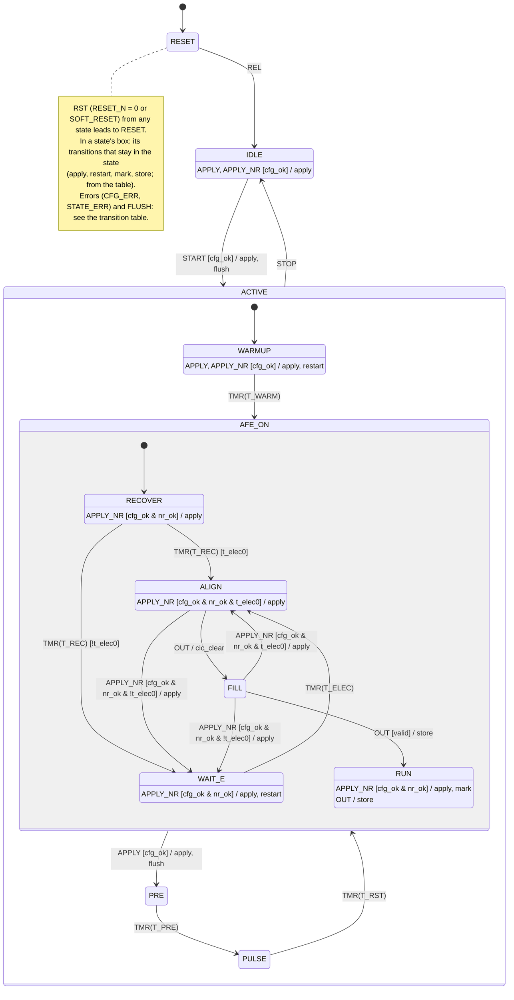
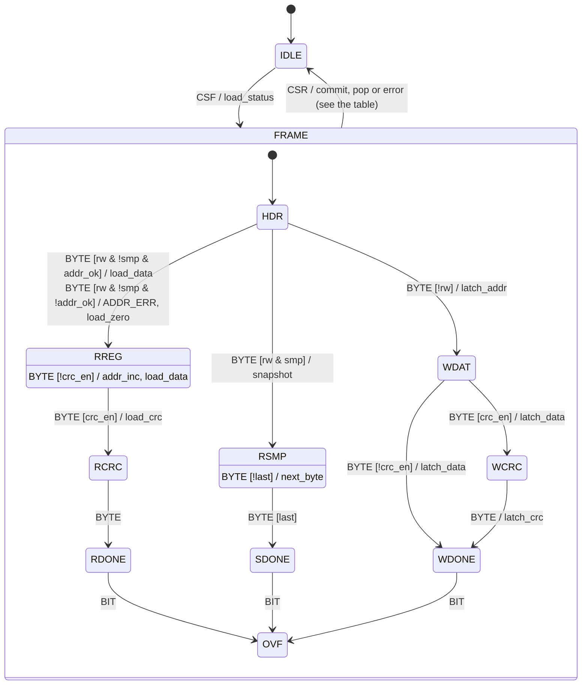

# デジタル制御（SPI・レジスタ・起動とデータ開始）の要件定義（案）（2026-11-19）

## 0. 本書の位置付け

- 11/19 の見直し（`gf180_digital_control_review_20261119.md`、問題点 A1〜H2）を受けた、改修版のデジタル制御の要件定義の案。
- 第 9 節の未決事項は、11/19 夜にユーザーの判断で推奨のとおり決定した。仕様（レジスタ表、SPI のフレームの詳細、タイミング図）は `gf180_digital_control_spec_20261119.md`。
- 要件の優先度は次の 3 段階。
  - 必須：今回の rev で満たすもの。
  - 推奨：面積と日程が許せば実装するもの。
  - 任意：今回は実装せず、将来の候補とするもの。
- 状態遷移図・状態表・状態遷移表の記法は第 3 節に定め、第 5 節をその模範とする。
- r2（11/19 夜）：状態遷移表を機械可読の仕様源（`gf180/tapeout/rtl/spec/fsm_spec.py`）とし、図と表をそこから生成。抜け・矛盾・行き止まり・同時の事象を自動で検査し、r1 の論理の穴 19 件を修正（第 5.5 節）。
- r3（11/19 夜）：アナログ側の仕様（AFE のクロックドライバ、オフセット DAC、ADC の過負荷、OTA1 のチョッパ、試験用マルチプレクサ、起動の条件）と、境目の全信号を照合（第 4.10 節）。ピンの兼用によるパッドの衝突、CHOP1 の切り替えの遅れ、64 kHz での命令の取りこぼしなど 8 件を修正し、時刻の制約も自動の検査に加えた（第 5.5 節）。

## 1. 目的と範囲

**目的**

- アナログの起動と調整の条件（待ち時間、パルス幅、順序）を、チップ内の状態機械とタイマで保証すること。
- ホストの手順を「設定の書き込み → START → DRDY ごとの読み出し」に単純化すること。
- SPI とレジスタを一般的な形式（R/W とアドレスによるフレーム、命令と設定の分離、二重バッファ）にそろえること。
- 状態と異常をフラグで示し、ホストが検出と切り分けを行えること。

**範囲**

- 対象：eeg_digital_top（SPI、レジスタ、シーケンサ（新設）、クロック生成、CIC、FIFO）と、チップ上のパッドとの接続。
- 対象外：アナログのブロック、eeg_adc_dig（TH の取り込み、DWA。インターフェースは変えない）、CIC のフィルタ特性（H1）、DAC2 の DWA（E3）。

## 2. 前提条件

| 項目 | 値 | 根拠 |
|---|---|---|
| クロック | MCLK 32.768 MHz、1 フレーム 32 MCLK（1.024 MHz、0.977 µs）、1 ms ＝ 1,024 フレーム | `eeg_clkgen.sv` |
| バイアスの整定 | 電源投入から 0.82〜1.05 ms（立ち上がり 1 ms） | `gf180_realistic_eval_20261028.md`「電源投入：プロセスの角と電源の立ち上がりの速さ」 |
| VCM の整定 | 外付け 10 nF で、電源投入から 5 ms の解除が可能。容量を増やす場合は時定数の約 5 倍 | 同「VCM の容量と解除の時刻」 |
| AFE のバイアス電流 | 解除の前に AFE_IBIAS ＝ 3 | 記録表 F4 |
| ADC の過負荷からの復帰 | 最大 0.22 ms（ダイと状態のばらつきを含む） | 同「ADC の過負荷からの戻り」、図 40 |
| オフセット DAC の変更 | 20 µs 以上あけて AFE_RST を 100 µs、解除後 0.22 ms、CIC の整定 3 ms。電極に R・C がある場合は 5 R_e C_e の追加の待ち | `gf180_electrode_dc_20261022.md`「使い方（ホスト）」 |
| AFE_RST 中のチョッパ | 動作させたまま（CHOP_EN ＝ 1） | 記録表 F4 |
| ブランキング | オフセット DAC の使用時 15 MCLK、不使用時 7 MCLK。0 は不可 | 記録表 F4（2） |
| CHOP_DLY | 0 のみ（1 以上は不可） | 記録表 F4（1） |
| BOOST_TRIM | typical の初期値 4/2（ダイごとに試験で決定） | 記録表 D7、`gf180_realistic_eval_20261028.md` の窓の節 |
| パッド | デジタルの bi_24t 9 個はすべて使用中（MCLK、RESET_N、SCLK、CS_N、MOSI、MISO、DRDY_N、RAW_DATA、RAW_CLK）。未使用は asig_5p0 の 33 個のみ | `gf180/tapeout/chip/padring/pad_coordinates.csv` |
| マクロ | eeg_digital_top は 440 × 700 µm、セル 7,080 個、使用率 75.8 %、ss/125 °C の setup の余裕 +1.10 ns | LibreLane の f2（11/19 の再実行、元のランと同一） |
| 日程 | 12/9 スロット購入、12/16 GDS 提出 | 記録表 F1 |
| AFE のクロックドライバ | CIA／CIB（入力チョッパ）は CHOP から作る（CHOP_EN が低いと相 A に固定）。OFPH（オフセット DAC の相）は CIA でセット、CIB でリセット。CDA／CDB（出力チョッパ）は CHOP_OUT と CHOP_BLANK から作る。RST は AFE_RST の緩衝。入力チョッパの縁は CHOP の 6〜10 ns 後 | `gf180_afe_clk_20261022.md` |
| ADC の過負荷 | AFE_RST を上げてから 0.5 µs で ADC の入力は範囲内に戻る。過負荷の間、積分器はレールに張りつく。戻りは最大約 0.22 ms。1 ビットのモードに残るのは、10〜20 kHz の大きな妨害が続くときのみ | `gf180_realistic_eval_20261028.md`「ADC の過負荷からの戻り」 |
| フルスケールでの量子化器の符号 | 行動モデルのコード列 s4、s20（合計 2,460 万フレーム。チップのフルスケール、オフセット DAC の残差の最大、128 kHz と 900 Hz の妨害を含む）で 3〜27。両端（0、31）は出ない | `gf180/tapeout/rtl/build/e2e/s4.codes`、`s20.codes`（11/19 に集計） |
| OTA1 のチョッパ（CHOP1） | 縁は e16。速さは 1,024 フレームごと（RESET_N の解除から数える。SOFT_RESET でも変えない）に取り込む。どの周期も 1 ms を割り切り、sinc³ の零点で打ち消される | `eeg_chop1.sv`、`gf180_ota1_chopper_20261022.md` |

## 3. 記法（状態遷移図の模範の形）

- 状態遷移表を正とし、状態遷移図と状態表は表の見取り図とする。3 点を一組とする。
- 状態遷移表は機械可読の形で `gf180/tapeout/rtl/spec/fsm_spec.py` に置き、唯一の仕様源とする。本書の図（Mermaid）と表は、このファイルから生成する（`fsm_spec.py gen`）。手で書き換えない。
- **状態**：英大文字の名前と、その意味。その状態で保持する出力（STATE、AFE_RST、READY）は、状態だけで決まる（Moore 型）。
- **複合状態**：図は UML の状態機械（階層）の記法とする。
  - 複合状態（ACTIVE、AFE_ON、FRAME）からの遷移は、その中の全ての状態に共通の遷移を表す。
  - 複合状態への遷移は、その初期状態への遷移を表す。
  - 図の生成では、表の遷移のうち、中の全ての状態で同一のものだけをまとめる。
- **遷移のラベル**：「イベント［条件］／動作」。
  - イベントは、SPI の命令、ピンの変化、タイマの満了（TMR(タイマ名)）、内部の事象（CIC の出力の時刻 OUT など）。
  - 条件は、あらかじめ定義した条件の変数（表 5.1-4、5.2-4）の論理式。
  - 動作は、遷移のときに 1 回だけ行う処理（表 5.1-5、5.2-5）。
- **タイマ**：状態に入るときに開始し、満了をイベント TMR とする。値は開始時にレジスタから取り込む。
- **状態遷移表**：行を状態、列をイベントとし、全欄を埋める。
  - 「—」：その状態では起こり得ない事象。起こり得る事象に使われていないことを、検査器が確認する。
  - 「無視」：受理して何もしない。
  - 条件付きの欄：条件は排他的かつ網羅的とする。検査器が、条件の全ての値の組み合わせで確認する。
  - STATE_ERR、CFG_ERR などのエラーは、命令を拒否して状態を変えず、フラグを立てる。
- **不正な状態値**（ソフトエラーなど）は、IDLE（AFE_RST ＝ 1）へ戻して STATE_ERR を立てる（安全側）。

## 4. 機能要件

### 4.1 動作状態（シーケンサ）

| ID | 要件 | 優先度 | 対応する問題点 |
|---|---|---|---|
| SEQ-01 | チップ内に上位の状態機械（シーケンサ）を設け、状態 RESET、IDLE、WARMUP、RECOVER、WAIT_E、ALIGN、FILL、RUN、PRE、PULSE を持つこと（第 5.1 節。ALIGN と FILL で CIC の整定、WAIT_E で電極の整定） | 必須 | C1、C3 |
| SEQ-02 | 起動の待ち（バイアスと VCM の整定）は、WARMUP のタイマ T_WARM で保証すること。既定 5 ms、5〜255 ms で設定可（VCM の容量を増やす場合は、その時定数の約 5 倍以上に） | 必須 | C1 |
| SEQ-03 | AFE_RST の解除後、ADC の過負荷からの復帰を RECOVER のタイマ T_REC で待つこと（既定 0.25 ms、最小 0.22 ms）。電極の整定のための追加の待ち T_ELEC（既定 0、0〜255 ms）は WAIT_E で待ち、T_ELEC ＝ 0 では WAIT_E を通らないこと | 必須 | C1、C8 |
| SEQ-04 | ALIGN で次の出力の時刻を待ってその時刻に CIC をクリアし、FILL で最初の有効な出力を待って RUN に入ること（READY ＝ 1）。間引きの位相（出力の時刻の格子）は START の時点のまま保つこと | 必須 | C3、C5、C6 |
| SEQ-05 | AFE の動作中（RECOVER〜RUN）の設定の反映（APPLY）では、次の要件を満たすこと。IDLE と WARMUP の APPLY は、パルスなしで一括反映のみ行い、FIFO は空にしない（WARMUP では T_WARM を数え直す。SEQ-16）（11/20 の監査の第 2 回） | 必須 | B1、C2、E1 |
| | ・シャドウからアクティブへ、フレームの決まった位置で一括して写すこと | | |
| | ・FIFO を空にすること（古い設定のサンプルを残さない）（11/20 の監査） | | |
| | ・T_PRE（既定 3 周期 ＝ 23.4 µs）ののち、AFE_RST のワンショット（T_RST、既定 13 周期 ＝ 101.6 µs、最大 255 周期 ＝ 1.99 ms。周期は 7.8125 µs）を出すこと | | |
| | ・RECOVER、（WAIT_E）、ALIGN、FILL を経て RUN に戻ること | | |
| | ・PRE と PULSE の間の APPLY と APPLY_NR は拒否すること（STATE_ERR） | | |
| | ・パルスの間もチョッパを止めないこと | | |
| SEQ-06 | パルスなしの一括反映（APPLY_NR）を持つこと（運転中の 1 段の追従用）。RUN では反映の直後の 3 ＋ T_ELEC 個の出力（sinc³ の窓が反映をまたぐ 3 個と、電極の整定の T_ELEC（1 ms ＝ 出力 1 個））に CHANGED の印を付け（残っている印のほうが長ければ、その長さを保つ。前の 1 段の電極の整定が続いている）、RUN を出たら残りの印を取り消すこと（次の RUN はクリアした CIC から始まる）。RUN の前では、T_ELEC ＞ 0 なら電極の整定を待ち直すこと（WAIT_E では数え直し、ALIGN と FILL からは WAIT_E へ）（11/20 の監査）。T_ELEC ＝ 0 の FILL では ALIGN に戻り、CIC のクリアをやり直すこと | 必須 | B1、C9 |
| SEQ-07 | START は命令で受け付けること。STOP で IDLE（AFE_RST ＝ 1）に戻ること。出力の時刻の格子はリセットの解除（RESET_N）を原点とし、START でも SOFT_RESET でも変えないこと（MCLK と RESET_N を共有するチップの間で格子がそろう。RST-02）（11/20 の監査） | 必須 | C6 |
| SEQ-08 | START、APPLY、APPLY_NR のたびに、シャドウの設定の整合（cfg_ok：オフセット DAC の M が、選んだ範囲の上限以下）を検査すること。不整合なら命令を拒否し、CFG_ERR を立てること（範囲を下げたあとの M の超過を含む） | 必須 | B6 |
| SEQ-09 | 状態遷移表（表 5.1-2）の全欄をそのまま実装すること。受け付けない命令は状態を変えず、STATE_ERR を立てること（IDLE の STOP は受け付けて何もしない） | 必須 | D5 |
| SEQ-16 | AFE_RST を保っている間（WARMUP）の反映（APPLY、APPLY_NR）は、解除までの待ち T_WARM を最初から数え直すこと。設定の変更から AFE_RST の解除まで、必ず T_RST 以上あること（11/16 の飽和の評価：オフセット DAC の変更のあとは AFE_RST を経る）（11/20 の監査） | 必須 | C1 |
| SEQ-10 | 試験の設定（ADC_ZERO、CHOP_EN ＝ 0、試験用マルチプレクサ）の切り替えも APPLY を経由し、再整定を自動で行うこと | 推奨 | C7 |
| SEQ-11 | 過負荷では状態を変えないこと（自動の再試行は行わない。未決事項 D-8）。過負荷のフラグ OVL は FILL と RUN の間のみ立てること（それ以外の状態では、過負荷は想定内） | 必須 | E4 |
| SEQ-12 | リセットの解除後に自動で WARMUP へ進む設定（AUTO_START、既定は無効）を持つこと | 任意 | — |
| SEQ-13 | シーケンサの tick は、チョッパの 1 周期に 1 回、相 A の中ほどのフレーム（128 kHz では 8 フレーム中の 2 番目、64 kHz では 16 フレーム中の 4 番目）のフレームサイクル 24 とすること。AFE_RST とアナログの設定の変化は、この tick に限ること。命令とタイマの満了は tick で、CIC の出力（OUT）はその出力のサイクルで処理する。同じ tick の事象は、第 5.0 節の優先順位の規則で処理すること。例外はリセット（RESET_N、SOFT_RESET）による既定値への復帰で、任意のサイクルに起こる。このとき AFE_RST も同時に 1 となり、IDLE と WARMUP（T_WARM 以上）を経てから解除される。ADC へ入る DWA_EN と TEST_CFG もこのとき変わるが、SOFT_RESET では ADC は動作を続け（RESET_N では ADC_RST_N で ADC もリセットされる）、格納は RUN のみで、再開の START は FIFO を空にする（11/20 の監査の第 2 回） | 必須 | B2、E1 |
| SEQ-15 | AFE の動作中（RECOVER〜RUN）の APPLY_NR は、オフセット DAC の符号付きの値 (1 − 2 S) × M の ±1 段の変更のみを受け付けること（範囲と、その他の設定は同じ。nr_ok）。それ以外は CFG_ERR とし、APPLY（パルス付き）を使うこと。1 段の除外は、整定した最適点からの 1 段を前提とする。ホストは次の APPLY_NR を、前の 1 段の CHANGED の付かないサンプル（3 ＋ T_ELEC 個のあと）を読んでから出す（連続して歩かせない。過負荷（OVL）を見たら APPLY による探索に戻る）（11/20 の監査の第 3 回） | 必須 | B1 |
| SEQ-14 | タイマの値は開始時に取り込むこと。最小値（T_WARM 5 ms、T_REC 0.22 ms、T_PRE 20 µs、T_RST 100 µs）を下回る値の書き込みは拒否し、RANGE_ERR を立てること | 必須 | C1、C2 |

### 4.2 SPI

| ID | 要件 | 優先度 | 対応する問題点 |
|---|---|---|---|
| SPI-01 | モード 0、MSB 先頭、SCLK 2 MHz 以下とし、MCLK による再同期の方式を継続すること | 必須 | — |
| SPI-02 | フレームの先頭バイト（MOSI）は、R/W（bit 7、1 ＝ 読み出し）と 7 ビットのアドレスとすること | 必須 | A2 |
| SPI-03 | すべてのフレームで、先頭バイトの間に MISO から STATUS を返すこと。STATUS には固定のビット列を含め、MISO の無応答（0x00、0xFF）と区別できること | 必須 | A4、A6 |
| SPI-04 | 書き込みのフレームは 2 バイト（CRC 有効時は 3 バイト）に固定すること。CS_N の立ち上がりで、長さと CRC が正しい場合に限り確定すること。正しくない場合は書き込まず、FRAME_ERR または CRC_ERR を立てること。クロックのない空のフレームはエラーとしないこと | 必須 | A1、A3、A5 |
| SPI-05 | CRC-8（多項式 0x07）を書き込みと読み出しに付ける設定（CRC_EN）を持つこと。既定は無効（未決事項 D-6） | 必須 | A5 |
| SPI-06 | 読み出しでは、先頭バイトのあとにデータを返すこと。CRC 無効時はアドレスの自動加算による連続読み出しを可能とし、CRC 有効時は 1 バイトと CRC に固定すること | 必須（連続は推奨） | A2 |
| SPI-07 | サンプルの読み出しは、データの窓のアドレスへの 8 バイトの読み出しとすること（先頭 1、サンプルの状態 1、SEQ 2、DATA 3、CRC 1。CRC は先頭バイトのあとの 6 バイトの CRC-8）。ちょうど 8 バイトの場合に FIFO から取り出すこと（現行と同等） | 必須 | — |
| SPI-08 | 未定義のアドレスへの書き込みと、読み出し専用のレジスタへの書き込みは行わず、CRC の検査のあと ADDR_ERR を立てること。未定義のアドレスの読み出しは 0x00 を返すこと。読み出しの先頭バイトのアドレスが未定義なら ADDR_ERR を立てること（連続読み出しの途中で通る未定義のアドレスは 0x00 のみで、エラーにしない）（11/20 の監査の第 3 回） | 必須 | A9、D5 |
| SPI-09 | ソフトウェアリセットを、命令レジスタへの命令コード SOFT_RESET（0xA5。他の命令コードと 2 ビット以上異なる）の書き込みで行えること。リセットは書き込みの確定（CS_N の立ち上がり）で直ちに行うこと | 必須 | A7 |
| SPI-10 | 連続読み出しモード（命令なしのデータ読み出し）を持つこと | 任意 | A8 |
| SPI-12 | 命令は 1 個まで保持すること。前の命令が tick で処理される前の命令レジスタへの書き込みは受け付けず、STATE_ERR を立てること（64 kHz では、tick の間隔 15.6 µs が書き込みのフレーム 8 µs より長い）。STATUS に未処理の命令の有無を示すこと。同じ間のシャドウ（一括反映の対象）とタイマのレジスタへの書き込みも、STATE_ERR として受け付けないこと（命令が tick で読む値を変えない。64 kHz で書き込みが tick に先行しうる）（11/20 の監査） | 必須 | — |
| SPI-11 | タイミングの条件（CS_N の立ち下がりから最初の SCLK まで、最後の SCLK から CS_N の立ち上がりまでなど）を定め、CS_N の変化と SCLK の変化が同じ MCLK のサイクルに重ならないことを前提とすること（現行の README「Timing assumptions」を基に、仕様で決める） | 必須 | A3 |

現行のコマンド形式（0x10／0x20／0x30）を維持する案は、未決事項 D-2 とする。

### 4.3 レジスタ

| ID | 要件 | 優先度 | 対応する問題点 |
|---|---|---|---|
| REG-01 | アドレス空間を、識別と状態（読み出し専用、W1C）、命令、設定、試験、データの窓の区画に分けること | 必須 | B3、B5 |
| REG-02 | 命令（START、STOP、APPLY、APPLY_NR、FLUSH、SOFT_RESET）は命令レジスタへの書き込みで実行し、設定のビットと混在させないこと。エラーのクリアは、エラーのレジスタへの W1C のみとすること | 必須 | B3 |
| REG-03 | アナログに影響する設定は、シャドウとアクティブの二重とすること。対象はオフセット DAC の M・符号・範囲、トリム、チョッパ、BLANK、試験の設定。アクティブへの反映は START、APPLY、APPLY_NR のときのみとし、シャドウとアクティブの両方を読み出せること | 必須 | B1、B2 |
| REG-04 | 1 つのフィールドは 1 つのレジスタに収めること。8 ビットを超えるものは、連続したアドレスに上位から置くこと。フィールドの境界をそろえ、未使用のビットは 0 を返し、その書き込みは無視すること | 必須 | B4、B5 |
| REG-05 | リセットの既定値は推奨の動作値とすること（AFE_IBIAS 3、BOOST_TRIM 4/2、BLANK 7、CHOP_FAST 1、CHOP1 4 kHz、DWA_EN 1）。これにより F4 の AFE_IBIAS の先行書き込みは不要となる | 必須 | C1 |
| REG-06 | 設定してはならない値を書けないこと。1 つのフィールドの範囲外の値（BLANK_LEN ＝ 0、最小値未満のタイマなど）は書き込まず、RANGE_ERR を立てること（黙って値を変えない）。フィールドの間の整合（M と範囲）は、SEQ-08 の cfg_ok で検査すること。CHOP_DLY は廃止し、0 に固定すること（未決事項 D-5） | 必須 | B6 |
| REG-07 | オフセット DAC の使用中（範囲 1 以上）は、BLANK を自動で 15 とすること | 推奨 | B7 |
| REG-08 | 試験のレジスタは、鍵の書き込みで解錠した場合のみ書き込めること | 推奨 | — |

### 4.4 データの出力

| ID | 要件 | 優先度 | 対応する問題点 |
|---|---|---|---|
| DAT-01 | FIFO への格納は、RUN の間と、FILL から RUN への遷移（最初の有効な出力）のみとすること | 必須 | C4 |
| DAT-02 | サンプルのステータスに次を含めること：VALID、OVERRUN、OVL（その窓、すなわちこの出力と直前の 2 個の出力の間隔のいずれかでの過負荷（11/20 の監査））、CHANGED（APPLY_NR の反映の直後の 3 ＋ T_ELEC 個の出力。残っている印のほうが長ければその長さ。RUN を出ると取り消す）、ERR（マスクしないエラーのフラグの有無） | 必須 | C9、D2 |
| DAT-03 | SEQ は、RESET_N の解除からの出力の時刻（1 ms）の番号とすること。全ての状態で加算し（SOFT_RESET の間も）、START では変えない。格納しない出力も数えるので、欠けた数が分かる。MCLK と RESET_N を共有するチップの間では、同じ SEQ が同じ時刻を表す（SOFT_RESET でも変えない）。SEQ は 16 ビットで、65,536 個（65.536 s）ごとに 0 に戻る。FIFO を空にするのは、START、APPLY（パルスあり、すなわち AFE の動作中の APPLY）、FLUSH の命令と、リセット（RESET_N、SOFT_RESET）のみとすること（11/20 の監査） | 必須 | C5、C6 |
| DAT-04 | DRDY_N は、レベル（FIFO が空でない間 Low、既定）とパルス（サンプルごとに一定幅の Low）を選べること | 必須 | D4 |
| DAT-05 | FIFO の深さは 4 以上とすること（8 が望ましい。未決事項 D-4）。満杯時は新しいサンプルを捨てて OVERRUN を立てること（現行どおり） | 必須 | — |
| DAT-06 | サンプルの形式（24 ビットの 2 の補数、CRC-8）は現行どおりとすること。CIC の出力は、出力の時刻の格子が同じであれば、現行とビット単位で一致すること | 必須 | — |
| DAT-07 | 同じ MCLK のサイクルの格納・取り出し・クリアは、クリア → 取り出し → 格納の順に処理し、新しいサンプルを失わないこと（第 5.3 節） | 必須 | — |

### 4.5 状態・フラグ・エラー

| ID | 要件 | 優先度 | 対応する問題点 |
|---|---|---|---|
| FLG-01 | STATUS（読み出し専用、全てのフレームの先頭バイトでも返す）に、READY、FIFO_NONEMPTY（DATA）、AFE_RST の現在値、過負荷の現在値（OVL_NOW）、未処理の命令（CMD_PENDING）、ALERT（マスクしないエラーの有無）を含めること。状態そのものは STATE のレジスタ（0x04）で読む | 必須 | D1 |
| FLG-02 | エラーのレジスタ ERR（W1C）に、RESET_FLAG（リセットの発生）、FRAME_ERR、CRC_ERR、ADDR_ERR、STATE_ERR、CFG_ERR、RANGE_ERR、CMD_ERR を持つこと。データのフラグ DFLAG（W1C）に、OVERRUN と OVL を持つこと。RESET_FLAG の既定値は 1 とし、どのリセットのあとも立っていること。発生と同じサイクルのクリアでは、発生を優先すること（現行どおり） | 必須 | D1、D5 |
| FLG-03 | ALERT のマスクを持つこと。マスクしないエラーの有無は、STATUS の先頭バイトの ALERT と、サンプルのステータスの ERR に示すこと（ピンは設けない。PIN-02） | 必須 | D3 |
| FLG-04 | ADC の過負荷を、量子化器の符号が両端（0 または 31）となる頻度で検出すること。フルスケールの行動モデルのコード列（2,460 万フレーム）では符号は 3〜27 で、両端は出ない。過負荷では積分器がレールに張りつき、符号は両端に留まる。案は「直近 32 フレームに両端が 4 個以上で過負荷」（ADC の過負荷のランの符号で確かめる。VER-07）。フラグ OVL を立てるのは FILL と RUN の間のみとすること（SEQ-11） | 必須 | E4 |

### 4.6 ピンとチップ上の接続

| ID | 要件 | 優先度 | 対応する問題点 |
|---|---|---|---|
| PIN-01 | パッドリングとパッドの設定は変更しないこと | 必須 | — |
| PIN-02 | SYNC と ALERT のピンは設けないこと。RAW_CLK を SYNC 入力と兼用すると、基板が SYNC を駆動したまま RAW を有効にしたときに、パッドどうしが衝突する。複数チップの同期は MCLK と RESET_N の共有で行い（SEQ-07、DAT-03）、異常の通知は STATUS の先頭バイトとサンプルのステータス（毎 ms）で行う。CS_N はチップごとに分けること（全てのフレームの先頭バイトで STATUS を返すため、CS_N を共有すると MISO が衝突する。現行の問題点 C6 の「一斉書き込み」は使えない）（11/20 の監査） | 必須 | C6、D3 |
| PIN-03 | RAW_DATA と RAW_CLK のパッドは、現行どおり出力のみとすること。リセットの解除が同時なら、MCLK を共有するチップの間のサンプルの時刻の差は、リセットの同期化による 1 MCLK（30.5 ns）以内 | 必須 | C6 |

### 4.7 アナログ制御の出力

| ID | 要件 | 優先度 | 対応する問題点 |
|---|---|---|---|
| ANA-01 | アナログへの制御出力（AFE_RST、CHOP_EN、OFM、OFS、OFEN、トリム、TEST_CFG など）は、すべてレジスタの出力とすること。変化は tick（SEQ-13）に限ること（リセットによる既定値への復帰を除く。SEQ-13 の例外）。これにより、比較器（e0）、TH（e2）、DAC（e3、e4）、CIC の出力（cycle 8）、CHOP1 の縁（e16）、ブランキングの窓（前のフレームの cycle 31〜cycle 15）を避ける。チョッパの速さ、CHOP1 の速さ、BLANK の長さは、アクティブへの写しは tick で、端子への効き目はそれぞれの区切り（次の 512 MCLK、次の 1,024 フレーム、次のブランキングのパルス）から（第 4.10 節、`fsm_spec.py` の時刻の検査） | 必須 | B2、E1 |
| ANA-02 | AFE_RST はシーケンサのみが駆動し、パルス幅は T_RST で保証すること | 必須 | C2、E1 |
| ANA-03 | CHOP_EN の意味（ピンへの出力のみで、CHOP と CHOP_OUT は止まらない）を仕様に明記すること | 必須 | E2 |
| ANA-04 | CHOP1 の速さの切り替えの区切り（1,024 フレームごと）を、出力の時刻の格子と一致させること（どちらもリセットの解除が原点）。旧い速さに残る CIC の重みは 9.3 × 10⁻¹⁰ | 必須 | — |
| ANA-05 | 通常の動作では、PULSE の間も CHOP_EN ＝ 1（チョッパを止めない）とすること。CHOP_EN ＝ 0 は試験の設定としてのみ許す | 必須 | — |

### 4.8 リセットとクロック

| ID | 要件 | 優先度 | 対応する問題点 |
|---|---|---|---|
| RST-01 | RESET_N は非同期で掛け、同期で解除すること（現行どおり） | 必須 | — |
| RST-02 | ソフトウェアリセット（SPI-09）は、制御（レジスタ、シーケンサ、SPI、FIFO、フラグ、CHANGED、DRDY_N）を RESET_N と同じ既定値に戻すこと。時刻とデータの経路（フレームとチョッパ、CHOP1、CIC、過負荷の検出、SEQ、RAW の生成の時刻、eeg_adc_dig の ADC_RST_N）は RESET_N からそのまま続け、複数チップの格子と SEQ をそろえたままにすること（11/20 の監査）。RAW_EN と DBG_SEL は制御のレジスタであり、SOFT_RESET で既定値に戻る（RAW の出力は止まる）。設定の既定値への復帰は、AFE_RST ＝ 1 と同時の任意のサイクルである（SEQ-13 の例外）（11/20 の監査の第 2 回） | 必須 | A7 |
| RST-03 | リセットの発生を RESET_FLAG で示すこと（予期しないリセットの検出） | 必須 | F2 |
| RST-04 | チップに POR はないため、電源の安定まで RESET_N を Low に保つことを基板の要件とすること（記録表 F2） | 必須（基板） | F2 |
| RST-05 | クロックは MCLK の単一とすること。MCLK の停止は、ホストが STATUS の固定のビット列（SPI-03）で検出すること | 必須 | A6、F1 |

### 4.9 試験機能

| ID | 要件 | 優先度 | 対応する問題点 |
|---|---|---|---|
| TST-01 | RAW のコード列、DBG_SEL、ADC_ZERO、アナログの試験用マルチプレクサを維持すること | 必須 | — |
| TST-02 | 試験の設定の変更は APPLY を経由すること（SEQ-10） | 推奨 | C7 |

### 4.10 アナログとの境目（信号ごとの確認）

境目の全信号について、アナログ側の条件（根拠の文書）と新しい設計の扱いを照合した。11/9 の境目の確認（132 本、食い違いなし）と、記録表 F4 の条件を含む。

| 信号 | 行き先と働き | アナログ側の条件 | 新しい設計 |
|---|---|---|---|
| MCLK | 全体のクロック（32.768 MHz） | 基板の発振器。2 つのマクロの間のスキューは 1 ns 未満（README） | 変更なし |
| RESET_N | 全体のリセット | 電源の安定まで Low（記録表 F2）。POR なし | 変更なし。出力の時刻の格子の原点（SEQ-07）。RESET_FLAG（RST-03） |
| CMP_STROBE | 量子化器の比較器（e0） | 0.26〜0.43 pF を buf_1 で駆動（ss で縁 8.8 ns） | 変更なし。tick は e0〜e5 を避ける（e24） |
| TH[30:0] → CODE | 量子化器から eeg_adc_dig（e2 で取り込み） | 判定は e2 の setup の前に確定（チップの余裕 +1.0 ns、トランジスタで +4.6 ns） | 変更なし（NFR-03） |
| SEL1／SEL2[30:0] | DAC1／DAC2 の素子の選択（e3） | DWA。SEL2 は SEL1 と同一（E3） | 変更なし |
| DAC_CLK | DAC1 の更新（cycle 4、立ち上がりで SEL1 を取り込む） | 約 2 ns のパルスで取り込む | 変更なし |
| DWA_EN | DWA の有無（DAC1、DAC2 共通） | 運転中の切り替えは直線性と雑音を変える | シャドウとアクティブ。APPLY（再整定）のみ |
| CHOP | AFE の入力チョッパ（CIA／CIB）と OFPH | e0 の縁、128 kHz（64 kHz も可）。入力チョッパの縁は 6〜10 ns 後でブランキングの中。不感時間 4.4 ns（typical） | 変更なし。tick は相 A の中ほど |
| CHOP_OUT | 出力チョッパ（CDA／CDB）と DC 経路のスイッチ | CHOP_DLY ＝ 0 のみ（1 以上は入力チョッパの縁がブランキングの外に出る。F4（1）） | CHOP_DLY を廃止し、0 に固定（REG-06） |
| CHOP_BLANK | CDA／CDB を切る | BLANK_LEN は 1 以上（0 では CDA と CDB が縁で重なる）。オフセット DAC の使用時は 15（F4（2））。雑音の折り返しは 7 で約 1 %、15 で約 3.5 % | 0 は拒否（REG-06）。範囲 1 以上で自動で 15（REG-07）。変更は APPLY のみ |
| CHOP_EN | AFE のクロックドライバ（低いと入力チョッパを相 A に固定） | 0 の間は入力の DC 経路が止まり、戻したあとは AFE_RST か待ちが要る（F4（3））。電極に R・C がある場合、パルスの間もチョッパを動かしたまま（F4） | 試験の設定として APPLY のみ（再整定は自動。SEQ-10）。通常は PULSE の間も 1（ANA-05） |
| AFE_RST | AFE のリセットスイッチ | DAC を書いてから 20 µs 以上あけて 100 µs。解除のあと ADC の戻りに 0.22 ms。解除は VCM の整定後（10 nF で 5 ms）、AFE_IBIAS ＝ 3 のあと。パルス中はピンが約 5.4 kΩ。上げてから 0.5 µs で ADC の入力は範囲内 | シーケンサのみが駆動（ANA-02）。縁は tick（相 A の中ほど）のみ（リセットで 1 になる場合を除く。SEQ-13 の例外）。T_PRE 20 µs、T_RST 100 µs、T_REC 0.25 ms、T_WARM 5 ms（最小値は拒否で保証。SEQ-14） |
| OFM[9:0]、OFS、OFEN[3:0] | 電極オフセットの DAC（M × 0.311 mV、範囲 1〜4） | 範囲の上限を超える M は上位のビットが切り捨てられる（F4（4））。書くたびに AFE_RST のパルス（F4（5））。運転中の ±1 段は AFE_RST なしでよい（残差約 0.5 mV、飽和は約 4 mV。抵抗の大きい電極では 1 段が約 3 mV） | シャドウとアクティブ、tick で一括反映（B1 を解消）。cfg_ok で範囲の超過を拒否（SEQ-08）。パルスなしは ±1 段のみ（SEQ-15） |
| CPF_TRIM[3:0] | 入力インピーダンスの補償容量のトリム | ダイごとの静的な値 | シャドウとアクティブ、APPLY |
| AFE_IBIAS[1:0] | AFE のバイアス電流 | 3 が必要（AVSS の差 25 mV で、2 では電流が約 19 % 少ない。F4） | 既定値 3（REG-05）、APPLY |
| BTRIM_P／N[1:0] | カスコードのブースタの単位 | ダイごとに THD と雑音で決める。typical は 4/2 | 既定値 4/2（REG-05）、APPLY |
| CHOP1 | ADC の OTA1 のチョッパ（e16） | 速さは 1,024 フレームごとに取り込む。周期は 1 ms を割り切る | シャドウとアクティブ、APPLY。区切りを出力の格子と一致（ANA-04） |
| TEST_CFG[4:0] | 試験用マルチプレクサ（ATP のパッドへ内部の節点） | 選んだ節点にパッドの容量と漏れが付く | 試験のレジスタ（鍵、REG-08）。APPLY（再整定） |
| TEST_CFG[5]（ADC_ZERO） | ADC の入力の短絡と CHOP_BLANK の保持 | 戻したあとは AFE_RST か待ちが要る（F4（3）） | APPLY（再整定、SEQ-10） |
| TEST_CFG[7:6]（DBG_SEL） | RAW のパッドに時刻の信号 | RAW の出力による AFE への結合は +0.64 nV（11/16） | 試験のレジスタ（鍵） |
| RAW_DATA、RAW_CLK | 生の符号の出力（8.192 MHz） | 同上 | 出力のみ（兼用しない。PIN-02、PIN-03） |
| DRDY_N | データの準備 | 1 ms に 1 回の切り替え | レベルとパルス（DAT-04） |
| MISO、MISO_OE | SPI の出力 | 読み出しによる AFE への結合は +0.42 nV（11/16）。CS_N の立ち上がりで直ちに MISO_OE を切る（共有の MISO） | 先頭バイトから STATUS を出す（SPI-03）。MISO_OE は現行どおり |
| SCLK、CS_N、MOSI | SPI の入力（MCLK で同期） | SCLK 2 MHz 以下、タイミングの条件（README） | 変更なし。命令は 1 個まで保持（SPI-12） |
| ADC_RST_N、TH_CAPTURE、DAC_LOAD、CODE | eeg_digital_top と eeg_adc_dig の間 | マクロの間の STA | 変更なし（NFR-03） |

## 5. 模範の状態遷移図・状態表・状態遷移表

### 5.0 単一の仕様源、同時の事象の規則、自動検査

**同時の事象の規則（シーケンサの 1 tick）**

- tick は、チョッパの 1 周期に 1 回、相 A の中ほどのフレームのサイクル 24（SEQ-13）。SPI の命令は CS_N の立ち上がりで確定し、次の tick で受け付ける。命令は 1 個まで保持し、未処理のうちの 2 個目は STATE_ERR（SPI-12）。1 tick に届く命令は高々 1 個。
- CIC の出力（OUT）はその出力のサイクル（cycle 8）で処理し、tick（cycle 24）と同じサイクルにはならない。
- 同じ tick の事象の優先順位は、STOP ＞ START ＞ APPLY ＞ APPLY_NR ＞ FLUSH ＞ TMR。
- 次の状態は、状態を変える事象のうち、最も優先度の高いもので決める。STOP は常に優先する。
- 状態を変えない事象の動作（例：RUN での格納）は、常に実行する。優先順位で負けた遷移の動作は、エラーのフラグと、SEQ の加算・出力の破棄のみ実行する。
- RST（RESET_N、SOFT_RESET）は非同期で、tick によらず直ちに RESET へ。

**自動検査（`fsm_spec.py check`）**

`fsm_spec.py check` は次の性質を確認する。

<!-- BEGIN GENERATED checks -->
- 完全性：全ての（状態、イベント）の欄が定義されている
- 起こり得ない事象（IMP）の正しさ：IMP はその状態で起こり得ない事象にのみ使われている
- 決定性：各欄の条件は排他的かつ網羅的（条件の全ての組み合わせを列挙して確認）
- 到達性：全ての状態が初期状態から到達できる
- 行き止まりがない：シーケンサは全ての状態から、リセットを使わずに IDLE と RUN へ到達できる。SPI は全ての状態から IDLE へ到達できる
- タイマ：タイマを持つ状態は、満了で必ずその状態を出る（満了の欄の全ての分岐）
- 語彙：動作と条件の一覧の全ての項目が表で使われ、表で使う全ての項目が一覧にある（古い項目が残らない）
- 同時の事象（シーケンサ）：1 tick の命令（0〜1 個）とタイマの満了の全ての組み合わせ、および出力の時刻（tick と同じサイクルにはならない）について、全ての条件の値で、優先順位の規則による結果が次の性質を満たす
  - 状態を変えるのは、表とは独立に書いた出口の一覧（SEQ_EXITS）にある（状態、その tick で状態を決めた事象）の組のみ：タイマの待ち（WARMUP、RECOVER、WAIT_E、PRE、PULSE）を出るのは、その満了、STOP、AFE の動作中の APPLY（PRE へ）のみ。FLUSH は状態を変えない。START は IDLE からのみ。APPLY_NR で状態が変わるのは RUN の前（ALIGN、FILL から電極の待ちかクリアへ）のみ。RUN を出るのは STOP と APPLY のみ
  - AFE_RST の解除は必ず RECOVER（ADC の復帰待ち）に入る
  - AFE_RST の解除と同じ tick で設定を反映しない。AFE_RST を保っている間（WARMUP）の反映は、解除までの待ちを最初から数え直す（変更から解除まで T_WARM 以上）
  - START は必ず一括反映し、FIFO を空にする
  - AFE の動作中に AFE_RST なしで反映するのは、オフセット DAC の ±1 段の変更（nr_ok）のみ
  - FILL へは CIC のクリアとともにのみ入る
  - FIFO への格納は RUN と、FILL から RUN への遷移（最初の有効な出力）のみ
  - RUN へ入るのは最初の有効な出力のときのみ。RUN を出るのは STOP と APPLY（と RST）のみ
  - RUN のままの設定の反映には必ず CHANGED の印が付く。充填中の窓の中では設定を変えない
  - 不整合な設定は反映されない
  - CIC のクリアは出力の時刻の格子の上（ALIGN から FILL）でのみ
  - AFE_RST のパルスの前には必ず PRE（T_PRE の待ち）がある。PRE へは設定の反映とともにのみ入る
  - RECOVER へは AFE_RST の解除（WARMUP と PULSE の満了）からのみ入る
  - FIFO を空にするのは START、APPLY（パルスあり、すなわち AFE の動作中の APPLY）、FLUSH のみ（ほかはリセット）。APPLY（パルスあり）は必ず FIFO を空にする（古い設定のサンプルを残さない）。IDLE と WARMUP の APPLY はパルスなしで、FIFO を空にしない
  - RUN の前のオフセットの 1 段（APPLY_NR）は、T_ELEC > 0 なら電極の整定を待ち直す（WAIT_E、WAIT_E では数え直し）。WAIT_E へは RECOVER の満了か、その 1 段からのみ入る
  - STOP は必ず IDLE へ。命令は実行されるか、定義による無視か、エラーのフラグのいずれか（黙って捨てられない）
  - T_ELEC ＞ 0 では RECOVER の満了は必ず WAIT_E へ、T_ELEC ＝ 0 では ALIGN へ。RUN の出力の時刻は必ず格納する。FLUSH は全ての状態で FIFO を空にする。RUN へは有効な出力でのみ入る。受け付けた APPLY と APPLY_NR は必ず反映する
- RESET の行：リセットの解除でのみ IDLE へ出る。命令は無視、出力の時刻は数えるのみ（格納、クリア、状態の変化なし）、タイマの満了は起こらない
- SPI（条件の全ての値で列挙）：書き込みの確定は、完全で CRC 検査済みの、書き込み可能なアドレスへのフレームの CS_N の立ち上がりのみ（前の命令が未処理なら確定しない）。CRC の不一致は CRC_ERR。取り出しは、8 バイトちょうど（先頭バイトと 7 バイト）読み出したサンプルが写した時点から FIFO の先頭のままのときのみで、そのときは必ず取り出す（空の語とフラッシュのあとの語は取り出さない）。CS_N の立ち上がりは必ず IDLE へ戻り、バイトの途中と不完全・過長な書き込みは FRAME_ERR
- SPI のフレーム（書き込み・読み出し・サンプル × CRC の有無 × 条件の全ての値 × 0〜10 バイトと途中のビット、3,520 通り）：表を歩いた結果を、表とは独立に書いた意味の定義（spi_expect）と照合。確定、STATE_ERR、ADDR_ERR（書き込みと未定義の読み出し）、CRC_ERR、FRAME_ERR（バイトの途中、長さの誤り、CRC 有効時の CRC のない読み出しと 8 バイトでないサンプル）、写し、取り出し、MISO へ載せるデータと CRC のバイト数
- FIFO（深さ 4）：同じサイクルの格納・取り出しの要求・クリア・SPI の写しの全ての組み合わせで、占有数が範囲内、OVERRUN は満杯への格納（取り出しとクリアなし）のときのみ、格納したサンプルは失われない。取り出すのは SPI が写して送った語のみ（写しが先頭のままの印は、空の語の写し、フラッシュ、取り出しで消える）
- 時刻（アナログとの関係）：tick のサイクルが比較器、TH、DAC、CIC の出力、CHOP1 の縁、ブランキングの窓と重ならない。tick はチョッパの相 A の中ほど（半周期の 25〜75 %）。1 ms がチョッパの周期の整数倍。CHOP1 の全ての周期が 1 ms を割り切り、速さの切り替えで旧い相に残る CIC の重みが 1e−6 以下。tick の間に命令が 2 つ届きうる場合に SPI の未処理の規則がある
<!-- END GENERATED checks -->

- 結果（11/20、監査の第 2 回の修正のあと）：違反 0。
  - シーケンサ：10 状態 × 9 イベント。tick の事象と出力の時刻の組み合わせは 1,344 通り（11/19 の r3 では 2,688 通り。11/20 の監査の第 1 回で条件 full を除いたため（満杯の判断は FIFO の規則に一本化）、条件の組み合わせが半分になった）。状態の変化は全て、表とは独立に書いた出口の一覧（SEQ_EXITS）と照合する（11/20 の監査の第 2 回）。
  - SPI：11 状態 × 4 イベント。条件の全ての値に対する分岐は 6,528 通り（11/19 夜の RTL の作成時に条件 head を加え、13,056 通り）。
  - FIFO：40 通り（同上、SPI の写しを加えて項目の同一性を持つ独立のモデルと比較し、144 通り）。
  - 時刻：tick は 128 kHz で相 A の立ち上がりから 56 MCLK（半周期の 0.438）、64 kHz で 120 MCLK（0.469）。タイマの既定値を tick の格子に切り上げると、T_PRE は 23.4／31.3 µs、T_RST は 101.6／109.4 µs（128／64 kHz）、T_REC は 250 µs、T_WARM は 5 ms で、いずれもアナログの最小値以上。CHOP1 の切り替えで旧い相に残る CIC の重みは 9.3 × 10⁻¹⁰。
- 検査器そのものの確認（`fsm_spec.py selftest`）：もっともらしい仕様の誤り 60 種類（11/19 の 28 種類に、RTL の作成時に 4 種類、11/20 の監査の第 1 回で 18 種類、第 2 回で 10 種類（待ちを FLUSH、START、APPLY_NR で切る 9 種と、SOFT_RESET の間の出力の時刻）を加えた）を一つずつ入れ、すべて検出されることを確認。誤りの例は、欄の欠落、条件の重なり、RECOVER の飛ばし、印のない反映、AFE の動作中の大きな変更、整合の検査の欠落、CRC を検査しない確定、未処理の命令の上書き、短い読み出しでの取り出し。
  - r3 の改訂の途中で、出力の時刻による遷移を検査の模型が実行しない誤りを検査器に入れてしまった。これを selftest（ALIGN で CIC をクリアしない誤り）が検出したので、直した。

### 5.1 シーケンサ

<!-- BEGIN GENERATED seq_mermaid -->

<!-- END GENERATED seq_mermaid -->

**表 5.1-1 状態表**

<!-- BEGIN GENERATED seq_states -->
| 状態 | 意味 | STATE | AFE_RST | READY | タイマ | 上位の状態 |
|---|---|---|---|---|---|---|
| RESET | リセット中（RESET_N = 0、またはソフトウェアリセット）。全レジスタは既定値、SPI は応答しない | — | 1 | 0 | — | — |
| IDLE | 待機。設定をシャドウへ書く。変換の出力は捨てる | 0 | 1 | 0 | — | — |
| WARMUP | バイアスと VCM の整定を待つ | 1 | 1 | 0 | T_WARM | ACTIVE |
| RECOVER | AFE_RST の解除後、ADC が過負荷から戻るのを待つ | 2 | 0 | 0 | T_REC | AFE_ON ⊂ ACTIVE |
| WAIT_E | 電極の整定を待つ（T_ELEC > 0 のときのみ） | 3 | 0 | 0 | T_ELEC | AFE_ON ⊂ ACTIVE |
| ALIGN | 次の出力の時刻を待ち、その時刻に CIC をクリアする | 4 | 0 | 0 | — | AFE_ON ⊂ ACTIVE |
| FILL | CIC の充填。最初の有効な出力を待つ | 5 | 0 | 0 | — | AFE_ON ⊂ ACTIVE |
| RUN | 変換。有効な出力ごとに FIFO へ格納する | 6 | 0 | 1 | — | AFE_ON ⊂ ACTIVE |
| PRE | 一括反映の直後、AFE_RST の前の待ち | 7 | 0 | 0 | T_PRE | ACTIVE |
| PULSE | AFE_RST のワンショット | 8 | 1 | 0 | T_RST | ACTIVE |
<!-- END GENERATED seq_states -->

**表 5.1-2 状態遷移表**（欄は「［条件］動作 → 次の状態」。次の状態の記載がない欄は、状態を変えない）

<!-- BEGIN GENERATED seq_table -->
| 状態 ＼ イベント | RST | REL | STOP | START | APPLY | APPLY_NR | FLUSH | TMR | OUT |
|---|---|---|---|---|---|---|---|---|---|
| RESET | 無視 | → IDLE | 無視 | 無視 | 無視 | 無視 | 無視 | — | discard, seq_inc |
| IDLE | → RESET | — | 無視 | ［cfg_ok］ apply, flush → WARMUP ［not cfg_ok］ CFG_ERR | ［cfg_ok］ apply ［not cfg_ok］ CFG_ERR | ［cfg_ok］ apply ［not cfg_ok］ CFG_ERR | flush | — | discard, seq_inc |
| WARMUP | → RESET | — | → IDLE | STATE_ERR | ［cfg_ok］ apply, restart ［not cfg_ok］ CFG_ERR | ［cfg_ok］ apply, restart ［not cfg_ok］ CFG_ERR | flush | → RECOVER | discard, seq_inc |
| RECOVER | → RESET | — | → IDLE | STATE_ERR | ［cfg_ok］ apply, flush → PRE ［not cfg_ok］ CFG_ERR | ［cfg_ok and nr_ok］ apply ［not (cfg_ok and nr_ok)］ CFG_ERR | flush | ［t_elec0］ → ALIGN ［not t_elec0］ → WAIT_E | discard, seq_inc |
| WAIT_E | → RESET | — | → IDLE | STATE_ERR | ［cfg_ok］ apply, flush → PRE ［not cfg_ok］ CFG_ERR | ［cfg_ok and nr_ok］ apply, restart ［not (cfg_ok and nr_ok)］ CFG_ERR | flush | → ALIGN | discard, seq_inc |
| ALIGN | → RESET | — | → IDLE | STATE_ERR | ［cfg_ok］ apply, flush → PRE ［not cfg_ok］ CFG_ERR | ［cfg_ok and nr_ok and t_elec0］ apply ［cfg_ok and nr_ok and not t_elec0］ apply → WAIT_E ［not (cfg_ok and nr_ok)］ CFG_ERR | flush | — | cic_clear, discard, seq_inc → FILL |
| FILL | → RESET | — | → IDLE | STATE_ERR | ［cfg_ok］ apply, flush → PRE ［not cfg_ok］ CFG_ERR | ［cfg_ok and nr_ok and t_elec0］ apply → ALIGN ［cfg_ok and nr_ok and not t_elec0］ apply → WAIT_E ［not (cfg_ok and nr_ok)］ CFG_ERR | flush | — | ［valid］ store, seq_inc → RUN ［not valid］ discard, seq_inc |
| RUN | → RESET | — | → IDLE | STATE_ERR | ［cfg_ok］ apply, flush → PRE ［not cfg_ok］ CFG_ERR | ［cfg_ok and nr_ok］ apply, mark ［not (cfg_ok and nr_ok)］ CFG_ERR | flush | — | store, seq_inc |
| PRE | → RESET | — | → IDLE | STATE_ERR | STATE_ERR | STATE_ERR | flush | → PULSE | discard, seq_inc |
| PULSE | → RESET | — | → IDLE | STATE_ERR | STATE_ERR | STATE_ERR | flush | → RECOVER | discard, seq_inc |
<!-- END GENERATED seq_table -->

**表 5.1-3 イベント**

<!-- BEGIN GENERATED seq_events -->
| イベント | 意味 |
|---|---|
| RST | RESET_N = 0、または SOFT_RESET（非同期。どの時点でも） |
| REL | リセットの解除 |
| STOP | 命令 STOP |
| START | 命令 START |
| APPLY | 命令 APPLY（AFE_RST のパルスを伴う一括反映） |
| APPLY_NR | 命令 APPLY_NR（パルスなしの一括反映） |
| FLUSH | 命令 FLUSH（FIFO を空にする） |
| TMR | その状態のタイマの満了 |
| OUT | CIC の出力の時刻（1 ms ごと） |
<!-- END GENERATED seq_events -->

**表 5.1-4 条件**

<!-- BEGIN GENERATED seq_conds -->
| 条件 | 意味 |
|---|---|
| cfg_ok | シャドウの設定が整合（オフセット DAC の M が、選んだ範囲の上限以下） |
| nr_ok | シャドウとアクティブの違いが、オフセット DAC の符号付きの値 (1 − 2 S) × M の ±1 段のみ（範囲は同じ） |
| t_elec0 | T_ELEC = 0 |
| valid | CIC の出力が有効（クリアのあと 3 個目以降） |
<!-- END GENERATED seq_conds -->

**表 5.1-5 動作**

<!-- BEGIN GENERATED seq_actions -->
| 動作 | 意味 |
|---|---|
| apply | シャドウからアクティブへ一括反映（オフセット DAC、トリム、チョッパ、BLANK、試験の設定） |
| flush | FIFO を空にする |
| cic_clear | CIC をクリアする（出力の時刻に合わせて行うので、格子は変わらない） |
| store | 出力を FIFO へ格納する（DRDY）。満杯なら FIFO が新しいサンプルを捨てて OVERRUN を立てる（第 5.3 節、fifo_step） |
| discard | 出力を捨てる |
| seq_inc | SEQ に 1 を加える（SEQ は RESET_N の解除からの出力の時刻の番号。SOFT_RESET でも変えない） |
| mark | このあとの 3 ＋ T_ELEC 個の出力に CHANGED を付ける（反映をまたぐ sinc³ の窓 3 個と、電極の整定 T_ELEC（1 ms ＝ 出力 1 個の単位））。残っている印のほうが長ければ、その長さを保つ（前の 1 段の電極の整定が続いている）。RUN を出ると残りは取り消す（次の RUN はクリアした CIC から始まり、その窓は反映をまたがない） |
| CFG_ERR | エラー CFG_ERR を立てる（命令は実行しない） |
| STATE_ERR | エラー STATE_ERR を立てる（命令は実行しない） |
| restart | その状態のタイマを最初から数え直す（同じ tick のタイマの満了は取り消す） |
<!-- END GENERATED seq_actions -->

- SEQ は、RESET_N の解除からの出力の時刻の番号（全ての状態で、SOFT_RESET の間も加算し、START では変えない。DAT-03）。
- 一括反映（apply）は tick（フレームの決まった位置）で行う。

### 5.2 SPI のトランザクション

<!-- BEGIN GENERATED spi_mermaid -->

<!-- END GENERATED spi_mermaid -->

**表 5.2-1 状態表**

<!-- BEGIN GENERATED spi_states -->
| 状態 | 意味 | 上位の状態 |
|---|---|---|
| IDLE | CS_N = 1。MISO は高インピーダンス | — |
| HDR | 先頭バイト。MOSI は R/W とアドレス、MISO は STATUS | FRAME |
| RREG | レジスタの読み出し（CRC 無効時はアドレスを自動加算して連続） | FRAME |
| RCRC | CRC 有効時、データ 1 バイトのあとの CRC | FRAME |
| RDONE | CRC 付きの読み出しの完了 | FRAME |
| RSMP | サンプルの窓の読み出し（先頭バイトのあとの 7 バイト：サンプルの状態、SEQ 2、DATA 3、CRC。フレームは 8 バイト） | FRAME |
| SDONE | サンプルの 8 バイト（先頭バイトと 7 バイト）の完了（CS_N の立ち上がりで FIFO から取り出す） | FRAME |
| WDAT | 書き込みのデータ 1 バイト | FRAME |
| WCRC | CRC 有効時の CRC の受信 | FRAME |
| WDONE | 書き込みのフレームの完了（CS_N の立ち上がりで確定） | FRAME |
| OVF | 規定より長いフレーム。以後は無視し、MISO は 0 | FRAME |
<!-- END GENERATED spi_states -->

**表 5.2-2 状態遷移表**

<!-- BEGIN GENERATED spi_table -->
| 状態 ＼ イベント | CSF | BIT | BYTE | CSR |
|---|---|---|---|---|
| IDLE | load_status → HDR | 無視 | — | — |
| HDR | — | 無視 | ［rw and smp］ snapshot → RSMP ［rw and not smp and addr_ok］ load_data → RREG ［rw and not smp and not addr_ok］ ADDR_ERR, load_zero → RREG ［not rw］ latch_addr → WDAT | ［mid］ FRAME_ERR → IDLE ［not mid］ → IDLE |
| RREG | — | 無視 | ［crc_en］ load_crc → RCRC ［not crc_en］ addr_inc, load_data | ［mid］ FRAME_ERR → IDLE ［not mid］ → IDLE |
| RCRC | — | 無視 | → RDONE | FRAME_ERR → IDLE |
| RDONE | — | → OVF | — | → IDLE |
| RSMP | — | 無視 | ［not last］ next_byte ［last］ → SDONE | ［mid or crc_en］ FRAME_ERR → IDLE ［not mid and not crc_en］ → IDLE |
| SDONE | — | → OVF | — | ［head］ pop → IDLE ［not head］ → IDLE |
| WDAT | — | 無視 | ［crc_en］ latch_data → WCRC ［not crc_en］ latch_data → WDONE | FRAME_ERR → IDLE |
| WCRC | — | 無視 | latch_crc → WDONE | FRAME_ERR → IDLE |
| WDONE | — | → OVF | — | ［(crc_ok or not crc_en) and wr_ok and not busy］ commit → IDLE ［(crc_ok or not crc_en) and wr_ok and busy］ STATE_ERR → IDLE ［(crc_ok or not crc_en) and not wr_ok］ ADDR_ERR → IDLE ［crc_en and not crc_ok］ CRC_ERR → IDLE |
| OVF | — | 無視 | 無視 | FRAME_ERR → IDLE |
<!-- END GENERATED spi_table -->

**表 5.2-3 イベント**

<!-- BEGIN GENERATED spi_events -->
| イベント | 意味 |
|---|---|
| CSF | CS_N の立ち下がり |
| BIT | バイトを完了しない SCLK の立ち上がり |
| BYTE | バイトを完了する SCLK の立ち上がり（8 ビット目） |
| CSR | CS_N の立ち上がり |
<!-- END GENERATED spi_events -->

**表 5.2-4 条件**

<!-- BEGIN GENERATED spi_conds -->
| 条件 | 意味 |
|---|---|
| rw | 先頭バイトの R/W が 1（読み出し） |
| smp | アドレスがサンプルの窓 |
| addr_ok | アドレスが定義済み |
| crc_en | CRC が有効 |
| last | サンプルの最後のバイト（先頭バイトのあとの 7 バイト目、フレームの 8 バイト目） |
| mid | バイトの途中（CS_N の立ち上がりの時点で受信したビット数が 8 の倍数でない） |
| crc_ok | 受信した CRC のバイトが、受け取った先頭バイトとデータの CRC-8 と一致 |
| wr_ok | 書き込み可能なアドレス（定義済みで読み出し専用でなく、試験のレジスタなら解錠済み） |
| busy | 前の命令がまだ tick で処理されていない間の、命令レジスタへの定義済みの命令（SOFT_RESET を除く）、またはシャドウ（一括反映の対象）とタイマのレジスタへの書き込み（命令が読む値を tick まで変えない） |
| head | 写した語が FIFO に格納されたサンプルで、写してから取り出しもフラッシュもなく、まだ先頭 |
<!-- END GENERATED spi_conds -->

**表 5.2-5 動作**

<!-- BEGIN GENERATED spi_actions -->
| 動作 | 意味 |
|---|---|
| load_status | STATUS を送信のシフトレジスタへ（その時点の値を写す） |
| snapshot | FIFO の先頭（空なら空の語）を写す |
| load_data | アドレスのデータを送信のシフトレジスタへ |
| load_zero | 0x00 を送信のシフトレジスタへ |
| addr_inc | アドレスに 1 を加える |
| load_crc | 受け取った先頭バイトと送ったデータのバイトの CRC-8 を送信のシフトレジスタへ |
| next_byte | サンプルの次のバイトを送信のシフトレジスタへ |
| latch_addr | アドレスを保持 |
| latch_data | データを保持 |
| latch_crc | CRC を保持 |
| commit | 書き込みを確定（値の範囲が不正なら RANGE_ERR として書かない。命令レジスタなら命令を次の tick に渡す。ただし SOFT_RESET は直ちにリセット、未定義のコードは CMD_ERR。TEST_KEY は 0x3C で解錠、0x00 で施錠、その他の値は施錠して CMD_ERR） |
| pop | FIFO の先頭（送ったサンプル）を取り出す |
| FRAME_ERR | エラー FRAME_ERR を立てる |
| CRC_ERR | エラー CRC_ERR を立てる（書かない） |
| ADDR_ERR | エラー ADDR_ERR を立てる（書かない。読み出しは 0x00） |
| STATE_ERR | エラー STATE_ERR を立てる（前の命令が未処理のため、この命令、またはシャドウとタイマへの書き込みを受け付けない） |
<!-- END GENERATED spi_actions -->

### 5.3 FIFO（同じサイクルの格納・取り出し・クリア）

- 同じ MCLK のサイクルでは、クリア → 取り出し → 格納の順に処理する。新しいサンプルは、クリアや取り出しと同時でも失われない。
- 取り出しは、SPI が写して送った語が、その時点まで先頭のままの場合のみ（SPI の条件 head。写しの印は、格納されたサンプルの写しで立ち、クリアと取り出しで消える。11/19 夜、RTL の作成時に追加）。
- OVERRUN は、満杯の FIFO への格納（同じサイクルに取り出しもクリアもない場合）のときのみ立て、新しいサンプルを捨てる。
- DRDY_N：レベルの設定では FIFO が空でない間 Low、パルスの設定では格納ごとに一定幅（128 MCLK、4 フレーム）の Low。
- 検査：深さ 4（最小）で、占有数と写しの印の全ての値と、格納・取り出しの要求・クリア・写しの全ての組み合わせ（144 通り）を、項目の同一性を持つ独立のモデルと比較。

### 5.4 模範のホスト手順

（11/20 の監査で改訂。命令の完了の確かめ方、FIFO と SEQ の扱い、SPI の時間の条件、多チップを明記）

1. 電源投入。電源の安定まで RESET_N を Low に保ち、そのあと High にする。RESET_N が Low の間と、High にしてから 10 MCLK（約 0.3 µs）以上は、CS_N を High に保つ。
2. ID（0x00）と STATUS を読み、STATUS の固定のビット（bit 7 ＝ 1、bit 6 ＝ 0）を確かめる。ERR（0x06）を読んで RESET_FLAG を確かめ、読んだ値をそのまま書き戻してクリアする（W1C。読んでいないビットを消さない）。
3. 最初に CRC_EN を 1 とし（以後の全てのフレームを CRC で守る。CRC 無効では、先頭バイトの 1 ビットの化けで、命令の書き込みが別のレジスタへの合法な書き込み（例：0x10 が 0x50、T_WARM）となり、命令が黙って失われる）、必要な設定をシャドウとタイマへ書く。BOOST_TRIM（ダイごと）、CHOP1、DRDY のモード、ALERT のマスク、電極に応じた T_ELEC、オフセット DAC（M、符号、範囲。既知の値があれば START の前に書き、AFE_RST を保っている間に反映する）など。既定値で足りる項目は書かない（11/20 の監査の第 3 回）。
4. 命令の出し方（SOFT_RESET を除く全ての命令に共通。SOFT_RESET は手順 9）：命令を書いてから ERR を確かめるまでは、サンプルの読み出し（読み直しを含む）を挟まない（読み直しの FRAME_ERR と区別できないため）。命令を書いたら（書き込みの MISO が全て 0x00 であることを確かめる。手順 8）、STATUS の CMD_PENDING が 0 になる（次の tick、128 kHz で最大 7.8 µs、64 kHz で最大 15.6 µs）のを待ち、ERR を読んで、前にクリアしたあとに立ったビットがないことを確かめる。CMD_ERR、STATE_ERR、CFG_ERR に加え、命令のフレーム自体の CRC_ERR、FRAME_ERR、ADDR_ERR も、命令が実行されなかったことを示す。CRC 有効時は、CMD_PENDING と ERR を CRC 付きの読み出し（0x03、0x06）で確かめる（先頭バイトの状態は CRC で守られない）（11/20 の監査の第 2 回）。CMD_PENDING が 1 の間は、次の命令と、シャドウとタイマへの書き込みを出さない（STATE_ERR となり、書かれない）。CRC 無効で運用する場合は、フレームの化けを ERR では検出できないので、効果で確かめる（APPLY のあとの READY ＝ 0、APPLY_NR のあとのアクティブの写し（アドレス ＋ 0x10）、書いたシャドウの読み戻し）（11/20 の監査の第 3 回）。
5. START（手順 4）。STATE（0x04）が RUN、または STATUS の READY が 1 になるのを待つ。START は FIFO を空にするので、START の処理より前の DRDY_N と FIFO の中身は使わない。複数チップでは、MCLK と RESET_N を共有し、CS_N はチップごとに分け、同じ SEQ のサンプルを同じ時刻として扱う（SOFT_RESET のあとも同じ。SEQ は 65,536 個ごとに 0 に戻る）。
6. DRDY_N の立ち下がり（パルスのモードではパルス）ごとに、VALID ＝ 0 の語が返るまで（または STATUS の DATA ＝ 0 まで）続けてサンプル（8 バイト）を読む。1 個ずつでは滞留が減らず、満杯の間はパルスも出ないので、パルスのモードでは定期的に STATUS の DATA も確かめる。CRC、VALID、OVL、CHANGED を確かめ、OVL または CHANGED の付いたサンプルを除く。CRC が合わない場合は、CS_N を上げる前に SCLK を 1 回以上（1 バイト分でもよい）余分に入れる（取り出されずに FRAME_ERR となるので、同じサンプルを読み直せる。CS_N をソフトウェアで制御できる場合）。読み直しで立てた FRAME_ERR は、読み直しの直後に ERR を読んで書き戻してクリアする（ALERT と、以後のサンプルの ERR を戻す）（11/20 の監査の第 3 回）。読み出しの先頭バイト以降の MOSI は 0x00 とする。STATUS だけを見るときは、定義済みのレジスタ（例：0x83）の読み出しの先頭バイトだけのフレームとする（CRC の有無によらずエラーにならない。サンプルの窓 0xC0 は CRC 有効時に FRAME_ERR、未定義のアドレスは ADDR_ERR となる）（11/20 の監査の第 2 回）。
7. オフセットの探索（11/20 の監査の第 2 回で改訂。`gf180_electrode_dc_20261022.md`）：
   - 粗い探索：T_ELEC ＝ 0 とし（1 点ごとの待ちを短くし、合わない M のままの時間を減らす）、M・符号・範囲をシャドウへ書いて APPLY し（手順 4）、READY が 1 になったあとのサンプルで M の向きと幅を決める。APPLY は FIFO を空にし、PRE から FILL までは格納しないので、READY のあとのサンプルは全て新しい設定のものであるが、電極の整定（T_ELEC ＝ 0 では待たない）は含まない。範囲の外では値が圧縮されるので、主に符号を使う（読みの符号は M の向きのとおり）。
   - 仕上げ：候補の M は、電極の整定（約 5 R_e C_e。51 kΩ ∥ 47 nF で約 12 ms）を待ってから判断する。T_ELEC をその時間として APPLY するか、T_ELEC ＝ 0 のまま READY のあとのサンプルをその時間だけ捨てる（読み出しの 1 ms ごとに 1 個）。10 ms で範囲の中に見えた M が、整定のあとは範囲の端であった例がある。
   - 確定：決めた M と、電極に合わせた T_ELEC をシャドウとタイマへ書き、APPLY する。最後に試した点が決めた M であっても省かない（省くと、WAIT_E を経ない RUN の最初の約 5 R_e C_e のサンプルが整定の途中となり、CHANGED も付かない）。
   - 運転中の 1 段の追従（APPLY_NR、±1 段のみ。それ以外は CFG_ERR）は、1 段が ADC の範囲に比べて十分小さい電極に限る。次の 1 段は、前の 1 段の CHANGED の付かないサンプル（3 ＋ T_ELEC 個のあと）を読んでから出す（連続して歩かせない。SEQ-15）。1 段は増幅器の入力で 0.301 mV × (1 ＋ R_e ／ 5.56 kΩ)、ADC の入力でその約 284 倍となる（100 Ω で約 0.09 V。51 kΩ では約 0.85 V となり、DAC1 のフルスケール ±0.484 V を超える）。高抵抗の電極では追従せず、APPLY による探索をやり直す。追従では、CHANGED の付いたサンプル（3 ＋ T_ELEC 個）を除く。
8. 異常時：STATUS の ALERT（全てのフレームの先頭バイトで返る）を見て ERR と DFLAG を読み、対処ののち、読んだ値を書き戻してクリアする（DFLAG を消さないと、以後の全てのサンプルの OVERRUN と ERR が立ったままになる）。書き込みのフレームでは、先頭バイトのあとの MISO が全て 0x00（CRC の位置を含む）であることを確かめる（先頭バイトの R/W の化けで読み出しとして扱われた書き込みを検出できる。CRC 有効時は必ず検出でき、CRC 無効時は読み値が 0x00 のレジスタへの化けは分からない）（11/20 の監査の第 2 回）。
9. SOFT_RESET のあとは、CS_N を 1 µs 以上 High に保ってから次のフレームを始める（SPI もリセットされるため）。SOFT_RESET は制御だけを戻し、格子と SEQ は変えない。制御の全ての設定（CRC_EN、DRDY_MODE、マスク、試験の鍵、シャドウ、タイマ）は既定値に戻り、RESET_FLAG が立つので、手順 2〜5 をやり直す（CRC_EN は 0 に戻るので、最初のフレームは CRC なしで送る。3 バイトの書き込みは過長な FRAME_ERR となる）（11/20 の監査の第 2 回）。オフセット DAC（M、符号、範囲）と T_ELEC も既定値（範囲 0、DAC 切）に戻るので、START の前に書き直す（または手順 7 をやり直す）。書き直さずに START すると、DAC 切のまま AFE_RST を解除し、11/16 の飽和した起動となる。SOFT_RESET の確認：CRC なしの 2 バイトの読み出しで ERR を読み、RESET_FLAG ＝ 1 を確かめる。RESET_FLAG が 0、または CRC_ERR・FRAME_ERR が立っていれば、SOFT_RESET は実行されていない（チップは CRC 有効のまま）ので、CRC 付きのフレームで ERR をクリアしてやり直す（11/20 の監査の第 3 回）。
10. 停止は STOP、再開は START（手順 4、5）。STOP のあとの IDLE も AFE_RST ＝ 1 でチョッパが動いており、電極から見て約 5.4 kΩ の負荷となる（低電流の待機ではない。未確認事項）。

現行の手順（AFE_IBIAS の先行書き込み、AFE_RST の 2 回の書き込みによるパルス、0.22 ms と 3 ms の待ち、FILTER_CLEAR、BLANK の切り替え）は、すべてチップ側に移る。

### 5.5 r1（11/19 夕方）からの修正（論理の穴）

| 番号 | r1 の穴 | r2 の修正 |
|---|---|---|
| R-01 | SETTLE に、CIC のクリアの前と後の副状態が暗黙に含まれていた | ALIGN（次の出力の時刻でクリア）と FILL（充填）に分けて明示 |
| R-02 | RECOVER に 2 つのタイマ（T_REC と T_ELEC）が入っていた | WAIT_E を新設（T_ELEC ＝ 0 では通らない） |
| R-03 | 同じ時刻に複数の事象が起きた場合の扱いが未定義 | tick と優先順位を規定し、全ての組み合わせを検査 |
| R-04 | IDLE で STOP と SYNC が同じ tick に来ると START してしまう（検査の性質を定める過程で発見。検査器が検出することを selftest で確認） | STOP が同じ tick の START と SYNC を取り消す（r3 で SYNC を廃止し、命令は 1 tick に 1 個となったため、この規則と動作 cancel は不要となり削除。11/20 の監査） |
| R-05 | 「設定が有効」が未定義。範囲を下げたあとの M の超過が起こり得た | cfg_ok を定義し、START だけでなく APPLY、APPLY_NR でも検査 |
| R-06 | 起こり得るピンの事象（SYNC）を「起こり得ない（—）」とした欄があった | 起こり得る事象は「無視」か動作を定義（検査器が強制） |
| R-07 | FILL 中の APPLY_NR で、充填中の窓が変更をまたぐ | ALIGN に戻り、クリアをやり直す |
| R-08 | エラーのクリアが 2 通り（命令と W1C） | W1C のみ |
| R-09 | 範囲外の値を飽和させる案（黙って値を変える） | 書き込みを拒否し、RANGE_ERR |
| R-10 | CHANGED を付けるサンプルの範囲が不明 | 反映の直後の 3 個の出力（sinc³ の窓が反映をまたぐもの） |
| R-11 | SEQ の数え方が状態によって不明 | START で 0、START 後の全ての出力の時刻で加算、IDLE では数えない（r3 で DAT-03 に置き換え：リセットの解除からの全ての出力の時刻の番号） |
| R-12 | 最初の有効な出力の格納が「格納は RUN の間のみ」と矛盾 | FILL から RUN への遷移の動作として格納 |
| R-13 | クロックのない空のフレームの扱いが未定義 | エラーとしない |
| R-14 | 読み出し専用への書き込みと CRC の検査の順序が未定義 | CRC の検査のあと ADDR_ERR |
| R-15 | FIFO の同じサイクルの格納・取り出し・クリアの順序が未定義 | クリア → 取り出し → 格納 |
| R-16 | タイマの値の変更の時期と、下限が未定義 | 開始時に取り込む。最小値未満は拒否（T_WARM 5 ms、T_REC 0.22 ms、T_PRE 20 µs、T_RST 100 µs） |
| R-17 | リセットの発生の通知の方法が未定義 | RESET_FLAG の既定値を 1（W1C） |
| R-18 | ソフトウェアリセットの時期が未定義 | 命令の確定時（CS_N の立ち上がり）に直ちに |
| R-19 | 過負荷のフラグの時期が未定義（RECOVER の終わりのみ） | FILL と RUN の間の常時の検出のみをフラグとし、状態は変えない |

r2 から r3 への修正（アナログ側の仕様との照合で見つけたもの）：

| 番号 | r2 の穴 | r3 の修正 |
|---|---|---|
| R-20 | SYNC と ALERT を RAW のパッドと兼用すると、基板が SYNC を駆動したまま RAW を有効にしたときに、パッドどうしが衝突する | ピンを設けない。同期は MCLK と RESET_N の共有（格子の原点はリセットの解除）、異常は STATUS とサンプルのステータス |
| R-21 | CHOP1 の速さは 1,024 フレームごとにしか取り込まれず、APPLY から最大 1 ms 遅れて切り替わる。START で間引きの位相を変えると、CIC の窓とずれる | 格子と CHOP1 の区切りの原点をそろえる（リセットの解除）。旧い相に残る重みは 9.3 × 10⁻¹⁰ |
| R-22 | 64 kHz では tick の間隔（15.6 µs）が SPI の書き込み（8 µs）より長く、tick の間に命令が 2 個届きうる | 命令を 1 個まで保持し、2 個目は STATE_ERR（SPI-12） |
| R-23 | AFE_RST の縁とオフセット DAC の変化のチョッパの位相が、ホストの書き込みの時刻次第（未確認の事項だった） | tick を相 A の中ほど（e24）に固定。この位相でアナログのデッキを回し直す（VER-07） |
| R-24 | AFE の動作中に、パルスなしで大きな変更（範囲や符号の変更、多段の M）を反映できた | AFE の動作中の APPLY_NR は ±1 段のみ（nr_ok、SEQ-15） |
| R-25 | tick のフレーム内の位置が、比較器、DAC、CIC、CHOP1、ブランキングとの関係で確かめられていない | e24 とし、フレーム内の時刻の表で自動の検査（ANA-01） |
| R-26 | 過負荷の検出の規則が未定義 | フルスケールのコード列で両端の符号が出ないことを確かめ、規則の案を規定（FLG-04） |
| R-27 | 通常の PULSE の間のチョッパの扱いが規定されていない | CHOP_EN ＝ 1 を規定（ANA-05） |

## 6. 非機能要件

| ID | 要件 | 優先度 |
|---|---|---|
| NFR-01 | 3.3 V の 9 コーナーで setup と hold を満たすこと（現行の SDC）。チップの配線込みの STA でも満たすこと | 必須 |
| NFR-02 | 現行のマクロの外形（440 × 700 µm）に収めること。収まらない場合は、FIFO を 4 段とし、CHOP_DLY の論理を除いて再評価すること。なお収まらない場合は、マクロを拡大し、チップの配置を変更すること。**結果：**面積の試行（LibreLane、GF180 の 9 トラック）で、現行の外形では配置後の使用率 92.0 % となり詳細配置が失敗、FIFO 4 段（汎用セルで −7 %）と CHOP_DLY の除去（畳み込み済み）でも解決しないため、外形を 440 × 900 µm に拡大（使用率 73.6 %、配線・検証・タイミングとも成立）。チップではデジタルの列で DVDD のデカップリングを 200 µm 上へ移す（11/19 夜、ユーザーの判断「Yes, 440 × 900」） | 必須 |
| NFR-03 | eeg_adc_dig とのインターフェースを変えないこと | 必須 |
| NFR-04 | 通常の動作で、新たに連続して切り替わる出力を設けないこと（DRDY のパルスは 1 ms に 1 回）。アナログ制御の変化はフレームの決まった位置に限ること（ANA-01） | 必須 |
| NFR-05 | 状態機械は安全側に作ること。シーケンサの不正な状態値は IDLE、AFE_RST ＝ 1、STATE_ERR。SPI の不正な状態値は、そのフレームを確定せず（書き込みと取り出しなし）、CS_N の立ち上がりで FRAME_ERR を立てて IDLE へ戻る（11/20 の監査の第 3 回） | 必須 |
| NFR-06 | 出力にグリッチがないこと（すべてレジスタの出力。DRDY_N はレベルとパルスのどちらの設定でもレジスタの出力（11/20 の監査）。MISO_OE の組み合わせ回路は現行どおり） | 必須 |
| NFR-07 | 検証の資産（CIC の黄金モデル、行動モデルのコード列、ゲートレベルの照合、SDF の台）を流用できること | 推奨 |
| NFR-08 | eeg_digital_top の外形と端子（名前と位置）を現行と同じにすること。チップの組み立ては、マクロの差し替えと検査のみとする（ピンの追加なし、PIN-01、PIN-02） | 推奨 |

## 7. 検証要件

| ID | 要件 |
|---|---|
| VER-01 | 状態遷移表（表 5.1-2、表 5.2-2）の全欄を単体試験で確認すること（状態の網羅率と遷移の網羅率 100 %。STATE_ERR、FRAME_ERR などの拒否の欄を含む） |
| VER-02 | SPI：全種類のフレーム、連続読み出し、CRC の有無、長さ違い、バイトの途中での CS_N の立ち上がり、未定義のアドレス、読み出し専用への書き込み、鍵の誤り。MCLK と非同期の 2 MHz と 1 MHz で確認すること（実施：tb_top_r14 L で 2 MHz（SCLK の High の最小 4 MCLK、または Low の最小 5 MCLK）と 1 MHz、CS_N のセットアップ・ホールド・High の最小、MISO のパッドの遅れ 15 ns、CRC の有無。11/20 の監査の第 2 回） |
| VER-03 | タイマ：T_WARM、T_PRE、T_RST、T_REC、T_ELEC を最小・既定・最大で確認し、AFE_RST のパルス幅をピンで測ること（実施：tb_top_r14 で全ての既定値、T_PRE・T_RST・T_REC の最大 255（各 1992.2 µs）、T_REC の最小 29（226.6 µs）の継続時間を測る。tb_seq では、5 つのタイマの全ての設定 0〜255 の読み込みの値を直接確かめ（11/20 の監査の第 3 回）、T_WARM と T_ELEC の最大 255（261,120 フレーム）を満了まで走らせる。乱数の事象の減算と満了はタイマの独立の模型で確かめる） |
| VER-04 | 通し試験：START から RUN までと、運転中の APPLY と APPLY_NR を、行動モデルのコード列（s4、s20）で黄金モデルとビット単位で照合すること |
| VER-05 | ゲートレベル（遅延なし）の照合を全単体試験と短い通し試験で行うこと。SDF を 3 コーナーで、SPI とシーケンサの代表的な試験に行うこと |
| VER-06 | ホストの手順の模型（Python）でテストベンチを駆動すること。対象は、電源投入からの起動、オフセットの探索、異常の注入（CRC、長さ違い、STATE_ERR）、MCLK と RESET_N を共有する 2 チップのサンプルの時刻の一致（片方の SOFT_RESET のあとも）（11/20 の監査） |
| VER-07 | シーケンサの既定のタイマと tick の位相（相 A の中ほど、e24）で、アナログのデッキを回し直すこと。対象は、起動（`afe_startup.py`）、オフセットの書き込みとパルス（`afe_saturation.py`）、電極に R・C がある場合（図 45 の台）。過負荷の検出の規則は、ADC の過負荷のラン（`adc_overload.py`、1 ビットのモードを含む）の符号で確かめること |
| VER-08 | チップ：DRC、LVS、precheck、チップの STA を行い、マクロの差し替え以外が r13 と同一であることを XOR で確かめること |
| VER-09 | RTL の状態遷移を仕様源（`fsm_spec.py`）と照合すること。仕様源から参照モデル（または SystemVerilog の表明）を生成し、単体試験と通し試験の全サイクルで、RTL の状態と動作をそれと比べること（実施：参照モデルは仕様源の seq_tick そのもの。tb_seq は全ての事象を比べ、事象のないサイクルでは状態も動作も変わらないことを確かめる。tb_top_r14 の全ての事象も同じ照合器で比べ、状態を事象から事象へつなぐ。SPI は全てのフレームを、FIFO は全てのサイクルを、それぞれの仕様源の模型と比べる。11/20 の監査の第 2 回） |
| VER-10 | 仕様源を変えるたびに `fsm_spec.py check` と `selftest` を通すこと |

## 8. 問題点との対応

| 問題点 | 対応する要件 | 扱い |
|---|---|---|
| A1、A3 | SPI-04、SPI-11、FLG-02 | 解消 |
| A2 | SPI-02、SPI-06 | 解消（D-2） |
| A4 | SPI-03 | 解消 |
| A5 | SPI-04、SPI-05 | 解消 |
| A6、F1 | SPI-03、RST-05 | 受容（検出のみ） |
| A7 | SPI-09、RST-02 | 解消 |
| A8 | SPI-10 | 任意（今回は実装しない） |
| A9、D5 | SPI-08、SEQ-09、FLG-02 | 解消 |
| B1 | REG-03、SEQ-05、SEQ-06、SEQ-15 | 解消 |
| B2 | REG-03、ANA-01、SEQ-13 | 解消 |
| B3、B5 | REG-01、REG-02、REG-04 | 解消 |
| B4 | REG-04 | 解消 |
| B6 | REG-06、SEQ-08 | 解消（D-5） |
| B7 | REG-07 | 解消 |
| C1 | SEQ-01〜03、SEQ-14、SEQ-16、REG-05 | 解消 |
| C2、E1 | SEQ-05、SEQ-13、SEQ-14、ANA-01、ANA-02 | 解消 |
| C3 | SEQ-01、SEQ-04、FLG-01 | 解消 |
| C4 | DAT-01 | 解消 |
| C5 | SEQ-04、DAT-03 | 解消 |
| C6 | SEQ-04、SEQ-07、DAT-03、PIN-02、PIN-03 | 解消（D-3） |
| C7 | SEQ-10、TST-02 | 解消 |
| C8 | SEQ-03（T_ELEC） | 軽減（値はホストが電極に応じて設定） |
| C9 | SEQ-06、DAT-02 | 解消 |
| D1 | FLG-01、FLG-02 | 解消 |
| D2 | DAT-02 | 解消 |
| D3 | FLG-03、PIN-02 | 解消（D-3） |
| D4 | DAT-04 | 解消 |
| E2 | ANA-03 | 文書化 |
| E3 | — | 対象外（次の rev） |
| E4 | FLG-04、SEQ-11 | 解消 |
| E5 | — | 受容（AFE_RST 中のため実害なし） |
| F2 | RST-03、RST-04 | 解消（基板の要件） |
| G1〜G3 | VER-01〜10 | 解消 |
| H1、H2 | — | 対象外 |

## 9. 未決事項（ユーザーの判断）

**11/19 夜、ユーザーの判断「推奨どおりで進めて」により、D-1〜D-8 を下表の推奨のとおり決定した。** 詳細仕様は `gf180_digital_control_spec_20261119.md`。

| 番号 | 事項 | 選択肢 | 推奨（11/19 に決定） |
|---|---|---|---|
| D-1 | 今回の rev での改修の範囲 | 本要件のすべて／必須のみ／改修なし（ファームウェアで回避） | 本要件のすべて（推奨と任意は面積と日程に応じて） |
| D-2 | SPI のフレーム形式 | R/W とアドレスの形式へ変更／現行のコマンド形式を維持し、誤りの通知と状態の返送のみ追加 | 変更。ホストのファームウェアが確定する前の今が最も安い |
| D-3 | SYNC と ALERT のピン | 設けない（MCLK と RESET_N の共有で同期、異常は STATUS とサンプルのステータス）／パッドリングの変更で専用のピンを追加／RAW のパッドと兼用 | 設けない（r3 で変更）。兼用はパッドの衝突の危険があり、専用ピンはパッドリングの再生成を伴う |
| D-4 | FIFO の深さ | 8 を維持／4 に削減 | 合成の面積を見て決める（1 kSPS で 4 段は 4 ms の余裕） |
| D-5 | CHOP_DLY | 廃止（0 に固定）／試験のレジスタへ移す | 廃止。1 以上は使えず（F4（1））、面積も減る |
| D-6 | CRC の既定 | 無効／有効 | 無効（立ち上げの扱いやすさ）。製品のファームウェアで有効にする |
| D-7 | 自動開始（AUTO_START） | なし／リセットの解除後に自動で WARMUP | なし（任意の機能として扱う） |
| D-8 | 過負荷の扱い | フラグのみ（状態は変えない）／AFE_RST を再度かける（回数の上限付き） | フラグのみ。原因（M の不一致など）はホストが判断する |

## 10. 日程（案）

| 期間 | 作業 |
|---|---|
| 11/20〜21 | 本要件の確定（ユーザーと実務者の確認、未決事項の判断） |
| 11/22〜24 | 仕様（レジスタ表、SPI のフレーム、タイミング図、過負荷検出のしきい値） |
| 11/25〜28 | RTL と単体試験（VER-01〜03） |
| 11/29〜12/1 | 通し試験、ゲートレベル、ホストの手順の模型（VER-04〜06） |
| 12/2〜3 | マクロの再生成（LibreLane）、14 回目のチップの組み立て |
| 12/4〜8 | DRC、LVS、precheck、チップの STA、SDF、起動の再確認（VER-05、07、08） |
| 12/9 | スロットの購入（設計と独立） |
| 12/10〜12 | 予備。提出版（r14、または現行のデジタルの r13）の判断 |
| 12/16 | GDS の提出 |

- 現行のデジタルの r13 は、改修が間に合わない場合の提出版として保持する。
