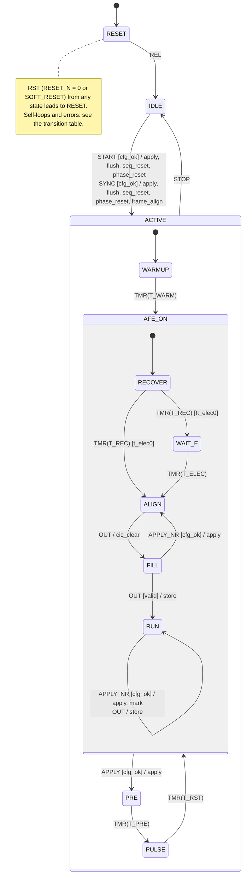
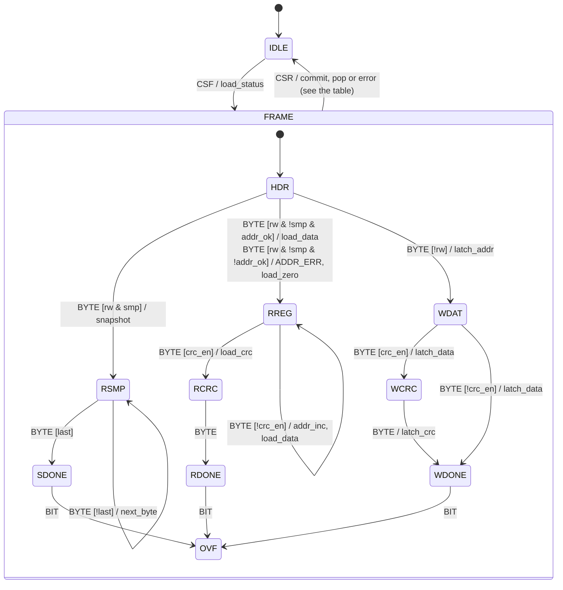

# デジタル制御（SPI・レジスタ・起動とデータ開始）の要件定義（案）（2026-11-19）

## 0. 本書の位置付け

- 11/19 の見直し（`gf180_digital_control_review_20261119.md`、問題点 A1〜H2）を受けた、改修版のデジタル制御の要件定義の案。
- 第 9 節の未決事項について、ユーザー（および実務者）の判断を受けたのち確定する。確定後、仕様（レジスタ表、SPI のフレームの詳細、タイミング図）を作成する。
- 要件の優先度は次の 3 段階。
  - 必須：今回の rev で満たすもの。
  - 推奨：面積と日程が許せば実装するもの。
  - 任意：今回は実装せず、将来の候補とするもの。
- 状態遷移図・状態表・状態遷移表の記法は第 3 節に定め、第 5 節をその模範とする。
- r2（11/19 夜）：状態遷移表を機械可読の仕様源（`gf180/tapeout/rtl/spec/fsm_spec.py`）とし、図と表をそこから生成。抜け・矛盾・行き止まり・同時の事象を自動で検査し、r1 の論理の穴 19 件を修正（第 5.5 節）。

## 1. 目的と範囲

**目的**

- アナログの起動と調整の条件（待ち時間、パルス幅、順序）を、チップ内の状態機械とタイマで保証すること。
- ホストの手順を「設定の書き込み → START → DRDY ごとの読み出し」に単純化すること。
- SPI とレジスタを一般的な形式（R/W とアドレスによるフレーム、命令と設定の分離、二重バッファ）にそろえること。
- 状態と異常をフラグで示し、ホストが検出と切り分けを行えること。

**範囲**

- 対象：eeg_digital_top（SPI、レジスタ、シーケンサ（新設）、クロック生成、CIC、FIFO）と、チップ上のパッドとの接続。
- 対象外：アナログのブロック、eeg_adc_dig（TH の取り込み、DWA。インターフェースは変えない）、CIC のフィルタ特性（H1）、DAC2 の DWA（E3）。

## 2. 前提条件

| 項目 | 値 | 根拠 |
|---|---|---|
| クロック | MCLK 32.768 MHz、1 フレーム 32 MCLK（1.024 MHz、0.977 µs）、1 ms ＝ 1,024 フレーム | `eeg_clkgen.sv` |
| バイアスの整定 | 電源投入から 0.82〜1.05 ms（立ち上がり 1 ms） | `gf180_realistic_eval_20261028.md`「電源投入：プロセスの角と電源の立ち上がりの速さ」 |
| VCM の整定 | 外付け 10 nF で、電源投入から 5 ms の解除が可能。容量を増やす場合は時定数の約 5 倍 | 同「VCM の容量と解除の時刻」 |
| AFE のバイアス電流 | 解除の前に AFE_IBIAS ＝ 3 | 記録表 F4 |
| ADC の過負荷からの復帰 | 最大 0.22 ms（ダイと状態のばらつきを含む） | 同「ADC の過負荷からの戻り」、図 40 |
| オフセット DAC の変更 | 20 µs 以上あけて AFE_RST を 100 µs、解除後 0.22 ms、CIC の整定 3 ms。電極に R・C がある場合は 5 R_e C_e の追加の待ち | `gf180_electrode_dc_20261022.md`「使い方（ホスト）」 |
| AFE_RST 中のチョッパ | 動作させたまま（CHOP_EN ＝ 1） | 記録表 F4 |
| ブランキング | オフセット DAC の使用時 15 MCLK、不使用時 7 MCLK。0 は不可 | 記録表 F4（2） |
| CHOP_DLY | 0 のみ（1 以上は不可） | 記録表 F4（1） |
| BOOST_TRIM | typical の初期値 4/2（ダイごとに試験で決定） | 記録表 D7、`gf180_realistic_eval_20261028.md` の窓の節 |
| パッド | デジタルの bi_24t 9 個はすべて使用中（MCLK、RESET_N、SCLK、CS_N、MOSI、MISO、DRDY_N、RAW_DATA、RAW_CLK）。未使用は asig_5p0 の 33 個のみ | `gf180/tapeout/chip/padring/pad_coordinates.csv` |
| マクロ | eeg_digital_top は 440 × 700 µm、セル 7,080 個、使用率 75.8 %、ss/125 °C の setup の余裕 +1.10 ns | LibreLane の f2（11/19 の再実行、元のランと同一） |
| 日程 | 12/9 スロット購入、12/16 GDS 提出 | 記録表 F1 |

## 3. 記法（状態遷移図の模範の形）

- 状態遷移表を正とし、状態遷移図と状態表は表の見取り図とする。3 点を一組とする。
- 状態遷移表は機械可読の形で `gf180/tapeout/rtl/spec/fsm_spec.py` に置き、唯一の仕様源とする。本書の図（Mermaid）と表は、このファイルから生成する（`fsm_spec.py gen`）。手で書き換えない。
- **状態**：英大文字の名前と、その意味。その状態で保持する出力（STATE、AFE_RST、READY）は、状態だけで決まる（Moore 型）。
- **複合状態**：図は UML の状態機械（階層）の記法とする。
  - 複合状態（ACTIVE、AFE_ON、FRAME）からの遷移は、その中の全ての状態に共通の遷移を表す。
  - 複合状態への遷移は、その初期状態への遷移を表す。
  - 図の生成では、表の遷移のうち、中の全ての状態で同一のものだけをまとめる。
- **遷移のラベル**：「イベント［条件］／動作」。
  - イベントは、SPI の命令、ピンの変化、タイマの満了（TMR(タイマ名)）、内部の事象（CIC の出力の時刻 OUT など）。
  - 条件は、あらかじめ定義した条件の変数（表 5.1-4、5.2-4）の論理式。
  - 動作は、遷移のときに 1 回だけ行う処理（表 5.1-5、5.2-5）。
- **タイマ**：状態に入るときに開始し、満了をイベント TMR とする。値は開始時にレジスタから取り込む。
- **状態遷移表**：行を状態、列をイベントとし、全欄を埋める。
  - 「—」：その状態では起こり得ない事象。起こり得る事象に使われていないことを、検査器が確認する。
  - 「無視」：受理して何もしない。
  - 条件付きの欄：条件は排他的かつ網羅的とする。検査器が、条件の全ての値の組み合わせで確認する。
  - STATE_ERR、CFG_ERR などのエラーは、命令を拒否して状態を変えず、フラグを立てる。
- **不正な状態値**（ソフトエラーなど）は、IDLE（AFE_RST ＝ 1）へ戻して STATE_ERR を立てる（安全側）。

## 4. 機能要件

### 4.1 動作状態（シーケンサ）

| ID | 要件 | 優先度 | 対応する問題点 |
|---|---|---|---|
| SEQ-01 | チップ内に上位の状態機械（シーケンサ）を設け、状態 RESET、IDLE、WARMUP、RECOVER、WAIT_E、ALIGN、FILL、RUN、PRE、PULSE を持つこと（第 5.1 節。ALIGN と FILL で CIC の整定、WAIT_E で電極の整定） | 必須 | C1、C3 |
| SEQ-02 | 起動の待ち（バイアスと VCM の整定）は、WARMUP のタイマ T_WARM で保証すること。既定 5 ms、5〜255 ms で設定可（VCM の容量を増やす場合は、その時定数の約 5 倍以上に） | 必須 | C1 |
| SEQ-03 | AFE_RST の解除後、ADC の過負荷からの復帰を RECOVER のタイマ T_REC で待つこと（既定 0.25 ms、最小 0.22 ms）。電極の整定のための追加の待ち T_ELEC（既定 0、0〜255 ms）は WAIT_E で待ち、T_ELEC ＝ 0 では WAIT_E を通らないこと | 必須 | C1、C8 |
| SEQ-04 | ALIGN で次の出力の時刻を待ってその時刻に CIC をクリアし、FILL で最初の有効な出力を待って RUN に入ること（READY ＝ 1）。間引きの位相（出力の時刻の格子）は START の時点のまま保つこと | 必須 | C3、C5、C6 |
| SEQ-05 | 設定の反映（APPLY）では、次の要件を満たすこと | 必須 | B1、C2、E1 |
| | ・シャドウからアクティブへ、フレームの決まった位置で一括して写すこと | | |
| | ・T_PRE（既定 20 µs）ののち、AFE_RST のワンショット（T_RST、既定 100 µs、0.1〜4 ms）を出すこと | | |
| | ・RECOVER、（WAIT_E）、ALIGN、FILL を経て RUN に戻ること | | |
| | ・PRE と PULSE の間の APPLY と APPLY_NR は拒否すること（STATE_ERR） | | |
| | ・パルスの間もチョッパを止めないこと | | |
| SEQ-06 | パルスなしの一括反映（APPLY_NR）を持つこと（運転中の 1 段の追従用）。RUN では反映の直後の 3 個の出力（sinc³ の窓が反映をまたぐもの）に CHANGED の印を付けること。FILL では ALIGN に戻り、CIC のクリアをやり直すこと | 必須 | B1、C9 |
| SEQ-07 | START は命令と SYNC の立ち上がり（第 4.6 節）の両方で受け付けること。STOP で IDLE（AFE_RST ＝ 1）に戻ること | 必須（SYNC は推奨） | C6 |
| SEQ-08 | START、APPLY、APPLY_NR のたびに、シャドウの設定の整合（cfg_ok：オフセット DAC の M が、選んだ範囲の上限以下）を検査すること。不整合なら命令を拒否し、CFG_ERR を立てること（範囲を下げたあとの M の超過を含む） | 必須 | B6 |
| SEQ-09 | 状態遷移表（表 5.1-2）の全欄をそのまま実装すること。受け付けない命令は状態を変えず、STATE_ERR を立てること | 必須 | D5 |
| SEQ-10 | 試験の設定（ADC_ZERO、CHOP_EN ＝ 0、試験用マルチプレクサ）の切り替えも APPLY を経由し、再整定を自動で行うこと | 推奨 | C7 |
| SEQ-11 | 過負荷では状態を変えないこと（自動の再試行は行わない。未決事項 D-8）。過負荷のフラグ OVL は FILL と RUN の間のみ立てること（それ以外の状態では、過負荷は想定内） | 必須 | E4 |
| SEQ-12 | リセットの解除後に自動で WARMUP へ進む設定（AUTO_START、既定は無効）を持つこと | 任意 | — |
| SEQ-13 | シーケンサは 1 フレームに 1 回、フレームの決まった位置（tick）で評価すること。同じ tick の事象は、第 5.0 節の優先順位の規則で処理すること | 必須 | — |
| SEQ-14 | タイマの値は開始時に取り込むこと。最小値（T_WARM 5 ms、T_REC 0.22 ms、T_PRE 20 µs、T_RST 100 µs）を下回る値の書き込みは拒否し、RANGE_ERR を立てること | 必須 | C1、C2 |

### 4.2 SPI

| ID | 要件 | 優先度 | 対応する問題点 |
|---|---|---|---|
| SPI-01 | モード 0、MSB 先頭、SCLK 2 MHz 以下とし、MCLK による再同期の方式を継続すること | 必須 | — |
| SPI-02 | フレームの先頭バイト（MOSI）は、R/W（bit 7、1 ＝ 読み出し）と 7 ビットのアドレスとすること | 必須 | A2 |
| SPI-03 | すべてのフレームで、先頭バイトの間に MISO から STATUS を返すこと。STATUS には固定のビット列を含め、MISO の無応答（0x00、0xFF）と区別できること | 必須 | A4、A6 |
| SPI-04 | 書き込みのフレームは 2 バイト（CRC 有効時は 3 バイト）に固定すること。CS_N の立ち上がりで、長さと CRC が正しい場合に限り確定すること。正しくない場合は書き込まず、FRAME_ERR または CRC_ERR を立てること。クロックのない空のフレームはエラーとしないこと | 必須 | A1、A3、A5 |
| SPI-05 | CRC-8（多項式 0x07）を書き込みと読み出しに付ける設定（CRC_EN）を持つこと。既定は無効（未決事項 D-6） | 必須 | A5 |
| SPI-06 | 読み出しでは、先頭バイトのあとにデータを返すこと。CRC 無効時はアドレスの自動加算による連続読み出しを可能とし、CRC 有効時は 1 バイトと CRC に固定すること | 必須（連続は推奨） | A2 |
| SPI-07 | サンプルの読み出しは、データの窓のアドレスへの 8 バイトの読み出しとすること（先頭 1、STATUS 1、SEQ 2、DATA 3、CRC 1）。ちょうど 8 バイトの場合に FIFO から取り出すこと（現行と同等） | 必須 | — |
| SPI-08 | 未定義のアドレスへの書き込みと、読み出し専用のレジスタへの書き込みは行わず、CRC の検査のあと ADDR_ERR を立てること。未定義のアドレスの読み出しは 0x00 を返し、ADDR_ERR を立てること | 必須 | A9、D5 |
| SPI-09 | ソフトウェアリセットを、命令レジスタへの鍵付きの書き込みで行えること。リセットは書き込みの確定（CS_N の立ち上がり）で直ちに行うこと | 必須 | A7 |
| SPI-10 | 連続読み出しモード（命令なしのデータ読み出し）を持つこと | 任意 | A8 |
| SPI-11 | タイミングの条件（CS_N の立ち下がりから最初の SCLK まで、最後の SCLK から CS_N の立ち上がりまでなど）を定め、CS_N の変化と SCLK の変化が同じ MCLK のサイクルに重ならないことを前提とすること（現行の README「Timing assumptions」を基に、仕様で決める） | 必須 | A3 |

現行のコマンド形式（0x10／0x20／0x30）を維持する案は、未決事項 D-2 とする。

### 4.3 レジスタ

| ID | 要件 | 優先度 | 対応する問題点 |
|---|---|---|---|
| REG-01 | アドレス空間を、識別と状態（読み出し専用、W1C）、命令、設定、試験、データの窓の区画に分けること | 必須 | B3、B5 |
| REG-02 | 命令（START、STOP、APPLY、APPLY_NR、FLUSH、SOFT_RESET）は命令レジスタへの書き込みで実行し、設定のビットと混在させないこと。エラーのクリアは、エラーのレジスタへの W1C のみとすること | 必須 | B3 |
| REG-03 | アナログに影響する設定は、シャドウとアクティブの二重とすること。対象はオフセット DAC の M・符号・範囲、トリム、チョッパ、BLANK、試験の設定。アクティブへの反映は START、APPLY、APPLY_NR のときのみとし、シャドウとアクティブの両方を読み出せること | 必須 | B1、B2 |
| REG-04 | 1 つのフィールドは 1 つのレジスタに収めること。8 ビットを超えるものは、連続したアドレスに上位から置くこと。フィールドの境界をそろえ、未使用のビットは 0 を返し、その書き込みは無視すること | 必須 | B4、B5 |
| REG-05 | リセットの既定値は推奨の動作値とすること（AFE_IBIAS 3、BOOST_TRIM 4/2、BLANK 7、CHOP_FAST 1、CHOP1 4 kHz、DWA_EN 1）。これにより F4 の AFE_IBIAS の先行書き込みは不要となる | 必須 | C1 |
| REG-06 | 設定してはならない値を書けないこと。1 つのフィールドの範囲外の値（BLANK_LEN ＝ 0、最小値未満のタイマなど）は書き込まず、RANGE_ERR を立てること（黙って値を変えない）。フィールドの間の整合（M と範囲）は、SEQ-08 の cfg_ok で検査すること。CHOP_DLY は廃止し、0 に固定すること（未決事項 D-5） | 必須 | B6 |
| REG-07 | オフセット DAC の使用中（範囲 1 以上）は、BLANK を自動で 15 とすること | 推奨 | B7 |
| REG-08 | 試験のレジスタは、鍵の書き込みで解錠した場合のみ書き込めること | 推奨 | — |

### 4.4 データの出力

| ID | 要件 | 優先度 | 対応する問題点 |
|---|---|---|---|
| DAT-01 | FIFO への格納は、RUN の間と、FILL から RUN への遷移（最初の有効な出力）のみとすること | 必須 | C4 |
| DAT-02 | サンプルのステータスに次を含めること：VALID、OVERRUN、OVL（その窓での過負荷）、CHANGED（APPLY_NR の反映の直後の 3 個の出力）、ERR（マスクしないエラーのフラグの有無） | 必須 | C9、D2 |
| DAT-03 | SEQ は START で 0 とし、以後は START 後の全ての出力の時刻（1 ms）ごとに数えること（格納しない出力、再整定中の無効な出力も数え、IDLE では数えない）。FIFO は START と FLUSH の命令でのみ空にすること | 必須 | C5 |
| DAT-04 | DRDY_N は、レベル（FIFO が空でない間 Low、既定）とパルス（サンプルごとに一定幅の Low）を選べること | 必須 | D4 |
| DAT-05 | FIFO の深さは 4 以上とすること（8 が望ましい。未決事項 D-4）。満杯時は新しいサンプルを捨てて OVERRUN を立てること（現行どおり） | 必須 | — |
| DAT-06 | サンプルの形式（24 ビットの 2 の補数、CRC-8）は現行どおりとすること。CIC の出力は、出力の時刻の格子が同じであれば、現行とビット単位で一致すること | 必須 | — |
| DAT-07 | 同じ MCLK のサイクルの格納・取り出し・クリアは、クリア → 取り出し → 格納の順に処理し、新しいサンプルを失わないこと（第 5.3 節） | 必須 | — |

### 4.5 状態・フラグ・エラー

| ID | 要件 | 優先度 | 対応する問題点 |
|---|---|---|---|
| FLG-01 | STATUS（読み出し専用）に、状態（STATE）、READY、FIFO_NONEMPTY、AFE_RST の現在値、過負荷の現在値、ALERT（マスクしないエラーの有無）を含めること | 必須 | D1 |
| FLG-02 | エラーのレジスタ（W1C）に、RESET_FLAG（リセットの発生）、FRAME_ERR、CRC_ERR、ADDR_ERR、STATE_ERR、CFG_ERR、RANGE_ERR、OVERRUN、OVL を持つこと。RESET_FLAG の既定値は 1 とし、どのリセットのあとも立っていること。発生と同じサイクルのクリアでは、発生を優先すること（現行どおり） | 必須 | D1、D5 |
| FLG-03 | ALERT のマスクを持ち、マスクしないエラーで ALERT_N を出すこと（ピンは未決事項 D-3） | 推奨 | D3 |
| FLG-04 | ADC の過負荷を、量子化器のコードが両端（0 または 31）となる頻度で検出すること。しきい値と窓は、正常な入力（フルスケールの正弦波、オフセット DAC の残差を含む）で誤検出しないように、仕様の段階で行動モデルのコード列から決めること。フラグ OVL を立てるのは FILL と RUN の間のみとすること（SEQ-11） | 必須 | E4 |

### 4.6 ピンとチップ上の接続

| ID | 要件 | 優先度 | 対応する問題点 |
|---|---|---|---|
| PIN-01 | パッドリングは変更しないこと | 推奨 | — |
| PIN-02 | SYNC 入力と ALERT_N 出力は、RAW の試験を使わない間、RAW_CLK と RAW_DATA のパッドを兼用して設けること（パッドの OE と入力をデジタルのマクロから制御。未決事項 D-3） | 推奨 | C6、D3 |
| PIN-03 | SYNC の立ち上がりは、IDLE でのみ START として受け付けること。フレームと間引きの計数を合わせ、MCLK と SYNC を共有する複数チップの間で、サンプルの時刻を 1 MCLK 以内にそろえること | 推奨 | C6 |

### 4.7 アナログ制御の出力

| ID | 要件 | 優先度 | 対応する問題点 |
|---|---|---|---|
| ANA-01 | アナログへの制御出力（AFE_RST、CHOP_EN、OFM、OFS、OFEN、トリム、TEST_CFG など）は、すべてレジスタの出力とすること。変化はフレーム内の決まった位置に限り、比較器と DAC の更新の時刻を避けること | 必須 | B2、E1 |
| ANA-02 | AFE_RST はシーケンサのみが駆動し、パルス幅は T_RST で保証すること | 必須 | C2、E1 |
| ANA-03 | CHOP_EN の意味（ピンへの出力のみで、CHOP と CHOP_OUT は止まらない）を仕様に明記すること | 必須 | E2 |

### 4.8 リセットとクロック

| ID | 要件 | 優先度 | 対応する問題点 |
|---|---|---|---|
| RST-01 | RESET_N は非同期で掛け、同期で解除すること（現行どおり） | 必須 | — |
| RST-02 | ソフトウェアリセット（SPI-09）は、RESET_N と同じ既定値に戻すこと | 必須 | A7 |
| RST-03 | リセットの発生を RESET_FLAG で示すこと（予期しないリセットの検出） | 必須 | F2 |
| RST-04 | チップに POR はないため、電源の安定まで RESET_N を Low に保つことを基板の要件とすること（記録表 F2） | 必須（基板） | F2 |
| RST-05 | クロックは MCLK の単一とすること。MCLK の停止は、ホストが STATUS の固定のビット列（SPI-03）で検出すること | 必須 | A6、F1 |

### 4.9 試験機能

| ID | 要件 | 優先度 | 対応する問題点 |
|---|---|---|---|
| TST-01 | RAW のコード列、DBG_SEL、ADC_ZERO、アナログの試験用マルチプレクサを維持すること | 必須 | — |
| TST-02 | 試験の設定の変更は APPLY を経由すること（SEQ-10） | 推奨 | C7 |

## 5. 模範の状態遷移図・状態表・状態遷移表

### 5.0 単一の仕様源、同時の事象の規則、自動検査

**同時の事象の規則（シーケンサの 1 tick）**

- シーケンサは、1 フレームに 1 回、フレームの決まった位置（tick）で評価する。SPI の命令は CS_N の立ち上がりで確定し、次の tick で受け付ける。SPI のフレームは 8 µs 以上かかるため、1 tick に届く命令は高々 1 個。
- 同じ tick の事象の優先順位は、STOP ＞ START ＞ SYNC ＞ APPLY ＞ APPLY_NR ＞ FLUSH ＞ TMR ＞ OUT。
- 次の状態は、状態を変える事象のうち、最も優先度の高いもので決める。STOP は常に優先し、IDLE では同じ tick の START と SYNC を取り消す。
- 状態を変えない事象の動作（例：RUN での格納）は、常に実行する。優先順位で負けた遷移の動作は、エラーのフラグと、SEQ の加算・出力の破棄のみ実行する。
- RST（RESET_N、SOFT_RESET）は非同期で、tick によらず直ちに RESET へ。

**自動検査（`fsm_spec.py check`）**

`fsm_spec.py check` は次の性質を確認する。

<!-- BEGIN GENERATED checks -->
- 完全性：全ての（状態、イベント）の欄が定義されている
- 起こり得ない事象（IMP）の正しさ：IMP はその状態で起こり得ない事象にのみ使われている
- 決定性：各欄の条件は排他的かつ網羅的（条件の全ての組み合わせを列挙して確認）
- 到達性：全ての状態が初期状態から到達できる
- 行き止まりがない：シーケンサは全ての状態から、リセットを使わずに IDLE と RUN へ到達できる。SPI は全ての状態から IDLE へ到達できる
- タイマ：タイマを持つ状態は、満了で必ずその状態を出る
- 同時の事象（シーケンサ）：1 tick の命令（0〜1 個）、SYNC、タイマ、出力の時刻の全ての組み合わせと、全ての条件の値で、優先順位の規則による結果が次の性質を満たす
  - AFE_RST の解除は必ず RECOVER（ADC の復帰待ち）に入る
  - START（SYNC を含む）は必ず一括反映、FIFO を空に、SEQ と間引きの計数を 0 にする。SYNC による開始はフレームの計数もそろえる
  - FILL へは CIC のクリアとともにのみ入る
  - FIFO への格納は RUN と、FILL から RUN への遷移（最初の有効な出力）のみ
  - RUN へ入るのは最初の有効な出力のときのみ。RUN を出るのは STOP と APPLY（と RST）のみ
  - RUN のままの設定の反映には必ず CHANGED の印が付く。充填中の窓の中では設定を変えない
  - 不整合な設定は反映されない
  - CIC のクリアは出力の時刻の格子の上（ALIGN から FILL）でのみ
  - AFE_RST のパルスの前には必ず PRE（T_PRE の待ち）がある。PRE へは設定の反映とともにのみ入る
  - RECOVER へは AFE_RST の解除（WARMUP と PULSE の満了）からのみ入る
  - SEQ と間引きの計数の 0 は START のみ、フレームの計数の 0 は IDLE での SYNC のみ、FIFO を空にするのは START と FLUSH のみ
  - STOP は必ず IDLE へ（同じ tick の START と SYNC を取り消す）。命令は実行されるか、定義による無視か、エラーのフラグのいずれか（黙って捨てられない）
- SPI（条件の全ての値で列挙）：書き込みの確定は、完全で CRC 検査済みの、書き込み可能なアドレスへのフレームの CS_N の立ち上がりのみ。CRC の不一致は CRC_ERR。取り出しは 7 バイトちょうどのサンプルの読み出しのみ。CS_N の立ち上がりは必ず IDLE へ戻り、バイトの途中と不完全・過長な書き込みは FRAME_ERR
- FIFO（深さ 4）：同じサイクルの格納・取り出し・クリアの全ての組み合わせで、占有数が範囲内、OVERRUN は満杯への格納（取り出しとクリアなし）のときのみ、格納したサンプルは失われない
<!-- END GENERATED checks -->

- 結果（11/19）：違反 0。
  - シーケンサ：10 状態 × 10 イベント。同時の事象の組み合わせは 5,376 通り。
  - SPI：11 状態 × 4 イベント。条件の全ての値に対する分岐は 3,264 通り。
  - FIFO：40 通り。
- 検査器そのものの確認（`fsm_spec.py selftest`）：もっともらしい仕様の誤り 27 種類を一つずつ入れ、すべて検出されることを確認。誤りの例は、欄の欠落、条件の重なり、RECOVER の飛ばし、印のない反映、整合の検査の欠落、CRC を検査しない確定、短い読み出しでの取り出し。

### 5.1 シーケンサ

<!-- BEGIN GENERATED seq_mermaid -->

<!-- END GENERATED seq_mermaid -->

**表 5.1-1 状態表**

<!-- BEGIN GENERATED seq_states -->
| 状態 | 意味 | STATE | AFE_RST | READY | タイマ | 上位の状態 |
|---|---|---|---|---|---|---|
| RESET | リセット中（RESET_N = 0、またはソフトウェアリセット）。全レジスタは既定値、SPI は応答しない | — | 1 | 0 | — | — |
| IDLE | 待機。設定をシャドウへ書く。変換の出力は捨てる | 0 | 1 | 0 | — | — |
| WARMUP | バイアスと VCM の整定を待つ | 1 | 1 | 0 | T_WARM | ACTIVE |
| RECOVER | AFE_RST の解除後、ADC が過負荷から戻るのを待つ | 2 | 0 | 0 | T_REC | AFE_ON ⊂ ACTIVE |
| WAIT_E | 電極の整定を待つ（T_ELEC > 0 のときのみ） | 3 | 0 | 0 | T_ELEC | AFE_ON ⊂ ACTIVE |
| ALIGN | 次の出力の時刻を待ち、その時刻に CIC をクリアする | 4 | 0 | 0 | — | AFE_ON ⊂ ACTIVE |
| FILL | CIC の充填。最初の有効な出力を待つ | 5 | 0 | 0 | — | AFE_ON ⊂ ACTIVE |
| RUN | 変換。有効な出力ごとに FIFO へ格納する | 6 | 0 | 1 | — | AFE_ON ⊂ ACTIVE |
| PRE | 一括反映の直後、AFE_RST の前の待ち | 7 | 0 | 0 | T_PRE | ACTIVE |
| PULSE | AFE_RST のワンショット | 8 | 1 | 0 | T_RST | ACTIVE |
<!-- END GENERATED seq_states -->

**表 5.1-2 状態遷移表**（欄は「［条件］動作 → 次の状態」。次の状態の記載がない欄は、状態を変えない）

<!-- BEGIN GENERATED seq_table -->
| 状態 ＼ イベント | RST | REL | STOP | START | SYNC | APPLY | APPLY_NR | FLUSH | TMR | OUT |
|---|---|---|---|---|---|---|---|---|---|---|
| RESET | 無視 | → IDLE | 無視 | 無視 | 無視 | 無視 | 無視 | 無視 | — | — |
| IDLE | → RESET | — | cancel | ［cfg_ok］ apply, flush, seq_reset, phase_reset → WARMUP ［not cfg_ok］ CFG_ERR | ［cfg_ok］ apply, flush, seq_reset, phase_reset, frame_align → WARMUP ［not cfg_ok］ CFG_ERR | ［cfg_ok］ apply ［not cfg_ok］ CFG_ERR | ［cfg_ok］ apply ［not cfg_ok］ CFG_ERR | flush | — | discard |
| WARMUP | → RESET | — | → IDLE | STATE_ERR | 無視 | ［cfg_ok］ apply ［not cfg_ok］ CFG_ERR | ［cfg_ok］ apply ［not cfg_ok］ CFG_ERR | flush | → RECOVER | discard, seq_inc |
| RECOVER | → RESET | — | → IDLE | STATE_ERR | 無視 | ［cfg_ok］ apply → PRE ［not cfg_ok］ CFG_ERR | ［cfg_ok］ apply ［not cfg_ok］ CFG_ERR | flush | ［t_elec0］ → ALIGN ［not t_elec0］ → WAIT_E | discard, seq_inc |
| WAIT_E | → RESET | — | → IDLE | STATE_ERR | 無視 | ［cfg_ok］ apply → PRE ［not cfg_ok］ CFG_ERR | ［cfg_ok］ apply ［not cfg_ok］ CFG_ERR | flush | → ALIGN | discard, seq_inc |
| ALIGN | → RESET | — | → IDLE | STATE_ERR | 無視 | ［cfg_ok］ apply → PRE ［not cfg_ok］ CFG_ERR | ［cfg_ok］ apply ［not cfg_ok］ CFG_ERR | flush | — | cic_clear, discard, seq_inc → FILL |
| FILL | → RESET | — | → IDLE | STATE_ERR | 無視 | ［cfg_ok］ apply → PRE ［not cfg_ok］ CFG_ERR | ［cfg_ok］ apply → ALIGN ［not cfg_ok］ CFG_ERR | flush | — | ［valid］ store, seq_inc → RUN ［not valid］ discard, seq_inc |
| RUN | → RESET | — | → IDLE | STATE_ERR | 無視 | ［cfg_ok］ apply → PRE ［not cfg_ok］ CFG_ERR | ［cfg_ok］ apply, mark ［not cfg_ok］ CFG_ERR | flush | — | ［not full］ store, seq_inc ［full］ OVERRUN, discard, seq_inc |
| PRE | → RESET | — | → IDLE | STATE_ERR | 無視 | STATE_ERR | STATE_ERR | flush | → PULSE | discard, seq_inc |
| PULSE | → RESET | — | → IDLE | STATE_ERR | 無視 | STATE_ERR | STATE_ERR | flush | → RECOVER | discard, seq_inc |
<!-- END GENERATED seq_table -->

**表 5.1-3 イベント**

<!-- BEGIN GENERATED seq_events -->
| イベント | 意味 |
|---|---|
| RST | RESET_N = 0、または SOFT_RESET（非同期。どの時点でも） |
| REL | リセットの解除 |
| STOP | 命令 STOP |
| START | 命令 START |
| SYNC | SYNC 入力の立ち上がり |
| APPLY | 命令 APPLY（AFE_RST のパルスを伴う一括反映） |
| APPLY_NR | 命令 APPLY_NR（パルスなしの一括反映） |
| FLUSH | 命令 FLUSH（FIFO を空にする） |
| TMR | その状態のタイマの満了 |
| OUT | CIC の出力の時刻（1 ms ごと） |
<!-- END GENERATED seq_events -->

**表 5.1-4 条件**

<!-- BEGIN GENERATED seq_conds -->
| 条件 | 意味 |
|---|---|
| cfg_ok | シャドウの設定が整合（オフセット DAC の M が、選んだ範囲の上限以下） |
| t_elec0 | T_ELEC = 0 |
| valid | CIC の出力が有効（クリアのあと 3 個目以降） |
| full | FIFO が満杯 |
<!-- END GENERATED seq_conds -->

**表 5.1-5 動作**

<!-- BEGIN GENERATED seq_actions -->
| 動作 | 意味 |
|---|---|
| apply | シャドウからアクティブへ一括反映（オフセット DAC、トリム、チョッパ、BLANK、試験の設定） |
| flush | FIFO を空にする |
| seq_reset | SEQ を 0 にする |
| phase_reset | 間引きの計数を 0 にする（出力の時刻の格子の原点） |
| frame_align | フレームの計数を 0 にする（SYNC を共有するチップの間でフレームをそろえる） |
| cic_clear | CIC をクリアする（出力の時刻に合わせて行うので、格子は変わらない） |
| store | 出力を FIFO へ格納する（DRDY） |
| discard | 出力を捨てる |
| seq_inc | SEQ に 1 を加える |
| mark | このあとの 3 個の出力（反映をまたぐ窓）に CHANGED を付ける |
| cancel | 同じ tick の START と SYNC を取り消す（IDLE に留まる） |
| CFG_ERR | エラー CFG_ERR を立てる（命令は実行しない） |
| STATE_ERR | エラー STATE_ERR を立てる（命令は実行しない） |
| OVERRUN | エラー OVERRUN を立てる（出力は捨てる） |
<!-- END GENERATED seq_actions -->

- SEQ は START で 0 とし、以後は START 後の全ての出力の時刻で加算する（IDLE では数えない）。
- 一括反映（apply）は tick（フレームの決まった位置）で行う。

### 5.2 SPI のトランザクション

<!-- BEGIN GENERATED spi_mermaid -->

<!-- END GENERATED spi_mermaid -->

**表 5.2-1 状態表**

<!-- BEGIN GENERATED spi_states -->
| 状態 | 意味 | 上位の状態 |
|---|---|---|
| IDLE | CS_N = 1。MISO は高インピーダンス | — |
| HDR | 先頭バイト。MOSI は R/W とアドレス、MISO は STATUS | FRAME |
| RREG | レジスタの読み出し（CRC 無効時はアドレスを自動加算して連続） | FRAME |
| RCRC | CRC 有効時、データ 1 バイトのあとの CRC | FRAME |
| RDONE | CRC 付きの読み出しの完了 | FRAME |
| RSMP | サンプルの窓の読み出し（STATUS、SEQ、DATA、CRC の 7 バイト） | FRAME |
| SDONE | サンプルの 7 バイトの完了（CS_N の立ち上がりで FIFO から取り出す） | FRAME |
| WDAT | 書き込みのデータ 1 バイト | FRAME |
| WCRC | CRC 有効時の CRC の受信 | FRAME |
| WDONE | 書き込みのフレームの完了（CS_N の立ち上がりで確定） | FRAME |
| OVF | 規定より長いフレーム。以後は無視し、MISO は 0 | FRAME |
<!-- END GENERATED spi_states -->

**表 5.2-2 状態遷移表**

<!-- BEGIN GENERATED spi_table -->
| 状態 ＼ イベント | CSF | BIT | BYTE | CSR |
|---|---|---|---|---|
| IDLE | load_status → HDR | 無視 | — | — |
| HDR | — | 無視 | ［rw and smp］ snapshot → RSMP ［rw and not smp and addr_ok］ load_data → RREG ［rw and not smp and not addr_ok］ ADDR_ERR, load_zero → RREG ［not rw］ latch_addr → WDAT | ［mid］ FRAME_ERR → IDLE ［not mid］ → IDLE |
| RREG | — | 無視 | ［crc_en］ load_crc → RCRC ［not crc_en］ addr_inc, load_data | ［mid］ FRAME_ERR → IDLE ［not mid］ → IDLE |
| RCRC | — | 無視 | → RDONE | ［mid］ FRAME_ERR → IDLE ［not mid］ → IDLE |
| RDONE | — | → OVF | — | → IDLE |
| RSMP | — | 無視 | ［not last］ next_byte ［last］ → SDONE | ［mid］ FRAME_ERR → IDLE ［not mid］ → IDLE |
| SDONE | — | → OVF | — | pop → IDLE |
| WDAT | — | 無視 | ［crc_en］ latch_data → WCRC ［not crc_en］ latch_data → WDONE | FRAME_ERR → IDLE |
| WCRC | — | 無視 | latch_crc → WDONE | FRAME_ERR → IDLE |
| WDONE | — | → OVF | — | ［(crc_ok or not crc_en) and wr_ok］ commit → IDLE ［(crc_ok or not crc_en) and not wr_ok］ ADDR_ERR → IDLE ［crc_en and not crc_ok］ CRC_ERR → IDLE |
| OVF | — | 無視 | 無視 | FRAME_ERR → IDLE |
<!-- END GENERATED spi_table -->

**表 5.2-3 イベント**

<!-- BEGIN GENERATED spi_events -->
| イベント | 意味 |
|---|---|
| CSF | CS_N の立ち下がり |
| BIT | バイトを完了しない SCLK の立ち上がり |
| BYTE | バイトを完了する SCLK の立ち上がり（8 ビット目） |
| CSR | CS_N の立ち上がり |
<!-- END GENERATED spi_events -->

**表 5.2-4 条件**

<!-- BEGIN GENERATED spi_conds -->
| 条件 | 意味 |
|---|---|
| rw | 先頭バイトの R/W が 1（読み出し） |
| smp | アドレスがサンプルの窓 |
| addr_ok | アドレスが定義済み |
| crc_en | CRC が有効 |
| last | サンプルの 7 バイト目 |
| mid | バイトの途中（CS_N の立ち上がりの時点で受信したビット数が 8 の倍数でない） |
| crc_ok | 受信した CRC が一致 |
| wr_ok | 書き込み可能なアドレス（定義済みで読み出し専用でない） |
<!-- END GENERATED spi_conds -->

**表 5.2-5 動作**

<!-- BEGIN GENERATED spi_actions -->
| 動作 | 意味 |
|---|---|
| load_status | STATUS を送信のシフトレジスタへ（その時点の値を写す） |
| snapshot | FIFO の先頭（空なら空の語）を写す |
| load_data | アドレスのデータを送信のシフトレジスタへ |
| load_zero | 0x00 を送信のシフトレジスタへ |
| addr_inc | アドレスに 1 を加える |
| load_crc | 送ったバイトの CRC を送信のシフトレジスタへ |
| next_byte | サンプルの次のバイトを送信のシフトレジスタへ |
| latch_addr | アドレスを保持 |
| latch_data | データを保持 |
| latch_crc | CRC を保持 |
| commit | 書き込みを確定（値の範囲が不正なら RANGE_ERR として書かない。命令レジスタなら命令を次の tick に渡す） |
| pop | FIFO の先頭を取り出す（空なら何もしない） |
| FRAME_ERR | エラー FRAME_ERR を立てる |
| CRC_ERR | エラー CRC_ERR を立てる（書かない） |
| ADDR_ERR | エラー ADDR_ERR を立てる（書かない。読み出しは 0x00） |
<!-- END GENERATED spi_actions -->

### 5.3 FIFO（同じサイクルの格納・取り出し・クリア）

- 同じ MCLK のサイクルでは、クリア → 取り出し → 格納の順に処理する。新しいサンプルは、クリアや取り出しと同時でも失われない。
- OVERRUN は、満杯の FIFO への格納（同じサイクルに取り出しもクリアもない場合）のときのみ立て、新しいサンプルを捨てる。
- DRDY_N：レベルの設定では FIFO が空でない間 Low、パルスの設定では格納ごとに一定幅の Low。
- 検査：深さ 4（最小）で、占有数の全ての値と、格納・取り出し・クリアの全ての組み合わせ（40 通り）。

### 5.4 模範のホスト手順

1. 電源投入。電源の安定まで RESET_N を Low に保ち、そのあと High にする。
2. ID と STATUS を読み、固定のビット列と RESET_FLAG を確認して、エラーのレジスタをクリア（W1C）する。
3. 必要な設定をシャドウへ書く。BOOST_TRIM（ダイごと）、CHOP1、CRC_EN、DRDY のモード、ALERT のマスク、電極に応じた T_ELEC など。既定値で足りる項目は書かない。
4. START（命令、または SYNC の立ち上がり）。STATUS の STATE が RUN（READY ＝ 1）になるのを、または最初の DRDY_N を待つ。
5. DRDY_N ごとにサンプル（8 バイト）を読む。ステータスの VALID、OVL、CHANGED を確認する。
6. オフセットの探索：M・符号・範囲をシャドウへ書いて APPLY し、READY を待って平均を読む。これを繰り返す（PRE と PULSE の間の APPLY は STATE_ERR となるため、READY を待ってから次を出す）。運転中の 1 段の追従は APPLY_NR とし、CHANGED の付いたサンプルを除く。
7. 異常時：ALERT_N（または STATUS の ALERT）を受けてエラーのレジスタを読み、対処ののちクリアする。
8. 停止は STOP、再開は START。

現行の手順（AFE_IBIAS の先行書き込み、AFE_RST の 2 回の書き込みによるパルス、0.22 ms と 3 ms の待ち、FILTER_CLEAR、BLANK の切り替え）は、すべてチップ側に移る。

### 5.5 r1（11/19 夕方）からの修正（論理の穴）

| 番号 | r1 の穴 | r2 の修正 |
|---|---|---|
| R-01 | SETTLE に、CIC のクリアの前と後の副状態が暗黙に含まれていた | ALIGN（次の出力の時刻でクリア）と FILL（充填）に分けて明示 |
| R-02 | RECOVER に 2 つのタイマ（T_REC と T_ELEC）が入っていた | WAIT_E を新設（T_ELEC ＝ 0 では通らない） |
| R-03 | 同じ時刻に複数の事象が起きた場合の扱いが未定義 | tick と優先順位を規定し、全ての組み合わせを検査 |
| R-04 | IDLE で STOP と SYNC が同じ tick に来ると START してしまう（検査の性質を定める過程で発見。検査器が検出することを selftest で確認） | STOP が同じ tick の START と SYNC を取り消す |
| R-05 | 「設定が有効」が未定義。範囲を下げたあとの M の超過が起こり得た | cfg_ok を定義し、START だけでなく APPLY、APPLY_NR でも検査 |
| R-06 | 起こり得るピンの事象（SYNC）を「起こり得ない（—）」とした欄があった | 起こり得る事象は「無視」か動作を定義（検査器が強制） |
| R-07 | FILL 中の APPLY_NR で、充填中の窓が変更をまたぐ | ALIGN に戻り、クリアをやり直す |
| R-08 | エラーのクリアが 2 通り（命令と W1C） | W1C のみ |
| R-09 | 範囲外の値を飽和させる案（黙って値を変える） | 書き込みを拒否し、RANGE_ERR |
| R-10 | CHANGED を付けるサンプルの範囲が不明 | 反映の直後の 3 個の出力（sinc³ の窓が反映をまたぐもの） |
| R-11 | SEQ の数え方が状態によって不明 | START で 0、START 後の全ての出力の時刻で加算、IDLE では数えない |
| R-12 | 最初の有効な出力の格納が「格納は RUN の間のみ」と矛盾 | FILL から RUN への遷移の動作として格納 |
| R-13 | クロックのない空のフレームの扱いが未定義 | エラーとしない |
| R-14 | 読み出し専用への書き込みと CRC の検査の順序が未定義 | CRC の検査のあと ADDR_ERR |
| R-15 | FIFO の同じサイクルの格納・取り出し・クリアの順序が未定義 | クリア → 取り出し → 格納 |
| R-16 | タイマの値の変更の時期と、下限が未定義 | 開始時に取り込む。最小値未満は拒否（T_WARM 5 ms、T_REC 0.22 ms、T_PRE 20 µs、T_RST 100 µs） |
| R-17 | リセットの発生の通知の方法が未定義 | RESET_FLAG の既定値を 1（W1C） |
| R-18 | ソフトウェアリセットの時期が未定義 | 命令の確定時（CS_N の立ち上がり）に直ちに |
| R-19 | 過負荷のフラグの時期が未定義（RECOVER の終わりのみ） | FILL と RUN の間の常時の検出のみをフラグとし、状態は変えない |

## 6. 非機能要件

| ID | 要件 | 優先度 |
|---|---|---|
| NFR-01 | 3.3 V の 9 コーナーで setup と hold を満たすこと（現行の SDC）。チップの配線込みの STA でも満たすこと | 必須 |
| NFR-02 | 現行のマクロの外形（440 × 700 µm）に収めること。収まらない場合は、FIFO を 4 段とし、CHOP_DLY の論理を除いて再評価すること。なお収まらない場合は、マクロを拡大し、チップの配置を変更すること | 必須 |
| NFR-03 | eeg_adc_dig とのインターフェースを変えないこと | 必須 |
| NFR-04 | 通常の動作で、新たに連続して切り替わる出力を設けないこと（DRDY のパルスは 1 ms に 1 回）。アナログ制御の変化はフレームの決まった位置に限ること（ANA-01） | 必須 |
| NFR-05 | 状態機械は安全側に作ること（不正な状態値は IDLE、AFE_RST ＝ 1、STATE_ERR） | 必須 |
| NFR-06 | 出力にグリッチがないこと（すべてレジスタの出力。MISO_OE の組み合わせ回路は現行どおり） | 必須 |
| NFR-07 | 検証の資産（CIC の黄金モデル、行動モデルのコード列、ゲートレベルの照合、SDF の台）を流用できること | 推奨 |

## 7. 検証要件

| ID | 要件 |
|---|---|
| VER-01 | 状態遷移表（表 5.1-2、表 5.2-1）の全欄を単体試験で確認すること（状態の網羅率と遷移の網羅率 100 %。STATE_ERR、FRAME_ERR などの拒否の欄を含む） |
| VER-02 | SPI：全種類のフレーム、連続読み出し、CRC の有無、長さ違い、バイトの途中での CS_N の立ち上がり、未定義のアドレス、読み出し専用への書き込み、鍵の誤り。MCLK と非同期の 2 MHz と 1 MHz で確認すること |
| VER-03 | タイマ：T_WARM、T_PRE、T_RST、T_REC、T_ELEC を最小・既定・最大で確認し、AFE_RST のパルス幅をピンで測ること |
| VER-04 | 通し試験：START から RUN までと、運転中の APPLY と APPLY_NR を、行動モデルのコード列（s4、s20）で黄金モデルとビット単位で照合すること |
| VER-05 | ゲートレベル（遅延なし）の照合を全単体試験と短い通し試験で行うこと。SDF を 3 コーナーで、SPI とシーケンサの代表的な試験に行うこと |
| VER-06 | ホストの手順の模型（Python）でテストベンチを駆動すること。対象は、電源投入からの起動、オフセットの探索、異常の注入（CRC、長さ違い、STATE_ERR）、2 チップの SYNC（サンプルの時刻の一致） |
| VER-07 | シーケンサの既定のタイマで、アナログの起動のデッキ（`afe_startup.py`）を回し直すこと（解除の時刻、パルス、復帰） |
| VER-08 | チップ：DRC、LVS、precheck、チップの STA、変更した配線（RAW のパッドの兼用）の目視の確認を行うこと |
| VER-09 | RTL の状態遷移を仕様源（`fsm_spec.py`）と照合すること。仕様源から参照モデル（または SystemVerilog の表明）を生成し、単体試験と通し試験の全サイクルで、RTL の状態と動作をそれと比べること |
| VER-10 | 仕様源を変えるたびに `fsm_spec.py check` と `selftest` を通すこと |

## 8. 問題点との対応

| 問題点 | 対応する要件 | 扱い |
|---|---|---|
| A1、A3 | SPI-04、SPI-11、FLG-02 | 解消 |
| A2 | SPI-02、SPI-06 | 解消（D-2） |
| A4 | SPI-03 | 解消 |
| A5 | SPI-05 | 解消 |
| A6、F1 | SPI-03、RST-05 | 受容（検出のみ） |
| A7 | SPI-09、RST-02 | 解消 |
| A8 | SPI-10 | 任意（今回は実装しない） |
| A9、D5 | SPI-08、SEQ-09、FLG-02 | 解消 |
| B1 | REG-03、SEQ-05、SEQ-06 | 解消 |
| B2 | REG-03、ANA-01 | 解消 |
| B3、B5 | REG-01、REG-02、REG-04 | 解消 |
| B4 | REG-04 | 解消 |
| B6 | REG-06、SEQ-08 | 解消（D-5） |
| B7 | REG-07 | 解消 |
| C1 | SEQ-01〜03、SEQ-14、REG-05 | 解消 |
| C2、E1 | SEQ-05、SEQ-14、ANA-02 | 解消 |
| C3 | SEQ-04、FLG-01 | 解消 |
| C4 | DAT-01 | 解消 |
| C5 | DAT-03 | 解消 |
| C6 | SEQ-04、SEQ-07、PIN-02、PIN-03 | 解消（D-3） |
| C7 | SEQ-10 | 解消 |
| C8 | SEQ-03（T_ELEC） | 軽減（値はホストが電極に応じて設定） |
| C9 | SEQ-06、DAT-02 | 解消 |
| D1 | FLG-01、FLG-02 | 解消 |
| D2 | DAT-02 | 解消 |
| D3 | FLG-03、PIN-02 | 解消（D-3） |
| D4 | DAT-04 | 解消 |
| E2 | ANA-03 | 文書化 |
| E3 | — | 対象外（次の rev） |
| E4 | FLG-04、SEQ-11 | 解消 |
| E5 | — | 受容（AFE_RST 中のため実害なし） |
| F2 | RST-03、RST-04 | 解消（基板の要件） |
| G1〜G3 | VER-01〜10 | 解消 |
| H1、H2 | — | 対象外 |

## 9. 未決事項（ユーザーの判断）

| 番号 | 事項 | 選択肢 | 推奨 |
|---|---|---|---|
| D-1 | 今回の rev での改修の範囲 | 本要件のすべて／必須のみ／改修なし（ファームウェアで回避） | 本要件のすべて（推奨と任意は面積と日程に応じて） |
| D-2 | SPI のフレーム形式 | R/W とアドレスの形式へ変更／現行のコマンド形式を維持し、誤りの通知と状態の返送のみ追加 | 変更。ホストのファームウェアが確定する前の今が最も安い |
| D-3 | SYNC と ALERT のピン | RAW_CLK と RAW_DATA の兼用／パッドリングの変更で専用のピンを追加／設けない | 兼用。パッドリングの再生成を避け、RAW の試験のときのみ使えない |
| D-4 | FIFO の深さ | 8 を維持／4 に削減 | 合成の面積を見て決める（1 kSPS で 4 段は 4 ms の余裕） |
| D-5 | CHOP_DLY | 廃止（0 に固定）／試験のレジスタへ移す | 廃止。1 以上は使えず（F4（1））、面積も減る |
| D-6 | CRC の既定 | 無効／有効 | 無効（立ち上げの扱いやすさ）。製品のファームウェアで有効にする |
| D-7 | 自動開始（AUTO_START） | なし／リセットの解除後に自動で WARMUP | なし（任意の機能として扱う） |
| D-8 | 過負荷の扱い | フラグのみ（状態は変えない）／AFE_RST を再度かける（回数の上限付き） | フラグのみ。原因（M の不一致など）はホストが判断する |

## 10. 日程（案）

| 期間 | 作業 |
|---|---|
| 11/20〜21 | 本要件の確定（ユーザーと実務者の確認、未決事項の判断） |
| 11/22〜24 | 仕様（レジスタ表、SPI のフレーム、タイミング図、過負荷検出のしきい値） |
| 11/25〜28 | RTL と単体試験（VER-01〜03） |
| 11/29〜12/1 | 通し試験、ゲートレベル、ホストの手順の模型（VER-04〜06） |
| 12/2〜3 | マクロの再生成（LibreLane）、14 回目のチップの組み立て |
| 12/4〜8 | DRC、LVS、precheck、チップの STA、SDF、起動の再確認（VER-05、07、08） |
| 12/9 | スロットの購入（設計と独立） |
| 12/10〜12 | 予備。提出版（r14、または現行のデジタルの r13）の判断 |
| 12/16 | GDS の提出 |

- 現行のデジタルの r13 は、改修が間に合わない場合の提出版として保持する。
