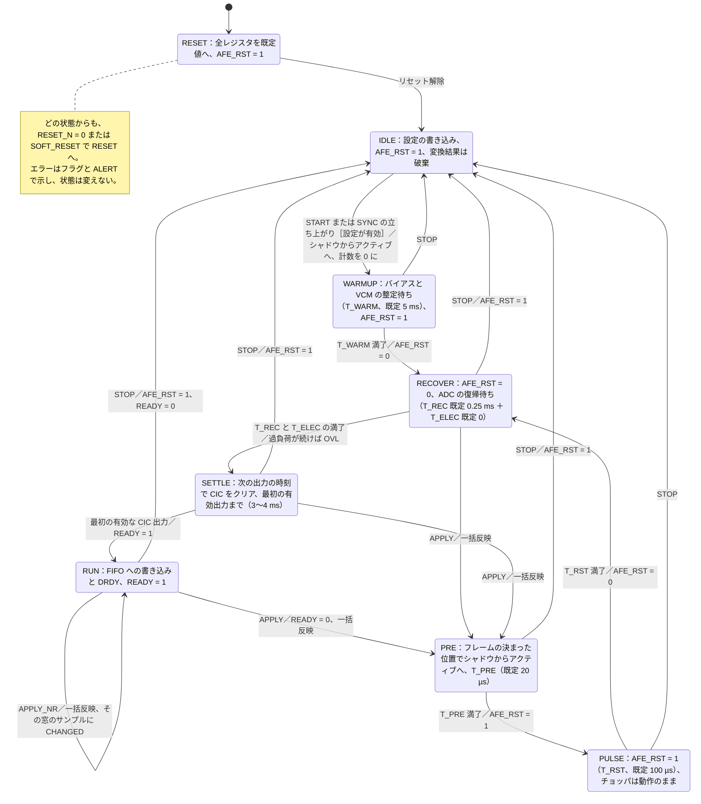
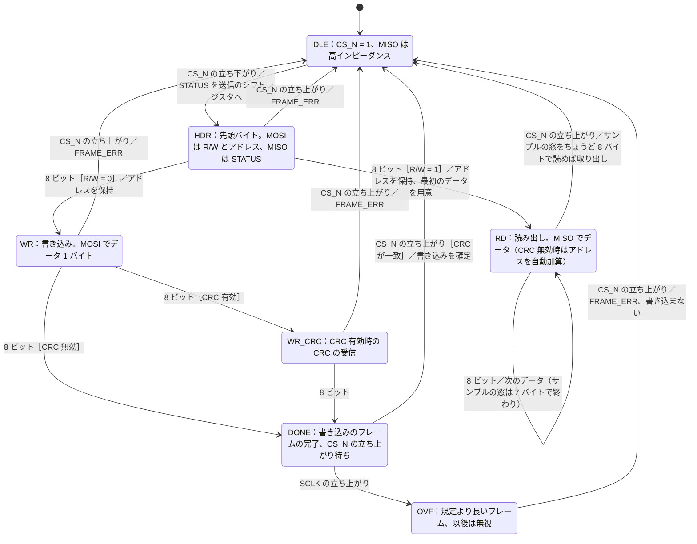
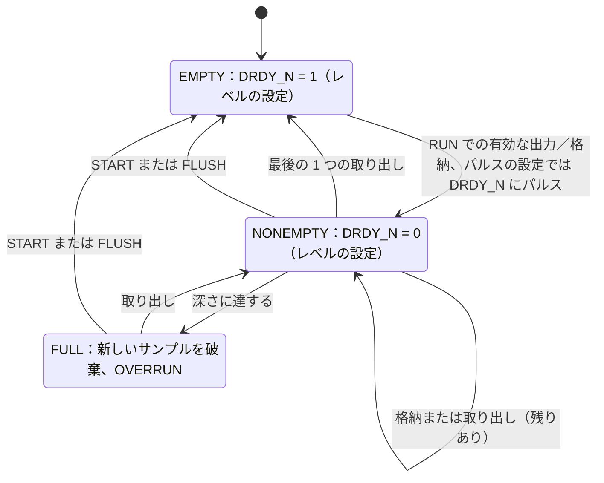

# デジタル制御（SPI・レジスタ・起動とデータ開始）の要件定義（案）（2026-11-19）

## 0. 本書の位置付け

- 11/19 の見直し（`gf180_digital_control_review_20261119.md`、問題点 A1〜H2）を受けた、改修版のデジタル制御の要件定義の案。
- 第 9 節の未決事項について、ユーザー（および実務者）の判断を受けたのち確定する。確定後、仕様（レジスタ表、SPI のフレームの詳細、タイミング図）を作成する。
- 要件の優先度は次の 3 段階。
  - 必須：今回の rev で満たすもの。
  - 推奨：面積と日程が許せば実装するもの。
  - 任意：今回は実装せず、将来の候補とするもの。
- 状態遷移図・状態表・状態遷移表の記法は第 3 節に定め、第 5 節をその模範とする。

## 1. 目的と範囲

**目的**

- アナログの起動と調整の条件（待ち時間、パルス幅、順序）を、チップ内の状態機械とタイマで保証すること。
- ホストの手順を「設定の書き込み → START → DRDY ごとの読み出し」に単純化すること。
- SPI とレジスタを一般的な形式（R/W とアドレスによるフレーム、命令と設定の分離、二重バッファ）にそろえること。
- 状態と異常をフラグで示し、ホストが検出と切り分けを行えること。

**範囲**

- 対象：eeg_digital_top（SPI、レジスタ、シーケンサ（新設）、クロック生成、CIC、FIFO）と、チップ上のパッドとの接続。
- 対象外：アナログのブロック、eeg_adc_dig（TH の取り込み、DWA。インターフェースは変えない）、CIC のフィルタ特性（H1）、DAC2 の DWA（E3）。

## 2. 前提条件

| 項目 | 値 | 根拠 |
|---|---|---|
| クロック | MCLK 32.768 MHz、1 フレーム 32 MCLK（1.024 MHz、0.977 µs）、1 ms ＝ 1,024 フレーム | `eeg_clkgen.sv` |
| バイアスの整定 | 電源投入から 0.82〜1.05 ms（立ち上がり 1 ms） | `gf180_realistic_eval_20261028.md`「電源投入：プロセスの角と電源の立ち上がりの速さ」 |
| VCM の整定 | 外付け 10 nF で、電源投入から 5 ms の解除が可能。容量を増やす場合は時定数の約 5 倍 | 同「VCM の容量と解除の時刻」 |
| AFE のバイアス電流 | 解除の前に AFE_IBIAS ＝ 3 | 記録表 F4 |
| ADC の過負荷からの復帰 | 最大 0.22 ms（ダイと状態のばらつきを含む） | 同「ADC の過負荷からの戻り」、図 40 |
| オフセット DAC の変更 | 20 µs 以上あけて AFE_RST を 100 µs、解除後 0.22 ms、CIC の整定 3 ms。電極に R・C がある場合は 5 R_e C_e の追加の待ち | `gf180_electrode_dc_20261022.md`「使い方（ホスト）」 |
| AFE_RST 中のチョッパ | 動作させたまま（CHOP_EN ＝ 1） | 記録表 F4 |
| ブランキング | オフセット DAC の使用時 15 MCLK、不使用時 7 MCLK。0 は不可 | 記録表 F4（2） |
| CHOP_DLY | 0 のみ（1 以上は不可） | 記録表 F4（1） |
| BOOST_TRIM | typical の初期値 4/2（ダイごとに試験で決定） | 記録表 D7、`gf180_realistic_eval_20261028.md` の窓の節 |
| パッド | デジタルの bi_24t 9 個はすべて使用中（MCLK、RESET_N、SCLK、CS_N、MOSI、MISO、DRDY_N、RAW_DATA、RAW_CLK）。未使用は asig_5p0 の 33 個のみ | `gf180/tapeout/chip/padring/pad_coordinates.csv` |
| マクロ | eeg_digital_top は 440 × 700 µm、セル 7,080 個、使用率 75.8 %、ss/125 °C の setup の余裕 +1.10 ns | LibreLane の f2（11/19 の再実行、元のランと同一） |
| 日程 | 12/9 スロット購入、12/16 GDS 提出 | 記録表 F1 |

## 3. 記法（状態遷移図の模範の形）

- 状態遷移図、状態表、状態遷移表の 3 点を一組とする。正は状態遷移表とし、図は表の見取り図とする。
- **状態**：英大文字の名前と、その意味。その状態で保持する出力は状態表に記す。
- **遷移のラベル**：「イベント［条件］／動作」（UML の状態機械の記法）。
  - イベントは SPI の命令、ピンの変化、タイマの満了、内部の事象（CIC の出力の時刻など）。
  - 条件は、遷移の可否を決める論理式。
  - 動作は、遷移のときに 1 回だけ行う処理。
- **タイマ**：遷移の動作で開始し、満了をイベントとする。値はレジスタで設定し、既定値を持つ。単位は、µs の範囲はフレーム（0.977 µs）、ms の範囲は 1 ms（1,024 フレーム）。
- **状態遷移表**：行を状態、列をイベントとし、各欄に「動作 → 次の状態」を記す。全欄を埋め、空欄を残さない。
  - 「—」：その状態では起こり得ない事象。
  - 「無視」：受理して何もしない。
  - 「STATE_ERR」：拒否して状態を変えず、エラーのフラグを立てる。
- **不正な状態値**（ソフトエラーなど）は、IDLE（AFE_RST ＝ 1）へ戻して STATE_ERR を立てる（安全側）。

## 4. 機能要件

### 4.1 動作状態（シーケンサ）

| ID | 要件 | 優先度 | 対応する問題点 |
|---|---|---|---|
| SEQ-01 | チップ内に上位の状態機械（シーケンサ）を設け、状態 RESET、IDLE、WARMUP、RECOVER、SETTLE、RUN、PRE、PULSE を持つこと（第 5.1 節） | 必須 | C1、C3 |
| SEQ-02 | 起動の待ち（バイアスと VCM の整定）は、WARMUP のタイマ T_WARM で保証すること。既定 5 ms、0〜255 ms で設定可 | 必須 | C1 |
| SEQ-03 | AFE_RST の解除後、ADC の過負荷からの復帰を RECOVER のタイマ T_REC で待つこと（既定 0.25 ms、設定可）。電極の整定のための追加の待ち T_ELEC（既定 0、0〜255 ms）を持つこと | 必須 | C1、C8 |
| SEQ-04 | SETTLE では、次の出力の時刻に合わせて CIC をクリアし、最初の有効な出力で READY ＝ 1 とすること。間引きの位相（出力の時刻の格子）は START の時点のまま保つこと | 必須 | C3、C5、C6 |
| SEQ-05 | 設定の反映（APPLY）では、次の要件を満たすこと | 必須 | B1、C2、E1 |
| | ・シャドウからアクティブへ、フレームの決まった位置で一括して写すこと | | |
| | ・T_PRE（既定 20 µs）ののち、AFE_RST のワンショット（T_RST、既定 100 µs、0.1〜4 ms）を出すこと | | |
| | ・RECOVER と SETTLE を経て RUN に戻ること | | |
| | ・パルスの間もチョッパを止めないこと | | |
| SEQ-06 | パルスなしの一括反映（APPLY_NR）を持ち、反映をまたぐサンプルに CHANGED の印を付けること（運転中の 1 段の追従用） | 必須 | B1、C9 |
| SEQ-07 | START は命令と SYNC の立ち上がり（第 4.6 節）の両方で受け付けること。STOP で IDLE（AFE_RST ＝ 1）に戻ること | 必須（SYNC は推奨） | C6 |
| SEQ-08 | START の時点で設定の整合（M が範囲内であること、BLANK_LEN ≥ 1 など）を検査し、不整合なら START を拒否して CFG_ERR を立てること | 推奨 | B6 |
| SEQ-09 | 状態遷移表（表 5.1-2）の全欄をそのまま実装すること。受け付けない命令は状態を変えず、STATE_ERR を立てること | 必須 | D5 |
| SEQ-10 | 試験の設定（ADC_ZERO、CHOP_EN ＝ 0、試験用マルチプレクサ）の切り替えも APPLY を経由し、再整定を自動で行うこと | 推奨 | C7 |
| SEQ-11 | RECOVER の終わりに過負荷が続いている場合は、OVL を立てて SETTLE に進むこと（自動の再試行は行わない。未決事項 D-8） | 必須 | E4 |
| SEQ-12 | リセットの解除後に自動で WARMUP へ進む設定（AUTO_START、既定は無効）を持つこと | 任意 | — |

### 4.2 SPI

| ID | 要件 | 優先度 | 対応する問題点 |
|---|---|---|---|
| SPI-01 | モード 0、MSB 先頭、SCLK 2 MHz 以下とし、MCLK による再同期の方式を継続すること | 必須 | — |
| SPI-02 | フレームの先頭バイト（MOSI）は、R/W（bit 7、1 ＝ 読み出し）と 7 ビットのアドレスとすること | 必須 | A2 |
| SPI-03 | すべてのフレームで、先頭バイトの間に MISO から STATUS を返すこと。STATUS には固定のビット列を含め、MISO の無応答（0x00、0xFF）と区別できること | 必須 | A4、A6 |
| SPI-04 | 書き込みのフレームは 2 バイト（CRC 有効時は 3 バイト）に固定すること。CS_N の立ち上がりで、長さと CRC が正しい場合に限り確定すること。正しくない場合は書き込まず、FRAME_ERR または CRC_ERR を立てること | 必須 | A1、A3、A5 |
| SPI-05 | CRC-8（多項式 0x07）を書き込みと読み出しに付ける設定（CRC_EN）を持つこと。既定は無効（未決事項 D-6） | 必須 | A5 |
| SPI-06 | 読み出しでは、先頭バイトのあとにデータを返すこと。CRC 無効時はアドレスの自動加算による連続読み出しを可能とし、CRC 有効時は 1 バイトと CRC に固定すること | 必須（連続は推奨） | A2 |
| SPI-07 | サンプルの読み出しは、データの窓のアドレスへの 8 バイトの読み出しとすること（先頭 1、STATUS 1、SEQ 2、DATA 3、CRC 1）。ちょうど 8 バイトの場合に FIFO から取り出すこと（現行と同等） | 必須 | — |
| SPI-08 | 未定義のアドレスへの書き込みと、読み出し専用のレジスタへの書き込みは行わず、ADDR_ERR を立てること | 必須 | A9、D5 |
| SPI-09 | ソフトウェアリセットを、命令レジスタへの鍵付きの書き込みで行えること | 必須 | A7 |
| SPI-10 | 連続読み出しモード（命令なしのデータ読み出し）を持つこと | 任意 | A8 |

現行のコマンド形式（0x10／0x20／0x30）を維持する案は、未決事項 D-2 とする。

### 4.3 レジスタ

| ID | 要件 | 優先度 | 対応する問題点 |
|---|---|---|---|
| REG-01 | アドレス空間を、識別と状態（読み出し専用、W1C）、命令、設定、試験、データの窓の区画に分けること | 必須 | B3、B5 |
| REG-02 | 命令（START、STOP、APPLY、APPLY_NR、FLUSH、エラーのクリア、SOFT_RESET）は命令レジスタへの書き込みで実行し、設定のビットと混在させないこと | 必須 | B3 |
| REG-03 | アナログに影響する設定は、シャドウとアクティブの二重とすること。対象はオフセット DAC の M・符号・範囲、トリム、チョッパ、BLANK、試験の設定。アクティブへの反映は START、APPLY、APPLY_NR のときのみとし、シャドウとアクティブの両方を読み出せること | 必須 | B1、B2 |
| REG-04 | 1 つのフィールドは 1 つのレジスタに収めること。8 ビットを超えるものは、連続したアドレスに上位から置くこと。フィールドの境界をそろえ、未使用のビットは 0 を返し、その書き込みは無視すること | 必須 | B4、B5 |
| REG-05 | リセットの既定値は推奨の動作値とすること（AFE_IBIAS 3、BOOST_TRIM 4/2、BLANK 7、CHOP_FAST 1、CHOP1 4 kHz、DWA_EN 1）。これにより F4 の AFE_IBIAS の先行書き込みは不要となる | 必須 | C1 |
| REG-06 | 設定してはならない値を書けないこと。BLANK_LEN は 1 以上とし、M は範囲の上限で飽和させる。制限した場合は RANGE_ERR を立てること。CHOP_DLY は廃止し、0 に固定すること（未決事項 D-5） | 必須 | B6 |
| REG-07 | オフセット DAC の使用中（範囲 1 以上）は、BLANK を自動で 15 とすること | 推奨 | B7 |
| REG-08 | 試験のレジスタは、鍵の書き込みで解錠した場合のみ書き込めること | 推奨 | — |

### 4.4 データの出力

| ID | 要件 | 優先度 | 対応する問題点 |
|---|---|---|---|
| DAT-01 | FIFO への書き込みは RUN の間のみとすること | 必須 | C4 |
| DAT-02 | サンプルのステータスに次を含めること：VALID、OVERRUN、OVL（その窓での過負荷）、CHANGED（その窓での APPLY_NR）、ERR（マスクしないエラーのフラグの有無） | 必須 | C9、D2 |
| DAT-03 | SEQ は START で 0 とし、以後は出力の時刻（1 ms）ごとに数えること（格納しない出力、再整定中の無効な出力も数える）。FIFO は START と FLUSH の命令で空にすること | 必須 | C5 |
| DAT-04 | DRDY_N は、レベル（FIFO が空でない間 Low、既定）とパルス（サンプルごとに一定幅の Low）を選べること | 必須 | D4 |
| DAT-05 | FIFO の深さは 4 以上とすること（8 が望ましい。未決事項 D-4）。満杯時は新しいサンプルを捨てて OVERRUN を立てること（現行どおり） | 必須 | — |
| DAT-06 | サンプルの形式（24 ビットの 2 の補数、CRC-8）は現行どおりとすること。CIC の出力は、出力の時刻の格子が同じであれば、現行とビット単位で一致すること | 必須 | — |

### 4.5 状態・フラグ・エラー

| ID | 要件 | 優先度 | 対応する問題点 |
|---|---|---|---|
| FLG-01 | STATUS（読み出し専用）に、状態（STATE）、READY、FIFO_NONEMPTY、AFE_RST の現在値、過負荷の現在値、ALERT（マスクしないエラーの有無）を含めること | 必須 | D1 |
| FLG-02 | エラーのレジスタ（W1C）に、RESET_FLAG（リセットの発生）、FRAME_ERR、CRC_ERR、ADDR_ERR、STATE_ERR、CFG_ERR、RANGE_ERR、OVERRUN、OVL を持つこと。発生と同じサイクルのクリアでは、発生を優先すること（現行どおり） | 必須 | D1、D5 |
| FLG-03 | ALERT のマスクを持ち、マスクしないエラーで ALERT_N を出すこと（ピンは未決事項 D-3） | 推奨 | D3 |
| FLG-04 | ADC の過負荷を、量子化器のコードが両端（0 または 31）となる頻度で検出すること。しきい値と窓は、正常な入力（フルスケールの正弦波、オフセット DAC の残差を含む）で誤検出しないように、仕様の段階で行動モデルのコード列から決めること | 必須 | E4 |

### 4.6 ピンとチップ上の接続

| ID | 要件 | 優先度 | 対応する問題点 |
|---|---|---|---|
| PIN-01 | パッドリングは変更しないこと | 推奨 | — |
| PIN-02 | SYNC 入力と ALERT_N 出力は、RAW の試験を使わない間、RAW_CLK と RAW_DATA のパッドを兼用して設けること（パッドの OE と入力をデジタルのマクロから制御。未決事項 D-3） | 推奨 | C6、D3 |
| PIN-03 | SYNC の立ち上がりは、IDLE でのみ START として受け付けること。フレームと間引きの計数を合わせ、MCLK と SYNC を共有する複数チップの間で、サンプルの時刻を 1 MCLK 以内にそろえること | 推奨 | C6 |

### 4.7 アナログ制御の出力

| ID | 要件 | 優先度 | 対応する問題点 |
|---|---|---|---|
| ANA-01 | アナログへの制御出力（AFE_RST、CHOP_EN、OFM、OFS、OFEN、トリム、TEST_CFG など）は、すべてレジスタの出力とすること。変化はフレーム内の決まった位置に限り、比較器と DAC の更新の時刻を避けること | 必須 | B2、E1 |
| ANA-02 | AFE_RST はシーケンサのみが駆動し、パルス幅は T_RST で保証すること | 必須 | C2、E1 |
| ANA-03 | CHOP_EN の意味（ピンへの出力のみで、CHOP と CHOP_OUT は止まらない）を仕様に明記すること | 必須 | E2 |

### 4.8 リセットとクロック

| ID | 要件 | 優先度 | 対応する問題点 |
|---|---|---|---|
| RST-01 | RESET_N は非同期で掛け、同期で解除すること（現行どおり） | 必須 | — |
| RST-02 | ソフトウェアリセット（SPI-09）は、RESET_N と同じ既定値に戻すこと | 必須 | A7 |
| RST-03 | リセットの発生を RESET_FLAG で示すこと（予期しないリセットの検出） | 必須 | F2 |
| RST-04 | チップに POR はないため、電源の安定まで RESET_N を Low に保つことを基板の要件とすること（記録表 F2） | 必須（基板） | F2 |
| RST-05 | クロックは MCLK の単一とすること。MCLK の停止は、ホストが STATUS の固定のビット列（SPI-03）で検出すること | 必須 | A6、F1 |

### 4.9 試験機能

| ID | 要件 | 優先度 | 対応する問題点 |
|---|---|---|---|
| TST-01 | RAW のコード列、DBG_SEL、ADC_ZERO、アナログの試験用マルチプレクサを維持すること | 必須 | — |
| TST-02 | 試験の設定の変更は APPLY を経由すること（SEQ-10） | 推奨 | C7 |

## 5. 模範の状態遷移図・状態表・状態遷移表

### 5.1 シーケンサ

**表 5.1-1 状態表**（各状態で保持する出力）

| 状態 | STATE の値 | AFE_RST | 設定 | CIC | FIFO への書き込み | READY | タイマ |
|---|---|---|---|---|---|---|---|
| RESET | —（SPI は応答しない） | 1 | 既定値へ | クリア | なし | 0 | — |
| IDLE | 0 | 1 | シャドウへ書き込み。APPLY で即時にアクティブへ | 動作（出力は破棄） | なし | 0 | — |
| WARMUP | 1 | 1 | アクティブは START 時の値 | 動作（破棄） | なし | 0 | T_WARM |
| RECOVER | 2 | 0 | — | 動作（破棄） | なし | 0 | T_REC ＋ T_ELEC |
| SETTLE | 3 | 0 | — | 次の出力の時刻でクリアし、充填 | なし | 0 | 有効な出力まで |
| RUN | 4 | 0 | APPLY_NR で一括反映 | 動作 | 有効な出力ごと | 1 | — |
| PRE | 5 | 0 | 入口で一括反映 | 動作（破棄） | なし | 0 | T_PRE |
| PULSE | 6 | 1 | — | 動作（破棄） | なし | 0 | T_RST |

- DRDY_N は、どの状態でも FIFO の状態に従う（レベルの設定。パルスの設定では、RUN で格納したサンプルごとに 1 回）。
- SEQ は START で 0 とし、以後どの状態でも出力の時刻ごとに数える。
- 一括反映は、命令を受けた次のフレームの決まった位置で行う。

**表 5.1-2 状態遷移表**（欄は「動作 → 次の状態」。次の状態の記載がない欄は、状態を変えない）

| 状態 ＼ イベント | RESET_N ＝ 0、SOFT_RESET | リセット解除 | START、SYNC の立ち上がり | STOP | APPLY | APPLY_NR | タイマ満了 | CIC の出力の時刻 |
|---|---|---|---|---|---|---|---|---|
| RESET | 無視 | → IDLE | — | — | — | — | — | — |
| IDLE | → RESET | — | ［設定が有効］一括反映、SEQ と間引きの計数を 0（SYNC はフレームの計数も 0）、T_WARM 開始 → WARMUP。［無効］CFG_ERR | 無視 | 一括反映 | 一括反映 | — | 破棄 |
| WARMUP | → RESET | — | STATE_ERR（SYNC は無視） | → IDLE | 一括反映 | 一括反映 | AFE_RST ＝ 0、T_REC 開始 → RECOVER | 破棄、SEQ を加算 |
| RECOVER | → RESET | — | STATE_ERR（SYNC は無視） | AFE_RST ＝ 1 → IDLE | 一括反映、T_PRE 開始 → PRE | 一括反映 | ［過負荷なし］→ SETTLE。［過負荷あり］OVL → SETTLE | 破棄、SEQ を加算 |
| SETTLE | → RESET | — | STATE_ERR（SYNC は無視） | AFE_RST ＝ 1 → IDLE | 一括反映、T_PRE 開始 → PRE | 一括反映、CIC のクリアをやり直す | — | ［クリア前］CIC をクリア。［充填中］破棄。［最初の有効出力］READY ＝ 1 → RUN。いずれも SEQ を加算 |
| RUN | → RESET | — | STATE_ERR（SYNC は無視） | AFE_RST ＝ 1、READY ＝ 0 → IDLE | READY ＝ 0、一括反映、T_PRE 開始 → PRE | 一括反映、その窓に CHANGED | — | FIFO へ格納（満杯なら破棄して OVERRUN）、DRDY、SEQ を加算 |
| PRE | → RESET | — | STATE_ERR（SYNC は無視） | AFE_RST ＝ 1 → IDLE | STATE_ERR | STATE_ERR | AFE_RST ＝ 1、T_RST 開始 → PULSE | 破棄、SEQ を加算 |
| PULSE | → RESET | — | STATE_ERR（SYNC は無視） | → IDLE | STATE_ERR | STATE_ERR | AFE_RST ＝ 0、T_REC 開始 → RECOVER | 破棄、SEQ を加算 |

- FLUSH（FIFO を空にする）とエラーのクリアは、RESET 以外のどの状態でも受け付け、状態を変えない。
- 不正な状態値は IDLE（AFE_RST ＝ 1）へ戻し、STATE_ERR を立てる。

### 5.2 SPI のトランザクション

**表 5.2-1 状態遷移表**

| 状態 ＼ イベント | CS_N の立ち下がり | 8 ビットの完了 | CS_N の立ち上がり（バイトの途中） | CS_N の立ち上がり（バイトの境界） |
|---|---|---|---|---|
| IDLE | STATUS を用意 → HDR | — | — | — |
| HDR | — | ［R/W ＝ 1］→ RD。［R/W ＝ 0］→ WR。［未定義のアドレス］ADDR_ERR（読み出しは 0 を返す） | FRAME_ERR → IDLE | FRAME_ERR → IDLE |
| RD | — | 次のデータ（CRC 無効時はアドレス ＋ 1） | FRAME_ERR → IDLE | ［サンプルの窓を 8 バイト］FIFO から取り出し → IDLE。［その他］→ IDLE |
| WR | — | ［CRC 有効］→ WR_CRC。［無効］→ DONE | FRAME_ERR → IDLE | FRAME_ERR → IDLE |
| WR_CRC | — | → DONE | FRAME_ERR → IDLE | FRAME_ERR → IDLE |
| DONE | — | —（最初のビットの受信で → OVF） | —（同左） | ［CRC 一致または CRC 無効］書き込みを確定（命令は実行）→ IDLE。［CRC 不一致］CRC_ERR → IDLE |
| OVF | — | 無視 | FRAME_ERR → IDLE | FRAME_ERR → IDLE |

- 読み出し専用のレジスタと未定義のアドレスへの書き込みは、DONE の確定の時点で ADDR_ERR とし、書き込まない。
- CS_N の立ち下がりから最初の SCLK までの間隔などのタイミングの条件は、仕様で現行（README「Timing assumptions」）を基に定める。

### 5.3 FIFO と DRDY

### 5.4 模範のホスト手順

1. 電源投入。電源の安定まで RESET_N を Low に保ち、そのあと High にする。
2. ID と STATUS を読み、固定のビット列と RESET_FLAG を確認して、エラーのレジスタをクリア（W1C）する。
3. 必要な設定をシャドウへ書く。BOOST_TRIM（ダイごと）、CHOP1、CRC_EN、DRDY のモード、ALERT のマスク、電極に応じた T_ELEC など。既定値で足りる項目は書かない。
4. START（命令、または SYNC の立ち上がり）。STATUS の READY、または最初の DRDY_N を待つ。
5. DRDY_N ごとにサンプル（8 バイト）を読む。ステータスの VALID、OVL、CHANGED を確認する。
6. オフセットの探索：M・符号・範囲をシャドウへ書いて APPLY し、READY を待って平均を読む。これを繰り返す。運転中の 1 段の追従は APPLY_NR とし、CHANGED の付いたサンプルを除く。
7. 異常時：ALERT_N（または STATUS の ALERT）を受けてエラーのレジスタを読み、対処ののちクリアする。
8. 停止は STOP、再開は START。

現行の手順（AFE_IBIAS の先行書き込み、AFE_RST の 2 回の書き込みによるパルス、0.22 ms と 3 ms の待ち、FILTER_CLEAR、BLANK の切り替え）は、すべてチップ側に移る。

## 6. 非機能要件

| ID | 要件 | 優先度 |
|---|---|---|
| NFR-01 | 3.3 V の 9 コーナーで setup と hold を満たすこと（現行の SDC）。チップの配線込みの STA でも満たすこと | 必須 |
| NFR-02 | 現行のマクロの外形（440 × 700 µm）に収めること。収まらない場合は、FIFO を 4 段とし、CHOP_DLY の論理を除いて再評価すること。なお収まらない場合は、マクロを拡大し、チップの配置を変更すること | 必須 |
| NFR-03 | eeg_adc_dig とのインターフェースを変えないこと | 必須 |
| NFR-04 | 通常の動作で、新たに連続して切り替わる出力を設けないこと（DRDY のパルスは 1 ms に 1 回）。アナログ制御の変化はフレームの決まった位置に限ること（ANA-01） | 必須 |
| NFR-05 | 状態機械は安全側に作ること（不正な状態値は IDLE、AFE_RST ＝ 1、STATE_ERR） | 必須 |
| NFR-06 | 出力にグリッチがないこと（すべてレジスタの出力。MISO_OE の組み合わせ回路は現行どおり） | 必須 |
| NFR-07 | 検証の資産（CIC の黄金モデル、行動モデルのコード列、ゲートレベルの照合、SDF の台）を流用できること | 推奨 |

## 7. 検証要件

| ID | 要件 |
|---|---|
| VER-01 | 状態遷移表（表 5.1-2、表 5.2-1）の全欄を単体試験で確認すること（状態の網羅率と遷移の網羅率 100 %。STATE_ERR、FRAME_ERR などの拒否の欄を含む） |
| VER-02 | SPI：全種類のフレーム、連続読み出し、CRC の有無、長さ違い、バイトの途中での CS_N の立ち上がり、未定義のアドレス、読み出し専用への書き込み、鍵の誤り。MCLK と非同期の 2 MHz と 1 MHz で確認すること |
| VER-03 | タイマ：T_WARM、T_PRE、T_RST、T_REC、T_ELEC を最小・既定・最大で確認し、AFE_RST のパルス幅をピンで測ること |
| VER-04 | 通し試験：START から RUN までと、運転中の APPLY と APPLY_NR を、行動モデルのコード列（s4、s20）で黄金モデルとビット単位で照合すること |
| VER-05 | ゲートレベル（遅延なし）の照合を全単体試験と短い通し試験で行うこと。SDF を 3 コーナーで、SPI とシーケンサの代表的な試験に行うこと |
| VER-06 | ホストの手順の模型（Python）でテストベンチを駆動すること。対象は、電源投入からの起動、オフセットの探索、異常の注入（CRC、長さ違い、STATE_ERR）、2 チップの SYNC（サンプルの時刻の一致） |
| VER-07 | シーケンサの既定のタイマで、アナログの起動のデッキ（`afe_startup.py`）を回し直すこと（解除の時刻、パルス、復帰） |
| VER-08 | チップ：DRC、LVS、precheck、チップの STA、変更した配線（RAW のパッドの兼用）の目視の確認を行うこと |

## 8. 問題点との対応

| 問題点 | 対応する要件 | 扱い |
|---|---|---|
| A1、A3 | SPI-04、FLG-02 | 解消 |
| A2 | SPI-02、SPI-06 | 解消（D-2） |
| A4 | SPI-03 | 解消 |
| A5 | SPI-05 | 解消 |
| A6、F1 | SPI-03、RST-05 | 受容（検出のみ） |
| A7 | SPI-09、RST-02 | 解消 |
| A8 | SPI-10 | 任意（今回は実装しない） |
| A9、D5 | SPI-08、SEQ-09、FLG-02 | 解消 |
| B1 | REG-03、SEQ-05、SEQ-06 | 解消 |
| B2 | REG-03、ANA-01 | 解消 |
| B3、B5 | REG-01、REG-02、REG-04 | 解消 |
| B4 | REG-04 | 解消 |
| B6 | REG-06、SEQ-08 | 解消（D-5） |
| B7 | REG-07 | 解消 |
| C1 | SEQ-01〜03、REG-05 | 解消 |
| C2、E1 | SEQ-05、ANA-02 | 解消 |
| C3 | SEQ-04、FLG-01 | 解消 |
| C4 | DAT-01 | 解消 |
| C5 | DAT-03 | 解消 |
| C6 | SEQ-04、SEQ-07、PIN-02、PIN-03 | 解消（D-3） |
| C7 | SEQ-10 | 解消 |
| C8 | SEQ-03（T_ELEC） | 軽減（値はホストが電極に応じて設定） |
| C9 | SEQ-06、DAT-02 | 解消 |
| D1 | FLG-01、FLG-02 | 解消 |
| D2 | DAT-02 | 解消 |
| D3 | FLG-03、PIN-02 | 解消（D-3） |
| D4 | DAT-04 | 解消 |
| E2 | ANA-03 | 文書化 |
| E3 | — | 対象外（次の rev） |
| E4 | FLG-04、SEQ-11 | 解消 |
| E5 | — | 受容（AFE_RST 中のため実害なし） |
| F2 | RST-03、RST-04 | 解消（基板の要件） |
| G1〜G3 | VER-01〜08 | 解消 |
| H1、H2 | — | 対象外 |

## 9. 未決事項（ユーザーの判断）

| 番号 | 事項 | 選択肢 | 推奨 |
|---|---|---|---|
| D-1 | 今回の rev での改修の範囲 | 本要件のすべて／必須のみ／改修なし（ファームウェアで回避） | 本要件のすべて（推奨と任意は面積と日程に応じて） |
| D-2 | SPI のフレーム形式 | R/W とアドレスの形式へ変更／現行のコマンド形式を維持し、誤りの通知と状態の返送のみ追加 | 変更。ホストのファームウェアが確定する前の今が最も安い |
| D-3 | SYNC と ALERT のピン | RAW_CLK と RAW_DATA の兼用／パッドリングの変更で専用のピンを追加／設けない | 兼用。パッドリングの再生成を避け、RAW の試験のときのみ使えない |
| D-4 | FIFO の深さ | 8 を維持／4 に削減 | 合成の面積を見て決める（1 kSPS で 4 段は 4 ms の余裕） |
| D-5 | CHOP_DLY | 廃止（0 に固定）／試験のレジスタへ移す | 廃止。1 以上は使えず（F4（1））、面積も減る |
| D-6 | CRC の既定 | 無効／有効 | 無効（立ち上げの扱いやすさ）。製品のファームウェアで有効にする |
| D-7 | 自動開始（AUTO_START） | なし／リセットの解除後に自動で WARMUP | なし（任意の機能として扱う） |
| D-8 | RECOVER の終わりにも過負荷が続く場合の扱い | フラグのみで SETTLE へ／AFE_RST を再度かける（回数の上限付き） | フラグのみ。原因（M の不一致など）はホストが判断する |

## 10. 日程（案）

| 期間 | 作業 |
|---|---|
| 11/20〜21 | 本要件の確定（ユーザーと実務者の確認、未決事項の判断） |
| 11/22〜24 | 仕様（レジスタ表、SPI のフレーム、タイミング図、過負荷検出のしきい値） |
| 11/25〜28 | RTL と単体試験（VER-01〜03） |
| 11/29〜12/1 | 通し試験、ゲートレベル、ホストの手順の模型（VER-04〜06） |
| 12/2〜3 | マクロの再生成（LibreLane）、14 回目のチップの組み立て |
| 12/4〜8 | DRC、LVS、precheck、チップの STA、SDF、起動の再確認（VER-05、07、08） |
| 12/9 | スロットの購入（設計と独立） |
| 12/10〜12 | 予備。提出版（r14、または現行のデジタルの r13）の判断 |
| 12/16 | GDS の提出 |

- 現行のデジタルの r13 は、改修が間に合わない場合の提出版として保持する。
