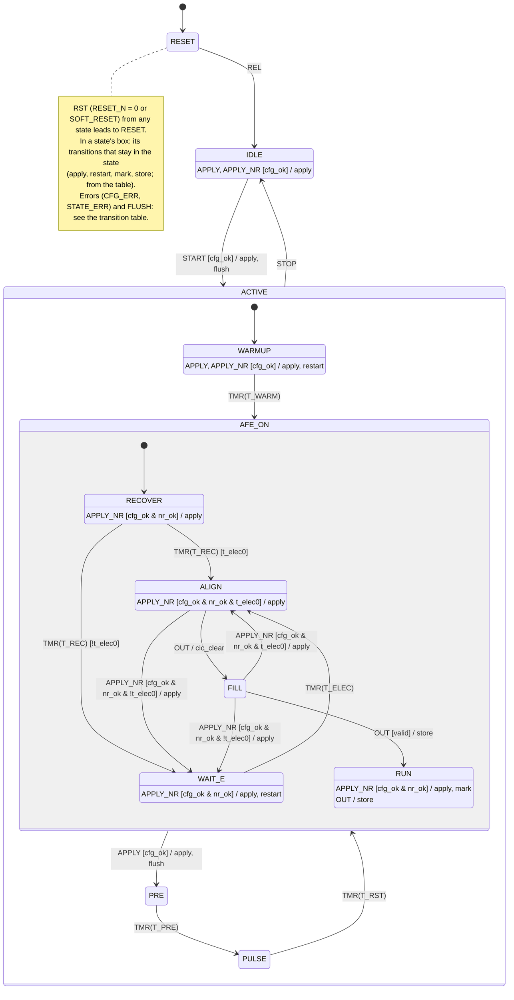
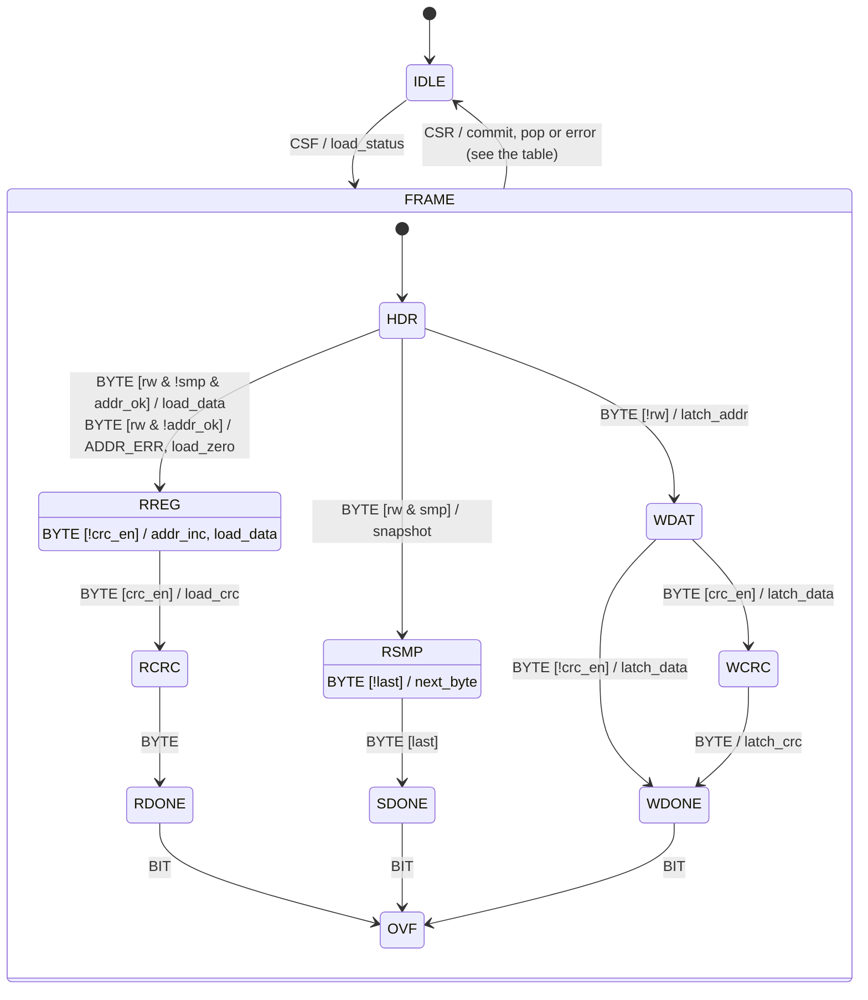

# デジタル制御（SPI・レジスタ・起動とデータ開始）の要件定義（案）（r15、2026-11-19、11/27 に r15 の追加）

## 0. 本書の位置付け

- 11/19 の見直し（`gf180_digital_control_review_20261119.md`、問題点 A1〜H2）を受けた、改修版のデジタル制御の要件定義の案。
- 第 9 節の未決事項は、11/19 夜にユーザーの判断で推奨のとおり決定した。仕様（レジスタ表、SPI のフレームの詳細、タイミング図）は `gf180_digital_control_spec_r15_20261127.md`。
- 要件の優先度は次の 3 段階。
  - 必須：今回の rev で満たすもの。
  - 推奨：面積と日程が許せば実装するもの。
  - 任意：今回は実装せず、将来の候補とするもの。
- 状態遷移図・状態表・状態遷移表の記法は第 3 節に定め、第 5 節をその模範とする。
- r2（11/19 夜）：状態遷移表を機械可読の仕様源（`gf180/tapeout/rtl/spec/fsm_spec.py`）とし、図と表をそこから生成。抜け・矛盾・行き止まり・同時の事象を自動で検査し、r1 の論理の穴 19 件を修正（第 5.5 節）。
- r3（11/19 夜）：アナログ側の仕様（AFE のクロックドライバ、オフセット DAC、ADC の過負荷、OTA1 のチョッパ、試験用マルチプレクサ、起動の条件）と、境目の全信号を照合（第 4.10 節）。ピンの兼用によるパッドの衝突、CHOP1 の切り替えの遅れ、64 kHz での命令の取りこぼしなど 8 件を修正し、時刻の制約も自動の検査に加えた（第 5.5 節）。

### 0.1 r15 の追加（11/27、Test4-1 のレジスタマップ案から）

#### 位置付けと区別

- r15 は r14（VERSION 0x10）に三つの機能を加えた制御の版である。VERSION は 0x11。ほかのレジスタ、命令のコード、SPI のフレーム、シーケンサは r14 と同じである。
- RTL と仕様源は `gf180/tapeout/rtl_r15`（`spec/` を含む）に、文書は `*_r15_20261127.md` に分けた。r14 のマクロ（r14f5）が読む `rtl_r14` と `rtl/spec`、r14 の文書は変えていない。
- Test4-1 案（Test3-1 の VERSION 0x07、Test4-1 v0.1 の 0x08 の系統）とは、ID が同じ 0xE6 でも別の通信仕様である。番地と命令のコードは互いに流用しない（例：Test4-1 案の 0x02 CONTROL、0x22 CMD は、r15 ではそれぞれ CAPS、OFF_CTRL）。ホストは ID と VERSION で通信仕様を選び、知らない版には書き込まない。この方針は Test4-1 案と同じである。

#### 加えた機能

| 名 | 番地 | 内容 |
|---|---|---|
| CFG_GEN | 0x0D（読み出し専用） | 設定の世代。START、APPLY、APPLY_NR がアクティブの写しを入れるたびに 1 進む。255 の次は 0。リセット（RESET_N、SOFT_RESET）で 0。ホストは命令の前後の CFG_GEN の差で、命令が実行されたかを一度の読み出しで確かめられる |
| DROP_CNT | 0x0E（読み出し専用） | FIFO が満杯で失ったサンプルの数。255 で止まる。DFLAG の OVERRUN を 1 の書き込みで消すと 0 に戻る（同じサイクルの取りこぼしは消去に勝ち、1 となる）。リセットで 0 |
| LATEST | 0x4F（データの窓） | 最新値の窓。サンプルの窓（0x40）と同じ 8 バイトのフレーム（状態、SEQ、DATA、CRC）で最後の出力を返し、FIFO から取り出さない。最後の出力とは、FIFO に格納したものと、満杯で落ちたものの両方を含む。CRC は先頭バイト 0xCF から始めるので、サンプルの窓の読み出しと取り違えない。START、APPLY、APPLY_NR、FLUSH、リセットのあとは空の語（VALID 0）を返す。APPLY と APPLY_NR では、同じサイクルの出力より空の語を優先する。その出力は古い設定のものだからである |

- LATEST の番地 0x4F は、読めるレジスタ（アクティブの写しを含む）のどれとも 1 ビット違いにならず、先頭バイトの SCLK の 1 回の滑りでも読めるレジスタから届かない（`regmap.py` の lat_slip_neighbours、`check` が確かめる）。このため、ホスト手順 5.4 (b) に新たな 2 回読みは要らない。
- VERSION の読み出しの滑りの組は (−1、0x11) となる。0x11 は VERSION の唯一の合法な値なので、誤った値ではない。

#### Test4-1 案との対応

| Test4-1 案 | r15 での扱い |
|---|---|
| ID 0xE6、VERSION で通信仕様を選ぶ | 同じ方針。r15 は VERSION 0x11 |
| CONTROL.RUN、CMD.START／STOP | 命令 START 0x11、STOP 0x22 と STATE（0x04）で行う（r14 から） |
| STATUS、EXT_STATUS、ACQ_STATUS | STATUS（0x03）、STATE（0x04）、ERR（0x06）、DFLAG（0x07）で行う（r14 から） |
| STAGE_L／STAGE_CTRL、OFFSET_APPLY、STAGE_DISCARD | シャドウとアクティブの写し、APPLY、APPLY_NR で行う。範囲外は書き込みの時点で RANGE_ERR、組み合わせの不正は命令の時点で CFG_ERR とし、アクティブの写しを変えない（r14 から）。仮設定の破棄はシャドウをアクティブの写しの値で書き戻して行う |
| CMD_ACK、ACQ_ACK | CMD_PENDING とアクティブの写しの読み返しで確かめる（r14 から）。r15 で CFG_GEN を加えた |
| ERROR、ACQ_ERROR | ERR（W1C、拒否の種類ごとのビット）で行う（r14 から） |
| CFG_GEN（推奨） | 採用（0x0D） |
| FIFO_DROP_COUNT（任意） | 採用（DROP_CNT、0x0E） |
| READ_LATEST（優先）、RESULT_A／B、TX_SNAP | 採用。SPI のオペコードではなく、番地 0x4F のデータの窓とした。フレームと CRC はサンプルの窓と共通である。RESULT_VALID はサンプルの状態の VALID、RESULT_SEQ は FIFO と同じ出力の番号（SEQ）とし、FIFO の語と照らし合わせられる。読み出し中に最新値が変わっても、写し（TX_SNAP にあたる SPI の shadow）は変わらない |
| READ_LATEST 内の CFG_GEN | 採用しない。フレームを FIFO と同じに保ち、設定の変わったあとの最初の出力は状態の CHANGED で示す |
| ACQ_CMD の単発、SLEEP／WAKE | 採用しない。単発は START のあと最初のサンプルで STOP すれば足りる。デジタル側の待機は IDLE が相当し、アナログの電源断は別の課題とする |
| STAGE_STATUS、APPLY_TXN_ID | 採用しない。不正な設定は命令の時点で拒否される。二重の実行は CFG_GEN とアクティブの写しで見分けられる |
| IRQ_ENABLE／FLAGS、FIFO_WATERMARK | ALERT と ALERT_MASK、ALERT_MASK_D、DRDY_N（DRDY_MODE）で行う。しきい値は採用しない |

#### 検証

- 仕様源：`fsm_spec.py`（fifo_step に LATEST の写し lsnap を加えた。自己試験 202 種）と `regmap.py`（データの窓を SAMPLE と LATEST の二つにした。LATEST の隣の検査、窓の滑りの模型の 4 番目のバイトの直接の検査。自己試験 125 種、違反の文 99 種）。check、selftest、fresh とも違反はない。
- FIFO 単体（`tb_fifo`、深さ 8 と 4）：LATEST の写しと消去をランダムに加え、`check_fifo_trace.py` が識別子の模型と照合した。照合器は誤りを入れた RTL 3 通りを全て検出した。
- 端子から（`tb/tb_r15.sv`、深さ 8 と 4）：VERSION、リセットのあとの値、各命令での CFG_GEN、LATEST の値と CRC、取り出さないこと、短いサンプルの読み出しのあとの LATEST の読み出し、満杯の間の追従、DROP_CNT と OVERRUN の消去、255 での停止、SOFT_RESET、CRC 有効時の読み出しを確かめた。誤りを入れた RTL 11 通りを全て検出した。

## 1. 目的と範囲

**目的**

- アナログの起動と調整の条件（待ち時間、パルス幅、順序）を、チップ内の状態機械とタイマで保証すること。
- ホストの手順を「設定の書き込み → START → DRDY ごとの読み出し」に単純化すること。
- SPI とレジスタを一般的な形式（R/W とアドレスによるフレーム、命令と設定の分離、二重バッファ）にそろえること。
- 状態と異常をフラグで示し、ホストが検出と切り分けを行えること。

**範囲**

- 対象：eeg_digital_top（SPI、レジスタ、シーケンサ（新設）、クロック生成、CIC、FIFO）と、チップ上のパッドとの接続。
- 対象外：アナログのブロック、eeg_adc_dig（TH の取り込み、DWA。インターフェースは変えない）、CIC のフィルタ特性（H1）、DAC2 の DWA（E3）。

## 2. 前提条件

| 項目 | 値 | 根拠 |
|---|---|---|
| クロック | MCLK 32.768 MHz、1 フレーム 32 MCLK（1.024 MHz、0.977 µs）、1 ms ＝ 1,024 フレーム | `eeg_clkgen.sv` |
| バイアスの整定 | 電源投入から 0.82〜1.05 ms（立ち上がり 1 ms） | `gf180_realistic_eval_20261028.md`「電源投入：プロセスの角と電源の立ち上がりの速さ」 |
| VCM の整定 | 外付け 10 nF で、電源投入から 5 ms の解除が可能。容量を増やす場合は時定数の約 5 倍 | 同「VCM の容量と解除の時刻」 |
| AFE のバイアス電流 | 通常の動作では解除の前に AFE_IBIAS ＝ 3（既定値）。0〜2 は評価用で性能を保証しない（書き込みは拒否しない。第 9 回で明記。拒否しないことは 11/20 に利用者が決定） | 記録表 F4 |
| ADC の過負荷からの復帰 | 最大 0.22 ms（ダイと状態のばらつきを含む） | 同「ADC の過負荷からの戻り」、図 40 |
| オフセット DAC の変更 | 20 µs 以上あけて AFE_RST を 100 µs、解除後 0.22 ms、CIC の整定 3 ms。電極に R・C がある場合は 5 R_e C_e の追加の待ち | `gf180_electrode_dc_20261022.md`「使い方（ホスト）」 |
| AFE_RST 中のチョッパ | 動作させたまま（CHOP_EN ＝ 1） | 記録表 F4 |
| ブランキング | オフセット DAC の使用時 15 MCLK、不使用時 7 MCLK。0 は不可 | 記録表 F4（2） |
| CHOP_DLY | 0 のみ（1 以上は不可） | 記録表 F4（1） |
| BOOST_TRIM | typical の初期値 4/2（ダイごとに試験で決定） | 記録表 D7、`gf180_realistic_eval_20261028.md` の窓の節 |
| パッド | デジタルの bi_24t 9 個はすべて使用中（MCLK、RESET_N、SCLK、CS_N、MOSI、MISO、DRDY_N、RAW_DATA、RAW_CLK）。未使用は asig_5p0 の 33 個のみ | `gf180/tapeout/chip/padring/pad_coordinates.csv` |
| マクロ | 現行（r13）の eeg_digital_top は 440 × 700 µm、セル 7,080 個、使用率 75.8 %、ss/125 °C の setup の余裕 +1.10 ns。r14 は 440 × 900 µm（NFR-02、11/19 夜の決定） | LibreLane の f2（11/19 の再実行、元のランと同一） |
| 日程 | 12/9 スロット購入、12/16 GDS 提出 | 記録表 F1 |
| AFE のクロックドライバ | CIA／CIB（入力チョッパ）は CHOP から作る（CHOP_EN が低いと相 A に固定）。OFPH（オフセット DAC の相）は CIA でセット、CIB でリセット。CDA／CDB（出力チョッパ）は CHOP_OUT、CHOP_EN、CHOP_BLANK から作る（CHOP_EN が低いと相 A に固定し、CDA はブランキングの間のみ開き（切）、CDB は常に開いたまま（切）。11/20 の監査の第 8 回で CHOP_EN を追記、第 9 回で CDB の記述を訂正）。RST は AFE_RST の緩衝。入力チョッパの縁は CHOP の 6〜10 ns 後 | `gf180_afe_clk_20261022.md` |
| ADC の過負荷 | AFE_RST を上げてから 0.5 µs で ADC の入力は範囲内に戻る。過負荷の間、積分器はレールに張りつく。戻りは最大約 0.22 ms。1 ビットのモードに残るのは、10〜20 kHz の大きな妨害が続くときのみ | `gf180_realistic_eval_20261028.md`「ADC の過負荷からの戻り」 |
| フルスケールでの量子化器の符号 | 行動モデルのコード列 s4、s20（合計 2,460 万フレーム。チップのフルスケール、オフセット DAC の残差の最大、128 kHz と 900 Hz の妨害を含む）で 3〜27。両端（0、31）は出ない | `gf180/tapeout/rtl/build/e2e/s4.codes`、`s20.codes`（11/19 に集計） |
| OTA1 のチョッパ（CHOP1） | 縁は e16（BLANK_LEN 15 のブランキングの明けた 1 MCLK あと。ss の起動のデッキでは ADC の入力のスパイクの頂に重なり、影響は図 52 で確かめた：第 34 回、A）。速さは 1,024 フレームごと（RESET_N の解除から数える。SOFT_RESET でも変えない）に取り込む。どの周期も 1 ms を割り切り、sinc³ の零点で打ち消される | `eeg_chop1.sv`、`gf180_ota1_chopper_20261022.md` |

## 3. 記法（状態遷移図の模範の形）

- 状態遷移表を正とし、状態遷移図と状態表は表の見取り図とする。3 点を一組とする。
- 状態遷移表は機械可読の形で `gf180/tapeout/rtl/spec/fsm_spec.py` に置き、唯一の仕様源とする。本書の図（Mermaid）と表は、このファイルから生成する（`fsm_spec.py gen`）。手で書き換えない。
- **状態**：英大文字の名前と、その意味。その状態で保持する出力（STATE、AFE_RST、READY）は、状態だけで決まる（Moore 型）。
- **複合状態**：図は UML の状態機械（階層）の記法とする。
  - 複合状態（ACTIVE、AFE_ON、FRAME）からの遷移は、その中の全ての状態に共通の遷移を表す。
  - 複合状態への遷移は、その初期状態への遷移を表す。
  - 図の生成では、表の遷移のうち、中の全ての状態で同一のものだけをまとめる。
- **遷移のラベル**：「イベント［条件］／動作」。
  - イベントは、SPI の命令、ピンの変化、タイマの満了（TMR(タイマ名)）、内部の事象（CIC の出力の時刻 OUT など）。
  - 条件は、あらかじめ定義した条件の変数（表 5.1-4、5.2-4）の論理式。
  - 動作は、遷移のときに 1 回だけ行う処理（表 5.1-5、5.2-5）。
- **タイマ**：状態に入るときに開始し、満了をイベント TMR とする。値は開始時にレジスタから取り込む。
- **状態遷移表**：行を状態、列をイベントとし、全欄を埋める。
  - 「—」：その状態では起こり得ない事象。起こり得る事象に使われていないことを、検査器が確認する。
  - 「無視」：受理して何もしない。
  - 条件付きの欄：条件は排他的かつ網羅的とする。検査器が、条件の全ての値の組み合わせで確認する。
  - STATE_ERR、CFG_ERR などのエラーは、命令を拒否して状態を変えず、フラグを立てる。
- **不正な状態値**（ソフトエラーなど）は、IDLE（AFE_RST ＝ 1）へ戻して STATE_ERR を立てる（安全側）。

## 4. 機能要件

### 4.1 動作状態（シーケンサ）

| ID | 要件 | 優先度 | 対応する問題点 |
|---|---|---|---|
| SEQ-01 | チップ内に上位の状態機械（シーケンサ）を設け、状態 RESET、IDLE、WARMUP、RECOVER、WAIT_E、ALIGN、FILL、RUN、PRE、PULSE を持つこと（第 5.1 節。ALIGN と FILL で CIC の整定、WAIT_E で電極の整定）。STATE（0x04）の符号は IDLE 0、WARMUP 1、RECOVER 2、WAIT_E 3、ALIGN 4、FILL 5、RUN 6、PRE 7、PULSE 8 とすること（ホストに見える値。`fsm_spec.py` が SEQ_CODES_REQUIRED として状態の表と照合する。第 47 回、C：符号は重なりのなさと一覧の並びでしか固定されず、RUN と PRE の符号を行ごと入れ替えた表が全ての仕様の検査を通った） | 必須 | C1、C3 |
| SEQ-02 | 起動の待ち（バイアスと VCM の整定）は、WARMUP のタイマ T_WARM で保証すること。既定 5 ms、5〜255 ms で設定可（VCM の容量を増やす場合は、その時定数の約 5 倍以上に） | 必須 | C1 |
| SEQ-03 | AFE_RST の解除後、ADC の過負荷からの復帰を RECOVER のタイマ T_REC で待つこと（既定 0.25 ms、最小 0.22 ms）。電極の整定のための追加の待ち T_ELEC（既定 0、0〜255 ms）は WAIT_E で待ち、T_ELEC ＝ 0 では WAIT_E を通らないこと（例：電極が 51 kΩ ∥ 47 nF で 300 mV のオフセットを打ち消すと、ADC の入力は最後の解除から 2.41 ms で範囲に戻るので、T_ELEC 3 ms 以上で最初に格納する窓はそのあとに始まる。範囲の内に入るのみで整定ではなく、その窓は −0.06〜−0.16 V と整定の −0.34 V から M の 1 段の 0.2〜0.33 倍外れる。整定は約 5 R_e C_e（手順 7 の仕上げ）。VER-07、図 50。11/23。第 36 回、A で訂正） | 必須 | C1、C8 |
| SEQ-04 | ALIGN で次の出力の時刻を待ってその時刻に CIC をクリアし、FILL で最初の有効な出力を待って RUN に入ること（READY ＝ 1）。間引きの位相（出力の時刻の格子）は START の時点のまま保つこと | 必須 | C3、C5、C6 |
| SEQ-05 | AFE の動作中（RECOVER〜RUN）の設定の反映（APPLY）では、次の要件を満たすこと。IDLE と WARMUP の APPLY は、パルスなしで一括反映のみ行い、FIFO は空にしない（WARMUP では T_WARM を数え直す。SEQ-16）（11/20 の監査の第 2 回） | 必須 | B1、C2、E1 |
| | ・シャドウからアクティブへ、フレームの決まった位置で一括して写すこと | | |
| | ・FIFO を空にすること（古い設定のサンプルを残さない）（11/20 の監査） | | |
| | ・T_PRE（既定 3 周期 ＝ 23.4 µs）ののち、AFE_RST のワンショット（T_RST、既定 13 周期 ＝ 101.6 µs、最大 255 周期 ＝ 1.99 ms。周期は 7.8125 µs）を出すこと | | |
| | ・RECOVER、（WAIT_E）、ALIGN、FILL を経て RUN に戻ること | | |
| | ・PRE と PULSE の間の APPLY と APPLY_NR は拒否すること（STATE_ERR） | | |
| | ・パルスの間もチョッパを止めないこと | | |
| SEQ-06 | パルスなしの一括反映（APPLY_NR）を持つこと（運転中の 1 段の追従用）。RUN では反映の直後の 3 ＋ T_ELEC 個の出力（sinc³ の窓が反映をまたぐ 3 個と、電極の整定の T_ELEC（1 ms ＝ 出力 1 個））に CHANGED の印を付け（残っている印のほうが長ければ、その長さを保つ。前の 1 段の電極の整定が続いている）、RUN を出たら残りの印を取り消すこと（次の RUN はクリアした CIC から始まる）。RUN の前では、T_ELEC ＞ 0 なら電極の整定を待ち直すこと（WAIT_E では数え直し、ALIGN と FILL からは WAIT_E へ）（11/20 の監査）。T_ELEC ＝ 0 の FILL では ALIGN に戻り、CIC のクリアをやり直すこと | 必須 | B1、C9 |
| SEQ-07 | START は命令で受け付けること。STOP で IDLE（AFE_RST ＝ 1）に戻ること。出力の時刻の格子はリセットの解除（RESET_N）を原点とし、START でも SOFT_RESET でも変えないこと（MCLK と RESET_N を共有するチップの間で格子がそろう。RST-02）（11/20 の監査） | 必須 | C6 |
| SEQ-08 | START、APPLY、APPLY_NR のたびに、シャドウの設定の整合（cfg_ok：オフセット DAC の M が、選んだ範囲の上限以下）を検査すること。不整合なら命令を拒否し、CFG_ERR を立てること（範囲を下げたあとの M の超過を含む） | 必須 | B6 |
| SEQ-09 | 状態遷移表（表 5.1-2）の全欄をそのまま実装すること。受け付けない命令は状態を変えず、STATE_ERR を立てること（IDLE の STOP は受け付けて何もしない） | 必須 | D5 |
| SEQ-16 | AFE_RST を保っている間（WARMUP）の反映（APPLY、APPLY_NR）は、解除までの待ち T_WARM を最初から数え直すこと。設定の変更から AFE_RST の解除まで、必ず T_RST 以上あること（11/16 の飽和の評価：オフセット DAC の変更のあとは AFE_RST を経る）（11/20 の監査） | 必須 | C1 |
| SEQ-10 | 試験の設定（ADC_ZERO、CHOP_EN ＝ 0、試験用マルチプレクサ）の切り替えも APPLY を経由し、再整定を自動で行うこと | 推奨 | C7 |
| SEQ-11 | 過負荷では状態を変えないこと（自動の再試行は行わない。未決事項 D-8）。過負荷のフラグ OVL は FILL と RUN の間の両端の符号でのみ立てること（それ以外の状態では、過負荷は想定内。ALIGN の過負荷の検出の尾が FILL に入っても立てない。第 6 回） | 必須 | E4 |
| SEQ-12 | リセットの解除後に自動で WARMUP へ進む設定（AUTO_START、既定は無効）を持つこと（D-7 により今回は実装しない。第 25 回、A） | 任意 | D-7 |
| SEQ-13 | シーケンサの tick は、チョッパの 1 周期に 1 回、相 A の中ほどのフレーム（128 kHz では 8 フレーム中の 2 番目、64 kHz では 16 フレーム中の 4 番目）のフレームサイクル 24 とすること。AFE_RST とアナログの設定の変化は、この tick に限ること。命令とタイマの満了は tick で、CIC の出力（OUT）はその出力のサイクルで処理する。同じ tick の事象は、第 5.0 節の優先順位の規則で処理すること。例外はリセット（RESET_N、SOFT_RESET）による既定値への復帰と、シーケンサの不正な状態の値からの IDLE への復帰（NFR-05、AFE_RST ＝ 1）で、任意のサイクルに起こる（後者は第 6 回で明記）。このとき AFE_RST も同時に 1 となり、IDLE と WARMUP（T_WARM 以上）を経てから解除される。SOFT_RESET の確定のサイクルでは、シーケンサは tick と出力の時刻による状態の変化と制御の動作を取らない（その tick で新しい値を取った出力が、直後の非同期リセットで戻る短いパルスを防ぐ。NFR-06）。データの経路は RESET_N のみで動き、その出力の時刻も SEQ に数えて捨てる（DAT-03）。ALIGN の CIC のクリアは、CIC が出力の時刻のサイクルの始まりの縁で、その前のサイクルの状態から行うので、出力の時刻のサイクルに確定した SOFT_RESET の前に済んでおり、その前のサイクルに確定した SOFT_RESET はクリアを取り消す（11/20 の監査の第 5 回）。2 サイクル前に確定した SOFT_RESET も、制御のリセットがシーケンサを戻して cic_arm を下ろすので、クリアを取り消す（RESET の行のとおり。その経路の余裕は r14f5 の max ss で ＋0.75 ns。違反しても CIC の一部がクリアされうるのみで、データは START まで出ず、START がクリアし直す。詳細仕様の第 8 節。第 41 回、A で追記）。SOFT_RESET による既定値への復帰でも、チョッパの速さ、CHOP1 の速さ、BLANK の長さの端子への効き目は、それぞれの区切り（次の 512 MCLK、次の 1,024 フレーム、次のブランキングのパルス）から（ANA-01 と同じ）（11/20 の監査の第 4 回）。RESET_N は時刻の領域もリセットするので、既定値は解除から直ちに効く（RESET_N が Low の間、CHOP、CHOP_OUT、CHOP_BLANK は 0、CHOP1 は 1。リセットの入りの CHOP_OUT の立ち下がりはブランキングされない。AFE_RST は同時に 1 となるので無害。CHOP_STOP の試験のモード（CHOP_EN ＝ 0）の間のリセット（RESET_N か SOFT_RESET）は CHOP_EN を非同期に 1 へ戻し、チョッパの相 B（CHOP ＝ CHOP_OUT ＝ 0）では、入力のチョッパ（AFE のクロックドライバの PH0 ＝ CHOP | ~CHOP_EN）は CHOP の縁なしに、出力のチョッパ（COE ＝ CHOP_OUT | ~CHOP_EN）は CHOP_BLANK ＝ 0 のまま切り替わる（ブランキングのない重なり。同じリセットで AFE_RST が 1 となり、データは START と T_WARM のあとまで出ないので、試験のモードのみの無害な例外。第 38 回、A の模擬 `tb_a38_chopstop.sv`：RUN の相 B の SOFT_RESET と RESET_N のパルスで、CHOP の縁のない PH0 の変化と CHOP_BLANK 0 の COE の変化が各 1 回。CHOP_STOP のない SOFT_RESET と、相 A の tick で CHOP_STOP を消す APPLY では起こらない）。第 29 回、A で訂正：それまでこの文は両方のリセットに読めた。A の模擬：64 kHz、CHOP1 16 kHz、BLANK 3 の RUN で、cnt 0x0A3 に 5 MCLK の RESET_N を入れると、CHOP の半周期は 165、7、128、128… MCLK、CHOP_BLANK の幅は最初のパルスから 8。同じ点の SOFT_RESET では、CHOP の半周期は 256、256 ののち 128、CHOP1 の半周期 1,024 が 3 回（16 kHz が 1,024 フレームの区切りまで続く）、CHOP_BLANK の幅は 4 ののち 8）。ADC へ入る DWA_EN と TEST_CFG もこのとき変わるが、SOFT_RESET では ADC のデジタル部（eeg_adc_dig）と時刻の端子は動作を続け（RESET_N では ADC_RST_N で ADC のデジタル部もリセットされる）、変調器の積分器は AFE_RST ＝ 1 の間 0 に保たれ（AFE_RST は ADC の積分器のリセットも兼ねる。第 4.10 節。第 7 回で訂正）、格納は RUN のみで、再開の START は FIFO を空にする（11/20 の監査の第 2 回） | 必須 | B2、E1 |
| SEQ-15 | AFE の動作中（RECOVER〜RUN）の APPLY_NR は、オフセット DAC の符号付きの値 (1 − 2 S) × M の ±1 段以内の変更のみを受け付けること（範囲と、その他の設定は同じ。nr_ok）。変化のない APPLY_NR と、M ＝ 0 の符号のみの変化も受け付ける（端子は変わらないか、DAC のビットが全て切のまま OFS のみが変わり、板は動かない。RUN では 3 ＋ T_ELEC 個のサンプルに CHANGED が付き、FILL では CIC のクリアか T_ELEC の待ちをやり直す。11/20 の監査の第 12 回で明記）。それ以外は CFG_ERR とし、APPLY（パルス付き）を使うこと（範囲の上限を超える 1 段は、範囲を一つ上げた APPLY による。範囲が同じなら APPLY も CFG_ERR となる。範囲 4 の上端（1023）からは外へ動かさない。手順 7。第 24 回、第 25 回、A）。1 段の除外は、整定した最適点からの 1 段を前提とする。ホストは次の APPLY_NR を、前の 1 段の CHANGED の付いたサンプル（3 ＋ T_ELEC 個）より後の、CHANGED の付かないサンプルを読んでから出す（APPLY_NR は FIFO を空にしないので、命令の前に格納された印のないサンプルは判断に使わない。11/20 の監査の第 6 回）（連続して歩かせない。過負荷（OVL）を見たら APPLY による探索に戻る）（11/20 の監査の第 3 回）。M[9:4] の変わる 1 段（16 の倍数をまたぐ桁上がり）も APPLY_NR でよい（11/21 のユーザーの判断。根拠の図 49 は 128 kHz のみで、64 kHz は評価していない（第 25 回、A）。11/20 の監査の第 10 回は桁上がりの過渡を案じて APPLY に限っていたが、範囲の中のトランジスタのレベルの評価（図 49）で、過渡は飽和を残さず、チョッパの周期の平均で 32 µV 以下と分かった。第 4.10 節の OFM の行、第 9 節の D-9）。1 段を動かす閾値（0.6 段）と範囲の選び方は手順 7（第 18 回）。範囲 0（DAC 切）では追従しない（APPLY_NR は受け付けられるが端子を動かさない。手順 7。第 19 回） | 必須 | B1 |
| SEQ-14 | タイマの値は開始時に取り込むこと。最小値（T_WARM 5 ms、T_REC 0.22 ms、T_PRE 20 µs、T_RST 100 µs）を下回る値の書き込みは拒否し、RANGE_ERR を立てること | 必須 | C1、C2 |

### 4.2 SPI

| ID | 要件 | 優先度 | 対応する問題点 |
|---|---|---|---|
| SPI-01 | モード 0、MSB 先頭、SCLK 2 MHz 以下とし、MCLK による再同期の方式を継続すること | 必須 | — |
| SPI-02 | フレームの先頭バイト（MOSI）は、R/W（bit 7、1 ＝ 読み出し）と 7 ビットのアドレスとすること | 必須 | A2 |
| SPI-03 | すべてのフレームで、先頭バイトの間に MISO から STATUS を返すこと。STATUS には固定のビット列を含め、MISO の無応答（0x00、0xFF）と区別できること | 必須 | A4、A6 |
| SPI-04 | 書き込みのフレームは 2 バイト（CRC 有効時は 3 バイト）に固定すること。CS_N の立ち上がりで、長さと CRC が正しい場合に限り確定すること。正しくない場合は書き込まず、FRAME_ERR または CRC_ERR を立てること。クロックのない空のフレームはエラーとしないこと | 必須 | A1、A3、A5 |
| SPI-05 | CRC-8（多項式 0x07）を書き込みと読み出しに付ける設定（CRC_EN）を持つこと。既定は無効（未決事項 D-6） | 必須 | A5 |
| SPI-06 | 読み出しでは、先頭バイトのあとにデータを返すこと。CRC 無効時はアドレスの自動加算による連続読み出しを可能とし、CRC 有効時は 1 バイトと CRC に固定すること（先頭バイトだけのフレームで STATUS を見る場合を除く。共通の規則 (b)、詳細仕様の第 3.2 節。11/20 の監査の第 12 回で明記） | 必須（連続は推奨） | A2 |
| SPI-07 | サンプルの読み出しは、データの窓のアドレスへの 8 バイトの読み出しとすること（先頭 1、サンプルの状態 1、SEQ 2、DATA 3、CRC 1。CRC は先頭バイト 0xC0 とそのあとの 6 バイトの CRC-8。先頭バイトを含めるのは、全て 0 の応答（先頭バイトの 1 ビットの化けで書き込みとなったフレーム、駆動されない MISO）が CRC の合う空の語とならないため。11/20 の監査の第 5 回）。ちょうど 8 バイトの場合に FIFO から取り出すこと（現行と同等） | 必須 | — |
| SPI-08 | 未定義のアドレスへの書き込みと、読み出し専用のレジスタへの書き込みは行わず、CRC の検査のあと ADDR_ERR を立てること。未定義のアドレスの読み出しは 0x00 を返すこと（連続読み出しは、未定義の先頭のあとも続く番地のデータを返す。生成した試験の 1b が確かめる。第 31 回、C）。読み出しの先頭バイトのアドレスが未定義なら、先頭バイトのあと、そのフレームの中で ADDR_ERR を立てること（同じフレームの連続読み出しの STATUS の ALERT と ERR に現れる。tb_top_r14 の段 AI が確かめる。第 36 回、C）（連続読み出しの途中で通る未定義のアドレスは 0x00 のみで、エラーにしない）（11/20 の監査の第 3 回） | 必須 | A9、D5 |
| SPI-09 | ソフトウェアリセットを、命令レジスタへの命令コード SOFT_RESET（0xA5。他の命令コードと 2 ビット以上異なる）の書き込みで行えること。リセットは書き込みの確定（CS_N の立ち上がり）で直ちに行うこと | 必須 | A7 |
| SPI-10 | 連続読み出しモード（命令なしのデータ読み出し）を持つこと（今回は実装しない。第 8 節の A8。第 27 回、B） | 任意 | A8 |
| SPI-12 | 命令は 1 個まで保持すること。前の命令が tick で処理される前の命令レジスタへの書き込みのうち、定義済みの命令（START、STOP、APPLY、APPLY_NR、FLUSH）は受け付けず STATE_ERR を立て、SOFT_RESET は常に受け付け（SPI-09）、未定義の符号は CMD_ERR とすること（第 41 回、B で訂正：前は全ての書き込みを受け付けず STATE_ERR とする書き方で、SPI-09、詳細仕様 2.3、生成した命令の表、RTL と食い違い、この文から書いたホストは手順 9 の SOFT_RESET を CMD_PENDING ＝ 0 まで待たせ、化けた符号に STATE_ERR を待つ。64 kHz では、tick の間隔 15.6 µs が書き込みのフレーム 8 µs より長い）。STATUS に未処理の命令の有無を示すこと。同じ間のシャドウ（一括反映の対象）とタイマのレジスタへの書き込みも、STATE_ERR として受け付けないこと（命令とその tick の間に書き込みが入らない。64 kHz で書き込みが tick に先行しうる。tick で読むのは START の T_WARM、APPLY の T_PRE、APPLY_NR の T_ELEC（WAIT_E の数え直し、ALIGN と FILL の行き先と WAIT_E の長さ、RUN の CHANGED の数）、WARMUP の APPLY と APPLY_NR の T_WARM（数え直し） のみで、ほかは各待ちの始まり（その待ちの状態に入る縁。詳細仕様の第 4.2 節、SEQ-14）に読む：START は T_REC を WARMUP の満了、T_ELEC を RECOVER の満了に、AFE の動作中の APPLY は T_RST を PRE の満了、T_REC を PULSE の満了、T_ELEC を RECOVER の満了に、WARMUP で受け付けた APPLY と APPLY_NR はそのあと START と同じく、RECOVER で受け付けた APPLY_NR は T_ELEC を RECOVER の満了に読む。このため、ガードの終わったあとの書き込みは進行中の命令のまだ始まっていない待ちに効き、走っている待ちの長さは変えない（第 47 回、A で訂正：第 46 回の「WARMUP と RECOVER の満了」は APPLY の T_RST と T_REC の読みと合わず、START にない T_RST の読みも読ませた。A の模擬（`tb_a47_waitstart.sv`、`tb_a47_inprog.sv`）：RUN の APPLY の PRE で T_RST 40、PULSE で T_REC 100 を書くと PULSE 312.50 µs、RECOVER 781.26 µs となり、走っている待ちへの書き込み（PRE の中の T_PRE 3、PULSE の中の T_RST 60、WAIT_E の中の T_ELEC 1）は PRE 156.25 µs、PULSE 101.56 µs、WAIT_E 3.000 ms を変えなかった。第 46 回、A で補った：RECOVER で受け付けた APPLY_NR の電極の待ちは、その tick でなく RECOVER の満了の T_ELEC で決まる。A の模擬（`tb_a46_recnr.sv`）：T_ELEC 2 で RECOVER の APPLY_NR を取ったのち 0 を書くと WAIT_E を経ずに 234.4 µs で ALIGN へ、逆に 0 で取って 3 を書くと WAIT_E に入り 3,234.4 µs で ALIGN へ。tb_top_r14 の段 AG が WARMUP の T_REC と PRE の T_RST の書き込みで（第 36 回、C）、WARMUP と ALIGN の T_ELEC と WARMUP の T_WARM の書き込みで（第 42 回、C）確かめる）。ホストはこれらを IDLE か RUN でのみ書く（5.4 の手順 4、7）。第 20 回、A で理由を訂正：「命令が tick で読む値を変えない」）（11/20 の監査） | 必須 | — |
| SPI-11 | タイミングの条件（CS_N の立ち下がりから最初の SCLK まで、最後の SCLK から CS_N の立ち上がりまでなど）を定め、CS_N の変化と SCLK の変化が同じ MCLK のサイクルに重ならないことを前提とすること（現行の README「Timing assumptions」を基に、仕様で決める）。CS_N はフレームの間 Low を保ち、どの幅の High（跳ね）も作らないこと（基板とホストの要件。RST-04 と同じ扱い。CS_N の同期器は MCLK の立ち上がりの 1 回の High の標本でフレームを終え、次の Low の標本で新しいフレームを始める（`eeg_spi_slave.sv` の cs_end と cs_start）ので、約 1 MCLK（30.5 ns）以上の High は常に、より短い High も MCLK の縁をまたげばフレームを二つに分ける（第 35 回、B の模擬：CRC 有効の STATE の読み出しの 4 ビットのあとの High で、8 通りの位相のうち 0.25 MCLK では 1 通り、0.5 で 3、0.75 で 5、1.0 で 7、1.25 MCLK 以上で 8 通りの全てで分かれる）。チップは一つ目を、先頭バイトのちょうどあとで切れたときのみ先頭バイトだけの読み出し（旗なし）として終え、ほかの位置ではバイトの途中か CRC の前で終わるので FRAME_ERR を立てる（同じく、CRC 付きの読み出しの 1〜23 ビットのあとの 3 MCLK の High で 23 通りのうち 22 通り）。二つ目はホストの残りの MOSI のビットから復号する。第 34 回の「2 MCLK 以上の High」と「一つ目は旗なし」は誤りで、第 35 回、B で訂正した。共通の規則 (b) の滑りの模型は、`regmap.slip_hazards` が SCLK の 4 種の故障を、`probe_slip_hazards` がそれにモードの判定の先頭のアドレスの 7 ビットの化けを加えて扱う。MISO と MOSI の 1 ビットの化けは、CRC-8（3 バイトの CRC 付きの読み出しで 1 ビットの化けを必ず検出し、先頭の MOSI の化けはチップの受けた先頭として CRC に入る）と窓の隣の規則（`WINDOW_NEIGHBOURS_REQUIRED` と 2 回の読み出し）に任せ、CS_N の跳ねは含めない（第 36 回、B で訂正：第 34 回の文は MISO と MOSI の化けも模型が扱うとしていた）。第 34 回、B の模擬（`tb_b34_csbreak.sv`、RTL、CRC 有効、RUN：STATE、ERR、IF_CFG、FIFO_LEVEL、DFLAG の CRC 付きの読み出しをパルス 2〜23 の前で切ると、110 個のホストの見方が模型 `a34B_csbreak2.py` と一致）：ERR はパルス 5、12、14、15 の前の切れで CRC の合う誤った値を返し（どの切れも両方の部分で FRAME_ERR を立てる：第 35 回、B。2〜7 ビット、0x00 はない。例：0x10 を 0x18、0x86 か 0x5C を RESET_FLAG の付いた 0x87、0x5D）、パルス 5 の前の切れは先頭 0x86 を短いサンプルの読み出し 0xC0 に変える（SEQ_H[7:5] の 8 通りに 1 通りで CRC が合う。RTL で ERR ＝ 0x74 の CRC の合う答え、チップは 0x03）。STATE、FIFO_LEVEL、DFLAG、IF_CFG は到達しうる場合なし。モードの判定は、AFE_RST ＝ 0 の全ての CRC 有効のチップで、先頭の直後の切れに CRC 無効の形を返す。2 回の読み出しと 2 回の判定の規則が影響を限り、残る費用は不要な規則 (c) と、手順 6 の 1 回の RESET_FLAG による語の捨て（第 34 回から捨てない）） | 必須 | A3 |

現行のコマンド形式（0x10／0x20／0x30）を維持する案は、未決事項 D-2 とする。

### 4.3 レジスタ

| ID | 要件 | 優先度 | 対応する問題点 |
|---|---|---|---|
| REG-01 | アドレス空間を、識別と状態（読み出し専用、W1C）、命令、設定、試験、データの窓の区画に分けること。区画は、識別と状態（読み出し専用、W1C と、その ALERT のマスク）0x00〜0x0F、命令と試験の鍵 0x10〜0x1F、設定 0x20〜0x3F（シャドウ 0x20〜0x2F と、そのアクティブの写し 0x30〜0x3F）、データの窓 0x40〜0x4F、タイマとインターフェース 0x50〜0x5F、試験 0x60〜0x7F（試験のレジスタ 0x60〜0x6F と、そのアクティブの写し 0x70〜0x7F。施錠するのは試験のレジスタのみ）。アクティブの写し（アドレス ＋ 0x10、読み出し専用）は、そのレジスタの区画に置く（11/20 の監査の第 12 回で明記：試験のレジスタの写し 0x70、0x71 は、どの区画にも入っていなかった）。ホスト手順が名指すアドレス（ID 0x00、VERSION 0x01、CAPS 0x02、STATUS 0x03、STATE 0x04、FIFO_LEVEL 0x05、ERR 0x06、DFLAG 0x07、ALERT_MASK 0x08、ALERT_MASK_D 0x09、CFG_GEN 0x0D、DROP_CNT 0x0E、COMMAND 0x10、TEST_KEY 0x11、OFF_M_H 0x20、OFF_M_L 0x21、OFF_CTRL 0x22、AFE_IBIAS 0x23、CPF_TRIM 0x24、BOOST_TRIM 0x25、CHOP_CFG 0x26、ADC_CFG 0x27、BLANK 0x28、SAMPLE 0x40、LATEST 0x4F、T_WARM 0x50、T_ELEC 0x51、T_REC 0x52、T_PRE 0x53、T_RST 0x54、IF_CFG 0x55、TEST_MUX 0x60、TEST_CTRL 0x61、DEBUG 0x62。第 20 回で FIFO_LEVEL と TEST_MUX を、第 29 回で TEST_CTRL を、第 31 回で TEST_KEY と DEBUG を、第 32 回で守るレジスタ（詳細仕様 2.3 の範囲）の全てを、第 36 回で VERSION を、第 39 回で CAPS を、第 40 回で ALERT_MASK_D を加えた。この一覧が `regmap.py` の FIXED_ADDR に等しいこと（第 32 回）と、要件と詳細仕様の文の「名（0xNN）」の全てを `regmap.py check` が照合する）と、STATUS の bit 7 ＝ 1・bit 6 ＝ 0、IF_CFG の bit 0 ＝ CRC_EN・bit 1 ＝ DRDY_MODE は変えないこと（11/20 の監査の第 10 回で明記。`regmap.py check` が確かめる）。STATUS のほかのビット（bit 5 ALERT、4 CMD_PENDING、3 READY、2 DATA、1 OVL_NOW、0 AFE_RST）も変えないこと（第 15 回で明記：ホスト手順は READY、DATA、CMD_PENDING、ALERT を位置で読み、READY と DATA を入れ違えた表が検査を通った）。命令のレジスタと試験の鍵は 1 バイトの全体で比べる（第 15 回）。命令のコード（START 0x11、STOP 0x22、APPLY 0x33、APPLY_NR 0x44、FLUSH 0x55、SOFT_RESET 0xA5）と試験の鍵 0x3C、ERR のビット（bit 7 CMD_ERR、6 STATE_ERR、5 CFG_ERR、4 RANGE_ERR、3 ADDR_ERR、2 CRC_ERR、1 FRAME_ERR、0 RESET_FLAG）、DFLAG のビット（bit 1 OVL、0 OVERRUN）、STATE と FIFO_LEVEL の位置（bit 0 から、値は 0〜8）、サンプルの状態のバイト（bit 7 VALID、6 OVERRUN、5 OVL、4 CHANGED、3 ERR、2:0 は 0）、ODR（1000 SPS）と QBITS（5）も変えないこと（第 13 回で明記。ホスト手順はこれらを値で書き、読む。ODR は MCLK とデシメーションから、QBITS は量子化器の符号から確かめる） | 必須 | B3、B5 |
| REG-02 | 命令（START、STOP、APPLY、APPLY_NR、FLUSH、SOFT_RESET）は命令レジスタへの書き込みで実行し、設定のビットと混在させないこと。エラーのクリアは、エラーのレジスタへの W1C のみとすること（データのバイトのみで命令や SOFT_RESET を解かないことを生成した試験の 2d と J2 が、ERR と DFLAG の W1C が互いの旗を消さないことを tb_regs と J2 が確かめる。第 28 回、C。受け付けた命令（START、RUN と IDLE の APPLY、APPLY_NR、FLUSH、STOP）が ERR と DFLAG を消さないことは tb_top_r14 の段 AE が、ERR の 8 ビットの全て（STATE_ERR は WARMUP で拒んだ START から）と DFLAG の両方のビットを立てて確かめる（START は DFLAG の立った間にも：第 36 回、C。8 ビットは第 37 回、C：前は RESET_FLAG と ADDR_ERR のみで、反映で CFG_ERR を消す写しが 16 群を通った）。第 35 回、C） | 必須 | B3 |
| REG-03 | アナログに影響する設定は、シャドウとアクティブの二重とすること。対象はオフセット DAC の M・符号・範囲、トリム、チョッパ、BLANK、ADC の設定（DWA_EN。第 18 回で明記）、試験の設定。アクティブへの反映は START、APPLY、APPLY_NR のときのみとし、シャドウとアクティブの両方を読み出せること | 必須 | B1、B2 |
| REG-04 | 1 つのフィールドは 1 つのレジスタに収めること。8 ビットを超えるものは、連続したアドレスに上位から置くこと。フィールドの境界をそろえ、未使用のビットは 0 を返し、その書き込みは無視すること | 必須 | B4、B5 |
| REG-05 | リセットの既定値は推奨の動作値とすること（AFE_IBIAS 3、BOOST_TRIM 4/2、BLANK 7、CHOP_FAST 1、CHOP1 4 kHz、DWA_EN 1）。これにより F4 の AFE_IBIAS の先行書き込みは不要となる | 必須 | C1 |
| REG-06 | 設定してはならない値を書けないこと。1 つのフィールドの範囲外の値（BLANK_LEN ＝ 0、最小値未満のタイマなど）は書き込まず、RANGE_ERR を立てること（黙って値を変えない）。フィールドの間の整合（M と範囲）は、SEQ-08 の cfg_ok で検査すること。CHOP_DLY は廃止し、0 に固定すること（未決事項 D-5） | 必須 | B6 |
| REG-07 | オフセット DAC の使用中（範囲 1 以上）は、BLANK を自動で 15 とすること | 推奨 | B7 |
| REG-08 | 試験のレジスタは、鍵の書き込みで解錠した場合のみ書き込めること（施錠は書き込みを拒むのみで、試験のレジスタの値を戻さない：反映していない試験のシャドウ（TEST_MUX、TEST_CTRL）は次の START、APPLY、IDLE／WARMUP の APPLY_NR で反映され（START（IDLE）、APPLY と APPLY_NR（IDLE、WARMUP）、APPLY（RECOVER、WAIT_E、FILL、RUN）の組で、TEST_MUX と TEST_CTRL を含む全ての反映の欄を tb_top_r14 の段 AJ が確かめる（ALIGN の APPLY は除く：その長さは出力の格子との位相で 175〜32,687 MCLK と変わり、書き込みの間に終わりうる）。第 37 回、C で訂正：第 36 回の段 AH は TEST_MUX のみを変えた。第 38 回、C で RECOVER、WAIT_E、FILL を加え、主張を組に合わせた）、即時の DEBUG（RAW_EN、DBG_SEL）は施錠のあとも効き続ける。試験のレジスタは手順 3 の括弧（鍵とその確かめ、書き込み、2 回の一致の読み戻し、施錠、TEST_CTRL への書き込みの ADDR_ERR による施錠の確かめ）でのみ書き、使ったあとはその括弧でリセット値へ戻すか、SOFT_RESET（手順 9）とする。反映した試験の設定を戻したときは、続けて APPLY を出し、アクティブの写しを確かめる（SEQ-10、TST-02。第 30 回、A）。第 28 回、A。第 29 回、B。試験の欄が TEST_MUX、TEST_CTRL、DEBUG にあり、これらがほかの欄を持たないことは `regmap.py check` が確かめる。第 29 回、C。TEST_KEY への鍵の書き込みのみで解錠すること（ほかの番地への 0x3C では解錠しない）を、生成した試験の 2e と試験台の鍵の模型が確かめる。第 30 回、C） | 推奨 | — |

### 4.4 データの出力

| ID | 要件 | 優先度 | 対応する問題点 |
|---|---|---|---|
| DAT-01 | FIFO への格納は、RUN の間と、FILL から RUN への遷移（最初の有効な出力）のみとすること | 必須 | C4 |
| DAT-02 | サンプルのステータスに次を含めること：VALID、OVERRUN、OVL（その窓、すなわちこの出力と直前の 2 個の出力の間隔のいずれかに、過負荷の検出の成り立つ両端の符号があること（11/20 の監査。第 6 回で、検出の窓の尾（最後の両端の符号から最大 28 フレーム）だけの間隔を含めないよう改めた））、CHANGED（APPLY_NR の反映の直後の 3 ＋ T_ELEC 個の出力。残っている印のほうが長ければその長さ。RUN を出ると取り消す）、ERR（マスクしないエラー（ERR ∧ ALERT_MASK）またはデータのフラグ（DFLAG ∧ ALERT_MASK_D）の有無：格納の時点の STATUS の ALERT） | 必須 | C9、D2 |
| DAT-03 | SEQ は、RESET_N の解除からの出力の時刻（1 ms）の番号とすること。全ての状態で加算し（SOFT_RESET の間も）、START では変えない。格納しない出力も数えるので、欠けた数が分かる。MCLK と RESET_N を共有するチップの間では、同じ SEQ が同じ時刻を表す（SOFT_RESET でも変えない）。SEQ は 16 ビットで、65,536 個（65.536 s）ごとに 0 に戻る。FIFO を空にするのは、START、APPLY（パルスあり、すなわち AFE の動作中の APPLY）、FLUSH の命令と、リセット（RESET_N、SOFT_RESET）のみとすること（11/20 の監査） | 必須 | C5、C6 |
| DAT-04 | DRDY_N は、レベル（FIFO が空でない間 Low、既定）とパルス（サンプルごとに一定幅の Low）を選べること | 必須 | D4 |
| DAT-05 | FIFO の深さは 4 以上とすること（8 が望ましい。未決事項 D-4）。満杯時は新しいサンプルを捨てて OVERRUN を立てること（現行どおり） | 必須 | — |
| DAT-06 | サンプルの形式（24 ビットの 2 の補数、CRC-8）は現行どおりとすること（ただし r14 のサンプルの CRC は先頭バイト 0xC0 から計算する。r13 は 6 バイトのみ。SPI-07。11/20 の監査の第 5 回の変更を第 6 回で反映）。CIC の出力は、出力の時刻の格子が同じであれば、現行とビット単位で一致すること | 必須 | — |
| DAT-07 | 同じ MCLK のサイクルの格納・取り出し・クリアは、クリア → 取り出し → 格納の順に処理し、新しいサンプルを失わないこと（第 5.3 節） | 必須 | — |

### 4.5 状態・フラグ・エラー

| ID | 要件 | 優先度 | 対応する問題点 |
|---|---|---|---|
| FLG-01 | STATUS（読み出し専用、全てのフレームの先頭バイトでも返す）に、READY、FIFO_NONEMPTY（DATA）、AFE_RST の現在値、過負荷の現在値（OVL_NOW）、未処理の命令（CMD_PENDING）、ALERT（マスクしないエラー（ERR ∧ ALERT_MASK）またはデータのフラグ（DFLAG ∧ ALERT_MASK_D）の有無。第 47 回、B でデータのフラグを加えた：RTL と ALERT_MASK_D の既定値 0x03 のとおり）を含めること。状態そのものは STATE のレジスタ（0x04）で読む | 必須 | D1、C3 |
| FLG-02 | エラーのレジスタ ERR（W1C）に、RESET_FLAG（リセットの発生）、FRAME_ERR、CRC_ERR、ADDR_ERR、STATE_ERR、CFG_ERR、RANGE_ERR、CMD_ERR を持つこと。データのフラグ DFLAG（W1C）に、OVERRUN と OVL を持つこと。RESET_FLAG の既定値は 1 とし、どのリセットのあとも立っていること。発生と同じサイクルのクリアでは、発生を優先すること（現行どおり）。旗は源の信号（シーケンサの拒否の信号 state_err と cfg_err、SPI の誤りの信号 frame_err、crc_err、addr_err、書き込みの確定（書き込みそのものの拒否）、FIFO の捨てた格納の信号 ovr_set、過負荷の検出器の hit）のサイクルの終わりの縁で立て、源の信号と旗の間にレジスタを置かないこと（命令の拒否の旗は CMD_PENDING が 0 になる縁で立つ。端子と事象からの遅れ（SPI と FIFO の中のレジスタを含む）は詳細仕様 3.2。第 45 回、C。第 46 回、B で訂正：前の「源の事象のサイクルの終わりの縁」は、SPI のフレームの終わりと読み出しの先頭バイト、FIFO の捨てた格納の旗が SPI と FIFO の中のレジスタを経る（詳細仕様 3.2 の 3〜4 MCLK、2 MCLK、1 MCLK）ことと合わなかった） | 必須 | D1、D5、A1、A3 |
| FLG-03 | ALERT のマスク（ERR の ALERT_MASK と DFLAG の ALERT_MASK_D）を持つこと。マスクしないエラー（ERR ∧ ALERT_MASK）またはデータのフラグ（DFLAG ∧ ALERT_MASK_D）の有無は、STATUS の先頭バイトの ALERT と、サンプルのステータスの ERR に示すこと（ピンは設けない。PIN-02） | 必須 | D3 |
| FLG-04 | ADC の過負荷を、量子化器の符号が両端（0 または 31）となる頻度で検出すること。フルスケールの行動モデルのコード列（2,460 万フレーム）では符号は 3〜27 で、両端は出ない。過負荷では積分器がレールに張りつき、符号は両端に留まる。案は「直近 32 フレームに両端が 4 個以上で過負荷」（ADC の過負荷のランの符号で確かめる。VER-07）。フラグ OVL を立てるのは FILL と RUN の間のみとすること（SEQ-11） | 必須 | E4 |

### 4.6 ピンとチップ上の接続

| ID | 要件 | 優先度 | 対応する問題点 |
|---|---|---|---|
| PIN-01 | パッドリングとパッドの設定は変更しないこと | 必須 | — |
| PIN-02 | SYNC と ALERT のピンは設けないこと。RAW_CLK を SYNC 入力と兼用すると、基板が SYNC を駆動したまま RAW を有効にしたときに、パッドどうしが衝突する。複数チップの同期は MCLK と RESET_N の共有で行い（SEQ-07、DAT-03）、異常の通知は STATUS の先頭バイトとサンプルのステータス（毎 ms）で行う。CS_N はチップごとに分けること（全てのフレームの先頭バイトで STATUS を返すため、CS_N を共有すると MISO が衝突する。現行の問題点 C6 の「一斉書き込み」は使えない）（11/20 の監査）。DRDY_N もチップごとに別の線とすること（DRDY_N のパッドは常に駆動する出力：`chip/eeg_chip.spice` の XPAD_bidir_6 は OE を DVDD に結ぶ（MISO の XPAD_bidir_5 は MISO_OE）。共有すると、例えばレベルのモードで一方のチップの FIFO のみを読み切った間、出力どうしが衝突する。手順 5 (ii) と手順 6 はチップごとの DRDY_N を前提とする。第 28 回、B） | 必須 | C6、D3 |
| PIN-04 | MISO の線に、基板で引き上げ（プルアップ）か保持（バスキーパ）を置くこと（基板の要件）。チップの MISO のパッドは引き上げも引き下げも持たない（`chip/eeg_chip.spice` の XPAD_bidir_5 は PD と PU を DVSS に。CS_N は引き上げ、SCLK と MOSI は引き下げを持つ）。引き下げや浮いた線では、直前のフレームの最後の High から下がる途中を読むと、届かなかったフレームが固定のビット 10 を持つように見えうる（共通の規則 (a)。11/20 の監査の第 16 回、B）。チップは全てのフレームの始まりに MISO を約 1 MCLK（30.5 ns）Low に駆動する（詳細仕様 3.1。第 20 回、B） | 必須（基板） | A4 |
| PIN-03 | RAW_DATA と RAW_CLK のパッドは、現行どおり出力のみとすること。リセットの解除が同時なら（RST-04 の基板の要件。第 15 回）、MCLK を共有するチップの間のサンプルの時刻の差は、リセットの同期化による 1 MCLK（30.5 ns）以内 | 必須 | C6 |

### 4.7 アナログ制御の出力

| ID | 要件 | 優先度 | 対応する問題点 |
|---|---|---|---|
| ANA-01 | アナログへの制御出力（AFE_RST、CHOP_EN、OFM、OFS、OFEN、トリム、TEST_CFG[5:0] など。TEST_CFG[7:6] の DBG_SEL はデジタルの内部の選択で、書き込みで直ちに変わり、ブロックの外では未接続。第 8 回で明記）は、すべてレジスタの出力とすること（CHOP_EN は 1 個のフリップフロップの反転、CHOP_BLANK はブランキングと ADC_ZERO のアクティブの写しの 2 個のフリップフロップの OR で、NFR-06 の許容とその例外による。第 26 回、A）。変化は tick（SEQ-13）に限ること（リセットによる既定値への復帰と、不正な状態の値からの復帰を除く。SEQ-13 の例外）。これにより、比較器（e0）、TH（e2）、DAC（e3〜e5。e5 は DAC_CLK の立ち下がり：fsm_spec.busy_all。第 37 回、A で訂正：前は e3、e4）、CIC の出力（cycle 8）、CHOP1 の縁（e16）、ブランキングの窓（前のフレームの cycle 31 から BLANK_LEN ＋ 1 サイクル。最長の 15 で cycle 31 と cycle 0〜14）を避ける。チョッパの速さ、CHOP1 の速さ、BLANK の長さは、アクティブへの写しは tick で、端子への効き目はそれぞれの区切り（次の 512 MCLK、次の 1,024 フレーム、次のブランキングのパルス）から（第 4.10 節、`fsm_spec.py` の時刻の検査） | 必須 | B2、E1 |
| ANA-02 | AFE_RST はシーケンサのみが駆動し、パルス幅は T_RST で保証すること | 必須 | C2、E1 |
| ANA-03 | CHOP_EN の意味（ピンへの出力のみで、CHOP と CHOP_OUT は止まらない）を仕様に明記すること | 必須 | E2 |
| ANA-04 | CHOP1 の速さの切り替えの区切り（1,024 フレームごと）を、出力の時刻の格子と一致させること（どちらもリセットの解除が原点）。旧い速さに残る CIC の重みは、切と入の切り替えで 2.3 × 10⁻⁹（新しい窓の最初の入力の 1.5 フレーム分。ほかに有界のループの状態の項。1 以上の速さの間では差はない。第 22 回、A で訂正：「9.3 × 10⁻¹⁰」は 1 入力として数えていた）。APPLY による速さの変化は AFE_RST の間とは限らず、最初に格納する窓の最初のフレームから始まりうるが、その窓は新しい速さの波形を全て見る（第 4.10 節の CHOP1 の行。第 17 回、A） | 必須 | — |
| ANA-05 | 通常の動作では、PULSE の間も CHOP_EN ＝ 1（チョッパを止めない）とすること。CHOP_EN ＝ 0 は試験の設定としてのみ許す | 必須 | — |

### 4.8 リセットとクロック

| ID | 要件 | 優先度 | 対応する問題点 |
|---|---|---|---|
| RST-01 | RESET_N は非同期で掛け、同期で解除すること（現行どおり）。リセット（RESET_N、SOFT_RESET）の解除のときに CS_N が Low のフレームは、その CS_N の立ち上がりまで無視すること（MISO を駆動せず、何も確定しない。11/20 の監査の第 10 回：同期の初期値を CS_N ＝ High としていたので解除を CS_N の立ち下がりと見て、リセットで CRC_EN が 0 に戻ったあと、CRC の書き込みの尾 [データ、CRC] を CRC なしの 2 バイトの書き込みとして確定した）。非同期の掛かりは、MCLK を止めて RESET_N を掛けても制御の端子（`check_reset_pins` の全て、TEST_CFG[7:6]、DRDY_N、MISO_OE、CHOP_BLANK、ADC_RST_N、RAW_DATA、RAW_CLK）が直ちに既定値となること（tb_top_r14 の X。第 29 回、C から、時刻の端子（CHOP、CHOP_OUT、CHOP1、CMP_STROBE、TH_CAPTURE、DAC_LOAD、DAC_CLK）と MISO も、X と最初の解除の前に試験台が既定値を確かめる（構造の検査はリセットの有無を確かめ、その値を確かめない。DAC_CLK を 1 にリセットする写しが 16 群を通った）。第 24 回、C で「全ての端子」を訂正）と、全てのフリップフロップが RESET_N の解除の連なりからの非同期のリセットを持つこと（構造の検査）で確かめる（第 12 回：`eeg_regs` のリセットを同期とした写しが全ての試験を通った） | 必須 | — |
| RST-02 | ソフトウェアリセット（SPI-09）は、制御（レジスタ、シーケンサ、SPI、FIFO、フラグ、CHANGED、DRDY_N）を RESET_N と同じ既定値に戻すこと。時刻とデータの経路（フレームとチョッパ、CHOP1、CIC、過負荷の検出、SEQ、RAW の生成の時刻、eeg_adc_dig の ADC_RST_N）は RESET_N からそのまま続け、複数チップの格子と SEQ をそろえたままにすること（11/20 の監査）。RAW_EN と DBG_SEL は制御のレジスタであり、SOFT_RESET で既定値に戻る（RAW の出力は止まる）。設定の既定値への復帰は、AFE_RST ＝ 1 と同時の任意のサイクルである（SEQ-13 の例外）（11/20 の監査の第 2 回）。AFE_RST ＝ 1 の間は ADC の積分器も 0 に保たれる（第 4.10 節。第 7 回）。確認：tb_top_r14 の H（格子、SEQ、CHOP1、ADC_RST_N、FIFO）、R5（フレームの時刻の端子）、R6（過負荷の検出）（11/20 の監査の第 4 回）、Y（書き込み可能な全てのレジスタ、両方の DFLAG、ERR、FIFO、試験の鍵を既定値から外した RUN からの SOFT_RESET を CRC 無効と有効で：全体の連続読み出しで全てのレジスタと旗が既定値、端子、DRDY_N、施錠。第 15 回）、I（未処理の START を残した SOFT_RESET：CMD_PENDING は直ちに 0、2 tick のあとも IDLE で AFE_RST ＝ 1。Y の時点では未処理の命令がなかった。第 16 回） | 必須 | A7 |
| RST-03 | リセットの発生を RESET_FLAG で示すこと（予期しないリセットの検出） | 必須 | F2 |
| RST-04 | チップに POR はないため、電源の安定まで RESET_N を Low に保つことを基板の要件とすること（記録表 F2）。RESET_N のパッドは引き上げを持つので、基板は能動的に Low に駆動する（開放は解除となる。第 16 回、B）。複数チップでは、RESET_N を一つの駆動元から全てのチップへ配り、全てのチップで同時の、単調な 1 回の立ち上がりで解除すること（グリッチやはね返りがなく、チップの間の到達の差は MCLK の 1 周期より十分小さいこと。PIN-03 の 1 MCLK の前提。第 15 回：一つのチップにだけ余分なパルスや遅れた解除があると、解除の差が 1 ms 未満なら SEQ は同じで、手順 5 の番号の比較では見えない。手順 5 の位相の確かめで検出する） | 必須（基板） | F2 |
| RST-05 | クロックは MCLK の単一とすること（全てのフリップフロップと記憶の書き込みの口が MCLK の立ち上がりで動くことを、構造の検査が確かめる。第 27 回、C）。MCLK の停止は、ホストが STATUS の固定のビット列（SPI-03）で検出すること（2 個以上続くフレームの先頭バイトで。要件 5.4 の (c)。第 25 回） | 必須 | A6、F1 |

### 4.9 試験機能

| ID | 要件 | 優先度 | 対応する問題点 |
|---|---|---|---|
| TST-01 | RAW のコード列、DBG_SEL、ADC_ZERO、アナログの試験用マルチプレクサを維持すること | 必須 | — |
| TST-02 | 試験の設定の変更は APPLY を経由すること（SEQ-10） | 推奨 | C7 |

### 4.10 アナログとの境目（信号ごとの確認）

境目の全信号について、アナログ側の条件（根拠の文書）と新しい設計の扱いを照合した。11/9 の境目の確認（132 本、食い違いなし）と、記録表 F4 の条件を含む。時刻と駆動の数（buf_1 の駆動、縁の時間、STA とトランジスタの余裕、入力チョッパの縁とブランキングの位置、隣の線との結合）は r13 のマクロ（f2、全ての出力が buf_1）と 10/24 のチップ（4 回目）の配線の値である（`gf180_digital_verification_20261024.md` 第 5 節。第 41 回、A で訂正：前は「そのチップの配線」としていたが、12 回目の組み直しで抽出した 112 本のうち 67 本が変わっており、13 回目のチップの配線での値は同じ文書の第 8.4、8.5 節）。r14 のマクロ（r14f5、11/24。全 50 個の出力を clkbuf_2 で駆動）は鏡映で置かれ、CHOP の群と OFM の端子は r13 と同じ位置（チップの y 542.3 µm）にあり、r13 と r14 のチップの線の違いは 13 本（MCLK、TH_CAPTURE、DAC_LOAD、DWA_EN、ADC_RST_N、CODE[4:0]、CMP_STROBE −24 µm、DAC_CLK −5 µm、ADC_ZERO の結合 −1.8 fF）のみ（第 41 回、A で訂正：前は第 35 回の時点の試行のマクロ r14m3 の端子の位置で、CHOP の群、OFM、CMP_STROBE、DAC_CLK の端子が動き「これらの線のチップの配線は全て変わる」としていた）。VER-08 のチップの STA とトランジスタの水準の確かめ 4 本は、r13 と r14 の両方のチップの配線で満たす（同じ文書の第 8.4、8.5 節。max ss で、TH の余裕は STA で ＋0.80 → ＋5.77 ns、トランジスタで ＋4.9 → ＋7.0 ns、ブランキングの余裕は始め ＋14.67 → ＋23.92 ns、終わり（BLANK_LEN 1）＋19.9 → ＋28.9 ns、r14 のブロック間の最悪は DWA_EN の ＋2.83 ns（SOFT_RESET のプリセットの経路））。各行の反映の命令と状態の組（START、APPLY、IDLE／WARMUP の APPLY_NR、AFE の動作中の APPLY（RECOVER、WAIT_E、FILL、RUN。ALIGN を除く））は、tb_top_r14 の段 AJ が全ての反映の欄（端子、アクティブの写し、CHOP、CHOP_BLANK、CHOP1 の幅）で確かめる（第 37 回、C。第 38 回、C で RECOVER、WAIT_E、FILL を加えた）。

| 信号 | 行き先と働き | アナログ側の条件 | 新しい設計 |
|---|---|---|---|
| MCLK | 全体のクロック（32.768 MHz） | 基板の発振器。2 つのマクロの間のスキューは 1 ns 未満（README） | 変更なし |
| RESET_N | 全体のリセット | 電源の安定まで Low（記録表 F2）。POR なし | 変更なし。出力の時刻の格子の原点（SEQ-07）。RESET_FLAG（RST-03） |
| CMP_STROBE | 量子化器の比較器（e0） | 0.26〜0.43 pF を buf_1 で駆動（ss で縁 8.8 ns。r13 のマクロ） | 変更なし（r14 のマクロ r14f5 の駆動は clkbuf_2。14 回目のチップで量子化器への到着は max ss で 15.77 ns、縁 3.00 ns（r13 のチップで 19.04 ns、6.13 ns）、VER-08 のチップの STA とトランジスタの確かめを満たす。`gf180_digital_verification_20261024.md` 第 8.4 節。第 41 回、C で訂正：前は「VER-08 で確かめ直す」）。tick は e0〜e5 を避ける（サイクル 24、出力は e25。第 10 回で表記を訂正） |
| TH[30:0] → CODE | 量子化器から eeg_adc_dig（e2 で取り込み） | 判定は e2 の setup の前に確定（max ss の余裕：r13 のマクロと 13 回目のチップの配線で STA ＋0.80 ns、トランジスタで ＋4.9 ns（10/24 の配線では ＋1.0 ns、＋4.6 ns）、r14f5 と 14 回目のチップで ＋5.77 ns、＋7.0 ns。第 41 回、A で訂正：前は 10/24 の配線の値を r13 のチップの値としていた） | 変更なし（NFR-03）。r14 のマクロとそのチップの配線でも満たす（VER-08。第 41 回、A） |
| SEL1／SEL2[30:0] | DAC1／DAC2 の素子の選択（e3） | DWA。SEL2 は SEL1 と同一（E3） | 変更なし |
| DAC_CLK | DAC1 の更新（cycle 4、立ち上がりで SEL1 を取り込む） | 約 2 ns のパルスで取り込む | 変更なし |
| DWA_EN | DWA の有無（DAC1、DAC2 共通） | 運転中の切り替えは直線性と雑音を変える | シャドウとアクティブ。START、APPLY（再整定）、IDLE／WARMUP の APPLY_NR のみ（いずれも AFE_RST ＝ 1 の間か、パルス付き。第 22 回、A で訂正：「APPLY のみ」）。r14 のマクロでは、SOFT_RESET が DWA_EN のフリップフロップをプリセットする経路が、eeg_adc_dig でのチップのブロック間の setup の最悪（max ss ＋2.83 ns。クロックの経路の最悪は TH_CAPTURE の ＋9.16 ns。r13 の時刻の模型にはない経路。`gf180_digital_verification_20261024.md` 第 8.4 節。第 41 回、A） |
| CHOP | AFE の入力チョッパ（CIA／CIB）と OFPH | e0 の縁、128 kHz（64 kHz も可）。入力チョッパの縁は 6〜10 ns 後でブランキングの中。不感時間 4.4 ns（typical） | シャドウとアクティブ（CHOP_CFG.CHOP_FAST）、START、APPLY、IDLE／WARMUP の APPLY_NR（いずれも AFE_RST ＝ 1 の間か、パルス付き）。新しい速さは反映の tick のあとの最初の 512 MCLK の折り返しから（tick の 15 フレーム以内。APPLY では PRE（24 フレーム以上）の中）。tick は相 A の中ほど（第 23 回、A で訂正：「変更なし」は r13 の即時の CONTROL のビットの記述であった） |
| CHOP_OUT | 出力チョッパ（CDA／CDB）と DC 経路のスイッチ | CHOP_DLY ＝ 0 のみ（1 以上は入力チョッパの縁がブランキングの外に出る。F4（1）） | CHOP_DLY を廃止し、0 に固定（REG-06） |
| CHOP_BLANK | CDA／CDB を切る | BLANK_LEN は 1 以上（0 では CDA と CDB が縁で重なる）。オフセット DAC の使用時は 15（F4（2））。雑音の折り返しは 7 で約 1 %、15 で約 3.5 %（128 kHz。64 kHz では窓が半周期に占める割合が半分となる。第 27 回、A）。15 ではブランキングの明け（e15。サイクル 14 の終わり）の 1 MCLK あとに CHOP1 の縁（e16）がある（第 34 回、A。CHOP1 の行） | 0 は拒否（REG-06）。範囲 1 以上で自動で 15（REG-07）。変更は START、APPLY、IDLE／WARMUP の APPLY_NR のみ（いずれも AFE_RST ＝ 1 の間か、パルス付き。第 22 回） |
| CHOP_EN | AFE のクロックドライバ（低いと入力と出力のチョッパを相 A に固定し、OFPH は 1 のまま。第 8 回で訂正） | 0 の間は入力の DC 経路が止まり、戻したあとは AFE_RST か待ちが要る（F4（3））。電極に R・C がある場合、パルスの間もチョッパを動かしたまま（F4） | 試験の設定として START、APPLY、IDLE／WARMUP の APPLY_NR のみ（いずれも AFE_RST ＝ 1 の間か、パルス付き。再整定は自動。SEQ-10。第 22 回）。リセットで CHOP_STOP を終わらせると非同期に 1 へ戻る（相 B では両方のチョッパがブランキングなしに切り替わる、無害な例外：SEQ-13。第 38 回、A）。通常は PULSE の間も 1（ANA-05） |
| AFE_RST | AFE のリセットスイッチと、ADC の積分器のリセット（C1、C2 の両端の TG。`adc/eeg_adc.spice` の RST、`chip/make_core_netlist.py`。第 7 回で追記：AFE_RST ＝ 1 の間は変調器の積分器が 0 に保たれ、ADC のデジタル部と時刻の端子のみが動く。過負荷はこの間に起こらず、T_REC は両方の再開を含む） | DAC を書いてから 20 µs 以上あけて 100 µs。解除のあと ADC の戻りに 0.22 ms。解除は VCM の整定後（10 nF で 5 ms）、AFE_IBIAS ＝ 3（通常の動作）のあと。パルス中はピンが約 5.4 kΩ。上げてから 0.5 µs で ADC の入力は範囲内 | シーケンサのみが駆動（ANA-02）。縁は tick（相 A の中ほど）のみ（リセットで 1 になる場合と、シーケンサの不正な状態値から IDLE へ戻る場合（NFR-05）を除く。SEQ-13 の例外。第 10 回で後者を追記）。DAC を書いてから 20 µs 以上は APPLY の PRE を経る経路で保証する。PRE で STOP を受け付けると、DAC の変化の 1〜2 tick 後（既定の T_PRE で 7.8〜17.6 µs。PRE の満了の tick に重なれば 64 kHz で 31.25 µs（第 25 回、A）、速さを切り替える APPLY では PRE の長さそのものの 25.4 か 33.2 µs（128 → 64 kHz）、29.3 µs（64 → 128 kHz）（詳細仕様 4.2。第 32 回、A の模擬）。保留中の速さの切り替えを含み、64 → 128 kHz の切り替えでは 21.5 µs もありうる。T_PRE を大きくすると、より後の tick（20 µs 以上）でも受け付けうる。第 15 回で訂正：「64 kHz で 15.6 µs」は一例）に AFE_RST が上がるが、そのあと T_WARM 以上 1 のままで解除されるので害はない（リセットによる場合も同じ。第 7 回）。APPLY_NR で 1 段を変えた直後の STOP も、DAC の変化から 20 µs 未満で AFE_RST を上げうる（CRC 無効の 2 バイトの書き込みで、CMD_PENDING ＝ 0 を先頭バイトだけの読み出しで待ってすぐ出すと次の tick、15.6 µs。CRC 有効で共通の規則 (b)（命令の 17 フレームのあとの CRC 付きの STATUS の読み出し 1 回）に従うホストでは、2 MHz で次の命令が取られるのは APPLY_NR の tick から最も早くて約 39.1／31.3 µs（128／64 kHz）で、DAC の変化から 20 µs 未満で AFE_RST を上げることはない。APPLY のあとの STOP は、64 kHz で PRE の満了の tick（APPLY の tick の 31.25 µs あと。速さを切り替える APPLY では 25.4、29.3、33.2 µs あと。第 32 回、A）に重なりうる（STOP がタイマに勝ち、PRE から IDLE へ。A の模擬で 8 位相のうち 3）が、AFE_RST は PULSE と同じ縁で上がり、そのあと T_WARM 以上 1 のままなので害はない（第 25 回、A の模擬で第 24 回の規則 (b) に合わせて訂正：「2 回の読み出しで約 39.1／46.9 µs、既定の T_PRE では STOP が PRE に落ちることもない」は第 19 回の規則の数。第 20 回、A：「CRC 有効の 3 バイトでは 23.4／31.25 µs」はさらに前の数）。SOFT_RESET は任意のサイクル。いずれも T_WARM 以上 1 のままで解除されるので害はない（第 16 回、A の模擬で明記）。T_PRE 20 µs、T_RST 100 µs、T_REC 0.22 ms（既定は 0.25 ms）、T_WARM 5 ms（最小値は拒否で保証。SEQ-14。第 12 回で訂正：「T_REC 0.25 ms」は既定値） |
| OFM[9:0]、OFS、OFEN[3:0] | 電極オフセットの DAC（公称 M × 0.311 mV、範囲 1〜4 は公称 ±39／79／159／318 mV。実測の 1 段は増幅器の入力で約 0.301 mV（電極の抵抗 R_e では × (1 ＋ R_e ／ R_sc)。R_sc はピンが約 30 mV で 5.67 kΩ（11/18 のラン G）、約 300 mV で 5.56 kΩ（図 39）。いずれも 128 kHz の値で、64 kHz は評価していない（手順 7。第 27 回、A）。手順 7。第 17 回で手順 7 と統一）で、範囲 4 で打ち消せるのは約 ±308 mV。第 16 回で明記：公称の 1 段からデッキの M を決めると、ADC の入力が範囲の外となった）。範囲はオフセットを覆う最小のものとする（範囲が大きいほど雑音利得が上がり、OFEN と BLANK 15 は M によらず範囲で決まる。手順 7。第 18 回） | 範囲の上限を超える M は上位のビットが切り捨てられる（F4（4））。書くたびに AFE_RST のパルス（F4（5））。運転中の ±1 段は AFE_RST なしでよい（残差約 0.5 mV、飽和は約 4 mV。抵抗の大きい電極では 1 段が約 3 mV。範囲 1 以上：範囲 0 では DAC が切で、受け付けられた APPLY_NR も端子を動かさない。手順 7。第 19 回）。M[9:4] の変わる 1 段（16 の倍数をまたぐ桁上がり）も含む（11/21 のユーザーの判断で、11/20 の監査の第 10 回の「APPLY（パルスあり）で行う」を緩めた。第 10 回の懸念：桁上がりでは多くのビットが同時に切り替わり、切れるビットはクランプで直ちに、入るビットは抵抗を通して約 65 ns かけて変わるので、仮想接地に切れる単位の過渡が出る。511 → 512 では 511 単位、電極換算で約 159 mV で、tick は相 A の中ほどでブランキングの外。M[9:4] の変わらない 1 段では、直ちに切れるのは最大 8 単位（x8 → x7 で 8 単位のビット）、約 2.5 mV で、静的な飽和の約 4 mV より小さいので、評価によらず安全（第 11 回で訂正：「最大 7 単位、約 2.2 mV」）。トランジスタのレベルの評価（511 ↔ 512 と、桁上がりのない 510 → 511。typical、脚 100 Ω、範囲 4）は 11/20 に行った（図 49 の旧い版）が、電極のオフセットを公称の 1 段から決めたため（159.1 mV と M 511）、ADC の入力が範囲の外（チョッパの周期の平均で約 ＋0.94 V、ADC の範囲 ±0.484 V の外で圧縮）の動作点であった。その結果では、どの段も飽和せず、過渡は最初の周期 12.4 mV、0.1 mV 未満まで 25 µs、コード 512 の出力が 511 とほぼ同じ（DNL ≈ −1 LSB）であったが、範囲の外の値である。範囲の中の動作点（154.0 mV ＝ 実測の 1 段の 511.5 倍、範囲 4、r14 の既定のトリム）で 11/21 に再実行した（`pex/runs/nr_step/run_nr_step_r14.sh`。図 49 を描き直した）：桁上がり（511 ↔ 512、DAC の線 20 本）では AFE の出力の生の波形が 1.72 V に達し、ADC の範囲 ±0.484 V を 0.3〜0.4 µs 超える（超えた分の面積 0.25 V·µs、ADC のフレームの 1 個未満）が、どの段も飽和せず（初段の出力 0.80〜2.52 V。桁上がりのない 510 → 511 では 0.85〜2.41 V）、チョッパの周期の平均は最初の周期から終わりの値にある（桁上がりそのものの過渡は 32 µV 以下）。桁上がりの段は bit 0 の段（510 → 511、ADC の入力で 95.2 mV）の 0.49（46.5 mV。DNL ≈ −0.5 LSB で、抽出のビットの重みによる範囲 4 の段 100〜332 µV の内）。11/20 の 12.4 mV と DNL ≈ −1 LSB は範囲の外の圧縮であった。過渡は飽和を残さないので、16 の境の評価は要らない（このデッキは 128 kHz のみ。64 kHz の tick（相 A の縁から 121 MCLK）での 1 段は評価していない。第 25 回、A）。ADC の変調器はこのデッキになく、範囲を超える 0.3〜0.4 µs は図 40 の過負荷（2.5 V で 50〜150 µs）よりはるかに小さい。アナログの過渡からは M[9:4] の変わる 1 段を APPLY とする規則は要らないので、11/21 のユーザーの判断で規則を緩めた（RTL の nr_ok はもとから M[9:4] を問わず、RTL の変更はない。第 9 節の D-9、記録表 C4）） | シャドウとアクティブ、tick で一括反映（B1 を解消）。cfg_ok で範囲の超過を拒否（SEQ-08）。パルスなしは ±1 段以内（SEQ-15） |
| CPF_TRIM[3:0] | 入力インピーダンスの補償容量のトリム | ダイごとの静的な値 | シャドウとアクティブ、START、APPLY、IDLE／WARMUP の APPLY_NR（第 22 回） |
| AFE_IBIAS[1:0] | AFE のバイアス電流 | 通常の動作では 3 が必要（AVSS の差 25 mV で、2 では電流が約 19 % 少ない。F4）。0〜2 は評価用で拒否しない（REG-06 の「設定してはいけない値」には当たらない。第 9 回で明記。11/20 に利用者が決定） | 既定値 3（REG-05）、START、APPLY、IDLE／WARMUP の APPLY_NR（第 23 回） |
| BTRIM_P／N[1:0] | カスコードのブースタの単位 | ダイごとに THD と雑音で決める。typical は 4/2 | 既定値 4/2（REG-05）、START、APPLY、IDLE／WARMUP の APPLY_NR（第 23 回） |
| CHOP1 | ADC の OTA1 のチョッパ（e16） | 速さは 1,024 フレームごとに取り込む。周期は 1 ms を割り切る | シャドウとアクティブ、START、APPLY、IDLE／WARMUP の APPLY_NR（第 23 回）。区切りを出力の格子と一致（ANA-04）。APPLY で変えた速さは次の 1,024 フレームの区切りから始まるので、PRE、PULSE、RECOVER の間とは限らず、APPLY の tick の位置によっては ALIGN のクリアのあとの FILL、最初に格納する窓の最初のフレームから始まる（T_ELEC ＝ 0、既定のタイマで約 6 割の位置。第 17 回、A の模擬で訂正）。その窓の最初の入力は区切りの前のフレームの e16 で決まった CHOP1（1 以上のどの速さでも相 B）を見るので、窓は新しい速さの波形を全て見る。切と入の切り替えのみ、新しい窓の最初の入力の 1.5 フレーム分（重み 2.3 × 10⁻⁹、ANA-04 の上限。第 22 回で訂正）が異なる。縁（e16）は全て、チョッパのフレーム 0（相 A の始め）の CHOP_OUT の立ち上がりから 16 MCLK で、BLANK_LEN 15 ではブランキングの明けた 1 MCLK あと（7 では 9 MCLK あと）。ss の起動のデッキでは ADC の入力のスパイク（＋632 mV）の頂に重なる（第 34 回、A：OTA1 の解析は転流の電荷を量子化の誤差の電流（1 側 0.95 µA rms）で見積もり、この重なりを扱っていなかった）。図 52（診断）：C1 に残る電荷はスパイクの上で 1 側 −41.9 fC（OTA1 の電流 13.65 µA、実効の β 3.07 ns）、制御のフレームで ＋4.6 fC、差 −46.5 fC。全ての縁が同じ符号とした上限で入力換算の DC 12〜195 nV（1〜16 kHz、ADC の入力 3.5〜55.8 µV。既定の 4 kHz で 49 nV）。測ったのは転流の一つの向きのみで、両方の向きを同じ符号とした（上限）。材料でないので縁は動かさない（動かすなら r13 のブロックと OTA1 の配置を変える） |
| TEST_CFG[4:0] | 試験用マルチプレクサ（ATP のパッドへ内部の節点） | 選んだ節点にパッドの容量と漏れが付く | 試験のレジスタ（鍵、REG-08）。START、APPLY（再整定）、IDLE／WARMUP の APPLY_NR（第 22 回） |
| TEST_CFG[5]（ADC_ZERO） | ADC の入力の短絡と CHOP_BLANK の保持 | 戻したあとは AFE_RST か待ちが要る（F4（3））。AFE_RST ＝ 1 の間は ADC の積分器も 0 に保たれるので、ADC_ZERO と RAW の評価は AFE_RST ＝ 0 の状態（RECOVER〜RUN、サンプルは RUN）で行う（第 7 回） | START、APPLY（再整定、SEQ-10）、IDLE／WARMUP の APPLY_NR（第 23 回） |
| TEST_CFG[7:6]（DBG_SEL） | RAW のパッドに時刻の信号 | RAW の符号の流れ（RAW_EN、DBG_SEL ＝ 0）による AFE への結合は +0.64 nV（11/16。RAW_CLK がどのフレームでも同じに動き、チョッパで打ち消される）。DBG_SEL 1〜3 は時刻の確かめ用で、性能は評価していない（DBG_SEL 2 では RAW_CLK ＝ CHOP、RAW_DATA ＝ CHOP_OUT がチョッパの縁の 1 MCLK あとに相 A の始まりで上がり相 B の始まりで下がり、入力のチョッパはその結合を打ち消さず一定のオフセットに変える。DBG_SEL 1 と、DBG_SEL 3 の RAW_CLK（CHOP_BLANK）は両方の相で同じに動く。DBG_SEL 3 の RAW_DATA（CHOP1）は、CHOP1 の縁（32 の倍数のフレームの e16。どちらの速さでもチョッパの周期のフレーム 0 で相 A）でのみ、上がりも下がりも相 A で動くので、チョッパで打ち消されず、上がりと下がりの結合の差が CHOP1 の速さに比例するオフセットとして残りうる（DBG_SEL 2 より小さい。第 27 回、A の模擬：128 kHz、CHOP1 16 kHz で RAW_DATA の上がりと下がりは相 A に 32 回ずつ、相 B に 0 回、RAW_CLK は両方の相に 256 回ずつ。64 kHz、CHOP1 1 kHz でも RAW_DATA は相 A のみ。第 20 回、A の「DBG_SEL 1 と 3 は両方の縁で同じに動く」を訂正））。測定の間は DBG_SEL ＝ 0 とする（第 20 回、A） | 試験のレジスタ（鍵） |
| RAW_DATA、RAW_CLK | 生の符号の出力（8.192 MHz） | 同上 | 出力のみ（兼用しない。PIN-02、PIN-03） |
| DRDY_N | データの準備 | 1 ms に 1 回の切り替え。格納による縁はチョッパの一つの相にのみある（格納はフレーム ≡ 15 で、立ち下がりは両方のモードで常に相 B、パルスのモードの立ち上がりは 4 フレームのちの相 A）ので、パッドの結合はチョッパで打ち消されず、一定のオフセットに変わる（交流のデータには無害。大きさは評価していない。DBG_SEL 2、3 と同じ類。第 28 回、A の模擬：両方の速さで立ち下がり 40／40 が相 B、立ち上がり 40／40 が相 A）。レベルのモード（既定）の立ち上がりは、ホストの読み出しが FIFO を空にする時刻（ホストのファームウェアの遅れ）と、格納のある間の START、APPLY、FLUSH の tick の直後とで決まり、その相はホストの時刻による（一定の遅れのホストではどちらかの符号の一定のオフセット、揺らぐ遅れでは一部が平均される。第 29 回、A で訂正：それまで「縁は一つの相にのみ」は両方のモードの全ての縁に読めた。A の模擬：128 kHz、立ち下がりから 1 µs か 3 µs で 1 個を読むと立ち上がりの 20／20 が相 A、5 µs か 7 µs で 20／20 が相 B、格納のある FLUSH は tick の直後の相 A で 5／5）。結合は実際のホストの時刻（またはパルスのモード）で評価する | レベルとパルス（DAT-04） |
| MISO、MISO_OE | SPI の出力 | 読み出しによる AFE への結合は +0.42 nV（11/16）。CS_N の立ち上がりで直ちに MISO_OE を切る（共有の MISO） | 先頭バイトから STATUS を出す（SPI-03）。MISO_OE は現行どおり |
| SCLK、CS_N、MOSI | SPI の入力（MCLK で同期） | SCLK 2 MHz 以下、タイミングの条件（README） | 変更なし。命令は 1 個まで保持（SPI-12） |
| ADC_RST_N、TH_CAPTURE、DAC_LOAD、CODE | eeg_digital_top と eeg_adc_dig の間 | マクロの間の STA | 変更なし（NFR-03） |

## 5. 模範の状態遷移図・状態表・状態遷移表

### 5.0 単一の仕様源、同時の事象の規則、自動検査

**同時の事象の規則（シーケンサの 1 tick）**

- tick は、チョッパの 1 周期に 1 回、相 A の中ほどのフレームのサイクル 24（SEQ-13）。SPI の命令は CS_N の立ち上がりで確定し、次の tick で受け付ける（その tick のサイクルにシーケンサの不正な状態の値があれば、その tick は IDLE への戻り（NFR-05）のみで命令を取らず、命令はさらに次の tick で受け付ける。第 44 回、A）。命令は 1 個まで保持し、未処理のうちの 2 個目は STATE_ERR（SPI-12）。1 tick に届く命令は高々 1 個。
- CIC の出力（OUT）はその出力のサイクル（cycle 8）で処理し、tick（cycle 24）と同じサイクルにはならない。
<!-- BEGIN GENERATED seq_priority -->
- 同じ tick の事象の優先順位は、STOP ＞ START ＞ APPLY ＞ APPLY_NR ＞ FLUSH ＞ TMR（`fsm_spec.SEQ_PRIORITY` から生成。第 16 回）。
<!-- END GENERATED seq_priority -->
- 次の状態は、状態を変える事象のうち、最も優先度の高いもので決める。STOP は常に優先する。
- 状態を変えない事象の動作（例：RUN での格納）は、常に実行する。優先順位で負けた遷移の動作は、エラーのフラグと、SEQ の加算・出力の破棄のみ実行する。
- RST（RESET_N、SOFT_RESET）は tick によらず直ちに RESET へ。RST はそのサイクルのシーケンサの事象に勝つ（SOFT_RESET の確定のサイクルでは、tick と出力の時刻による状態の変化と制御の動作を取らない。その出力の時刻はデータの経路として数えて捨て、ALIGN の CIC のクリアは出力の時刻のサイクルの始まりの縁で済んでいる。RESET_N は非同期）（11/20 の監査の第 4 回、第 5 回）。

**自動検査（`fsm_spec.py check`）**

`fsm_spec.py check` は次の性質を確認する。

<!-- BEGIN GENERATED checks -->
- 完全性：全ての（状態、イベント）の欄が定義されている
- 起こり得ない事象（IMP）の正しさ：IMP はその状態で起こり得ない事象にのみ使われている
- 決定性：各欄の条件は排他的かつ網羅的（条件の全ての組み合わせを列挙して確認）。成り立たない条件の分岐（死んだ分岐）はない（第 12 回）。一つの欄を、同じ動作と行き先の分岐に分けない（何も変えない条件。第 17 回）。条件は、名指す全ての変数に依り（ほかの変数のある値で、その変数が条件の値を変える）、同じ変数を 2 回名指さない（第 18 回）
- 到達性：全ての状態が初期状態から到達できる
- 行き止まりがない：シーケンサは全ての状態から、リセットを使わずに IDLE と RUN へ到達できる。SPI は全ての状態から IDLE へ到達できる
- タイマ：タイマを持つ状態は、満了で必ずその状態を出る（満了の欄の全ての分岐）。状態の表のタイマと AFE_RST の欄は、要件から書いた一覧（SEQ-02、03、14、ANA-01、SEQ-13）と一致する（第 12 回）。状態の所属（ACTIVE、AFE_ON）も要件から書いた一覧と一致する（第 13 回）。STATE の符号は SEQ-01 の値（SEQ_CODES_REQUIRED。第 47 回、C）。apply は START、APPLY、APPLY_NR の欄にのみ（REG-03）、数え直しの欄は受け付ける全ての分岐で数え直す、tick の位置は SEQ-13 の値（第 14 回）。合成状態の始まりの状態（ACTIVE は WARMUP、AFE_ON は RECOVER、FRAME は HDR）とその所属、SPI の状態のフレームへの所属は要件の値、SEQ_PRIORITY は 5 個の命令と TMR の並びで、先頭は STOP（STOP は常に優先する。第 40 回、C）、単独のタイマの満了はその欄の行き先へ（第 16 回）
- 語彙：動作と条件の一覧の全ての項目が表で使われ、表で使う全ての項目が一覧にある（古い項目が残らない）
- 同時の事象（シーケンサ）：1 tick の命令（0〜1 個）とタイマの満了の全ての組み合わせ、および出力の時刻（tick と同じサイクルにはならない）について、全ての条件の値で、優先順位の規則による結果が次の性質を満たす（列挙した組は、列挙とは別に書いた組の集合と一致すること。第 17 回）
  - 状態を変えるのは、表とは独立に書いた出口の一覧（SEQ_EXITS）にある（状態、その tick で状態を決めた事象）の組のみ：タイマの待ち（WARMUP、RECOVER、WAIT_E、PRE、PULSE）を出るのは、その満了、STOP、AFE の動作中の APPLY（PRE へ）のみ。FLUSH は状態を変えない。START は IDLE からのみ。APPLY_NR で状態が変わるのは RUN の前（ALIGN、FILL から電極の待ちかクリアへ）のみ。RUN を出るのは STOP と APPLY のみ
  - AFE_RST の解除は必ず RECOVER（ADC の復帰待ち）に入る
  - AFE_RST の解除と同じ tick で設定を反映しない。AFE_RST を保っている間（WARMUP）の反映は、解除までの待ちを最初から数え直す（変更から解除まで T_WARM 以上）
  - START は必ず一括反映し、FIFO を空にする
  - AFE の動作中に AFE_RST なしで反映するのは、オフセット DAC の ±1 段の変更（nr_ok）のみ
  - FILL へは CIC のクリアとともにのみ入る
  - FIFO への格納は RUN と、FILL から RUN への遷移（最初の有効な出力）のみ
  - RUN へ入るのは最初の有効な出力のときのみ。FILL の有効な出力は必ず格納して RUN へ入る（SEQ-04、DAT-01。第 12 回）。RUN を出るのは STOP と APPLY（と RST）のみ
  - RUN のままの設定の反映には必ず CHANGED の印が付く。充填中の窓の中では設定を変えない
  - 不整合な設定は反映されない
  - CIC のクリアは出力の時刻の格子の上（ALIGN から FILL）でのみ
  - AFE_RST のパルスの前には必ず PRE（T_PRE の待ち）がある。PRE へは設定の反映とともにのみ入る
  - RECOVER へは AFE_RST の解除（WARMUP と PULSE の満了）からのみ入る
  - FIFO を空にするのは START、APPLY（パルスあり、すなわち AFE の動作中の APPLY）、FLUSH のみ（ほかはリセット）。APPLY（パルスあり）は必ず FIFO を空にする（古い設定のサンプルを残さない）。IDLE と WARMUP の APPLY はパルスなしで、FIFO を空にしない
  - RUN の前のオフセットの 1 段（APPLY_NR）は、T_ELEC > 0 なら電極の整定を待ち直す（WAIT_E、WAIT_E では数え直し）。WAIT_E へは RECOVER の満了か、その 1 段からのみ入る
  - STOP は必ず IDLE へ。命令は実行されるか、定義による無視（IDLE の STOP のみ）か、エラーのフラグのいずれか（黙って捨てられない）。これを各欄でなく、その tick の優先順位の解決の結果で確かめる（受け付けた命令の動作が全て取られ、遷移する命令はその tick の遷移を決める）
  - T_ELEC ＞ 0 では RECOVER の満了は必ず WAIT_E へ、T_ELEC ＝ 0 では ALIGN へ。RUN の出力の時刻は必ず格納する。FLUSH は全ての状態で FIFO を空にする。RUN へは有効な出力でのみ入る。受け付けた APPLY と APPLY_NR は必ず反映する
- RESET の行：リセットの解除でのみ IDLE へ出る。命令は無視、出力の時刻は数えるのみ（格納、クリア、状態の変化なし）、タイマの満了は起こらない
- リセットの優先：全ての状態と、上の全ての事象の組み合わせ（全ての条件の値）に RST が加わると、結果は RESET で、状態の変化と制御の動作はない（SOFT_RESET の確定のサイクルの tick と出力の時刻）。その出力の時刻はデータの経路として数えて捨て（seq_inc、discard）、ALIGN では CIC のクリアが出力の時刻のサイクルの始まりの縁で済んでいる（cic_clear）
- 分岐ごとの性質（シーケンサ、第 6 回で追加）：出力の時刻の分岐は必ず数え（seq_inc）、格納か破棄のちょうど一方。出力の時刻の動作（store、discard、seq_inc、cic_clear）は出力の時刻のみ。RESET の出力の時刻も数える（DAT-03）。拒否の旗はちょうど 1 個で、CFG_ERR は設定の整合に依る分岐、STATE_ERR は状態による無条件の拒否のみ。待ちの数え直しは、表とは独立に書いた一覧（WARMUP の APPLY と APPLY_NR、WAIT_E の APPLY_NR）のとおり
- 分岐ごとの性質（シーケンサ）：命令を無視（IGN）してよいのは IDLE の STOP のみ。拒否した命令（CFG_ERR、STATE_ERR）はほかの動作を伴わず状態を変えない（SEQ-09）。待ちの数え直し（restart）は反映（apply）とともにのみ。CHANGED の印（mark）は RUN の受け付けた APPLY_NR のみ。FLUSH は FIFO を空にするのみ（数え直し、印、反映、遷移なし）
- SPI（条件の全ての値で列挙）：書き込みの確定は、完全で CRC 検査済みの、書き込み可能なアドレスへのフレームの CS_N の立ち上がりのみ（条件 busy、すなわち前の命令が未処理の間の、命令レジスタへの定義済みの命令（SOFT_RESET を除く）とシャドウとタイマのレジスタへの書き込みは確定せず STATE_ERR。ほかのレジスタへの書き込みと SOFT_RESET は未処理の命令によらず確定し、未定義の命令コードは CMD_ERR。第 46 回、B で訂正：前の「前の命令が未処理なら確定しない」は全ての書き込みを指すと読め、SPI-09、SPI-12、詳細仕様 2.3、表 5.2-4 の busy と RTL に反した）。CRC の不一致は CRC_ERR。取り出しは、8 バイトちょうど（先頭バイトと 7 バイト）読み出したサンプルが写した時点から FIFO の先頭のままのときのみで、そのときは必ず取り出す（空の語とフラッシュのあとの語は取り出さない）。CS_N の立ち上がりは必ず IDLE へ戻り、バイトの途中と不完全・過長な書き込みは FRAME_ERR
- 第 7 回で追加（その時の掃引の 1 か所の書き換え、シーケンサ 1,931 通りと SPI 1,159 通りが全て検査で捕まる。第 9 回の C の掃引 6,267 通りでは、整合する設定の命令を拒否とする 12 通りが通っていた：下の命令の結果の照合で塞いだ）：全ての状態の出力の時刻の欄は分岐の並びで、必ず数える（無視（IGN）を許さない）。リセット中の出力の時刻はちょうど数えて捨てる（リセットの規則の動作はこの欄から取る）。T_ELEC ＝ 0 では、どの状態からも WAIT_E に入らない。IDLE の STOP は受け付けて何もしない（IGN）。SPI の IDLE では SCLK の縁を無視し（CS_N が High の間の他のチップのフレーム）、バイトと CS_N の立ち上がりは起こらない。同じ意味の書き方は一つ（留まるのは行き先なし、何もしない欄は IGN、自分自身への遷移は書かない）。書き込みのアドレスの取り込みは書き込みの分岐のみ
- SPI の動作の位置（第 6 回で追加）：各動作（STATUS と先頭の写し、MISO への読み込み、アドレスの加算、書き込みの保持、確定、取り出し、エラーの旗）は、フレームの定義から表とは独立に書いた位置（状態と事象）でのみ。FRAME_ERR は CS_N の立ち上がりのみ
- SPI のフレーム（先頭バイトの R/W と標本の窓の全ての組（窓への書き込みを含む。第 12 回）× CRC の有無 × 条件の全ての値 × 0〜10 バイトと 0〜7 ビットの途中のバイト、14,080 通り。第 6 回で途中のビットを 0 と 3 から全てに）：表を歩いた結果を、表とは独立に書いた意味の定義（spi_expect）と照合。確定、STATE_ERR、ADDR_ERR（書き込みと未定義の読み出し）、CRC_ERR、FRAME_ERR（バイトの途中、長さの誤り、CRC 有効時の CRC のない読み出しと 8 バイトでないサンプル）、写し、取り出し、MISO へ載せるデータと CRC のバイト数と、読み出しの MISO のバイトの並び（アドレスの順）、確定する書き込みがアドレスとデータ（CRC 有効時は CRC）を保持していること。サンプルのフレームのバイト（SAMPLE_BYTES：状態 1、SEQ 2、DATA 3、CRC 1）は SPI-07 の値（第 15 回。SPI のタイミング図と試験台のサンプルの取り出しもこの定義から）。表の全ての分岐が、列挙したいずれかのフレームで取られること（その状態で一定の条件で 1 分岐の欄を分け、取られない分岐を足す編集を拒む。第 20 回）
- FIFO（深さ 4）：同じサイクルの格納・取り出しの要求・クリア・SPI の写しの全ての組み合わせで、占有数が範囲内、OVERRUN は満杯への格納（取り出しとクリアなし）のときのみ、格納したサンプルは失われない。取り出すのは SPI が写して送った語のみ（写しが先頭のままの印は、空の語の写し、フラッシュ、取り出しで消える）
- 命令の結果（第 9 回で追加）：全ての状態と命令と条件の値で、命令の結果（受け付け、CFG_ERR、STATE_ERR、無視）を、要件（SEQ-05、07、08、15 と IDLE の STOP）から表とは独立に書いた規則と照合する。START は IDLE でのみ、設定が整合すれば受け付けて WARMUP へ。APPLY と APPLY_NR は PRE と PULSE では STATE_ERR、ほかでは整合すれば受け付けて反映する（AFE の動作中の APPLY は PRE へ、APPLY_NR はさらに ±1 段のときのみ）。FLUSH は全ての状態で受け付ける。C の 6,267 通りの掃引で、通る書き換えは等価なもののみ（28 通り：SPI の先頭バイトの条件 2 通り、優先順位の移動 26 通り）。第 10 回の C の掃引（15,282 通り。1 分岐の欄を条件で分ける種類を加えた）では、下の第 10 回の性質を加えたあとに通るのは 262 通りで、全て等価（シーケンサ 27 通りと優先順位 26 通りは全ての tick の組み合わせで同じ、SPI 209 通りは全てのフレームで観測できる動作が同じで、その状態で成り立たない条件の組み合わせのみを変える）
- SPI の性質（第 10 回で追加）：全ての CS_N の立ち下がりの分岐は STATUS を写して HDR へ入る（SPI-03）。分岐の条件は、その事象で分かるもののみ（CS_N の立ち下がりでは条件なし、mid は CS_N の立ち上がりのみ）。途中のバイトで終わるフレームでも MISO への読み込みを照合する。第 11 回：ビットとバイトの分岐の条件は、それまでのフレームで決まるもの（rw、smp、addr_ok、wr_ok、crc_en、last）のみ、busy、head、crc_ok は CS_N の立ち上がりのみ（SPI_EVENT_CONDS。未処理の命令はフレームの途中の tick で消える）。自己試験の一覧（CHECK_FUNCS）は全ての検査の関数を含み、それぞれ run_checks から呼ばれる第 13 回：WDONE に至る全ての書き込みは、確定の有無によらず、アドレス、データ（CRC 有効なら CRC）を保持する
- 自己試験（第 9 回で改めた）：各変異は、書いた目的の違反の文（その固定の文字列）を生むときのみ検出とし、検査の全ての違反の文（関数の構文木から取る）が、それを生む変異の目的の文であることを求める（どの検査も、壊れたり空になったりすれば自己試験が失敗する）。文は互いに区別できる。表が未定義の名前を使うときは、表の検査のみ行う
- 時刻（アナログとの関係）：tick のサイクルが比較器、TH、DAC、CIC の出力、CHOP1 の縁、ブランキングの窓と重ならない。tick はチョッパの相 A の中ほど（半周期の 25〜75 %）。1 ms がチョッパの周期の整数倍。CHOP1 の全ての周期が 1 ms を割り切り、速さの切り替えで旧い相に残る CIC の重みが 1e−6 以下。tick の間に命令が 2 つ届きうる場合に SPI の未処理の規則がある。DAC の選択の更新のサイクル（dac_load_cycle）は 2（ADC のループの遅れ 3/32 と tick の位置）で、DAC の忙しいサイクル（選択の更新と DAC_CLK の縁）はそこから導く。RTL の既定値と試験台の値は構造の検査が照合する（第 33 回）。使用中のフレームサイクル（比較器 0、TH の確定 1 と取り込み 2、CIC の出力 8、CHOP1 の縁 16。札は頭で照合し、二つの TH のサイクルの入れ違いも捕らえる：第 42 回、C）、タイマのアナログの最小・公称・最大（SEQ-02、SEQ-03、SEQ-14 とレジスタの 255 段）、SPI の SCLK の上限 2 MHz と書き込みの 16 ビットは、RTL と要件から書いた表（BUSY_CYCLES_REQUIRED、TIMERS_REQUIRED、SPI_REQUIRED）に等しい（第 41 回、C）。CIC の入力のサイクル（cic_in_cycle）は 3（eeg_clkgen の cic_en、tb_clkgen、詳細仕様 4.1。CIC_IN_CYCLE_REQUIRED。タイミング図のフレームの図はここから描き、`wave.py check` が照合する：第 44 回、C）。SPI の時刻（詳細仕様 3.1 の SCLK の High と Low の最小 4、5 MCLK、CS_N の立ち下がりから最初の SCLK の立ち上がりまでの最小 5 MCLK と推奨 1 µs、MISO の読み込みは SCLK の立ち下がりの 3 MCLK 以内）は SPI_TIMING_REQUIRED に等しく、要件 5.4 の手順 5 (ii) の窓の方法の読み出しの時刻の例（t_css ＋ 7・T_SCLK ＋ t_high ＋ 3 MCLK を、デューティ 50 % と詳細仕様 3.1 の許す最も長い High で、t_css 0.3 µs、推奨の 1 µs、最小の 5 MCLK について）はここから計算した値に等しい（第 45 回、B：例はデューティ 50 % を断らずに置き、手書きの数を 2 回直していた）
- 生成のブロック（第 32 回）：要件の生成のブロック（GEN_KEYS の 14 個）の全てに BEGIN と END の印が 1 個ずつ順にあり、ほかの鍵の印はなく、要件が読める（gen と fresh は印のないブロックを黙って飛ばし、手で直した文を自らと比べていた。二重のブロックも比べなかった）
<!-- END GENERATED checks -->

- 結果（11/21、監査の第 21 回の修正のあと）：違反 0。
  - シーケンサ：10 状態 × 9 イベント。tick の事象と出力の時刻の組み合わせは 1,344 通り（11/19 の r3 では 2,688 通り。11/20 の監査の第 1 回で条件 full を除いたため（満杯の判断は FIFO の規則に一本化）、条件の組み合わせが半分になった）。これに、同じサイクルにリセット（RST）が加わる場合の 1,344 通りを加え、計 2,688 通り（RST が加わると結果は RESET のみ。11/20 の監査の第 4 回）。状態の変化は全て、表とは独立に書いた出口の一覧（SEQ_EXITS）と照合する（11/20 の監査の第 2 回）。
  - SPI：11 状態 × 4 イベント。条件の全ての値に対する分岐は 6,528 通り（11/19 夜の RTL の作成時に条件 head を加え、13,056 通り。11/20 の監査の第 6 回で、終わった状態で飛ばす組を（バイトの途中、CS_N の立ち上がり）のみに絞り、14,208 通り）。フレームは 14,080 通り（第 6 回で途中のビットを 0〜7 の全てに）。
  - FIFO：40 通り（同上、SPI の写しを加えて項目の同一性を持つ独立のモデルと比較し、144 通り）。
  - 時刻：tick は 128 kHz で相 A の立ち上がりから 56 MCLK（半周期の 0.438）、64 kHz で 120 MCLK（0.469）。タイマの既定値を tick の格子に切り上げると、T_PRE は 23.4／31.3 µs、T_RST は 101.6／109.4 µs（128／64 kHz）、T_REC は 250 µs、T_WARM は 5 ms で、いずれもアナログの最小値以上。CHOP1 の切と入の切り替えで旧い相に残る CIC の重みは 2.3 × 10⁻⁹（第 22 回で訂正）。
- 検査器そのものの確認（`fsm_spec.py selftest`）：もっともらしい仕様の誤り 202 種類（r15 で 1 種類（LATEST の写し）、11/19 の 28 種類に、RTL の作成時に 4 種類、11/20 の監査の第 1 回で 18 種類、第 2 回で 10 種類（待ちを FLUSH、START、APPLY_NR で切る 9 種と、SOFT_RESET の間の出力の時刻）、第 3 回で 9 種類（RECOVER の満了の分岐、RUN の格納、FLUSH、有効でない出力での RUN、受け付けた APPLY と APPLY_NR の反映、RESET の行）、第 4 回で 9 種類（リセットがそのサイクルの事象に勝たない 2 種と、拒否した命令がほかの動作を伴う、拒否した命令で数え直す、FLUSH が数え直しや印を伴う 7 種）、第 5 回で 5 種類（命令を無視する IGN の 3 種と、タイマの満了を命令より優先する優先順位の 2 種）、第 6 回で 12 種類（出力の時刻を数えない 2 種、RUN の APPLY で格納する、拒否に旗を 2 つ立てる、RECOVER の APPLY_NR で数え直す、SPI の動作の位置の 7 種（先頭バイトでアドレスを進める、CRC 有効の読み出しでもアドレスを進める、CS_N の立ち上がりで先頭を写す、書き込みのデータを保持しないなど））、第 7 回で 10 種類（出力の時刻を無視する 2 種、リセット中の出力の時刻を捨てない、T_ELEC ＝ 0 で WAIT_E へ入る 2 種、IDLE の STOP の拒否、タイマの満了の無視、CS_N が High の間の SCLK で進む、読み出しの分岐での書き込みのアドレスの取り込み、自分自身への遷移）、第 9 回で 47 種類（整合する設定の APPLY と APPLY_NR を拒否とする 22 種と、どの変異も生まなかった違反の文のための 25 種）、第 10 回で 3 種類（全てのフレームの先頭の STATUS、その事象で分からない条件）、第 11 回で 1 種類（バイトの事象で busy を見る分岐）、第 12 回で 6 種類（標本の窓への書き込みの先頭バイトを写す分岐、狭いフレームの列挙、FILL から RUN へ入らない 2 種、タイマの欄の入れ違い、AFE_RST の欄）、第 13 回で 3 種類（確定しない書き込みの保持の欠落、合成状態の所属の 2 種）、第 14 回で 4 種類（STOP と出力の時刻での反映（REG-03）、一部の分岐だけの数え直し、窓の中の tick の位置）、第 15 回で 1 種類（サンプルのフレームの SEQ と DATA の順の入れ違い）、第 16 回で 4 種類（合成状態の始まりの 2 種、IDLE のフレームへの所属、TMR を優先順位から除く）、第 17 回で 2 種類（同じ動作の二つの分岐への分割、tick の列挙から単独の満了を除く）、第 18 回で 2 種類（何も変えない条件を足す、同じ条件を 2 回名指す）、第 19 回で 2 種類（2 個の条件のうちの何も変えない条件、SOFT_RESET のサイクルの出力の時刻を数えない解決）、第 20 回で 1 種類（取られない分岐を足す SPI の欄の分割）、第 25 回で 1 種類（CIC の次数を 4 に：RTL と要件の sinc³ への固定と、ANA-04 などの重みの照合）、第 32 回で 3 種類（要件の生成のブロックの印を除く、ブロックを二重に、要件がない）、第 33 回で 4 種類（DAC の選択の更新のサイクルを 22 と 1 に、要件に生成しない鍵の印、生成のブロックの END を BEGIN の前に）、第 34 回で 2 種類（IDLE の出力の時刻を捨てない、R-21 の重みの引用を読めない形に）、第 40 回で 1 種類（SEQ_PRIORITY の STOP を最後に：C）、第 41 回で 4 種類（CIC の出力をサイクル 9 に、CHOP1 の縁を e17 に、T_REC のアナログの最小を 0.11 ms に、SPI の SCLK の上限を 4 MHz に：C）、第 42 回で 1 種類（TH の確定と取り込みのサイクルの札の入れ替え：C）、第 44 回で 1 種類（CIC の入力をサイクル 4 に：C）、第 45 回で 2 種類（SCLK の Low の最小を 4 MCLK に、窓の方法の時刻の例をデューティ 50 % の値に：B）、第 47 回で 1 種類（RUN と PRE の STATE の符号の入れ替え：C）を加えた）を一つずつ入れ、すべてその目的の違反の文で検出されることを確認（第 9 回から。どの違反でも検出としていたので、検査が後の編集で空になっても気付かなかった。検査の全ての違反の文 139 種が、いずれかの変異の目的の文である（第 40 回、C で SEQ_PRIORITY の先頭の STOP の検査を、第 41 回、C で使用中のフレームサイクル、タイマのアナログの値、SPI の数の照合の 3 種を、第 44 回、C で CIC の入力のサイクルの照合の 1 種を、第 45 回、B で SPI の時刻の値と窓の方法の時刻の例の照合の 2 種を、第 47 回、C で STATE の符号の照合の 1 種を加えた。第 21 回、A で 125 から訂正。第 25 回、C で CIC の次数の固定と重みの照合の 2 種を、第 32 回、C で生成のブロックの印の 1 種を、第 33 回、A で DAC の選択の更新のサイクルの 2 種を加えた。以後、文書の引く自己試験の数は自己試験そのものが照合する。第 44 回、C から、この一覧の回ごとの数の和が総数と等しいことも照合する））。誤りの例は、欄の欠落、条件の重なり、RECOVER の飛ばし、印のない反映、AFE の動作中の大きな変更、整合の検査の欠落、CRC を検査しない確定、未処理の命令の上書き、短い読み出しでの取り出し。
  - r3 の改訂の途中で、出力の時刻による遷移を検査の模型が実行しない誤りを検査器に入れてしまった。これを selftest（ALIGN で CIC をクリアしない誤り）が検出したので、直した。

### 5.1 シーケンサ

<!-- BEGIN GENERATED seq_mermaid -->

<!-- END GENERATED seq_mermaid -->

**表 5.1-1 状態表**

<!-- BEGIN GENERATED seq_states -->
| 状態 | 意味 | STATE | AFE_RST | READY | タイマ | 上位の状態 |
|---|---|---|---|---|---|---|
| RESET | リセット中（RESET_N = 0、またはソフトウェアリセット）。全レジスタは既定値、SPI は応答しない | — | 1 | 0 | — | — |
| IDLE | 待機。設定をシャドウへ書く。変換の出力は捨てる | 0 | 1 | 0 | — | — |
| WARMUP | バイアスと VCM の整定を待つ | 1 | 1 | 0 | T_WARM | ACTIVE |
| RECOVER | AFE_RST の解除後、ADC が過負荷から戻るのを待つ | 2 | 0 | 0 | T_REC | AFE_ON ⊂ ACTIVE |
| WAIT_E | 電極の整定を待つ（T_ELEC > 0 のときのみ） | 3 | 0 | 0 | T_ELEC | AFE_ON ⊂ ACTIVE |
| ALIGN | 次の出力の時刻を待ち、その時刻に CIC をクリアする | 4 | 0 | 0 | — | AFE_ON ⊂ ACTIVE |
| FILL | CIC の充填。最初の有効な出力を待つ | 5 | 0 | 0 | — | AFE_ON ⊂ ACTIVE |
| RUN | 変換。有効な出力ごとに FIFO へ格納する | 6 | 0 | 1 | — | AFE_ON ⊂ ACTIVE |
| PRE | 一括反映の直後、AFE_RST の前の待ち | 7 | 0 | 0 | T_PRE | ACTIVE |
| PULSE | AFE_RST のワンショット | 8 | 1 | 0 | T_RST | ACTIVE |
<!-- END GENERATED seq_states -->

**表 5.1-2 状態遷移表**（欄は「［条件］動作 → 次の状態」。次の状態の記載がない欄は、状態を変えない）

<!-- BEGIN GENERATED seq_table -->
| 状態 ＼ イベント | RST | REL | STOP | START | APPLY | APPLY_NR | FLUSH | TMR | OUT |
|---|---|---|---|---|---|---|---|---|---|
| RESET | 無視 | → IDLE | 無視 | 無視 | 無視 | 無視 | 無視 | — | discard, seq_inc |
| IDLE | → RESET | — | 無視 | ［cfg_ok］ apply, flush → WARMUP ［not cfg_ok］ CFG_ERR | ［cfg_ok］ apply ［not cfg_ok］ CFG_ERR | ［cfg_ok］ apply ［not cfg_ok］ CFG_ERR | flush | — | discard, seq_inc |
| WARMUP | → RESET | — | → IDLE | STATE_ERR | ［cfg_ok］ apply, restart ［not cfg_ok］ CFG_ERR | ［cfg_ok］ apply, restart ［not cfg_ok］ CFG_ERR | flush | → RECOVER | discard, seq_inc |
| RECOVER | → RESET | — | → IDLE | STATE_ERR | ［cfg_ok］ apply, flush → PRE ［not cfg_ok］ CFG_ERR | ［cfg_ok and nr_ok］ apply ［not (cfg_ok and nr_ok)］ CFG_ERR | flush | ［t_elec0］ → ALIGN ［not t_elec0］ → WAIT_E | discard, seq_inc |
| WAIT_E | → RESET | — | → IDLE | STATE_ERR | ［cfg_ok］ apply, flush → PRE ［not cfg_ok］ CFG_ERR | ［cfg_ok and nr_ok］ apply, restart ［not (cfg_ok and nr_ok)］ CFG_ERR | flush | → ALIGN | discard, seq_inc |
| ALIGN | → RESET | — | → IDLE | STATE_ERR | ［cfg_ok］ apply, flush → PRE ［not cfg_ok］ CFG_ERR | ［cfg_ok and nr_ok and t_elec0］ apply ［cfg_ok and nr_ok and not t_elec0］ apply → WAIT_E ［not (cfg_ok and nr_ok)］ CFG_ERR | flush | — | cic_clear, discard, seq_inc → FILL |
| FILL | → RESET | — | → IDLE | STATE_ERR | ［cfg_ok］ apply, flush → PRE ［not cfg_ok］ CFG_ERR | ［cfg_ok and nr_ok and t_elec0］ apply → ALIGN ［cfg_ok and nr_ok and not t_elec0］ apply → WAIT_E ［not (cfg_ok and nr_ok)］ CFG_ERR | flush | — | ［valid］ store, seq_inc → RUN ［not valid］ discard, seq_inc |
| RUN | → RESET | — | → IDLE | STATE_ERR | ［cfg_ok］ apply, flush → PRE ［not cfg_ok］ CFG_ERR | ［cfg_ok and nr_ok］ apply, mark ［not (cfg_ok and nr_ok)］ CFG_ERR | flush | — | store, seq_inc |
| PRE | → RESET | — | → IDLE | STATE_ERR | STATE_ERR | STATE_ERR | flush | → PULSE | discard, seq_inc |
| PULSE | → RESET | — | → IDLE | STATE_ERR | STATE_ERR | STATE_ERR | flush | → RECOVER | discard, seq_inc |
<!-- END GENERATED seq_table -->

**表 5.1-3 イベント**

<!-- BEGIN GENERATED seq_events -->
| イベント | 意味 |
|---|---|
| RST | RESET_N = 0、または SOFT_RESET（どの時点でも。SOFT_RESET の確定のサイクルでは、tick と出力の時刻による状態の変化と制御の動作を取らない。その出力の時刻もデータの経路として数えて捨て、ALIGN の CIC のクリアは出力の時刻のサイクルの始まりの縁で済んでいる） |
| REL | リセットの解除 |
| STOP | 命令 STOP |
| START | 命令 START |
| APPLY | 命令 APPLY（AFE_RST のパルスを伴う一括反映） |
| APPLY_NR | 命令 APPLY_NR（パルスなしの一括反映） |
| FLUSH | 命令 FLUSH（FIFO を空にする） |
| TMR | その状態のタイマの満了 |
| OUT | CIC の出力の時刻（1 ms ごと） |
<!-- END GENERATED seq_events -->

**表 5.1-4 条件**

<!-- BEGIN GENERATED seq_conds -->
| 条件 | 意味 |
|---|---|
| cfg_ok | シャドウの設定が整合（オフセット DAC の M が、選んだ範囲の上限以下） |
| nr_ok | シャドウとアクティブの違いが、オフセット DAC の符号付きの値 (1 − 2 S) × M の ±1 段以内（変化なしと、M ＝ 0 の符号のみの変化を含む。範囲と、ほかの一括反映の設定は全て同じ。第 17 回、A：「範囲は同じ」のみでは、反映していないシャドウの書き込みのあとの APPLY_NR が受け付けられるように読めた） |
| t_elec0 | T_ELEC = 0 |
| valid | CIC の出力が有効（クリアのあと 3 個目以降） |
<!-- END GENERATED seq_conds -->

**表 5.1-5 動作**

<!-- BEGIN GENERATED seq_actions -->
| 動作 | 意味 |
|---|---|
| apply | シャドウからアクティブへ一括反映（オフセット DAC、トリム、チョッパ、BLANK、ADC の設定（DWA_EN）、試験の設定） |
| flush | FIFO を空にする |
| cic_clear | CIC をクリアする（出力の時刻に合わせて行うので、格子は変わらない） |
| store | 出力を FIFO へ格納する（DRDY）。満杯なら FIFO が新しいサンプルを捨てて OVERRUN を立てる（第 5.3 節、fifo_step） |
| discard | 出力を捨てる |
| seq_inc | SEQ に 1 を加える（SEQ は RESET_N の解除からの出力の時刻の番号。SOFT_RESET でも変えない） |
| mark | このあとの 3 ＋ T_ELEC 個の出力に CHANGED を付ける（反映をまたぐ sinc³ の窓 3 個と、電極の整定 T_ELEC（1 ms ＝ 出力 1 個の単位））。残っている印のほうが長ければ、その長さを保つ（前の 1 段の電極の整定が続いている）。RUN を出ると残りは取り消す（次の RUN はクリアした CIC から始まり、その窓は反映をまたがない） |
| CFG_ERR | エラー CFG_ERR を立てる（命令は実行しない） |
| STATE_ERR | エラー STATE_ERR を立てる（命令は実行しない） |
| restart | その状態のタイマを最初から数え直す（同じ tick のタイマの満了は取り消す） |
<!-- END GENERATED seq_actions -->

- SEQ は、RESET_N の解除からの出力の時刻の番号（全ての状態で、SOFT_RESET の間も加算し、START では変えない。DAT-03）。
- 一括反映（apply）は tick（フレームの決まった位置）で行う。

### 5.2 SPI のトランザクション

<!-- BEGIN GENERATED spi_mermaid -->

<!-- END GENERATED spi_mermaid -->

**表 5.2-1 状態表**

<!-- BEGIN GENERATED spi_states -->
| 状態 | 意味 | 上位の状態 |
|---|---|---|
| IDLE | CS_N = 1。MISO は高インピーダンス | — |
| HDR | 先頭バイト。MOSI は R/W とアドレス、MISO は STATUS | FRAME |
| RREG | レジスタの読み出し（CRC 無効時はアドレスを自動加算して連続） | FRAME |
| RCRC | CRC 有効時、データ 1 バイトのあとの CRC | FRAME |
| RDONE | CRC 付きの読み出しの完了 | FRAME |
| RSMP | サンプルの窓の読み出し（先頭バイトのあとの 7 バイト：サンプルの状態、SEQ 2、DATA 3、CRC（先頭バイト 0xC0 と 6 バイトの CRC-8）。フレームは 8 バイト） | FRAME |
| SDONE | サンプルの 8 バイト（先頭バイトと 7 バイト）の完了（CS_N の立ち上がりで FIFO から取り出す） | FRAME |
| WDAT | 書き込みのデータ 1 バイト | FRAME |
| WCRC | CRC 有効時の CRC の受信 | FRAME |
| WDONE | 書き込みのフレームの完了（CS_N の立ち上がりで確定） | FRAME |
| OVF | 規定より長いフレーム。以後は無視し、MISO は 0 | FRAME |
<!-- END GENERATED spi_states -->

**表 5.2-2 状態遷移表**

<!-- BEGIN GENERATED spi_table -->
| 状態 ＼ イベント | CSF | BIT | BYTE | CSR |
|---|---|---|---|---|
| IDLE | load_status → HDR | 無視 | — | — |
| HDR | — | 無視 | ［rw and smp］ snapshot → RSMP ［rw and not smp and addr_ok］ load_data → RREG ［rw and not addr_ok］ ADDR_ERR, load_zero → RREG ［not rw］ latch_addr → WDAT | ［mid］ FRAME_ERR → IDLE ［not mid］ → IDLE |
| RREG | — | 無視 | ［crc_en］ load_crc → RCRC ［not crc_en］ addr_inc, load_data | ［mid］ FRAME_ERR → IDLE ［not mid］ → IDLE |
| RCRC | — | 無視 | → RDONE | FRAME_ERR → IDLE |
| RDONE | — | → OVF | — | → IDLE |
| RSMP | — | 無視 | ［not last］ next_byte ［last］ → SDONE | ［mid or crc_en］ FRAME_ERR → IDLE ［not mid and not crc_en］ → IDLE |
| SDONE | — | → OVF | — | ［head］ pop → IDLE ［not head］ → IDLE |
| WDAT | — | 無視 | ［crc_en］ latch_data → WCRC ［not crc_en］ latch_data → WDONE | FRAME_ERR → IDLE |
| WCRC | — | 無視 | latch_crc → WDONE | FRAME_ERR → IDLE |
| WDONE | — | → OVF | — | ［(crc_ok or not crc_en) and wr_ok and not busy］ commit → IDLE ［(crc_ok or not crc_en) and wr_ok and busy］ STATE_ERR → IDLE ［(crc_ok or not crc_en) and not wr_ok］ ADDR_ERR → IDLE ［crc_en and not crc_ok］ CRC_ERR → IDLE |
| OVF | — | 無視 | 無視 | FRAME_ERR → IDLE |
<!-- END GENERATED spi_table -->

**表 5.2-3 イベント**

<!-- BEGIN GENERATED spi_events -->
| イベント | 意味 |
|---|---|
| CSF | CS_N の立ち下がり |
| BIT | バイトを完了しない SCLK の立ち上がり |
| BYTE | バイトを完了する SCLK の立ち上がり（8 ビット目） |
| CSR | CS_N の立ち上がり |
<!-- END GENERATED spi_events -->

**表 5.2-4 条件**

<!-- BEGIN GENERATED spi_conds -->
| 条件 | 意味 |
|---|---|
| rw | 先頭バイトの R/W が 1（読み出し） |
| smp | アドレスがデータの窓（サンプルの窓 SAMPLE、または r15 の最新値の窓 LATEST） |
| addr_ok | アドレスが定義済み |
| crc_en | CRC が有効 |
| last | サンプルの最後のバイト（先頭バイトのあとの 7 バイト目、フレームの 8 バイト目） |
| mid | バイトの途中（CS_N の立ち上がりの時点で受信したビット数が 8 の倍数でない） |
| crc_ok | 受信した CRC のバイトが、受け取った先頭バイトとデータの CRC-8 と一致 |
| wr_ok | 書き込み可能なアドレス（定義済みで読み出し専用でなく、試験のレジスタなら解錠済み） |
| busy | 前の命令がまだ tick で処理されていない間の、命令レジスタへの定義済みの命令（SOFT_RESET を除く）、またはシャドウ（一括反映の対象）とタイマのレジスタへの書き込み（命令とその tick の間に書き込みが入らない。第 21 回で理由を訂正） |
| head | 写した語が FIFO に格納されたサンプルで、写してから取り出しもフラッシュもなく、まだ先頭 |
<!-- END GENERATED spi_conds -->

**表 5.2-5 動作**

<!-- BEGIN GENERATED spi_actions -->
| 動作 | 意味 |
|---|---|
| load_status | STATUS を送信のシフトレジスタへ（その時点の値を写す） |
| snapshot | SAMPLE では FIFO の先頭（空なら空の語）を、LATEST では最後の出力の語（満杯で落ちたものを含む。なければ空の語）を写す |
| load_data | アドレスのデータを送信のシフトレジスタへ |
| load_zero | 0x00 を送信のシフトレジスタへ |
| addr_inc | アドレスに 1 を加える |
| load_crc | 受け取った先頭バイトと送ったデータのバイトの CRC-8 を送信のシフトレジスタへ |
| next_byte | サンプルの次のバイトを送信のシフトレジスタへ |
| latch_addr | アドレスを保持 |
| latch_data | データを保持 |
| latch_crc | CRC を保持 |
| commit | 書き込みを確定（値の範囲が不正なら RANGE_ERR として書かない。命令レジスタなら命令を次の tick に渡す。ただし SOFT_RESET は直ちにリセット、未定義のコードは CMD_ERR。TEST_KEY は鍵の値（`regmap.TEST_KEY`）で解錠、0x00 で施錠、その他の値は施錠して CMD_ERR） |
| pop | FIFO の先頭（送ったサンプル）を取り出す |
| FRAME_ERR | エラー FRAME_ERR を立てる |
| CRC_ERR | エラー CRC_ERR を立てる（書かない） |
| ADDR_ERR | エラー ADDR_ERR を立てる（書かない。読み出しは 0x00） |
| STATE_ERR | エラー STATE_ERR を立てる（前の命令が未処理のため、この命令、またはシャドウとタイマへの書き込みを受け付けない） |
<!-- END GENERATED spi_actions -->

### 5.3 FIFO（同じサイクルの格納・取り出し・クリア）

- 同じ MCLK のサイクルでは、クリア → 取り出し → 格納の順に処理する。新しいサンプルは、クリアや取り出しと同時でも失われない。
- 取り出しは、SPI が写して送った語が、その時点まで先頭のままの場合のみ（SPI の条件 head。写しの印は、格納されたサンプルの写しで立ち、クリアと取り出しで消える。11/19 夜、RTL の作成時に追加）。
- OVERRUN は、満杯の FIFO への格納（同じサイクルに取り出しもクリアもない場合）のときのみ立て、新しいサンプルを捨てる。
- DRDY_N：レベルの設定では FIFO が空でない間 Low、パルスの設定では格納ごとに一定幅（128 MCLK、4 フレーム）の Low。
- 検査：深さ 4（最小）で、占有数と写しの印の全ての値と、格納・取り出しの要求・クリア・写しの全ての組み合わせ（144 通り）を、項目の同一性を持つ独立のモデルと比較。

### 5.4 模範のホスト手順

（11/20 の監査の第 1〜6 回で改訂。第 6 回で、各回の追記を一つの手順として整理し、チップの状態がホストの思うものと異なる場合の回復を加えた。括弧内は規則の理由と、確かめた試験）

**共通の規則（全ての手順で守る）**

- (a) フレームの確認：全てのフレーム（書き込みを含む）で、最初の MISO のバイトが STATUS の固定のビット（bit 7 ＝ 1、bit 6 ＝ 0）を持つことを確かめる（チップが CS_N を受けなかったフレームでは MISO が駆動されず、固定のビットが現れない。これは駆動されない MISO が引き上げか保持で一定のときに限る（PIN-04）：引き下げや浮いた線では、直前のフレームの最後の High（例：先頭バイトだけの STATUS の読み出しは最後に bit 7 の 1 を残す）から下がる途中を読むと 10 が現れ、続く 0x00 とともに書き込みの確認を通りうる（第 16 回、B）。MISO がプルダウンやバスホールドで 0x00 と読める線では、ほかの確認だけでは届かなかった書き込みや命令を実行済みと誤認する。第 5 回）。書き込みのフレームでは、先頭バイトのあとの MISO が全て 0x00（CRC の位置を含む）であることも確かめる（先頭バイトの R/W の化けで読み出しとして扱われた書き込みを検出する。CRC 有効時は必ず検出でき、CRC 無効時は読み値が 0x00 のレジスタへの化けは分からない。第 2 回）。どちらかを満たさないフレームは、届かなかったものとして扱う（書き込みは同じ値で出し直す。ただし W1C の ERR と DFLAG は、読み直して、処理したビットのみを書き戻す（同じ値で出し直すと、その間に立った新しいビットを見ないまま消しうる。第 8 回。処理したビットのみとするのは共通の規則 (e)。第 11 回）。命令は手順 4 の効果による確かめ方で、ERR によらず実行の有無を決める（届かなかったフレームや R/W の化けで読み出しとなった命令は ERR に何も残さない。第 8 回））。ただしサンプルの読み出しは、サンプルの CRC が合えば届いたものとし、先頭バイトの固定のビットによらずその語を使う（サンプルの CRC は先頭バイト 0xC0 と 6 バイトにわたり、駆動されない MISO の全て 0 の応答や化けた先頭バイトへの応答では、偶然の一致を除き合わない（全く駆動されないフレームに限る。途中まで駆動されてリセットされたフレームは偶然でない位置で合いうるので、手順 6 の待っている語の規則が受け持つ。第 22 回、B）。サンプルは先頭バイトの終わりで写され、8 バイトちょうどのフレームの CS_N の立ち上がりで（先頭のままなら）取り出されるので、MISO の先頭バイトの化けだけで捨てると失う（第 14 回で理由を訂正：「先頭バイトの終わりで取り出されている」）。固定のビットは手順 6 の空の語の判断に使う。第 7 回）。読み出しの先頭バイト以降の MOSI は 0x00 とする。
- (b) CRC：手順 3 で有効にし、以後の全てのフレームを CRC で守る（CRC 無効では、先頭バイトの 1 ビットの化けで、命令の書き込みが別のレジスタへの合法な書き込み（例：0x10 が 0x50、T_WARM）となり、命令が黙って失われる。第 3 回）。CRC 有効時のレジスタの読み出しと書き込みは 3 バイト（先頭、データ、CRC）、サンプルは 8 バイト（CRC は先頭バイト 0xC0 と 6 バイト）。ID（0x00）、T_WARM（0x50）、TEST_MUX（0x60）の CRC 付きの読み出しは、CRC が合っても 2 回読んで一致を確かめる（これらの先頭バイト 0x80、0xD0、0xE0 は 1 ビットの化けでサンプルの窓の 0xC0 となり、チップは短いサンプルの読み出しとして [STATUS、サンプルの状態、SEQ の上位] を返して FRAME_ERR を立てるが、ホストの CRC の確かめは、3 バイト目の SEQ の上位が 256 通りのうち 1 通りのとき通る。FIFO の先頭にサンプルがある間（65.5 s ごとに 256 ms）。第 16 回、B の模擬：T_WARM の読み出しが 0x80 を CRC の合う値として返した。窓の 1 ビットの隣の定義済みのアドレスの一覧は `regmap.py check` が確かめる。先頭バイトの SCLK の 1 回の滑りでも、この 3 個と 0x01（VERSION。手順 3 で ID とともに、CRC を有効にした直後にのみ 2 回読む。このときチップはリセットのあとの IDLE で FIFO は空で、窓の読み出しは空の語のみを返し、ID 0xE6 と VERSION 0x11 の読みに CRC の合う誤った値を作らない：第 37 回、B の模型と RTL の 624 回の 1 個の故障の模擬で、誤った値の受け入れは 0。値とこの結論は `regmap.py check` が、既定値と空の窓の滑りの模型で確かめる（第 38 回、C）。第 37 回、B で訂正：第 36 回に手順 3 の読みを加えたあとも「手順は読まない」と記していた）、0x20（OFF_M_H。手順 3 の読み戻しと手順 4 のアクティブの写しとの比べのみで、どちらでも 2 回読む。第 29 回、B で手順 4 の比べを加えた。第 27 回、B で改めた：それまでの「誤った値が通るには書き込みの失敗も要る」は、書き込みの失敗と 1 回の滑りの重なり（第 26 回の 377 と同じ類）を見ていなかった）の読み出しが窓の読み出しとなり、その一覧も `regmap.py check` が確かめる。第 19 回、B）。STATUS だけを見るときは、定義済みのレジスタ（例：0x83）の読み出しの先頭バイトだけのフレームとする（CRC の有無によらずエラーにならない。サンプルの窓 0xC0 は CRC 有効時に FRAME_ERR、未定義のアドレスは ADDR_ERR となる。第 2 回）。ただし先頭バイトの STATUS は CRC で守られないので、判断に使う STATUS と ERR は CRC 付きの読み出し（0x03、0x06）で読む。CRC 付きの STATUS の読み出しも、SCLK の 1 回の滑り（チップが SCLK を 1 回取りこぼすか、余分な縁を 1 回数える）で別の値が CRC を通りうる（先頭バイト 0x83 と STATUS の bit 7 の 1 が CRC-8 の多項式そのものとなるため。STATUS の 64 通りの値で 62 組。例：IDLE の 0x81 が 0x82、START の未処理の 0x91 が 0xA2（CMD_PENDING ＝ 0 に見える）、FIFO の空の RUN の 0x88 が 0x84（DATA ＝ 1、READY ＝ 0 に見える）。チップはそのフレームに FRAME_ERR を立てる。第 18 回、B の模擬）。そこで READY と AFE_RST は STATE（0x04。READY は RUN、AFE_RST ＝ 1 は IDLE、WARMUP、PULSE）で、DATA は FIFO_LEVEL（0x05。0 でない）で判断する（AFE_RST は第 42 回、B で加えた：過負荷の間の RUN の 8 個の値（OVL_NOW ＝ 1。0x8A、0x8E、0x9A、0x9E、0xAA、0xAE、0xBA、0xBE）は 1 回の滑りで AFE_RST ＝ 1 の CRC の合う値となる。B の模擬：STATUS 0x8A のチップが [0x83、0、0] のパルス 9〜11 のいずれかを取りこぼすと、ホストは 8A 85 1B を受け、固定のビットと CRC が合い READY 0、DATA 1、AFE_RST 1 と読めるが、STATE は RUN、AFE_RST の端子は 0、そのあとの ERR は 0x02）（STATE、FIFO_LEVEL、DFLAG、IF_CFG は 1 回の滑りで別の合法な値が CRC を通ることがなく、ERR は 0x66 が 0x67 となる 1 組のみ。`regmap.py check` が確かめる。CS_N の跳ねは SPI-11 の基板とホストの要件で除き、この模型に含めない：第 34 回、B。滑りは 3 バイトの全ての 24 パルスで考え、先頭バイトの中の滑りではチップの復号した番地の応答と規則 (a) を入れる。第 19 回、B。第 31 回、B から、滑りは SCLK の 1 回の故障の 4 種とする：パルスの取りこぼし、低い相の余分なパルス、高い相の中の跳ね（MOSI のビット k を 2 回読み、MISO のビット k＋1 を飛ばす）、低い相の欠け（パルス k と k＋1 が 1 個となり、MOSI のビット k＋1 を失い、MISO のビット k を 2 回取る）。加えた 2 種は、記録した全ての組の数を変えない（B が RTL で確かめた：0x03、0x04、0x06、0x50 の CRC 付きの読み出しで、全てのパルスの跳ね 96 フレームと融合 92 フレームが模型の予測と一致）。最初のバイトの中の滑りでは STATUS の全ての値（AFE_RST ＝ 1 を含む）を入れ、手順 4 と規則 (c) の読むアクティブの写しも同じく確かめる：OFF_M_L の写しの 0xAA が 0xAB となる 1 組のみで、この組は両方の向きに効く：0xAA が新しい値なら実行済みの命令を未実行と読ませ（出し直しは変化のない APPLY_NR で無害）、0xAA が古い値で 0xAB が新しい値なら（M ＝ 170、426、682、938 からの上向きの 1 段）実行されなかった命令を実行済みと読ませる（古い設定のサンプルを新しいものとして使い、ホストの M が 1 段ずれる）。このため手順 4 と規則 (c) は、アクティブの写しを CRC の合う読み出しが 2 回続けて同じ値を示したときのみ使う（第 24 回、B：規則 (c) を 1 回の読み出しで比べると、1 回の滑りでオフセットの探索を含むやり直しとなった。第 26 回、B の模擬：範囲 2、M 170 の RUN で M 171 への APPLY_NR を CRC の誤りで失わせ（MISO は 8C 00 00 で規則 (a) を満たす。ERR は 0x04）、0x31 の読み出しでチップがホストのパルス 14 を取りこぼすと AC AB 02（固定のビットを持ち CRC が合う）を返し、実行済みと読めた。チップは M 170 のまま）。T_WARM は 17 組で、2 回読む。手順 3 の読み戻す全てのレジスタも 2 回読む（組の数は `regmap.py` が記録して確かめる。詳細仕様の第 9 節。第 27 回、B）。第 20 回、B と C）。CMD_PENDING ＝ 0 は、命令の CS_N の立ち上がりから 17 フレーム（約 16.6 µs。tick の間隔の最大 16 フレームと確定の数 MCLK）以上たってから始めた、CRC の合う STATUS の読み出し（固定のビットを含む）の 1 回で受け入れる（その時には命令は tick に取られて真の値は 0 であり（シーケンサの不正な状態の値による例外はこの規則の終わり）、滑りは偽りの 1 しか作らない：STATUS の 62 組のうち CMD_PENDING を 0 から 1 とするのは 16 組、例：RUN の 0x88 が 0x90、0x8C が 0x98。偽りの 1 と CRC の合わない読み出しは使わずに読み直す。それより前の読み出しは使わない：真の 1 が滑りで 0 に見えうる（1 から 0 とするのも 16 組。例：START の未処理の 0x91 が 0xA2）。第 24 回、B で改めた：第 19 回の「2 回続けて CMD_PENDING ＝ 0 で一致したときのみ」は、偽りの 1 が組を切ると 2 回の読み直しを要し、規則 (d) の上限を超えた。B の模擬：64 kHz、CRC 有効、1 MHz、フレームの間 5 µs、tick の 0.3 µs あとに確定した FLUSH（次の tick は 15.3 µs あと）で、3 回目の読み出しにチップが余分な縁を 1 回数えると 88 90 70（CRC が合い CMD_PENDING ＝ 1）を返し、受け入れは 5 回目の 148.5 µs、上限は 134.4 µs。最初の読み出しが tick の前に STATUS を写す位置は、64 kHz の命令の約 13 %（1 MHz）、約 37 %（2 MHz））。ただし、命令を取るはずの tick のサイクルにシーケンサの不正な状態の値があると（NFR-05）、その tick は IDLE への戻りのみで命令を取らず、命令は次の tick まで残る。このため 64 kHz と速さの切り替えをまたぐ間では、真の CMD_PENDING ＝ 1 が 17 フレームを越えて続き、CS_N の立ち上がりから最大約 32.1 フレームとなる（tick の間隔は最大 16 フレーム。128 kHz の一定の速さでは 16.1 フレーム以内で、17 フレームのあとに真の 1 はない）。ホストはこの真の 1 も偽りの 1 と同じく使わずに読み直す。2 回目の読み出しのデータのバイトは、最速の合法なタイミング（詳細仕様 3.1：SCLK 2 MHz、High 4 MCLK、CS_N の立ち下がりから最初の SCLK まで 5 MCLK、最後の SCLK から CS_N の立ち上がりまで 3 MCLK、CS_N の High 4 MCLK）でも CS_N の立ち上がりの約 33.2 フレームあと以後に載るので 0 となり、受け入れは 2 回目で、規則 (d) の CRC の不一致の予備は残る。続く STATE_ERR は、ほかの時刻の不正な状態の値と同じく、規則 (c) の 7 番目の契機、手順 4 の確かめ、手順 8 が扱う（第 44 回、A で加えた：それまでは「必ず tick に取られて」としていた。A の模擬（`tb_a44_pend.sv`）と、この規則の判断する CRC 付きの STATUS のデータのバイトでの数え直し（`tb_r44_pend_data.sv`。64 kHz、IDLE の FLUSH の確定の位相 128 通り、取るはずの tick に状態の値 9、CRC 有効）：命令の取られるのは最大 32.11 フレーム、1 回目の読み出しが真の 1 を返したのは 2 MHz で 88〜90 位相、1 MHz で 57 位相、2 回目は全て 0。CRC で守られない先頭バイトでは 2 MHz の 2 回目も 16〜22 位相で 1 となるが、手順は先頭バイトで判断しない。128 kHz と注入なしでは 1 は現れない）。
- (c) 同期の回復（第 6 回、第 7 回で改訂）：次のいずれかでは、チップの状態がホストの思うものと異なるおそれがある（予期しないリセット、ホストだけの再起動、化けの重なり）。まず手順 9 のモードの判定でモードを確かめ（判定がホストの思うモードと異なれば判定をくり返し、2 回続けて一致した結果でのみ判断する。判定のフレームの R/W の化け（0xD5 → 0x55）は、正常な CRC 有効のチップで CRC 無効の形を返す。SCLK の 1 回の故障と先頭バイトの bit 0 の化け（0xD5 → 0xD4。第 33 回、B）も、CRC 有効のチップが T_REC ＝ 0x30 か T_RST ＝ 0x22（bit 0 の化けは T_RST ＝ 0x22 のみ）を保つとき、CRC 無効の答え（2 バイト目の bit 0 ＝ 0、3 バイト目 0x00）を返しうる（チップが先頭を 0xD2 か 0xD4 と復号してその値を返し、その答えは CRC で守られない。この規則は 2 回の一致する判定でのみ動き、手順 9 はくり返すので、最後の状態は変わらない。組は `regmap.py` が記録して確かめ（4 種の故障と、R/W を除く先頭の 7 ビットの化け）、どれもリセット値でないことも確かめる：手順 3 の最初の IF_CFG の読み出しはリセット値のもとにある。手順 3 の書き直しのくり返しも IF_CFG を 1 回読み、その時はホストのタイマのもとにあるが、誤ると CRC 無効の形の書き直しが FRAME_ERR となり、くり返しが 1 回増えるのみ（第 33 回、B で訂正：それまでの「手順 3 は IF_CFG をリセット値のもとで 1 回読む」はこのくり返しを落としていた）。第 32 回、B の模擬：CRC 有効、1 MHz、4 種の故障を全てのパルスに入れた 285 回の判定のうち 6 回、既定のタイマでは 0 回。第 33 回、B の模擬：先頭の 8 ビットの化けのうち、T_RST ＝ 0x22 では bit 0 の化けが A1 22 00 を返し、既定のタイマと T_REC ＝ 0x30 では R/W の化けのみ。CRC 無効のチップが CRC 有効と読まれるのは、タイマがリセット値でないとき（T_RST ＝ 0x25 での bit 0 の化けで、0xD4 の答え 0x25 と続く IF_CFG の 0x00 が、0xD5 への CRC 有効の答え（CRC-8(0xD5、0x25) ＝ 0x00）と読める）のみで、手順ではありえない：CRC 無効のチップの設定は、リセット値か、手順の CRC 無効のフレームの 1 回の故障で残る値に限られる（ホストはタイマとシャドウを手順 3 で CRC を有効にしたあとにのみ書き、CRC 無効へ戻る道は全てリセットを経る。1 回の故障で残る値：手順 3 の最初の IF_CFG の書き込み [0x55、0x01 か 0x03] が 0x51 に着いた T_ELEC 1 か 3、0x03 のデータの bit 0 を失った IF_CFG 0x02、手順 2 の CRC 無効の SOFT_RESET [0x10、0xA5] が 0x50 に着いた T_WARM 165、手順 9 の CRC 無効の ERR のクリアが 0x26 に着いた CHOP_CFG。第 34 回、B で訂正：第 33 回の「常にリセット値」は偽りで、結論は保たれる）。`regmap.py` がこれらの値の全ての組み合わせのもとで 1 回の故障のどれもこれを起こさないことを確かめる（第 34 回、B の模擬：24 通りで空。RTL で、CRC 無効の T_ELEC 1、3、IF_CFG 0x02 に 4 種の SCLK の故障を全てのパルスとヘッダの 8 ビットの化けを入れた 309 回の判定で、CRC 有効の答えは 0）（第 33 回、B。第 32 回の「CRC 無効のチップが CRC 有効と読まれる場合はない」は SCLK の故障と既定のタイマについてのみ正しかった））。第 9 回）、判定したモードの形式で（CRC 有効なら CRC 付きで）STATE（0x04）と ERR（0x06）を読む（第 8 回で訂正。第 42 回、B で STATUS（0x03）を除いた：この規則のどの判断も STATUS を使わず、READY と AFE_RST は STATE で決める。共通の規則 (b)）。ホストが CRC を有効にしたのに CRC 無効と判定したら、RESET_FLAG の読み値によらず、チップは既定値に戻った（RESET_N か SOFT_RESET。CRC_EN は CRC の合う書き込みでしか変わらない。リセットの解除のときに走っていたフレームは CS_N の立ち上がりまで無視されるので（RST-01）、リセットのあとに書かれるのはホストが新たに始めたフレームのみ。第 10 回）とみなす。CRC 無効の形式の読み出しは化けを検出できないので、その RESET_FLAG は 2 回読んで一致を確かめる（第 9 回）。RESET_FLAG ＝ 0 で、CRC のモードがホストの思うものに等しく、STATE とアクティブの写しが次の期待の内にあれば、化けによるものとして、中断した手順をそのまま続ける。期待（第 32 回、A で定めた）：STATE は、最後に受け付けられた命令（START、STOP、APPLY、APPLY_NR）がチップを置いた状態から、命令なしに（タイマの満了と出力の時刻のみで）表 5.1-2 をたどって至る状態のいずれか（START のあと WARMUP、RECOVER、WAIT_E（T_ELEC ＞ 0）、ALIGN、FILL、RUN。RECOVER〜RUN の APPLY のあと PRE、PULSE、RECOVER、WAIT_E（T_ELEC ＞ 0）、ALIGN、FILL、RUN。STOP のあと IDLE。リセットのあと最初の命令の前は IDLE）。アクティブの写しは、最後に受け付けられた START、APPLY、APPLY_NR が反映したシャドウの値（手順 7 の探索では試みの M。リセットのあと最初の反映の前はリセット値）。確かめ（手順 4）を終えていない命令は、受け付けられた場合と受け付けられなかった場合のどちらの期待も認める（その確かめが決める）。続けるのは中断した手順（手順 4 の確かめ、手順 5 の RUN の待ち、手順 7 の探索）で、共通の規則 (d) の RUN の待ちの上限は最後に受け付けられた命令から数えたままとする。ERR は、確かめ（手順 3、4、9）の途中でなければ書き戻し、途中なら書き戻さない（その確かめが命令の CFG_ERR や STATE_ERR を読む。ほかのビットがあれば手順 4 のとおり効果で決める）。第 31 回までの「手順 3 と 7 で決めた値に等しければ、ERR を書き戻してそのまま続ける」は、手順 7 の探索の間（写しは試みの M）、最初の START の前（写しはリセット値）、確かめの途中の命令（前か後か）と、START や APPLY のあとの過渡の状態とで比べる値が定まらず、一つの状態と写しで比べるホストは、この間の 1 回の化けを本当の食い違いとして SOFT_RESET と手順 2〜5、探索をやり直し、確かめの途中の書き戻しは確かめの読む CFG_ERR や STATE_ERR を消した（効果の確かめで戻るが、拒まれる命令が 1 回増える）。A の模擬（CRC 有効で STATE を 10 µs ごとに読む）：START のあと、T_ELEC 0 で WARMUP、RECOVER、ALIGN、FILL、RUN を 8.99 ms、T_ELEC 2 で WAIT_E を加えて 10.96 ms、手順 7 の各 APPLY のあと PRE、PULSE、RECOVER、ALIGN、FILL、RUN を 3.99 ms（T_ELEC 2 で WAIT_E を加えて 6.00 ms）通る。（先頭バイトの STATUS は CRC で守られず、CRC の不一致も MISO の化けだけで続きうる。確かめずにやり直すと、1 ビットの化けで SOFT_RESET か START の拒否と探索のやり直しとなり、データが T_WARM ＋ T_REC ＋ T_ELEC ＋ 約 4 ms 以上途切れる。第 7 回）。アクティブの写しは、期待の値と異なると読めたら読み直し、CRC の合う読み出しで 2 回続けて同じ異なる値のときのみ異なるとする（1 回の SCLK の滑りで OFF_M_L の写しの 0xAA が CRC の合う 0xAB と読める。第 24 回、B の模擬：M ＝ 170（0xAA）、範囲 2 の IDLE の APPLY のあと、0x31 の CRC 付きの読み出しでチップがホストのパルス 14 を取りこぼすと 81 AB 02 を返し（CRC が合い規則 (a) も通る）、続く ERR は 0x02。1 回で比べると、M[7:0] ＝ 0xAA（M ＝ 170、426、682、938）のチップで 1 回の滑りが SOFT_RESET とオフセットの探索を含むやり直しを招いた）。そうでなければ、RESET_FLAG ＝ 1 なら手順 2〜5（と手順 7）を（やり直す手順 2 と 3 は判定したモードの形式で読み書きする。CRC 有効と判定したチップには、手順 3 の IF_CFG の CRC 無効の形式の書き込みを出さず、CRC 付きで読んで望む値なら書かない（違えば CRC 付きで書く）。CRC 無効の形式の書き込みは FRAME_ERR で拒否され、手順 3 の確かめにビットを残す（B の模擬：IF_CFG は 0x01 のまま、ERR 0x03）。第 17 回）、RESET_FLAG ＝ 0 なら SOFT_RESET（手順 9）で既定値に戻してから手順 2〜5（と手順 7）をやり直す。複数チップで、ホストの出していない RESET_FLAG ＝ 1 が 1 個のチップだけにあれば、そのチップだけがリセットされた（SEQ と出力の格子がずれた）ので、5 番目の規則のとおり全てのチップに共通の RESET_N をかけ、全てのチップで手順 1〜5（と手順 7）をやり直す（第 8 回）。RESET_FLAG だけでは、RESET_N（SEQ と出力の格子が戻る）と SOFT_RESET（戻らない）を区別できず、CRC 無効の形式の読み出しの化けで誤りうるので、複数チップでは同期の回復と手順 5 のあとに、各チップの格子が揃っていることを手順 5 の方法（番号と位相。第 15 回で位相を追加）で確かめる（B の模擬：1 個のチップの RESET_N に読み出しの 1 ビットの化けが重なると、格子が 407.8 µs ずれたまま全ての確かめを通った。第 9 回）。
  - CRC 付きのレジスタの読み出しの CRC の不一致が 2 回続く（予期しない RESET_N のあとはチップが CRC 無効となり、CRC 付きの形式の読み出しは毎回合わず、書き込みは FRAME_ERR で拒否され、サンプルの読み出しは CRC の合う空の語を返し続ける）。
  - ALERT とともに RESET_FLAG が立つ。
  - RUN のはずの間に、フレームの先頭バイトの STATUS で READY ＝ 0 または AFE_RST ＝ 1（ホストの出していない STOP、APPLY、リセット。先頭バイトは CRC で守られないので、上の CRC 付きの STATE の読み出しで確かめてから判断する（READY と AFE_RST は STATE で。共通の規則 (b)。第 18 回。AFE_RST は第 42 回、B：それまで AFE_RST を確かめる読み出しを定めず、上の読み出しのうち AFE_RST を持つのは STATUS のみで、過負荷の間の RUN の STATUS は 1 回の滑りで AFE_RST ＝ 1 の CRC の合う値となる）。第 7 回）。
  - ホストの起動時（手順 2）に RESET_FLAG ＝ 0：チップが動作中のまま、ホストだけが起動した。先に SOFT_RESET（手順 9）か RESET_N でチップを既定値に戻す（そのまま設定を書くと、START は RUN で STATE_ERR となり、新しいシャドウは反映されない）。
  - 複数チップで、1 個のチップだけに RESET_N がかかった：SEQ と出力の格子がずれるので、全てのチップに共通の RESET_N をかけて揃え直し、全てのチップで手順 1〜5（と手順 7）をやり直す（第 7 回）。
  - MCLK の停止を検出した（RST-05：続けて 2 個以上のフレームの先頭バイトが固定のビット（bit 7 ＝ 1、bit 6 ＝ 0）を持たない。MCLK が止まると、CS_N の High の間に止まれば MISO_OE は切のまま、フレームの途中で止まれば MISO は止まったビットのままとなり、以後の全てのフレームの先頭バイトが一定の線となる。MISO の 1 ビットの化けはこう見えない。RUN では、手順 6 の約 2 ms の間 DRDY_N の縁がないときの FIFO_LEVEL の読み出しと、手順 5 の務めの読み出し（読み出しを遅らせたチップも FIFO_DEPTH − 1 回の出力の時刻までに 1 回読む。第 40 回、B）がこれを見る（RUN の外では格納がないので DRDY_N に縁はない）。CRC の不一致は規則 (b) と (d) の読み直しと、上の 2 回続く不一致による。第 25 回、B で訂正：それまでの「約 2 ms の間 DRDY_N の縁がなく、CRC 付きの STATUS の読み出しも合わない」は CRC の不一致 1 回で成り立ち RUN に限らなかったので、IDLE の START のあとの CMD_PENDING の読み出しの MISO の 1 ビットの化けで、健全な全てのチップに RESET_N をかけえた）：RESET_N を Low にする（非同期の経路で、クロックなしに AFE_RST ＝ 1 となる）。MCLK が戻ったら手順 1 からやり直す（RESET_N を共有する複数チップでは全てのチップ。第 7 回）。
  - RUN を待つ間（手順 5 と、手順 4 と 7 の命令のあとの RUN の待ち）に、CRC の合う STATE の読み出しがこの規則の期待（最後に受け付けられた命令からタイマの満了と出力の時刻のみで至る状態。第 32 回）の外にある（START や APPLY のあとの IDLE など）か、拒まれた命令で説明できない STATE_ERR がある：シーケンサが不正な状態の値から IDLE へ戻った（NFR-05。AFE_RST ＝ 1 と STATE_ERR。RESET_FLAG は 0 で CRC は有効のままなので、ほかの契機は働かない）。起動の区切り（共通の規則 (e)）の中でも直ちにこの規則に入る（RESET_FLAG ＝ 0 で STATE が期待の外なので、このチップのみを SOFT_RESET してやり直し、ほかのチップと出力の格子は保たれる）。第 33 回、A で加えた：それまでは RUN のはずの間のみが契機で、待ちは共通の規則 (d) の上限（T_WARM ＋ T_REC ＋ T_ELEC ＋ 5 ms。既定で 10.25 ms、T_ELEC 12 ms で約 22 ms）まで続き、RESET_N を共有する全てのチップにかけて全てのチャネルのデータを失った（第 15、17、18、23、29 回の「不正な状態からの回復は規則 (c) が扱う」は RUN の間のみ成り立っていた）。A の模擬（`tb_a33_illegal.sv`、CRC 有効）：START のあと WARMUP の 2.0 ms に状態の値 9 を 1 MCLK 置くと、23.5 ms まで全ての CRC の読み出しが STATE 0、STATUS 0xA1（READY 0、AFE_RST 1、ALERT 1）、ERR 0x40（RESET_FLAG 0）で、RUN に至らない。RUN の APPLY のあとの PULSE に置いても同じ。
- (d) 上限（第 6 回）：全ての待ちとくり返しに上限を設ける。CMD_PENDING の待ちは、命令の CS_N の立ち上がりから 17 フレーム（約 16.6 µs。tick の間隔の最大 16 フレームと確定の数 MCLK。共通の規則 (b) の読み出しはこのあとに始める）と、ホストの SCLK での CRC 付きの STATUS の読み出し 3 回分（フレームの間の時間を含む。受け入れる 1 回、滑りの偽りの 1 の予備 1 回（NFR-05 で 1 tick 遅れた命令の真の 1 もこの予備を使う。共通の規則 (b)。第 44 回、A）、CRC の不一致の予備 1 回）の和とし、上限は次の読み出しを始める前に確かめ、読み出しの途中では切らない（フレームの間に 5 µs を置いて、1 MHz で約 0.11 ms、2 MHz で約 0.07 ms。第 24 回、B で改めた：第 19 回の上限（tick の間隔の最大と、tick をまたぐ 1 回、規則 (b) の 2 回の一致、滑りによる 1 回の予備の読み出し 4 回分）は、2 回の一致を偽りの 1 が切ると 2 回の読み直しを要して足りず、B の模擬で受け入れは 148.5 µs、上限は 134.4 µs であった。第 19 回の記録：B の模擬：64 kHz、1 MHz で RUN の FLUSH の受け入れは命令から 51.2〜76.5 µs、RUN の APPLY（読み出しの間に AFE_RST が変わる）は 51.2〜101.8 µs。第 19 回、A の模擬：第 6 回の「50 µs」は、1 MHz では 2 回の読み出しだけで約 48〜50 µs、フレームの間に 5 µs を置くと 2 回目の 0 は 58〜89 µs となり、全ての命令で RESET_N をかけ、START をくり返した）、RUN の待ちは、最後に受け付けられた START、APPLY、APPLY_NR の CS_N の立ち上がりから T_WARM ＋ T_REC ＋ T_ELEC ＋ 5 ms（WARMUP の APPLY と APPLY_NR は T_WARM を、WAIT_E の APPLY_NR は T_ELEC を数え直し、IDLE〜FILL の APPLY はパルスと整定をやり直す。第 24 回、A の模擬：既定のタイマで、START の 2.013 ms あとの WARMUP の APPLY では RUN が START の 10.980 ms あとで、START から数えた上限 10.250 ms を超え、健全なチップに RESET_N をかけた）、確かめのくり返し（手順 3、4、9）は 3 回とする。手順 5 の (i) と (ii) の回（数えない回と、(ii) の捨てた回を含む。(i) の新しいサンプルのあった回は、手順 5 のとおりホストの側の手当て）は、比べるチップごとにそれぞれ 10 回とする（第 26 回、B：手順 5 に上限の数がなく、手順 3、4、9 の 3 回を当てると、CRC の不一致や DRDY_N が High でない数えない回の 3 回で全てのチップに RESET_N をかけた）。上限を超えたら RESET_N でチップを既定値に戻し、手順 1 からやり直す（RESET_N を共有する複数チップでは全てのチップを。第 7 回）。
- (e) ERR の持ち主（第 11 回）：手順 3、4、9 の確かめは「クリアのあとに立ったビット」による。設定の書き込み、命令、SOFT_RESET の最初のフレームから、その確かめを終えるまでを一つの区切りとし、その間は手順 6 と手順 8 で ERR を書かない（ALERT を見ても手順 8 に入らず、立ったビットは確かめが受け取る）。起動（手順 1〜5）と同期の回復 (c) も、それぞれ全体を一つの区切りとする（RESET_FLAG は手順 2 と 9、(c) が読む。手順 3 の確かめに現れたものは手順 3 が扱う。第 17 回）。確かめ（手順 3、4、9）の途中で (c) に入り、期待の内と判じたときは、(c) は ERR を書き戻さず、その確かめを続ける（第 32 回、A）。区切りの外では、手順 6 と 8 も、処理したビットのみを書き戻す（手順 6 では FRAME_ERR の 0x02。読んだ値の全てを書き戻すと、確かめの前の別のビットを消しうる）。（B の模擬：RUN で CFG_ERR となる APPLY のあと、CMD_PENDING の待ちのフレームの先頭バイトの ALERT で手順 8 が ERR 0x20 を読んで書き戻し、手順 4 は ERR 0x00 を読んで実行済みと誤った。CRC_ERR で書かれなかった OFF_M_L のあと、手順 6 の読み直しのクリアが ERR 0x06 を書き戻し、手順 3 の確かめを通って古いシャドウのまま APPLY した。RESET_FLAG を手順 8 が先に消すと、手順 9 は SOFT_RESET を未実行と判じてくり返し、手順 2 は SOFT_RESET を出し直す）

**手順**

1. 電源投入。電源の安定まで RESET_N を Low に保ち、そのあと High にする。RESET_N が Low の間と、High にしてから 10 MCLK（約 0.3 µs）以上は、CS_N を High に保つ。
2. 最初に手順 9 のモードの判定を行う（CRC の有無によらず合法）。ホストの起動時に CRC 有効と判定したら、チップは動作したままで既定値ではないので、SOFT_RESET（手順 9）で既定値に戻してからこの手順をやり直す（CRC 有効のチップでは、CRC 無効の形式の 3 バイトの ERR の読み出しは CRC 付きの読み出しとして答えられ（3 バイト目は DFLAG でなく CRC で、ホストは確かめない）、2 バイトの書き戻しは FRAME_ERR で拒否されて RESET_FLAG を消さない。化けも検出できない。第 9 回。第 17 回で訂正：B の模擬で、[0x86、0x00、0x00] は CRC の合う読み出しとなり ERR は 0x00 のまま、FRAME_ERR を立てたのは書き戻しのみ。「FRAME_ERR を加え」は読み出しが 2 バイトだったときのもの）。STATUS の固定のビットを確かめる（どのフレームの先頭バイトでも返る。ID と VERSION は手順 3 で CRC を有効にしたあと CRC 付きで読む：第 36 回、B）。ERR（0x06）を 2 回読んで一致を確かめ（CRC 無効の形式は化けを検出できない。規則 (c) の RESET_FLAG の読みと同じ。第 38 回、B）、RESET_FLAG を確かめ、読んだ値をそのまま書き戻してクリアする（W1C。読んでいないビットを消さない）。書き戻したら ERR を読み直し（CRC 無効の形式なので 2 回読んで一致を確かめる）、RESET_FLAG ＝ 0 を確かめる。1 のままなら書き戻しをくり返す（共通の規則 (d) の上限。書き戻しの 1 ビットの化けは (a) を通って何も消さない：先頭バイトの bit 0 で 0x06 が 0x07（DFLAG への W1C）、データの bit 0 で 0x01 が 0x00 となる。確かめないと、消えなかった RESET_FLAG が手順 3 の確かめに現れ、手順 3 と (c) のどちらが扱うかが定まらなかった。第 17 回、B の模擬）。最初に読んだ RESET_FLAG が 0 なら、チップはリセットされていない：ホストの起動時は共通の規則 (c) の 4 番目（SOFT_RESET か RESET_N で既定値に戻す）、同期の回復でも 0 と読めたとき（2 回の一致のあとも）は起動時と同じく扱う（第 38 回、B で訂正：前は「同期の回復でここに来ることはない（(c) で SOFT_RESET を先に出す）」とし、1 回の守られない読みの化けで 0 と読めたときの扱いがなかった）、SOFT_RESET のあとは手順 9 の確認に戻る（第 5〜7 回）。
3. 設定：
   - 最初に IF_CFG を 1 回だけ書いて CRC を有効にする（0x01。DRDY_N をパルスのモードとするなら 0x03。CRC_EN と DRDY_MODE は同じレジスタにあり、あとで DRDY_MODE だけを書くと CRC_EN が 0 に戻る。第 4 回）。この書き込み自体は CRC で守られず、R/W の化け（0x55 → 0xD5）では MISO が 0x00 のままとなるので、IF_CFG を CRC 付きで読み（3 バイト：0xD5、0x00、0x00）、2 バイト目が書いた値、3 バイト目がその CRC であることを確かめる。違えば、2 バイト目の bit 0 と 3 バイト目からそのときのモードを手順 9 と同じく判定し、そのモードの形式で書き直して、確かめがとれるまでくり返す（例：書き込みの 1 ビットの化けで 0x03 となった場合、チップは CRC 有効で、CRC なしの 2 バイトの書き直しは FRAME_ERR となり書かれない。第 5、6 回）。
   - CRC を有効にしたら T_ELEC を必ず書く（CRC を有効にする書き込みの先頭バイトの 1 ビットの化け（0x55 → 0x51）で、合法な値がエラーなしで T_ELEC に書かれうる。tb_top_r14 の S5。第 5 回）。
   - CRC を有効にしたら、ID（0x00）と VERSION（0x01）を CRC 付きで読み、2 回の一致する読みが 0xE6 と 0x11（r15 の値。`regmap.py` の既定値）であることを確かめる（共通の規則 (b)。2 回の読みが異なれば読み直し（規則 (d) の上限まで）、2 回の一致する読みが 0xE6 か 0x10 と異なるときのみ、r14 のレジスタの表を前提とするこの手順を止める。第 37 回、B で明確化：前の「違えば」は 2 回の読みの不一致とも読めた。第 36 回、B：手順 2 の CRC 無効の ID の読みには受け入れの規則がなく、守られない読みで、先頭の bit 6 の化け（[0x80、0x00、0x00] → [0xC0、0x00、0x00]）では空の語の状態と SEQ_H（0x08、0x00）を返し、旗も立たなかった）。
   - 続けて CAPS（0x02）を CRC 付きで 1 回読み、FIFO_DEPTH（bit 3:0。4 か 8）を手順 5 のために覚える（CAPS は滑りの組がなく、CRC 付きの 1 回の読みでよい：`regmap.py` の SLIP_DECIDE_REQUIRED。第 39 回、B：第 38 回から手順 5 が FIFO_DEPTH を使うが、いつ、どう読むかを記さず、CAPS の番地とビットの位置も留めていなかった）。
   - 必要な設定をシャドウとタイマへ書く。BOOST_TRIM（ダイごと）、CHOP1、ALERT のマスク（ALERT_MASK_D は 0x00 とし、DFLAG を ALERT に含めない：過負荷と取りこぼしはサンプルの状態の OVL と OVERRUN、SEQ の欠番、FIFO_LEVEL で知る。ALERT を ERR の旗だけに保つと、手順 6 の滑ったフレームの特定（ALERT の 0 → 1）が取りこぼしの読み切りや過負荷の間も効く。第 21 回、B）、電極に応じた T_ELEC、オフセット DAC（M、符号、範囲。既知の値があれば START の前に書き、AFE_RST を保っている間に反映する）など。既定値で足りる項目は書かない（第 3 回。RESET_N か SOFT_RESET の直後のみ成り立つ）。試験のレジスタ（0x60〜0x62）は、次の括弧でのみ書く（REG-08。CRC 有効のときのみ。第 30 回、B）：(0) ERR を CRC 付きで読み、立っているビットを書き戻して、ERR が 0 であることを確かめる（括弧の判断の基準。(0)〜(5) の間はサンプルを読まない：手順 6 の読み直しの意図した FRAME_ERR が判断に混ざる）。(1) TEST_KEY に 0x3C を書き、ERR を CRC 付きで読んでビットがないことを確かめる。(2) 0x60〜0x62 を書く。(3) 0x60〜0x62 の全て（DEBUG を含む）を CRC 付きで読み戻し、CRC の合う読み出しが 2 回続けて同じ値を示したときにその値で確かめる（TEST_MUX は 1 回の滑りで 0x1A を 0x1B と読みうる）。書いた値でなければ括弧をやり直す。(4) TEST_KEY に 0x00 を書いて施錠する。(5) 施錠を確かめる：TEST_CTRL（0x61）に (3) で確かめた値を書き、ERR がちょうど ADDR_ERR となることを確かめてから ERR を書き戻す（TEST_KEY は 0x00 と読め、施錠そのものは読めない。施錠がなければこの書き込みは受け付けられるが、(3) で確かめた値と同じなのでシャドウを変えず、ホストは施錠をやり直す。第 30 回、A で訂正：それまでは常にリセット値 0x00 を書くとし、括弧で値を設定したときに施錠を失うと、確かめた値を 0x00 で上書きした。A の模擬：TEST_CTRL ＝ 0x02 を 2 回の一致で確かめたあと施錠の書き込みを失うと、(5) の 0x00 が受け付けられ、施錠をやり直した (5) は ERR 0x08 で括弧を受け入れ、START のあと写しは 0x00、CHOP_EN は 1 で、ホストは CHOP_STOP を立てたと思っていた。ERR にビットのない施錠の書き込みの喪失は、2 個の故障かホストの誤りを要する）。どこかでほかのビットが立てば、読んだビットを書き戻してから (0) から括弧の全体をやり直す（第 30 回、B で訂正：それまでは ERR の基準を作らず、成功のときのみ書き戻したので、やり直しの (1) が同じビットを読み続け、1 回の故障で共通の規則 (d) の上限に至り、全てのチップに RESET_N をかけた。その間、鍵は開いたままであった。B の模擬（CRC 有効）：(2) の TEST_CTRL ＝ 0x02 の CRC のバイトの 1 ビットの化けで CRC_ERR となり、(3) は 0x00、(5) は ERR 0x0C、やり直しの (1) は 2 回とも 0x0C。施錠の書き込みのパルスの 1 回の取りこぼし（第 29 回の 411 の (c) の場合。MISO 81 00 は規則 (a) を通る）は (5) で ERR 0x02、(1) が 2 回とも 0x02。括弧の間のサンプルの読み出しの CRC の誤りに続く手順 6 の読み直しは FRAME_ERR を立て（規則 (e) により、その区切りの中では書き戻さない）、(5) は 0x0A、(1) が 2 回とも 0x0A）。0x60〜0x62 と TEST_KEY は、下の書き直しと読み戻しの一般の規則に含めない（第 29 回、B の模擬：(a) 戻して施錠したあと BOOST_TRIM の CRC_ERR で試験のシャドウを含めて文字どおりに書き直すと、施錠の間の書き込みは毎回 ADDR_ERR となり 3 回とも ERR 0x08、共通の規則 (d) の上限で全てのチップに RESET_N をかける。解錠の書き込みを失っても同じ。(b) RUN で施錠の書き込みの 2 バイト目か 3 バイト目のパルスを 1 回取りこぼすと（16 通りの全て）、規則 (a) は通り ERR は 0x02、ERR を書き戻して試験のシャドウを書き直すと鍵が開いたままなので受け付けられ ERR は 0x00 となり、鍵は開いたまま全ての確かめが通った。(c) DEBUG は読み戻しの一覧になかった）。試験のレジスタを使ったときは、この括弧でリセット値へ書き戻すか、SOFT_RESET（手順 9）とする。反映した試験の設定（START か APPLY のあと）を括弧で戻したときは、シャドウのみが戻り、アクティブの写しと端子は次の START か APPLY まで試験の設定のままであるので、続けて APPLY を出して反映し（RUN では手順 4 の RUN の APPLY：AFE_RST のパルスとデータのやり直しを伴う。IDLE では次の START か APPLY）、アクティブの写し TEST_MUX と TEST_CTRL（0x70、0x71）がリセット値であることを CRC の合う 2 回の一致で確かめる。戻してからその APPLY までのサンプルは、試験の設定のデータとして扱う（SEQ-10、TST-02。第 30 回、A の模擬：RUN で TEST_CTRL ＝ 0x02 を APPLY で反映し（CHOP_EN 0）、括弧で 0x00 へ戻すと、読み戻しも施錠の確かめも全て通るのに、写しの 0x71 は 0x02、CHOP_EN は 0 のままで、続く 4 個のサンプルに CHANGED も OVL もなく、次の追従の APPLY_NR は nr_ok の試験の欄の比べで CFG_ERR 0x20 となった。追従しない低いインピーダンスの電極では、試験のモードが限りなく続く）（REG-08：施錠は書き込みを拒むのみで、試験のレジスタの値を戻さない：反映していない試験のシャドウ（TEST_MUX、TEST_CTRL）は次の START、APPLY、IDLE／WARMUP の APPLY_NR で反映され、即時の DEBUG（RAW_EN、DBG_SEL）は施錠のあとも効き続ける。第 28 回、A の模擬：範囲 1、M 40 の RUN で TEST_MUX ＝ 0x1C（ATP_EN、ATP_SEL 12 ＝ AFE の OUTP）と TEST_CTRL ＝ 0x02（CHOP_STOP）を書いて反映せず施錠すると、TEST_MUX を 0 に戻す書き込みは ADDR_ERR で拒まれ、手順 7 の APPLY_NR（M 41）は nr_ok の試験の欄の比べで CFG_ERR となり、手順 4 の手当ての APPLY は ERR 0x00 で受け付けられ、写しの確かめも合い、RUN は CHOP_EN ＝ 0 と ATP の負荷のまま、どの旗も立たずに続いた）。
   - 書き終えたら、命令を出す前に ERR を CRC 付きで読み、クリアのあとに立ったビットがないことを確かめる（書かれなかった書き込み（CRC_ERR、RANGE_ERR など）も MISO は 0x00 であり、ここで確かめないと、古いシャドウやタイマのまま START や APPLY が実行される。例：OFF_CTRL の書き込みが CRC_ERR で書かれず、DAC 切のまま AFE_RST を解除する。第 4 回）。ビットが立っていれば、どの書き込みかは分からないので、ERR を書き戻してクリアし、書いた全ての設定（IF_CFG と試験のレジスタを除く。試験のレジスタは上の括弧ごとやり直す。IF_CFG は上のとおり CRC 付きで読んで確かめ、違えば判定したモードの形式で書き直す。最初の CRC なしの 2 バイトの書き込みをそのまま送り直すと、CRC 有効のチップでは FRAME_ERR となり、毎回ビットが立って共通の規則 (d) の上限で全てのチップに RESET_N をかける。第 28 回、B の模擬：BOOST_TRIM の CRC_ERR のあと、IF_CFG を含めて文字どおりに書き直すと、3 回とも ERR は 0x02）を書き直して、ERR を確かめ直す（読み戻しで書き直すものを選ばない。第 27 回、B）。ビットがなくても、書いた全てのレジスタ（シャドウ、タイマ、ALERT_MASK、ALERT_MASK_D。IF_CFG は上の確かめ、試験のレジスタは括弧の読み戻し）を CRC 付きで読み戻し、CRC の合う読み出しが 2 回続けて同じ値を示したときにその値で決める（書いた値なら書けた、異なれば書き直す。1 回の SCLK の滑りで、書けなかった値を書いた値と読みうる：OFF_M_L の 0xDA → 0xDB、T_REC 10 組、T_PRE 32 組、T_RST 2 組、T_ELEC 3 組、ALERT_MASK 3 組、ALERT_MASK_D 1 組。組の数は `regmap.py` が記録して確かめる。第 27 回、B の模擬：範囲 2、M 218 の RUN で OFF_M_L ＝ 0xDB の書き込みのパルス 20 をチップに取りこぼさせると、MISO は 8C 00 00 で規則 (a) を満たし、ERR は 0x02、シャドウは 0xDA のまま。読み戻しでチップがホストのパルス 14 を取りこぼすと AC DB 02（固定のビットを持ち CRC が合う）を返した。続く APPLY_NR はシャドウとアクティブが等しいまま受け付けられ、写しの確かめは毎回「未実行」で、規則 (d) で全てのチップに RESET_N をかけ、RUN の APPLY ならチップは黙ってホストの思う M から 1 段ずれた。T_REC の 0x32 → 0x31 も同じ（AC 31 07）。第 12 回でマスクを明記。T_WARM と TEST_MUX は共通の規則 (b) のとおり 2 回。第 16 回）（ERR のビットは、共通の規則 (e) を守らない処理で消えうるので、それだけに頼らない。第 11 回）。この確かめの CRC の合う読み出しに RESET_FLAG があれば、手順 2 でクリアを確かめたあと、IF_CFG の書き込みの確かめがとれる前にリセットされた（そのあとのリセットは CRC を無効にするので、以後の CRC 付きの読み出しが合わない）。その確かめのあとの設定は全てリセットのあとに書かれているので、(c) に入らず、上のとおり ERR を書き戻し、書いた全ての設定（IF_CFG と試験のレジスタを除く。試験のレジスタは括弧で）を書き直して、ERR と 2 回の一致の読み戻しで確かめてから続ける（第 28 回、B で第 27 回の改めに合わせた）（複数チップの格子は手順 5 が確かめる。第 17 回、B）。
4. 命令（SOFT_RESET を除く全ての命令に共通。SOFT_RESET は手順 9）：
   - 出す前：ERR にクリアのあとのビットがない状態（手順 3 の確かめのあと）から出す。CMD_PENDING ＝ 1 の間は、次の命令と、シャドウとタイマへの書き込みを出さない（STATE_ERR となり書かれない。未処理の命令はそのまま次の tick で実行される）。タイマの T_RST、T_REC、T_ELEC は、STATE が IDLE か RUN のときのみ書く（START は T_REC と T_ELEC を、AFE の動作中に受け付けた APPLY は T_RST、T_REC、T_ELEC を、WARMUP で受け付けた APPLY と APPLY_NR は T_REC と T_ELEC を、RECOVER で受け付けた APPLY_NR は T_ELEC を、tick ではなく各待ちの始まり（SPI-12 の一覧）に読むので、WARMUP〜PULSE（IDLE と RUN 以外）で書くと、ガードの終わったあとでも進行中の命令のまだ始まっていない待ちに効く。第 48 回、A で訂正：第 47 回の「START、APPLY、APPLY_NR はこれらを」は、同じ項の「tick で読むのは…APPLY_NR の T_ELEC」と食い違い、START にない T_RST の読みも読ませた。第 47 回、A で「WARMUP〜FILL」を改めた：PRE と PULSE で書いた T_RST と T_REC も進行中の APPLY に効く。tick で読むのは START の T_WARM、APPLY の T_PRE、APPLY_NR の T_ELEC（WAIT_E の数え直し、ALIGN と FILL の行き先と WAIT_E の長さ、RUN の CHANGED の数）、WARMUP の APPLY と APPLY_NR の T_WARM（数え直し）。WARMUP と RECOVER で受け付けた APPLY_NR の電極の待ちは、RECOVER の満了の T_ELEC で決まる（第 46 回、A）。第 20 回、A の模擬：RUN の APPLY（T_ELEC ＝ 2）の PULSE の間に T_ELEC ＝ 3、RECOVER の間に 0 を書くと、WAIT_E を経ずに ALIGN へ進み、解除から 0.70 ms で CIC をクリアし、印のないサンプルを格納した）。命令を書いてから ERR を確かめるまでは、サンプルの読み出し（読み直しを含む）を挟まない（読み直しの FRAME_ERR と区別できないため。第 3 回。また、その読み出しが START、APPLY（パルスあり）、FLUSH の tick と重なると、CRC の合う VALID の語が取り出されず命令の前のデータとなり、新しい設定のものと見なして手順 4 の SEQ の確かめに使うと、実行済みの APPLY を出し直して AFE_RST のパルスを 2 回招く。第 33 回、B）。
   - 確かめ：フレームの確認（共通の規則 (a)）ののち、命令の CS_N の立ち上がりから 17 フレーム以上たってから、CMD_PENDING ＝ 0 を CRC 付きの読み出しで確かめ（共通の規則 (b)。それより前の読み出しは使わない：1 回の読み出しの SCLK の滑りで未処理の命令が 0 に見え、tick の前に効果を確かめて未実行と判じ、出し直した RUN の APPLY が 2 回実行されうる。第 18 回。第 24 回で「2 回続けて一致した 0 のみ」を改めた）、ERR を CRC 付きで読む。(a) を満たしたフレームで、クリアのあとに立ったビットがなければ実行済み。ただし APPLY と APPLY_NR は、効果で区別できる場合（RUN の APPLY、IDLE〜FILL でアクティブの写しが前と異なる APPLY、APPLY_NR）は、ERR によらず下の効果で確かめる（データの設定に関わり、誤認すると古い設定のサンプルを新しいものとして使う。第 11 回）。効果で区別できない場合（IDLE〜FILL でアクティブの写しが前から等しい APPLY）は、(a) を満たしてクリアのあとに立ったビットがなければ実行済みとし、(a) を満たさないか、ビットがあれば、1 回だけ出し直す（CFG_ERR は原因を直してから。第 14 回：(a) を満たしビットのある場合（CRC_ERR、SCLK の余分な縁の FRAME_ERR）の扱いがなく、実行されなかった APPLY のあとの RUN のサンプルを新しい設定のものとして使いえた。RECOVER〜FILL の APPLY も、シャドウが前のアクティブと異なれば写しで区別できる）。出し直しが STATE_ERR なら、前の APPLY は実行済みである（出し直しは CMD_PENDING ＝ 0 を確かめてから出し、APPLY を拒むのは PRE と PULSE のみで、そこへは APPLY でのみ入る。STATE は読まない：PRE と PULSE は tick から T_PRE ＋ T_RST（既定で約 125 µs）しか続かず、1 MHz の確かめの読み出しは RECOVER を返した。第 14 回で訂正：「STATE が PRE か PULSE なら」）。確かめはアクティブの写しで行う。第 13 回：「常に効果で」と下の「確かめずに出し直してよい」を字義どおりに重ねると、確かめのできない出し直しをくり返し、規則 (d) の上限で正常なチップに RESET_N を掛けた。
   - (a) を満たさなかったフレーム、またはビットがあれば、効果で実行の有無を決める（届かなかったフレームや R/W の化けで読み出しとなった命令は CMD_PENDING ＝ 0、ERR ＝ 0x00 のままで、ERR からは実行済みに見える（B が模擬で確認：0x90 となった START、届かなかった START、RUN の 0x90 となった APPLY。第 8 回）。ERR のビットだけでは、どのフレームで立ったか（命令か、確認の読み出しか）は分からない。第 4 回）。START は、出す前に STATE ＝ IDLE を CRC 付きで確かめておき、そのあとの STATE ≠ IDLE で実行済みとする（出す前に IDLE を確かめないと、RUN で拒否された START も RUN のまま実行済みに見える。第 6 回。第 9 回で訂正：「直後の STATE ＝ WARMUP」は、T_WARM を過ぎた遅い読み出しで判断できない）。STOP は STATE ＝ IDLE。APPLY は、RUN で出したなら、命令のフレームの CS_N の立ち上がりから 3 ms 以内に（CMD_PENDING ＝ 0 を確かめたあとで）読んだ STATE が PRE、PULSE、RECOVER、WAIT_E、ALIGN、FILL のいずれか（実行されれば tick から RUN に戻るまで T_PRE ＋ T_RST ＋ T_REC ＋ T_ELEC ＋ 3 ms 以上（最小の設定で約 3.35 ms）かかり、実行されなければ RUN のまま。tick は書き込みのあとなので、書き込みから 3 ms 以内の読み出しは必ずこの間に入る。IDLE なら共通の規則 (c)。第 8 回：起点を CMD_PENDING ＝ 0 を見た時刻とすると、遅いホストでは窓が RUN に戻ったあとに及んだ（A が模擬で確認：T_REC 最小で tick から 3.357 ms、CMD_PENDING ＝ 0 を見たのが tick の 407 µs 後）。時間によらない確かめ方：APPLY の前に FIFO を読み切り、最後のサンプルの SEQ を s とすると、次のサンプルの SEQ と s の差（65,536 を法とする）が、実行されれば 4 以上（FIFO を空にし、ALIGN のクリアのあと FILL は 3 個目の出力から格納する）、実行されなければ 1（その間に CRC の合わないサンプルを読み直さずに失えば 2〜3、3 個続けて失えば未実行でも 4 となるので、サンプルを失ったときはこの確かめ方を使わず、STATE による確かめ方による。第 13 回。第 9 回：SEQ は 65,535 の次に 0 に戻るので、差を法として取る）。第 7 回：第 6 回の STATE ＝ PRE か PULSE は tick から T_PRE ＋ T_RST（既定で約 125 µs）しか続かず、確かめの読み出しが遅いと実行済みの APPLY を未実行と誤り、出し直して 2 回目の AFE_RST のパルスを出す）。IDLE〜FILL で出したならアクティブの写し（アドレス ＋ 0x10）がシャドウに等しいこと（写しが前から等しい場合は区別できず、上の確かめの規則による。IDLE〜FILL の APPLY は出し直しても害がない：データはまだ出ておらず、整定が延びるのみ。WARMUP では T_WARM を数え直す。第 6 回、第 14 回で RECOVER〜FILL を加えた）。APPLY_NR はアクティブの写しの M と符号が新しい値になったこと。アクティブの写しによる確かめ（IDLE〜FILL の APPLY と APPLY_NR）は、CRC の合う読み出しが 2 回続けて同じ値を示したときにその値で決める（規則 (b) の OFF_M_L の写しの滑りの組は、上向きの 1 段で実行されなかった命令を実行済みと読ませる。第 26 回、B）。FLUSH は確かめずに出し直してよい（何度出しても FIFO を空にするのみで、その間に格納された高々数個のサンプルを失い、SEQ の欠番で分かる。FIFO_LEVEL は FLUSH の前から 1 以下なら確かめにならない。第 7 回）。
   - 実行されていなければ、ERR をクリアして出し直す。ただし CFG_ERR（M が範囲の上限を超える、2 段以上や範囲・ほかの設定の変化を伴う APPLY_NR）と STATE_ERR（その状態で受け付けない命令）は、出し直しても同じ結果となるので、原因を直してから出す（シャドウを直す（範囲の上限を超える M には範囲を一つ上げる。範囲 4 の上限 1023 は超えられない。手順 7。第 24 回、第 25 回）、APPLY_NR の代わりに APPLY を使う（その前に全てのシャドウをアクティブの写し（番地 ＋ 0x10）と比べ、意図しない違いを直す。比べはそれぞれ CRC の合う読み出しが 2 回続けて同じ値を示したときにその値でする（1 回の滑りで、OFF_M_L の 0xDA を 0xDB、TEST_MUX の 0x1A を 0x1B、OFF_M_L の写しの 0xAA を 0xAB と読みうる。第 29 回、B）。試験のシャドウの違いは手順 3 の括弧で直すか SOFT_RESET とする（施錠の間の直しの書き込みは ADDR_ERR で拒まれ、ERR の確かめと書き直しをくり返して共通の規則 (d) の上限に至る。第 29 回、B の模擬：RUN、範囲 1、M 40 で 0x60 ＝ 0x1C、0x61 ＝ 0x02 を反映せず施錠した状態で、比べは 0x60／0x61 を 0x70／0x71 と異なるとし、直しの書き込みは 3 回とも ERR 0x08 でシャドウは 0x1C／0x02 のまま。それでも APPLY を出すホストは ERR 0x00 で CHOP_EN 0、TEST_CFG 0x1C の RUN を得た）。意図しない違いのみを直したなら、APPLY でなく APPLY_NR を出し直す（nr_ok が成り立ち、APPLY の AFE_RST のパルスとデータのやり直しを避ける。第 29 回、B）。APPLY は全てのシャドウを反映するので、残っていた試験のシャドウも反映する。REG-08。第 28 回、A）、状態を確かめる。第 6 回）。START が STATE_ERR で拒否され、STATE が IDLE でなければ、チップはホストの思う状態にないので、共通の規則 (c) による（第 9 回）。
   - CRC 無効のフレームは、手順 2〜3 の立ち上げ（手順 3 で CRC を有効にするまで）に限り、START、APPLY、APPLY_NR を CRC 無効で出さない（共通の規則 (b)。この手順は CRC 無効の運用を保証しない。第 31 回、B で改めた：第 30 回の手当て（命令の前の全てのシャドウとタイマの読み戻し）は、即時に効くレジスタ、命令、旗への黙った別名を覆わない。B の模擬（CRC 無効。どれも MISO は規則 (a) を通り ERR は 0x00）：(A) 手順 3 の ALERT_MASK_D ＝ 0x00 の書き込みが [0x08、0x00] と着き、ALERT_MASK_D の読み戻しの不一致で書き直すと読み戻しは全て合うが、ALERT_MASK は 0x00 のままで ALERT が働かず、手順 6 の滑ったフレームの特定と手順 8 が次のリセットまで見えない。(B) T_ELEC ＝ 13 ms の書き込みが [0x55、0x0D] と着き IF_CFG ＝ 0x01（CRC 有効）、以後の 2 バイトの書き込みは全て FRAME_ERR となり、規則 (d) で全てのチップに RESET_N をかける。(C) T_WARM ＝ 17 ms の書き込みが [0x10、0x11] と着き、IDLE のチップが既定の設定（DAC 切）で START を取り、5 ms のちに AFE_RST を解除する。ほかの別名：ALERT_MASK → ALERT_MASK_D、BLANK → ALERT_MASK、T_ELEC → TEST_KEY（60 ms で解錠）、T_RST → IF_CFG（既定の 13 を含む多くの値で CRC_EN か DRDY_MODE を変える）、T_WARM の 17、34、51、68、85、165 ms → COMMAND、CHOP_CFG → ERR、ADC_CFG → DFLAG、ERR ↔ DFLAG）。以下は第 30 回までの CRC 無効の運用の注意で、記録として残す：フレームの化けを ERR で検出できないので、全ての命令を効果で確かめる（上と同じ。READY は RUN の外の APPLY では変わらないので使わない。第 3、4 回）。レジスタの読み出しは 3 バイト以上（データ 2 バイト以上の連続読み出し）とする（2 バイトの読み出しの R/W の化けは 0x00 の合法な書き込みとして黙って確定する（B の模擬：0xA3 → 0x23 で AFE_IBIAS が 3 から 0、0x88 → 0x08 で ALERT_MASK が 0）。3 バイト以上なら長すぎる書き込みとして FRAME_ERR で拒否され、書かれない。第 9 回）。サンプルのデータは CRC 有効で取る（CRC 無効では、サンプルの読み出しの先頭バイトの 1 ビットの化け（0xC0 → 0xD0）がタイマの連続読み出しとなり、約 1/256 のタイマの設定ではサンプルの CRC が毎回合う。CRC 無効で読む場合は、SEQ が前のサンプルから続くことと状態のバイトの bit 2:0 ＝ 0 も確かめる。第 8 回）。書き込みの先頭バイトの 1 ビットの化けは、隣の書き込み可能な番地への合法な書き込みとして黙って確定し、MISO は規則 (a) を通り ERR も 0x00 のままなので、書いたレジスタの読み戻しでは隣の変化が見えない（手順の書き込みの別名：ERR の書き戻し 0x06 → CHOP_CFG 0x26、DFLAG の書き戻し 0x07 → ADC_CFG 0x27、TEST_KEY 0x11 → T_ELEC 0x51、試験の括弧の TEST_CTRL 0x61 → OFF_M_L 0x21、OFF_M_L 0x21 → OFF_M_H、AFE_IBIAS、BOOST_TRIM、T_ELEC 0x51 → T_WARM、T_PRE、IF_CFG。第 30 回、B の模擬（CRC 無効）：手順 6 の FRAME_ERR の書き戻し [0x06、0x02] が [0x26、0x02] と、手順 8 の OVL の書き戻し [0x07、0x02] が [0x27、0x02] と着き、シャドウは CHOP_FAST 0、DWA_EN 0、CHOP1_RATE 2 となり、次の APPLY がそれを反映した：チョッパは評価していない 64 kHz、DWA_EN は 0、CHOP1 は 2 kHz）。そこで CRC 無効で運用するホストは、全ての START、APPLY、APPLY_NR の前に全てのシャドウ（0x20〜0x28）と全てのタイマ（0x50〜0x54）を 2 回の一致で読み戻して意図した値と比べ、試験のレジスタの括弧は使わない（括弧は CRC 有効のときのみ。第 30 回、B）。
5. START（手順 4）。STATE（0x04）が RUN になるのを待つ（共通の規則 (d) の上限。上限は最後に受け付けられた START、APPLY、APPLY_NR の CS_N の立ち上がりから数える。第 24 回、A。STATUS の READY は SCLK の滑りに弱いので使わない：共通の規則 (b)。第 19 回で「または STATUS の READY が 1」を除いた）。待つ間の CRC の合う STATE の読み出しは共通の規則 (c) の期待と比べ、外れれば（START のあとの IDLE など）上限を待たずに規則 (c) に入る（その 7 番目の契機。第 33 回、A）。START は FIFO を空にするので、START の処理より前の DRDY_N と FIFO の中身は使わない。複数チップでは、MCLK と RESET_N を共有し、CS_N と DRDY_N はチップごとに分け（DRDY_N は常に駆動する出力。PIN-02。第 28 回、B）、同じ SEQ のサンプルを同じ時刻として扱う（SOFT_RESET のあとも同じ。SEQ は 65,536 個ごとに 0 に戻り、SEQ の差と前後は 65,536 を法として比べる。第 9 回）。RUN に入ったら、各チップの格子を基準のチップと、番号と位相の両方で比べる（第 15 回）。比べる回の間と回を待つ間（回を分けるとき、回をくり返すとき、ほかのチップの RUN を待つとき、1 個のチップを手順 2〜5 で戻すとき）も、RUN の全てのチップを FIFO_DEPTH − 1 回の出力の時刻ごとに少なくとも 1 回読み、FIFO をあふれさせない（手順 6。回の読み切りのあとに行い、レベルのモードではそのチップの DRDY_N が High になったところでやめてよく、空の語まで読まなくてよい。第 38 回、B。第 39 回、B で訂正：第 38 回の「出力の時刻ごとに空の語まで読み切る」は、チップごとに 8 バイトのフレームを 2 個以上要し、回とともに 1 ms に収まるのは SCLK 1 MHz で 6 個、2 MHz で 13 個のチップまでで、レベルのモードの手順 6 の扱える 15 個、29 個に届かず、7〜15 個（1 MHz）の系は手順 5 を終えられなかった。B の見積もり：8 バイトのフレーム 66.0／34.25 µs、3 バイトの読み 26.0／14.25 µs、回と読み出しで 66 ×（2N ＋ 1）＋ 52 µs）。(i) 番号：出力の時刻（DRDY_N）の直後に、基準のチップ、その回で比べるチップ（1 個以上）、基準のチップの順に FIFO を読み切り、基準の 2 回目の読み切りに新しいサンプルがない（その間に出力の時刻がない）ときのみ、比べる各チップの最後に読んだサンプルの SEQ が、基準の最後の SEQ に等しいことを確かめる。この回を数えるのは、その回の全ての読み切り（基準の 2 回と、比べる各チップの 1 回。比べるチップが K 個なら K ＋ 2 回。第 40 回、B で訂正：「3 回の読み切り」は比べるチップを 1 個とみなし、ほかの読み切りの語の欠けを見ていなかった）の全ての語の CRC が合い、それぞれの読み切りが CRC の合う空の語（先頭バイトの STATUS の DATA ＝ 0）で終わり、さらに FIFO の深さ（CAPS（0x02）の FIFO_DEPTH（bit 3:0）。手順 3 で読む）個以上の VALID の語（サンプル）を返した読み切りがなく（空の語は数えない。第 40 回、B で訂正：「FIFO の深さ個の語を返さず」は空の語も数え、FIFO_DEPTH − 1 回の出力の間読まなかったチップの何も失っていない読み切り（サンプル 7 個と空の語）を拒み、9 回の出力の間読まなかったチップの読み切り（サンプル 8 個と空の語）を通していた。B の模擬、8 段、CRC 有効、レベルのモード）、その回のあとに CRC 付きで読んだ基準と比べる全てのチップの DFLAG の OVERRUN が 0 のときのみとし（第 39 回、B で訂正：前の「両方の」は比べるチップを 1 個とみなしていたが、1 回に複数のチップを挟みうる）（満杯の FIFO は最も古いサンプルを保って新しい格納を捨て、残った語の OVERRUN は 0 なので、待たされたチップの最後の SEQ は誤りなしに遅れる。DFLAG は滑りの組がなく 1 回の読みでよい。OVERRUN が 1 なら W1C で消してその回をくり返す。第 38 回、B の模擬：2 個のチップ、CRC 有効、1 MHz、レベルのモードで、比べるチップを 9 回の出力の間読まずにおくと 8 個の語（SEQ 8〜15、全て OVERRUN 0）を返し、基準の 16 と比べて共通の RESET_N を命じた。12 回では 15 対 20、4 段では 4 回で 11 対 12）、そうでなければ不一致とせず、次の出力の時刻の直後からくり返す（第 15 回：CRC の合わない語を失うと最後の SEQ が下がり、基準の 2 回目の読み切りの新しいサンプルも隠れる。B の模擬：比べるチップの唯一の語の MISO の 1 ビットの化けでその語を失い、SEQ 13 と 14 を比べて共通の RESET_N を命じた。数えない回が続くときは共通の規則 (d) の上限による）。新しいサンプルがあれば、次の出力の時刻の直後からその回の全てのチップの確かめをくり返す（第 40 回、B で訂正：「そのチップの」）（3 回続けば、ホストの読み出しが遅すぎるので、SCLK を上げるか、挟む間のほかの処理を止める。チップの不一致とはみなさない）。(ii) 位相：SEQ は各チップの RESET_N の解除からの出力の数であり、解除の差が出力の間隔（1 ms）未満のチップには同じ番号が付くので、(i) だけでは格子のずれを見逃す（比べるチップが進んでいれば最大約 0.7 ms、遅れていれば基準の読み切りの時間（約 0.07〜0.14 ms）まで。第 15 回、B の模擬：一方のチップにだけ余分な RESET_N のパルスがあり、格子が 0.4078 ms ずれたまま (i) を 5 回とも通った）。基準の DRDY_N の立ち下がり（出力の時刻。レベルのモードでは、基準を空の語まで読み切ってから待つ）の直後に、その回で比べるチップと基準のチップの FIFO を CRC の合う空の語まで読み切り、次の出力の時刻の予測（その立ち下がりの 1 ms 後）の前に、それらのチップの DRDY_N が全て High であることを確かめてから、その出力の時刻の各チップの DRDY_N の立ち下がりを一つのタイマで時刻付けし、基準との差が、ホストの時刻付けの分解能と 2 MCLK（61 ns）の和以内であることを確かめる（立ち下がりは格納のサイクルの 2 MCLK あとで、揃ったチップの間の差はリセットの同期による 1 MCLK とパッドの遅れのばらつきのみ。PIN-03。レベルのモードの DRDY_N は空の FIFO への格納でのみ下がる（DAT-04）ので、読み切りのあとに出力の時刻を 1 回でも過ぎたチップは、時刻付けする出力の時刻に下がらない。パルスのモードでは、FIFO が満杯でない限り全ての格納で下がる。第 23 回、B で訂正：それまでの「全てのチップを読み切ったのち、次の出力の時刻」と「立ち下がりは、レベルとパルスのどちらのモードでも格納のサイクルから一定の遅れ」は、読み切りの時を出力の時刻に結び付けていなかった。B の模擬：空の語まで読み切ったあと 1 個の格納ののちに時刻付けを始めると、レベルのモードでは次の 1.2 ms に立ち下がりがなく、パルスのモードでは 1 個。B の見積もりで、立ち下がりのないことを不一致とすると、1 MHz では 2 個のチップでも試みの約 13 % が偽りの共通の RESET_N となり、全てのチップを読み切る形は、読み切りが 1 ms を超える約 9 個（1 MHz）、約 16 個（2 MHz）から決して通らなかった）。1 回で比べるチップの数は、読み切りが予測の前に終わる数とする（(i) と同じく、多ければ回を分ける）。予測の前に DRDY_N が High でないチップ、または High を確かめてから 1 ms のうちに立ち下がりのないチップがあれば、その回を数えず、次の出力の時刻の直後からくり返す（不一致とはしない。くり返しは共通の規則 (d) の上限による）。DRDY_N を時刻付けできないホストは、基準の DRDY_N の立ち下がりの直後に比べるチップと基準のチップを読み切ったのち、基準の次の出力の時刻の予測（その立ち下がりの 1 ms 後）の w 前と、基準の DRDY_N の次の立ち下がりを見た直後に、比べるチップの FIFO_LEVEL（0x05）を CRC 付きで読み、それぞれ 0 と 0 でないことを確かめる（読み出しの時刻は、データのバイトの読み込み（詳細仕様 3.2）の遅いほうの限り、すなわち先頭バイトのあとのホストの SCLK の立ち下がり（8 番目の立ち下がり）の 3 MCLK あと（同期の遅れは 2〜3 MCLK。ホストの CS_N の立ち下がりからは t_css ＋ 7・T_SCLK ＋ t_high ＋ 3 MCLK（t_css は CS_N の立ち下がりから最初の SCLK の立ち上がりまでの時間、T_SCLK は SCLK の周期、t_high はその High の時間で、8 番目の立ち下がりは t_css ＋ 7・T_SCLK ＋ t_high）。デューティ 50 % では SCLK 1 MHz で t_css ＋ 7.5 µs ＋ 3 MCLK、2 MHz で t_css ＋ 3.75 µs ＋ 3 MCLK：t_css 0.3 µs で約 7.9／4.1 µs、詳細仕様 3.1 の推奨の 1 µs で 8.59／4.84 µs、最小の 5 MCLK で 7.74／3.99 µs（第 44 回、C で 4.00 を訂正）。詳細仕様 3.1 の許す最も長い High（Low 5 MCLK）では 1 MHz で 0.347 µs、2 MHz で 0.097 µs 遅い t_css ＋ 7.85／3.85 µs ＋ 3 MCLK：t_css 0.3 µs で約 8.2／4.2 µs、推奨の 1 µs で 8.94／4.94 µs、最小の 5 MCLK で 8.09／4.09 µs。High の短い SCLK では早く、w の側の余裕が増す（これらの例は `fsm_spec.py check` が詳細仕様 3.1 の値から計算して照合する。第 45 回、B で High の時間を式に入れた：前の式と例は SCLK のデューティ 50 % を断らずに置き、Low 5 MCLK の SCLK では読み込みが式より 1 MHz で 0.347 µs、2 MHz で 0.097 µs 遅く、ともに w の基とする 3 MCLK（92 ns）を超えた。B の模擬（`tb_b45_window2.sv`。RTL、CRC 有効、レベルのモード、w ＝ 3 MCLK、ホストの時刻の誤差 0、式で置いた読み出し、MCLK の位相 3 通り）：揃ったチップ（基準と同じ縁のものと 1 MCLK 早いもの）の FIFO_LEVEL は、デューティ 50 % では 12 回の全てで 0、1 MHz、High 847.1 ns では 6 回の全てで 1、2 MHz、High 347.1 ns では 6 回のうち 4 回で 1 で、揃ったチップを進んだと判じて共通の RESET_N をかけ、やり直しても同じとなりえた。前の式のままでは、1 MHz の Low の短い SCLK で手順 5 を終えられなかった。第 43 回、B で式に改めた：前の「約 7.9 µs、約 4 µs」は t_css 0.3 µs（試験台の値）を断らずに置いていた））とし、w はこの時刻から予測の時刻までとする。w は、ホストの時刻の誤差（分解能と、1 ms の間のホストの時計の MCLK に対するずれ）と 3 MCLK（92 ns）の和以上とする（揃ったチップの間のリセットの同期による 1 MCLK、FIFO_LEVEL が DRDY_N の立ち下がる縁からの読み込みで 0 でなく読める 1 MCLK、DRDY_N の出力と SCLK の入力のパッドと基板の遅れの余裕 1 MCLK）。第 42 回、B の模擬：1 個のチップ、CRC 有効、レベルのモード、SCLK 1 MHz で、読み込みが格納の縁（DRDY_N の立ち下がりの 1 MCLK 前）までなら 0、次の縁から 1。それまでの「データのバイトの読み込みが予測の時刻の前」は基準と同じ縁のチップにのみ正しく、1 MCLK 早く同期した揃ったチップを進んだと判じ、決まった時刻で読むホストは同じずれを 2 回見て揃った系に共通の RESET_N をかけえた。w の基準の時刻も定めず、w を CS_N の立ち下がりから測るホストでは、w が約 7.9 µs（1 MHz）未満の回は決して数えられず、共通の規則 (d) の上限で共通の RESET_N に至った）（レベルのモードでは、基準を読み切っておかないと、基準の DRDY_N は次の出力の時刻に下がらない。第 23 回、B）（STATUS の CRC 付きの読み出しは SCLK の滑りで DATA を誤りうる。共通の規則 (b)。第 18 回で STATUS の DATA から改めた）（見つけられるずれは、進んだもので w、遅れたもので後の読み出しの遅れ（SCLK 1 MHz で約 30 µs）を超えるもの。それより小さいずれは RST-04 の基板の要件で除く）。窓の方法の時刻を決めた読み出し（比べるチップの FIFO_LEVEL の 2 回）は、CRC が合い、それぞれの窓に入ったとき（先の読み出しは、その読み出しの時刻が予測の時刻より、ホストの時刻の誤差と 3 MCLK の和以上前。第 42 回、B で「どちらの方法でも」を窓の方法に限った：時刻付けの方法は FIFO_LEVEL を読まない）のみ数え、そうでなければその回を数えず、次の出力の時刻の直後からくり返す（読み直すと予測の時刻を過ぎ、揃ったチップを進んだと判じうる。第 25 回、B）。時刻付けの方法の DRDY_N の 1 本の縁も CRC で守られないので、(ii) は次のとおり判定する（第 25 回、B。第 26 回、B で定めた：「数えた 2 回が同じずれ」だけでは、ずれた回のあとの許容の内の回や異なる二つのずれの扱いと、くり返しの上限がなかった）：数えた回が許容の内なら、そのチップは揃っている。許容を外れた回のあとは次の数えた回を確かめとし、同じずれ（同じ向き。時刻付けの方法では差の違いが分解能と 2 MCLK の和の内）を示せば異なるとし、そうでなければ（許容の内でも別のずれでも）その 2 回を捨てて初めからやり直す。(i) と (ii) の回の上限は共通の規則 (d)（比べるチップごとに 10 回）。(i) が異なるか、(ii) が異なれば、全てのチップに共通の RESET_N をかけてやり直す（第 9 回）。1 回に挟むチップの数は、読み出しが 1 ms の出力の間隔に収まる数とする（上の FIFO をあふれさせないための読み出しを含めて。第 39 回、B）（8 バイトの読み出しは SCLK 1 MHz で約 66 µs、2 MHz で約 34 µs。読み切りには空の語を含めて 2 フレーム以上。第 12 回：全てのチップを順に読み切って比べる形は、1 MHz で約 5〜8 個を超えると出力の時刻をまたぎ、揃ったチップを揃っていないと判じて RESET_N をくり返した）。手順 5 を行える系は、RUN のチップの数 N が N・T8 ＋（3・T8 ＋ 2・T3）／（FIFO_DEPTH − 2）≦ 1 ms を満たすものに限る（T8 と T3 はホストの 8 バイトのフレームと 3 バイトの読みの時間で、第 39 回の B の時刻では 1 MHz で 66.0 µs と 26.0 µs、2 MHz で 34.25 µs と 14.25 µs。N は FIFO_DEPTH 8 で 1 MHz 14 個、2 MHz 28 個まで、4 で 13 個、27 個まで。1 個のチップを比べる回は、定常の読み出しに空の語の 3 フレームと DFLAG の読み 2 回を足し、それを読み出しを遅らせる窓のあきで返す。手順 6 のレベルのモードの定常で扱える 15 個、29 個の系では、あきが 1 ms あたり 10 µs、6.75 µs で、手順 5 を終えられず規則 (d) の共通の RESET_N に至る。第 40 回、B の見積もり）。この条件はレベルのモード（既定）のもので、パルスのモードでは読み切りが空の語まで要る（k 個のサンプルに k ＋ 1 フレーム）ので、N・T8 を N・T8・FIFO_DEPTH／（FIFO_DEPTH − 1）に置き換え、N は FIFO_DEPTH 8 で 1 MHz 約 12 個、2 MHz 約 24 個、4 で約 9 個、約 20 個までとなる。手順 6 の定常で扱えるチップの数も、レベルのモードの 15 個、29 個に対し、出力ごとに空の語まで読み切るパルスのモードでは 7 個、14 個（1 個のチップに 2・T8）である。多くのチップを並べる系はレベルのモードとする（第 41 回、B：前の条件はモードを名指さず、パルスのモードの 14 個の系は務めの読み出しのみで 1 ms あたり約 1,056 µs を要した。B の模擬（`tb_b41_readout.sv`、RTL、CRC 有効、1 MHz）：パルスのモードで k 回の出力のあとの読み切りは VALID の語 k 個と空の語の k ＋ 1 フレームで、1 ms あたり k ＝ 1 で 132.0 µs、k ＝ 7（8 段）で 75.4 µs、k ＝ 3（4 段）で 88.0 µs。レベルのモードは k によらず 66.0 µs）。
6. サンプルの読み出し：レベルのモードでは DRDY_N が Low である間（縁でなくレベルで）、パルスのモードではパルスごとに、サンプル（8 バイト）を続けて読む（1 個ずつでは滞留が減らず、満杯の間はパルスも出ない）。
   - CRC が合い VALID ＝ 1 の語は、8 バイトちょうどのフレームの CS_N の立ち上がりで FIFO から取り出されている（取り出されなければ次の読み出しが同じ SEQ を返す。第 14 回で理由を訂正。ただし読み出しの途中に START、APPLY（パルスあり）、FLUSH の tick があれば、FIFO は空になって語は取り出されず（詳細仕様 3.2）、その語は命令の前のデータで、次の読み出しは返さない。手順 4 は命令から ERR の確かめまでサンプルを読まないので、手順に従うホストには起こらない。第 33 回、B の模擬：CRC 有効、2 MHz、命令の直後に始めるサンプルの読み出しを tick から 250 ns ずつずらすと、FLUSH では状態 0x80、SEQ 36 の語が取り出されず FIFO_LEVEL は 0、RUN の APPLY では SEQ 108 の古い設定の語）ので、先頭バイトの STATUS の DATA の値によらず必ず使う（先頭バイトの STATUS は CS_N の立ち下がりで写し、サンプルは先頭バイトの終わりで写すので、その間の格納では、同じフレームに DATA ＝ 0 と VALID ＝ 1 が現れる。第 6 回）。ただしサンプルの語は、次のフレームの先頭バイトの STATUS を見てから使う。待っている語（読んだが、まだ使うと決めていない語）を使うと決めるのは、(i) あとのフレームの先頭バイトが規則 (a) を満たし ALERT ＝ 0 のとき、または (ii) あとの CRC の合う ERR の読み出しに RESET_FLAG がないときとし、そのうえで使う語と捨てる語を、下の FRAME_ERR の規則と ALERT が 1 の間の規則で選ぶ（FRAME_ERR は (ii) を妨げない。第 23 回、B で訂正：第 22 回の「(ii) FRAME_ERR も RESET_FLAG もないときのみ」は、サンプルでないフレーム（STATUS や FIFO_LEVEL の読み出し、ERR と DFLAG の書き戻し）の滑りのすぐあとに読んだ正しいサンプルを使えなくし（第 19 回の 296 が除いた損失。B の模擬：滑った FIFO_LEVEL の CRC 付きの読み出しのすぐあとのサンプルの読み出しは、先頭バイト 0xAC（ALERT 0 → 1）、SEQ 10 で CRC が合い、FIFO から取り出されていたが、続く ERR が FRAME_ERR を持つので使えなかった）、共通の規則 (e) の区切りの中では FRAME_ERR を書き戻さないので、そこで読んだ全ての語を使えなくした）。ERR の CRC 付きの読み出しが合わなければ読み直し、2 回続けて合わないとき（共通の規則 (c) に入る）、ERR に RESET_FLAG があり、共通の規則 (c) の自らの ERR の読み出しでも RESET_FLAG を確かめたとき（1 回の CRC の合う RESET_FLAG では捨てない：CS_N の跳ねで、CRC の合う誤った ERR が RESET_FLAG を含みうる。第 34 回、B）、あとのフレームの先頭バイトが規則 (a) を満たさないことが 2 回続くときは、待っている語を全て捨てる（1 回の不一致では捨てない：MISO の 1 ビットの化けや滑りで、取り出し済みの正しい語を失う。第 23 回、B）。予期しないリセットは ERR を消して CRC を無効にするので、そのあとの ERR の CRC 付きの読み出しは毎回合わず（FRAME_ERR は見えない）、RESET_FLAG は CRC の形式の書き込みでは消えない（チップは長さ違いとして書かない）。リセットまで駆動されたフレームは、引き上げや保持の線では偶然でない位置で CRC を通る（第 22 回、B の模擬：SEQ 9 の読み出しのビット 19 の前の 200 ns の RESET_N で、ホストは 80 1F FF FF FF FF の CRC の合う語（VALID 1、SEQ 8191、DATA 0xFFFFFF）を受け、次の先頭バイトは 0xA1（ALERT 0 → 1）、ERR の読み出しは CRC で合わなかった。20,000 語の模型で、引き上げの線のリセットの時刻の 0.69 %、保持の線で 0.47 % が CRC の合う変わった VALID の語を与え、SEQ が 8192 未満ならビット 19 の前のリセットは必ずそうなる。読み出しの途中の MCLK の停止（MISO が保たれる）も同じ）。ALERT が 0 から 1 に変わっていたら ERR を CRC 付きで読み、FRAME_ERR があれば、その先頭バイトの直前のフレームが FRAME_ERR を立てた（SCLK の滑り、64 ビット目のあとの余分な縁、8 回の SCLK の読み直し。FRAME_ERR は、CS_N の High が最短の 4 MCLK でも次のフレームの先頭バイトの STATUS の写しより前に立つ）。そのフレームがサンプルの読み出しならその語を捨て（チップは取り出しておらず、次の読み出しが同じサンプルを返す。滑ったホストの写しは約 0.26 % で CRC を通る）、ほかのフレームなら語は全て使う（チップは取り出している）。どちらも、共通の規則 (e) の区切りの外では FRAME_ERR を書き戻す（区切りの中では書き戻さず、ALERT は 1 のままとなるので、下の ALERT が 1 の間の規則による。第 20 回、B で明記）。このため FRAME_ERR を ALERT_MASK で外さず、処理した ERR のビットを書き戻して ERR を空に保つ。SEQ が直前に使った語の SEQ に等しい語は、ALERT によらずバイトごとに比べ、等しければ再送として捨て、異なれば両方を使わない（すでに使った語は取り消し、欠番として扱う。どちらが滑った写しかは分からない。ALERT がすでに 1 であった間は滑ったフレームを特定できないため。ALERT が 0 の間も比べるのは、SPI の状態のレジスタの正しい符号の間の 1 ビットの化けが取り出しを旗なしに落とし、次の読み出しが同じ語を返しうるため（NFR-05。第 47 回、B の模擬 `tb_b47_seu.sv`：RUN、CRC 有効で、CS_N の立ち上がりの 1 MCLK 前に SDONE を RREG に化けさせると、SEQ 0x0008 の CRC の合う語を ALERT 0、FRAME_ERR なし、取り出しなしで返し、次の読み出しが同じ SEQ の語を ALERT 0 で返して取り出した。前の規則は ALERT が 1 の間のみ比べ、同じ語を 2 回使った）。一つの格子の一つの START からの動作の中では、使った語が正しく戻ることはなく（取り出した語は消え、CRC の合わない写しと FRAME_ERR の写しは使わない）、使った語と同じ SEQ の正しい別の語も現れない（SEQ は出力ごとに 1 進み、手順 5 の読み出しの義務のもとで FIFO はあふれず、APPLY のあとの飛びは長いタイマでも約 265、FLUSH のあとは 1〜2 で、65,536 に届かない）ので、この比べは何も失わない。また ALERT が 1 の間は、SEQ が直前に使った語の SEQ ＋ 1 でない語も使わずに読み直す（滑ったホストの写しの SEQ は任意の値となりうる：第 20 回、B の 20,000 語の模型で、CRC を通る誤った写しの 39 % は SEQ が s でも s − 1 でもなかった。チップは滑ったフレームでは取り出さないので、次の読み出しが本当の語を返す）。ただしホストが語を捨てたあとの語（読み直しに回した語を含む）、FIFO を空にする命令（START、APPLY、FLUSH）と SOFT_RESET のあとの最初の語は、SEQ が飛んでよい。取りこぼしで SEQ の飛んだ語は、一度捨てて読み直すと（チップは取り出している）、次の語が受け入れられる（失うのは取りこぼしのあとの最初の 1 語のみ）。OVERRUN のビットは飛びを許す理由としない（DFLAG.OVERRUN を書き戻すまでに格納した全ての語が持ち、滑った写しにも現れうる。第 21 回、B の模擬：OVERRUN を持つ滑った写し（SEQ 204）が飛びを許されて使われ、取り消されなかった）。第 19 回、B の模擬：第 18 回の「その間の最後のサンプルの読み出しを捨てて読み直す」は、ほかのフレーム（STATUS の読み出しや DFLAG への書き込み）の滑りの FRAME_ERR でも、取り出し済みの正しいサンプルを捨てた（SEQ 8、10、12 を失った）。第 18 回の「直前の語を新しい語で置き換える」は、新しい語が次のサンプルの滑った写しで SEQ が 1 小さく読める場合（20,000 語の模型で引き金の約 1.4 %）に正しい語を上書きした。直前の語との比べは同じ格子の同じ START からの動作の中に限り、ホストは RESET_N（手順 1、共通の規則 (c)、(d) の全てのチップへの共通のものを含む）のたびに直前の SEQ を忘れる（RESET_N は SEQ を 0 から数え直すので、新しい格子の最初のサンプルが、リセットの前に使った語と同じ SEQ を持ちうる。手順 5 の (i) も前の試みの SEQ と比べない。第 16 回、B）。START の実行を確かめたとき（手順 4）も直前の SEQ を忘れる（SEQ は RESET_N でのみ 0 に戻り、IDLE の間も STOP と SOFT_RESET のあとも出力ごとに数えて 65,536 で一巡するので、STOP や SOFT_RESET のあとの休みが 65.536 s の倍数に近いと、START のあとの最初のサンプルが前に使った語と同じ SEQ を持つ。休みが 65.5 s を超えると START の約 65,536 回に 1 回。START の tick は FIFO を空にするので、取り出しの落ちた語も消え、第 47 回の比べの守りは失わない。FIFO を空にするほかの命令（APPLY、FLUSH）のあとは飛びが小さく、SOFT_RESET のあとのサンプルは START を要するので、START で忘れれば足りる。確かめのない FLUSH で忘れると、届かなかった FLUSH のあとに取り出しの落ちた語を 2 回使いうる。第 48 回、B の模擬 `tb_b48_seqwrap.sv`：RUN、CRC 有効で、STOP の前に使った最後の語が SEQ 0x000A、DATA 0x04B629。65.536 s の休みを表すよう FILL の間に seq_cnt を置いて START すると、最初の語は VALID、CRC の合う SEQ 0x000A、DATA 0x0394C9 で、前の規則では正しい新しい語を使わず、すでに使った正しい語を取り消した）。
   - CRC が合い VALID ＝ 0 の語は空の語である（サンプルの CRC は先頭バイト 0xC0 を含み、チップがサンプルの読み出しとして応じたことを示す。先頭バイトの化けや駆動されない MISO の全て 0 の応答は、この CRC で拒否される。第 5 回）。読むのをやめるのは、さらに先頭バイトの STATUS が固定のビットを持ち DATA ＝ 0 のときとし、DATA ＝ 1 か固定のビットがないときは読み直す（先頭バイトの間に FIFO を空にする命令（FLUSH、START、APPLY）の tick があると、DATA ＝ 1 で空の語となる。誤りではない。第 9 回で訂正：第 5 回の「フレームの誤りとして ERR を読む」は不要）。
   - レベルのモードでは、読み終えたあとと、読まない区間（手順 4 の命令から ERR の確かめまでと手順 8 のように、サンプルを読まずに過ごす区間。第 15 回で訂正：共通の規則 (e) の区切りは ERR の書き戻しのみを制限してサンプルの読み出しを止めず、起動（手順 1〜5）と同期の回復 (c) は手順 5 の確かめと、その回の間の読み出し（FIFO_DEPTH − 1 回の出力ごとに少なくとも 1 回。第 38 回、第 39 回、B）で全ての FIFO を読むので、読まない区間に数えると手順 5 を行えない）のあとに、DRDY_N のレベルを見直し、Low なら続けて読む（縁を待つ前にレベルを見る。最後のサンプルを取り出した読み出しの CS_N の立ち上がりが次の格納の直前なら、DRDY_N の High は 1〜2 MCLK（30.5〜61 ns）しか続かないか、全く現れない（第 20 回、B で訂正：「1 MCLK」）。縁だけを待つと、読まない区間に落ちた唯一の立ち下がりを逃し、FIFO が満杯のまま読み出しが止まる。第 13 回、B の模擬：区間の中の格納のあと 10 ms 読まず、立ち下がりは 0 回、FIFO_LEVEL 8、DRDY_N は Low のまま、OVERRUN が立ち続けた）。パルスのモードでは定期的に FIFO_LEVEL（0x05）も確かめる。どちらのモードでも、約 2 ms の間 DRDY_N の縁がなければ FIFO_LEVEL を CRC 付きで読み、0 でなければ FIFO を読み切る（手順 5 の務めで読み出しを遅らせているチップ（起動と共通の規則 (c) の回復の中で、FIFO_DEPTH − 1 回の出力の時刻まで）は除く。それらでは務めの読み出しの先頭バイトの固定のビットが MCLK の停止を見る。第 40 回、B：この規則は手順 5 の後回しを打ち消し、遅らせたチップに約 2 ms ごとの FIFO_LEVEL の読みと読み切りを足して、回のためにあけた時間を使っていた。B の模擬：遅らせたチップの DRDY_N は最初の格納で下がったのち、6 ms と 8 ms の間縁がなかった）（その読み出しの先頭バイトが固定のビットを持たないことが 2 回続けば、MCLK の停止として共通の規則 (c) による。RST-05。第 5 回。第 13 回で読み切りを追加。第 19 回で STATUS の DATA から改めた：STATUS の CRC 付きの読み出しは SCLK の 1 回の滑りで、FIFO にサンプルのある RUN（0x8C）を DATA ＝ 0（0x98）と読ませうる。共通の規則 (b)）。
   - CRC、VALID、OVL、CHANGED を確かめ、OVL または CHANGED の付いたサンプルを除く（手順 7 の粗い探索を除く）。SEQ の欠番は、捨てたサンプルと読み落としを示す。
   - CRC が合わない場合は、CS_N を上げる前に SCLK を 1 バイト分（8 回）余分に入れる（取り出されずに FRAME_ERR となるので、同じサンプルを読み直せる。CS_N をソフトウェアで制御できる場合。第 16 回で訂正：「1 回以上」は、チップが SCLK を 1 回取りこぼしていたとき（ホストの CRC はこれで合わない）、余分な 1 回で 64 ビットちょうどとなり、旗なしに取り出された（B の模擬）。8 回なら 7 回までの取りこぼしでも長すぎるフレームとなる。tb_top_r14 の Y0 で 1〜7 回の取りこぼしの全てを確かめる。第 21 回、C で、1 回のみを試していたのを広げた）。読み直しで立てた FRAME_ERR は、読み直しの直後に FRAME_ERR のビット（0x02）のみを書いてクリアする（ALERT と、以後のサンプルの ERR を戻す。第 3 回）。ただし共通の規則 (e) の区切りの中では書かず、その確かめに任せる（第 11 回：ほかのビットまで書き戻すと、手順 3 の確かめが書かれなかった書き込みを見逃した）。
7. オフセットの探索（第 2 回で改訂。`gf180_electrode_dc_20261022.md`）：
   - 粗い探索：T_ELEC ＝ 0 とし（1 点ごとの待ちを短くし、合わない M のままの時間を減らす）、M・符号・範囲をシャドウへ書いて APPLY し（手順 4）、STATE が RUN になったあとのサンプルで M の向きと幅を決める（共通の規則 (b)。第 19 回で「READY が 1」から改めた）。APPLY は FIFO を空にし、PRE から FILL までは格納しないので、RUN のあとのサンプルは全て新しい設定のものであるが、電極の整定（T_ELEC ＝ 0 では待たない）は含まない。範囲の外では値が圧縮されるので、主に符号を使う。読みの符号が M の向きのとおりなのは、読みが M の約 1 段より大きく外れているとき（1 段は ADC の入力で約 0.301 mV ×（1 ＋ R_e ／ R_sc）× 287。R_sc は下の追従の段落のとおり、ピンが約 30 mV で 5.67 kΩ、約 300 mV で 5.56 kΩ。51 kΩ では約 0.86〜0.88 V と ADC の範囲より大きいので、範囲の外の読み。第 37 回、B で訂正：前は 5.56 kΩ の式に 5.67 kΩ の値 0.86 V を並べていた）か、窓が解除から約 5 R_e C_e のあとに始まるとき（100 Ω の脚では常に）に限る。1 段が過負荷の規則の働かない範囲（約 ±0.43 V）より大きい電極（R_e が約 23 kΩ 以上。ADC の範囲 ±0.484 V を越えるのは約 26 kΩ 以上。例えば 51 kΩ）では前者は見えず、後者の窓のみを使う：範囲を越える読みはどれも積分器が端に張り付き（FLG-04）、DATA はフルスケールで OVL が付いて越えの大きさを示さないので、OVL の付いた読みやフルスケールの読みだけでは「1 段より大きく外れている」と判じない（第 40 回、A：A の行動模型で DC 0.49、0.51、0.52、0.86、1.20 V はどれも 220、104、88、27、19 フレームで走り去り、両端の符号が 92 % 以上。M 99 の整定の ＋0.52 V（1 段だけのずれ）も、正しい M の解除の過渡（図 50 の (b) の 1 個目 ＋0.31〜＋0.51 V）も同じく見える）。電極に R・C があると、RUN の直後のサンプルは解除の過渡を含み、その符号は M の誤りでなく、それまでの経過による（図 50 の (b)：51 kΩ ∥ 47 nF で正しい M 100 でも、RUN のあとの1 個目は ＋0.31〜＋0.51 V、2 個目は ＋0.09〜＋0.33 V、3 個目は −0.06〜＋0.09 V を読み、整定は −0.34 V。M 99 と 101 の整定は ＋0.52 V と −1.20 V で範囲の外。第 36 回、A：RTL の ALIGN のクリアは解除の 0.255〜1.248 ms（64 kHz で 0.261〜1.246 ms）あと、最初の格納はクリアの 3.000 ms あとで（第 37 回、A で訂正：前は模擬の 16 の位置の幅 0.28〜1.23 ms を記していた。RECOVER のちょうど 256 フレームのあと、ALIGN は出力のフレームまで 128 kHz で 175〜32,687 MCLK、64 kHz で 367〜32,623 MCLK）、その sinc³ の窓をデッキの OUTP − OUTN に当てた）。読みが過負荷の規則の働かない範囲（ADC の入力で約 ±0.43 V。OVL の付かないサンプル。第 40 回、A で訂正：「ADC の範囲の内」）に入ったら、粗い探索の符号を使わず仕上げに移る（答えの近くで符号に従うと、M 100 から離れるか、隣の M の間を行き来するか、隣の M を仕上げに渡しうる）。合わない M では ADC が過負荷となり全てのサンプルに OVL が付くので、粗い探索では OVL の付いたサンプルも符号の判断に使う（第 4 回。ただし上の二つの場合（1 段より大きく外れた読みか、解除から約 5 R_e C_e のあとの窓）に限る。第 40 回、A）。
   - 仕上げ：候補の M は、電極の整定（約 5 R_e C_e。51 kΩ ∥ 47 nF で約 12 ms）を待ってから判断する。T_ELEC をその時間として APPLY するか、T_ELEC ＝ 0 のまま RUN のあとのサンプルをその時間だけ捨てる（読み出しの 1 ms ごとに 1 個）。10 ms で範囲の中に見えた M が、整定のあとは範囲の端であった例がある。
   - 範囲：確定の前に、決めたオフセットを覆う最小の範囲（|M| が RANGE_MAX_M の上限以下となる最小の範囲。M ＝ 0 なら範囲 0、DAC 切）に下げ、その範囲で仕上げの探索をやり直す（1 段の大きさは範囲で異なる：範囲 1 で 222〜307 µV、範囲 3、4 で 100〜332 µV。範囲の変更は APPLY のみ）。範囲が大きいほど仮想接地の容量が増えて雑音利得が上がり（AFE の雑音：オフセットなしで切 4.59、範囲 1 4.63、範囲 4 4.94 nVrms、±30 mV で範囲 1 4.98、範囲 4 5.27 nVrms）、範囲 1 以上では BLANK が 15 MCLK となって雑音の折り返しが約 1 % から約 3.5 % に増える。OFEN と BLANK は M によらず範囲で決まるので、大きい範囲のまま確定すると、M が小さくても（0 でも）この分を払う（`gf180_electrode_dc_20261022.md` の使い方 4 と雑音の表、`gf180_realistic_eval_20261028.md` の 1 段の表。チップの 16.5／16.4 bit は範囲 1 の値。第 18 回、A：手順は範囲を下げることを書いていなかった）。
   - 確定：決めた M と、電極に合わせた T_ELEC をシャドウとタイマへ書き、ERR で書き込みを確かめてから（手順 3。T_ELEC の書き込みが書かれないと、T_ELEC ＝ 0 のまま WAIT_E を経ない）APPLY する。最後に試した点が決めた M であっても省かない（省くと、WAIT_E を経ない RUN の最初の約 5 R_e C_e のサンプルが整定の途中となり、CHANGED も付かない）。この APPLY の実行は、手順 4 の RUN の APPLY の確かめ方で確かめる（アクティブの写しは前から等しい。第 8 回で訂正：STATE ＝ PRE か PULSE は約 125 µs しか続かない）。この APPLY が RUN に戻るまでは、次の探索のための T_ELEC ＝ 0 などのタイマを書かない（WAIT_E の長さは RECOVER の満了で T_ELEC から読むので、電極の待ちが黙って消える。手順 4。第 20 回、A）。
   - 運転中の 1 段の追従（APPLY_NR、±1 段以内。それ以外は CFG_ERR。変化のない APPLY_NR（実行済みのものの出し直しを含む）も受け付けられ、3 ＋ T_ELEC 個のサンプルに CHANGED が付く。第 12 回）は、1 段が ADC の範囲に比べて十分小さい電極（0.6 段と信号の振幅の和が、過負荷の規則の働かない範囲（ADC の入力で約 ±0.43 V。ADC の範囲 ±0.484 V の内でも、約 0.44 V から両端の符号が出て OVL が付く）の内にあるもの。例えば ADC の入力で信号に 0.2 V を残すなら、1 段は約 0.38 V 以下で、R_e は約 19 kΩ 以下（R_sc 5.67 kΩ。下の測った 1 段による閾値では約 17 kΩ 以下）。T_ELEC は約 5 R_e C_e 以上。第 38 回、A。第 40 回、A で訂正：前は ±0.484 V の範囲に対して 1 段約 0.47 V、R_e 約 25 kΩ としていた。A の行動模型（ループの遅れ 3／32、`regmap.OVL_RULE`、雑音なし）で、DC 0.43 V は両端の符号なし、0.44 V で両端の符号 2.3 %、0.45 V で OVL_NOW が 93 % のフレーム（DATA は 0.48 V まで正しい）。前の例（0.6 段の 0.28 V と 40 Hz の 0.2 V、頂 0.48 V）では OVL_NOW 22 %、命中 12 % のフレームで、手順 6 がそのサンプルを捨て、SEQ-15 が APPLY の探索へ戻していた）に限る。範囲 0（DAC 切）では追従しない：APPLY_NR は受け付けられてアクティブの写しの M は変わるが、端子（OFM、OFS、OFEN）は 0 のままで何も動かさず、3 ＋ T_ELEC 個のサンプルに CHANGED が付くのみで、手順 4 の確かめ（アクティブの写しの M）も通る（第 19 回、A の模擬：範囲 0 の RUN で M を 1〜4 と歩かせ、ERR 0x00、写しの M は新しい値、端子は 0）。範囲 0 で平均が 0.6 段を出たら、範囲 1 で仕上げと確定を APPLY でやり直す。範囲の上端（|M| がその範囲の RANGE_MAX_M の上限。範囲 1〜3 で 127、255、511）から外へ 1 段動かすときも同じく、一つ上の範囲で仕上げと確定を APPLY でやり直す（範囲が同じなら、APPLY_NR も APPLY も cfg_ok が CFG_ERR で拒む。第 24 回、A の模擬：範囲 1、M 127 の RUN で、M 128 の APPLY_NR も APPLY も ERR 0x20 で M 127 のまま、書いたとおりのホストは OVL が出るまで CFG_ERR をくり返した。1 段の大きさは範囲で異なる（範囲 1 で 222〜307 µV、範囲 3〜4 で 100〜332 µV）ので、移った範囲で探し直す）。範囲 4 の上端（|M| ＝ 1023、打ち消せるのは約 ±308 mV）からは外へ動かさない：オフセットは DAC の範囲を超えており、粗い探索も |M| ≤ 1023 に限り、範囲を超える電極として扱う（OVL が付かなくても。第 25 回、A の模擬：範囲 4、M 1023 の RUN で M 1024 を OFF_M_H ＝ 0x04 と書くと、M_H は bit [1:0] で bit 2 は無視され（REG-04）、シャドウの M は 0 となって手順 3 の読み戻しが合わず、規則 (d) の上限で全てのチップに RESET_N をかけた。M_H を絞るホストには CFG_ERR の手当てがなかった）。1 段を動かすのは、CHANGED の付かないサンプルの平均が 0.6 段を出たときのみとする。0.6 段はその電極の 1 段の 0.6 倍で、ADC の入力で 0.6 × 0.301 mV ×（1 ＋ R_e ／ R_sc）× 287（R_e ≈ 0 で約 ±52 mV、入力換算 ±0.18 mV）、または、粗い探索と仕上げで測った 1 段の 0.6 倍とこの式の値の大きいほうとする。測る 1 段は、偶数の M とその M ＋ 1 の読みの差（ビット 0 のみの変わり目で、局所の 1 段の最大。どの M でも片側はこの組）とする（第 40 回、A で訂正：前は「M と M ± 1 の読みの差として測った 1 段の 0.6 倍」で、桁上がりの組（局所の 1 段の最小）で測ると、閾値が隣の組の半段より狭くなり行き来しうる。A の計算（`a40_track_meas.py`、抽出のビットの重み）：範囲 4 の 300 mV のチップで 995 → 996（263.0 µV、桁上がり）を測ると閾値 157.8 µV は 996／997 の半段 165.7 µV より狭く、その中点の ±7.9 µV（その組の 4.8 %）のオフセットが行き来する。255 → 256（100 µV）で測ると閾値 60 µV で 256／257 の組の 64 %、両側の平均（215.7 µV）でも 22 % が行き来する。式の値が安全なのは、0.6 × 0.301 mV ＝ 180.6 µV が最大の残差 166.2 µV より 8.7 % 大きいことによる）（第 38 回、A で訂正：前は「0.6 段（入力換算 ±0.19 mV、ADC の入力で約 ±54 mV）」と、公称の 0.311 mV の段の R_e ≈ 0 の固定の値を記していた。固定の ±54 mV は R_e が約 0.24 kΩ 以上で 0.6 段より狭く、約 1.42 kΩ 以上で半段より狭く（第 40 回、A で訂正：前は「約 1.42 kΩ 以上で 0.6 段より狭く」）、オフセットが M と M ＋ 1 の間の中ほどにあると両方の読みが閾値を越え、M ↔ M ＋ 1 を行き来し続け、行き来ごとに 3 ＋ T_ELEC 個のサンプルが CHANGED で捨てられる。A の計算（`a38_track.py`）：行き来の続くオフセットの割合は 2 kΩ で 8 %、5 kΩ で 34 %、10 kΩ で 55 %）。半段より少し広くして行き来を避ける（抽出の残差の最大は範囲 1 で 153 µV、範囲 2 以上で 166 µV（R_e ≈ 0 の入力換算。1 段と同じく（1 ＋ R_e ／ R_sc）倍になる）で、半段の 150 µV を超えるが 0.6 段の内側。半段で動かすと、局所の 1 段の大きい符号で行き来しうる。`gf180_electrode_dc_20261022.md` の使い方 5、`gf180_realistic_eval_20261028.md`。第 18 回、A）。M[9:4] の変わる 1 段（16 の倍数をまたぐ。例 15 ↔ 16、511 ↔ 512）も APPLY_NR でよい（11/21 のユーザーの判断。第 10 回は APPLY に限っていた。範囲の中の評価（図 49）で、桁上がりの過渡は飽和を残さず、CHANGED の印の窓の外に影響しない。第 4.10 節の OFM の行）。次の 1 段は、前の 1 段の CHANGED の付いたサンプル（3 ＋ T_ELEC 個）より後の、CHANGED の付かないサンプルを読んでから出す（連続して歩かせない。SEQ-15）。APPLY_NR は FIFO を空にしないので、命令の前に格納された印のないサンプルが FIFO に残りうる。印の付いたサンプルより前の SEQ のサンプルは古い設定のもので、判断に使わない（第 6 回）。1 段は増幅器の入力で 0.301 mV × (1 ＋ R_e ／ R_sc)（R_sc はピンが約 30 mV で 5.67 kΩ、約 300 mV で 5.56 kΩ。第 4.10 節の OFM の行。第 17 回で統一）、ADC の入力でその約 287 倍（DAC を使うときのブランキング 15 MCLK の利得。`gf180_realistic_eval_20261028.md` の当てはめ。7 MCLK では約 298。第 18 回で訂正：「約 284 倍」）となる（100 Ω で約 86 mV。51 kΩ では約 0.86 V となり、DAC1 のフルスケール ±0.484 V を超える）。高抵抗の電極では追従せず、APPLY による探索をやり直す。この手順の数（1 段の 0.301 mV と R_sc、ADC の入力の約 287 倍、R_e ≈ 0 の 0.6 段の約 ±52 mV）と、第 4.10 節の OFM の行の R_sc、CHOP_BLANK の行の雑音の折り返しは、128 kHz（CHOP_FAST ＝ 1、既定）の評価の値である。64 kHz では評価していない（ブランキング 15 MCLK が半周期に占める割合は 128 kHz の 7.5 MCLK と同じとなり、利得は約 4 % 上がる（7 MCLK の約 298 に近い）。R_sc が入力のチョッパのスイッチトキャパシタの抵抗なら約 2 倍となり、51 kΩ の 1 段は約 3.0 mV から約 1.7 mV に下がりうる）。64 kHz で運転するなら、これらの数を求め直してから使う（64 kHz の評価の残り（VER-07 の tick の位相、APPLY_NR の 1 段（第 26.1 節の 366））とともに、64 kHz を運転に使うかはユーザーの判断。第 27 回、A）。
8. 異常時：STATUS の ALERT（全てのフレームの先頭バイトで返る。手順 3 の ALERT_MASK_D ＝ 0 のもとでは ERR の旗のみを示す）を見て、ERR を CRC 付きで読み、対処ののち、対処したビットを書き戻してクリアする。過負荷と取りこぼしは、サンプルの状態の OVL と OVERRUN と SEQ の欠番で知り、DFLAG を CRC 付きで読んで確かめ、対処したビットを書き戻す（DFLAG を消さないと、以後の全てのサンプルの OVERRUN が立ったままになる）。共通の規則 (e) の区切りの中では ALERT を見ても入らず、その確かめのあとに処理する（命令の拒否で立つビットは、次のフレーム（CMD_PENDING の待ち）の先頭バイトの ALERT に現れる。区切りの中で書き戻すと、手順 3、4、9 の確かめが命令の拒否や書かれなかった書き込みを見逃す。第 11 回）。過負荷の続く間（FILL と RUN）は、DFLAG.OVL が両端の符号のフレームごとに立ち直るので、過負荷はサンプルの OVL で扱い、OVL の付かないサンプルを読んだあとに DFLAG.OVL を書き戻してクリアする（第 12 回の、DFLAG.OVL のみのとき ALERT_MASK_D の OVL のビットを 0 とする手当ては、第 21 回から手順 3 の ALERT_MASK_D ＝ 0 に含まれる。OVL と OVERRUN が同時の場合と、共有のマスクの戻し方の穴もなくなる。第 21 回、B）。サンプルの読み出し（手順 6）は手順 8 より先に行う（手順 6 の滑りの確かめは除く：サンプルの読み出しの直後の先頭バイトで ALERT が立てば、そのフレーム（多くは次のサンプルの読み出し）を終えてから、それより後のサンプルを読む前に ERR を読む。そのフレームの語は ALERT がすでに 1 の間の規則による（この語も待っている語で、続く ERR の読み出し（手順 6 の (ii)）で使うと決める。第 23 回）。先頭バイトのあと CS_N を上げて止めてもよいが、CRC 有効では FRAME_ERR を立てるので、ホストの出した FRAME_ERR として扱う。第 19 回。第 22 回、B で、ALERT を見た先頭バイトのフレームの扱いを明記：「次のサンプルを読む前」はそのフレーム自身が次のサンプルの読み出しであることが多く、そのままでは行えなかった）。RESET_FLAG などの ERR のビットは、ALERT から推さず ERR の読み値で判断する（第 12 回、B の模擬：RUN でコード 31 を 5 ms 保つと、書いたとおりの手順 8 は 164 回クリアし、その全てで読む前に DFLAG.OVL が立ち直り、ALERT は 59 % で次のフレームに戻り、サンプルを読めずに FIFO が溜まった）。OVERRUN への対処は FIFO を読み切ることである（クリアだけでは、FIFO が満杯のままなら次の出力で立ち直る。第 13 回）。DFLAG.OVERRUN を書き戻すまでに格納された全ての語が OVERRUN を持つ（取りこぼしのあとの最初の語だけではない）。取りこぼしのあとの最初の語（SEQ の飛んだ語）を読んだら、DFLAG.OVERRUN を書き戻してクリアする。第 20 回の、読み切りの間だけ ALERT_MASK_D の OVERRUN のビットを 0 とする手当ては、原因が OVERRUN と分かるのが読み切りのあと（DFLAG は手順 8 で読み、サンプルの読み出しが先）なので効かなかった（第 21 回、B の模擬：12 ms 離れたホストの読み切りの 8 個の先頭バイトは全て 0xAC（ALERT 1）で、0 → 1 の縁がなかった）。手順 3 の ALERT_MASK_D ＝ 0 に改めた。予期しないリセットなどは共通の規則 (c)。RUN の間と RUN を待つ間の、命令の拒否で説明できない STATE_ERR（ERR 0x40）は、シーケンサが不正な状態の値から IDLE へ戻った（NFR-05）ことを示すので、共通の規則 (c) に入る（その 7 番目の契機。起動の区切りの中の RUN の待ち（手順 5）でも。第 33 回、A）。設定の区切り（手順 3）の中の説明できない STATE_ERR は手順 3 の確かめが扱う（全ての設定の書き直し。どちらの扱いも同じ状態に至る。第 34 回、B で範囲を明記：第 33 回の文は、7 番目の契機の範囲（RUN の待ち）を越えて設定の区切りにも及ぶと読めた）。
9. SOFT_RESET：出す前に ERR をクリアしておく（RESET_FLAG ＝ 0）。SOFT_RESET からその確認を終えるまでは共通の規則 (e) の区切りとする（その間に手順 8 が RESET_FLAG を消すと、実行済みの SOFT_RESET を未実行と判じる。第 11 回）。SOFT_RESET の確認が終わるまで DRDY_N を見ない（確定の 2 MCLK 以上前の格納で、DRDY_N に 1 MCLK 以上の Low が出うる。NFR-06 の注）。SOFT_RESET のあとは、CS_N を 1 µs 以上 High に保ってから次のフレームを始める（SPI もリセットされるため）。SOFT_RESET は制御だけを戻し、格子と SEQ は変えない。SOFT_RESET の確認（第 4、5 回）：
   - CRC のモードの判定：IF_CFG の 3 バイトの読み出し（0xD5、0x00、0x00）を送る。このフレームは CRC の有無によらず合法で、エラーを立てない（CRC 有効では CRC 付きの読み出し、無効では 0x55 と 0x56 の連続の読み出し）。2 バイト目の bit 0（CRC_EN）が 1 で、3 バイト目がその CRC（0xD5 と 2 バイト目の CRC-8。IF_CFG のとりうる値 0x00〜0x03 では 0x00 にはならない。CRC-8（0xD5、x）が 0x00 となるのは x ＝ 0x25 のみ。第 8 回）なら CRC 有効。bit 0 が 0 で、3 バイト目が 0x00（未定義の 0x56 の読み値）なら CRC 無効。どちらでもなければ化けとして、この読み出しをやり直す。
   - 判定したモードの形式で ERR を読む。RESET_FLAG ＝ 1 なら実行済み。RESET_FLAG ＝ 0 なら実行されていない（CRC 有効のままの CRC_ERR、CRC 無効の FRAME_ERR など）ので、判定したモードの形式で ERR を書き戻してクリアし、SOFT_RESET をそのモードの形式で出し直す。出し直したら、確認（モードの判定と ERR の読み出し）を、判定したモードの形式で RESET_FLAG ＝ 1 を読むまでくり返す（判定の読み出しの R/W の化け（0xD5 → 0x55）か、SCLK の 1 回の故障か先頭の bit 0 の化け（T_REC ＝ 0x30 か T_RST ＝ 0x22 のとき。共通の規則 (c)。第 32 回、第 33 回、B）では、CRC 有効のチップを CRC 無効と判定し、その形式のクリアと SOFT_RESET は FRAME_ERR で拒否されるため。上限は共通の規則 (d)。tb_top_r14 の S、S4 で確かめた。第 5 回）。
   - 実行済みなら、制御の全ての設定（CRC_EN、DRDY_MODE、マスク、試験の鍵、シャドウ、タイマ）は既定値に戻り、RESET_FLAG が立っているので、手順 2〜5 をやり直す（CRC_EN は 0 に戻るので、最初のフレームは CRC なしで送る。3 バイトの書き込みは過長な FRAME_ERR となる。第 2 回）。オフセット DAC（M、符号、範囲）と T_ELEC も既定値（範囲 0、DAC 切）に戻るので、START の前に書き直す（または手順 7 をやり直す）。書き直さずに START すると、DAC 切のまま AFE_RST を解除し、11/16 の飽和した起動となる。
10. 停止は STOP、再開は START（手順 4、5）。STOP のあとの IDLE も AFE_RST ＝ 1 でチョッパが動いており、電極から見て約 5.4 kΩ の負荷となる（低電流の待機ではない。未確認事項）。

現行の手順（AFE_IBIAS の先行書き込み、AFE_RST の 2 回の書き込みによるパルス、0.22 ms と 3 ms の待ち、FILTER_CLEAR、BLANK の切り替え）は、すべてチップ側に移る。

### 5.5 r1（11/19 夕方）からの修正（論理の穴）

| 番号 | r1 の穴 | r2 の修正 |
|---|---|---|
| R-01 | SETTLE に、CIC のクリアの前と後の副状態が暗黙に含まれていた | ALIGN（次の出力の時刻でクリア）と FILL（充填）に分けて明示 |
| R-02 | RECOVER に 2 つのタイマ（T_REC と T_ELEC）が入っていた | WAIT_E を新設（T_ELEC ＝ 0 では通らない） |
| R-03 | 同じ時刻に複数の事象が起きた場合の扱いが未定義 | tick と優先順位を規定し、全ての組み合わせを検査 |
| R-04 | IDLE で STOP と SYNC が同じ tick に来ると START してしまう（検査の性質を定める過程で発見。検査器が検出することを selftest で確認） | STOP が同じ tick の START と SYNC を取り消す（r3 で SYNC を廃止し、命令は 1 tick に 1 個となったため、この規則と動作 cancel は不要となり削除。11/20 の監査） |
| R-05 | 「設定が有効」が未定義。範囲を下げたあとの M の超過が起こり得た | cfg_ok を定義し、START だけでなく APPLY、APPLY_NR でも検査 |
| R-06 | 起こり得るピンの事象（SYNC）を「起こり得ない（—）」とした欄があった | 起こり得る事象は「無視」か動作を定義（検査器が強制） |
| R-07 | FILL 中の APPLY_NR で、充填中の窓が変更をまたぐ | ALIGN に戻り、クリアをやり直す（11/20 の監査で、T_ELEC ＞ 0 なら WAIT_E へ戻り電極を待ってからクリアする。SEQ-06。第 46 回、A で注記） |
| R-08 | エラーのクリアが 2 通り（命令と W1C） | W1C のみ |
| R-09 | 範囲外の値を飽和させる案（黙って値を変える） | 書き込みを拒否し、RANGE_ERR |
| R-10 | CHANGED を付けるサンプルの範囲が不明 | 反映の直後の 3 個の出力（sinc³ の窓が反映をまたぐもの）（11/20 の監査で 3 ＋ T_ELEC 個とし、続く段差では長いほうの残りを保ち、RUN の外で消す。SEQ-06、DAT-02。第 46 回、A で注記） |
| R-11 | SEQ の数え方が状態によって不明 | START で 0、START 後の全ての出力の時刻で加算、IDLE では数えない（r3 で DAT-03 に置き換え：リセットの解除からの全ての出力の時刻の番号） |
| R-12 | 最初の有効な出力の格納が「格納は RUN の間のみ」と矛盾 | FILL から RUN への遷移の動作として格納 |
| R-13 | クロックのない空のフレームの扱いが未定義 | エラーとしない |
| R-14 | 読み出し専用への書き込みと CRC の検査の順序が未定義 | CRC の検査のあと ADDR_ERR |
| R-15 | FIFO の同じサイクルの格納・取り出し・クリアの順序が未定義 | クリア → 取り出し → 格納 |
| R-16 | タイマの値の変更の時期と、下限が未定義 | 開始時に取り込む。最小値未満は拒否（T_WARM 5 ms、T_REC 0.22 ms、T_PRE 20 µs、T_RST 100 µs） |
| R-17 | リセットの発生の通知の方法が未定義 | RESET_FLAG の既定値を 1（W1C） |
| R-18 | ソフトウェアリセットの時期が未定義 | 命令の確定時（CS_N の立ち上がり）に直ちに |
| R-19 | 過負荷のフラグの時期が未定義（RECOVER の終わりのみ） | FILL と RUN の間の常時の検出のみをフラグとし、状態は変えない |

r2 から r3 への修正（アナログ側の仕様との照合で見つけたもの）：

| 番号 | r2 の穴 | r3 の修正 |
|---|---|---|
| R-20 | SYNC と ALERT を RAW のパッドと兼用すると、基板が SYNC を駆動したまま RAW を有効にしたときに、パッドどうしが衝突する | ピンを設けない。同期は MCLK と RESET_N の共有（格子の原点はリセットの解除）、異常は STATUS とサンプルのステータス |
| R-21 | CHOP1 の速さは 1,024 フレームごとにしか取り込まれず、APPLY から最大 1 ms 遅れて切り替わる。START で間引きの位相を変えると、CIC の窓とずれる | 格子と CHOP1 の区切りの原点をそろえる（リセットの解除）。旧い相に残る重みは、切と入の切り替えで 2.3 × 10⁻⁹（第 22 回で訂正） |
| R-22 | 64 kHz では tick の間隔（15.6 µs）が SPI の書き込み（8 µs）より長く、tick の間に命令が 2 個届きうる | 命令を 1 個まで保持し、2 個目は STATE_ERR（SPI-12） |
| R-23 | AFE_RST の縁とオフセット DAC の変化のチョッパの位相が、ホストの書き込みの時刻次第（未確認の事項だった） | tick を相 A の中ほど（サイクル 24、出力は e25）に固定。この位相でアナログのデッキを回し直す（VER-07） |
| R-24 | AFE の動作中に、パルスなしで大きな変更（範囲や符号の変更、多段の M）を反映できた | AFE の動作中の APPLY_NR は ±1 段以内（nr_ok、SEQ-15） |
| R-25 | tick のフレーム内の位置が、比較器、DAC、CIC、CHOP1、ブランキングとの関係で確かめられていない | サイクル 24（出力は e25）とし、フレーム内の時刻の表で自動の検査（ANA-01） |
| R-26 | 過負荷の検出の規則が未定義 | フルスケールのコード列で両端の符号が出ないことを確かめ、規則の案を規定（FLG-04） |
| R-27 | 通常の PULSE の間のチョッパの扱いが規定されていない | CHOP_EN ＝ 1 を規定（ANA-05） |

## 6. 非機能要件

| ID | 要件 | 優先度 |
|---|---|---|
| NFR-01 | 3.3 V の 9 コーナーで setup と hold を満たすこと（現行の SDC）。チップの配線込みの STA でも満たすこと | 必須 |
| NFR-02 | 現行のマクロの外形（440 × 700 µm）に収めること。収まらない場合は、FIFO を 4 段とし、CHOP_DLY の論理を除いて再評価すること。なお収まらない場合は、マクロを拡大し、チップの配置を変更すること。**結果：**面積の試行（LibreLane、GF180 の 9 トラック）で、現行の外形では配置後の使用率 92.0 % となり詳細配置が失敗、FIFO 4 段（汎用セルで −7 %）と CHOP_DLY の除去（畳み込み済み）でも解決しないため、外形を 440 × 900 µm に拡大（使用率 73.6 %、配線・検証・タイミングとも成立）。チップではデジタルの列で DVDD のデカップリングを 200 µm 上へ移す（11/19 夜、ユーザーの判断「Yes, 440 × 900」） | 必須 |
| NFR-03 | eeg_adc_dig とのインターフェースを変えないこと | 必須 |
| NFR-04 | 通常の動作で、新たに連続して切り替わる出力を設けないこと（DRDY のパルスは 1 ms に 1 回）。アナログ制御の変化はフレームの決まった位置に限ること（ANA-01） | 必須 |
| NFR-05 | 状態機械は安全側に作ること。シーケンサの不正な状態値は IDLE、AFE_RST ＝ 1、STATE_ERR（未処理の命令は取り消さず、次の tick に IDLE で処理される：START なら起動、APPLY と APPLY_NR は IDLE での反映、FLUSH は空にするのみ。いずれも安全側。第 9 回で明記。不正な値が命令を取るはずの tick のサイクルにあれば、その tick は IDLE への戻りのみで、命令はさらに次の tick に処理される（64 kHz で CS_N の立ち上がりから最大約 32.1 フレーム。ホストの CMD_PENDING の読みは共通の規則 (b)。第 44 回、A）。ホストは、RUN の間と RUN を待つ間の STATE の読み出しと、命令で説明できない STATE_ERR でこれを知り、共通の規則 (c) で回復する。第 33 回、A で RUN を待つ間を加えた）。SPI の不正な状態値は、そのフレームを確定せず（書き込みと取り出しなし）、CS_N の立ち上がりで FRAME_ERR を立てて IDLE へ戻る（11/20 の監査の第 3 回。不正な値 11〜15 の全てを tb_top_r14 で注入。第 4 回。第 27 回、C から、試験台は不正な値をコンパイルした RTL の S_* の符号から取る）。これはフレームの中（CS_N ＝ Low）の不正な値の場合であり、CS_N が High の間の不正な値は、次の CS_N の立ち下がりで先頭バイトの状態に戻り、そのフレームは正しく処理され、旗は立たない（害はない。第 15 回で明記し、11〜15 の全てをフレームの間にも注入）。注：単一ビットの化けで正しい状態の符号の間を移る場合（例：IDLE 0000 から RECOVER 0010 や ALIGN 0100 へ）は検出せず、AFE_RST が START や T_WARM なしに解除されうる。放射線などによる化けは想定外とする（耐性が要る場合は、AFE_RST を解除する状態の符号を保つ状態から 2 ビット以上離す）（11/20 の監査の第 6 回）。SPI の状態のレジスタの、正しい符号の間の単一ビットの化け（例：SDONE 0110 から RREG 0010 や RDONE 0100、WDONE 1001 から HDR 0001）も検出せず、そのフレームの取り出しか書き込みを旗なしに落とす。逆に RDONE 0100 や RREG 0010 から SDONE 0110 への化けは、サンプルでないフレームの CS_N の立ち上がりで取り出しを求め、held が 1 のまま（取り出さずに終わったサンプルの読み出し：CRC の合わない語に 8 回の SCLK を足したフレーム（手順 6）や、先頭バイトで止めた読み出し（手順 8）のあと）なら、ホストの受けていない先頭の語を旗なしに取り出す（SEQ の欠番として見える。耐性が要る場合は、写しをとったフレームでのみ取り出しを求める。第 48 回、B の模擬 `tb_b48_seu_pop.sv`：RUN、CRC 有効で、SEQ 9 の 72 ビットの読み直しのあと（FRAME_ERR、取り出しなし、held 1）、FIFO_LEVEL の CRC 付きの読み出しで RDONE を SDONE に化けさせると、MISO 8C 04 EB（CRC が合う）、FRAME_ERR なしで 1 語を取り出し、次の読み直しは SEQ 0x000A を返して SEQ 9 を失った。先頭バイトのみの 0x83 の読み出しで RREG を SDONE に、先頭バイトで止めた読み出しのあとの ERR の読み出しで RDONE を SDONE に化けさせても同じ）。FIFO の held の化けも、取り出しを落とすか、写していない語を取り出しうる（後者は SEQ の欠番として見える）。ホストは取り出しの落ちを手順 6 の同じ SEQ の語の比べ（ALERT によらない）で、加わった取り出しを SEQ の欠番で、設定の書き込みの落ちを手順 3 と 4 の読み戻しで捉える。状態の変わらない命令（変化のない APPLY_NR、FLUSH）の書き込みの落ちは、実行されたと数えられうる。いずれも想定外の化けとして受容する（第 47 回、B の模擬 `tb_b47_seu.sv`：SDONE を RREG に化けさせると同じ語が 2 回返り、WDONE を HDR に化けさせた CPF_TRIM の CRC 付きの書き込みは MISO 8C 00 00（規則 (a) を通る）、ERR 0x00 でシャドウを書かなかった） | 必須 |
| NFR-06 | 出力にグリッチがないこと（すべてレジスタの出力。DRDY_N はレベルとパルスのどちらの設定でもレジスタの出力（11/20 の監査）。MISO_OE の組み合わせ回路は現行どおり）。SOFT_RESET の確定のサイクルでは、シーケンサは tick と出力の時刻を取らず、DRDY_N を High とする（その縁で新しい値を取ったレジスタが直後の非同期リセットで戻ると、リセットの木の遅れの間だけのパルスとなる。AFE_RST、OFM、OFS、OFEN、トリム、TEST_CFG、CHOP_EN、DWA_EN、DRDY_N）。確認：tb_top_r14 の R で、WARMUP の満了の tick、RUN の APPLY の tick、出力の時刻、空の FIFO への格納の直後の各サイクルに SOFT_RESET を確定させ、レジスタの出力の端子が同じ時刻に 2 回変わらないことを全ての段で監視。構造は `check_outputs_registered.py`（yosys）で、全ての出力がフリップフロップの出力であることを確かめる（許容は CHOP_EN の反転、CHOP_BLANK（2 個のフリップフロップの OR。運転中は同じ縁で変わらない：ブランキングはフレームのサイクル 31 と窓の終わり、ADC_ZERO のアクティブの写しは tick の e25。ADC_ZERO の試験のモードでの SOFT_RESET はリセットの木の遅れのあとにこれを消すので、同じ縁のブランキングのフリップフロップの変化より遅く、その縁では OR は 1 回しか変わらない。ただし、その SOFT_RESET がブランキングの窓の始まり（フレームのサイクル 31。128 kHz ではフレーム 3、7、11、15）の 2 MCLK 前（サイクル 29）に確定すると、写しは e30 ＋ リセットの木の遅れ d に消え、ブランキングは e31 に立つので、CHOP_BLANK は約 1 MCLK − d の間 Low となる（確定の位置の 128 kHz で 1／128、64 kHz で 1／256。第 26 回、A の模擬：RTL で 30.518 ns、d ＝ 8 ns の模型で 22.518 ns）。その間は出力のチョッパの相 A のスイッチが閉じるが、同じリセットで AFE_RST が 1 となり、SOFT_RESET のあとのデータは START まで出ないので、何も残らない（試験のモードのみの、無害な例外。RTL は変えない））、r13 と同じ MISO_OE）（11/20 の監査の第 4 回）。CHOP_STOP の試験のモードをリセットが終わらせると、CHOP_EN の非同期の戻りで、相 B では両方のチョッパがブランキングなしに切り替わる（SEQ-13。同じく試験のモードのみの無害な例外で、RTL は変えない。第 38 回、A）。非同期の入力（RESET_N、CS_N、SCLK、MOSI）が 2 段のフリップフロップを経ることも構造で確かめる（RST-01、SPI-01。1 段の同期は機能の試験を全て通った。11/20 の監査の第 9 回）。注：この規則が除くのは 1 MCLK に満たないパルスである。SOFT_RESET が変化の 1 MCLK 以上あとに確定すると、AFE_RST（解除の tick の 1 MCLK あとの確定で約 31 ns の Low）や DRDY_N（空の FIFO への格納の 2 MCLK あとの確定で 1 MCLK の Low）に、1 MCLK 以上のレジスタのパルスが出うる。これはリセットが任意のサイクルに起こる例外（SEQ-13）であり、AFE_RST はその後 T_WARM 以上保たれ、ホストは SOFT_RESET の確認まで DRDY_N を見ない（手順 9）（11/20 の監査の第 5 回） | 必須 |
| NFR-07 | 検証の資産（CIC の黄金モデル、行動モデルのコード列、ゲートレベルの照合、SDF の台）を流用できること | 推奨 |
| NFR-08 | eeg_digital_top の端子の名前と機能を現行と同じにすること（ピンの追加なし、PIN-01、PIN-02）。外形は 440 × 900 µm（NFR-02、11/19 夜の決定。現行は 440 × 700 µm）で、端子の位置とチップの組み立て（マクロの差し替え、DVDD のデカップリングを 200 µm 上へ）はそれに合わせる（第 9 回で訂正：「外形と端子の位置を現行と同じ」は決定と矛盾していた） | 推奨 |

## 7. 検証要件

| ID | 要件 |
|---|---|
| VER-01 | 状態遷移表（表 5.1-2、表 5.2-2）の全欄を単体試験で確認すること（状態の網羅率と遷移の網羅率 100 %。STATE_ERR、FRAME_ERR などの拒否の欄を含む）（実施：tb_seq で表 5.1-2 の 87 分岐の全て（全ての状態でのリセット RST とその解除 REL を含む。第 21 回、C で、リセットの遷移が網羅の外で RECOVER のリセットをどの試験も通らなかったのを改めた。リセット中の出力の時刻 RESET／OUT はデータの経路の性質で、tb_top_r14 の R と SEQ の照合が確かめる）、tb_spi_r14 で表 5.2-2 の 33 分岐の全て。さらに網羅の 1 歩の試験台 tb_seq_exh が、状態の値 0〜15 × 事象 × 命令 × 条件 × タイマの 18,432 通りを置いて仕様と照合し、tick と出力の時刻の 77 分岐の全てを 8 回以上通る（乱数の種によらない。第 22 回、A：tb_seq の乱数の歩みは最も稀な分岐（ALIGN の T_ELEC ≠ 0 の APPLY_NR）を種 11 で 1 回のみ通り、種 101 では通らなかった）） |
| VER-02 | SPI：全種類のフレーム、連続読み出し、CRC の有無、長さ違い、バイトの途中での CS_N の立ち上がり、未定義のアドレス、読み出し専用への書き込み、鍵の誤り。MCLK と非同期の 2 MHz と 1 MHz で確認すること（実施：tb_top_r14 L で 2 MHz（SCLK の High の最小 4 MCLK、または Low の最小 5 MCLK）と 1 MHz、CS_N のセットアップ・ホールド・High の最小、MISO のパッドの遅れ 15 ns、CRC の有無。11/20 の監査の第 2 回。第 22 回から、tb_spi_r14 が全てのフレームの SCLK の High と Low をフレームごとに 4 種（2 MHz の 250／250 ns、1 MHz の 500／500 ns、2 MHz で High の最小 4 MCLK、Low の最小 5 MCLK）から引き、全ての種類のフレームを両方の速さと限界で通す（C：それまで連続読み出し、バイトの途中の CS_N、長さ違い、未定義のアドレス、読み出し専用への書き込み、鍵の誤りは 250／250 ns でのみ走っていた）。第 23 回から、全てのフレームの SCLK の種類をトレースに記し、`check_spi_trace.py` が VER-02 の 12 種類（書き込み、命令、読み出し、連続読み出し、サンプルの読み出し、CRC 有効、CRC 無効、長さ違い、バイトの途中の CS_N、未定義のアドレス、読み出し専用への書き込み、鍵の誤り）の全てを 4 種の全てで 3 フレーム以上求める（C：数えていたのは引いた回数で、種類との組は確かめていなかった）。第 24 回から、乱数の部分の前に全ての種類を 4 種のそれぞれで 3 回ずつ、CRC の無効と有効で、定まったフレームで送り（乱数の列から引かない）、書き込みの系の種類は CRC の合う完全なフレームのみを、CRC の有無、バイトの途中の CS_N（先頭バイトの中の立ち上がりも）、長さ違いは全てのフレームを、ほかは先頭バイトのそろったフレームのみを数える（第 26 回、C で数え方の記述を実際に合わせた）（C：乱数の列と時刻に頼り、時刻だけを動かす RTL の写しで SPI の誤りなしに組が抜けて群が赤くなった。数え方にも誤りがあった）） |
| VER-03 | タイマ：T_WARM、T_PRE、T_RST、T_REC、T_ELEC を最小・既定・最大で確認し、AFE_RST のパルス幅をピンで測ること（実施：tb_top_r14 で全ての既定値、T_PRE・T_RST・T_REC の最大 255（各 1992.2 µs）、T_REC の最小 29（226.6 µs）の継続時間を測る。tb_seq では、5 つのタイマの全ての設定 0〜255 の読み込みの値を直接確かめ（11/20 の監査の第 3 回）、T_WARM と T_ELEC の最大 255（261,120 フレーム）を満了まで走らせる。乱数の事象の減算と満了はタイマの独立の模型で確かめる。第 33 回、C から、tb_top_r14 の AC が T_WARM 128 と 255 の START、T_ELEC 255 の WAIT_E を eeg_regs から eeg_seq へ通し、WARMUP と WAIT_E が続くことと、事象の記録の照合器のタイマの模型が全ての読み込みを eeg_regs のレジスタの値と比べることで確かめる：それまで T_WARM と T_ELEC の 128 以上は eeg_seq の単体の tb_seq のみで、tb_top_r14 の START の T_WARM は最大 6、WAIT_E に入る T_ELEC は最大 2 であり、eeg_regs の t_warm の口を 7 ビットとする写しが 16 群を通った） |
| VER-04 | 通し試験：START から RUN までと、運転中の APPLY と APPLY_NR を、行動モデルのコード列（s4、s20）で黄金モデルとビット単位で照合すること（状況：tb_top_r14 は s4 で実施。s20 は未実施） |
| VER-05 | ゲートレベル（遅延なし）の照合を全単体試験と短い通し試験で行うこと。SDF を 3 コーナーで、SPI とシーケンサの代表的な試験に行うこと（状況：11/24 に r14 のマクロ r14f5 を作った（c77f787a。外形 440 × 900 µm、9 コーナーで setup ≥ ＋0.752 ns（max_ss、プリセットとクリアの弧あり）、hold ≥ ＋0.195 ns、slew、容量、ファンアウトの警告 0。`gf180/tapeout/digital/eeg_digital_top_r14/README_r14f_20261124.md`）。r14f5 のネットリストのゲートレベルは、遅延なしの tb_top_r14 が 4 つの版の試験台の全てで RTL と一致（e56bc9da の 34,188,344 サイクル：ffde1edc。3de8d03b の段 AK を含む 36,966,843 サイクル：3d93b0eb。810a0bc4 の段 AK、AL、AM を含む 39,644,472 サイクル（1,209.868 ms、事象 145,426 個）：dae7dbf3。ed9c0ebe の第 42〜44 回の追加（段 AM、AG、N、Y）を含む 42,850,655 サイクル（1,307.714 ms、事象 157,256 個）：bb097fad）、SDF の 3 コーナーの代表的な試験も合格（ae72041e）、tb_spi_r14（16,484,254 サイクル）と遅延なしの不正な状態の注入（629,492 サイクル）も 810a0bc4 と ed9c0ebe の源で一致（3d93b0eb、bb097fad）。第 45〜47 回の試験台の変更（ERR と DFLAG の旗の立つ時刻の常時の監視、tb_spi_r14 の SPI の信号の端子からのサイクルの確かめ、段 AK の OVL_NOW の立ち上がりの時刻の照合）は RTL の内部の信号を見るのみで、刺激とネットリストの出力の比べ方を変えない。r14 を採るまでに最新の試験台で走らせ直す（`gl_r14/run_gl_r14.sh`、約 2 時間。第 41 回、C で試験台の版を記し、第 42〜47 回で更新）。結果は記録表の C3、E7 と `gf180/tapeout/digital/gl_r14/`。第 40 回、C で訂正：前は「r14 のマクロは RTL の確定ののちに作り直すため未実施。SDF は r13 のマクロで実施」のままであった）。r14 のマクロの STA では、フリップフロップのプリセットとクリアの弧を有効にする（OpenSTA の sta_preset_clear_arcs_enabled、既定は 0）。SOFT_RESET で制御の領域のフリップフロップがクリアされ、その Q が時刻の領域（チョッパの速さ、BLANK の長さ、CHOP1 の速さ、CIC のクリア、RAW）とほかのマクロ（eeg_adc_dig への DWA_EN）へ至る経路は、この弧を通るため既定では計時されない（11/20 の監査の第 5 回。r14f5 で計時した余裕は max ss で CIC のクリアの経路 ＋0.75 ns、チップの DWA_EN ＋2.83 ns：詳細仕様の第 8 節。第 41 回で訂正：前は「見積もりの余裕は約 15 ns」）。最終のマクロのゲートレベルでは、シーケンサと SPI の状態のフリップフロップに不正な値を入れ（9〜15、SPI の未定義の値）、IDLE と STATE_ERR、FRAME_ERR へ戻ることを確かめる（SPI の値はフレームの中（CS_N ＝ Low）に入れ、CS_N の立ち上がりで FRAME_ERR と IDLE となることを見る。フレームの間に入れた値では旗は立たず、次のフレームが正しく処理される。第 15 回。NFR-05 が合成を経て残ること。RTL の状態のレジスタには fsm_encoding ＝ "none" を付け、構造の検査が確かめる。第 14 回） |
| VER-06 | ホストの手順の模型（Python）でテストベンチを駆動すること。対象は、電源投入からの起動、オフセットの探索、異常の注入（CRC、長さ違い、STATE_ERR）、MCLK と RESET_N を共有する 2 チップのサンプルの時刻の一致（片方の SOFT_RESET のあとも）（11/20 の監査）。状況（11/20 の監査の第 4 回）：Python のホストの模型は未作成。手順の個々の確かめ方は tb_top_r14 で確かめた（手順 9 の SOFT_RESET の確認と出し直しは S、未処理の命令と拒否した命令は F と P、CRC とフレームの誤りは A と J3、SOFT_RESET をまたぐ格子と SEQ は H） |
| VER-07 | シーケンサの既定のタイマと tick の位相（相 A の中ほど、サイクル 24。出力は e25 で、相 A の縁から 57 MCLK、64 kHz では 121 MCLK。第 10 回で表記を訂正）で、アナログのデッキを回し直すこと。対象は、起動（`afe_startup.py`）、オフセットの書き込みとパルス（`afe_saturation.py`）、電極に R・C がある場合（図 45 の台）。過負荷の検出の規則は、ADC の過負荷のラン（`adc_overload.py`、1 ビットのモードを含む）の符号で確かめること（状況：11/19 夜の 5 本のうち 4 本が 11/20 に終わったが、結果を記録していなかった。起動（0 mV）は tick の位相の解除で ADC の入力 −0.09 mV（範囲の中。r13 の既定のトリム）。オフセットの書き込みの 3 本（300 mV の typical と ss、30 mV）は、M を公称の 1 段から決めたため（M 964、96）ADC の入力が範囲の外（＋1.18 V、＋1.10 V）か範囲の端（＋0.31 V）となり、r13 の既定のトリム（ブースタ 4／4、AFE_IBIAS は書き込みまで 2）のままであった。11/21 に、受け入れたランの M（997、100）と r14 の既定のトリム（AFE_IBIAS 3、BTRIM_P 1、BTRIM_N 0）で再実行し（`pex/runs/ver07_r14/run_ver07_r14.sh`、`_b.sh`）、ss の M 991 を加えた 6 本が全て終わった（図 50。11/23 に確定）：起動（0 mV）、30 mV（M 100）、300 mV（M 997）は AFE_RST の解除の直後から ADC の範囲の内（チョッパの周期の平均 −0.09、−49.3、−144 mV）。300 mV の ss は典型の M 997 のままでは範囲の外（−534 mV。DAC の利得の角による）で、M はダイごとに探す（手順 7）ので、ss で打ち消す M 991 で再実行した（`_c.sh`、11/22。7.2 時間）：チョッパの周期の平均は解除の直後から −34.7〜−34.0 mV（電極換算 −118 µV）で範囲の内。ただし瞬時の値は、各 CHOP_OUT の縁のあとブランキング（15 MCLK）の明けた直後の MCLK 15〜18 に最大 ＋648 mV と ADC の範囲（±0.484 V）を越える（両方の相。そのほかは −69〜＋30 mV。ss では入力のチョッパの縁からの AFE の出力の整定が 15 MCLK のブランキングに収まらない。M 997 の ss の回にも同じ形がある。典型の M 997 は −199〜−59 mV で範囲の内）。ADC の変調器はこの越えを許す（11/22、図 51、診断：振る舞いの模型（adc_beh_mc のループ、41 ダイ）で最後の 1 ms を 10 回くり返し、第一積分器 ≤ 37 mV、第二積分器 ≤ 26 mV で、比較器の範囲 ±46.9 mV、1 ビットの判定 0.5 V、レールに届かず、DATA は入力の線形の平均と一致する（±0.484 V で切ると平均の差 2.29 mV だけ動き、差は 0.5 µV の内）。抽出した ADC のループ（図 40 のデッキ、ss の模型）の 30 µs では、1 回のスパイクで O1 が 8.7〜11.3 mV 動くのみ。覆わないもの：スパイクの同相の成分、ADC の雑音、起動のデッキの理想の 18.75 kΩ の負荷。`gf180/tapeout/pex/adc_spike/`、`gf180/tapeout/viz/ver07_spike_fig.py`）。CHOP1 の縁（e16）がスパイクの頂に重なることの影響は図 52 で確かめた（11/23、第 34 回、A。診断：抽出した ss のループで CHOP1 の縁をスパイクの上と CHOP_OUT の縁のないフレームの e16 へ移し、O1 の差の前後の直線の段から C1 に残る電荷を求めた。スパイクの上で 1 側 −41.9 fC、制御のフレームで ＋4.6 fC、差 −46.5 fC。全ての縁が同じ符号の電荷を持つとした上限で入力換算の DC 12〜195 nV（CHOP1 の 1〜16 kHz。既定の 4 kHz で 49 nV）。`gf180/tapeout/pex/adc_spike/chop1_spike.py`、`deck_spike.py --chop1-td`、`gf180/tapeout/viz/ver07_chop1_fig.py`）。デッキは AFE_RST を RESET_N の 0.2 ms 後（電源投入から 5.0 ms）に解除し、r14 の START から T_WARM より早いが、そのとき VCM と偏りは整定しているので、きびしい側の条件である。電極に R・C のある 1 本（300 mV を ELP の 51 kΩ ∥ 47 nF を通して、M 100、r14 の既定のトリム）は 11/23 に終わった（`_c.sh`、30.3 時間。図 50 の確定版）：最後の解除（AFE_RST、6.1221 ms）から 2.41 ms で ADC の範囲に戻り、終わり（13.88 ms）まで範囲の内（チョッパの周期の平均 −341 mV、電極換算 −1.19 mV：51 kΩ の M の 1 段（約 3 mV）の半分の内）。それまでは範囲を越える（解除から約 1.2 ms までは瞬時の値が ±1.2 V に振れ、平均も 1.5 ms で ＋700 mV）。最初に格納する窓は ALIGN のクリア（解除から T_REC 0.25 ms ＋ T_ELEC ＋ 0〜1 ms）から始まるので、この電極では T_ELEC を 3 ms 以上とすれば、その窓は範囲に戻ったあとに始まる（範囲の内に入るのみで、整定は約 5 R_e C_e。T_ELEC ＝ 0 では窓が範囲の越えを含みうる。そのときの ADC の振る舞い（過負荷と OVL の印）は ADC のループのランで確かめていない）。（r13 の既定のトリムの 51 kΩ の 1 本は 11/21 の再起動で止まり、r14 のもので置き換えた）。`afe_saturation.py --seq` は 128 kHz の tick の位相のみを置き、64 kHz（CHOP_FAST ＝ 0、相 A の縁から 121 MCLK）はトランジスタのレベルで確かめていない（第 24 回、A）。第 16 回、A） |
| VER-08 | チップ：DRC、LVS、precheck、チップの STA（r14 のマクロの時刻の模型とチップの配線。ブランキングの立ち下がりの余裕は BLANK_LEN 1 と 15 で）と、長い制御線のトランジスタの水準の確かめ 4 本（`chip_sta/drive_check.py`、`strobe_check.py`、`dac1_brk_check.py`、`xtalk_check.py`）を行い、マクロの区画と移した DVDD のデカップリングを除く全てが r13 と同一であることを XOR で確かめること（第 9 回で訂正。第 35 回、A で STA の条件とトランジスタの確かめを加えた：r13 は TH の STA の余裕が 10/24 の配線で ＋1.0 ns（13 回目のチップの配線で ＋0.80 ns）で、buf_1 が時刻の模型の表の外を駆動したためトランジスタの確かめを要した。r14 のマクロは出力の駆動と、一部の端子の位置が変わる）。r14 を採る条件として、チップの電源の雑音のデッキ（`gf180/tapeout/pex/digital_noise.py`）を r14 の電流の形（`power/current_profile.py` を r14 の VCD で作り直す）で回し直すこと（DVDD の電流はマクロで 4.36 → 7.00 mA、デジタル側の結合による AFE の出力の一定のずれは電極換算 0.30 nV から約 0.6 nV の見込み。`gf180_digital_verification_20261024.md` 第 8.7 節。第 41 回、A。11/26 に済んだ（91631bfa、図 57）：12 回目の通しのチャンク 14 の写し三つ（デジタル側なし、r13、r14）を一つのデッキで同じ時刻の点で解き、デジタル側の結合による AFE の出力の一定のずれは電極換算で r13 0.00 ± 0.18 nV、r14 ＋0.55 ± 0.08 nV（r14 − r13 ＋0.55 ± 0.22 nV）、ADC の符号は三つの写しで 48 フレームとも同じで、r13 と r14 の選択を分けない。第 48 回で記した）（状況：11/24、14 回目のチップ（r14f5）で、チップの STA は r13 と r14 の両方のチップの配線で 9 コーナーの全ての確かめを満たし（max ss で TH ＋0.80 → ＋5.77 ns、r14 のブロック間の最悪は DWA_EN の ＋2.83 ns、ブランキングは BLANK_LEN 1 で始め ＋23.92 ns、終わり ＋28.9 ns、15 で ＋455.9 ns）、トランジスタの水準の確かめ 4 本も満たし（TH ＋4.9 → ＋7.0 ns）、XOR の違いはデジタルの列のみ。チップ全体の LVS（KLayout はパッドリング込みとコア、Magic／Netgen は「Circuits match uniquely」）は一致し、穴埋めのあとの全 DRC は違反なし、wafer.space の precheck（タグ pre_20261124_r14、最新のイメージ、`--slot 1x0p5 --cob`）は全項目 0 件で通った（3d93b0eb）。雑音のデッキの回し直しも 11/26 に済んだ（上の条件の括弧。第 48 回で更新）。同じ文書の第 8 節。第 41 回、A で訂正：前は「14 回目のチップの組み立ての段階で実施」と、10/24 の配線の r13 の値のまま） |
| VER-09 | RTL の状態遷移を仕様源（`fsm_spec.py`）と照合すること。仕様源から参照モデル（または SystemVerilog の表明）を生成し、単体試験と通し試験の全サイクルで、RTL の状態と動作をそれと比べること（実施：参照モデルは仕様源の seq_tick そのもの。tb_seq は全ての事象を比べ、事象のないサイクルでは状態も動作も変わらないことを確かめる。tb_top_r14 の全ての事象も同じ照合器で比べ、状態を事象から事象へつなぐ。SPI は全てのフレームを、FIFO は全てのサイクルを、それぞれの仕様源の模型と比べる。11/20 の監査の第 2 回。範囲の明記（第 5 回）：SPI の表との照合は tb_spi_r14 のフレーム（第 24 回のあと 2,009 個：前置き 230 個（種類の 228 と CRC の切り替えの 2）と、そのほかの 1,779 個（START の前の準備の 2 個と乱数の部分）。第 22 回のあと 1,795 個、第 21 回までは 1,788 個）で行い、tb_top_r14 の約 3,750 のフレーム（第 8 回の時点）は SPI の表には通さない（端子で結果を確かめる）。照合器が RTL から取る値は詳細仕様の第 7 節に記す。第 32 回、C から、tb_top_r14 の事象の条件（未処理の命令、cfg_ok、nr_ok、タイマの値（第 33 回からレジスタの値）、CIC の valid）は eeg_seq の口でなくそれぞれの源（eeg_regs、eeg_cic3）から取る：口から取ると、valid を過負荷で落とす配線が仕様の入力として再生され、16 群を通った） |
| VER-10 | 仕様源を変えるたびに `fsm_spec.py check` と `selftest` を通すこと |

## 8. 問題点との対応

| 問題点 | 対応する要件 | 扱い |
|---|---|---|
| A1、A3 | SPI-04、SPI-11、FLG-02 | 解消 |
| A2 | SPI-02、SPI-06 | 解消（D-2） |
| A4 | SPI-03 | 解消 |
| A5 | SPI-04、SPI-05 | 解消 |
| A6、F1 | SPI-03、RST-05 | 受容（検出のみ） |
| A7 | SPI-09、RST-02 | 解消 |
| A8 | SPI-10 | 任意（今回は実装しない） |
| A9、D5 | SPI-08、SEQ-09、FLG-02 | 解消 |
| B1 | REG-03、SEQ-05、SEQ-06、SEQ-15 | 解消 |
| B2 | REG-03、ANA-01、SEQ-13 | 解消 |
| B3、B5 | REG-01、REG-02、REG-04 | 解消 |
| B4 | REG-04 | 解消 |
| B6 | REG-06、SEQ-08 | 解消（D-5） |
| B7 | REG-07 | 解消 |
| C1 | SEQ-01〜03、SEQ-14、SEQ-16、REG-05 | 解消 |
| C2、E1 | SEQ-05、SEQ-13、SEQ-14、ANA-01、ANA-02 | 解消 |
| C3 | SEQ-01、SEQ-04、FLG-01 | 解消 |
| C4 | DAT-01 | 解消 |
| C5 | SEQ-04、DAT-03 | 解消 |
| C6 | SEQ-04、SEQ-07、DAT-03、PIN-02、PIN-03 | 解消（D-3） |
| C7 | SEQ-10、TST-02 | 解消 |
| C8 | SEQ-03（T_ELEC） | 軽減（値はホストが電極に応じて設定） |
| C9 | SEQ-06、DAT-02 | 解消 |
| D1 | FLG-01、FLG-02 | 解消 |
| D2 | DAT-02 | 解消 |
| D3 | FLG-03、PIN-02 | 解消（D-3） |
| D4 | DAT-04 | 解消 |
| E2 | ANA-03 | 文書化 |
| E3 | — | 対象外（次の rev） |
| E4 | FLG-04、SEQ-11 | 解消 |
| E5 | — | 受容（AFE_RST 中のため実害なし） |
| F2 | RST-03、RST-04 | 解消（基板の要件） |
| G1〜G3 | VER-01〜10 | 一部解消（VER-01〜03、09、10 は r14 で実施。VER-07 は ss の M 991 と 51 kΩ ∥ 47 nF を含め 6 本が全て終わった（ss の瞬時の範囲の越えは ADC が許すことを図 51 で確かめた（診断）。第 28 節。その頂に重なる CHOP1 の縁の影響は図 52（診断）。第 35 節。51 kΩ ∥ 47 nF は解除から 2.41 ms で範囲に戻る：図 50、第 36.4 節）。VER-05 は r14f5 のゲートレベルを ed9c0ebe の試験台（第 44 回まで）まで済ませた（bb097fad。第 45〜47 回の試験台の変更は刺激を変えない。VER-05 の状況）。VER-08 はチップの STA、トランジスタの水準の確かめ 4 本、チップ全体の LVS、穴埋めのあとの全 DRC、precheck を 14 回目のチップで満たし（11/24〜25）、雑音のデッキの回し直しも 11/26 に済んだ（VER-08 の状況。第 48 回で更新）。未了は VER-04 の s20、VER-06 と、VER-05 の残り（監査の区切りでの最新の試験台によるゲートレベルの回し直し）で、第 10 節の日程。11/20 の監査の第 4 回で訂正。第 41 回、C で訂正：前は VER-07 を未了に並べ、VER-08 を未実施としていた） |
| H1、H2 | — | 対象外 |

## 9. 未決事項（ユーザーの判断）

**11/19 夜、ユーザーの判断「推奨どおりで進めて」により、D-1〜D-8 を下表の推奨のとおり決定した。** 詳細仕様は `gf180_digital_control_spec_r15_20261127.md`。

| 番号 | 事項 | 選択肢 | 推奨（11/19 に決定） |
|---|---|---|---|
| D-1 | 今回の rev での改修の範囲 | 本要件のすべて／必須のみ／改修なし（ファームウェアで回避） | 本要件のすべて（推奨と任意は面積と日程に応じて） |
| D-2 | SPI のフレーム形式 | R/W とアドレスの形式へ変更／現行のコマンド形式を維持し、誤りの通知と状態の返送のみ追加 | 変更。ホストのファームウェアが確定する前の今が最も安い |
| D-3 | SYNC と ALERT のピン | 設けない（MCLK と RESET_N の共有で同期、異常は STATUS とサンプルのステータス）／パッドリングの変更で専用のピンを追加／RAW のパッドと兼用 | 設けない（r3 で変更）。兼用はパッドの衝突の危険があり、専用ピンはパッドリングの再生成を伴う |
| D-4 | FIFO の深さ | 8 を維持／4 に削減 | 合成の面積を見て決める（1 kSPS で 4 段は 4 ms の余裕） |
| D-5 | CHOP_DLY | 廃止（0 に固定）／試験のレジスタへ移す | 廃止。1 以上は使えず（F4（1））、面積も減る |
| D-6 | CRC の既定 | 無効／有効 | 無効（立ち上げの扱いやすさ）。製品のファームウェアで有効にする |
| D-7 | 自動開始（AUTO_START） | なし／リセットの解除後に自動で WARMUP | なし（任意の機能として扱う） |
| D-8 | 過負荷の扱い | フラグのみ（状態は変えない）／AFE_RST を再度かける（回数の上限付き） | フラグのみ。原因（M の不一致など）はホストが判断する |
| D-9 | M[9:4] の変わる 1 段（オフセット DAC の桁上がり）の扱い（11/21 に追加） | APPLY に限る（11/20 の監査の第 10 回）／緩める（APPLY_NR でよい）／RTL で強制（nr_ok に M[9:4] の不変を加える） | 緩める（11/21、ユーザーの判断「Relax the rule」。範囲の中の評価（図 49）：飽和なし、ADC の範囲を超えるのは 0.3〜0.4 µs、チョッパの周期の平均で 32 µV 以下、DNL ≈ −0.5 LSB。RTL の変更なし。図 49 のデッキは 128 kHz のみで、64 kHz（CHOP_FAST ＝ 0、tick は相 A の縁から 121 MCLK）の 1 段（桁上がりを含む）はトランジスタのレベルで評価していない。第 25 回、A） |

## 10. 日程（案）

| 期間 | 作業 |
|---|---|
| 11/20〜21 | 本要件の確定（ユーザーと実務者の確認、未決事項の判断） |
| 11/22〜24 | 仕様（レジスタ表、SPI のフレーム、タイミング図、過負荷検出のしきい値） |
| 11/25〜28 | RTL と単体試験（VER-01〜03） |
| 11/29〜12/1 | 通し試験、ゲートレベル、ホストの手順の模型（VER-04〜06） |
| 12/2〜3 | マクロの再生成（LibreLane）、14 回目のチップの組み立て |
| 12/4〜8 | DRC、LVS、precheck、チップの STA、SDF、起動の再確認（VER-05、07、08） |
| 12/9 | スロットの購入（設計と独立） |
| 12/10〜12 | 予備。提出版（r14、または現行のデジタルの r13）の判断 |
| 12/16 | GDS の提出 |

- 現行のデジタルの r13 は、改修が間に合わない場合の提出版として保持する。
