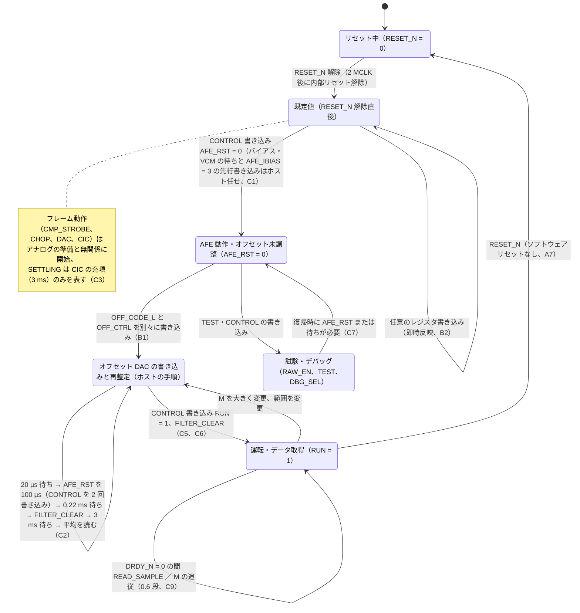
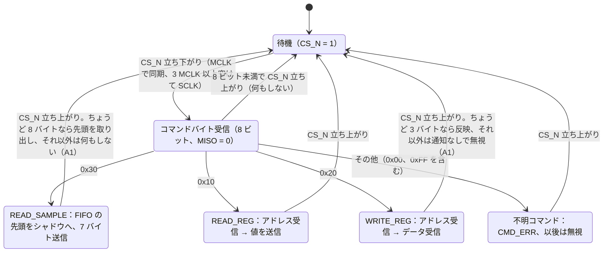
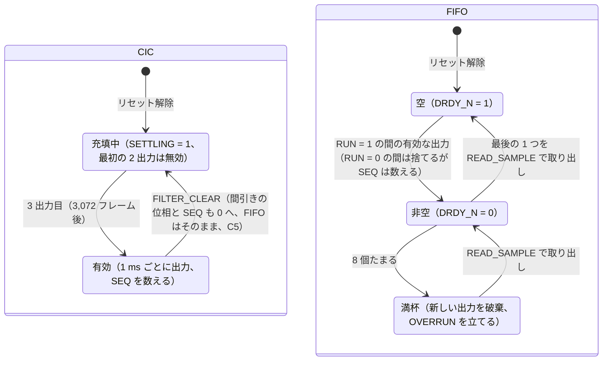
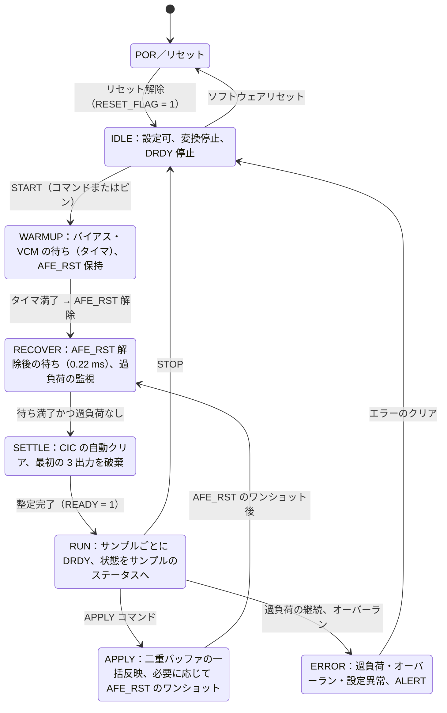

# デジタル制御（SPI・レジスタ・起動手順）の見直し：現状の状態遷移と問題点（2026-11-19）

## 経緯

- 11/19、ユーザーおよび実務者から、デジタル側について次の指摘を受領。
  - レジスタが SPI の一般的な使い方に合っていない形に見える。
  - ビットの区切り（フィールドやバイトの切れ目）が分かりにくい。ラッチ（値の反映時刻）の問題が大きい。
  - アナログ側の起動に合わせて、SPI とデータ開始の方法を検討する必要がある。
  - 実務では、状態機械を作り、フラグで状態を示す形が一般的。AD7386 などの既存の実装を参考にしてよい。
- 本文書では、現状の RTL（`gf180/tapeout/rtl/`、10/24 版。チップに入っているマクロ f2／f3 と同一）と、ホストの手順（`gf180_electrode_dc_20261022.md` の「使い方（ホスト）」、記録表 F4）を状態遷移図として整理し、問題点を洗い出す。
- AD7386 のデータシート本文（PDF）は、11/19 に配布元 5 か所（analog.com、Arrow、Farnell、ADI の別の配信先、Mouser）から取得を試みたが、いずれもタイムアウトまたは接続拒否で取得できず。第 4 節には、データシートの目次・特長の一覧（検索結果）と、同系列（AD7380 系）の Linux の IIO ドライバの文書で確認できた範囲のみを記載。フレームの形式などの詳細は未確認。

## 1. 現状の構成の要点

- チップ内に上位の状態機械（シーケンサ）はない。動作状態は、レジスタのビット（CONTROL の RUN、AFE_RST、CHOP_EN など）の組み合わせと、ホストが SPI で行う書き込みの順序・時刻により決まる。
- フレームのタイミング（CMP_STROBE、DAC、CIC、チョッパ）は、RESET_N の解除直後から常時動作（`eeg_clkgen.sv`）。
- SPI は MCLK による再同期方式のスレーブ（モード 0、SCLK ≤ 2 MHz）。コマンドは 3 種類（0x10 READ_REG、0x20 WRITE_REG、0x30 READ_SAMPLE）で、フレーム長はコマンドにより 3 バイトまたは 8 バイト（`eeg_spi_slave.sv`）。
- レジスタは 16 本（8 ビット）。書き込みは CS_N の立ち上がりで、ちょうどの長さのフレームに限り反映（`eeg_regs.sv`）。
- データは CIC（R = 1024、1 kSPS）から 8 段の FIFO を経て、READ_SAMPLE で 1 サンプルずつ読み出す。DRDY_N は FIFO が空でない間 Low（`eeg_fifo.sv`）。
- 現状の RTL は、単体試験、4 s／20 s の通し試験（ビット一致）、遅延なしのゲートレベル（1 億 4,553 万サイクル一致）で機能を確認済み（`gf180_digital_verification_20261024.md`）。以下の問題点は、主に、ホストへの依存、一般的な慣行との違い、アナログの起動との整合、異常時の扱いに関するもの。

## 2. 現状の状態遷移図

### 2.1 動作状態（暗黙の状態とホストの手順）

チップ内に状態機械はなく、以下の「状態」はレジスタのビットとホストの手順の組み合わせ。遷移の条件・待ち時間は、すべてホストのソフトウェアが管理する。括弧内は第 3 節の問題点の番号。

### 2.2 SPI トランザクション

カウンタ（bit_cnt、byte_cnt）とコマンドの保持（cmd）による実装で、明示的な状態はない。以下は等価な状態遷移。

- バイトの区切りは、CS_N の立ち下がりからの SCLK の計数のみで決まる。CS_N を Low に保ったまま余分なクロックや雑音が入ると、以降のバイト境界がずれ、そのフレームの終わりまで回復しない（A3）。
- READ_SAMPLE の MISO は、0x00、STATUS、SEQ（2 バイト）、DATA（3 バイト）、CRC-8 の順。READ_REG は 0x00、0x00、値。最初のバイトでステータスを返さない（A4）。

### 2.3 データ経路（CIC、FIFO、DRDY_N）

CIC と FIFO は独立に動く 2 つの状態として示す。

- AFE_RST の間や、設定の変更をまたいだ出力も、RUN = 1 であれば VALID として格納される（C4、B2）。
- DRDY_N は「FIFO に 1 つ以上ある」ことを示すレベル信号で、サンプルごとのパルスではない（D4）。

## 3. 問題点一覧

計 42 項目（SPI 9、レジスタと反映時刻 7、起動と運転の順序 9、状態と通知 5、ADC・AFE の制御 5、クロックとリセット 2、検証 3、データ経路 2）。重大度：高＝データの破損やアナログの異常状態を招きうる、中＝堅牢性・使いやすさの問題、低＝慣行との違い・文書の問題。対処：RTL＝チップの論理の変更、FW＝ホストのファームウェアで回避、文書＝仕様の明記。

### A. SPI のプロトコル（フレーム構造）

| 番号 | 内容 | 影響 | 重大度 | 根拠 | 対処 |
|---|---|---|---|---|---|
| A1 | フレーム長がコマンドにより異なり（READ_REG／WRITE_REG 3 バイト、READ_SAMPLE 8 バイト）、長さが合わないフレームは通知なしで無視される（書き込みは反映されず、エラーフラグも立たない） | 書き込みの失敗をホストが検出できない（例：AFE_RST の解除の書き込みが反映されず、AFE がリセットのまま） | 高 | `eeg_spi_slave.sv` 176〜185 行 | RTL：長さ違いを CMD_ERR などで通知、書き込みの応答（エコー）。FW：書き込みごとの読み戻し |
| A2 | コマンドバイトが R/W ビットとアドレスを含まない独自の形式（0x10／0x20／0x30 ＋ アドレスバイト）。連続（バースト）アクセスなし | 一般的なドライバの流用が難しい。初期設定に多数のトランザクションが必要 | 低 | `eeg_spi_slave.sv` 54〜56 行 | RTL：R/W ＋ アドレスの固定長フレーム |
| A3 | バイトの区切りは CS_N の立ち下がりからの SCLK の計数のみ。CS_N → 最初の SCLK の間隔（3 MCLK 以上、推奨 1 µs 以上）などの要件を外れると 1 ビット欠落し、フレームの終わりまで境界がずれる | 雑音・タイミング違反に弱い。ずれの検出手段なし | 中 | `eeg_spi_slave.sv` 171〜219 行、README「Timing assumptions」（174〜176 行） | RTL：固定長フレーム＋CRC、フレーム長の検査 |
| A4 | READ_REG の応答は同一フレームの 3 バイト目で、先頭 2 バイトは 0x00 固定。フレームの先頭でステータスを返さない | 毎回ステータスを確認するには追加のトランザクションが必要 | 低 | `eeg_spi_slave.sv` 135〜151 行 | RTL：先頭バイトでステータスを返す |
| A5 | コマンド・アドレス・書き込みデータに誤り検出（CRC、パリティ、エコー）がない。誤り検出はサンプルの CRC-8 のみ | トリム、オフセット DAC、AFE_RST などの誤書き込みを検出できない（医療用途） | 中 | `eeg_spi_slave.sv` 全体 | RTL：書き込みフレームに CRC。FW：読み戻し |
| A6 | SPI は MCLK による再同期方式（SCLK ≤ 2 MHz、High／Low ≥ 4 MCLK）。MCLK が停止すると SPI も停止 | クロック喪失時にレジスタを読めず、状態の診断ができない | 中 | README「Timing assumptions」（172〜173 行）、`eeg_spi_slave.sv` 61〜89 行 | RTL：SCLK 駆動のシフトレジスタ＋同期化、またはクロック監視 |
| A7 | ソフトウェアリセットのコマンドなし（RESET_N ピンのみ） | 異常時の復帰に専用のピン操作が必要 | 中 | `eeg_spi_slave.sv` 54〜56 行 | RTL：リセットコマンド |
| A8 | 連続読み出し（コマンドなしの読み出し）のモードなし。1 サンプルあたり 64 SCLK（2 MHz で 32 µs）＋ CS_N の時間 | 1 チップでは十分だが、多チップ・多チャンネルでの帯域が制限される | 低 | README「SPI protocol」 | RTL：連続読み出しモード |
| A9 | 未定義アドレスの読み出しは 0x00 を返し、エラーにならない | アドレスの誤りを検出できない | 低 | `eeg_regs.sv` 193 行 | RTL：未定義アドレスの通知 |

### B. レジスタの構成と反映時刻（ラッチ）

| 番号 | 内容 | 影響 | 重大度 | 根拠 | 対処 |
|---|---|---|---|---|---|
| B1 | オフセット DAC の M[9:0] が OFF_CODE_L（M[7:0]）と OFF_CTRL（M[9:8]、SIGN、OFF_RANGE）に分かれ、2 回の書き込みの間は中間の値がそのままアナログに出る。二重バッファと一括反映がない | 例：範囲 3 または 4 で M = 255 → 256。OFF_CODE_L を先に書くと一時的に M = 0、OFF_CTRL を先に書くと M = 511 となり、いずれも約 80 mV（256 段 × 0.311 mV、入力換算）の段差。AFE が飽和する大きさ（約 4 mV）を大きく超え、出力チョッパの後ろで飽和したまま残りうる。運転中の 1 段の追従（AFE_RST を使わない規則）でも、256 の倍数の境界（255↔256、511↔512、767↔768）をまたぐと発生 | 高 | `eeg_regs.sv` 150〜155 行、`gf180_electrode_dc_20261022.md`「使い方（ホスト）」3、5 | RTL：シャドウレジスタと一括反映（APPLY）。FW：境界をまたぐ変更は 1 段の追従でも 3 の手順（AFE_RST のパルス）で行う |
| B2 | 書き込みは、フレーム、CIC の窓、チョッパの相と無関係な時刻に即時反映（AFE_IBIAS、BOOST_TRIM、CPF_TRIM、OFF_*、TEST の ADC_ZERO、CHOP_EN、AFE_RST、CHOP_DLY）。例外は CHOP_FAST（512 MCLK ごと）、BLANK_LEN（次のパルス）、CHOP1（1 ms ごと） | 変更をまたいだサンプルに印がなく、VALID として格納される。チョッパの相の途中での変更による過渡 | 高 | `eeg_regs.sv` 128〜159 行、`eeg_clkgen.sv` 21〜38、50〜52 行 | RTL：フレーム境界での反映、変更の印（サンプルのステータス）。FW：変更後に FILTER_CLEAR |
| B3 | CONTROL に性質の異なるビット（静的設定 DWA_EN／RAW_EN／CHOP_FAST、アナログ制御 AFE_RST／CHOP_EN、データ経路の命令 RUN／FILTER_CLEAR）が混在 | AFE_RST のパルスや FILTER_CLEAR のたびに全ビットの再書き込みが必要で、他のビット（CHOP_EN、DWA_EN など）を誤って変える危険 | 中 | `eeg_regs.sv` 130〜138 行 | RTL：命令用レジスタ（書くと 1 回だけ動作）と設定用レジスタの分離 |
| B4 | ANA_TRIM が CPF_TRIM と AFE_IBIAS を同じバイトに保持し、片方だけを書き換える手段がない（読み出して全体を書き直す必要） | AFE_IBIAS = 3 の書き込みで CPF_TRIM を誤って 0 にする（記録表 F4 の注記） | 中 | `eeg_regs.sv` 141〜144 行 | RTL：フィールドの分離。FW：手順の明記 |
| B5 | ビットの配置が不規則（OFF_CTRL の bit 2、7 が空き、M の上位 2 ビットが別のレジスタなど）で、フィールドの切れ目が分かりにくい | 誤設定を招きやすい | 低 | `eeg_regs.sv` 26〜30、191 行 | RTL：フィールドの整列。文書：ビットマップの図示 |
| B6 | 設定してはならない値が書ける：CHOP_DLY ≠ 0（ブランキングが入力チョッパの縁を隠さない）、BLANK_LEN = 0（出力チョッパの相が重なる）、M が範囲の上限を超える（上位ビットの切り捨て） | 誤設定でアナログが異常動作。ハードウェアの制限・通知なし | 中 | 記録表 F4（1）（2）（4） | RTL：値の制限・飽和・エラー通知、レジスタのロック |
| B7 | オフセット DAC を使う時の BLANK_LEN = 15 が自動でない | 設定漏れで雑音が増加 | 低 | 記録表 F4（2） | RTL：OFF_RANGE ≥ 1 で自動選択。FW：手順 |

### C. 起動と運転の順序（アナログとの整合）

| 番号 | 内容 | 影響 | 重大度 | 根拠 | 対処 |
|---|---|---|---|---|---|
| C1 | チップ内に起動・運転の状態機械がなく、アナログの起動条件（バイアスの整定 0.82〜1.05 ms、VCM の整定（10 nF で 5 ms、容量を増やすと時定数の約 5 倍）、AFE_IBIAS = 3 の先行書き込み、AFE_RST の解除、ADC の過負荷からの復帰 0.22 ms、FILTER_CLEAR と 3 ms の整定）を、すべてホストの時刻管理に依存 | ホストの実装・割り込み遅延により条件を外れうる。外れた場合、AFE が飽和したまま CIC の平均が 0 付近を示すなど、誤認を招く（11/16） | 高 | `gf180_electrode_dc_20261022.md`「使い方（ホスト）」、記録表 F4、`gf180_realistic_eval_20261028.md`「VCM の容量と解除の時刻」「電源投入：プロセスの角と電源の立ち上がりの速さ」 | RTL：起動シーケンサ（タイマ付き）。FW：手順の厳守 |
| C2 | オフセット DAC の書き込みごとの手順（20 µs 空けて AFE_RST を 100 µs、0.22 ms 待ち、FILTER_CLEAR、3 ms 待ち）が、SPI の書き込み 3〜4 回と待ちで構成され、パルス幅と待ち時間がホストに依存 | パルス幅のばらつき、手順の誤り。探索 1 回あたり約 3.4 ms 以上 | 高 | 同上 | RTL：AFE_RST のワンショットと再整定の自動化（APPLY） |
| C3 | リセット解除直後からフレーム動作が始まり、アナログの準備と無関係に SETTLING が 3 ms で解除される。SETTLING は CIC の充填のみを表し、AFE_RST 中、過負荷、DAC の変更直後を表さない | 「SETTLING = 0 ＝ データ有効」と誤認しやすい | 中 | README「Valid flag」 | RTL：READY フラグ（状態機械の状態に連動） |
| C4 | RUN = 1 のまま AFE_RST を上げ下げすると、リセット中・復帰中のサンプルも VALID として FIFO に入る（印なし） | 汚れたサンプルの混入 | 中 | `eeg_fifo.sv` 59〜63 行 | RTL：AFE_RST 中・復帰中の印、または格納の停止 |
| C5 | FILTER_CLEAR は FIFO を空にしない。クリア前の古いサンプル（古い SEQ）が残り、その後に SEQ = 0 から新しいサンプルが続く。FIFO を空にするコマンドなし | 古いサンプルの誤読、SEQ の逆転 | 中 | `eeg_fifo.sv` 90〜94 行、README「FILTER_CLEAR scope」 | RTL：FIFO のフラッシュ（FILTER_CLEAR と連動または専用コマンド） |
| C6 | データの開始時刻（デシメーションの位相）は FILTER_CLEAR の書き込みの時刻で決まる（CIC の間引きの計数を 0 に戻す）。START／SYNC のピンなし。複数チップでチップごとに書き込むと位相がずれる。MCLK と RESET_N を共通にし、全チップの CS_N を同時に Low にした一斉書き込み（書き込みの間の MISO はどのチップも 0）で回避できる見込みだが、仕様としての規定と検証がない | 多チャンネルの EEG で、チップ間のサンプル時刻が最大 1 ms ずれる（100 Hz で最大 36° の位相差） | 高（多チップ構成時） | `eeg_cic3.sv` 31〜34、100〜113 行、`eeg_regs.sv` 130〜138 行 | RTL：START／SYNC のピン、またはブロードキャストの開始。FW：一斉書き込みの手順の規定と検証 |
| C7 | CHOP_EN = 0 や ADC_ZERO = 1 から戻した後に、AFE_RST または待ちが必要だが自動でない | 戻し後のサンプルの汚れ | 中 | 記録表 F4（3） | RTL：状態機械による再整定 |
| C8 | 電極の状態（R_e、C_e）により待ち時間（5 R_e C_e）が変わり、ホストが電極を知らないと決められない。合わない M を残したまま待つと、AFE が逆向きに飽和したまま残り、チップが電極を逆へ引く（B：51 kΩ ∥ 47 nF、M 983 で 12.7 µA） | 待ち不足による誤った探索結果、電極への DC 電流 | 中 | `gf180_electrode_dc_20261022.md`「使い方（ホスト）」3 | FW：待ち時間のパラメータ化。RTL：整定の判定（出力の変化の監視） |
| C9 | 運転中のオフセットの追従（0.6 段の規則）で M を変えたサンプルに印がない | 段差を含むサンプルの判別がホスト頼み | 低 | 同上「使い方」5 | RTL：サンプルのステータスに設定変更の印 |

### D. 状態・フラグ・エラーの通知

| 番号 | 内容 | 影響 | 重大度 | 根拠 | 対処 |
|---|---|---|---|---|---|
| D1 | STATUS は 4 ビット（FIFO_NONEMPTY、SETTLING、OVERRUN、CMD_ERR）のみ。AFE リセット中、ADC の過負荷（符号 0／31 の連続）、AFE の飽和、設定の反映待ち、予期しないリセットの発生、クロックの異常を示すフラグがない | 異常の検出・切り分けができない | 中 | `eeg_regs.sv` 180 行 | RTL：状態・フラグの拡充 |
| D2 | サンプルのステータスバイトは VALID、OVERRUN、SETTLING のみ。サンプルごとの品質（過負荷、AFE_RST、設定変更）を示さない | 後処理でのサンプルの選別が困難 | 中 | `eeg_fifo.sv` 63 行 | RTL：ステータスバイトの拡張 |
| D3 | 割り込み・アラートのピンは DRDY_N のみ。エラーをホストに知らせる手段がない | エラーの検出がポーリング頼み | 中 | `eeg_digital_top.sv` 179 行 | RTL：ALERT ピン（または DRDY_N の多重化） |
| D4 | DRDY_N は「FIFO に 1 つ以上ある」レベル信号で、サンプルごとのパルスではない。FIFO に滞留があると Low のまま | エッジ割り込みのホストで新しいサンプルを取りこぼす | 中 | `eeg_digital_top.sv` 179 行、`eeg_fifo.sv` 88 行 | RTL：サンプルごとのパルス（選択可）。FW：レベル割り込みで FIFO を空にする |
| D5 | CMD_ERR は不明なコマンドのみ。長さ違いのフレーム、未定義アドレス、範囲外の値はエラーにならない | 誤操作の検出漏れ | 中 | `eeg_spi_slave.sv` 195〜203 行 | RTL：エラー条件の拡大 |

### E. ADC・AFE のコントロールロジック（デジタル↔アナログ）

| 番号 | 内容 | 影響 | 重大度 | 根拠 | 対処 |
|---|---|---|---|---|---|
| E1 | AFE_RST、CHOP_EN、トリム類はレジスタのビットを直接ピンへ出力。パルス幅・切り替えの時刻の保証なし | C2、B2 と同じ | 中 | `eeg_digital_top.sv` 230〜242 行 | RTL：状態機械からの出力 |
| E2 | CHOP_EN はピンへ出すのみで、CHOP／CHOP_OUT は CHOP_EN によらず動作 | 仕様の理解違いの余地 | 低 | README「Chopper outputs」 | 文書 |
| E3 | DWA_EN が DAC1 と DAC2 で共通で、SEL2 は常に SEL1 と同一 | 設計上の制約（README の未解決項目） | 低 | README「DWA on DAC2」 | 文書（次 rev で検討） |
| E4 | ADC の過負荷・発振の検出なし（符号の連続飽和の監視など） | 過負荷の検出がホストのデータ解析頼み | 中 | — | RTL：過負荷検出のフラグ |
| E5 | リセット解除後の最初の CHOP_OUT の縁はブランキングされない（AFE_RST = 1 の間のため実害なし） | 前提条件への依存 | 低 | README「CHOP_BLANK」 | 文書 |

### F. クロック・リセット

| 番号 | 内容 | 影響 | 重大度 | 根拠 | 対処 |
|---|---|---|---|---|---|
| F1 | 唯一のクロック MCLK が停止すると、SPI を含むすべてが停止。クロックの監視なし | A6 と同じ | 中 | `eeg_digital_top.sv` | RTL：クロック監視、または SCLK 駆動の SPI |
| F2 | 電源投入の順序（DVDD を先、記録表 F2 の（1））と RESET_N の解除時刻を守る仕組みがチップ側にない（POR なし） | 基板・ファームウェアの誤りで不定状態 | 中 | 記録表 F2 | 基板：POR／リセット IC。文書 |

### G. 検証の抜け

| 番号 | 内容 | 重大度 | 対処 |
|---|---|---|---|
| G1 | 遅延込み（SDF）のゲートレベルは 11/19 から 3 コーナーで実行中 | 中 | 実行中 |
| G2 | 非同期入力（SPI、RESET_N）のメタステーブルは未評価 | 低 | 同期化の構造で対処済みの前提 |
| G3 | ホストの手順（ファームウェア）を含めたシステムの試験がない（状態遷移の網羅、書き込み途中の中断、電源瞬断、クロック停止などの異常系） | 高 | ファームウェアのモデルと RTL の結合試験 |

### H. データ経路・その他（README の未解決項目などの既知事項、参考）

| 番号 | 内容 | 重大度 | 根拠 |
|---|---|---|---|
| H1 | 1 kSPS への間引きが CIC3 のみで、0.9〜1.1 kHz（および 1 kHz の倍数の近傍）の成分が帯域へ折り返す（帯域端 100 Hz へ 900 Hz から −57.7 dB、1,100 Hz から −62.9 dB。通し試験で −57.69 dB を確認）。1 kHz 近傍の干渉は入力側（電極のフィルタ、AFE の帯域）で抑える前提 | 中 | README「Aliasing of the CIC3」、`gf180_digital_verification_20261024.md` 2.4 |
| H2 | 出力データレートは 1 kSPS 固定（ODR_H／ODR_L は読み出し専用）で、フィルタの選択もない。市販の ADC では出力データレートとフィルタを選べるものが多い | 低 | `eeg_regs.sv` 13〜14 行 |

## 4. 一般的な ADC・AFE の構成との比較（参考）

AD7386（AD7380 系）について確認できた範囲は次のとおり。

- データシートの目次・特長の一覧に、ソフトウェアリセット、シリアルインターフェース、レジスタへの書き込み、CRC、ALERT のレジスタと下限・上限のしきい値のレジスタ、オーバーサンプリング、分解能の向上（resolution boost）、範囲外の ALERT 表示の項目がある（検索結果に表示された目次と特長の一覧）。
- Linux の IIO ドライバの文書（ad7380）：ALERT は Low アクティブのピンで、変換の終わりに結果が上限を超えるか下限を下回ると立ち、CS の立ち下がりで解除される。どのチャンネル・どちら向きかは ALERT のレジスタで確認できる。オーバーサンプリングの比は 2〜32、分解能の向上は 2 ビットの追加（オーバーサンプリング時のみ）。CRC の表示（CRC indication）は、ドライバの未実装の機能として挙がっている。
- 変換の開始とデータの読み出しの手順、レジスタのフレームの形式、CRC の多項式、リセット後の待ち時間は、本文を取得できず未確認。

以下の表は、市販の ADC・生体用 AFE で一般的な構成との比較（AD7386 で確認できた項目は明記。それ以外は AD7386 固有の記述ではない）。

| 項目 | 一般的な構成 | 現状 |
|---|---|---|
| 範囲外の検出 | 上限・下限のしきい値と ALERT のピン（AD7386 で確認） | なし（D3、E4） |
| 誤り検出 | レジスタの書き込み・データの CRC（AD7386 は CRC の項目あり、詳細は未確認） | サンプルの CRC-8 のみ（A5） |
| 変換の開始・停止 | START ピンまたは START／STOP コマンド。複数チップの同期が可能 | CONTROL の RUN と FILTER_CLEAR の書き込み。同期の手段なし（C6） |
| データ準備の通知 | 変換ごとの DRDY（または BUSY）のパルス | FIFO 非空のレベル（D4） |
| データの読み出し | 固定長のフレーム（ステータス語 ＋ データ）、連続読み出しモード | 8 バイトのコマンド付きフレーム（A8） |
| レジスタの読み書き | R/W ビット ＋ アドレス ＋ データの固定長フレーム、連続アクセス、先頭でステータス | 独自のコマンドバイト、3 バイト、先頭は 0x00（A2、A4） |
| 反映の時刻 | 二重バッファと一括反映（LDAC 相当）、または変換境界での反映 | 即時反映（B1、B2） |
| リセット | ソフトウェアリセットのコマンドと、リセット後の待ち時間の規定（AD7386 はソフトウェアリセットの項目あり） | RESET_N ピンのみ（A7） |
| 状態とエラー | 状態語・アラートの出力、異常の種別ごとのフラグ | 4 ビットの STATUS、アラートなし（D1、D3） |
| 起動手順 | データシートで電源・リセット・初期化の順序と時間を規定し、チップ内のタイマで保証する例も多い | ホストの手順書のみ（C1、C2） |

## 5. 改善のたたき台（状態機械とフラグ、議論用）

### 5.1 上位の状態機械（案）

- 待ち時間（WARMUP、RECOVER、AFE_RST のパルス幅）はレジスタで設定可能なタイマとし、既定値を現在のホスト手順の値（バイアス・VCM の待ち、0.22 ms、100 µs）とする。
- 状態はステータスレジスタとサンプルのステータスバイトに出力（READY、STATE、AFE_RST 中、過負荷、設定変更の印）。
- START を外部ピンでも受け付け、複数チップのデシメーションの位相をそろえる。

### 5.2 SPI とレジスタの方針（案）

- 固定長フレーム：16 ビット（R/W 1 ビット ＋ アドレス 7 ビット ＋ データ 8 ビット）。必要に応じて CRC-8 を加えた 24 ビット。各フレームの先頭でステータスを返す。
- 命令（RESET、START、STOP、APPLY、FIFO のフラッシュ、エラーのクリア）は専用の命令レジスタ（書き込むと 1 回だけ動作）とし、設定レジスタと分離。
- 複数バイトにまたがる値（オフセット DAC の M など）は二重バッファとし、APPLY で一括反映。アナログに影響する設定は、フレーム境界で反映。
- 設定してはならない値の制限・飽和、範囲外の書き込みの通知。
- データの読み出しは固定長フレーム（ステータス、SEQ、DATA、CRC）、連続読み出しモードを追加。

## 6. 今回 rev への影響と判断事項

- 現状の RTL は機能・タイミングとも確認済みであり、ホストが手順（`gf180_electrode_dc_20261022.md`、記録表 F4）を厳守すれば動作する。上記の問題点は、手順の厳守をホストに強いる点、異常時の検出・回復の手段が乏しい点、多チップ構成での同期の手段がない点に集約される。
- 改修する場合の作業：RTL の変更（状態機械、命令レジスタ、二重バッファ、SPI のフレーム）、単体試験と通し試験の改訂、LibreLane によるマクロの再生成（eeg_digital_top、440 × 700 µm の範囲内の見込み）、チップの組み直し（14 回目）、DRC・LVS・precheck、チップの配線込みの STA、起動手順のシミュレーションの再実施。
- 日程：12/9 スロット購入期限、12/16 GDS 提出。
- 判断事項（ユーザー）：
  - （a）今回 rev で改修する範囲（全面、最小限、改修なし）。最小限の候補：B1（オフセット DAC の二重バッファと一括反映）、B3（命令レジスタの分離）、C5（FIFO のフラッシュ）、A7（ソフトウェアリセット）、D1／D2（フラグの拡充）、C6（START／SYNC のピン。パッドの追加を伴う）。
  - （b）改修しない項目のファームウェアでの回避方法の確定。候補：B1 は 256 の倍数の境界をまたぐ変更を AFE_RST のパルス付きの手順で行う、C5 は FILTER_CLEAR のあと SEQ が 0 に戻るまで古いサンプルを読み捨てる、C6 は全チップの一斉書き込み、D4 はレベル割り込みで FIFO を空にする、A1・A5 は書き込みごとに読み戻す。

- 11/19 夜：本書を受けた要件定義の案を `gf180_digital_control_requirements_20261119.md` に作成（模範の状態遷移図・状態表・状態遷移表、未決事項 D-1〜D-8）。

## 7. 参照

- RTL：`gf180/tapeout/rtl/eeg_spi_slave.sv`、`eeg_regs.sv`、`eeg_fifo.sv`、`eeg_digital_top.sv`、`eeg_clkgen.sv`、`eeg_cic3.sv`、`README.md`
- ホストの手順：`documentation/gf180_electrode_dc_20261022.md`「使い方（ホスト）」、記録表 F2、F4
- 検証：`documentation/gf180_digital_verification_20261024.md`
- AD7386：データシートの配布先（本文は未取得）<https://www.mouser.com/datasheet/2/609/ad7386_4_7387_4_7388_4-3367448.pdf>、<https://wcm-cce.cldnet.analog.com/media/en/technical-documentation/data-sheets/AD7386-7387-7388.pdf>。Linux の IIO ドライバの文書 <https://docs.kernel.org/6.15/iio/ad7380.html>
