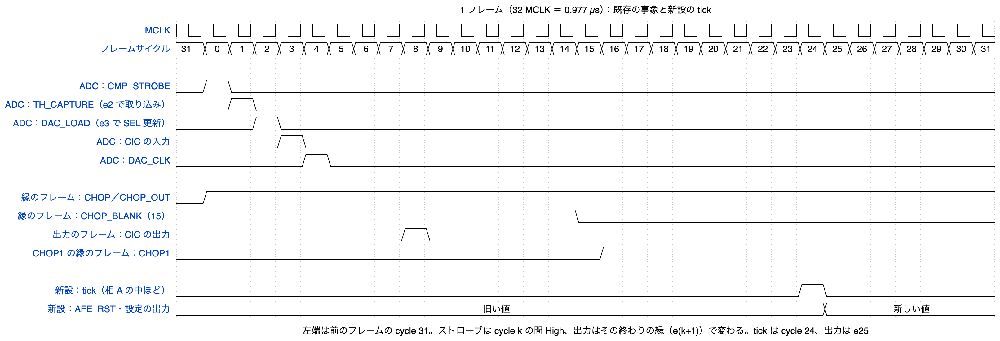
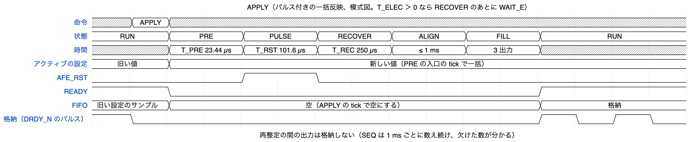

# デジタル制御の詳細仕様（レジスタ、SPI、シーケンサ、タイミング）（2026-11-19）

## 0. 位置付けと仕様源

- 要件定義 r3（`gf180_digital_control_requirements_20261119.md`）と、11/19 夜の決定（未決事項 D-1〜D-8 を推奨のとおり）に基づく詳細仕様。
- 仕様源は機械可読の 3 つのファイルとし、本書の表と図はそこから生成する。手で書き換えない。

| 仕様源 | 内容 | 生成するもの | 検査 |
|---|---|---|---|
| `gf180/tapeout/rtl/spec/fsm_spec.py` | シーケンサ、SPI のトランザクション、FIFO の状態遷移表と、アナログとの時刻の制約 | Mermaid の図、状態表、状態遷移表（要件定義の第 5 節） | `check`、`selftest` |
| `gf180/tapeout/rtl/spec/regmap.py` | レジスタ表、命令コード、サンプルのステータス、cfg_ok と nr_ok、過負荷の規則 | 本書の第 2 節の表、RTL 用の `eeg_regs_pkg.sv` | `check`、`selftest` |
| `gf180/tapeout/rtl/spec/wave.py` | タイミング図（WaveDrom） | `wave_*.json`、`wave_*.png`（本書の第 4 節） | 数値は `fsm_spec.TIMING` から |

- 検査の結果（11/19）：
  - `fsm_spec.py check`：違反 0。
  - `regmap.py check`：違反 0。
  - 自己試験：`fsm_spec.py` は 60 種類（11/19 の 28 種類に、RTL の作成時に 4 種類、11/20 の監査の第 1 回で 18 種類、第 2 回で 10 種類を加えた）、`regmap.py` は 15 種類の誤りを入れ、すべて検出。
  - `regmap.py` の自己試験で、検査器自身の弱点を 1 件見つけて直した。範囲の上限の表を、その表自身で確かめていた点である。DAC の群の構成と範囲の電圧から、独立に確かめる形に改めた。

## 1. 全体の構成

- 単一のクロック MCLK（32.768 MHz）。1 フレーム ＝ 32 MCLK（1.024 MHz）、1 ms ＝ 1,024 フレーム。
- ブロック：SPI のスレーブ（MCLK による再同期、SCLK 2 MHz 以下）、レジスタ、シーケンサ（新設）、クロック生成（現行）、CIC（現行。クリアは出力の時刻に合わせる）、FIFO（深さ 4 または 8）、過負荷の検出（新設）、RAW の出力（現行）。
- eeg_adc_dig、パッド、マクロの外形と端子は変えない（NFR-03、PIN-01、NFR-08）。
- 出力の時刻の格子と SEQ の原点は、リセットの解除とする。MCLK と RESET_N を共有するチップの間では、同じ SEQ が同じ時刻を表す（差はリセットの同期化による 1 MCLK 以内）。

## 2. レジスタ

### 2.1 一覧

- アドレスは 7 ビット（0x00〜0x7F）。未定義のアドレスへの書き込みは ADDR_ERR として書かない。未定義のアドレスを先頭として読むと 0x00 を返し、ADDR_ERR を立てる。連続読み出しの途中の未定義のアドレスは 0x00 で、エラーにしない。
- 「写し」：アナログに効く設定は、シャドウ（書き込み先）とアクティブ（一括反映で写した値）の二重。アクティブは、アドレス ＋ 0x10 で読める（読み出し専用）。端子の値はアクティブから決まり、次の 2 点だけがアクティブと異なる：範囲 0 では OFM と OFS を 0 とし、範囲 1 以上では CHOP_BLANK の幅を 15 とする（11/20 の監査）。
- 試験の鍵：0x60〜0x62 は、TEST_KEY に 0x3C を書いたあとだけ書ける。鍵なしで書くと ADDR_ERR とし、書かない。TEST_KEY に 0x00 を書くと施錠する。0x3C と 0x00 以外の値は施錠し、CMD_ERR とする（1 ビットの誤りで解錠も黙った施錠もしない）。
- 既定値の列は、リセットの解除の直後の値である。STATUS は、リセット直後の値（ALERT ＝ 1、AFE_RST ＝ 1）を示す。

<!-- BEGIN GENERATED reg_summary -->
| アドレス | 名前 | 種別 | 試験の鍵 | 既定値 | 内容 |
|---|---|---|---|---|---|
| 0x00 | ID | RO | — | 0xE6 | 識別 |
| 0x01 | VERSION | RO | — | 0x10 | 版 |
| 0x02 | CAPS | RO | — | 0x18 | 機能 |
| 0x03 | STATUS | RO | — | 0xA1 | 状態（フレームの先頭バイトで MISO から返す値と同じ） |
| 0x04 | STATE | RO | — | 0x00 | シーケンサの状態 |
| 0x05 | FIFO_LEVEL | RO | — | 0x00 | FIFO の占有数 |
| 0x06 | ERR | W1C | — | 0x01 | エラー（W1C） |
| 0x07 | DFLAG | W1C | — | 0x00 | データのフラグ（W1C） |
| 0x08 | ALERT_MASK | RW | — | 0xFF | ALERT のマスク |
| 0x09 | ALERT_MASK_D | RW | — | 0x03 | ALERT のマスク（データ） |
| 0x0A | ODR_H | RO | — | 0x03 | 出力データレート |
| 0x0B | ODR_L | RO | — | 0xE8 | 出力データレート |
| 0x0C | FORMAT | RO | — | 0x05 | 形式 |
| 0x10 | COMMAND | WO | — | — | 命令 |
| 0x11 | TEST_KEY | WO | — | — | 試験の鍵 |
| 0x20（写し 0x30） | OFF_M_H | RW | — | 0x00 | オフセット DAC（上位） |
| 0x21（写し 0x31） | OFF_M_L | RW | — | 0x00 | オフセット DAC（下位） |
| 0x22（写し 0x32） | OFF_CTRL | RW | — | 0x00 | オフセット DAC（符号と範囲） |
| 0x23（写し 0x33） | AFE_IBIAS | RW | — | 0x03 | AFE のバイアス |
| 0x24（写し 0x34） | CPF_TRIM | RW | — | 0x08 | 補償容量のトリム |
| 0x25（写し 0x35） | BOOST_TRIM | RW | — | 0x01 | ブースタのトリム（typical 4/2） |
| 0x26（写し 0x36） | CHOP_CFG | RW | — | 0x01 | AFE のチョッパ |
| 0x27（写し 0x37） | ADC_CFG | RW | — | 0x13 | ADC の設定 |
| 0x28（写し 0x38） | BLANK | RW | — | 0x07 | ブランキング |
| 0x40 | SAMPLE | RO | — | — | サンプル |
| 0x50 | T_WARM | RW | — | 0x05 | タイマ |
| 0x51 | T_ELEC | RW | — | 0x00 | タイマ |
| 0x52 | T_REC | RW | — | 0x20 | タイマ |
| 0x53 | T_PRE | RW | — | 0x03 | タイマ |
| 0x54 | T_RST | RW | — | 0x0D | タイマ |
| 0x55 | IF_CFG | RW | — | 0x00 | インターフェース |
| 0x60（写し 0x70） | TEST_MUX | RW | 要 | 0x00 | 試験用マルチプレクサ |
| 0x61（写し 0x71） | TEST_CTRL | RW | 要 | 0x00 | 試験の制御 |
| 0x62 | DEBUG | RW | 要 | 0x00 | デバッグの出力 |
<!-- END GENERATED reg_summary -->

### 2.2 フィールド

- 反映の欄の意味：
  - 一括反映：シャドウに書き、START、APPLY、APPLY_NR の tick でアクティブへ写す。
  - 即時：書いた時点で効く。アナログには効かない。タイマは開始時に取り込む。
  - 命令：次の tick で処理する。
- 合法な値の外の書き込みは、RANGE_ERR として書かない。

<!-- BEGIN GENERATED reg_fields -->
| レジスタ | ビット | フィールド | 既定値 | 合法な値 | 反映 | アナログの端子 | 内容 |
|---|---|---|---|---|---|---|---|
| ID | [7:0] | ID | 230 | 230 | 読み出し専用 | — | チップの識別（0xE6） |
| VERSION | [7:0] | VERSION | 16 | 16 | 読み出し専用 | — | 制御の版（0x10 ＝ r3 の SPI とシーケンサ） |
| CAPS | [3:0] | FIFO_DEPTH | 8 | 4、8 | 読み出し専用 | — | FIFO の深さ（合成で決める。4 または 8） |
| CAPS | [4] | CRC | 1 | 1 | 読み出し専用 | — | CRC を持つ（1） |
| STATUS | [7] | MARK1 | 1 | 1 | 読み出し専用 | — | 固定の 1（MISO の無応答と区別） |
| STATUS | [6] | MARK0 | 0 | 0 | 読み出し専用 | — | 固定の 0 |
| STATUS | [5] | ALERT | 1 | 0、1 | 読み出し専用 | — | マスクしないエラーのフラグがある（リセット直後は RESET_FLAG で 1） |
| STATUS | [4] | CMD_PENDING | 0 | 0、1 | 読み出し専用 | — | 命令が tick での処理を待っている |
| STATUS | [3] | READY | 0 | 0、1 | 読み出し専用 | — | 状態が RUN |
| STATUS | [2] | DATA | 0 | 0、1 | 読み出し専用 | — | FIFO が空でない |
| STATUS | [1] | OVL_NOW | 0 | 0、1 | 読み出し専用 | — | 過負荷を検出中（直近 32 フレームに両端の符号が 4 個以上） |
| STATUS | [0] | AFE_RST | 1 | 0、1 | 読み出し専用 | — | AFE_RST の出力の現在値 |
| STATE | [3:0] | STATE | 0 | 0〜8 | 読み出し専用 | — | シーケンサの状態（0 IDLE、1 WARMUP、2 RECOVER、3 WAIT_E、4 ALIGN、5 FILL、6 RUN、7 PRE、8 PULSE） |
| FIFO_LEVEL | [3:0] | LEVEL | 0 | 0〜8 | 読み出し専用 | — | FIFO のサンプルの数 |
| ERR | [7] | CMD_ERR | 0 | 0、1 | W1C | — | 未定義の命令コード、または TEST_KEY への 0x3C と 0x00 以外の値 |
| ERR | [6] | STATE_ERR | 0 | 0、1 | W1C | — | その状態で受け付けない命令、未処理の命令への上書き、または未処理の命令がある間のシャドウとタイマへの書き込み（SOFT_RESET は常に受け付ける） |
| ERR | [5] | CFG_ERR | 0 | 0、1 | W1C | — | 整合しない設定（cfg_ok でない）での START、APPLY、APPLY_NR、または AFE の動作中の nr_ok でない APPLY_NR |
| ERR | [4] | RANGE_ERR | 0 | 0、1 | W1C | — | 範囲外の値の書き込み（書かない） |
| ERR | [3] | ADDR_ERR | 0 | 0、1 | W1C | — | 未定義のアドレス、読み出し専用への書き込み、鍵なしの試験のレジスタへの書き込み |
| ERR | [2] | CRC_ERR | 0 | 0、1 | W1C | — | 書き込みの CRC の不一致（書かない） |
| ERR | [1] | FRAME_ERR | 0 | 0、1 | W1C | — | バイトの途中の CS_N、不完全または過長な書き込み、完了したフレーム（書き込み、CRC 付きの読み出し、8 バイトのサンプル）のあとのビット、CRC 有効時の CRC のない読み出しと 8 バイトでないサンプル |
| ERR | [0] | RESET_FLAG | 1 | 0、1 | W1C | — | リセットが起きた（既定値 1） |
| DFLAG | [1] | OVL | 0 | 0、1 | W1C | — | FILL または RUN の間に過負荷を検出した |
| DFLAG | [0] | OVERRUN | 0 | 0、1 | W1C | — | FIFO が満杯でサンプルを捨てた |
| ALERT_MASK | [7:0] | ALERT_MASK | 255 | 0〜255 | 即時 | — | ERR のビットごとに ALERT に含める（1） |
| ALERT_MASK_D | [1:0] | ALERT_MASK_D | 3 | 0〜3 | 即時 | — | DFLAG のビットごとに ALERT に含める（1） |
| ODR_H | [7:0] | ODR_H | 3 | 3 | 読み出し専用 | — | 出力データレート 1000 SPS の上位 |
| ODR_L | [7:0] | ODR_L | 232 | 232 | 読み出し専用 | — | 同下位 |
| FORMAT | [3:0] | QBITS | 5 | 5 | 読み出し専用 | — | 量子化器のビット数 |
| COMMAND | [7:0] | CMD | 0 | — | 命令 | — | 命令コード（第 2.3 節）。次の tick で処理 |
| TEST_KEY | [7:0] | KEY | 0 | — | 即時 | — | 0x3C で試験のレジスタを解錠、0x00 で施錠。その他の値は施錠し、CMD_ERR（書き込みの確定の時点で効く） |
| OFF_M_H | [1:0] | M_H | 0 | 0〜3 | 一括反映 | OFM[9:8] | オフセット DAC の大きさ M[9:8] |
| OFF_M_L | [7:0] | M_L | 0 | 0〜255 | 一括反映 | OFM[7:0] | M[7:0] |
| OFF_CTRL | [4] | SIGN | 0 | 0、1 | 一括反映 | OFS | 符号 S（打ち消す量は (1 − 2 S) × M × 0.311 mV） |
| OFF_CTRL | [2:0] | RANGE | 0 | 0〜4 | 一括反映 | OFEN[3:0] | 範囲（0 切、1〜4 で ±39／79／159／318 mV。5〜7 は RANGE_ERR） |
| AFE_IBIAS | [1:0] | AFE_IBIAS | 3 | 0〜3 | 一括反映 | AFE_IBIAS[1:0] | AFE のバイアス電流（3 が推奨） |
| CPF_TRIM | [3:0] | CPF_TRIM | 8 | 0〜15 | 一括反映 | CPF_TRIM[3:0] | 入力インピーダンスの補償容量のトリム |
| BOOST_TRIM | [5:4] | BTRIM_N | 0 | 0〜3 | 一括反映 | BTRIM_N[1:0] | NMOS カスコードのブースタ（00 ＝ 2 単位 … 11 ＝ 8 単位。既定 2） |
| BOOST_TRIM | [1:0] | BTRIM_P | 1 | 0〜3 | 一括反映 | BTRIM_P[1:0] | PMOS カスコードのブースタ（既定 01 ＝ 4 単位） |
| CHOP_CFG | [0] | CHOP_FAST | 1 | 0、1 | 一括反映 | CHOP／CHOP_OUT／CHOP_BLANK の速さ | AFE のチョッパ（1 ＝ 128 kHz、0 ＝ 64 kHz） |
| ADC_CFG | [4] | DWA_EN | 1 | 0、1 | 一括反映 | DWA_EN | DAC1／DAC2 の DWA |
| ADC_CFG | [2:0] | CHOP1_RATE | 3 | 0〜5 | 一括反映 | CHOP1 | OTA1 のチョッパ（0 切、1〜5 で 1／2／4／8／16 kHz。6、7 は RANGE_ERR） |
| BLANK | [3:0] | BLANK_LEN | 7 | 1〜15 | 一括反映 | CHOP_BLANK の幅 | 出力チョッパのブランキング（MCLK。0 は RANGE_ERR。範囲 1 以上では 15 として出す） |
| SAMPLE | [7:0] | SAMPLE | 0 | — | 読み出し専用 | — | サンプルの窓（先頭のアドレスとしてのみ。先頭バイトのあとの 7 バイト、フレームは 8 バイト。第 3.2 節、第 3.4 節） |
| T_WARM | [7:0] | T_WARM | 5 | 5〜255 | 即時 | — | WARMUP（ms） |
| T_ELEC | [7:0] | T_ELEC | 0 | 0〜255 | 即時 | — | WAIT_E（ms。0 で WAIT_E を通らない） |
| T_REC | [7:0] | T_REC | 32 | 29〜255 | 即時 | — | RECOVER（7.8125 µs 単位。既定 32 ＝ 250 µs） |
| T_PRE | [7:0] | T_PRE | 3 | 3〜255 | 即時 | — | PRE（7.8125 µs 単位。既定 3 ＝ 23.4 µs） |
| T_RST | [7:0] | T_RST | 13 | 13〜255 | 即時 | — | PULSE（7.8125 µs 単位。既定 13 ＝ 101.6 µs） |
| IF_CFG | [1] | DRDY_MODE | 0 | 0、1 | 即時 | — | DRDY_N（0 ＝ FIFO が空でない間 Low のレベル、1 ＝ 格納ごとに 128 MCLK（4 フレーム、3.906 µs）の Low のパルス。満杯で捨てた出力ではパルスなし） |
| IF_CFG | [0] | CRC_EN | 0 | 0、1 | 即時 | — | 書き込みと読み出しの CRC |
| TEST_MUX | [4] | ATP_EN | 0 | 0、1 | 一括反映 | TEST_CFG[4] | 試験用マルチプレクサを ATP へ |
| TEST_MUX | [3:0] | ATP_SEL | 0 | 0〜15 | 一括反映 | TEST_CFG[3:0] | 節点の選択（0 AVSS … 15 ADC O2N） |
| TEST_CTRL | [1] | CHOP_STOP | 0 | 0、1 | 一括反映 | CHOP_EN | 1 で CHOP_EN ＝ 0（入力チョッパを相 A に固定） |
| TEST_CTRL | [0] | ADC_ZERO | 0 | 0、1 | 一括反映 | TEST_CFG[5] | ADC の入力の短絡と CHOP_BLANK の保持 |
| DEBUG | [2:1] | DBG_SEL | 0 | 0〜3 | 即時 | TEST_CFG[7:6] | RAW のパッドに時刻の信号（RAW_EN ＝ 0 のとき） |
| DEBUG | [0] | RAW_EN | 0 | 0、1 | 即時 | RAW_DATA／RAW_CLK | 生の符号の出力 |
<!-- END GENERATED reg_fields -->

### 2.3 命令コード

- 命令は COMMAND（0x10）へ書く。1 個まで保持し、次の tick で処理する。
- 未処理の命令があるうちの命令の書き込みは、STATE_ERR として受け付けない。STATUS の CMD_PENDING で確かめられる。SOFT_RESET は未処理の命令があっても受け付け、CS_N の立ち上がりで直ちにリセットする。
- 未処理の命令があるうちは、シャドウ（一括反映の対象：0x20〜0x28、0x60、0x61）とタイマ（0x50〜0x54）への書き込みも STATE_ERR として受け付けない（命令が tick で読む値を変えない。64 kHz では書き込みが tick に先行しうる。生成した定数 GUARDED_ADDRS）（11/20 の監査）。
- IDLE の STOP は受け付けて何もしない。APPLY（パルスあり、すなわち AFE の動作中の APPLY）は FIFO を空にする（11/20 の監査）。IDLE と WARMUP の APPLY はパルスなしで、FIFO を空にしない（STOP のあとに FIFO に残ったサンプルは、次の START まで読める）。
- 未定義のコードは、未処理の命令の有無によらず CMD_ERR とする（STATE_ERR にはしない）。
- コードは互いに、また 0x00、0xFF と 2 ビット以上異なる（1 ビットの誤りで、別の命令や空の線の値にならない）。

<!-- BEGIN GENERATED commands -->
| 命令 | コード | 受け付ける状態（fsm_spec の状態遷移表） |
|---|---|---|
| START | 0x11 | IDLE |
| STOP | 0x22 | IDLE（何もしない）、WARMUP、RECOVER、WAIT_E、ALIGN、FILL、RUN、PRE、PULSE |
| APPLY | 0x33 | IDLE、WARMUP、RECOVER、WAIT_E、ALIGN、FILL、RUN |
| APPLY_NR | 0x44 | IDLE、WARMUP、RECOVER、WAIT_E、ALIGN、FILL、RUN |
| FLUSH | 0x55 | IDLE、WARMUP、RECOVER、WAIT_E、ALIGN、FILL、RUN、PRE、PULSE |
| SOFT_RESET | 0xA5 | 全て（未処理の命令があっても受け付け、CS_N の立ち上がりで直ちにリセット） |
| （試験の鍵） | 0x3C（TEST_KEY へ。0x00 で施錠、その他の値は施錠して CMD_ERR） | — |
<!-- END GENERATED commands -->

### 2.4 整合の条件

- **cfg_ok**（START、APPLY、APPLY_NR で検査）：シャドウの M が、シャドウの範囲の上限以下。
  - 上限は、範囲 1：127、2：255、3：511、4：1023。DAC の群（G0 は M0〜M6、G1〜G3 は M7〜M9）と範囲の電圧（±39／79／159／318 mV、0.311 mV／段）に一致する。
  - 範囲 0（切）では M と S を見ず、OFM と OFS は 0 を出す。
- **nr_ok**（AFE の動作中の APPLY_NR で検査）：次をすべて満たすこと。
  - シャドウとアクティブの違いが、符号付きの値 (1 − 2 S) × M の ±1 段のみ。
  - 範囲が同じ。
  - その他の一括反映の設定が全て同じ。
- 範囲が同じなら、0 をまたぐ ±1 段（M 0 ↔ 1）は可。符号だけの反転（+1 → −1）は 2 段の変化なので不可。

## 3. SPI

### 3.1 電気的な条件とタイミング

- モード 0（CPOL ＝ 0、CPHA ＝ 0）、MSB 先頭。MOSI は SCLK の立ち上がりで取り込み、MISO は立ち下がりの後で変える。
- SCLK は 2 MHz 以下。High は 4 MCLK（122 ns）以上、Low は 5 MCLK（153 ns）以上。MISO は SCLK の立ち下がりから、同期化と取り込み（最大 3 MCLK）とパッドの遅れ（約 15 ns）のあとに変わる。Low を 5 MCLK 以上とすることで、ホストの取り込みまでに 1 MCLK 以上の余裕を残す（11/20 の監査）。
- CS_N の立ち下がりから最初の SCLK の立ち上がりまでは 5 MCLK（153 ns）以上（推奨 1 µs）。現行は 3 MCLK。先頭バイトの MISO（STATUS の bit 7）は、同期化（最大 2 MCLK）と取り込み（1 MCLK）とパッドの遅れ（約 15 ns）のあとに出るので、ホストの setup の余裕を含めて延ばす。
- 最後の SCLK の立ち下がりから CS_N の立ち上がりまでは 3 MCLK 以上。CS_N の High は 4 MCLK 以上。
- SOFT_RESET のフレームのあとは、CS_N の High を 1 µs 以上とする（SPI も 5 MCLK の間リセットされ、短いと次のフレームの先頭のビットを失う）。RESET_N が Low の間と、High にしてから 10 MCLK 以上は CS_N を High に保つ（11/20 の監査）。
- CS_N はチップごとに分ける（全てのフレームの先頭バイトで STATUS を返すので、CS_N を共有すると MISO が衝突する）（11/20 の監査）。
- CS_N の変化と SCLK の変化は、同じ MCLK のサイクルに重ならない（上の条件で保証。SPI-11）。
- MISO_OE は、CS_N の Low を同期化して 1〜2 MCLK 後に出す。CS_N の立ち上がりでは、組み合わせ回路で直ちに切る（共有の MISO。現行どおり）。

### 3.2 フレーム

- 先頭バイト（MOSI）：bit 7 ＝ R/W（1 ＝ 読み出し）、bit 6:0 ＝ アドレス。
- 先頭バイトの間、MISO は STATUS（0x03 と同じ値）を返す。値は CS_N の立ち下がりの時点で写す。bit 7 ＝ 1、bit 6 ＝ 0 は固定で、MISO の無応答（0x00、0xFF）と区別できる。
- 書き込み：先頭バイト ＋ データ 1 バイト（CRC 有効時は ＋ CRC 1 バイト）の固定長。
  - CS_N の立ち上がりで、長さが正しく、CRC が一致する場合（CRC 無効時は長さのみ）に限り確定する。
  - データのバイトの間の MISO は 0x00。
  - 長さの誤りやバイトの途中の CS_N は FRAME_ERR、CRC の不一致は CRC_ERR とし、どちらも書かない。
- 読み出し（CRC 無効）：先頭バイトのあと、アドレスとその次のアドレス以降のデータを続けて返す（自動加算。0x7F の次は 0x00）。
- 読み出し（CRC 有効）：先頭バイト ＋ データ 1 バイト ＋ CRC 1 バイトの固定長。CRC の対象は、チップが受け取った先頭バイトとデータで、アドレスの化けも検出できる。CRC のバイトの前で止めた読み出しは FRAME_ERR（11/20 の監査）。
- 読み出しとサンプルの先頭バイト以降の MOSI は 0x00 とする（先頭バイトの R/W の 1 ビットの化けで書き込みとなっても、CRC 有効なら CRC_ERR か ADDR_ERR となり、黙って書かれない）（11/20 の監査）。
- STATUS（先頭バイトの状態）だけを見るには、定義済みのレジスタ（例：0x83、STATUS）の読み出しの先頭バイトだけのフレームとする（CRC の有無によらずエラーにならない）。サンプルの窓（0xC0）の先頭バイトだけのフレームは CRC 有効時に FRAME_ERR、未定義のアドレスは ADDR_ERR となるので使わない。先頭バイトの状態は CRC で守られないので、CRC 有効時の確認（命令の完了など）は STATUS（0x03）の CRC 付きの読み出しで行う（11/20 の監査の第 2 回）。
- 書き込みのフレームの、先頭バイトのあとの MISO は全て 0x00（CRC の位置を含む）。ホストはこれを確かめることで、先頭バイトの R/W の化けで読み出しとして扱われた書き込み（書かれずエラーも立たない）を検出できる（11/20 の監査）。CRC 有効時は、読み出しに化けたフレームの CRC の位置のバイトが 0 にならない（先頭バイトが 0 でない限り、CRC-8 は 0 にならない）ので、必ず検出できる。CRC 無効時は、読み値が 0x00 のレジスタ（COMMAND、TEST_KEY を含む）への書き込みの化けは MISO からは分からない。CRC の有効を推奨する理由の一つ（11/20 の監査の第 2 回）。
- サンプル：先頭のアドレス 0x40 で 8 バイト（STATUS、サンプルの状態、SEQ 2、DATA 3、CRC）。FIFO の先頭は、先頭バイトの完了の時点で写す。ちょうど 8 バイトの場合に FIFO から取り出す。短い読み出しでは取り出さないので、読み直せる。
  - 取り出すのは、写した語が格納されたサンプルで、取り出しの時点まで FIFO の先頭のままの場合に限る（fsm_spec の SPI の条件 head）。空の語を写した読み出しと、読み出しの途中で FLUSH、START、APPLY（パルスあり）による空化があった読み出しでは取り出さない。読み出しの途中に格納されたサンプルは、次の読み出しで得られる（11/19、RTL の作成時に発見した穴の修正）。
- クロックのない空のフレーム（CS_N の Low のみ）は、エラーにしない。
- CRC 有効時は、サンプルの読み出しも 8 バイトちょうどとし、短い読み出しは FRAME_ERR とする（先頭バイトの化けでフレームの種類が変わる場合を、どちらの向きでも FRAME_ERR として検出する）（11/20 の監査）。
- 8 バイトのサンプルの CRC が合わないときは、CS_N を上げる前に SCLK を 1 回以上余分に入れる（1 バイト分でもよい）。過長なフレーム（FRAME_ERR）となって取り出されないので、同じサンプルを読み直せる（11/20 の監査）。CS_N をソフトウェアで制御できない場合（DMA やハードウェアの CS）はこの方法を使えず、CRC の合わないサンプルは失われる（SEQ の欠番で分かる）（11/20 の監査の第 2 回）。
- 読み出しとサンプルでも、バイトの途中の CS_N の立ち上がりと、完了したフレーム（CRC 付きの読み出し、8 バイトのサンプル、書き込み）のあとのビットは FRAME_ERR とする。CRC 無効時は、バイトの区切りで止めた読み出しはエラーにしない（CRC 有効時の CRC のない読み出しと 8 バイトでないサンプルは、上記のとおり FRAME_ERR）。
- CRC：CRC-8、多項式 0x07、初期値 0、反転なし、最後の XOR なし（CRC-8/SMBUS。現行のサンプルの CRC と同じ）。

### 3.3 DRDY_N

- レベル（IF_CFG.DRDY_MODE ＝ 0、既定）：FIFO が空でない間 Low（レジスタの出力）。最後のサンプルを取り出した読み出しの CS_N の立ち上がりから、コアで最大 5 MCLK（端子ではパッドの遅れ約 15 ns を加える）遅れて High に戻る（その間に読むと空の語（VALID ＝ 0）が返る）（11/20 の監査）。
- DRDY_N のパッドは、どちらの設定でも 1 個のレジスタの出力（設定の切り替えでもグリッチがない。NFR-06）（11/20 の監査）。
- パルス（DRDY_MODE ＝ 1）：格納の MCLK から 128 MCLK（4 フレーム、3.906 µs）の Low（専用のレジスタの出力）。FIFO の中身によらない。格納は 1 ms に 1 回であり、パルスは重ならない。満杯で捨てた出力ではパルスは出ない。
- ホストの扱い：DRDY_N の立ち下がり（パルスのモードではパルス）ごとに、VALID ＝ 0 の語が返るまで（または STATUS の DATA ＝ 0 まで）続けて読む。1 個ずつ読むと滞留が減らず、満杯の間はパルスも出ないので、パルスを取りこぼすと満杯のまま止まる。パルスのモードでは、定期的に STATUS の DATA も確かめる（11/20 の監査の第 2 回）。

### 3.4 サンプルの状態のバイト

- サンプルの窓の 2 バイト目。空の FIFO の読み出しでは VALID ＝ 0、SEQ ＝ 0、DATA ＝ 0 で、CRC は正しい。空の語の他のビットは、OVERRUN ＝ DFLAG.OVERRUN、OVL ＝ その時点の OVL_NOW、CHANGED ＝ 0、ERR ＝ その時点の ALERT（11/20 の監査）。
- OVL は、その出力の sinc³ の窓（この出力と直前の 2 個の出力の間隔）のいずれかで過負荷を検出したことを示す。検出は最大 4 フレーム遅れるが、窓の最も新しい 4 入力の重みは 1e−8 未満であり、影響しない（11/20 の監査）。
- SEQ は 16 ビットで、リセットの解除（RESET_N）からの出力の時刻の番号。65,536 個（65.536 s）ごとに 0 に戻る。SOFT_RESET では変えない（11/20 の監査）。

<!-- BEGIN GENERATED sample_status -->
| ビット | 名前 | 内容 |
|---|---|---|
| 7 | VALID | 格納したサンプル（空の FIFO の読み出しでは 0） |
| 6 | OVERRUN | 格納の時点で DFLAG.OVERRUN が立っていた |
| 5 | OVL | この出力の窓（sinc³ の 3 ms：この出力と直前の 2 個の出力の間隔）のいずれかで過負荷を検出した |
| 4 | CHANGED | APPLY_NR の反映をまたぐ窓と電極の整定（反映の直後の 3 ＋ T_ELEC 個。残りのほうが長ければその長さ。RUN を出ると残りは取り消す） |
| 3 | ERR | 格納の時点で ALERT が立っていた |
| 2 | 0 | 0 |
| 1 | 0 | 0 |
| 0 | 0 | 0 |
<!-- END GENERATED sample_status -->

## 4. タイミング

### 4.1 フレーム内の位置と tick

- 既存のフレームの事象は変えない。
  - CMP_STROBE は cycle 0。
  - TH は e2 で取り込む。
  - SEL1／SEL2 は e3 で変わる。
  - DAC_CLK は cycle 4。
  - CIC の入力は cycle 3、出力は cycle 8。
  - チョッパの縁は e0。ブランキングは、前のフレームの cycle 31 から BLANK_LEN サイクル。
  - CHOP1 の縁は e16。
- tick は cycle 24 で、アナログへの出力（AFE_RST、オフセット DAC、トリム、チョッパの設定、試験の設定）は e25 で変わる。どの事象とも重ならないことを `fsm_spec.py` で検査している。

- tick はチョッパの 1 周期に 1 回、相 A の中ほどにある。
  - 128 kHz：8 フレームの 2 番目。縁から 56 MCLK（出力は 57 MCLK）。7.8125 µs ごと。
  - 64 kHz：16 フレームの 4 番目。縁から 120 MCLK。15.625 µs ごと。
- 1 ms はチョッパの周期の整数倍（128 kHz で 128 周期）なので、CIC の出力の時刻は常に同じチョッパの位相にある。

### 4.2 シーケンサのタイマ

| タイマ | 単位 | 既定 | 最小（アナログの条件） | 最大 | tick の格子での実際（128／64 kHz） |
|---|---|---|---|---|---|
| T_WARM | 1 ms | 5（5 ms） | 5（VCM 10 nF で 5 ms、バイアス 1.05 ms） | 255 ms | 5.000／5.000 ms |
| T_ELEC | 1 ms | 0（WAIT_E を通らない） | 0 | 255 ms | — |
| T_REC | 7.8125 µs | 32（250 µs） | 29（226.6 µs ≥ 0.22 ms） | 1.99 ms | 250.0／250.0 µs |
| T_PRE | 7.8125 µs | 3（23.4 µs） | 3（≥ 20 µs） | 1.99 ms | 23.4／31.3 µs |
| T_RST | 7.8125 µs | 13（101.6 µs） | 13（≥ 100 µs） | 1.99 ms | 101.6／109.4 µs |

- 値はタイマの開始時に取り込む。満了は、満了の後の最初の tick で処理する。
- 最小値の未満の書き込みは、RANGE_ERR として書かない。

### 4.3 起動と APPLY

- 状態遷移の全体は、要件定義の第 5.1 節の図と表（`fsm_spec.py` から生成）による。
- APPLY_NR（AFE の動作中は ±1 段のみ）は RUN のまま反映し、直後の 3 ＋ T_ELEC 個の出力に CHANGED を付ける（11/20 の監査）。RUN を出ると残りは取り消す（APPLY と STOP のあとは、クリアした CIC から始まる）。

### 4.4 SPI のフレーム

## 5. 過負荷の検出

- 規則：量子化器の符号が両端（0 または 31）であるフレームが、直近 32 フレームに 4 個以上あれば、過負荷（OVL_NOW ＝ 1）とする。
- サンプルの状態の OVL：その出力の sinc³ の窓（この出力と直前の 2 個の出力の間隔）のいずれかで、OVL_NOW が 1 になった（11/20 の監査。第 3.4 節）。
- DFLAG.OVL（W1C）：FILL と RUN の間に OVL_NOW が 1 になった。
- 確認（11/19）：
  - 誤検出：フルスケールの行動モデルのコード列で、規則は 1 回も成立しない。対象は s4（410 万フレーム）と s20（2,049 万フレーム）で、チップのフルスケール、オフセット DAC の残差の最大、128 kHz と 900 Hz の妨害を含む。符号は 3〜27 で、両端は出ない（`regmap.py check` が毎回確かめる）。
  - 検出：抽出した ADC のループの過負荷のラン 2 本（`gf180/tapeout/pex/runs/adc_overload_r12/`、±2.5 V）で確かめた。

  | ラン | 過負荷の区間 | 検出 | 解除 |
  |---|---|---|---|
  | +2.5 V を 150 µs → −39 mV の DC | 150 µs | 4.2 µs 後から区間の終わりまで | 過負荷の終わりから 90.5 µs（ループの戻り 64 µs ＋ 窓の 31 µs） |
  | +2.5 V を 50 µs → 20 kHz のフルスケール → −2.5 V | 50 µs ／ 50 µs | どちらも 0.6〜4.2 µs 後から | 20 kHz ではループが戻らず（既知の 1 ビットのモード）、検出が続く |

  - 起動前の区間（ループの初期の 1 フレームの両端の符号）では、成立しない。
- RECOVER の既定（250 µs）は、30 mV の場面の解除（90.5 µs）より長い。抵抗の大きい電極で AFE の飽和が残る場合（図 45 の B）は、FILL と RUN で OVL として通知される。

## 6. 現行からの変更の一覧（RTL の作業の範囲）

| ブロック | 変更 |
|---|---|
| eeg_spi_slave | 先頭バイトの R/W とアドレス、STATUS の返送、固定長の書き込みと CRC、連続読み出し、FRAME_ERR／CRC_ERR／ADDR_ERR、命令の保持と STATE_ERR、試験の鍵 |
| eeg_regs | 表 2 のレジスタ、シャドウとアクティブ、W1C、範囲の検査（RANGE_ERR）、ALERT とマスク、`eeg_regs_pkg.sv` を使う |
| シーケンサ（新設） | `fsm_spec.py` の状態遷移表、tick（相 A の中ほどの cycle 24）、タイマ、cfg_ok と nr_ok、AFE_RST の駆動 |
| eeg_cic3 | クリアを出力の時刻に合わせる（間引きの計数は止めない）。有効の判定は現行の NSKIP ＝ 2 |
| eeg_fifo | START、APPLY（パルスあり）、FLUSH で空にする（11/20 の監査で APPLY を追加）。サンプルの状態のバイトの新しい項目。DRDY_N のパルスのモード。SEQ は RESET_N の解除からの出力の番号（全ての状態で、SOFT_RESET の間も加算） |
| 過負荷の検出（新設） | 32 フレームの窓で両端の符号を数える |
| eeg_clkgen | CHOP_DLY を廃止（0 に固定、遅延の論理を除く）。それ以外は変えない |
| eeg_chop1、eeg_raw、eeg_adc_dig | 変えない |
| eeg_digital_top | 端子は変えない（CHOP_DLY などの内部の信号の整理のみ）。SOFT_RESET は制御のみを戻し、時刻とデータの経路は RESET_N から続ける。OVL は 3 個の出力の間隔の窓、CHANGED は 3 ＋ T_ELEC 個で RUN を出ると取り消す、DRDY_N はレジスタの出力（11/20 の監査） |

## 7. r14 の RTL と検証（11/19 夜、11/20 の監査で更新）

- 置き場所：`gf180/tapeout/rtl_r14/`。チップに入っている現行の `gf180/tapeout/rtl/` は、r13（保険）の元として変えない。
- モジュール：eeg_seq（シーケンサ）、eeg_clkgen（tick を追加。CHOP_DLY は 0 に固定）、eeg_cic3（FILTER_CLEAR を廃止し、ALIGN の間の出力の時刻にクリア）、eeg_ovl（過負荷の検出）、eeg_regs、eeg_spi_slave、eeg_fifo、eeg_digital_top（端子は現行と同じ）。eeg_chop1、eeg_raw、eeg_rnd_sat は `rtl/` のものを使う。レジスタの定数、範囲の表（cfg_ok の M の上限）、OFEN の温度計の符号、DAC を使うときの BLANK は、`regmap.py` が生成する `eeg_regs_defs.svh` から使う（11/20 の監査の第 2 回で手書きの表を廃止）。
- 実行：`gf180/tapeout/rtl_r14/run_tests_r14.sh`（11 群）。全ての段を終了の状態で判定し（コンパイルの失敗、検査器と自己試験の失敗、入力の欠落は不合格）、仕様の段は全ての検査器と自己試験の成功でのみ合格とする（11/20 の監査の第 2 回）。
  1. 仕様の検査と自己試験：`fsm_spec.py check`（シーケンサの tick の組み合わせ 1,344 通り、出口の一覧との照合、SPI の分岐 13,056 通りとフレーム 3,520 通り、FIFO 144 通り）、`fsm_spec.py selftest`（60 種）、`regmap.py check`（端子の規則を含む）、`regmap.py selftest`（15 種）。
  2. 符号列：`tb/gen_codes.py` が `build/top_r14.codes`（行動モデルのフルスケールの s4）と `build/ovl.codes`（抽出した ADC の過負荷のラン 2 本と s4）を生成。
  3. シーケンサ（`tb_seq.sv` と `check_seq_trace.py`）：乱数の事象 262,497 個を、仕様源の `fsm_spec.seq_tick` にそのまま通して、次の状態と動作を比較（不一致 0、状態遷移表の 77 欄の全て）。タイマは照合器が独立に模擬し（設定は主に短く、ときに 0〜255 の全範囲）、事象の前後の値を比べる。状態は事象から事象へつなぐ。試験台が直接確かめるもの：事象のないサイクルでは状態も動作も変わらないこと、cmd_ack は tick と未処理の命令のときのみ、AFE_RST は状態の値で tick でのみ変わること、不正な状態の全ての値（9〜15）は STATE_ERR とともに IDLE へ戻ること。
  4. tick（`tb_tick.sv`）、CIC のクリア（`tb_cic_arm.sv`、黄金モデル `rtl/model/cic_golden.py`）。
  5. 過負荷の検出（`tb_ovl.sv`）：全てのフレームを規則（regmap.OVL_RULE）と比較。抽出した過負荷のランでは必ず検出し、フルスケール（窓が過負荷のランを出たあと）では 0。
  6. FIFO（`tb_fifo.sv` と `check_fifo_trace.py`、深さ 8 と 4）：乱数の 40 万サイクル（同じサイクルの格納・取り出しの要求・フラッシュ・写しの全ての組み合わせ。満杯への取り出しと格納の同時、空の写し、フラッシュと格納の同時を含む）を、`fsm_spec.fifo_step` と項目の同一性の模型に通して、push_ok、占有数、写しの印、先頭の項目（または空の語）、OVERRUN、nonempty を全てのサイクルで比較。
  7. ブロック全体（`tb_top_r14.sv`、`check_top_r14.py`、FIFO 8 段と 4 段）：刺激は端子から（SPI、MCLK、RESET_N、CODE）。A〜N の段：レジスタの表から生成した試験 320 項目、CRC とフレームの誤り、START から RUN、APPLY、APPLY_NR と CHANGED（3 ＋ T_ELEC 個、RUN を出ると取り消し、長い方を保つ）、エラー、64 kHz の未処理の命令と守る書き込み、FLUSH とオーバーラン、DRDY_N、SOFT_RESET（格子、SEQ、CHOP1、ADC_RST_N が続くこと）、STATUS の全ビット、WARMUP の数え直し、過負荷（サンプルの OVL、DFLAG.OVL は FILL と RUN のみ）、SEQ の折り返し、サンプルの ERR と予約のビット、ALERT のマスク、空の語、SPI の時間の最小値と 1 MHz、アナログの制御端子の全て（`regmap.pins_from_active` から生成した 31 通りの設定）、範囲をまたぐ APPLY_NR、タイマの長さ（RECOVER、WAIT_E、T_PRE・T_RST・T_REC の最大、T_REC の最小）。読み出したサンプルは黄金の CIC とビット単位で比較。シーケンサの全ての事象を記録し、3. と同じ照合器で比較する（通し試験、VER-09）。
     - 判定に内部の信号を使うもの：状態の待ち（`dut.seq_state`）、黄金の CIC のクリアの位置（`dut.cic_arm`）、CHANGED の計数（`dut.chg_cnt`）、SOFT_RESET の前後のフレームの計数と SEQ、シーケンサの事象の記録（`dut.u_seq`）。端子の値、SPI のバイト、DRDY_N、サンプル、AFE_RST とアナログの制御端子の時刻と値は、端子で判定する。
  8. SPI（`tb_spi_r14.sv` と `check_spi_trace.py`）：乱数のフレーム 1,775 個を端子から入れ、各フレームを `fsm_spec` の SPI の状態遷移表、`regmap.py`、CRC-8 で再現して比較（不一致 0、33 分岐の全て）。独立に再現するもの：フレームの意味（確定、エラーの種類、取り出しの要求と条件 head）、MISO の固定ビット、0x00 のバイト、CRC、アドレスに対応するレジスタの読み値。先頭バイトの STATUS とサンプルの語の中身は RTL の内部の値と比べる（その中身は 7. で端子から確かめる）。
- 試験の自己試験（変異、`tb/mutate_top_r14.py`）：RTL に誤りを 1 個ずつ入れた写しを、ブロック全体、SPI、シーケンサ、FIFO の各試験に通し、全てを検出することを確かめる。種類の数と結果は監査の記録（`gf180_digital_control_audit_20261120.md`）に記す。

- RTL の作成の過程で確定した仕様の細部（仕様源と本書に反映済み）：
  - 試験の鍵：0x00 で施錠、0x3C と 0x00 以外の値は施錠して CMD_ERR（「鍵の誤り」の定義が曖昧であったため）。
  - SOFT_RESET は、未処理の命令があっても受け付ける。未定義のコードは、未処理の命令の有無によらず CMD_ERR（SPI の条件 busy の定義を明確化）。
  - サンプルの取り出しは、写した語が先頭のままの場合のみ（SPI の条件 head と、FIFO の写しの印を新設）。読み出しの途中の FLUSH のあとに格納されたサンプルを、送らずに捨てる穴を修正。`fsm_spec` の FIFO の検査を、項目の同一性を持つ独立のモデルとの比較に強化（144 通り）。仕様の自己試験は 32 種類すべて検出（11/19 の時点。11/20 の監査のあとは 60 種類）。
  - DRDY_N のパルスの幅を 128 MCLK（4 フレーム、3.906 µs）と規定（当初の実装は 119 MCLK であったため、格納のサイクルで数えるよう変更）。

## 8. 残っている確認（並行して進める）

- VER-07：tick の位相（相 A の中ほど）と既定のタイマで、アナログのデッキを回し直す（11/19 の 20 時 52 分に 5 本を並列で開始。ターミナルのタブ、`gf180/tapeout/pex/runs/ver07_seq/run_ver07_seq.sh`、r13。当初の記録の「21 時 40 分」は誤り）。
  - `afe_saturation.py --seq`（11/19 に追加）は、最初の解除、オフセット DAC の書き込み（APPLY の tick）、AFE_RST のパルス（T_PRE 3 周期、T_RST 13 周期）を、すべて tick（相 A の縁から 57 MCLK、周期の 0.2227）に置く。デッキの時刻で確認済み：解除 5.004865 ms、書き込み 5.997052 ms、AFE_RST 6.020490〜6.122052 ms。
  - ラン：typical の 300 mV と 30 mV、ss の 300 mV、ELP に 51 kΩ ∥ 47 nF の 300 mV（M 100、20 ms まで）、起動のデッキ（解除を tick の位相に）。
  - 起動の解除の位相については、既存のモンテカルロのラン（解除をチョッパの任意の位相に散らした 18 ダイ）が、どの位相でも立ち上がることを示している。
- 面積（NFR-02）：汎用セルでの合成（Yosys 0.69、目安）では、現行のデジタル（r13）の 4,274 セル・フリップフロップ 873 個に対し、r14 は 5,737 セル（＋34 %）・1,097 個（＋26 %）。これを受け、GF180 の標準セル（9 トラック）で LibreLane の試行を実施（11/19 夜、`gf180/tapeout/digital/eeg_digital_top_r14/`。r13 のマクロと同じ設定、比較は `compare_trial.py`）。
  - 合成：r13 の 4,878 セル・178,703 µm² に対し、r14 は 6,182 セル・225,710 µm²（＋26 %）。増分の主はレジスタの二重化とエラー・整合の条件、CIC のクリア、シーケンサ、SPI。
  - 現行の外形 440 × 700 µm：配置後の使用率 92.0 %（r13 は 75.8 %）。クロックツリーの挿入後の詳細配置が失敗（DPL-0036）し、収まらない。FIFO を 4 段にしても汎用セルで −7 % に留まり、CHOP_DLY の論理はすでに畳まれているため、要件の代替案では解決しない。
  - 440 × 900 µm：使用率 73.6 %（r13 と同程度）で 80 段を完走（25 分 37 秒）。配線の DRC 0、Magic DRC 0、KLayout DRC 0、LVS 一致、アンテナ 0。セットアップは全コーナーで満足（最悪は ss・125 °C の ＋0.520 ns、r13 は ＋1.096 ns。経路は CIC のくし形の加算から丸めと飽和を経て出力のレジスタへ至る既存の経路）。ホールドは ff・−40 °C で ＋0.194 ns（r13 ＋0.191 ns）。
  - 設計規則の警告：最大容量はクロックの根のバッファで、r13 と同じ。最大スルーは、新しいリセット（SOFT_RESET を含む rst_n。1 個のフリップフロップから全てのフリップフロップのリセットへ）の分配木が buf_1 主体で組まれ、4.76 ns（上限 3 ns）に達する（r13 の最大は 3.07 ns）。マクロの確定までに解消する（GRT 後の設計の修復、リセットの根の分割など）。
  - チップの配置：デジタルの列（x 3002〜3442）の DVDD のデカップリングの上（y 1461〜1989）には配線（Metal3、Metal4）のみがあり素子はない。マクロを 200 µm 高くしても、デカップリングを上へ移して収まる（配線は組み直し）。
  - 結論：r14 は現行の外形に収まらない。外形を 440 × 900 µm に広げる案は、配置・配線・検証・タイミングとも成立する。**r14 のマクロの外形を 440 × 900 µm に決定**（11/19 夜、ユーザーの判断「Yes, 440 × 900」。要件 NFR-02 の代替の条項による）。チップではデジタルの列で DVDD のデカップリングを 200 µm 上へ移し、周りの配線を組み直す（14 回目の組み立てで実施）。
- 次の段階：通しの試験（ADC のモデルと CIC の出力までの長い区間）、合成と面積（D-4 の FIFO の深さ）、ゲートレベルと SDF、マクロ、14 回目のチップ（RTL と仕様との照合は第 7 節）。

## 9. 検査の項目（`regmap.py check`）

<!-- BEGIN GENERATED reg_checks -->
- アドレスの重なりがない。アクティブの写しのアドレス（＋0x10）が他のレジスタと重ならない
- 各レジスタのフィールドは 8 ビットに収まり、重ならない（未使用のビットが 0 を返すことは、レジスタ表から生成した試験 tb_top_r14 で確かめる）
- 既定値はフィールドの幅に収まり、合法な値。推奨の動作値（AFE_IBIAS 3、BOOST_TRIM 4/2、BLANK 7、CHOP_FAST 1、CHOP1 4 kHz、DWA_EN 1）
- アナログ側が受ける制御の全て（17 項目）が、ちょうど 1 つのフィールド（apply）かシーケンサ（AFE_RST）から出る。アナログに効く設定に、即時に効くもの（imm）はない
- 端子の規則（pins_from_active）：OFEN は範囲 r で DAC の群 G0〜G(r−1) を入れる温度計の符号（RANGE_MAX_M の群の構成と一致）、範囲 0 では OFM と OFS を 0、DAC を使うときの CHOP_BLANK は 15 MCLK（フレームの最長のブランキング）。アナログの全ての制御が、この規則のいずれかの端子に対応する。RTL はこの範囲の表と OFEN の表を生成した eeg_regs_defs.svh から使い、tb_top_r14 は同じ規則から生成した端子の試験（build/pin_tests.svh）で端子を確かめる
- タイマの最小値と既定値は、tick の格子に切り上げても（フレームの整数で計算）アナログの最小値（fsm_spec.TIMING）以上。タイマの最大値（255 × 単位）は TIMING の最大と一致
- 未処理の命令がある間に書き込みを止めるレジスタ（GUARDED）は、一括反映のフィールドを持つレジスタとタイマのレジスタに一致
- STATE の値は fsm_spec のシーケンサの状態のコードと一致する
- STATUS は固定のビット（bit 7 ＝ 1、bit 6 ＝ 0）を持ち、0x00 と 0xFF にならない
- 命令コードと試験の鍵は互いに、また 0x00、0xFF と 2 ビット以上異なる（1 ビットの誤りで別の命令にならない）
- 範囲の上限の表を、DAC の群（G0 は M0〜M6、G1〜G3 は M7〜M9）と範囲の電圧（±39／79／159／318 mV、0.311 mV／段）から独立に確かめる
- cfg_ok と nr_ok：全ての範囲の上限で境界の値を確かめる（M が上限なら可、上限＋1 なら不可。±1 段は可、±2 段と範囲の変更と他の設定の変更は不可）
- 過負荷の規則は、フルスケールの行動モデルのコード列（s4、s20）で 1 回も成立しない（誤検出なし）
<!-- END GENERATED reg_checks -->
