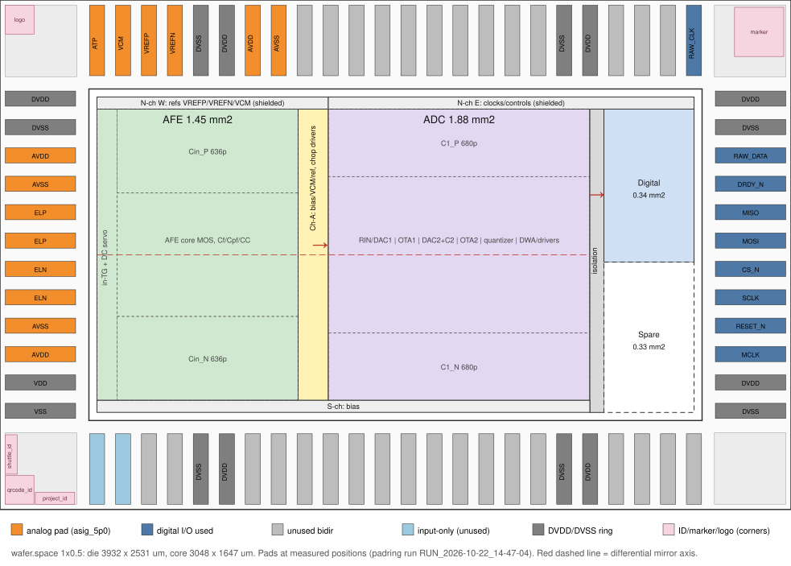

# GF180 フロアプラン（Half Height、2026-10-22）

今回の rev は wafer.space の 1x0.5（Half Height）スロットで進める（10/22 決定）。このスロットのコアに、AFE・ADC・デジタルを配置した初版である。

- 図：`figures/gf180_floorplan_20261022.svg`
- 図の生成と配置チェック：`python3 gf180/floorplan_half_height.py`
- 各ブロックの面積は `gf180_area_estimate_20261021.md` の値を使った。DAC2 は MOS 電流 DAC にする（10/22、`gf180_large_resistors_20261022.md`）。

## 前提（wafer.space テンプレート、`librelane/slots/slot_1x0p5.yaml`）

- **寸法**：ダイは 3932 × 2531 µm、コアは (442, 442)〜(3490, 2089) の 3048 × 1647 µm。
- **パッド数**：標準パッドリングは 72 本（信号 56、電源 16）。
  - 内訳は南 24、東 12、北 24、西 12。
  - テンプレートの標準では、アナログパッド（`gf180mcu_fd_io__asig_5p0`）は 4 本で、すべて西辺にある。今回は 14 本にした（西辺 8、北辺 6。「パッドの割り当て」）。
- **電源**：
  - DVDD／DVSS の 16 本は、リング全体で 1 つの網になっている。
  - fd_io では VDD = DVDD、VSS = DVSS につながる。
  - テンプレートには、アナログとデジタルで電源を分ける仕組みがない。
- **README の制約**：パッドの数と電源パッドは変えないこと（標準ブレイクアウト基板との互換のため）。信号パッドの種類（双方向／入力／アナログ）は変えてよい。
- **パッドの並びと座標**：作業コピーで作ったパッドリング（「パッドリング試作」）で確かめた。
  - slot YAML の PAD_* の各リストは、座標の小さい側から順に置かれる。西辺と東辺は下（南）から上（北）、南辺と北辺は左（西）から右（東）。
  - パッドのセルは 75 × 350 µm で、ダイの端から 26 µm に並ぶ。ピッチは西辺と東辺が 141 µm、南辺と北辺が 129 µm。ボンディングパッドの中心は、ダイの端から 58 µm。
  - パッドの内側の端からコア領域の端までは、4 辺とも 66 µm。
  - 4 隅は 355 µm 角のコーナーセル。wafer.space の ID／マーカーセルとロゴは、コーナーセルの区画に入り、コアには入らない。
  - 図のパッドは、この実座標で描いた。

## ブロック配置（コア座標、µm。ダイ座標は +442）

| ブロック | x | y | 面積 | 必要面積（下限〜上限） | 中央値 | 上限 |
|---|---|---|---|---|---|---|
| AFE | 40〜1040 | 100〜1547 | 1.447 mm² | 1.187〜1.691 | 収まる | 0.24 不足 |
| Ch-A（バイアス・VCM・基準のフィルタ、チョッパドライバ） | 1040〜1190 | 100〜1547 | 0.217 | 0.055〜0.170 | 収まる | 収まる |
| ADC | 1190〜2490 | 100〜1547 | 1.881 | 1.385〜1.966 | 収まる | 0.08 不足 |
| 分離帯（ガードリング） | 2490〜2560 | 40〜1547 | 0.106 | — | — | — |
| デジタル | 2560〜3008 | 787〜1547 | 0.340 | 0.250〜0.400 | 収まる | 0.06 不足 |
| 予備 | 2560〜3008 | 40〜787 | 0.335 | — | — | — |
| 南チャネル（バイアス） | 40〜2490 | 40〜100 | | | | |
| 北チャネル西側（基準電圧、シールド付き） | 40〜1190 | 1547〜1607 | | | | |
| 北チャネル東側（クロック・制御、シールド付き） | 1190〜3008 | 1547〜1607 | | | | |

- 外周 40 µm はコアの電源リング用に空けてある。
- 差動の対称軸はコア中央の y = 823.5 µm。AFE と ADC はこの軸で上下対称に並べる。
- wafer.space の ID／マーカーセルとロゴは、コーナーセルの区画に入る（「前提」）。以前ここで取っていた 0.09 mm²（x 2708〜3008、y 40〜340）は、予備に戻した（10/22）。

**面積の結論**

- **中央値なら収まる。** 予備が 0.33 mm² 残る。
- **上限の見積もりでは 0.39 mm² 不足する。** 予備を使い切っても、まだ 0.05 mm² 足りない（ID／マーカーセルの領域を予備に戻す前は 0.17 mm²、DAC2 を MOS 電流 DAC にする前は 0.38 mm²）。
- **不足分を埋める手段**：次のどれか 1 つで埋められる（`gf180_area_estimate_20261021.md` の「面積を減らす手段」）。
  - C1 を半分にする（0.38 mm² 減）
  - Cin を 318 pF に戻す（0.36 mm² 減）
  - デカップリングを MIM の下に置く（0.1〜0.25 mm² 減）
- **レイアウトの進め方**：AFE と ADC の枠を先に確保し、東列の予備は最後まで緩衝として残す。

## ブロック内部の並べ方（案）

- **AFE**（西から東へ）
  - 入力 TG と DC サーボの帯（x 40〜140）を置く。入力 TG は対称軸上の ELP／ELN の正面に置く。
  - その東に、Cin_P（上）・コア MOS 帯（中）・Cin_N（下）を並べる。
  - コア MOS 帯には、入力対（共通重心）、カスコード、テール、CMFB、Cf／Cpf／CC、出力 TG を置く。
- **ADC**
  - C1_P（上）と C1_N（下）で中央帯を挟む。
  - 中央帯には、西から RIN と DAC1 → OTA1 → R21・DAC2・C2 → OTA2 → 量子化器（比較器 31 個＋ラダー）→ DWA ロジックと DAC スイッチのドライバ、の順に並べる。
  - DWA と DAC スイッチの制御線（DAC1 と DAC2 で計 124 本）は ADC の中で完結させ、デジタルブロックへは出さない。

## パッドの割り当て

10/22 に決めた。アナログパッド（asig_5p0）は 14 本で、西辺に 8 本、北辺の西側に 6 本置く。

- 西辺の入力専用 4 本（`inputs[0..3]`、in_c）と、北辺の双方向 6 本（テンプレートの `bidir[40..45]`）を、アナログパッドに変えた。defines は NUM_INPUT_PADS 0、NUM_ANALOG_PADS 14、NUM_BIDIR_PADS 40。
- パッドの数と電源パッドは変えない。

**西辺**（上から。y はパッド中心のダイ座標、µm）

| 位置 | y | パッド | 割り当て |
|---|---|---|---|
| 1 | 2041 | `dvdd_pads[6]` | DVDD（リング） |
| 2 | 1900 | `dvss_pads[6]` | DVSS（リング） |
| 3 | 1759 | `analog[0]` | AVDD |
| 4 | 1618 | `analog[1]` | AVSS |
| 5 | 1477 | `analog[2]` | ELP |
| 6 | 1336 | `analog[3]` | ELP |
| 7 | 1195 | `analog[4]` | ELN |
| 8 | 1054 | `analog[5]` | ELN |
| 9 | 913 | `analog[6]` | AVSS |
| 10 | 772 | `analog[7]` | AVDD |
| 11 | 631 | `vdd_pads[0]` | VDD（リング） |
| 12 | 490 | `vss_pads[0]` | VSS（リング） |

**北辺の西側**（左から。x はパッド中心のダイ座標、µm。y = 2473）

| 位置 | x | パッド | 割り当て |
|---|---|---|---|
| 1 | 482.5 | `analog[8]` | ATP（テスト用、用途はゲート 1 で決める） |
| 2 | 611.5 | `analog[9]` | VCM |
| 3 | 740.5 | `analog[10]` | VREFP |
| 4 | 869.5 | `analog[11]` | VREFN |
| 5, 6 | 998.5, 1127.5 | `dvss_pads[5]`, `dvdd_pads[5]` | DVSS, DVDD（リング） |
| 7 | 1256.5 | `analog[12]` | AVDD |
| 8 | 1385.5 | `analog[13]` | AVSS |

- **AVDD と AVSS は 3 本ずつ、ELP と ELN は 2 本ずつ。** 同じ信号のパッドはチップ上で幅の広い配線（ストラップ）でつなぎ、パッケージでもそれぞれ別のピンにボンディングする。
  - **AVDD／AVSS の電流（決定）**：typical で合計約 28 mA、1 本あたり約 9.3 mA。asig_5p0 の Metal2 の帯の上限 13.6 mA（テック LEF の DC 電流密度）の約 69 %。1 本が全体の約 49 % を超えて流さない限り、上限に収まる。2 本では 1 本約 14 mA になり、上限を超える。
  - **北辺の AVDD／AVSS**（x = 1256.5／1385.5）は、AFE の東側（ダイ座標 x 982〜1482）の上にある。チップ上の AVDD／AVSS のストラップは、西辺の 2 本と北辺の 1 本の計 3 本をつなぐ。北辺のパッドから AFE へは、北チャネルの西側（基準電圧用、コア座標 x 40〜1190）を横切る。北辺のパッドはコア座標で x 814.5／943.5 にあたる。
  - **ELP／ELN の抵抗**：asig_5p0 の中で 1 本あたり約 1.2 Ω。2 本並列で片側約 0.6 Ω、差動で約 1.2 Ω。熱雑音は約 1.4 nVrms で、予算 5.88 nVrms の約 6 %（電力比）。
- **上下対称**：西辺の 8 本は、差動の対称軸（ダイ座標 y = 1265.5 µm、コア座標 823.5 µm）について上下対称に並ぶ。
  - ELP（1477／1336）と ELN（1195／1054）が軸を挟む。内側の 2 本は軸から ±70.5 µm、外側の 2 本は ±211.5 µm。
  - その外側に AVSS（1618／913）、いちばん外側に AVDD（1759／772）が来る。
- **ATP・VCM・VREFP・VREFN**：北辺の西端に置いた。
  - ATP は入力（ELP／ELN）から離れる。AFE 出力のモニタに使っても、入力へ帰還しにくい。
  - VREFP／VREFN／VCM は北辺から入り、北チャネルの西側（基準電圧用）を通って Ch-A の上端に入る（「配線と分離のルール」、10/22 決定）。
- **東辺**（`bidir[18..25]`、下から順に）：MCLK、RESET_N、SCLK、CS_N、MOSI、MISO、DRDY_N、RAW_DATA。
- **北東角**（`bidir[26]`、x = 3449.5 µm）：RAW_CLK。デジタルブロックの真上にある。以前の案の `bidir[45]` は、実際には北西角（AFE の真上）にあった。その位置は今回 ATP にした。
- **南西角の `clk_pad`／`rst_n_pad`**：使わない。西辺のアナログパッドに近いので、32.768 MHz の MCLK は東辺から入れる。
- **その他の双方向パッド（南 18 本、北 13 本）**：使わない。出力と入力を無効にしてプルをかける。
- **リングの電源パッド**：西辺の両端の 4 本を含め、テンプレートのまま。fd_io では VDD＝DVDD、VSS＝DVSS で、どれもリングの同じ網になる。西辺の上側の AVDD（位置 3）の上隣は DVSS、下側の AVDD（位置 10）の下隣は VDD、北辺の AVDD の西隣は DVDD（`dvdd_pads[5]`）。

## 電源とグラウンド

- **アナログ電源は AVDD／AVSS から取る。**
  - AFE と ADC には、アナログパッドの AVDD／AVSS（各 3 本）から電源を入れる。リングの VDD／VSS にはつながない。
  - AVDD は、基板の低雑音 LDO から供給する想定。
- **デジタル電源はリングから取る。** デジタルブロックとパッドは、リングの DVDD／DVSS（= VDD／VSS）で動かす。
- **ESD と電源投入順**：asig パッドの ESD ダイオードはリングの DVDD／DVSS につながっている。そのため、AVDD は DVDD をダイオード 1 段分以上は超えないように投入する。
- **基板**：p 基板は共通。
  - アナログ領域の基板タップは AVSS、デジタル領域は DVSS につなぐ。
  - 基板上では AVSS と DVSS を 1 点で接続する。
  - 分離帯には p+ と n ウェルの二重ガードリングを置く。デジタルを deep N ウェルで囲う案も検討する。

## 配線と分離のルール

- **入力経路の抵抗**
  - ELP／ELN の入力経路の抵抗は、パッド込みで差動合計 1.4 Ω 以下にする（10/22 に 1 Ω から見直し）。
  - パッド（asig_5p0、2 本並列）が差動約 1.2 Ω を占めるので、パッドから入力 TG までのオンチップのストラップは片側 0.1 Ω 以下にする。2 本のパッドは、TG の手前で同じ太さのストラップで合流させる。
  - 1.4 Ω で 1.5 nVrms（予算 5.88 nVrms の約 7 %、電力比）。
  - 入力に直列抵抗は入れられない。100 Ω でも 12.8 nVrms になり、予算を超える。
  - ESD はパッドのものだけに頼る。
- **北チャネル（60 µm）は 2 つに分ける**（10/22 決定）。
  - 西側（x 40〜1190、AFE と Ch-A の上）は基準電圧用。北辺西端のパッドから VREFP／VREFN／VCM を Ch-A の上端まで運ぶ。両側を VSS でシールドし、クロック線は通さない。チョッパのクロックは Ch-A の東側から入るので、ここをクロックに使う必要はない。
  - 東側（x 1190〜3008）はクロックと制御線用。デジタルからアナログへ、128 kHz（64 kHz も選べる）のチョッパ相、1.024 MHz の ADC 相、CHOP_BLANK、リセット、トリム設定などを Ch-A まで運ぶ。
  - 両側を VSS 線でシールドする。
  - SKY130 では、チョッパ配線と入力の結合（PHI→INN 5.3 fF）で −90 mV の暴走が起きた。同じことを避けるため、AFE の入力節点からは十分離す。
- **32.768 MHz の MCLK**：東列のデジタルブロックの外に出さない。アナログ側へは分周した相だけを送る。
- **南チャネル（60 µm）**：バイアスを運ぶ。VREFP／VREFN／VCM は北チャネルの西側を通すことにした（10/22）。
- **Ch-A（150 µm）**
  - バイアス生成、VCM バッファ、基準電圧の RC フィルタ、AFE 出力 TG 用のチョッパドライバを置く。
  - AFE から ADC への差動対は、対称軸上でこの帯を横切る。
- **分離帯（70 µm）**：横切るのはコードバス（5〜6 bit とストローブ）と、少数の制御線だけにする。デジタルブロックの側（中段より上）で横切る。

## 組み立ての流れ（案）

1. テンプレートの `SLOT=1x0p5 make librelane-padring`（README の「Building a Standalone Padring for Analog Design」）で、標準パッドリングだけを作る。信号パッドの種類変更は、slot YAML と defines（NUM_INPUT_PADS 0、NUM_ANALOG_PADS 14、NUM_BIDIR_PADS 40）を直して反映する。10/22 に作業コピーで作った（「パッドリング試作」）。
2. アナログのコア（AFE＋ADC）は、これまでの KLayout 生成フローで作る。
3. デジタルブロックは LibreLane でマクロとして固める。
4. KLayout でトップを組み立て、DRC／LVS を通したうえで、wafer.space の `gf180mcu-precheck` を通す。

## パッドリング試作（10/22）

テンプレートの作業コピーで、「パッドの割り当て」どおりのパッドリングを作った。padring フローは最後（シールリング）まで通った。asig_5p0 パッドの性能も、ネットリストと GDS から確かめた。

- **作業コピー**：`/Users/noah/Codings/ws_gf180/eeg_padring`
  - テンプレートのチェックアウト（`gf180mcu-project-template`、main）は変えていない。
  - PDK（`gf180mcu/`）は元のチェックアウトへのシンボリックリンク。`librelane/runs` は持ってこなかった。
  - `shell.nix` は元の `shell.nix` を読み込む。作業コピーは git 管理外なので、元のままだと nix-shell のたびにフォルダ全体（ランを含む）が nix ストアへコピーされる。
- **実行**：作業コピーで `nix-shell --run "SLOT=1x0p5 make librelane-padring"`。
- **ラン**：`librelane/runs/RUN_2026-10-22_14-47-04`（20 ステップ、約 12 秒）
  - 結果は `final/def/chip_top.def`、`final/odb/chip_top.odb`、`final/gds/chip_top.gds`（シールリング付き）。
  - 警告は lint 2 件、IFP-0028（コア左下の丸め）、PAD-0033 で、テンプレートの既定ラン（`RUN_2026-10-22_11-30-39`）と同じ程度。lint の 1 件は、chip_core で NUM_INPUT_PADS を使わなくなったため（無害）。
  - 全 72 本の座標は、同じランフォルダの `pad_coordinates.csv`（端子の形は `pad_geometry.json`）。抽出は作業コピーの `scripts/extract_pads.py` と `scripts/annotate_pads.py`。
  - それまでの版は、`RUN_2026-10-22_12-41-47`（アナログパッドを西辺の 8 本だけにした版）と `RUN_2026-10-22_13-32-23`（AVDD／AVSS を 2 本ずつにした版）。
- **変えたところ**（作業コピーだけ）
  - `src/slot_defines.svh`（SLOT_1X0P5）：NUM_INPUT_PADS を 4 から 0、NUM_BIDIR_PADS を 46 から 40、NUM_ANALOG_PADS を 4 から 14 にした。電源パッドの数は変えていない。
  - `librelane/slots/slot_1x0p5.yaml`：PAD_WEST の `inputs[3..0]` を `analog[7..4]` に、PAD_NORTH の `bidir[45..42]` を `analog[8..11]` に、`bidir[41]`・`bidir[40]` を `analog[12]`・`analog[13]` に置き換えた。
  - `src/chip_top.sv`、`src/chip_core.sv`、`librelane/chip_top.sdc`：入力専用パッドの部分を外した（`NO_INPUT_PADS`）。コアはテンプレートのダミーのまま。
  - **SRAM マクロ 2 個を外した**（`chip_core.sv`、`librelane/macros/macros_5v.yaml`・`macros_3v3.yaml`、`librelane/pdn/pdn_cfg.tcl`）。テンプレートのままだと、パッドリングの GDS のダイ座標 (490, 500) と (970, 500) に SRAM が置かれ、AFE の領域に重なる。
- **確認**
  - GDS のコア領域には何もない（ダイ境界の箱とシールリングだけ）。
  - テンプレートの既定ランとの違いは、西辺の 4 か所（in_c → asig_5p0）、北辺の 6 か所（bi_24t → asig_5p0）と SRAM だけ。ほかのパッドとフィラーの位置は同じ。前の版（`RUN_2026-10-22_13-32-23`）との違いは、北辺の 2 か所だけ。
  - RAW_CLK の `bidir[26]` は残っており、位置も (3449.5, 2473.0) のまま。
  - `gf180/floorplan_half_height.py` のパッド位置と信号名は、このランの座標と一致する（72 本すべてで確認）。

### インスタンス名と YAML の書き順

- PAD_* の各リストは座標の小さい側から置かれる（LibreLane の `pad_cfg.tcl`）。そのため西辺は、アナログパッドを下から `analog[7]`、`analog[6]`、…、`analog[0]` の順に書いた。インスタンス名は上から `analog[0]`〜`analog[7]` になる。
- 北辺は左から `analog[8]`〜`analog[11]`、リングの電源パッド 2 本を挟んで `analog[12]`（AVDD）と `analog[13]`（AVSS）。北辺の東端の `bidir[26]` が RAW_CLK。
- 複数パッドの信号（AVDD／AVSS は 3 本、ELP／ELN は 2 本）も、トップでは別々のピン（`analog_PAD[i]`）のまま。つなぐストラップはアナログ部のレイアウトで引く。トップの LVS では、同じ信号のパッドを同じ網として扱う必要がある。
- ID／マーカーセルとロゴの位置：qrcode_id（142.8 µm 角）、project_id と shuttle_id（195.5 × 59.5 µm）は南西角、marker（245 µm 角）は北東角、ロゴ（143.25 µm 角）は北西角。どれもコーナーセルの区画の中。

### 西辺のアナログパッド（ダイ座標、µm）

| 位置（上から） | 信号 | インスタンス | パッド中心 (x, y) | コア側の端子（x = 376.0 の y 範囲） |
|---|---|---|---|---|
| 1 | DVDD（リング） | `dvdd_pads[6]` | (58.0, 2041.0) | — |
| 2 | DVSS（リング） | `dvss_pads[6]` | (58.0, 1900.0) | — |
| 3 | AVDD | `analog[0]` | (58.0, 1759.0) | 1736.84〜1781.16 |
| 4 | AVSS | `analog[1]` | (58.0, 1618.0) | 1595.84〜1640.16 |
| 5 | ELP | `analog[2]` | (58.0, 1477.0) | 1454.84〜1499.16 |
| 6 | ELP | `analog[3]` | (58.0, 1336.0) | 1313.84〜1358.16 |
| 7 | ELN | `analog[4]` | (58.0, 1195.0) | 1172.84〜1217.16 |
| 8 | ELN | `analog[5]` | (58.0, 1054.0) | 1031.84〜1076.16 |
| 9 | AVSS | `analog[6]` | (58.0, 913.0) | 890.84〜935.16 |
| 10 | AVDD | `analog[7]` | (58.0, 772.0) | 749.84〜794.16 |
| 11 | VDD（リング） | `vdd_pads[0]` | (58.0, 631.0) | — |
| 12 | VSS（リング） | `vss_pads[0]` | (58.0, 490.0) | — |

### 北辺のアナログパッド（ダイ座標、µm）

| 位置（左から） | 信号 | インスタンス | パッド中心 (x, y) | コア側の端子（y = 2155.0 の x 範囲） |
|---|---|---|---|---|
| 1 | ATP | `analog[8]` | (482.5, 2473.0) | 460.34〜504.66 |
| 2 | VCM | `analog[9]` | (611.5, 2473.0) | 589.34〜633.66 |
| 3 | VREFP | `analog[10]` | (740.5, 2473.0) | 718.34〜762.66 |
| 4 | VREFN | `analog[11]` | (869.5, 2473.0) | 847.34〜891.66 |
| 5 | DVSS（リング） | `dvss_pads[5]` | (998.5, 2473.0) | — |
| 6 | DVDD（リング） | `dvdd_pads[5]` | (1127.5, 2473.0) | — |
| 7 | AVDD | `analog[12]` | (1256.5, 2473.0) | 1234.34〜1278.66 |
| 8 | AVSS | `analog[13]` | (1385.5, 2473.0) | 1363.34〜1407.66 |

- **セル**：アナログパッドはすべて asig_5p0、リングは dvdd／dvss。西辺のセルは x 26〜376 µm、北辺のセルは y 2155〜2505 µm。
- **パッド中心**：ボンディングパッド（Metal5、60 µm 角）の中心。トップのピン `analog_PAD[i]` もここにある。
- **コア側の端子**：ASIG5V は、幅 2.54 µm の Metal2 の帯 8 本で、セルの内側の端（西辺は x = 376.0、北辺は y = 2155.0）に出る。
  - 帯はパッド中心から ±2.58〜±22.16 µm にあり、中央に 5.16 µm の隙間がある。LEF のピンは、内側の端から 215.6 µm の長さ。
  - コアからは 8 本すべてにつなぐ。
- アナログパッドのセルの中を、リングの DVDD／DVSS／VDD／VSS のレールが通る。ASIG5V とレールの間は ESD ダイオードだけ。

### デジタルパッド（使うもの、ダイ座標、µm）

| 信号 | インスタンス | 辺 | パッド中心 (x, y) |
|---|---|---|---|
| RAW_DATA | `bidir[25]` | 東 | (3874.0, 1759.0) |
| DRDY_N | `bidir[24]` | 東 | (3874.0, 1618.0) |
| MISO | `bidir[23]` | 東 | (3874.0, 1477.0) |
| MOSI | `bidir[22]` | 東 | (3874.0, 1336.0) |
| CS_N | `bidir[21]` | 東 | (3874.0, 1195.0) |
| SCLK | `bidir[20]` | 東 | (3874.0, 1054.0) |
| RESET_N | `bidir[19]` | 東 | (3874.0, 913.0) |
| MCLK | `bidir[18]` | 東 | (3874.0, 772.0) |
| RAW_CLK | `bidir[26]` | 北（東端） | (3449.5, 2473.0) |

- 東辺の両端は、上から DVDD（`dvdd_pads[3]`、y = 2041.0）、DVSS（`dvss_pads[3]`、1900.0）、…、DVDD（`dvdd_pads[2]`、631.0）、DVSS（`dvss_pads[2]`、490.0）。
- 東辺のセルは x 3556〜3906 µm。コア側の端子は、セルの内側の端（x = 3556 µm）の Metal2。A・OE・SL・Y はセルの上端寄り（セル下端から 68.7〜71.2 µm）、CS・PU・PD・IE は下端寄り（3.4〜11.8 µm）にある。
- `bidir[26]` のセルは x 3412〜3487、y 2155〜2505 µm。コア側の端子は y = 2155 の Metal2 で、A・OE・SL・Y が東寄り（x 3480.7〜3483.2）、CS・PU・PD・IE が西寄り（x 3415.4〜3423.8）。

### AVDD／AVSS のパッドセル

- **結論：AVDD／AVSS も asig_5p0 にする（各 3 本）。** 電源パッドのセル（dvdd／dvss）は、このリングでは使えない。
- **分離**
  - dvdd／dvss のボンディングパッドは、リングの DVDD／DVSS レールにそのままつながる。fd_io では、dvdd の中で VDD＝DVDD、dvss の中で VSS＝DVSS になる。テンプレートのリングは一続きなので、AVDD を dvdd にすると DVDD と短絡する。
  - リングを切るセル（brk2／brk5）は DVDD・DVSS・VDD を切るが、VSS のレールは通す。dvss の中で VSS＝DVSS なので、切っても AVSS は DVSS から分けられない。分けられるのは AVDD だけ。
  - テンプレートの padring の手順とブレイクアウト基板も、一続きのリングを前提にしている（README：電源パッドは変えない）。
  - asig_5p0 なら、パッドとリングの間は逆バイアスのダイオードだけになる。
- **ESD**
  - asig_5p0 の中身は HBM 用のダイオード 2 個だけで、クランプはない（SPICE ネットリスト）。ASIG5V → DVDD の p+／n ウェルと、DVSS → ASIG5V の n+／p 基板で、どちらも 150 µm² × 4。
  - 放電はダイオードでリングへ逃がし、dvdd／dvss（16 個）の RC トリガ付きクランプ（W 4 mm の NMOS）とコーナーセルのクランプで吸収する。
  - AVDD–AVSS 間の放電は、AVDD のダイオード、リングのクランプ、AVSS のダイオードの順に通る。アナログ部の AVDD–AVSS 間に、RC トリガのクランプを置く。
  - GF の資料（gf180mcu_fd_io の Analogue Signal Cells）は、asig パッドがゲートを駆動するなら、ゲートの近くに CDM 用の保護（ダイオードの周囲長 25 µm 以上、ポリ抵抗 50 Ω 以上。資料では単位が抜けている）を置くよう求めている。ELP／ELN は入力 TG の拡散と Cin を通ってからゲートに入る。「入力に直列抵抗は入れない」方針でよいかは、ESD の見直しで確かめる。
- **電流容量**
  - asig_5p0 の中で、ボンディングパッドの下（Metal2〜Metal5 の積層、ビアは各層 6464 個）からコア側の端までは、Metal2 の帯 8 本（計 20.32 µm 幅、長さ約 285 µm）だけでつながる。その上の層は、リングのレールが使っている（GDS で確認）。
  - テック LEF の DC 電流密度（Metal2 0.67 mA/µm）では、1 本あたりの上限は 13.6 mA。1 本だけでは、AVDD の typical 約 28 mA はその約 2 倍になる。
  - **決定：AVDD／AVSS を 3 本ずつにした。** typical の合計約 28 mA で、1 本あたり約 9.3 mA、上限の約 69 %。2 本では 1 本約 14 mA で上限を超える。1 本が全体の約 49 % を超えて流さない限り、上限に収まる。
  - 抵抗は 1 本あたり約 1.2 Ω（Metal2 0.09 Ω/□）。3 本並列で約 0.4 Ω になり、28 mA で約 11 mV 下がる（AVDD と AVSS で計約 22 mV。チップ上のストラップの抵抗は別）。
  - 参考：dvdd は、コア側の Metal2 が 60 µm 幅（40 mA）、ボンディングパッドからコア側の端まで約 0.23 Ω。
  - テック LEF の電流密度は、ふつう高温での寿命から決めた値で、室温から体温で使う試作なら実際の余裕はもっと大きい（GF180 の規定温度は未確認）。
- **電源投入**：「電源とグラウンド」のとおり、AVDD は DVDD をダイオード 1 段分以上超えないようにする。AVSS も、DVSS からダイオード 1 段分以内に保つ。

### ELP／ELN の経路抵抗

- asig_5p0 の中だけで、1 本あたり約 1.2 Ω ある（上の Metal2 の帯）。帯の上の層はリングのレールなので、パッドのセルの中では下げられない。
- 2 本並列で片側約 0.6 Ω、差動で約 1.2 Ω。熱雑音は 1.28 nVrms × √1.2 ≈ 1.4 nVrms で、予算 5.88 nVrms の約 6 %（電力比）。1 本ずつのとき（差動約 2.4 Ω、約 11 %）の半分になる。
- 「配線と分離のルール」の上限は、パッド込みで差動 1.4 Ω 以下に見直した（10/22）。ストラップは片側 0.1 Ω 以下にする。

### 試作の経緯（10/22）

- **第 1 版**（`RUN_2026-10-22_12-41-47`）：アナログパッドは西辺の 8 本だけ（上から AVDD、ATP、AVSS、ELP、ELN、VCM、VREFP、VREFN）。
- **第 2 版**（`RUN_2026-10-22_13-32-23`）：AVDD・AVSS・ELP・ELN を 2 本ずつにし、ATP・VCM・VREFP・VREFN を北辺の西端に移した。RAW_CLK は `bidir[26]` にした。
- **第 3 版**（`RUN_2026-10-22_14-47-04`、今の版）：北辺の `bidir[41]`・`bidir[40]` を AVDD・AVSS にして、AVDD／AVSS を 3 本ずつにした。
- 第 1 版で分かったこと（YAML のリストの向き、ID／マーカーセルの位置、asig_5p0 の抵抗と電流の上限）は、「前提」「ブロック配置」「パッドの割り当て」に入れた。

**残っている判断**

- ~~ELP／ELN の入力経路の抵抗の上限~~：パッド込みで差動 1.4 Ω 以下に見直した（10/22）。
- ~~VREFP／VREFN／VCM の経路~~：北チャネルの西側を基準電圧用にした（10/22）。
- ~~AVDD／AVSS の電流~~：3 本ずつにした（10/22 決定、第 3 版）。
  - 10/22 の積み上げでは typical で約 28 mA ある。内訳は AFE とバイアス 23.4 mA、ADC の OTA 3.4 mA、比較器とクロックドライバ約 1 mA（量子化器は 10/22 の設計で AVDD 0.28 mA なので、見込みより小さい）。
  - 2 本ずつでは 1 本あたり約 13.9 mA で、ストラップの上限 13.6 mA をわずかに超える。85 °C や ff ではさらに 16 mA 台になる。
  - 北辺の `bidir[41]`／`bidir[40]`（ダイ x 1256.5／1385.5、AFE の東寄りの上）を AVDD／AVSS に替えた。1 本あたり typical で約 9.3 mA、85 °C や ff でも約 11 mA で、上限に収まる。

## 確認が必要なこと

- **基板の電源電圧**：基板が DVDD = 3.3 V を供給できるか。fd_io では VDD = DVDD になり、こちらの素子は 3.3 V 系。
- **asig_5p0 パッドの性能**：済み（10/22、「パッドリング試作」）。1 本あたり DC 13.6 mA まで、約 1.2 Ω。AVDD／AVSS は 3 本ずつで 1 本約 9.3 mA（typical の合計約 28 mA）、ELP／ELN は 2 本ずつで片側約 0.6 Ω。
- **ID／マーカーセル**：済み（10/22）。4 隅のコーナーセルの区画に入り、コアには置かない。
- **パッドの実座標**：済み（10/22）。図も実座標で描き直した。
- **ESD**：アナログ部の AVDD–AVSS 間のクランプと、ELP／ELN の CDM 保護の要否（「パッドリング試作」の「AVDD／AVSS のパッドセル」）。
- **独立環境（Codex）への依頼**
  - DAC2 の作り直し
  - DC サーボの設計
  - いずれも AFE と ADC の面積に効く。
- **MIM の下の配置ルール**：デカップリングを MIM の下に置けるか。
- **スロット購入**：期限は 12/9。
