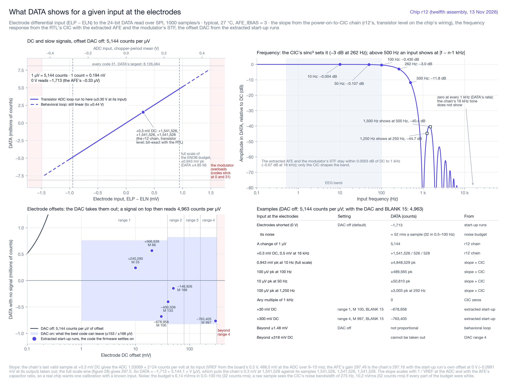

# GF180 EEG チップ：電極の入力と DATA の対応（2026-11-12）

電極に何を入れると、SPI で読む DATA に何が出るかをまとめた。チップの評価やファームウェアを書くときの目安にする。図は図 32（`documentation/figures/gf180/r12_20261113/viz/gf180_viz_r12_32_input_output.png`）。

- 値は typical、27 °C、AFE_IBIAS 3、基板の基準電圧 0.5 V でのシミュレーション。
- 傾きは 12 回目のチップ（発注の候補）の通し（`e2e_startup.py`、電源投入から CIC の出力まで、トランジスタとチップの配線。11/16 に終わった）から取った。
- 11/16 に、9 回目の通しの値から 12 回目の値に直した。傾きは 5,152 → 5,144 カウント／µV（−0.16 %）、0 V の値は −1,295 → −1,713。違いの中身は下の「傾きの出どころ」。



## 要点

- **DATA の形**：24 bit の 2 の補数で、1 秒に 1000 個。`READ_SAMPLE`（0x30）で読む（`gf180/tapeout/rtl/README.md`）。
  - CIC をクリアしてから最初の 2 個は SETTLING で、使えない。最初の有効な値は、クリアから 3 ms 後。
  - DATA が取りうる最大は ±8,126,464（どのフレームも符号 31 または 0 のとき）。
- **オフセット DAC が切のとき（既定、BLANK 7）**：
  - DATA ≈ −1,713 + 5,144 ×（電極の入力、µV）。
  - 1 カウントは電極で 0.194 nV。
- **オフセット DAC を使うとき（BLANK 15）**：電極の信号は 1 µV あたり 4,963 カウントになる。
- **周波数**：CIC の sinc³ だけで決まる。
  - 100 Hz で −0.43 dB、262 Hz で −3 dB、500 Hz で −11.8 dB。
  - 1 kHz の整数倍は DATA に出ない。
  - 500 Hz より上の入力は、|f − n × 1 kHz| に折り返って出る。
- **入力の範囲**：
  - ENOB の予算のフルスケールは ±0.943 mV pk（DATA で ±4.85 M）。
  - トランジスタの ADC のループで確かめたのは、ADC の入力 ±0.30 V（電極 ±1.01 mV）まで。
  - 行動モデルでは ±0.44 V（±1.48 mV）まで線形で、その先は変調器が飽和する。
- **電極の DC オフセット**：±318 mV まで DAC で打ち消せる。打ち消したあとに残るのは ±0.15〜0.17 mV で、DATA で ±0.76〜0.82 M。DAC を書くたびに、ホストは AFE_RST を 100 µs 上げる（11/16、`gf180_electrode_dc_20261022.md` の「使い方」）。
- **雑音**：電極を短絡したとき、0.5〜100 Hz で 6.14 nVrms（32 カウント rms）。生のサンプル 1 個では約 52 カウント rms（下の「注意」）。

## 例

| 電極の入力 | 設定 | DATA（カウント） | 出どころ |
|---|---|---|---|
| 短絡（0 V） | DAC 切（既定） | −1,713 | 起動のラン（電極 0 V）× 通しの ADC |
| その雑音 | | 1 サンプルで約 52 rms（0.5〜100 Hz では 32 rms） | 雑音の予算 |
| 1 µV の変化 | | 5,144 | 12 回目の通し |
| +0.3 mV の DC（16 kHz・0.5 mV を重ねる） | | +1,541,526、+1,541,526、+1,541,528 | 12 回目の通し（トランジスタ、RTL とビット一致） |
| 10 Hz・0.943 mV pk（フルスケール） | | ±4,848,529 pk | 傾き × CIC（−0.004 dB） |
| 100 Hz・100 µV pk | | ±489,565 pk | 傾き × CIC（−0.43 dB） |
| 50 Hz・10 µV pk | | ±50,810 pk | 傾き × CIC（−0.11 dB） |
| 1,250 Hz・100 µV pk | | 250 Hz に ±3,003 pk | 折り返し（−44.7 dB） |
| 1 kHz の整数倍（16 kHz など） | | 0 | CIC の零（通しの 16 kHz の正弦は出ない） |
| +10 mV の DC | 範囲 1、M 33、BLANK 15 | +240,290 | 抽出の起動のラン |
| +30 mV の DC | 範囲 1、M 100、BLANK 15 | −678,958 | 抽出の起動のラン |
| +300 mV の DC | 範囲 4、M 997、BLANK 15 | −763,405 | 抽出の起動のラン |
| ±1.48 mV を超える（DAC 切） | | 比例しない（符号が 0 と 31 に張り付く） | 行動モデル |
| ±318 mV を超える DC | | 打ち消せない | DAC の範囲 4 |

- 正弦の行は振幅で、DC の行は DATA そのもの（0 V の −1,713 を含む）。
- DAC を使う行は、電極のオフセットだけのときの DATA。信号を重ねると、そこから 4,963 カウント／µV で動く。

## 傾きの出どころ

12 回目の通し（`runs/e2e_startup/…_r12_chain/`、+0.3 mV の DC）の最後の有効なサンプルで、CIC の重みで平均した値から求めた。

- **ADC**：DATA ÷ ADC の入力 = 1.03069 × 2^24（1 V あたり）。
  - 単位利得の ADC（DAC1 のフルスケール 0.484 V で 31 × 2^18）より 3.07 % 大きい。
  - そのうち 2.46 % は、ADC での VREF が 488.0 mV（9〜10 ms の平均）で、0.5 V より小さいため。基板の 0.5 V が、チップの中の片側 100 Ω で下がる。
  - 9 回目の版（1.03129、VREF 487.7 mV）との差 −0.058 % は、VREF が 0.28 mV 高くなった分（DATA は VREF に反比例する）。
- **AFE**：ADC の入力 ÷ 電極 = 297.16。
  - これには AFE のオフセットが入っている。電極 0 V の起動のランの出力 −0.0991 mV を引くと 297.49。
  - フルスケールの正弦波（図 28、12 回目）の 297.5 と合う。
  - 9 回目の版（オフセット −0.0748 mV、引いて 297.75、正弦波 297.8）より 0.09 % 小さい。AFE だけの台は変わっていないので、チップの上での違い（負荷になる ADC の入力抵抗など）と見ているが、確かめていない。
- **合わせると** DATA ≈ −1,713 + 5,144.1 ×（µV）。
  - 0.3 mV では 1,541,528 で、通しのサンプル 1,541,526、1,541,526、1,541,528 と合う。
- **DAC を使うとき**：BLANK を 15 にするので、AFE の利得は 287.02 になる（DC のラン 8 本の当てはめ、図 27。当てはめの外れは最大 0.86 µV）。1 µV あたり 4,963 カウント。

## 周波数

| 入力の周波数 | DATA での大きさ（DC に対して） | DATA に出る周波数 |
|---|---|---|
| 10 Hz | −0.004 dB | 10 Hz |
| 50 Hz | −0.107 dB | 50 Hz |
| 60 Hz | −0.155 dB | 60 Hz |
| 100 Hz | −0.430 dB | 100 Hz |
| 200 Hz | −1.74 dB | 200 Hz |
| 262 Hz | −3.0 dB | 262 Hz |
| 500 Hz | −11.8 dB | 500 Hz |
| 1,250 Hz | −44.7 dB | 250 Hz |
| 1,500 Hz | −40.4 dB | 500 Hz |
| 1 kHz の整数倍 | 出ない | — |

- AFE（抽出、チョッパ込みの調波の和）と変調器の STF は、1 kHz まで DC から 0.0003 dB 以内（16 kHz で −0.07 dB）。帯域の形は CIC（`eeg_cic3`、R = 1024 の sinc³）だけで決まる。
- 100 Hz の −0.43 dB（4.8 %）は、チップの中では補正していない。

## 電極の DC オフセット

- 使うレジスタ：
  - OFF_CODE_L（0x0D）：M[7:0]。
  - OFF_CTRL（0x0E）：M[9:8]、SIGN、範囲。
  - BLANK（0x0B）：DAC を使うときは 0x0F にする。
- 範囲は、オフセットを覆う最小のものにする：範囲 1 は ±39 mV、2 は ±79 mV、3 は ±159 mV、4 は ±318 mV。
- M は、出力の平均の絶対値が最小になる符号にする。
  - 1 段は約 0.30 mV で、オフセットを 1 段で割った見積もりから 1〜2 ずれることがある（300 mV では 995 ではなく 997）。
  - 手順は `gf180_electrode_dc_20261022.md` の「使い方（ホスト）」。
- 打ち消したあとに残るのは、いちばん大きい段の半分まで：範囲 1 で ±153 µV、範囲 2〜4 で ±166 µV（DATA で ±761,347、±824,875）。
- 最初の電源投入で AFE が飽和しているとき、DAC を書いても CIC の平均が 0 付近を示すことがある（増幅器が出力チョッパの後ろで飽和したまま）。DAC を書くたびに AFE_RST を 100 µs 上げ、0.22 ms 待ってから FILTER_CLEAR を出す（11/16、図 39）。

抽出の起動のラン（12 回目のチップの配線、図 27。DAC は解除の前に書いた）：

| 電極のオフセット | 範囲、M | DATA | 残り（電極換算） |
|---|---|---|---|
| 10 mV | 1、33 | +240,290 | +48.4 µV |
| 20 mV | 1、66 | +566,639 | +114.2 µV |
| 30 mV | 1、100 | −678,958 | −136.8 µV |
| 40 mV | 2、133 | −400,509 | −80.7 µV |
| 50 mV | 2、166 | −146,926 | −29.6 µV |
| 300 mV | 4、997 | −763,405 | −153.8 µV |

## 注意

- **チップごとの差**：傾きは、ADC での VREF に反比例し、AFE の容量の比で決まる。シミュレーションは typical なので、実際のチップでは既知の入力で 1 度合わせる。
- **0 V の値（−1,713）**：AFE のオフセットだけの値（電極換算 −0.33 µV）。
  - 起動のランのモンテカルロ（12 回目、30 本）では、AFE の出力で −0.0996 ± 0.0055 mV（DATA で ±95）。
  - ADC 自身のオフセットは入っていない。
- **雑音の 1 サンプルあたりの値**：雑音の予算（0.5〜100 Hz の 6.14 nVrms）がすべて白色だとして、CIC の雑音帯域幅 275 Hz に広げた見積もり（10.2 nVrms）。
  - AFE の雑音は、チョッパで帯域内は白色になる。
  - ADC の 2.93 nVrms は予算の割り当てで、測った密度ではない。
- **大きい入力での雑音**：ADC のポリ抵抗のフリッカ雑音は、ADC の利得のゆらぎなので信号に比例する（図 33）。
  - 11 回目から、RIN、DAC1、R21 を ppolyf_u（幅 0.8 µm の 2 本の直列）にした。PDK の大きさでとると、フルスケールの正弦波で 0.29 nVrms（ppolyf_u_1k のときは 4.15 nVrms）。
  - 上の雑音の値（入力なし）には入っていない。
- **電極のインピーダンス**：AFE の入力インピーダンスは、DC で差動 3.56 MΩ（図 24）。
  - 電極の抵抗が片側 Rs なら、DATA は 3.56 MΩ ÷（3.56 MΩ ＋ 2 Rs）倍になる。
  - 片側 10 kΩ で −0.56 %、100 Ω で −0.006 %。

## 作り方

`figs_perf.py` の `fig_input_output`。

- 通しは、版のもの（r12 は `_r12_chain`）を読む。ADC での VREF は、通しのチャンクの 9〜10 ms から計算する（11/16 から。それまでは図の注に 487.7 mV と書き込んでいた）。
- 起動のランは `runs/startup/*_chip_r12`。周波数は `runs/viz_r12/afe_baseband_pex_A.csv` と `runs/viz_r12/adc_ntf_stf.csv`。雑音は `gf180/tapeout/viz/data_r12/budget.csv`。

```bash
gf180/tools/venv310/bin/python gf180/tapeout/viz/figs_perf.py gf180/tapeout/pex documentation/figures/gf180/r12_20261113/viz fig_input_output
```
