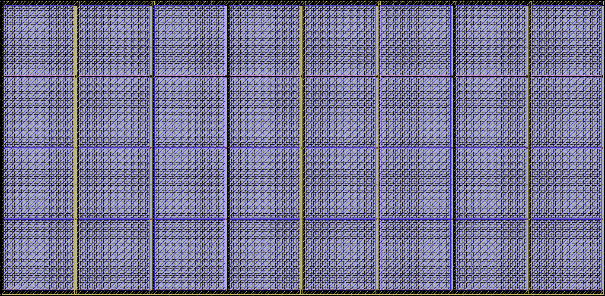

# レイアウトの進め方（2026-10-23）

レイアウトの道具、PDK の版、DRC／LVS の流れを決め、最初のブロック（基準電圧のフィルタ eeg_ref）で DRC と LVS を通した。管理表の E1〜E8 はこの流れで進める。

## 道具と PDK

| 用途 | 道具 | 備考 |
|---|---|---|
| 生成 | KLayout の Python（`gf180/tools/venv310`：pip の klayout 0.30.12 と gdsfactory） | PDK の pcell を置き、配線とビアは矩形で描く。スクリプトは `gf180/tapeout/layout/`（共通部分 `gf180lay.py`、ブロックごとに `<block>_lay.py`） |
| DRC、LVS | テンプレートの nix 環境の KLayout 0.30.12（Ruby 3.4） | 作業コピー `/Users/noah/Codings/ws_gf180/eeg_padring` で `nix-shell` から呼ぶ。アプリ版の KLayout 0.30.9 は内蔵の Ruby が古く、PDK の DRC デッキを読めない |
| PEX | magic（同じ nix 環境） | `gf180/pex/` の試行を、テンプレートの PDK で使い直す（未着手） |

- **PDK の版。** レイアウトには、テンプレートの gf180mcuD（open_pdks 792ef670）を使う。precheck と同じ版だから。
  - シミュレーションで使ってきた ciel の版（f6eeac7d）とは、ngspice のモデルの差がポリ抵抗の基板容量の書き方（`cox` と `cj`）だけだった。小さなデッキで比べて、どちらも同じ容量になった（17.3 fF）。シミュレーションの結果は変わらない。
  - pcell は同じ。DRC と LVS のデッキは版によって違うので、テンプレート側を使う。
- **DRC。** variant gf180mcuD（5 層メタル、最上層は Metal5、11 kÅ、MIM は B）。ブロックでは `decks=all,-antenna,-density,-cup`（テンプレートの LibreLane と同じ除外）。アンテナと密度はトップで確かめる。
- **LVS。** PDK の `gf180mcu.lvs` を、`run_lvs.py` と同じスイッチで直接呼ぶ。
  - `run_lvs.py` は docopt を使うが、nix 環境の Python に入っていない。
  - デッキはメモリの記録に Linux の `pmap` を呼び、macOS ではそこで止まる。代わりの小さなスクリプト（`gf180/tapeout/layout/shims/pmap`）を PATH に足す。PDK は書き換えない。
- **回路図側のネットリスト。** シミュレーション用のネットリスト（`gf180/tapeout/*/*.spice`）から `gf180lay.to_cdl()` で作る。X で呼んでいる素子を M／R／C に直し、パラメタ名をデッキに合わせる。
  - 容量や抵抗を分割して置くときは、シミュレーション用のネットリストも同じ分割で書く。ネットリストを 1 つに保つため（例：eeg_ref の MIM 3 個と MOS 容量 8 個）。

## 確かめた規則（ブロックの設計に効くもの）

| 規則 | 内容 | 影響 |
|---|---|---|
| MIMTM.8b、MIMTM.11 | MIM 1 個は 10,000 µm²（20 pF）まで。下の板を共有しても、その上の MIM の合計は 10,000 µm² まで | Cin（636 pF／側、32 個以上）、C1（680 pF／側、34 個以上）、オフセット DAC の最上位ビット（30.72 pF、2 個）、AFE の保持容量（30 pF、2 個）は分割が要る。C2（19.5 pF）は 1 個で収まる |
| MIMTM.10 | MIM の下の板（Metal4）は、上の Via4 からしかつなげない | MIM の両方の端子を Metal5 で引く |
| MIMTM.8a | MIM の最小面積 25 µm²（50 fF） | オフセット DAC の単位 60 fF（30 µm²）は収まる |
| MSLOT*.1 | 幅と長さのどちらも 30 µm を超えるメタルにはスリットが要る | 大きな板は 30 µm 未満の帯に分ける。PDK の MOS 容量の pcell はゲート全体を Metal1 で覆うので、単位の幅を 30 µm 未満にする |
| DF.14_LV | N 拡散から基板タップ（P 拡散）まで 20 µm 以内 | MOS 容量や大きなトランジスタには、ガードリングかタップの帯を付ける |
| V*.2b | 4 × 4 以上のビア配列では、ビアの間隔 0.36 µm | 共通部分のビア配列はこの間隔で描く |
| MT.1、MT.2a、MT.2b | Metal5（最上層）の幅 0.44 µm、間隔 0.46 µm、広い配線との間隔 0.6 µm | |

## 最初のブロック：eeg_ref

`gf180/tapeout/layout/eeg_ref_lay.py`（出力 `gf180/tapeout/layout/gds/eeg_ref.gds`）。

- **形。** 913 × 59 µm。北チャネルの西側（高さ 60 µm の帯）に入る。
  - 下から、VSS（Metal1）、VREFN（Metal5）、素子の帯（44 µm）、VREFP（Metal5）。
  - 西から、R_f 2 本（ppolyf_u、L 2 µm、W 7 µm）、C_g（cap_nmos_03v3、28.6 × 44 µm を VREFP と VREFN に 4 個ずつ、ガードリング付き）、C_d（MIM、190 × 44 µm を 3 個、計 50 pF）。
- **DRC。** 違反なし。最初の版では、MOS 容量のゲートの Metal1 が 30 µm を超えて MSLOT1.1、基板タップから遠い N 拡散で DF.14_LV が出た。MOS 容量を幅 28.6 µm の単位に分け、pcell のガードリングを付けて直した。
- **LVS。** 一致。わざと誤った回路図（接続の入れ替え、MIM の寸法、抵抗の長さ）では、どれも不一致になることを確かめた。
- **ネットリスト。** `gf180/tapeout/adc/eeg_ref.spice` を、レイアウトと同じ分割（MIM 3 個、MOS 容量 8 個）に直した。総容量は MIM で +0.5 %、MOS 容量で −0.1 % で、特性は変わらない。
- **実行。** `gf180/tools/venv310/bin/python gf180/tapeout/layout/eeg_ref_lay.py --drc --lvs`。生成は数秒、DRC と LVS はそれぞれ 1 分ほど。

## MIM の配列（E1／E2）

`gf180/tapeout/layout/mim_arrays_lay.py`（生成関数は `gf180lay.mim_array()`）。

| 配列（片側） | 単位 | 個数（列 × 行） | 容量 | 大きさ | DRC | LVS |
|---|---|---|---|---|---|---|
| Cin（AFE の入力容量） | 99.70 µm 角 | 32（8 × 4） | 636.03 pF | 860.6 × 420.6 µm（0.362 mm²） | 違反なし | 一致 |
| C1（ADC の 1 段目の積分容量） | 98.61 µm 角 | 35（7 × 5） | 680.56 pF | 745.3 × 517.5 µm（0.386 mm²） | 違反なし | 一致 |
| C2（ADC の 2 段目の積分容量） | 98.83 µm 角 | 1 | 19.53 pF | 105.8 × 112.8 µm | 違反なし | 一致 |

- **単位の大きさ。** モデル（`cap_mim_2f0ff`）の面積の項 1.99 fF/µm² と周囲長の項 0.238 fF/µm から、合計がネットリストの値になる正方形にした。1 個は 10,000 µm² 以下。
- **配線。** MIM の両方の端子が Metal5 に出るので、Metal5 の櫛形で 2 つの網を交差させずに引く。
  - 列ごとに、西に TOP の背骨（3 µm、上の板に接する）、東に BOT の背骨（3 µm、各単位の下の板から出した Metal4 のタブに Via4）。
  - TOP の背骨は配列の上のバス、BOT の背骨は下のバスにつながる。
- **行の間は 2.6 µm。** 下の板の Metal4（上の板から 0.6 µm はみ出す）は、ほかの Metal4 から 1.2 µm 離す必要がある（MIMTM.1）。最初の 2.0 µm では 96 件の違反が出た。
- **板の向き。** 高インピーダンスの節点（AFE の増幅器の入力、積分器の入力）を上の板にした。上の板のほうが寄生容量が小さい。
- **面積。** Cin は 2 側で 0.724 mm²、C1・C2 は 0.796 mm²。面積の見積もり（AFE の MIM 0.73〜0.82 mm²、ADC の積分容量 0.77〜0.86 mm²）の中に収まる。
- **ネットリスト。** AFE の Cin（`make_afe_netlist.py` の `eeg_cin`）と ADC の C1／C2（`eeg_adc.spice` の `eeg_c1`、`eeg_c2`）を、この配列と同じ部分回路にした。AFE のトップを呼ぶデッキ（`afe_offset.py`、ネットリストの確認）には MIM のライブラリを足した。
  - AFE の動作点は前と同じ（IDD 23.148 mA）。チョッパ動作の利得 277.5、HD3 −122.4 dBc も前と同じ（理想容量で 277.5、−122.2 dBc）。
- **入れていないもの。** ダミーの MIM（MIM の容量はよくそろう。CCIA では Cin の左右の不一致は帯域外に移る）と、下の層のシールド。必要なら外周に細いダミーを足す。

## これからの順序（管理表の E1〜E8）

1. **E1 生成スクリプト**（`gf180lay.py` に足す）
   - MIM の配列：単位は 10,000 µm² 以下、両方の端子を Metal5 で引く、周りにダミー。
   - FET の配列：共通重心、ダミー、ガードリング、ビアの積み上げ。AFE の入力対（m 4096）や OTA1 の入力対に使う。
   - ポリ抵抗の配列：DAC1・RIN・R21 の 300 kΩ の単位（195.5 × 2 µm）132 本、ダミー付き。
2. **E2 構成が固まったブロック**：Cin・C1・C2 の MIM、DAC2 のセル、DAC1 の抵抗とセル。
3. **E3 AFE、E4 ADC**（`eeg_adc_dig` の置き場所を含む）、**E5** バイアス、基準電圧（eeg_ref は済み）、クロックドライバ（AVDD_CLK の分離と 150 pF を含む）。
4. **C3 デジタル**：LibreLane で `eeg_digital_top` と `eeg_adc_dig` をマクロにする。
5. **E7 トップの組み立て**（アンテナ、密度を含む DRC と LVS）、**E8** precheck と提出。

- どのブロックも DRC と LVS を通す。AFE の入力節点、積分器、DAC などの重要なブロックは、magic で寄生を抽出して再シミュレーションする（D6）。
