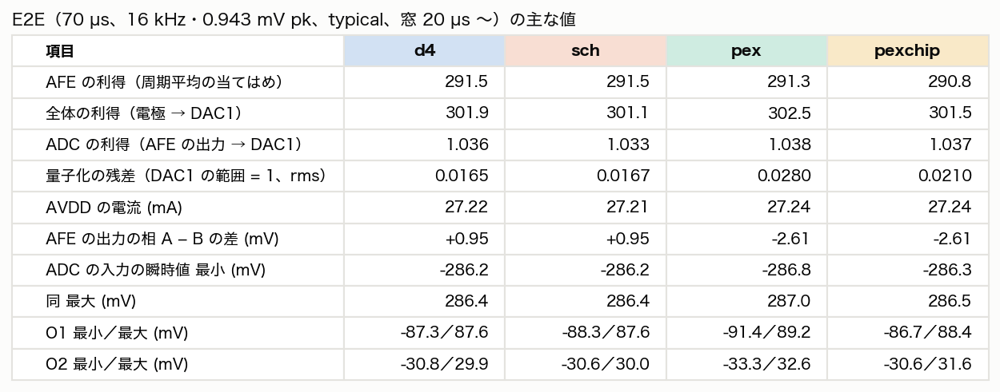
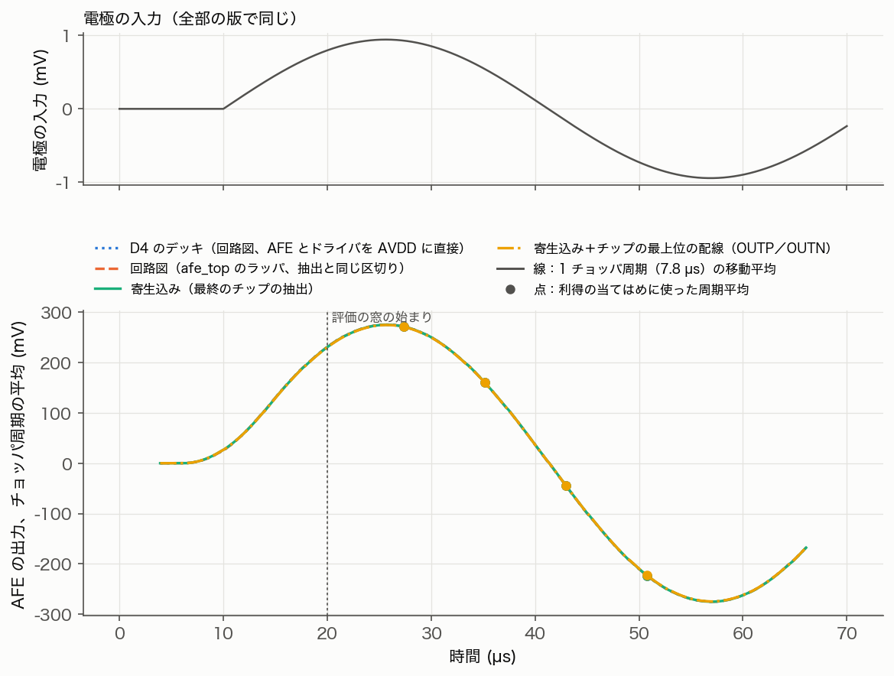
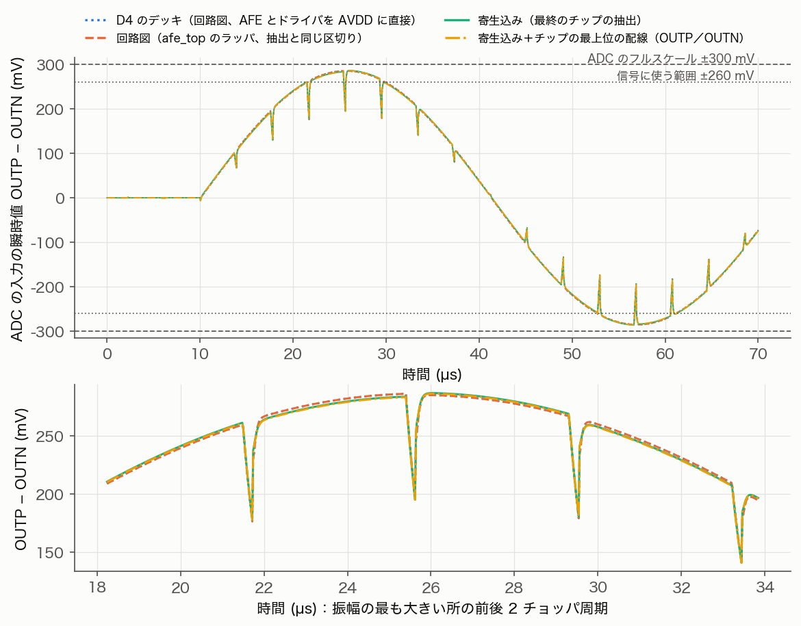
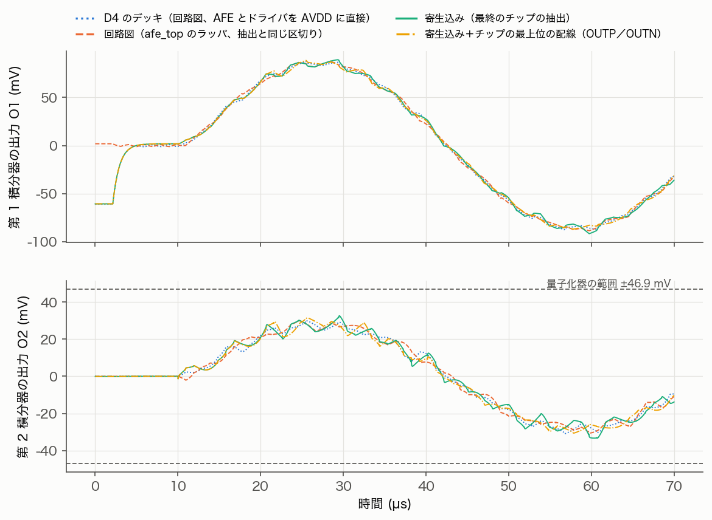
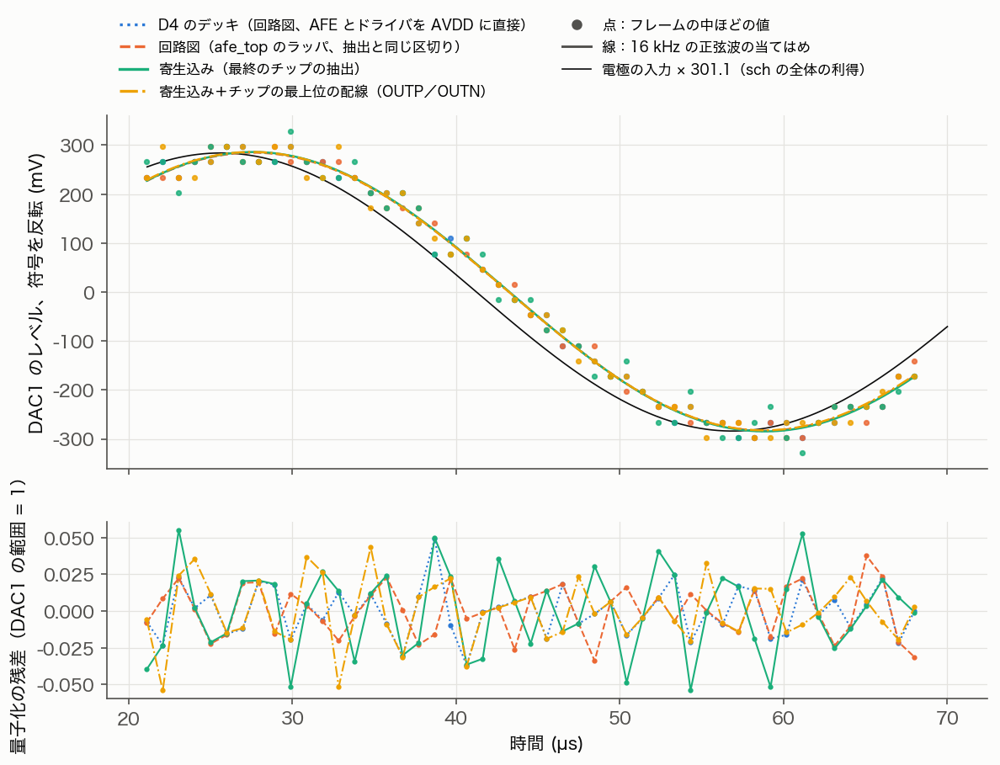
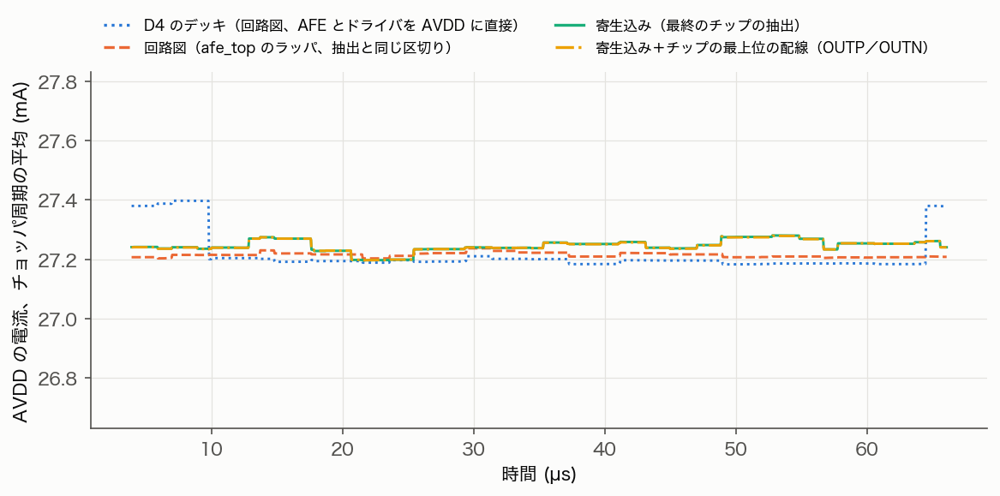
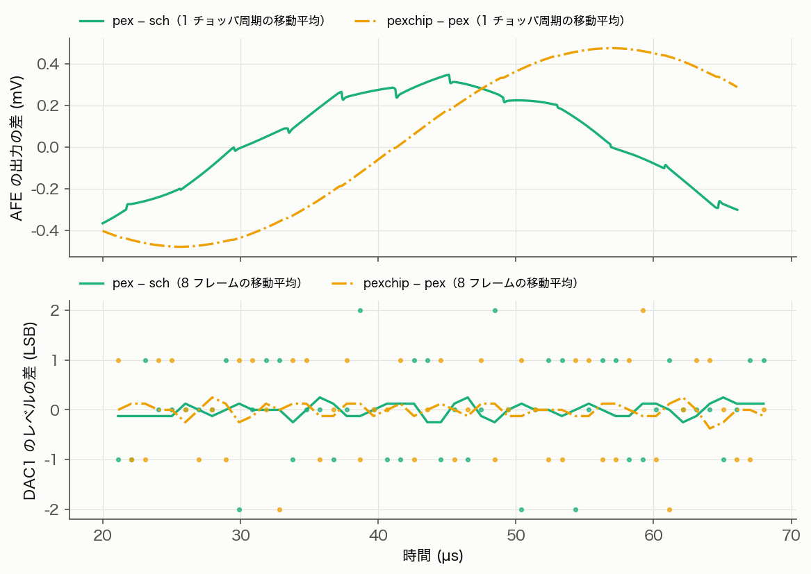

# 重要ブロックの PEX 確認（D6、2026-10-23）

管理表 D6（L4：チョッパの寄生結合、AFE の入力節点、積分器・DAC）の結果。10/23 に組んだレイアウト（`gf180_chip_assembly_20261023.md`）から寄生を抽出し、回路図と同じテストベンチで比べた。

- 対象：AFE（afe_top：入力チョッパ afe_tgin、コア eeg_afe_core、Cin、出力部、オフセット DAC、クロックドライバ）、ADC（adc_top からデジタルのマクロを除いた eeg_adc：OTA1、C1、DAC1／RIN、DAC2、量子化器）、DAC1／RIN のブロック adc_rdac、OTA1 のブロック。
- 特に断らない限り typical、27 °C。雑音は電極換算、0.5〜100 Hz、片側 100 Ω の信号源（16.5 bit の残差予算の基準）。
- スクリプトは `gf180/tapeout/pex/`、結果は `gf180/tapeout/pex/runs/`（git の対象外）。

## 結論

**10/25：信号がなくても電極に流れていた差動 ±36.6 nA（3 回目のチップ）を ±1.65 nA に下げた**（「電極に流れる DC 電流（10/25）」）。入力チョッパのクロックの結合が WP と WN で違い、交換器が電荷を一方の電極から他方へ運んでいた（チョッパの中のストラップの並び、ゲートの折り返しが WN の面の下、上端の WP の板、OFPH の線）。1 MΩ の電極では片側 37 mV のずれになり、16.5 bit の前提（電極オフセット数 mV）を外れるので、`afetg_lay.py` と `afe_lay.py` で直した（回路は不変）。残りの 1.65 nA はコアの INP／INN の寄生の非対称による。`viz_data.py` の既定の値の同相 −3.4 nA ずつは ngspice の GMIN による見かけ。副作用として、WN の W の配線抵抗が 0.339 → 0.570 Ω に増えた（チョッパの下の WN の面からゲートのレーンの通路を外したため。総残差で −0.007 bit、16.45 bit）。

**10/24：直し方 1〜7 を入れてチップを組み直し、4 件とも仕様の内側に戻った**（「直したあとの確認」）。配線抵抗は片側 0.634／0.676 Ω（10/23 は 76／119 Ω。Cin の下の Metal3 の面は Tesselation で数えた）で、目標の 0.35 Ω には届いていない。総残差は 6.05〜6.07 nVrms（16.45〜16.46 bit、目標 16.50 bit）。抽出では、MIM の上の板の補正を下の導体への容量まで広げた。直し方 1、2 の副作用で新しく 1 件が仕様を外れた（INP と増幅器の出力 ONI／OPI の結合が P 側だけ 617／526 fF で、フルスケールの HD2 −70 dBc、利得 −2 %）が、**コアの出力の幹線を移して遮蔽し、直した**（4 つの結合は 9 fF 以下、HD2 −113.8 dBc、利得は回路図に戻った）。さらに、B7 の確認で帯域内の低い周波数の HD2 −87 dBc（DC 経路が相 B の出力を固定するため）が見つかり、DC 経路を対称にして直した。B4 の量子化器のラッチも対称に描き直した。この 2 つも入れた最終の形で、AFE の雑音 4.81 nVrms（配線抵抗込み 5.05）、帯域内のフルスケールの HD2〜HD5 −132.7／−120.4／−160.9／−144.5 dBc、リップル 2.02 mV p-p。最終のチップは DRC 違反なし、LVS 一致、穴埋めのあとの全 DRC も違反なし（`gf180_chip_assembly_20261023.md`）。寄生込みの E2E（AFE と ADC を最終の抽出に差し替え、チップの最上位の配線も足した）でも、利得、積分器の振れ、ADC の入力の範囲は回路図と同等で、仕様を外れるものはなかった（「寄生込みの E2E（10/24）」）。以下は 10/23 の結論。

**このままのレイアウトでは 16.5 bit に届かない。** 寄生容量そのものの影響は小さいが、配線の抵抗と、切り替わる線との結合の非対称で、仕様を外れる項目が 4 つある。いずれも原因を特定し、直し方を示した（「直し方」）。

- **① 入力の信号経路の配線抵抗（AFE、最も重い）。** 片側 76／119 Ω（P／N）が信号に直列に入る。AFE の雑音は 4.64 → 19.1 nVrms（シミュレーションで確認）、ENOB は約 14.8 bit になる。
  - 主因はコアの入力対のゲート配線（片側 72／115 Ω）。自動配線が幅 0.38 µm の線と 1 個ずつのビアで、数千本のフィンガのゲートを Cin のバスにつないでいる。ゲートの配線抵抗の熱雑音は、入力にそのまま加わる（1/gm ≈ 3.1 Ω と比べるべき量）。
  - 次は Cin の下の板の網（片側 3.97 Ω）。Metal5 幅 5 µm、長さ 860 µm のバスに、西端のチョッパから信号電流が全部入る。入力チョッパの中の EP／EN の配線（片側 0.35 Ω）も、予算でストラップに見込んだ 0.1 Ω を超える。
- **② DAC1 の偶成分（ISI、ADC）。** 1 素子 0.47 fC、31 素子同時 0.69 fC／切り替え（要求 0.008 fC、回路図 0.0001 fC 以下）。行動モデルで SNDR 69〜72 dB（16.5 bit には 101 dB）。ブレークの間に浮く素子の節点 XP／XN に、素子の SEL・ラッチ・スイッチの駆動の線から入る結合（XP と XN で違う）が原因。この結合だけを除くと要求の内側に戻ることを確かめた。
- **③ AFE のリップル。** DC 経路のスイッチト・キャパシタの中間節点 SCP と、そのスイッチのゲート線 CIB2 の結合が P 側だけ 0.57 fF（N 側 0.04 fF）。増幅器の出力が −23 mV ずれ、出力チョッパが AFE の出力に 39 mV p-p の 128 kHz の方形波を乗せる。ADC の入力の余裕 40 mV（0.3 − 0.26 V pk）の半分を使う。
- **④ 量子化器の入力の結合（ADC）。** クロック CLKQ と O2P（O2N の 6 倍）、比較器の内部節点と O2N の結合で、判定が理想から平均 +2.4 LSB 外れる。ループの残差が 2.2 倍、O2 の振れが量子化器の範囲を超える瞬間がある。帯域内は整形される見込みだが、余裕が減る。
- **寄生容量だけなら、回路図との差は小さい。**
  - AFE：雑音 4.637 → 4.701 nVrms（+1.4 %）、チョッパ動作の利得 290.68 → 290.14（−0.2 %）、残留オフセット 0.3 µV 以下、HD3 −118 → −116 dBc、オフセット DAC の残差（+30 mV）+0.111 → +0.098 mV。
  - ADC：ループの利得 1.0075 → 1.0046、O1／O2 の CM と電流は同じ。積分器は寄生込みでも 50 ns で整定。OTA1 のチョッパの折り返しは約 +11 %（0.15 → 0.17 nVrms）。
- **直すもの**（優先順）：入力対のゲート配線（目標：片側 0.1 Ω 以下）、Cin の上の板の網（0.1 Ω 前後）と下の板の網（0.3〜0.5 Ω）、チョッパの EP／EN の帯（0.12 Ω）、DAC1 の素子の XP／XN の遮蔽と対称、P 側の CIB2、量子化器の入力の遮蔽。配線抵抗の合計を両側で 0.7 Ω 以下にし、DAC1 を直せば 16.50 bit。

## 直したあとの確認（10/24）

上の 4 件（「直し方」1〜7）をレイアウトで直し（AFE は `gf180_afe_d6_fix_20261024.md`、ADC は `gf180_adc_d6_fix_20261023.md`。回路は変えていない）、チップを組み直して、この文書の抽出と比較を回し直した。抽出は MIM の補正を広げた版（「道具と流れ」）。

### AFE

**入力の信号経路の配線抵抗**（`pex_rin.py`、チップのコアの LVS の結果、片側 P／N、typical）

| 区間 | 10/23 | 10/24、SquareCounting | 10/24、最終値 | 主な所在（10/24、最終値の解） |
|---|---|---|---|---|
| E | 0.350／0.346 | 0.174／0.215 | 0.171／0.213（Metal3〜5 を Tesselation） | チョッパの中 0.131／0.153（Metal5 の背骨、Metal4 の帯、Metal3 のレーン）、パッドのストラップ 0.039／0.059 |
| W | 3.97／3.94 | 0.204／0.198 | 0.344／0.339（Cin の下の Metal3 の面を Tesselation） | Cin の配列とバス 0.242／0.211（Metal3 0.149／0.152、大半が面）、チョッパの中 0.092／0.121（Metal5 の縞） |
| T | 71.6／114.6 | 0.125／0.124（1 回目） | 0.119／0.124（SquareCounting、INP と出力の結合を直した最終の形） | コアの帯とゲート 0.093／0.104（ポリのコンタクトとポリ 0.052／0.054）、Cin の配列とバス 0.026／0.020 |
| 計 | 75.9／118.9 | 0.503／0.537 | **0.634／0.676** | 両側 1.31 Ω（10/23 は 195 Ω）。この抵抗だけの雑音は 1.47 nVrms |

- **Cin の下の Metal3 の面は Tesselation で数える。** SquareCounting は、点（バスの下の足）から電流が入って広がる面の抵抗を見落とす（W で 0.14 Ω 低い。D6 の 10/23 の確かめと同じ傾向）。チョッパの中の縞やレーンは両者が一致する（afe-d6：87.6 対 88.0 mΩ）。全層の Tesselation は W と T で 40〜56 GB を超えて終わらないので、W は面の層（Metal3）だけを三角分割した（`pex_rin.py --tess m3`、ピーク 12 GB）。E は Metal3〜5 の Tesselation で SquareCounting と 2 % 以内。T は SquareCounting のまま（太い Metal5 の帯の広がりの分だけ低めの可能性がある）。
- afe-d6 の記録の最終値（片側 0.62／0.65 Ω）は、E を AFE だけで測ったときの Tesselation との差（−0.025 Ω）で引いた値。チップの E は Tesselation でもほとんど下がらないので、ここでは 0.634／0.676 Ω とする（最終の形。1 回目は T が 0.125 で 0.640／0.676 Ω）。
- 目標の片側 0.35 Ω（両側 0.7 Ω、16.50 bit）には届いていない。残りの大半は、今の配置では下げ幅の小さい所（チョッパの縞、入力対のゲートのポリ、チョッパの背骨と帯）にあり、AFE の配置の変更が要る。今回 rev はこの形とした（案と見込みは `gf180_afe_d6_fix_20261024.md` の「判断と次の手段」）。
- ELN の E は、AFE だけで測った見込み（0.123 ＋ ストラップ 0.05 = 0.173 Ω）より大きい（SquareCounting で Metal4 0.091 Ω、via4 0.011 Ω。ELP は 0.049、0.003 Ω）。チップでは ELN のストラップを、EP の背骨の下をくぐる Metal4 の継ぎで EN の帯に入れる。afe-d6 の見立てでは、この継ぎが細い（幅 13 µm × 2 本。10/23 は 28 µm × 1 本）ため、ストラップの分が 約 0.05 → 0.09 Ω に増えた。継ぎの下に Metal3 の継ぎ（ストラップの高さ全体、EN の帯へ via3）を足せば N 側で約 0.03 Ω 下がる（`chip_lay.py` の `electrodes()` だけの変更）。両側で 0.03 Ω 下がっても ENOB は約 0.001 bit しか変わらないので、チップを組み直してまでは入れていない。

**雑音**（`pex_afe.py noise`、相 A と B で同じ）

| DUT | 雑音、チョッパ動作の推定 (nVrms) | 熱雑音 | 1/f | 利得（高調波和） | 利得（相を止めた 10 Hz） |
|---|---|---|---|---|---|
| sch | 4.637 | 3.873 | 2.550 | 287.28 | 299.24 |
| dev | 4.639 | 3.872 | 2.554 | 286.74 | 299.25 |
| pex（10/23） | 4.701 | 3.922 | 2.590 | 284.99 | — |
| pex（10/24、1 回目：INP と出力の結合あり） | 4.821 | 4.024 | 2.655 | 279.55 | 293.17 |
| **pex（10/24、最終：INP と出力の結合を直した形）** | **4.811** | 4.013 | 2.654 | 284.95 | 298.89 |
| sch＋配線抵抗（10/24、チップの最終値） | 4.877 | 4.157 | 2.550 | 287.28 | |
| pex＋配線抵抗（10/24、1 回目） | 5.058 | 4.306 | 2.655 | 279.55 | |
| **pex＋配線抵抗（10/24、最終）** | **5.047** | 4.294 | 2.654 | 284.95 | |
| pex（DC 経路も対称にした最終の形、0cb0fff4） | 4.811 | 4.013 | 2.654 | 284.81 | 298.77 |
| pex＋配線抵抗（同） | 5.048 | 4.294 | 2.654 | 284.81 | |

- afe-d6 の記録の pex 4.781 nVrms、利得 287.34 は、MIM の見かけの結合（WP–INP、WN–INN 21.3 pF、Cin と並列）を含んでいた。上の表はそれを除いた値。
- **16.5 bit の総残差**（D6 の表の内訳：AFE × 1.01（ブランキング）、パッドとストラップ 1.5、ADC 側 2.93 nVrms）：最終の形で、AFE 4.811 と配線抵抗 両側 1.31 Ω の 4kTR で 6.05 nVrms（16.46 bit）、pex＋配線抵抗の解 5.047 で 6.07 nVrms（16.45 bit）。目標 5.88 nVrms（16.50 bit）に 0.04〜0.05 bit 足りない（1 回目は 6.06〜6.08 nVrms）。パッドとストラップの 1.5 nVrms のうちストラップの分（差動 0.2 Ω）は E と重なっているので、除けば 0.005 bit ほど良くなる。
- 下の 2 項目は 1 回目（INP と出力の結合を直す前の抽出）の値。最終の形は INP の容量 20.0 pF、INN 25.0 pF、雑音 +3.8 %（sch 比）。
- **pex の雑音 +4.0 %（sch 比）は、入力節点の容量の増加による。** INP／INN の寄生容量は 18.6／24.7 pF（10/23 は 7.1／7.4 pF）。主な相手は INP–INN 4.41 pF（差動で 2 倍に効く）、INN–AVSS 6.12、INN–AVDD 4.12、INP–AVSS 3.73 pF、コアの内部節点と 1〜2.6 pF ずつ。コアのゲートの帯を太くし、INN の板が尾部やブースタの上を通るため（直し方 1、2 の副作用）。
- **利得の低下（sch 比で、高調波和 −2.7 %、相を止めた 10 Hz −2.0 %、過渡解析 −1.9 %）の大半は、INP と増幅器の出力の結合による（新しく見つかったもの）。** INP–ONI 617 fF（P 側の Cf と並列）と INP–OPI 526 fF（逆向き）。N 側は INN–OPI 7.4 fF、INN–ONI 0.5 fF。差し引きで Cf（2 pF）に P 側 +91 fF、N 側 +7 fF が並び、差動で約 +2.4 %。
  - 所在：コアの上端で INP を Cin の上の板のバスへつなぐ Metal5 の板の下を、ONI／OPI の Metal4 の線がコアの上端に沿って走る（x 214〜945、y 925〜1010。重なり 10 480／9 460 µm²、Metal5 と Metal4 の間 39 aF/µm²）。INN の板はコアの下端で、出力の線はそこを通らない。
  - **影響：帯域内に偶数次の歪みが出る（仕様を外れる）。** フルスケールの正弦波で HD2 −70.4 dBc、HD4 −82.0 dBc（仕様 −111 dBc 以下。10/23 の pex は −116 dBc）。HD3、HD5 は −121、−126 dBc。切り分け（2 ms、窓 1〜2 ms）：抽出からこの 4 つの結合（INP–ONI、INP–OPI、INN–OPI、INN–ONI）だけを除くと HD2 −113.8 dBc、利得 293 → 299.9（素子だけの dev 298.9）に戻る。OUTP／OUTN の結合、電極と W の結合を除いても変わらない（どちらも HD2 −70.6 dBc）。dev は HD2 −101.9 dBc（2 周期の窓の床）。回路図は同じ窓（2〜4 ms）で HD2 −137.7 dBc で、窓の取り方による見かけの値ではない。
    - 最初は「入力チョッパの後の非対称なので帯域には残らない」と見たが、誤りだった。**効くのは P と N の非対称**：抽出の INN–OPI／INN–ONI を P 側と同じ値に足して 4 つを対称にすると HD2 −114.5 dBc（窓の床。利得は 287.5 に下がる）、非対称を半分にすると −77.1 dBc（6.5 dB 下がる）。HD2 は非対称にほぼ比例し、−111 dBc 以下には、和の差 (INP–ONI ＋ INP–OPI) − (INN–OPI ＋ INN–ONI)（今 約 1135 fF）を約 10 fF 以下にする要がある。仕組みは詰めていない（P 側だけの結合で、増幅器の出力の同相成分や偶数次の成分がチョッパの位相と相関を持つと見る）。
  - **相手はコアの出力の幹線**（afe-d6 の調べ）：Metal4 幅 5 µm の幹線（ONI 3 本、OPI 3 本、コアの y 496〜536）が、カスコードの上で全列の出力のレーンを集めて東端へ出る。INP は上端から入り、カスコードの上を通って入力対へ下りるので、構造上ここで重なる（10/23 は INP が細い Metal3 だったので小さかった）。INP が幹線の帯を越える幅 1 µm あたり、ONI と OPI にそれぞれ約 1 fF。Metal4 と Metal5 の間に遮蔽の層はない。
  - **直し方**（afe-d6、「直し方」1 の追加）：カスコードの配置を変えて上端に帯を空け、幹線を Metal2（OUTP 側）と Metal3（OUTN 側）に移して上を Metal4 の遮蔽（VSS／VDD）で覆う。INP の Metal5 はそのまま（T は変わらない）。目標は、4 つの結合をどれも 20 fF 以下、上の和の差を約 10 fF 以下、HD2〜HD5 を −111 dBc 以下。ほかの案（INP と INN の帯を交互にして 4 つを対称にそろえる、帯を越える INP を細くする）は、約 300 fF を数 fF までそろえる要があること、T が +0.2 Ω になることから採らなかった。
  - **10/24 に直した**（7b30c762、`gf180_afe_d6_fix_20261024.md` の「INP と ONI／OPI の結合の直し」）：上の幹線の移動と遮蔽に加え、出力部の P 側の MIM（CFB_P、CPF_P、トリム）を N 側の鏡映に描き直した。INP–ONI 8.29、INN–OPI 6.35、INP–OPI 1.18、INN–ONI 0.39 fF（和の差 2.73 fF）。**HD2〜HD5 は −113.8／−117.2／−120.9／−137.7 dBc**（既定の窓）、利得は回路図に戻った（過渡解析 290.60、相を止めた 10 Hz 298.89）。最終の GDS で抽出し直しても同じ値（差 0.01 fF 以下）。

**過渡解析**（`pex_afe.py tran`／`sine`、チョッパ動作）

| 項目 | sch | pex（10/23） | pex（10/24、1 回目） | pex（10/24、2 回目：INP と出力の結合を直した形） | pex（最終：DC 経路も対称にした形） |
|---|---|---|---|---|---|
| 利得（±0.5 mV、200 µs） | 290.68 | 290.14 | 285.02 | 290.60 | 297.89（静的に 299.29） |
| 残留オフセット、入力換算（0 mV 入力、0.1〜1.5 ms） | 0 | −0.11 µV | −0.09 µV | −0.13 µV | −0.37 µV |
| リップル（AFE 出力、ブランキングの外の p-p、0 mV 入力、0.1〜1.5 ms） | 0 | 39 mV | 3.62 mV（区間ごとに 3.55〜3.60） | 4.00 mV（区間ごとに 3.84〜3.97） | 2.02 mV（区間ごとに 1.93〜2.02） |
| 増幅器の出力（OPI − ONI）の平均 | 0 | −23 mV | +0.77〜+0.83 mV | +0.72〜+0.83 mV | +0.66〜+0.71 mV |
| オフセット DAC、+30 mV（範囲 1、15 MCLK）の残差、入力換算 | +0.111 mV | +0.098 mV | +0.136 mV | +0.136 mV | B7 の文書（段の残差は限界として受け入れ） |
| 歪み、フルスケール 0.943 mV pk、2 kHz：HD2／HD3／HD4／HD5 (dBc) | −137.7／−117.4／−145.3／−134.4（窓 2〜4 ms。10/23 の窓では −114.1／−118.2／−119.9／−122.7） | −116.3／−115.6／−114.3／−123.3（10/23 の窓） | **−70.4**／−121.2／**−82.0**／−125.6（窓 2〜4 ms） | −113.8／−117.2／−120.9／−137.7（同） | −127.7／−118.1／−143.8／−141.1（afe-d6） |
| 帯域内の歪み、フルスケール（DC の点から多項式、`afe_dcpath.py static`）：HD2／HD3／HD4／HD5 (dBc) | — | — | — | −87.1／−101.6（B7 の確認、DC 経路が 1 本） | −132.7／−120.4／−160.9／−144.5 |

- **最終の形（B7 の DC 経路の対称化のあと）では、リップル 2.02 mV p-p、帯域内のフルスケールの HD2〜HD5 −132.7／−120.4／−160.9／−144.5 dBc。** DC 経路の 8 個のスイッチを出力チョッパの相（CDA2／CDB2）で動かすので、入力チョッパの縁の過渡を標本化しない（afe-d6、0cb0fff4）。以下は 2 回目の形の記録。
- リップルは 2 回目の形で 4.00 mV p-p（目標 4 mV 以下の境）。保持の間の出力は ±0.23 mV で、p-p を決めるのは出力チョッパがつながった直後の 0.3 µs ほどのとげ。クロックの線と出力の結合の P／N の差（前からあるもの：NCDB2–OUTN 13.2 と NCDB2–OUTP 5.0 fF、CIA2–OUTN 6.6 と CIA2–OUTP 0.2 fF）による。抽出でこの結合を P と N で等しくすると 3.06 mV。1 回目より 0.4 mV 増えたのは、INP と出力の結合（帰還に足されていた分）がなくなって利得と応答が回路図に戻ったため（afe-d6 の見立て）。帯域の外（128 kHz）で、効くのは ADC の入力の余裕だけなので、このまま進めた。余裕を取るなら、CIA2 と出力チョッパのクロックの線を出力の線から離す（約 3.1 mV の見込み）。
- **2 回目までの歪みの確認は 2 kHz（fch/64）だけだった。** 帯域内の低い周波数では、DC 経路（相 A で INP、相 B で ONI につなぐ 1 本）が増幅器の出力の平均ではなく相 B の値を固定するので、信号が相 A に約 2 倍で出て、フルスケールで増幅器が線形の範囲を外れる（pex で HD2 −87 dBc、HD3 −102 dBc。B7 の確認で 10/24 に分かった：`gf180_electrode_dc_20261022.md` の「10/24 の追記」）。2 kHz は DC 経路の時定数（286 µs）より速いので、この効きが小さかった。DC 経路を対称にする直し（相を入れ替えた枝を足す、ユーザーの判断）を 10/24 に入れ、帯域内の HD2 は −132.7 dBc になった（上の表の最終の列）。
- **オフセット DAC の打ち消し**（+30 mV、範囲 1、ブランキング 15 MCLK、大きさ M = 96 は理想の比で選んだ値）：入力換算の残差 +0.136 mV（回路図 +0.111、10/23 の pex +0.098 mV。量子化だけなら +0.113 mV）。出力の平均から、DAC の経路の利得が信号の経路より 0.08 % 小さい（10/23 は 0.05 % 大きい）。
  - 実際の符号は出力を見て探すので、比のずれは選ぶ符号に吸収される（範囲 4 の 300 mV でも比のずれは 0.24 mV で、1 段 0.311 mV より小さい）。この入力では同じ M = 96 が最良で、AFE の出力で約 39 mV になる。
  - B7 の「残差 ±0.11 mV」は試した入力（3、30、300 mV）での値で、量子化の最大は 1 段の半分の ±0.156 mV（AFE の出力で約 ±44 mV）。ADC の入力の余裕 40 mV の配分（残差の最大 30 mV）は、回路図の段階から足りない（B7 で見直す。P と N の半分に別の大きさを入れられれば段は半分になるが、今は OFM[9:0] を両方に共通に配っている）。

### ADC（`gf180_adc_d6_fix_20261023.md`）

| 項目 | 回路図 | 寄生込み（10/23） | 寄生込み（10/24） |
|---|---|---|---|
| DAC1 の偶成分、1 素子／31 素子同時 (fC／切り替え) | +0.00005／−0.00003 | +0.473／−0.687 | −0.00139／−0.00124 |
| 同、行動モデルの SNDR (dB) | 167〜174（偶成分なし） | 68.9〜72.2 | 122.8〜123.8 |
| 量子化器のクロック CLKQ と O2P／O2N の結合 (fF) | — | 32.5／5.3 | 2.127／2.123 |
| ループの利得 | 1.0075 | 1.0046 | 1.0021 |
| ループの残差 (rms、DAC の段) | 0.0203 | 0.0455 | 0.0267 |
| O2 の振れ (mV)（量子化器の範囲 ±46.9 mV） | −32.8〜31.5 | −49.6〜32.6 | −36.0〜32.9 |
| 判定が理想のしきい値と合うフレーム（`pex_adc.py codes`） | 98.8 % | 11.2 % | 65.0 %（そろったずれ +1.0 mV を除くと 92.5 %、素子だけの版 93.8 %） |
| 仮想接地の乱れ、DAC1 の更新ごと：最大の平均／最大 (µV) | 372／610 | 559／1073 | 363／659 |

- DAC1 の偶成分は要求（0.008 fC）の約 1/6、16.5 bit に要る 101 dB を十分超える。量子化器は残るずれが静的なしきい値のずれ（ラッチの OA／OB の配線容量の差）だけで、行動モデルで σ 10 mV まで許される（B4）。
- コードの一致は adc の記録の定義（`pex_adc.py codes`、ループが使ったコードとの一致）で、10/23 の「ループ」の表の 97 %／9 % とは数え方が違う。
- MIM の補正を広げても、ADC のブロックの容量の差はネットごとに 10 fF 以下（C1 などの下に導体がない）。上の値はそのまま使える。

## 寄生込みの E2E（10/24）

D4 の短窓の E2E（`gf180/tapeout/sim/e2e/e2e_deck.py`：電極 → AFE とクロックドライバ → ADC、本物のバイアス生成と基準電圧のフィルタ、DWA は XSPICE のモデル）の AFE と ADC を、最終のチップ（D6 の直しと B7、B4 の直しを入れた形）の抽出に差し替えて、回路図と比べた（`gf180/tapeout/pex/pex_e2e.py`、図は `plot_e2e.py`）。刺激と時刻は D4 と同じ：16 kHz・フルスケール 0.943 mV pk、片側 100 Ω、typical、ブランキング 7 MCLK、AFE_RST を 10 µs で解除、70 µs、評価は 20〜70 µs。窓が 16 kHz の 0.8 周期しかないので、利得の精度は数 %、帯域内の SNDR はこの試験では見ない。

| 版 | AFE | ADC |
|---|---|---|
| d4 | 回路図の eeg_afe と eeg_afe_clk（AVDD に直接、D4 と同じデッキ） | 回路図 |
| sch | afe_top の回路図のラッパ（クロックドライバは 100 Ω とデカップリングを通した AVDD_CLK、オフセット DAC の半分 2 つ）。抽出と同じ区切り | 回路図 |
| pex | 最終のチップの抽出（`afe_top_pex.spice`：素子の形と寄生容量、MIM の補正込み） | 最終のチップの抽出（`eeg_adc_pex.spice`） |
| pexchip | pex にチップの最上位の配線を足したもの：Ch-A を横切る OUTP／OUTN（下記） | 同上 |

**10/25：4 回目のチップ（電極の DC 電流の直しのあと、9b5f495a）の抽出で pex と pexchip を回し直した。下の図と表と値は 4 回目**（d4 と sch は回路が同じなので回し直していない。チップの窓の Ch-A は 3 回目と同じ形：GDS の XOR で差なし。3 回目の出力と表は `gf180/tapeout/pex/runs/e2e/r3/`）。

- **利得は寄生込みでも回路図と同じ。** AFE の利得（チョッパ周期の平均の当てはめ。周期平均の sinc で約 2.5 % 低く出る。静的な値は 299.3）は d4／sch 291.5、pex 291.3、pexchip 290.8（3 回目 291.4／290.9）。全体の利得（電極 → DAC1）は 301.1〜302.5 で、どれも窓の精度（数 %）の中。pexchip の −0.17 % は、配線の抵抗（片側 35.6 Ω）と ADC の入力抵抗 18.75 kΩ の比のとおり。
- **量子化の残差は寄生込みで 1.3〜1.7 倍**（sch 0.0167 → pex 0.0280、pexchip 0.0210。3 回目は 0.0321／0.0352 で約 2 倍）。70 µs の窓の 49 フレームの値なので幅がある。ADC 単体の寄生込みのループ（`gf180_adc_d6_fix_20261023.md`、80 フレームの残差 1 割増し）と同じ向きの、帯域の外の量子化雑音の増加。B4 で受け入れた量（帯域内は 2 次で整形される）。
- **AFE の出力の相 A と相 B の保持値の差は、寄生込みで −2.6 mV**（sch +0.95 mV。3 回目は +18.8 mV）。窓の中で −2.85 → −2.03 mV と減り、当てはめた時定数は約 100 µs（3 回目は 22.6 → 18.7 mV、143 µs で、DC 経路の時定数 138 µs と合っていた）。AFE_RST を解いた直後の P／N の不釣り合いが抜けていく起動の過渡で、この E2E ではリセットの解除（10 µs）がチョッパの縁（9.8 µs）の直後のブランキングの中に当たる（AFE 単体の試験は相の途中。リップル 2.38 mV p-p、0.1〜1.5 ms）。**3 回目の 18.8 mV の大きさは、入力チョッパのゲートのクロックの結合の WP／WN の差で決まっていた**：その差だけをそろえた 4 回目で 7 分の 1 になり、符号も変わった（10/24 にはリセットの解除の時刻による起動の過渡とだけ見ていた）。保持の値の残差も 1.90 → 0.29 mV rms。
- **ADC の入力の瞬時値は、寄生込みで −286.8〜+287.0 mV**（回路図 ±286 mV。3 回目は −294〜+297 mV で、増えた約 10 mV は上の起動の過渡の分だった）。フルスケール ±300 mV まで 13 mV。ADC は入力を積分するので、効くのは周期の平均と積分器の振れ：O1 は −91.4〜+89.2 mV、O2 は −33.3〜+32.6 mV（pexchip は −86.7〜+88.4、−30.6〜+31.6 mV。量子化器の範囲 ±46.9 mV の内側）。
- AVDD の電流は 27.21〜27.24 mA で、どの版も同じ。d4 と sch はほぼ同じ（クロックドライバの電源の 100 Ω とデカップリングは効かない）。
- 10/22 の D4（AFE の利得 268.9、全体 282、残差 0.031）から変わったのは、その後の回路の変更（B7 の DC 経路の対称化で、相 B の固定がなくなり周期の平均が正しく出る、など）による。
- **仕様を外れるものはない。** 3 回目では起動の過渡の間（リセットの解除から数百 µs）に ADC の入力の山がフルスケールに近づいたが、4 回目は回路図と同じ。

**チップの最上位の配線（pexchip）**：OUTP／OUTN は、AFE の端子から ADC へ Metal4（幅 0.38 µm、Ch-A の中で 150 µm）で渡り、さらに Ch-A を北の試験用マルチプレクサまで Metal3 の枝（それぞれ約 560 µm、2.4 µm の間隔で並ぶ）で上る。チップの GDS（穴埋め込み）の Ch-A の窓（x 1582〜1732.4、y 1395〜1995 µm）を magic で抽出し、ネット名をチップの LVS の結果で回路図の名前に直した（`gf180/tapeout/pex/pex_chipwin.py`）。

| | OUTP | OUTN |
|---|---|---|
| 合計 (fF) | 73.9 | 69.8 |
| AVDD | 27.8 | 32.9 |
| OUTP–OUTN | 18.9 | 18.9 |
| VCM | 7.4 | 0.5 |
| ADC の O2P／O2N（試験用マルチプレクサへの線） | 0.61／0.50 | 0.75／1.04 |
| 試験用マルチプレクサの選択線（静的） | 0.3 以下 | 0.3 以下 |
| 直列の抵抗（Metal4、90 mΩ/□） | 35.6 Ω | 35.6 Ω |

- クロックの線との結合はない。静的なネットとの容量は差動の信号に効かない。O2 との結合（約 1 fF）は、AFE の出力の保持容量 30 pF に対して 3e-5 で、O2 の帯域内の成分は小さいので効かない。E2E でも pex との差は利得の −0.17 % だけだった（差の図）。
- 窓の縁で切れた形の分と、ブロックの縁から 8 µm 以内のブロックの中の形との結合は入っていない。

- 4 本の色と線の種類はすべての図で同じ（d4 青の点線、sch 橙の破線、pex 緑の実線、pexchip 黄の一点鎖線）。d4 と sch、pex と pexchip はほとんど重なる。差は最後の図で見る。
- 実行時間：d4／sch 約 35 分、pex／pexchip 約 85 分（4 本を並べて回した。10/25 の pex／pexchip は約 90 分）。

## 電極に流れる DC 電流（10/25）

電極側の入力インピーダンス（`viz_data.py zin`、25c9cacb）を測ると、3 回目のチップの抽出では信号がなくても電極に I_ELP −40.0 nA、I_ELN +33.3 nA が流れていた（正は AFE へ入る向き。typical、27 °C、CPF_TRIM 8、片側 100 Ω。±1 mV の DC の段差の組の平均、0.4 ms から 16 チョッパ周期）。回路図は 0.01 nA。原因をレイアウトの中で突き止め、電極側の要求と比べて、入力チョッパとその周りを直した（回路と afe_top の外形・端子は変えていない）。

### 内訳

| 成分 | 3 回目の抽出 | 原因 |
|---|---|---|
| 同相（両方とも AFE から出る） | −3.39 nA ずつ | **ngspice の GMIN による見かけで、実物にはない** |
| 差動 | ELP −36.6／ELN +36.6 nA（1 周期 286 fC） | **入力チョッパのクロックの結合が WP と WN で違う**（実物にもある） |

- **同相分**：ngspice は接合ごとに GMIN（既定 1e-12 S）を並列に入れ、それを素子の M 倍にする（1.65 V で 1 フィンガあたり 1.65 pA）。抽出の入力 TG は PMOS M=1024、NMOS M=512 の 1 素子ずつなので、E と W の節点ごとに AVDD から入る分（PMOS 4 個）が AVSS へ出る分（NMOS 4 個）の 2 倍になり、差 3.39 nA が電極へ出る。回路図の TG は m=256 ずつで打ち消し合う。チョッパを止めた DC の点で、抽出も gmin 1e-15 なら −0.011 nA（回路図と同じ。接合の本当の漏れは jss 1.65e-7 A/m² で pA 以下）。以下の値は gmin 1e-15 で測った（`viz_data.py` の既定のままの値も表に並べた）。
- **差動分**：交換器は W の節点を相ごとに反対の電極へつなぐ（相 A で WP–ELP、WN–ELN、相 B で WP–ELN、WN–ELP）。TG のゲートの縁で W に入る電荷は、W と Cin の速い時定数（片側 100 Ω と約 140 pF で 14 ns、縁は 1.5 ns）では電極へ逃げきらず、TG が切れたあと W に残って、次の相で反対の電極へ流れる（ポンプ）。W の節点ごとに (C_CIA − C_CIB) − (C_NCIA − C_NCIB) に VDD を掛けた電荷が 1 周期に運ばれ、これが WP と WN で等しければ差動の電流は消える。3 回目の抽出では WN と WP の差が −90.6 fF で、1 fF あたり約 0.4 nA。

### 所在（`afe_top` を窓で切り、LVS の結果のネット名を付けて magic で抽出）

| 場所 | WN–CIA／CIB／NCIA／NCIB (fF) | WP–同 (fF) | 原因 |
|---|---|---|---|
| チョッパの中（afe_tgin、全体の約 95 %） | 205.4／92.0／409.3／182.1 | 110.1／90.6／220.9／185.7 | 各ストリップの S/D の Metal2 のストラップの並びが、どのストリップも同じ（下から EP×3、WP×3、EN×3、WN×3）。一番上の WN が自分の CIA／NCIA のゲートピンと 0.64 µm で全長約 136 µm 並ぶ（1 本あたり約 9.4 fF、NMOS 12 本、PMOS 24 本）。一番下の EP は下のストリップの CIB／NCIB のピンと 1.88 µm（ELP–CIB／NCIB 131／260 fF、ELN 95／187 fF） |
| チョッパの下 | 38.6／28.5／31.9／29.7 | 0 | ゲートの Metal4 の折り返し（約 108 µm）が WN の Metal5 の面の下、Metal3 の継ぎの上を走る。WP には何もない。効く差は 7.8 fF（CIA のレーンが WN の Metal3 の端と 0.3 µm で 53 µm 並ぶ分と、折り返しの帯の端の分） |
| チョッパの上端 | — | NCIB +5.6、NCIA +1.7 | `w_entry` の WP の Metal4 の板がチョッパの Metal4 の帯の 0.6 µm 上から始まり、最上段のストリップの NCIA／NCIB のピンを覆う |
| OFPH の西の列 | OFPH 10.0 | 0 | オフセット DAC の相 OFPH（CIA の立ち上がりでセット、CIB の立ち上がりでクリア）の西の端子への線が、WN の面とバスの下を 140 µm 走る。縁が新しい相の TG が閉じた直後なので、1 周期に C·VDD = 33 fC を一方の電極から他方へ運ぶ（±4.2 nA、上の向きと逆） |

- WN だけにある結合でも、両方の縁が同じ相の中にある線（出力チョッパの相 CDA／CDB／NCDA／NCDB、6 fF 以下）と静的な線（RST、CHOP_EN）はポンプしない（抽出を対称にしても電流は変わらない：下の切り分け）。

### 判定（電極側の要求）

- **チップの性能（片側 100 Ω の信号源）には効かない。** 36.6 nA × 100 Ω = 3.7 µV の DC のずれで、AFE の出力で約 1 mV。
- **電極を通すと DC のずれと分極になる。** 電流はチャージポンプ（1 周期に決まった電荷）なので、電極と皮膚の DC のインピーダンスに比例したずれを作る。
  - ゲルの良い電極（DC で 10 kΩ 程度）で片側 0.37 mV。乾式の電極や接触の悪いとき（1 MΩ）で片側 37 mV、差動で 73 mV。
  - 16.5 bit は、電極オフセットが数 mV（範囲 1 で ±3 mV 程度）までの値として示している（`gf180_electrode_dc_20261022.md`、ゲート 1）。この電流だけで、両側の合計が 82 kΩ を超える電極でこの前提を外れる。オフセット DAC で ±300 mV まで打ち消せるが、範囲 2〜3 では 16.4 bit 以下。
  - 電極のインピーダンスの揺れ（動き）がそのまま入力のずれの揺れになる（ΔZ 100 kΩ で 3.7 mV）。電極と電解質の界面に DC が流れ続ける（分極、ドリフト）。
  - 安全の上限（患者補助電流、DC で 10 µA）より 3 桁小さく、安全の問題ではない。
- **要求は電極 1 本あたり 1 nA 以下とした**（1 MΩ で 1 mV、範囲 1 の内側）。3 回目の 36.6 nA は不適合なので直した。

### 直した形（`afetg_lay.py`、`afe_lay.py`）

1. **チョッパのストリップを 1 本おきに P／N の鏡像にした**（S/D の並び EN -CIA- WN -CIB- EP …、ストラップは下から EN WN EP WP）。上の PMOS セルは反対の偶奇から始める（一番下と一番上のストリップは元の並びのまま。レーンの端は変わらない）。セルごとに CIA／NCIA のピンの隣は WN と WP が 6 本ずつ、NCIB のピンの隣は 2 つの PMOS セルで EP と EN が 11 本ずつ（NMOS の CIB のピンは 11 か所なので EP 5、EN 6）。
2. **WN の縞を最上段のストリップのゲートピンの上まで伸ばし、ゲートのレーンの並びを CIA CIB NCIB NCIA にした**（外側の 2 本が同じ相の相補の組）。
3. **ゲートの折り返しを Metal2 にして、クロックドライバのすぐ上（WN の面の外、y 400〜408）へ移した。** レーンは WN のない通路（外側のレーンから西 6 µm、東 6.5 µm）を真っ直ぐ上る。WN が通路を横切るのは Cin_N のバス（Metal5、5 µm）だけで、4 本とも同じ。
4. **チョッパの上の WP の Metal3／Metal4 の板と Metal5 の縞の広がりを、ブロックの上端の 0.6 µm 上から始めた。**
5. **西の端子の列で OFPH と CHOP_EN（静的）を入れ替え、OFPH を WN の面の下から出した。** WN の面の下に残る列（CDA、NCDA、CDB、NCDB、RST、CHOP_EN）は、縁が相の中にあるか静的。
6. 旧い折り返しと、通路と上端から外した WN／WP の Metal3／Metal4 の跡は、配線器の障害物として残した。配線器はほかのネットを同じに引く（3 回目の GDS との XOR で、変わったのは上の場所と OFPH／CHOP_EN の西の列だけ）。

### 直したあとの確認（4 回目のチップの抽出）

| 項目 | 3 回目 | 直したあと |
|---|---|---|
| ポンプに効く結合の差（WN − WP、OFPH を除く） | −90.6 fF | +0.6 fF |
| WN–CIA／CIB／NCIA／NCIB | 243.4／120.1／441.0／211.6 fF | 158.6／92.1／314.8／182.7 fF |
| WP–CIA／CIB／NCIA／NCIB | 109.9／90.5／220.6／185.6 fF | 157.5／90.7／313.6／180.6 fF |
| WN–OFPH | 10.0 fF | 0.07 fF |
| ELP–CIB／NCIB、ELN–CIB／NCIB | 131.0／260.0、95.4／187.2 fF | 111.3／223.9、115.1／223.6 fF |
| **電極の DC 電流、gmin 1e-15（dm と cm の組で同じ）** | **ELP −36.6、ELN +36.6 nA** | **ELP −1.64、ELN +1.65 nA** |
| 同、ngspice の既定の gmin（`viz_data.py` のまま） | −40.0／+33.3 nA | −5.02／−1.72 nA |
| DC の入力インピーダンス（差動、gmin 1e-15） | 3.29 MΩ | 3.50 MΩ（Cpf の打ち消しの差なので結合の小さな変化で動く。CPF_TRIM はホストが合わせる） |
| 同（同相、片側） | 53.9 MΩ | 61.0 MΩ |
| AFE の雑音（`pex_afe.py noise`、相 A／B） | 4.811 nVrms、配線抵抗込み 5.048 | 4.811（同じ）、配線抵抗込み **5.086**（4 回目の配線抵抗で解いた値。10/25 の初めの記録の 5.048 は 10/24 の配線抵抗のままだった） |
| 入力の信号経路の配線抵抗（`pex_rin.py`、チップのコア、片側 P／N、typical） | E 0.171／0.213、W 0.344／0.339、T 0.119／0.124 Ω（10/24 に測った値。3 回目までは入力経路の形を変えていない） | E 0.168／0.211、W 0.343／**0.570**、T 0.119／0.124 Ω（両側 1.31 → 1.54 Ω、4kTR で 1.47 → 1.59 nVrms） |
| 利得（`pex_afe.py tran`、±0.5 mV、200 µs） | 297.89 | 297.89 |
| 残留オフセット、入力換算／リップル（0 mV、0.1〜1.5 ms） | −0.37 µV／2.02 mV p-p | −0.24 µV／2.38 mV p-p（目標 4 mV の内側。p-p を決めるのは前と同じく出力チョッパがつながった直後のとげ。0.1〜0.2 ms でも 2.38 mV） |
| 帯域内の歪み、フルスケール（`afe_dcpath.py static`、DC 8 点）：HD2／HD3／HD4／HD5 | −132.7／−120.4／−160.9／−144.5 dBc、利得 299.29 | −165.8／−120.3／−148.9／−145.5 dBc、利得 299.29（仕様 −111 dBc 以下） |
| 歪み、フルスケール 2 kHz（`pex_afe.py sine`、窓 2〜4 ms）：HD2／HD3／HD4／HD5 | −127.7／−118.1／−143.8／−141.1 dBc、利得 299.14 | −134.1／−118.2／−143.9／−141.6 dBc、利得 299.14 |
| 寄生込みの E2E（70 µs、`pex_e2e.py`）：AFE の出力の相 A − B／ADC の入力の山 | +18.8 mV／−294〜+297 mV | −2.6 mV／−286.8〜+287.0 mV（回路図 +0.95 mV／±286 mV。「寄生込みの E2E」） |

- 電極の電流は `viz_data.py zin` の 0 Hz の点と同じ関数（`viz_data.zin_one`）で、出力先だけ変えて測った（`runs/viz` の 3 回目の組と、図が読む `afe_zin.csv` の回路図の行を残すため）。値と台本は `gf180/tapeout/pex/runs/zin_dc_20261025/`（git の対象外）。
- **差動の電流は 22 分の 1 になった。** 残りの 1.65 nA は、上の結合の非対称ではない。抽出の結合を P／N で等しくした版で測ると（gmin 1e-15、差動の組）：ELP／ELN と 4 本のゲート −2.06 nA、E と W の相の組 −1.48 nA、WP／WN と 4 本のゲートと相の中の線・静的な線 −1.84 nA、これらを全部 −2.10 nA、各 W と E で相 A と相 B のゲートを等しく −1.91 nA。**INP／INN の結合を P／N で等しくした版だけが差動 +0.52 nA** になった（残りは E の 1 か所の差と同じ程度）。この版では同相にも −0.75 nA ずつ出た（ELP −0.23、ELN −1.26 nA。実際の抽出の同相は 0.01 nA 以下で、Cin が運ぶ電荷は差動だけなので、結合を平均にした版のもの。原因は調べていない）。
- **残りは、コアの INP／INN の寄生の非対称による。** INP の寄生 20.0 pF に対して INN 25.0 pF、INN–VBP 535 fF（INP 0.1 fF）、INN–CORE.SP 2.63 pF（INP 1.38 pF）など（D6 で T の抵抗のために INN を尾部の上で通した形）。TG が切れる瞬間の増幅器の入力の差 V_INP − V_INN が、相 A の終わりと相 B の終わりで違う（相 A +83.6、相 B +51.0 µV。回路図はどちらも 0.1 µV 以下）と、Cin がその差を 1 周期ごとに運ぶ：Cin × fch × 25 µV = 2.0 nA。入力チョッパの縁の同相の揺れを、INP／INN の非対称が差動に変える。直すにはコアの INP／INN の対称が要り、今回 rev は見送る（次の rev の候補）。
- 1.65 nA は 1 MΩ の電極で片側 1.65 mV（範囲 1 の内側）、100 kΩ で 0.17 mV。要求の 1 nA には 0.65 nA 足りないが、3.5 MΩ の入力インピーダンスが電極オフセット 5.8 mV から引く電流と同じ程度で、電極の分極にもこれより大きい電流がふつうに流れる。今回 rev はこの値で受け入れる。
- **チップの最上位の配線**：チップの配線のうち W の 8 µm 以内に来るクロックの線は、AFE の東の端子へ南の帯を通る CIA／CIB（端子 CIA2／CIB2 は AFE の中では使っていない）と CDA／CDB（出力チョッパと DC 経路の相 CDA2／CDB2）の線だけ（Cin_N の下の板のそば、WN だけ。CDA／CDB 系は縁が相の中なのでポンプしない）。チップの窓の抽出で WN–CIA 4.16、CIB 3.66、CDA 5.67、NCDA 3.14、CDB 2.99、NCDB 2.91 fF。抽出の afe_top に足すと ELP −1.34、ELN +1.36 nA（+0.30 nA。CIA と CIB の差 0.5 fF の分）で、チップの値は ±1.35 nA。OFPH のチップの線は ELP／ELN のストラップのそばを通る（E の結合は縁が TG の閉じた直後なのでポンプしない）。チップの窓の抽出は OFPH と W の結合も出す（WP 2.8〜3.5、WN 1.4〜1.6 fF）が、形で調べると OFPH のチップの線は W の 8 µm 以内に来ない（窓の縁で網から切れたストラップなどを浮いた節点として畳んだ見かけ）。試しに WN–OFPH 1.57 fF を足すと、C·VDD·fch のとおり +0.66 nA 動く（−0.69 nA）。
- **WN の W の配線抵抗が 0.23 Ω 増えた（この直しの副作用、10/25 に図を作り直すときに見つけた）。** チョッパの下の WN の面（`afe_lay.w_entry`）から、ゲートの 4 本のレーンが上る通路（x 169〜192 µm）の Metal5／Metal4／Metal3 を外したので、WN の電流が東の Cin へ通路を渡る所は Cin_N のバス（Metal5、高さ 5 µm、長さ約 23 µm）だけになった（0.04 Ω/□ × 23／5 で約 0.18 Ω、広がりを足して 0.23 Ω）。`pex_rin.py` の「入力チョッパ」の区画（チョッパの下の面も入る）が 0.121 → 0.352 Ω。総残差は 6.05 → 6.08 nVrms（16.46 → 16.45 bit、−0.007 bit）。直すなら、通路の上の Metal5 だけ WN の面を戻す（Metal3／Metal4 は外したまま）：面は 4 本のレーンに等しくかかり、外側の 2 本（CIA と NCIA）と内側の 2 本（CIB と NCIB）がそれぞれ相の補の組なので、ポンプに効く組み合わせ (C_CIA − C_CIB) − (C_NCIA − C_NCIB) は打ち消す見込み（窓の抽出と電極の電流で確かめる）。今は直していない。
- **チップ（4 回目の組み直し）**：チップ全体の DRC 違反なし、コアの LVS 一致、穴埋めのあとの全 DRC 違反なし、wafer.space の precheck（pre_20261025）も通った（ダミー COMP を除いた Magic DRC は前と同じ 2 種類だけ。`gf180_chip_assembly_20261023.md` の「組み直し（10/25、4 回目）」）。

## 道具と流れ

| 段階 | 道具 | 内容 |
|---|---|---|
| 容量の抽出 | magic 8.3.677（テンプレートの nix 環境、テンプレートの PDK の gf180mcuD の tech） | ブロックの GDS を平らに抽出。基板への容量とネット間の結合（横 8 µm まで）を、0.01 fF 以上すべて残す。素子の容量（ゲート、接合）は BSIM のモデル（レイアウトの ad／as／pd／ps）が持ち、二重には数えない |
| ネット名の対応 | KLayout の LVS の結果（lvsdb） | magic のネット名（例：`eeg_afe_core_0/m3_43288_59236#`）は、セルの中の層と座標（5 nm 単位）。.ext の配置情報で最上位の座標に直し、LVS のレイアウト側のネットを引いて、回路図のネット名（この例は INN）に直す。AFE、ADC とも全ノードが対応した |
| 補正 | `pex.py` | ① MIM の上の板に付いた、下の導体と基板への容量を下の板へ移す（下記）。② 容量しかつながらない浮いたノード（ダミーのポリ、孤立した拡散など）を星形–網形変換で周りに畳み込む（容量だけのノードでは厳密） |
| 抵抗の抽出 | KLayout 0.30.12 の R 抽出（`klayout.pex`） | 入力の信号経路のネットの形（チップのコアの LVS の結果から）を抵抗網にし、終端の電流の分け方を与えて、雑音で等価な直列抵抗を求める（下記） |
| シミュレーション | ngspice-46 | 同じテストベンチで、回路図（sch）、抽出した素子だけ（dev）、素子＋寄生容量（pex）を差し替える。dev と sch の差がレイアウトの素子の形（フィンガ幅、接合面積）、pex と dev の差が配線 |

- **MIM の上の板の補正。** magic は MIM の領域を Metal4 の面にある上の板の型として扱うので、その領域から下への容量（下に導体がなければ基板へ：面積 7.6 aF/µm²＋周囲 28〜29 aF/µm、Cin の 1 単位で 87 fF）が上の板に付く。実際は Metal4 の下の板が上の板の下全体にあって下に面し、上の板を遮蔽する。10/23 の版では、補正前は Cin の上の板（INP／INN、増幅器の入力）に 2.8 pF、C1 の上の板（I1P／I1N、積分器の入力）に 1.6 pF が余分に付いていた。補正で AFE 6.57 pF、ADC 3.39 pF を下の板へ移した。
  - **10/24 に、下の導体への分も移すように広げた**（`mim_shield`）。lvsdb から上の板（LVS の層 l67）と下の板を取り、上の板の下の層ごとの重なり（上の層が下の層を遮る）と、縁の外 0.2 µm の帯の下の導体に、magic の係数（Metal4 の面から Metal3 59.0、Metal2 20.2、Metal1 12.2 aF/µm²、縁は 47.9〜28.2 aF/µm）を掛けて、上の板から下の板へ移す。下に何もない所は前と同じく基板への分になる。
  - 直した AFE は Cin の下に WP／WN の Metal3 の面を敷いた（「直し方」3）。magic はこの面と上の板の重なり（316 035 µm²）を INP–WP、INN–WN の結合（21.3 pF ずつ）にしていた。実際は間に下の板（WP／WN、面と同じネット）があり、結合しない。新しい補正で 19.27 pF ずつを下の板へ移して消した。残る 2.06 pF は、上の板の Metal4 の継ぎと Metal5 の橋が面の上を通る分で、実在する。前の補正のままだと、面があるのに基板への分を素子の面積で移していたので、INP–AVSS の実在の容量を WP へ移していた（正しくは INP–AVSS 3.73 pF、INN–AVSS 6.12 pF）。
  - ADC のブロック（C1 などの下に導体がない）は、前の補正との差がネットごとに 10 fF 以下だった。ADC の 10/24 の結果（`gf180_adc_d6_fix_20261023.md`）はそのまま使える。
- **AVSS_CLK。** クロックドライバの接地 AVSS_CLK は基板のタップを通して AVSS と同じネットに抽出される（KLayout の LVS も同じ）。回路図の 100 Ω の分離は、抽出では基板の抵抗としてしか残らない（抽出は基板の抵抗を持たない）。テストベンチの AVSS は理想の接地なので、比較への影響は小さい。
- **抵抗の等価値。** 信号電流 I が流れる抵抗網の熱雑音は、1 本の抵抗 R_eff = P / I² = Σ R_k (I_k / I)² の熱雑音に等しい（P はその網で消える電力）。電流の分け方は終端で決まる。
  - チョッパのフィンガ：種類ごとに同じ電流、NMOS と PMOS はオン抵抗の比（1 本 W 10 µm でそれぞれ 3.06 mS、0.657 mS。NMOS 側に 70 %）。リング状の並び（EP -CIA- WP -CIB- EN -CIA- WN -CIB-）で、各 S/D はどちらの相でもフィンガ 1 本分の電流を運ぶ。
  - Cin：32 個に等分（128 kHz で 1 個 62 kΩ、網の抵抗は数 Ω 以下）。
  - 入力対のゲート：フィンガごとの gm の重み（相反定理により、増幅器がゲートを感じる重み）。NMOS 対 142 mS（20 µm フィンガ 1024 本）、PMOS 対 184 mS（2048 本）、片側。
  - 層の抵抗：magic の tech（variant ()、括弧内は高抵抗側）。Metal1〜4 90（104）mΩ/□、Metal5 40（49）mΩ/□、ビア 1 個 4.5（15）Ω、ポリ 7.3（15）Ω/□、ポリのコンタクト 1 個 8（15）Ω。

### スクリプト

| ファイル | 内容 |
|---|---|
| `gf180/tapeout/pex/pex.py` | magic の抽出、ネット名の対応、MIM の補正、浮いたノードの畳み込み。ブロックごとに `runs/<block>_c/` に `<dut>_pex.spice`（素子＋容量）、`<dut>_dev.spice`（素子だけ）、ネットごとの容量表 `<block>_caps.txt` を書く。ADC はデジタルのマクロを抜き、eeg_adc の端子で書く |
| `gf180/tapeout/pex/pex_afe.py` | AFE の比較：相を止めた雑音（`afe_noise.py` の高調波和）、チョッパ動作の過渡解析（利得、残留オフセット、リップル）、フルスケールの正弦波（HD2〜HD5）。`--rwire` で抽出した配線抵抗を直列に入れる |
| `gf180/tapeout/pex/pex_adc.py` | ADC のループのデッキ（`adc_deck.py`）の eeg_adc を差し替える |
| `gf180/tapeout/pex/pex_benches.py` | DAC1（`dac1_check.py`）と OTA1 のチョッパ（`ota1_edge.py`）の確認をブロックの抽出で回す |
| `gf180/tapeout/pex/pex_rin.py` | 入力の信号経路の配線抵抗（電極側 E、Cin の下の板側 W、Cin の上の板からゲートまで T） |
| `gf180/tapeout/pex/pex_e2e.py` | D4 の E2E のデッキ（`e2e_deck.py`）の AFE と ADC を、回路図のラッパ（sch）、抽出（pex）、抽出＋チップの最上位の配線（pexchip）に差し替えて回す |
| `gf180/tapeout/pex/pex_chipwin.py` | チップ（穴埋め込み）の窓を magic で抽出し、チップの LVS の結果で回路図のネット名に直して、指定したネットの容量を出す（チップの最上位の配線） |
| `gf180/tapeout/pex/plot_e2e.py` | E2E の 4 本の図と主な値の表（`documentation/figures/gf180_e2e_pex_20261024_*.png`） |

- 実行時間：magic の抽出は afe_top で約 2 分、adc_top（デジタルを除く）で約 1 分。配線抵抗は 6 ネットで約 1 分。AFE の雑音は数秒、200 µs の過渡解析は約 3 分。ADC のループは 100 µs で回路図約 30 分、寄生込み約 80 分（並列の負荷なし）。

## AFE

### 主なネットの寄生容量（補正後）

| ネット | 合計 (pF) | 主な相手 |
|---|---|---|
| INP／INN（増幅器の入力、Cin の上の板） | 7.09／7.36 | INP–INN 1.72、INP–WP 1.21（Cin と並列）、入力対のソース SN 0.86、NMOS 入力対のドレイン DNP 0.74、AVSS 0.59／0.93 |
| WP／WN（チョッパと Cin の下の板の間） | 12.9／12.9 | ELP、ELN へ各 3.0〜3.5、AVSS 3.2、Cin の上の板 1.2 |
| ELP／ELN（電極） | 9.11／9.26 | WP、WN へ各 3.0〜3.5（チョッパの中で並ぶレーン）、ELP–ELN 1.73 |
| OPI／ONI（増幅器の出力） | 2.40／2.50 | 入力対・カスコードの内部節点 |
| Cf に並ぶ結合 | INP–ONI 17.9 fF、INN–OPI 8.4 fF | 逆向き INP–OPI 5.4 fF、INN–ONI 0.2 fF。差動の Cf は 2 pF から +0.5 % |

- 入力節点の 7 pF は、入力対のゲート容量（片側約 90 pF）と Cin（636 pF）に比べて小さい。雑音の増幅率 (Cin + Cf + Cp)/Cin を約 1 % 上げる。
- WP–ELP などの 3.4 pF は、入力チョッパの中で信号のレーンが並ぶため。電極から見た入力容量が増え、電極込みの入力インピーダンス（128 kHz で片側 120〜150 kΩ）を下げる。チップ自身の 16.5 bit には効かない。

### 比較表（回路図、抽出した素子、素子＋寄生容量）

| 項目 | sch | dev | pex | 備考 |
|---|---|---|---|---|
| AFE 電流 (mA) | 23.17 | 23.20 | 23.20 | 過渡解析の平均。動作点では 23.47／23.49／23.49 |
| 雑音、チョッパ動作の推定 (nVrms) | 4.637 | 4.639 | 4.701 | 相を止めた雑音解析の高調波和（相 A と B で同じ）。熱雑音 3.873／3.872／3.922、1/f 2.550／2.554／2.590 |
| 利得（高調波和） | 287.28 | 286.74 | 284.99 | |
| 利得（チョッパ動作の過渡解析、±0.5 mV） | 290.68 | 290.72 | 290.14 | |
| 残留オフセット、入力換算 | 0 | 0 | +0.30 µV（100〜200 µs）、−0.11 µV（0.1〜1.5 ms） | |
| リップル（AFE 出力、ブランキングの外の p-p） | 0 | 0 | 21 mV（200 µs）、39 mV（定常） | 0 mV 入力。下の節 |
| オフセット DAC の残差、+30 mV（範囲 1、ブランキング 15 MCLK）、入力換算 | +0.111 mV | — | +0.098 mV | 要求 ±0.11 mV 以内（B7） |
| 最初の 1 周期の差動誤差（増幅器の出力） | 0 | 0 | −0.54 mV | 検証計画の L4 の指標。リセット解除後、0 mV 入力 |
| 歪み、フルスケール 0.943 mV pk、2 kHz：利得／HD2／HD3 (dBc) | 298.89／−114.1／−118.2 | — | 298.38／−116.3／−115.6 | 出力をチョッパ周期ごとに平均し、1.5〜2.5 ms（信号 2 周期）の FFT。HD4／HD5 は sch −119.9／−122.7、pex −114.3／−123.3 |

- テストベンチ：afe_top を丸ごと入れ（クロックドライバとその 100 Ω、オフセット DAC は止める、CPF_TRIM 8）、負荷は ADC の入力 RIN 18.75 kΩ。雑音は実際のバイアス回路、過渡解析は理想のバイアス。
  - これまでの 4.59 nVrms（`gf180_afe_noise_20261022.md`）とは負荷（9.375 kΩ）とブロックの範囲が違う。比較は同じテストベンチの中で行った。
- 歪み：0.5 ms から窓を取ると、回路図でも HD2 −89、HD3 −93 dBc に見えた。リセット解除時に Cin に残った電荷と、DC 経路（時定数 286 µs）の整定の漏れで、歪みではない（周期平均を正弦波で当てはめた残りは、0.1〜0.5 ms で 4.8 µV rms、1.5 ms 以降で 0.1 µV rms）。表は 1.5 ms 以降の窓の値で、残る過渡のため ±3 dB 程度の幅がある。`pex_afe.py sine` は、正弦波をリセット解除後（20 µs）に始め、2 ms からの 4 周期で FFT するように直した（再実行はしていない）。
- dev と sch はほぼ同じ。レイアウトの素子の形（20 µm フィンガ、接合面積）の影響は無視できる。
- pex の雑音 +1.4 % は、入力節点の寄生容量（雑音の増幅率 +1 %）と、Cf・Cpf に並ぶ結合による。利得 −0.2 % は Cf に並ぶ結合（差動で +10 fF）。

### 入力の信号経路の配線抵抗

`pex_rin.py`（チップのコアの LVS の結果）。片側の値（P／N）。

| 区間 | 経路 | typical (Ω) | 高抵抗側 (Ω) | 主な所在 |
|---|---|---|---|---|
| E | パッドの接続点 → ストラップ → チョッパの背骨 → Metal4 の帯 → レーン → フィンガの S/D | 0.350／0.346 | 0.46／0.47 | チョッパの中 0.31（EP／EN の Metal4 の帯 0.15、背骨の Metal5 0.10〜0.11）、ストラップ 0.04／0.05 |
| W | フィンガの S/D → レーン → Metal5 の縞 → Cin の下の板のバスと背骨 → 下の板 | 3.97／3.94 | 4.91／4.86 | Cin のバスと背骨 3.76／3.71（大半が Metal5 幅 5 µm のバス、幅 3 µm の背骨は約 0.24）、チョッパの中 0.21 |
| T | Cin の上の板 → 上の板のバス → コアの入口 → コアのゲート配線 → 入力対のゲート | 71.6／114.6 | 108.5／178.2 | コアの中 70.4／113.4（Metal3 の幅 0.38 µm のレーンと Metal2 の帯、1 個ずつの via2／via3）、Cin のバスと背骨 1.2 |
| 計 | | 75.9／118.9 | 113.9／183.6 | 両側で 195 Ω（高抵抗側 297 Ω） |

- **3 区間とも、信号に直列に入り、入力に 1:1 で効く。**
  - E と W は信号源の抵抗と同じ（入力 TG のオン抵抗と同じ扱い）。
  - T は増幅器の入力に直列。仮想接地はゲートの側にあり、Cin と Cf がつながるバスとの間の抵抗の雑音電圧が、そのまま入力換算の雑音になる。
- **雑音解析で確かめた。** 上の値を集中定数の抵抗として直列に入れた（E は信号源の抵抗に足し、W はチョッパと Cin の間、T は INP／INN と入力対のゲートの間）。

| DUT | 雑音、チョッパ動作の推定 (nVrms) | 熱雑音 | 1/f | 利得（高調波和） |
|---|---|---|---|---|
| sch | 4.637 | 3.873 | 2.550 | 287.28 |
| sch＋配線抵抗 | 19.10 | 18.92 | 2.555 | 287.20 |
| pex | 4.701 | 3.922 | 2.590 | 284.99 |
| pex＋配線抵抗 | 19.38 | 19.20 | 2.595 | 284.90 |

- **算法による違い（10/24 に確認）。** 有限要素の Tesselation（三角形 4 µm² 以下）でも測り直した：E 0.331／0.331、W 3.94／3.91、T 70.3／113.8 Ω（両側 192.7 Ω、17.8 nVrms）。上の表の SquareCounting との差は 2 % 以内。ただし、点から電流が入って広がる広い面では、SquareCounting は広がりの抵抗を見落とす（Metal3 の面 860 × 420 µm を南西の角から 8 本の足へ：SquareCounting 0.059 Ω、Tesselation 0.13 Ω）。面を使う直しは Tesselation で評価する（`pex_rin.py --algo tess`。KLayout の三角分割が内部エラーで止まる形があり、そのときは面の層 → Metal5 だけ、と狭めて残りを SquareCounting で解く）。
- 4kT·R の式では両側 195 Ω で 17.9 nVrms。シミュレーションの増分（√(19.10² − 4.64²) = 18.5）はそれより少し大きい。T の抵抗の雑音には入力節点の雑音の増幅率が掛かるため。
- **原因。**
  - T：コア（`afecore_lay.py`）は、入力対のゲート INP／INN を自動配線（route.Router）でつないでいる。最小幅（0.38 µm）の Metal3 の縦レーン 2 本（279 µm と 322 µm、端から端で 66 Ω と 76 Ω）と、Metal4 の継ぎ（0.38 µm）、Metal2 の横帯（0.38 µm、270〜360 µm、片端近くから給電）、ビアは 1 個ずつ。Cin のバスへの入口は幅 1.2 µm の Metal3 1 本。入力対のゲート抵抗は 1/gm（片側 3.1 Ω）より十分小さくなければならない。
    - いちばん大きいのは、入口から最初のゲートの帯までの Metal3 のレーンの 1 区間で、全部の電流が通る（INP 40 Ω、INN 63 Ω）。INN は 1 個ずつの via3（11〜14 Ω）も直列に入る。残りはレーンの区間（23 µm ごとに 5.4 Ω、通る電流が順に減る）。
  - W：Cin の配列（`gf180lay.mim_array`、south=True）の下の板のバスは Metal5 の幅 5 µm、背骨は 3 µm。チョッパは配列の西端の下にあり、信号電流はバスの西端から入って 860 µm 東へ流れる。
  - E：チョッパ（`afetg_lay.py`）の EP／EN は、背骨（Metal5 12 µm）から 44 µm おきの Metal4 の帯（高さ 2 µm、長さ約 180 µm）でレーンに配られる。

### DC 経路のスイッチの寄生結合とリップル

- **見え方。** 0 mV 入力で、pex だけ増幅器の出力（OPI − ONI）に直流のずれが育つ。時定数約 300 µs（DC 経路の 143 MΩ × Cf 2 pF = 286 µs）で −23 mV に落ち着く。出力チョッパがこれを 128 kHz の方形波にし、AFE の出力に ±19.4 mV（39 mV p-p）が乗る。回路図では 0.1 µV 以下。

| 時刻 | 100 µs | 200 µs | 400 µs | 700 µs | 1 ms | 1.5 ms |
|---|---|---|---|---|---|---|
| 増幅器の出力の平均 (mV) | −9.7 | −13.9 | −18.7 | −21.6 | −22.6 | −22.9 |
| AFE の出力の振れ (mV) | ±6.3 | ±10.5 | ±15.3 | ±18.1 | ±19.1 | ±19.4 |

- **原因。** DC 経路のスイッチト・キャパシタ（INP–SCP–ONI、ゲート CIA2／CIB2、SCP–AVSS 54.5 fF）の中間節点 SCP と CIB2 の結合が 0.570 fF、N 側の SCN–CIB2 は 0.036 fF。
  - P 側だけ、CIB2 の配線が SCP の Metal4（CSCP への接続）の 0.86 µm 下を約 9 µm 平行に走り、Metal3 でも隣を通る。N 側の CIB2 は上から入り、SCN から離れている（スイッチのセル自体は P と N で同じ）。
  - CIB2 が下がって SCP が浮くたびに差の電荷（約 1.8 fC）が SCP に入り、次に CIA2 が上がると INP に移る。周期ごとに同じ向きなので直流の電流（約 0.2 nA）になり、DC 経路の抵抗と釣り合うまで増幅器の出力がずれる。
  - 入力節点 INP／INN と切り替わる線の結合の差は小さい（CIA2 0.10 fF、CIB2 0.04 fF、RST2 は止まっている）。これは毎回向きが変わり、復調後の残留オフセット（0.3 µV）になるだけ。
- **影響。** ADC の入力のフルスケール 0.3 V pk のうち 0.26 V pk を信号に使い、残り 40 mV をオフセット DAC の残差と AFE のリップルに見込んでいる。リップル 19.4 mV とオフセット DAC の残差の最大（±0.11 mV × 277 = ±30 mV）の和は 49 mV で、余裕を超える。電極のオフセットが小さいとき（残差が 20 mV 以下）は収まる。（10/24 注：B7 の ±0.11 mV は試した入力での値で、残差の最大は量子化の 1 段 0.311 mV の半分の ±0.156 mV、AFE の出力で約 ±43 mV。リップルがなくても余裕 40 mV を超えうる。「直したあとの確認」）
- **直し方。** P 側の CIB2（と CIA2）を N 側と同じ向きから入れ、SCP の Metal4 と Metal3 から離す（または AVSS で遮蔽する）。非対称を 0.05 fF 以下にすれば、リップルは 4 mV p-p 以下になる。

## ADC

### 主なネットの寄生容量（補正後）

| ネット | 合計 (pF) | 主な相手 |
|---|---|---|
| I1P／I1N（第 1 積分器の入力、C1 の上の板） | 1.09／1.18 | O1N／O1P 0.68／0.70（C1 と並列）、OTA1 のチョッパの後の入力 CIP／CIN 0.06〜0.07、AVSS 0.09／0.11 |
| O1P／O1N（OTA1 の出力、C1 の下の板） | 3.67／3.53 | AVSS 1.83／1.80（C1 の下の板の基板容量）、I1N／I1P 0.70／0.68、OTA1 の内部節点 P2P／P2N 0.35 |
| OTA1 の CIP／CIN（入力チョッパの後） | 2.09／2.21 | CIP–CIN 0.74、テール 0.34〜0.36、AVSS 0.33／0.56、入力対のドレイン 0.3 |
| I2P／I2N（第 2 積分器の入力、DAC2 の出力） | 0.84／0.87 | I2P–I2N 0.29、AVSS 0.18／0.12 |
| O2P／O2N（量子化器の入力） | 1.10／1.13 | O2P–O2N 0.35、AVSS 0.22／0.28 |
| VREFP／VREFN | 0.22／0.20 | |

- 回路図は積分器の出力ごとに配線の見積もり 2 pF（CW）を持っていた。抽出では、C1 に並ぶ分を除いて O1 が約 2.6 pF、O2 が約 0.8 pF。
- C1 に並ぶ 0.7 pF は C1（340 pF）の 0.2 %。

### ループ（`adc_deck.py`、20 kHz・0.3 V pk、100 µs、20〜100 µs で評価）

| 項目 | sch | dev | pex |
|---|---|---|---|
| ループの利得 | 1.0075 | 1.0061 | 1.0046 |
| 残差 (rms、DAC の段) | 0.0203 | 0.0219 | 0.0455 |
| O1 の振れ (mV) | −92.4〜91.2 | −92.4〜92.7 | −96.0〜93.3 |
| O2 の振れ (mV) | −32.8〜31.5 | −32.4〜32.2 | −49.6〜32.6 |
| O1／O2 の CM (V) | 1.6489／1.6492 | 1.6486／1.6489 | 1.6486／1.6489 |
| AVDD (mA) | 4.71 | 4.70 | 4.71 |
| 仮想接地の乱れ、DAC1 の更新ごと：最大の平均／最大 (µV) | 372／610 | 360／588 | 559／1073 |
| 同、50 ns 後の残り（更新前との差） (µV) | 49 | 56 | 84 |
| ストローブの瞬間の O2 を理想のしきい値で量子化したコードと、実際のコードの一致 | 97 % | 94 % | 9 %（平均 +2.4 LSB） |

- sch は回路図の CW 2 pF を含み、dev は配線の容量を持たない。寄生込みの 100 µs は約 2.2 時間（並列の負荷あり）。
- 仮想接地の乱れ：DAC_CLK（e4）の立ち上がりの前後の I1P − I1N の差。更新ごとの尖りの大きさと、50／100／200／500 ns 後の残り（`pex_adc.py settle`）。どの版も 50 ns で新しい準静的な値（積分器の電流が変わった分）に戻る。寄生込みでは尖りが 1.5 倍、残りが 1.7 倍になるが、次のストローブ（約 850 ns 後）までには十分に整定している。
- **ループは寄生込みでも同じように動く**（利得、振れ、CM、電流）。ただし残差が 2.2 倍になった。増えた分は 150〜300 kHz に集まり（回路図より約 10 dB 高い）、帯域の外の量子化雑音が増えた形。
- **原因は量子化器の入力の結合の非対称。** ストローブの瞬間の O2 を理想のしきい値で量子化すると、実際のコードと 9 % しか合わない（回路図 97 %）。共通のずれ（最良で −2.6 mV）でも 29 % しか合わず、判定が符号に応じて動く。
  - 量子化器のクロック CLKQ が O2P と 32.5 fF、O2N と 5.3 fF 結合する（差 27 fF、3.3 V の振れで約 90 fC）。各比較器の前置増幅器の出力 VOP は O2N と約 6 fF ずつ（31 個で約 180 fF）、O2P とは 0.4 fF ずつ結合する。ストローブと比較器の動きが、判定の瞬間に入力を非対称に押す。
  - 量子化器の誤差はループで 2 次に整形されるので、帯域内への影響は小さい見込み（B4 の行動モデル：しきい値の誤差 σ 10 mV でも 147 dB）。ただし O2 の振れが −49.6 mV まで増え、量子化器の範囲（±46.9 mV）を超える瞬間があり、フルスケールの余裕が減る。帯域内の確認には長い実行（1.25 ms、寄生込みで約 1 日）か、押しを入れた行動モデルが要る。

### DAC1 と OTA1 のチョッパ（ブロックの抽出）

**OTA1 のチョッパ**（`ota1_edge.py`、ドライバ eeg_adc_clk、1 回の切り替えで積分器に入る電荷 q = β I + γ v_o1 + q0、片側）

| DUT | A→B：β (ns)、γ (pC/V)、q0 (fC) | B→A：β (ns)、γ (pC/V)、q0 (fC) | 当てはめの残り (fC) |
|---|---|---|---|
| sch | −1.977、−0.0309、0.00 | −1.708、−0.0209、0.00 | 0.015／0.011 |
| dev | −2.012、−0.0327、−0.09 | −1.722、−0.0221、+0.09 | 0.22／0.03 |
| pex | −2.188、−0.0335、+4.24 | −1.897、−0.0229、−0.74 | 0.48／0.09 |

- 寄生込みで β が +11 %、γ が +8〜10 %（チョッパの後の入力節点 CIP／CIN の寄生 約 2.1 pF による）。量子化雑音の折り返し（`gf180_ota1_chopper_20261022.md`、4 kHz で 0.15 nVrms）は β に比例するので約 0.17 nVrms、OTA1 の寄与は 0.29 → 約 0.30 nVrms。チョッパ由来の予算 1.5 nVrms に十分収まる。
- q0（切り替えごとの一定の電荷、+4.24／−0.74 fC）は、OTA1 のチョッパのスイッチまわりの配線の非対称による。直流のオフセット（電極換算 数 nV）と 4 kHz の成分になり、4 kHz は CIC の零点（1 kHz の倍数）に落ちる。雑音にはならない。
- このベンチは C1 を半分にする前の値（RIN 9375 Ω、C1 680.5 pF、負荷 4 pF）を使う。比べるのは 3 つの版の間。

**DAC1**（`dac1_check.py`、ブロック adc_rdac。出力は理想の仮想接地、基準電圧は VCM ± 0.25 V）

| DUT | 偶成分、1 素子 (fC／切り替え) | 偶成分、31 素子同時 (fC／切り替え) | VRP の電流 k = 0／15／31 (µA) | 切り替えごとの VRP の余分な電荷 (fC) |
|---|---|---|---|---|
| sch | +0.00005 | −0.00003 | 12.8525／12.8527／12.8525 | +0.047 |
| dev | −0.00016 | −0.00011 | — | — |
| pex | +0.473 | −0.687 | 12.8543／12.8568／12.8570 | +0.014 |
| pex から X 節点と切り替わる線の結合（507 個）を除いたもの | −0.00067 | −0.00259 | — | — |

- 偶成分は、切り替えの向きによらない電荷の誤差（ISI）。要求は素子 1 個の 1 周期の差動電荷 2·Iu·T の 1e-5。C1 を半分にしたとき素子の抵抗を 2 倍にしたので、2·Iu·T は 0.81 pC（`dac1_check.py` の 1.63 pC の半分）、要求は 0.008 fC。
- **寄生込みでは要求の約 60〜85 倍。** 行動モデル（`gf180/behavioral/ct2_dac2_options.py`、s = 10、DWA、DAC の不一致 0.5／2 %、0.5〜100 Hz の SNDR、乱数 3 通り）では次のとおり。偶成分の共通分（全素子に同じ向き）が効き、素子ごとのばらつきは DWA で整形される。

| DAC1 の偶成分（2·Iu·T に対する比） | SNDR (dB) |
|---|---|
| なし | 167〜174 |
| 1e-5（要求） | 107.5 |
| 共通 3e-5 ＋ ばらつき 3e-5 | 97.6〜98.0 |
| 1e-4 | 87.5 |
| +5.8e-4（pex、1 素子） | 72.2 |
| −8.5e-4（pex、31 素子同時） | 68.9 |
| ばらつきだけ 6e-4（pex の素子ごとの結合の差の大きさ） | 101.6〜111.5 |

- **仕組み（確かめた）。** dev はほぼ 0、pex から XP／XN と切り替わる線の結合だけを除くと要求の内側に戻る。素子の XP／XN（抵抗の下端、2 つのスイッチの共通の節点）は、共通ブレークの間すべてのスイッチが開いて浮く。この間とその前後に切り替わる線（自分の SEL、ラッチの N1／Q／QB、スイッチの駆動 D／DB、ブレークの線）から結合で入った電荷は、ブレークのあと新しく選ばれた側の出力に届くか、切り替えの前に古い側の出力に届く。どちらも、届く先が切り替えの向きで決まるので、向きによらない誤差（偶成分）になる。回路図にはこの結合がなく、2 つのスイッチも対称なので 0 になる。
  - 抽出では、XP と XN で結合が違う（例：全素子で XP–D 0.07 fF、XP–DB 0.01 fF。外れの素子では 14 番の XN–DB 1.23 fF、30 番の XP–DB 0.98 fF）。1 fF の差 × 3.3 V は 3.3 fC で、要求 0.008 fC は aF の桁の対称を求める。
  - 31 素子が同じ向きに同時に切り替わる試験では、素子の間の結合（X 節点どうし 31 素子の合計で約 270 fF、ほかの素子の D／DB／SEL へ約 50 fF）も偶成分になる。1 素子と 31 素子で符号が違うのはこのため。
- 基準電流は符号によらない（k による差 0.03 %）。素子の電流そのものには問題がない。

## 仕様の判定

10/23 の判定のあとに、直したあと（10/24）の値と判定を足した。

| 項目 | 仕様・予算 | 回路図 | 寄生込み（10/23） | 判定（10/23） | 直したあと（10/24） | 判定（10/24） |
|---|---|---|---|---|---|---|
| AFE の雑音（寄生容量） | 5.0 nVrms | 4.64 | 4.70（ブランキングの折り返し込みで約 4.75） | 適合 | 4.81（同 約 4.86） | 適合 |
| 入力の信号経路の配線抵抗 | 予算はパッドとストラップの 1.5 nVrms だけ。16.50 bit には片側 0.35 Ω 以下 | — | 片側 76／119 Ω、17.9 nVrms。AFE の雑音は 19.1 nVrms | **不適合**（直す、「直し方」1〜4） | 片側 0.634／0.676 Ω、1.47 nVrms。AFE の雑音は 5.05 nVrms。10/25（4 回目）：0.630／0.905 Ω（WN の W が +0.23 Ω、電極の DC 電流の直しの副作用）、1.59 nVrms、AFE の雑音は 5.09 nVrms | 目標に届かず（今回 rev はこの形。下の行） |
| 16.5 bit の総残差 | 5.88 nVrms | 5.69（16.55 bit） | 18.8（14.8 bit）。配線抵抗と DAC1 を直せば 5.8〜6.0（16.47〜16.50 bit） | **不適合**（同上） | 6.05〜6.07（16.45〜16.46 bit）。10/25（4 回目）：6.08〜6.10（16.45 bit） | ほぼ適合（16.50 bit に 0.04〜0.05 bit 不足。AFE の雑音のコーナーの幅 4.17〜5.06 nVrms より小さい） |
| AFE の利得 | 設計 277（較正する） | 290.68 | 290.14（−0.2 %） | 適合 | 297.89（過渡）、299.29（静的）、高調波和 284.81 | 適合（1 回目は INP と出力の結合で −1.9 %、直した） |
| 残留オフセット | オフセット DAC の残差より十分小さい | 0 | 0.3 µV 以下 | 適合 | −0.37 µV（0.1〜1.5 ms） | 適合 |
| オフセット DAC の打ち消し（+30 mV、範囲 1） | 量子化分だけ残る（この入力で +0.113 mV） | +0.111 mV | +0.098 mV | 適合 | +0.136 mV（DAC と信号の利得の比 −0.08 %） | 適合（符号は出力を見て選ぶので比のずれは吸収される。余裕の配分は B7 で見直す） |
| AFE のリップル（AFE 出力） | ADC の余裕 40 mV をオフセット DAC の残差と分ける。直す目標 4 mV p-p 以下 | 0 | ±19.4 mV | **一部不適合**（「直し方」5） | 2.02 mV p-p（区間ごとに 1.93〜2.02） | 適合 |
| 歪み（フルスケール、HD2〜HD5） | −111 dBc 以下 | HD3 −118.2 | HD3 −115.6 | 適合（窓による幅 ±3 dB） | 帯域内 HD2〜HD5 −132.7／−120.4／−160.9／−144.5、2 kHz −127.7／−118.1／−143.8／−141.1（途中で HD2 −70.4：INP と出力の結合、帯域内 −87.1：DC 経路が 1 本、どちらも直した） | 適合 |
| ADC のループ（利得、振れ、CM、電流） | 回路図と同等 | 利得 1.0075 | 利得 1.0046、ほかも同等 | 適合 | 利得 1.0021、ほかも同等 | 適合 |
| ADC の残差（量子化器の判定） | 回路図と同等、O2 は量子化器の範囲 ±46.9 mV の内側 | 0.020、O2 ±32 mV | 0.046、O2 −49.6 mV | **一部不適合**（「直し方」7） | 0.027、O2 −36.0〜32.9 mV | 適合（静的なしきい値のずれ +1.0 mV が残る） |
| 積分器の整定 | 次のストローブ（約 850 ns 後）までに整定 | 50 ns | 50 ns（尖りは 1.5 倍） | 適合 | 尖り 363／659 µV（回路図 372／610） | 適合 |
| DAC1 の偶成分の誤差 | 2·Iu·T の 1e-5 = 0.008 fC／切り替え | 0.00005／0.00003 fC | 0.47／0.69 fC（SNDR 69〜72 dB 相当） | **不適合**（「直し方」6） | −0.0014／−0.0012 fC（123 dB） | 適合 |
| OTA1 のチョッパの折り返し | チョッパ由来 1.5 nVrms | 0.15 nVrms | 約 0.17 nVrms（β +11 %） | 適合 | OTA1 は変えていない | 適合 |
| 電極の DC 電流（信号なし、10/25 に追加） | 1 本あたり 1 nA 以下（1 MΩ の電極で 1 mV） | 0.01 nA | 3 回目のチップ（10/24）で差動 ±36.6 nA（1 MΩ で片側 37 mV） | **不適合**（10/25 に直した） | ±1.65 nA（10/25、4 回目。残りはコアの INP／INN の非対称） | ほぼ適合（1 MΩ で片側 1.65 mV、範囲 1 の内側。今回 rev は受け入れ） |

## 直し方

10/24 に 1〜7 をすべてレイアウトで入れた（結果は「直したあとの確認」、形は `gf180_afe_d6_fix_20261024.md` と `gf180_adc_d6_fix_20261023.md`）。下は 10/23 に決めた直し方と見込み。

入力の信号経路の配線抵抗は、両側の合計 R で ENOB が次のように決まる（他の項目は寄生容量込みの値：AFE 4.70 × 1.01（ブランキング）、パッドとストラップ 1.5、ADC 側 2.93 nVrms）。

| 配線抵抗、両側 (Ω) | 0 | 0.7 | 1.4 | 2.0 | 4.0 | 8.6 | 195（現状） |
|---|---|---|---|---|---|---|---|
| 総残差 (nVrms) | 5.78 | 5.88 | 5.97 | 6.06 | 6.32 | 6.90 | 18.8 |
| ENOB (bit) | 16.53 | 16.50 | 16.48 | 16.46 | 16.40 | 16.27 | 14.8 |

16.5 bit を保つには、3 区間の合計を両側で 0.7 Ω（片側 0.35 Ω）以下にする。直す順と見込みは次のとおり。見込みは手計算で、直したあとに `pex_rin.py` で確かめる。

1. **入力対のゲート配線（T のコアの部分、片側 70／113 Ω → 0.1 Ω 以下）。** `afecore_lay.py` で INP／INN を自動配線から外し、手で描く。
   - 各ストリップのゲートの帯（Metal2）に、約 36 µm おきに via2＋via3 の 2 × 2 の積み上げ。
   - その上に、列ごと・ネットごとに 8 本の帯。NMOS 対の上は Metal4（いまは空き）の幅 4 µm、PMOS 対の上は Metal5（いまは空き）の幅 6 µm。INP と INN を交互に並べる。
   - INP の帯はコアの上端、INN は下端で束ね、Cin の上の板のバスにコアの幅全体でビアの列でつなぐ（いまの幅 1.2 µm の Metal3 1 本の代わり）。
   - 見込み：帯 0.06（NMOS 列）＋0.03（PMOS 列）、ゲートの帯 0.002、ビア 0.01 Ω。
2. **Cin の上の板の網（T のバスの部分、片側 1.2 Ω → 0.1 Ω 前後）。** 1 でコアとバスを幅全体でつなぐと、バスの電流は近くで済む。実際の形で、コアの幅に 21 か所の口を置いて解くと 0.40 Ω（背骨とバスの Metal5 0.21、下の板のバスの下をくぐる Metal4 の継ぎの via4 0.19）。各列の上の板の Metal5 を、行の間（2.6 µm）の上で Metal5 の橋でつなぎ、列を 1 本の幅 100 µm の Metal5 にする。継ぎを太くし、via4 を増やす。
3. **Cin の下の板の網（W、片側 3.97 Ω → 0.3〜0.6 Ω）。**
   - (a) Cin の配列の下に、下の板のネット（WP／WN）の Metal3 の面を敷く（いまは穴埋めの場所）。西端でチョッパの WP／WN につなぎ、下の板のバスとはその全長でビアの積み上げでつなぐ。バスは近くの電流だけになる。配列は変えない。見込み：面 0.13（Tesselation）、背骨 0.24、チョッパの中 0.21 → 約 0.6 Ω。Metal3 の面は下の板と同じネットなので、上の板（INP）への容量は増えない（基板への容量 約 3.6 pF が WP に付くだけ）。
   - (b) さらに下げるなら、行の間でも背骨と面をつなぐ。背骨の下に Metal4 の島を置くため、行の間を 2.6 → 約 5 µm に広げる（配列の高さ +7 µm）。背骨の分が約 1/10 になり、約 0.3 Ω。
   - 見込みの元（`klayout.pex` で単純な形を解いた値）：いまのバス（Metal5 5 µm、西端から 8 本の背骨へ）2.3 Ω。Metal3 の面（860 × 420 µm、南西の角から 8 本の背骨の足へ）0.13 Ω（Tesselation。SquareCounting では 0.059 Ω と低く出る）。背骨（Metal5 3 µm、420 µm、南端から 4 個へ）1 本 1.88 Ω、8 列で 0.24 Ω。
4. **チョッパの中の配線（E 0.31、W 0.21 Ω）。** EP／EN の Metal4 の帯を高さ 2 → 6 µm（行の間隔 11 µm の中）、背骨を 12 → 20 µm。WP／WN の Metal5 の縞も太くするか、下に Metal4 を重ねる。見込み：E 約 0.12、W のチョッパの分 約 0.1 Ω。
5. **P 側の CIB2 の引き回し。** N 側と同じ向きから入れ、SCP の Metal4／Metal3 から離す（または AVSS で遮蔽）。非対称 0.05 fF 以下（リップル 4 mV p-p 以下）。
6. **DAC1 の素子（偶成分、要求 0.008 fC に対して 0.47〜0.69 fC）。** 入力経路の抵抗とは別の、ADC 側の直すもの。
   - レイアウト：各素子の XP／XN を、切り替わる線（自分の SEL、ラッチ、D／DB、BRK の線）から AVSS の遮蔽で離し、残る結合が XP と XN で同じになるよう、素子を XP–XN の軸で鏡像対称に描き直す（`rdac1_lay.py`）。ほかの素子の X 節点、D／DB、SEL も X 節点の脇を通さない。目標は共通分 1e-5 以下（線ごとの XP と XN の結合の差で約 2.5 aF 以下）、素子ごとのばらつき 3e-4 以下。
   - 回路で感度を下げる案：ブレークの間、XP／XN を浮かせず VCM の捨て場へつなぐスイッチを足す。ブレーク中に入る電荷は捨て場へ行く。抵抗の電流もブレークの 1.5 ns の間は捨て場へ行くが、全素子に同じなので一定の利得誤差になる。SEL はブレークの前（X が出力につながっている間）に変わるので、SEL と X の結合は遮蔽で抑える。
   - どちらも、直したあと `pex_benches.py dac1` と行動モデルで確かめる。
7. **量子化器の入力の結合。** O2P／O2N の配線を、量子化器のクロック CLKQ と比較器の内部節点（前置増幅器の出力 VOP など）から AVSS で遮蔽し、残る結合を O2P と O2N で同じにする（`quant_lay.py`、`adc_lay.py`）。量子化器のブロックの抽出で静的なしきい値と、ストローブの押しを確かめ、ループの残差が回路図と同程度に戻ることを確かめる。

- 1〜4 で片側 E 0.12 ＋ W 0.3〜0.6 ＋ T 0.2 = 0.6〜0.9 Ω、両側 1.2〜1.8 Ω、16.47〜16.49 bit の見込み。16.50 bit には 3(b) と 4 が要る。ただし 6（DAC1）を直すことが前提（直さなければ ADC が約 70 dB で決まる）。
- 1 だけでも、14.8 bit から 16.27 bit に戻る（両側 8.6 Ω）。
- 直したあとは、ブロックとチップの DRC／LVS、穴埋め、precheck をやり直し、この文書の抽出と比較を回し直す（`pex.py`、`pex_rin.py`、`pex_afe.py`）。

## 残っていること

- **直したあとの確認**は 10/24 に済んだ（「直したあとの確認」。INP と ONI／OPI の結合も直した）。次の rev で直す候補：
  - 配線抵抗の片側 0.35 Ω までの残り（AFE の配置の変更。`gf180_afe_d6_fix_20261024.md` の「判断と次の手段」）。ELN のストラップの継ぎの下に Metal3 を足す（N 側 約 0.03 Ω）。
  - 入力節点の容量（INP 18.6、INN 24.7 pF。雑音 +4 %）：INP と INN の帯の間を広げる、INN の板を電源の行から離す（T の抵抗とのかね合い）。
  - 電極の DC 電流の残り 1.65 nA（10/25）：コアの INP／INN の寄生を P／N で対称にする（上の入力節点の容量と同じ直し）。抽出で INP／INN を対称にすると差動 +0.5 nA（その版では同相 −0.75 nA も出たので、直した形では同相も確かめる）。チップの配線の CIA／CIB は、AFE の中で使っていない東の端子 CIA2／CIB2 へ南の帯を通って WN のそばを走るので、つながなければ WN だけの結合（約 4 fF ずつ）とクロックの負荷がなくなる（チップのネットリストの変更が要る）。今の形ではこの結合が残りを 0.30 nA 打ち消している（±1.65 → ±1.35 nA）ので、外すのは INP／INN の直しと一緒に（INP／INN を対称にすると差動 +0.5 nA、この線があると +0.8 nA）。
- **オフセット DAC の残差の最大**（量子化 ±0.156 mV、AFE の出力で約 ±44 mV）と ADC の入力の余裕 40 mV の配分は、B7 で見直す（D6 の範囲の外）。
- **W と T の配線抵抗の Tesselation。** afe_top の W／T を三角分割すると 40 GB を超えて終わらない。表は SquareCounting の値（E は Tesselation と 2 % 以内）。確かめるには、Cin の配列 1 つやチョッパだけを切り出して解く。
- **ADC の帯域内の確認。** 寄生込みのループは 100 µs の窓でしか回していない（約 2.2 時間）。DAC1 の偶成分の帯域内への影響は行動モデルで見積もった。量子化器の押しの帯域内への影響は、直したあとに長い実行（1.25 ms）か、押しを入れた行動モデルで確かめる。
- **抽出に入っていないもの。**
  - チップの最上位の配線（AFE の出力 OUTP／OUTN が Ch-A を横切って ADC へ行く線、デジタルからアナログへの制御線、電源の幹線）の結合。ELP／ELN のストラップの抵抗は E に入っている。
  - 基板の抵抗（AVSS_CLK と AVSS は基板で 1 つのネットになる）。クロックドライバの電源の揺れの基板経由の結合は、B8 の解析（`supply_check.py`）の扱いのまま。
  - AFE の出力側や ADC の配線の抵抗（RIN 18.75 kΩ、DAC1 の 300 kΩ に比べて無視できる。基準電圧の経路は符号によらない電流なので一定の利得誤差だけ）。
  - OTA1 の入力対のゲート配線の抵抗。OTA1 の入力換算雑音は AFE の利得 277 で割られるので、100 Ω でも電極換算 0.13 nVrms 程度。
- **ブロック単体で見ていないもの。** DAC2 と量子化器は、ループ（寄生込みの eeg_adc）でだけ確かめた。DAC2 の誤差は第 1 積分器で整形され（要求は 1 セル 0.11 fC）、量子化器のオフセットは行動モデルで σ 10 mV まで許される（B4）。第 2 積分器の入力 I2P／I2N に入る SEL2 の結合は合計 10〜12 fF で、切り替えの向きで符号が変わる成分（DAC の符号の差分）なので帯域に効かない。第 1 積分器の入力に入る SEL1 の結合（合計 15 fF、1 本で最大 3.5 fF の差）も同じ（積分器の入力は浮かず、届く先が切り替えの向きによらないので奇成分。DAC1 の X 節点への結合とはここが違う）。
- **コーナー。** 比較は typical だけ。配線抵抗は高抵抗側も示した。寄生容量の効き（雑音 +1.4 %、利得 −0.2 %）は形で決まり、コーナーでほぼ同じと見込む。
