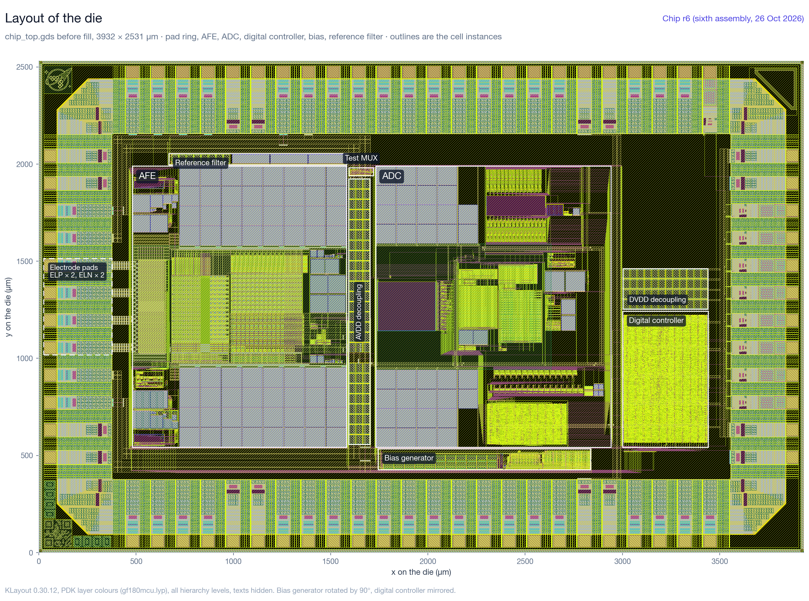

# 週次レポート 2026-10-23〜10-29（GF180 今回 rev のレイアウトと、実際に近い条件での評価）

## 今週の概要と前回からの差分

- **全ブロックとチップのレイアウトを作り、wafer.space の precheck を通した**（10/23〜10/25）。
  - GF180 で一から作った。DRC 違反なし、LVS 一致、穴埋めのあとの全 DRC も違反なし。
  - 10/24 に「レイアウト完了」の目標を 12/8 から 10/30 に前倒しし、10/25 に済んだ。
  - 判断ゲート 1（予定は 10/31）は、10/23 に推奨どおり決めた。
- **重要ブロックの PEX とその確かめで、仕様を外れるものが 7 件見つかり、レイアウトで直した**（10/23〜10/25）。
  - 入力経路の配線抵抗と、電極に流れる DC 電流の 2 件は、目標に少し届かないまま、今回 rev では受け入れた。
  - 直すたびにチップを組み直し、今は 7 回目。
- **precheck の Magic DRC が途中で落ちていた原因（Magic 8.3 の不具合）を突き止めて避け、0 件を確かめた**（10/26）。
  - 10/27 には、事務局の指定どおりの引数（`--slot 1x0p5 --cob`）と最新の precheck で回し直して通した。Magic の警告もなくした。
- **10/27 から、実際に近い条件で測り直している。** 条件は、電源投入から、チップの配線込み、抽出したバイアスと基準、モンテカルロ、AVDD ±5 %。
  - **見込みは 16.40 bit**（モンテカルロ 30 の最悪 16.36）に下がった。10/26 までの 16.45〜16.46 bit は、ブロックが共通の理想の電源とグラウンドを持ち、パッドセルの抵抗を入れていない値だった。
  - **ADC のループが、抵抗 ff と MIM ff の組でリミットサイクルになる**ことを見つけた。C1・C2 を 1.25 倍にした 7 回目のチップを作り、precheck を通した（10/29）。
- 電源投入から CIC の出力までの通しの計算（10 ms）を、6 回目と 7 回目のチップで回している。どちらもまだ終わっていない。
- **10/29 夜：コアの DVDD が、どの DVDD パッドにもつながっていなかった**（最初の組み立てから 7 回目まで。外部の確認で判明）。8 回目のチップで直し、同じ穴を探す確認を流れに足した（下の「追記」）。AFE の AVSS の電流密度を直した 9 回目まで作り、precheck を通した。

図は 6 回目のチップ（10/26）。7 回目との違いは、ADC の中（C1、C2）と、ADC の下の電源レールへのストラップだけ（XOR で確かめた）。7 回目の図はまだ描いていない。

## 今回 rev の構成（10/29、7 回目のチップ）

10/22 からの変更：

| 項目 | 内容 |
| --- | --- |
| AFE | 構成は 10/22 のまま（CCIA、チョッパ 128 kHz、Cin 636 pF、Cf 2 pF）。DC 経路に相を入れ替えた枝を足して対称にした（10/24）。ファームウェアが AFE_IBIAS を 3 に書く（10/28） |
| ADC | C1 は 10/23 に面積のため半分にし（680.5 → 340.3 pF／側、RIN と DAC1 の抵抗は 2 倍）、10/29 にリミットサイクル対策で 1.25 倍にした（425.4 pF／側）。C2 は 19.53 → 24.41 pF／側。抵抗と DAC の電流は変えていない |
| デジタル | TH の取り込みと DWA を ADC 側のブロック eeg_adc_dig に分けた。TEST_CFG[5] ADC_ZERO（ADC の入力を短絡）、[7:6] DBG_SEL を足した（VERSION 0x07）。LibreLane でマクロ 2 つ（eeg_digital_top、eeg_adc_dig）を作った |
| チップ | Half Height（1x0.5）、ダイ 3932 × 2531 µm、標準パッドリング（使わない信号パッドはアナログパッド）。AFE 1100 × 1447 µm、ADC 1210 × 1447 µm |

## レイアウトとチップの組み立て（`gf180_layout_flow_20261023.md`、`gf180_chip_assembly_20261023.md`）

- **流れ**：KLayout の Python と PDK の pcell で生成し、テンプレートの PDK（open_pdks 792ef670）のデッキで DRC／LVS をとる。回路図側は、シミュレーション用のネットリストから変換する。
- **ブロック**（10/23 にすべて DRC 違反なし・LVS 一致）：
  - MIM 配列（Cin、C1、C2）、基準電圧のフィルタ、バイアス、クロックドライバ 2 つ、DAC2、DAC1（RIN を含む）、量子化器、OTA1／OTA2、試験用マルチプレクサ、afe_top、adc_top。
  - 理想の容量と抵抗は、すべて PDK の素子（MIM、ppolyf_u_1k）に置き換えた。
- **チップ**：10/23 に組み立てた。アンテナ違反（デジタルからアナログへの長い制御線など）を直し、穴埋めのあとの全 DRC も違反なし。
- **組み直し**（どの版も、DRC 違反なし、コアの LVS 一致、穴埋めのあとの全 DRC 違反なし、precheck 通過）：

| 版 | 日付 | 入れた変更 |
| --- | --- | --- |
| r0 | 10/23 | 最初の組み立て |
| r1〜r3 | 10/24 | PEX の直し（配線抵抗、DAC1、DC 経路のスイッチ、量子化器）、INP と出力の結合、DC 経路の対称化、ラッチの対称化 |
| r4 | 10/25 | 電極に流れる DC 電流 |
| r5 | 10/25 夜 | WN の配線抵抗（r4 の副作用） |
| r6 | 10/26 | Magic DRC の直し（10/27 夜に Magic の警告も消した。マスクは同じ） |
| r7 | 10/29 | ADC の C1・C2 を 1.25 倍 |

## 重要ブロックの PEX 確認（`gf180_pex_20261023.md`）

寄生容量だけなら、回路図との差は小さかった（AFE の雑音 +1.4 %、ADC のループは同等）。仕様を外れたものは、レイアウトで直した。

| 見つけたもの | 見つけたとき | 直したあと（6 回目） |
| --- | --- | --- |
| 入力の信号経路の配線抵抗 | 片側 76／119 Ω（AFE の雑音 19 nVrms、約 14.8 bit） | 片側 0.634／0.692 Ω（目標 0.35 Ω には届かず、今回 rev はこの形） |
| DAC1 の偶成分 | 0.47〜0.69 fC（要求 0.008 fC、SNDR 約 70 dB） | −0.0013 fC（行動モデルで 123 dB） |
| DC 経路のスイッチの結合 | AFE の出力のリップル 39 mV p-p | 2.37 mV p-p |
| 量子化器の入力とラッチの結合 | 判定が平均 +2.4 LSB ずれる | 判定が理想のしきい値と 91〜94 % で合う（素子だけの版と同じ） |
| INP と増幅器の出力の結合（上の直しの副作用） | フルスケールの HD2 −70 dBc | 結合 9 fF 以下、HD2 −113.8 dBc |
| DC 経路が出力を相 B で固定する（回路の問題。PEX の確かめの中で見つけた） | 帯域内のフルスケールで HD2 −87 dBc | 相を入れ替えた枝を足して対称にした |
| 信号がなくても電極に流れる DC 電流 | 差動 ±36.6 nA（1 MΩ の電極で 37 mV） | −1.55／+1.57 nA（要求の 1 本あたり 1 nA には少し届かず、今回 rev はこの値で受け入れた） |

- 6 回目の歪み（帯域内の静的な値）：HD2〜HD5 −164.0／−120.3／−148.9／−146.0 dBc。2 kHz では −133.9／−118.1／−141.4／−141.1 dBc。
- 寄生込みの E2E（70 µs）：AFE の利得 291.3、ADC の入力 ±287 mV で、仕様を外れるものはない。
- 図：配置と配線、雑音と歪み、検証、寄生込みの E2E、入力インピーダンスなど 24 枚と、KLayout のレイアウトの図 9 枚を、版ごとのフォルダに描いた（`gf180_viz_20261024.md`）。

## precheck と Magic DRC（`gf180_chip_assembly_20261023.md`）

- 10/23〜10/25 は、precheck の Magic DRC が途中で落ちていて、LibreLane はそれを 0 件と数えていた。代わりに穴埋めの一部を除いて Magic DRC を回すと、Magic の規則の書き方による 2 種類だけが出ていた。
- **10/26 に原因を突き止めた。** Magic 8.3 の不具合で、セルの中のインスタンスの区画をその場で分け直すとき、区画とちょうど同じ寸法の要素で配列の外に書き込む。穴埋めの COMP／ポリの配列（192.005 µm 角のものが多い）が当たっていた。
  - 範囲の検査を足した Magic をビルドして確かめた。
  - 穴埋めの COMP／ポリを、1 つのセルに 9 個以下の木に組み替えて避けた（Magic は 10 個未満では区画を作らない）。
  - 2 種類の指摘も、形で直した（抵抗のコンタクトの位置、MIM の下の板の Via4 の囲み）。
  - 穴埋めをすべて入れた Magic DRC が、初めて最後まで走って 0 件になった。
- **10/27：事務局の指定どおりに回し直した。** 今回は CoB で発注しているので `--cob`、Half Height の `--slot 1x0p5` を付け、最新の precheck（10/20 版）を使う。パッドマスクと ID のセルの位置の検査も含めて通った。
- **Magic の警告もなくした**（10/27 夜）。
  - 消したのは、同じセルの二重配置 16,175 件（KLayout の穴埋めが一部の格子を 3 回置くものと、PDK の IO ライブラリのビア）、5 nm の格子から 2 nm ずれた頂点、ファイル数の上限。
  - マスクは XOR で全層同じ。残るのは、GDS の中身と関係のない決まった文 4 行だけ。
- 7 回目（10/29、pre_20261029_r7）も同じく、すべて 0 件で通った。

## 実際に近い条件での評価（10/27〜、`gf180_realistic_eval_20261028.md`）

10/27 のユーザーの指示（「実際にそんな挙動をするかというのが大事」、モンテカルロも含める、立ち上がりに限らず性能の評価でも同じ）で、測り直している。

- **条件**：
  - 電源投入から（電源のランプ、すべての節点 0 V から）、RTL のリセットの順序。
  - パッドリング、基板（仮定）とボンディングワイヤ、チップの配線（パッドセル、AVDD／AVSS の網とデカップリング、ブロックの間の配線と結合）。
  - 抽出した AFE・バイアス・基準、モンテカルロ 30、AVDD ±5 %、27 °C。
- **チップの配線で分かったこと**：
  - バイアス回路と AFE のグラウンドが 25 mV ずれ、AFE の電流が 19 % 減る。ファームウェアで AFE_IBIAS を 3 にする（10/28 決定、レイアウトは変えない）。
  - パッドセルの中の Metal2（電極 1 本あたり 0.636 Ω）が、入力経路の抵抗に入っていなかった。含めると片側 1.27／1.33 Ω、2.07 nVrms。パッドリングを変えない限り直らない（約 −0.06 bit）。
- **雑音**（チップの実際の動作点、入力経路込み、モンテカルロ 30）：
  - AFE_IBIAS 2：5.61 ± 0.08 nVrms（16.35 bit、最悪 16.32）。
  - AFE_IBIAS 3：5.35 ± 0.07 nVrms（16.40 bit、最悪 16.36）。
- **立ち上がり**：
  - バイアスは電源投入から 0.89〜0.98 ms で 1 % 以内。
  - AFE_RST の解除から 8 µs で 1 mV、11 µs で 0.1 mV 以内（出力）に落ち着く。残るオフセットは電極換算 −0.25 ± 0.02 µV。
- **電極の DC オフセット**（10〜300 mV、オフセット DAC で打ち消す）：残差はどれも半段（151 µV）以内で、0.32 ms 以内に落ち着く。
- **フルスケールの正弦波**：電極 0.943 mV pk で出力 280.6 mV pk（利得 297.6）。解除後の最初の 1 周期で落ち着く。
- **VCM の外付け容量**：10 nF なら 5 ms で解除できる。100 nF、1 µF にするなら、ファームウェアは 25 ms、250 ms 待ってから解除する。
- **電源、基準、バイアスの発振**：20 節点を調べ、発振はない。チョッパの切り替えの過渡は毎周期同じ形で、静かな区間の周期ごとの違いは 30 nV 以下（計算の誤差の大きさ）。
- **ADC ブロックのモンテカルロ**：
  - 比較器のしきい値 σ 2.1 mV、OTA1 の位相余裕 53.0 ± 0.9°（最悪 50.8°）、DAC1 の偶成分 −0.0013 ± 0.0008 fC。
  - 行動モデルでのダイごとの SNDR は 115.2〜142.2 dB。最悪のダイの HD2 は電極換算 1.15 nVrms で、歪みの予算 2.0 nVrms の内。

## ADC のリミットサイクルと 7 回目のチップ（10/28〜10/29）

- 抽出した ADC のループ（実際のバイアスと、チップの配線を通した基準、0.28 V pk）を、角とモンテカルロで回した。
  - typical、モンテカルロ 10、ほかの角は正常。抵抗 ff と MIM typical の組は境目（残差 0.12）。
  - **抵抗 ff と MIM ff の組（RC が typical の 0.72 倍）では、入力がなくてもリミットサイクルになった**（量子化器の入力 −75〜+92 mV、範囲は ±46.9 mV）。
- 原因：実効のループの遅れが、設計（0.094 クロック）より大きい 0.22〜0.25 クロックある。RC が小さいと積分器の利得が上がり、余裕がなくなる。
  - 行動モデルもこの遅れで、トランジスタの 4 つの結果をすべて再現する。
  - 遅れはすでに RTL の最小で、ファームウェアでは変えられない。
- **10/29 の決定：C1 と C2 を 1.25 倍にする。** ループのすべての時定数が 1.25 倍になり、抵抗 ff と MIM ff の組でも typical の 0.90 倍で動く。抵抗は変えないので、RIN の雑音は変わらない。
  - 行動モデル：どの角でも量子化器の入力は範囲の内側。SNDR（0.3 V pk）は 122.8〜124.8 dB で下がらない。
  - レイアウト：C1 を 98.33 µm 角 20 個と 69.47 µm 角 4 個に、C2 を 2 個にした。ADC の外形と端子は同じ。
- **トランジスタでも、リミットサイクルは消えた**（最初の 6 本）：

| 条件 | 6 回目：量子化器の入力（残差） | 7 回目：量子化器の入力（残差） |
| --- | --- | --- |
| typical、0.28 V pk | ±32 mV（0.037） | −30〜+28 mV（0.016） |
| 抵抗 ss・MIM ss、0.28 V pk | ±29 mV（0.017） | −29〜+28 mV（0.015） |
| 抵抗 ff・MIM typical、0.28 V pk | −48〜+49 mV（0.118） | −30〜+30 mV（0.023） |
| 抵抗 ff・MIM ff、0.28 V pk | −85〜+77 mV（0.273） | −33〜+31 mV（0.034） |
| 抵抗 ff・MIM typical、入力なし | −31〜+26 mV（0.145） | −4〜+5 mV（0.025） |
| 抵抗 ff・MIM ff、入力なし | −75〜+92 mV（0.487） | −6〜+9 mV（0.029） |

残差は、正常に動くループの目安 0.1 を下回る。残りの角 3 つとモンテカルロ 10 本は、10/29 夜に終わる。

## デジタルの検証と STA（`gf180_digital_verification_20261024.md`）

- 単体テスト 13 本が通る。行動モデルのコード列で 4 s／20 s 分を通し、SPI で読んだ出力がすべて bit-exact。
- チップに入っているゲートレベルのネットリストを RTL と並べて動かし、1 億 4,553 万サイクルで出力が毎 MCLK 一致した。RTL の不具合はなく、マクロは作り直さない。
- チップの配線込みの STA で、ブロック間の余裕は setup +9.9 ns、hold +1.89 ns 以上。

## 16.5 bit の残差予算（電極換算、0.5〜100 Hz）

| 時点 | 条件 | AFE（入力経路込み、nVrms） | ADC 側など（nVrms） | 合計（nVrms） | ENOB |
| --- | --- | ---: | ---: | ---: | ---: |
| 10/22 | 回路図、typical。未評価の項目は配分値 | 4.59 ＋ 入力経路 1.5 | 配分値 | 5.65 | 16.6 |
| 10/26 | 6 回目の抽出。ブロックは共通の理想の電源とグラウンド、パッドセルの抵抗なし | 5.05 | 3.37 | 6.05〜6.07 | 16.45〜16.46 |
| 10/28 | チップの実際の動作点、AFE_IBIAS 3、モンテカルロ 30 | 5.35 ± 0.07 | 3.37 | 6.33 | 16.40（最悪 16.36） |

- 目標は 5.88 nVrms（16.5 bit）。
- 「ADC 側など」は 10/26 までの値のままで、実際の条件ではまだ確かめていない。7 回目の C1・C2 の変更では変わらない。

## 追記（10/29 夜）：コアの DVDD がパッドにつながっていなかった（8 回目のチップ）

- 外部の確認で、コアの DVDD がどの DVDD パッドにもつながっていないと指摘を受け、パッドリング込みのつながりを抽出して確かめた。最初の組み立て（10/23）から 7 回目まで、すべての版にあった。
  - DVDD の幹線は、MSLOT5.1 のため 2 本に分けてある。パッドからの帯は東の 1 本、デジタルブロックとデカップリングの帯は西の 1 本にだけ届いていた。
  - このままでは、デジタルの制御回路、ADC のデジタル部、DVDD のデカップリングに電源が来ない。チップは動かない。
- DRC、コアの LVS、precheck は、すべて通っていた。コアの LVS はパッドリングを外して比べ、パッド側の DVDD のネットには素子がない。DRC と precheck はつながりを見ない。
- **8 回目のチップで直した**：コアの帯を、2 本をまたぐまで伸ばした。7 回目との違いは、2 本のすき間の Metal5 だけ（XOR）。アナログの形は同じなので、7 回目の抽出とシミュレーションはそのまま 8 回目にあてはまる。
- 同じ穴を探すため、チップが動くために成り立つべきことと、それを見ている検査の対応表を作った（`gf180_verification_coverage_20261029.md`）。毎回の流れに 3 つの確認を足した。
  - パッドリング込みのつながり（`chip_lay.connect_check()`）
  - パッドセルのネットリスト込みのチップ全体の LVS（`chip_lay.lvs_chip()`）
  - 私たちのネットリストとラベルを使わない、GDS だけからの電源の確認（`gf180/tapeout/pex/supply_check.py`）
  - 7 回目では、つながりの確認と GDS だけの確認が、DVDD の切れを出した。8 回目は、どちらも問題なし。チップ全体の LVS は、デッキの扱いを直して回し直している。
- 別の道具（Magic の抽出と Netgen）でもチップ全体を比べた。違いは、PDK の角のセルのデカップリングを Magic が読み落とす 1 件だけ（Magic が層をセルごとに読み替えるため。下のセルを平らにして読むと一致する）。
- 対応表で見つけた次の穴：AFE の AVSS の Metal4 の渡り 2 本が、電流密度の上限の 87 %（typical）。ADC のデジタル部の電流は、ゲートレベルのシミュレーションのスイッチングで 1.38 mA（上限 4.0 mA）で、渡りは太くしない。
- **9 回目のチップ（10/29〜10/30 未明）**：AFE の AVSS の渡りに、同じ大きさの Metal3 を足した（46／42 %）。渡りの下を通っていた配線 10 本は、その部分だけ同じ列のまま Metal2 に下ろした。組み立てで、パッドセルのネットリスト込みのチップ全体の LVS が初めて一致し、precheck も通した。発注の候補は 9 回目。
- ADC の C1・C2 × 1.25 は、トランジスタのループでも確かめた。r6 でリミットサイクルになった R ff・MIM ff は、入力ありで ±33 mV、入力なしで −6〜+9 mV（r6 は −75〜+92 mV）。

## 現時点の判断

- 16.5 bit の目標に対して、実際に近い条件の見込みは **16.40 bit**（最悪 16.36）。
  - 10/26 までの値との差の大半は、パッドセルの抵抗（約 −0.06 bit）。パッドリングを変えない限り直らない。
  - バイアスのずれは、ファームウェア（AFE_IBIAS 3）で戻した。レイアウトで直しても +0.02 bit 程度。
  - 届かない場合も提出は止めず、予測値として明記する方針は変えない。
- ADC は C1・C2 を 1.25 倍にして、抵抗と MIM の工程の角でもリミットサイクルにならない余裕を持たせた。
- 発注の前に、電源投入から CIC の出力までの通しの計算を、7 回目のチップで確かめる。今は計算機の負荷が大きく、終わるのは 11/1 ごろ以降。
- まだ確かめていないもの：
  - ADC 側の雑音を、実際の条件で
  - 実際のレギュレータの雑音が出力に出る量（PSRR）
  - 温度（27 °C だけ）、MIM と抵抗の素子ごとのばらつき（PDK にないので仮の係数）
  - 基板（値は仮定）、電極込みの性能
  - 7 回目のチップでの図の描き直し
- 日程は変わらない：11/18 今回 rev の構成決定、12/9 スロット購入の期限、12/16 GDS 提出。

## 検証記録

- 文書（`documentation/`）：
  - `gf180_tapeout_tracker.md`：作業管理表と残差予算
  - `gf180_gate1_20261023.md`：判断ゲート 1
  - `gf180_layout_flow_20261023.md`：レイアウトの流れ
  - `gf180_pex_20261023.md`、`gf180_adc_d6_fix_20261023.md`、`gf180_afe_d6_fix_20261024.md`：PEX と直し
  - `gf180_chip_assembly_20261023.md`：チップの組み立て、組み直し（r0〜r8）、precheck
  - `gf180_digital_verification_20261024.md`：デジタルの検証と STA
  - `gf180_viz_20261024.md`：図の説明
  - `gf180_realistic_eval_20261028.md`：実際に近い条件での評価
  - `gf180_verification_coverage_20261029.md`：チップが動くために成り立つべきことと検査の対応表
- 図：`documentation/figures/gf180/<版>_<日付>/`（r0、r1、r3、r6。版を変えるたびに全部描き直す。7 回目はまだ）
- レイアウト：`gf180/tapeout/layout/`（`chip_lay.py`、`afe_lay.py`、`adc_lay.py`、`mim_arrays_lay.py` ほか）
- 提出用の GDS：`gf180/tapeout/chip/gds/`（版ごとの gz と sha256）
- precheck：`gf180/tapeout/chip/precheck/run_precheck.sh`
- PEX と評価：`gf180/tapeout/pex/`
  - 抽出と比較：`pex.py`、`pex_afe.py`、`pex_adc.py`、`pex_e2e.py`、`viz_data.py`
  - 実際に近い条件：`pex_chipnets.py`、`afe_startup.py`、`afe_chip_noise.py`、`e2e_startup.py`
  - ADC：`adc_block_mc.py`、`adc_loop_mc.py`、`adc_beh_mc.py`
  - 計算結果は `runs/`（git の対象外）
- デジタル：`gf180/tapeout/rtl/`（`run_tests.sh`、`run_e2e.sh`）、`gf180/tapeout/digital/`（LibreLane、`chip_sta/`）
