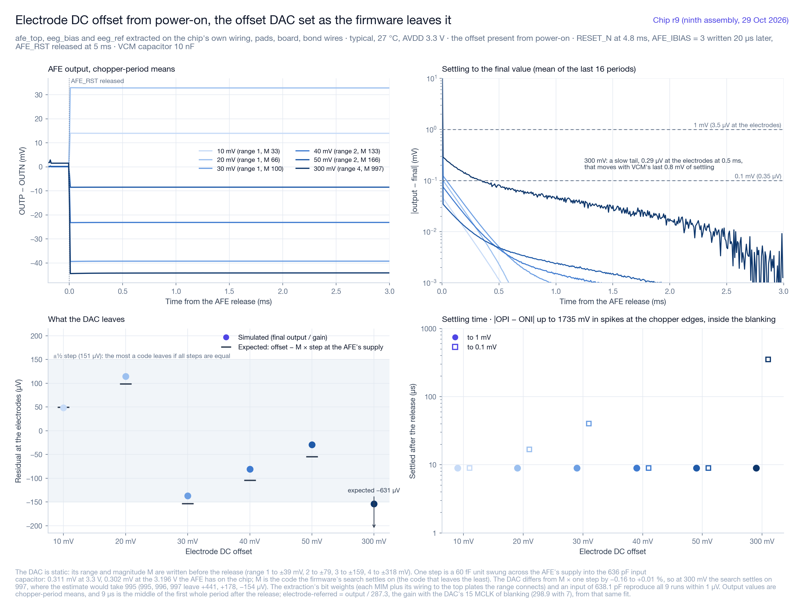

# 週次レポート 2026-10-30〜11-05（9 回目のチップでの回し直しと、電源投入から CIC の出力までの通し）

この週の分は出していなかったので、11/12 に書いた。数字はこの週に出した値で、あとで直したものは注に書いた。

## 今週の概要と前回からの差分

- **発注の候補を 9 回目のチップ（10/29〜30、precheck pre_20261029_r9）にして、評価をその形で回し直した**（10/30〜31）。
  - XOR で、AFE は 6 回目から、ADC は 7 回目から変わっていない。AFE は 6 回目の抽出、ADC は 7 回目の抽出を使い、チップの配線を通すものは 9 回目の GDS で取り直した。
  - 見込みは **16.40 bit のまま**（モンテカルロ 30 の最悪のダイ 16.37）。
- **ADC の C1・C2 の 1.25 倍を、寄生込みで確かめた。** ループの残差は 0.0318 → 0.0202 になった（今の回路図 0.0165）。
- **電源投入から CIC の出力までの通し（10 ms）が、6 回目と 7 回目のチップで最後まで回った**（11/1、11/2）。
  - 有効なサンプルは RTL とビット一致した。
  - 0 と 31 のコードは出ず、CIC も飽和しなかった。
- **電極の DC オフセットを 9 回目の配線で回し直し、残差の換算の誤りを直した**（10/31）。
- 9 回目のチップの図をすべて描いた（可視化 30 枚、レイアウト 9 枚、寄生込みの E2E 7 枚）。

図は 9 回目のチップの配線での、電極の DC オフセットのラン（下の「電極の DC オフセット」）。

## 9 回目のチップでの回し直し（10/30〜31、`gf180_pex_20261023.md`、`gf180_realistic_eval_20261028.md`）

9 回目は、AFE の AVSS の渡りに Metal3 を足した形。AVSS のパッドから AFE までが 1.290 → 1.215 Ω になり、AFE の電流が約 1 % 増えた。

| 項目 | 6 回目 | 9 回目 |
| --- | --- | --- |
| ADC のループ（抽出）：利得、残差、判定が理想のしきい値と合うフレーム | 1.0040、0.0318、91.2 % | 0.9974、0.0202、95.0 % |
| 同、回路図 | 1.0075、0.0203、98.8 %（10/23 の回路図） | 0.9997、0.0165、96.2 %（C1・C2 × 1.25） |
| OTA1／OTA2 のループの位相余裕 | 53.1°／90.1° | 53.0°／89.8° |
| NTF（100 Hz） | −126.1 dB | −122.3 dB（C1・C2 × 1.25 の 2 乗の分、+3.9 dB） |
| 寄生込みの E2E（70 µs）の量子化の残差 | 0.025／0.021 | 0.016／0.017（回路図 0.017） |
| DAC1 の偶成分（行動モデルの SNDR） | 123.0 dB | 同じ（adc_rdac は変わっていない） |
| 入力経路の配線抵抗（片側 P／N） | 0.634／0.692 Ω | 同じ |
| チップの上の AFE の雑音（AFE_IBIAS 3、モンテカルロ 30） | 5.354 ± 0.073 nVrms、16.40 bit（最悪 16.36） | 5.340 ± 0.073 nVrms、16.40 bit（最悪 16.37） |

- **立ち上がり**（モンテカルロ 30、AVDD ±5 %、すべて最後まで回った）：6 回目とほとんど同じ。
  - バイアスは、電源投入から 0.89〜0.97 ms で 1 % 以内に入る。
  - AFE_RST の解除から、10 µs で 1 mV、12 µs で 0.1 mV 以内（出力）に落ち着く。落ち着いたあとの出力は −0.075 ± 0.006 mV。
    - 前回の週報の 8／11 µs は、図の平均の取り方を直す前の値。直すと 6 回目も 10／12 µs。
  - AVDD の電流は 24.0／27.4 mA（AFE_IBIAS 2／3）。
  - ADC での基準電圧は 486.0 mV。テストベンチの ADC の基準の負荷を、今の ADC の値（18.4 → 29.9 kΩ）に直した分で、配線の差ではない。
- **フルスケールの正弦波**：出力 280.8 mV pk、利得 297.8（6 回目より 0.06 % 大きい）。

## 電極の DC オフセット（10/31、`gf180_electrode_dc_20261022.md`）

9 回目の配線で、10〜300 mV のランを回し直した。

| 電極のオフセット | 範囲、M | 残り（電極換算） |
| --- | --- | ---: |
| 10 mV | 1、33 | +48.5 µV |
| 20 mV | 1、66 | +114.3 µV |
| 30 mV | 1、100 | −136.7 µV |
| 40 mV | 2、133 | −80.6 µV |
| 50 mV | 2、166 | −29.5 µV |
| 300 mV | 4、997 | −153.7 µV |

- 300 mV の M は、見積もりの 995（300 mV ÷ 1 段）ではなく 997 になる。
  - 1 段の大きさは、場所と範囲で違う。
  - 抽出のビットの重みで説明できる。利得 287.25、Cin 638.08 pF とすると、9 本のランがどれも 1 µV 以内で合う。
- 残りの最大は、範囲 1 で 153.4 µV（ADC の入力で ±44.1 mV）、範囲 2 以上で 166.2 µV（±47.7 mV）。段はどの範囲でも単調で、直さなくてよい。
- **換算の誤りを直した。**
  - DAC を使うときのブランキングは 15 MCLK で、このとき AFE の利得は 287.25 になる。
  - 10/30 までは、7 MCLK のときの 298.9 で割っていた。そのため、残差が 3.9 % 小さく出ていた。

## 電源投入から CIC の出力までの通し（10/28〜11/2、`e2e_startup.py`）

- **条件**：
  - 電源投入から 10 ms までを、AFE と ADC を抽出したトランジスタで回した（チップの配線、パッド、基板、ボンディングワイヤ込み）。ADC のコードは、RTL の CIC に通した。
  - typical。電極は 0.3 mV の DC に、16 kHz・0.5 mV の正弦（CIC の零）を重ねた。VCM の容量は 10 nF。
  - AFE_RST の解除は 5 ms。54 のチャンクに分けて回した。
- 6 回目は 11/1 の 15 時に、7 回目（C1・C2 × 1.25）は 11/2 の 5 時に最後まで回った。

| 項目 | 6 回目 | 7 回目 |
| --- | --- | --- |
| 有効なサンプル（クリアから 3、4、5 ms） | +1,543,245、+1,543,250、+1,543,250 | +1,543,242、+1,543,243、+1,543,246 |
| RTL（SPI で読む）との比べ | 3 つともビット一致 | 3 つともビット一致 |
| 電極から DATA までの利得 | 306.6 | 306.6 |
| コード | 10〜28 | 11〜26 |
| AVDD の電流（変換中） | 26.18 mA | 26.18 mA |

- 0 と 31 のコードは出ず、O2 は一番外のしきい値の内側に収まった。DAC1 のラッチはどのフレームでも選択と一致し、CIC は飽和しなかった。
- 6 回目と 7 回目のサンプルの差は 3、7、4 LSB（2^24 の 0.4 ppm 以下）。
  - C1・C2 の 1.25 倍で、積分器の振れは小さくなった（O1 の最大 96 → 92 mV、O2 37 → 31 mV）。
  - 利得は変わらない。
- 単位利得の ADC より、利得が 3.13 % 大きい。
  - 2.52 % は、ADC での VREF（487.7 mV）が 0.5 V より小さい分。
  - 残りの約 0.6 % は、6 回目と 7 回目で同じ。その一部は原因を確かめていない。一定の利得の誤差なので、分解能には効かない。
- RTL との自動の比べは、走り終わりに FAIL を出した。
  - 原因は、テストベンチに渡す列が短かったこと。`cic` は 10/31 に直したが、チェーンは直す前の `cic` で動いていた。
  - 3 つのサンプルは合っていた。直した `cic` での回し直しは、11/7 に PASS した。

## 16.5 bit の残差予算（電極換算、0.5〜100 Hz）

| 時点 | 条件 | AFE（入力経路込み、nVrms） | ADC 側など（nVrms） | 合計（nVrms） | ENOB |
| --- | --- | ---: | ---: | ---: | ---: |
| 10/28 | 6 回目の配線、AFE_IBIAS 3、モンテカルロ 30 | 5.35 ± 0.07 | 3.37 | 6.33 | 16.40（最悪 16.36） |
| 10/30 | 9 回目の配線、同じ | 5.34 ± 0.07 | 3.37 | 6.31 | 16.40（最悪 16.37） |

- 目標は 5.88 nVrms（16.5 bit）。
- 「ADC 側など」は、10/26 までの値のまま。
- 注（11/9 に分かったこと）：この合計は、パッドとストラップの抵抗の 1.5 nVrms を二重に数えていた。10/28 からの AFE の値に、すでに入っていた。直すと、9 回目で 6.13 nVrms、16.44 bit になる（次の週報）。

## 現時点の判断（11/5）

- 発注の候補は 9 回目のチップで、見込みは 16.40 bit（最悪 16.37）。
  - 11/9 に、量子化器のラッチのグラウンドがつながっていない穴が見つかった。候補は 10 回目になった（次の週報）。
- ADC の C1・C2 の 1.25 倍は、寄生込みのループでも通しでも効いた。残差は小さくなり、利得と出力は変わらない。
- 次にやること：
  - 9 回目の配線での通し（11/7 に始めた）。
  - デジタルの切り替えを入れたチャンク。
  - ADC 側の雑音と歪みを、実際の条件で。
  - レギュレータの PSRR、温度、基板。
- 日程は変わらない：11/18 今回 rev の構成決定、12/9 スロット購入の期限、12/16 GDS 提出。

## 検証記録

- 文書（`documentation/`）：
  - `gf180_realistic_eval_20261028.md`：9 回目の配線での回し直し、電極の DC オフセット、電源投入から CIC の出力までの通し
  - `gf180_pex_20261023.md`：9 回目のチップの寄生込みの比べ
  - `gf180_electrode_dc_20261022.md`：10/31 の追記（抽出で見た DAC の段）
  - `gf180_tapeout_tracker.md`：作業管理表と残差予算
- 図：`documentation/figures/gf180/r9_20261029/`（可視化 30 枚、レイアウト 9 枚、寄生込みの E2E 7 枚）
- 評価：`gf180/tapeout/pex/`（`afe_chip_noise.py`、`afe_startup.py`、`e2e_startup.py`、`pex_e2e.py`、`pex_adc.py`）
  - 計算結果は `runs/`（git の対象外）
  - 通しの比べの図（診断用）：`runs/e2e_startup/e2e_chain_r6_r7_20261107.png`
