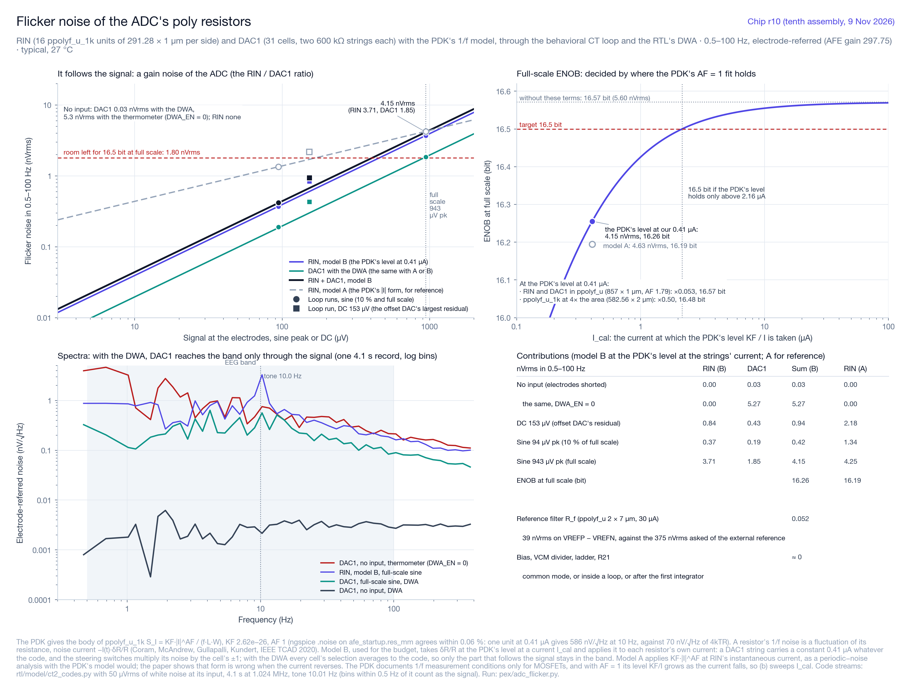
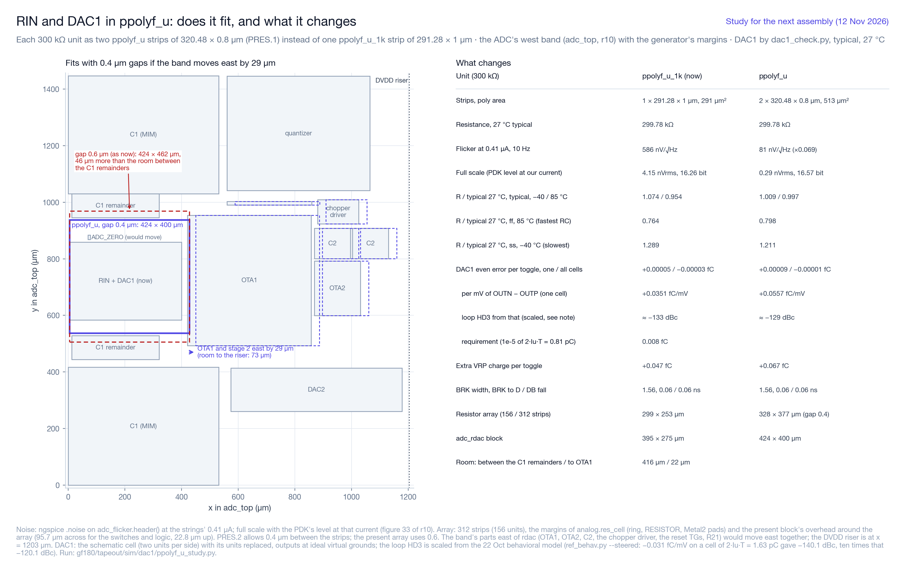

# 週次レポート 2026-11-06〜11-12（10 回目のチップ、デジタル側の結合、ADC のポリ抵抗のフリッカ雑音）

## 今週の概要と前回からの差分

- **量子化器のラッチのグラウンドが、どの版でもつながっていなかった**（11/9 に判明。r0〜r9 のすべての版）。
  - ユーザーの判断で AVSS につなぎ、**10 回目のチップ**を作った。
  - チップ全体の LVS（パッドリング込み）が、KLayout と Magic／Netgen の両方で一致した。precheck（pre_20261109_r10）も通した。**発注の候補は r10。**
  - 同じ穴を探す確認（タップの確認）を、毎回の流れに足した。
- **デジタル側の結合を、通しのチャンクに入れて確かめた**（11/8〜11）。
  - AFE の出力にできるのは、電極換算 0.30 nV の一定のずれだけ。シミュレータ自身の計算の差と同じ大きさ。
  - ADC の符号は変わらない。
- **電源投入から CIC の出力までの通しが、9 回目のチップの配線で最後まで回った**（11/11）。
  - 有効なサンプルは RTL とビット一致した。
  - 10 回目の通しは 11/10 から回していて、11/13 の昼ごろに終わる見込み。
- **残差予算を見直した**（11/9、11/12）。
  - 10/28 からの合計は、パッドとストラップの抵抗を二重に数えていた。
  - 直して、ADC 側を測った値で積み直すと、**5.60 nVrms、16.57 bit**。ただし ADC 自身の歪みはまだ確かめていない。
- **ADC のポリ抵抗のフリッカ雑音が、予算に入っていなかった**（11/12。後輩の Test-2-4 の指摘から）。
  - ADC の利得の 1/f のゆらぎになる。PDK の大きさを今の電流でとると、**フルスケールの正弦波で 16.26 bit**。
  - 入力がないときや、小さい信号ではほとんど効かない。
  - 直す案（RIN と DAC1 を ppolyf_u に替える）を調べた（下）。幅 0.8 µm の 2 本を直列にした 1 単位で、フルスケールでも 16.57 bit。ADC の外形の中に収まり、DAC1 の確認も通った。
  - 替えるかどうかは 11/18 に決める。
- 電極の入力と DATA の対応をまとめた（図 32）。
- 後輩の Test-2-4 を読み、10 回目のチップと比べた。発注の候補にはならない。git に入れた。
- 10/30 からの作業と 10 回目の GDS を git に入れた。10/30〜11/5 の週報も、遅れて 11/12 に出した。

## 10 回目のチップ（11/9、`gf180_chip_assembly_20261023.md`）

- **見つけたこと**：量子化器の DVSS の端子が、adc_top の中でどこにもつながっていなかった。
  - この端子には、31 個の比較器のラッチ、TH／QD のインバータ、ストローブのバッファ、クロックのシールドがつながっている。
  - グラウンドへの道は、313 個の p タップと基板だけだった。
  - 9 回目の GDS を、タップを基板につながない形で抽出して見つけた。
- **見落とした理由**：どの検査も、それぞれ別の理由で通っていた。
  - ブロックの LVS は、DVSS を AVSS と同じネットとして扱っていた。
  - ストラップの確認（`strap_to_rail()`）は、Metal3 だけを見ていた。
  - 電源の確認は、名前ごとに 1 か所しか見ていなかった。
  - 抽出は、基板を AVSS としていた。
- **決めたこと（ユーザーの判断）**：DVSS ではなく AVSS につなぐ。
- **直し**：量子化器の端子の上に Via4 10 個と Metal5 のストラップ（幅 6 µm、長さ約 177 µm）を置き、ネットリストの端子を AVSS に移した。
  - 9 回目との違いは、この Via4 と Metal5 だけ（XOR）。
  - ADC の抽出では、ループの節点は変わらない（O2P／O2N に +0.03／+0.02 fF）。
- **流れに足した確認**：`supply_check.tap_check()`。9 回目ではこのネットだけを出し、10 回目では何も出ない。
- **チップでの確認**：

| 確認 | 結果 |
| --- | --- |
| パッドリング込みのつながり、GDS だけの電源の確認（タップの規則を含む）、DRC、穴埋めのあとの全 DRC | 問題なし |
| チップ全体の LVS（パッドリング込み） | KLayout で一致。Magic の抽出と Netgen でも一致（素子 90,779、ネット 51,211） |
| コアの LVS | 一致 |
| precheck（pre_20261109_r10） | 最新のイメージ（10/20 版。11/9 にも最新と確かめた）を `--slot 1x0p5 --cob` で回し、すべて 0 件、パッドマスク一致、Magic DRC は最後まで走った |
| GDS | `gf180/tapeout/chip/gds/chip_top_fill_r10_20261109.gds.gz`（sha256 7e206aac…） |

- **ADC を 10 回目の抽出で確かめ直した**：ループの窓、寄生込みの E2E、OTA、NTF、行動モデルは、7 回目とすべて同じ。
  - トランジスタのループ 19 本のうち、15 本は判定がすべて同じ。
  - 残りの 4 本（モンテカルロ 2 本と角 2 つ）は、4〜18 フレームだけ分かれて、また同じ列に戻った。利得の差は 0.0003 以下で、リミットサイクルはない。
  - 前に「mc3 は 80 フレームのうち 3 で違う」と書いたのは、判定が合うフレームの数の変化（56 → 53）だった。違うフレームの数は 7 で、直した。
- 図を 10 回目でそろえた（`documentation/figures/gf180/r10_20261109/`。可視化 33 枚、レイアウト 9 枚、寄生込みの E2E 7 枚）。

## デジタル側の結合（11/8〜11、`gf180_realistic_eval_20261028.md` の「デジタル側」）

- これまでの通しには、デジタルブロックの電源電流と、9 個のデジタルパッド（bi_24t）が入っていなかった。
- 9 回目の通しのチャンクに、これらとチップの DVDD／DVSS を足して回した（`digital_noise.py`、`current_profile.py`）。
  - ブロックの電源電流は、ゲートレベルのシミュレーションからとった。eeg_digital_top は 4.36 mA、eeg_adc_dig は 1.25 mA。
- 結果（ADC は 10 回目の抽出、11/11）：

| 比べた組 | AFE の出力の一定のずれ（電極換算） | 周期ごとの残り | ADC の符号 |
| --- | ---: | ---: | --- |
| 結合（デジタルの電流とパッドあり − なし） | +0.30 nV | 0.17 nV rms | 48 フレームとも一致 |
| SPI の読み出しあり − なし | +0.03 nV | 0.28 nV rms | 48 フレームとも一致 |
| RAW の出力あり − なし | −0.30 nV | 0.26 nV rms | 48 フレームとも一致 |

- 結合は MCLK に同期しているので、一定のずれにしかならず、雑音にはならない。
  - 大きさは、シミュレータ自身の計算の差（0.27 nV）と同じ。DATA の 1 LSB は 0.19 nV。
- リングの DVDD／DVSS の揺れは 18／19 → 59／57 mV p-p に、ADC のデジタル部の電源は 417 mV p-p になる。それでも AFE には効かない。
- 基板を通る結合は、まだ見ていない。
- 2 本が「Timestep too small」で止まった。
  - 原因は、パッドの信号の角が、チップのクロックの角と 3 fs だけ離れていたこと。
  - パッドの信号を 0.125 ns ずらして回し直した。

## 電源投入から CIC の出力までの通し（`e2e_startup.py`）

- **9 回目の配線**：11/7 の 22 時 47 分から回し、11/11 の 0 時 26 分に最後まで回った（73.7 時間）。
  - 有効なサンプルは +1,544,232、+1,544,237、+1,544,236。RTL とビット一致した。電極から DATA までの利得は 306.8。
  - 7 回目より 0.064 % 大きく、差はすべて AFE の利得で説明できる。
    - AFE の AVSS の渡りに足した Metal3 で、AFE の AVSS の持ち上がりが 1.1 mV 小さくなり、AFE の電流が約 1 % 増えた。
    - AVDD の電流は 26.41 mA（+0.89 %）。
- 6 回目と 7 回目の通しの RTL との比べは、直した `cic` で回し直して PASS した（11/7）。
- **10 回目**：11/10 の 20 時 59 分から回している（ユーザーの判断）。
  - チャンク 30 まで（7.834 ms）を、9 回目と比べた（11/12、途中経過）。
  - 電源と基準は、0.03 µV、5 nA 以内で同じ。
  - コードはクリアから 389 フレーム目で初めて分かれ、そのあとは細かいところで別の列になる。それでも CIC の出力の差は 3.2 LSB 以内。
  - 11/13 の昼ごろに終わる見込み。終わったら 9 回目と全部比べ、図 32 を描き直す。

## 16.5 bit の残差予算の見直し（11/9、11/12）

| 時点 | 条件 | 合計（nVrms） | ENOB |
| --- | --- | ---: | ---: |
| 10/30 | 9 回目の配線。ADC 側などは 10/26 までの 3.37 nVrms | 6.31 | 16.40（最悪 16.37） |
| 11/9 | 同じ。パッドとストラップの二重計上を除いた。ADC 側などは 10/22 の配分（2.93 nVrms） | 6.13 | 16.44（最悪 約 16.41） |
| 11/12 | ADC 側などを測った値で積み直した（1.54 nVrms） | 5.60 | 16.57 |
| 11/12 | ＋ADC のポリ抵抗のフリッカ（フルスケールの正弦波。PDK の大きさを今の電流でとった場合） | 6.97 | 16.26 |

- 目標は 5.88 nVrms（16.5 bit）。
- 積み直した ADC 側の中身（nVrms）：
  - ADC の抵抗 1.17、OTA1 0.27、OTA1 のチョッパの折り返し 0.17
  - DAC1 の偶成分 0.47、AFE の HD3 0.64、外付けの基準の要求 0.5
- **ADC 自身の歪みは、まだ確かめていない。**
  - トランジスタのループの計算（8 ms）では、−110 dBc より下が見えない。PDK の抵抗のモデルには、電圧係数がない。
  - −110 dBc なら 16.47 bit、−120 dBc なら 16.56 bit。16.5 bit には、約 −111.4 dBc より良いことが要る。

## ADC のポリ抵抗のフリッカ雑音（11/12、図 33、`gf180/tapeout/pex/adc_flicker.py`）

- 後輩の Test-2-4 の検証で、ngspice では PDK の ppolyf_u_1k が雑音を出さないと分かった（本体が雑音のない B ソース）。こちらでも確かめた。
  - AFE のモンテカルロ（雑音のモデルを残した書き方）と、ADC の抵抗の熱雑音（4kTR で手で計算）には影響しない。
  - 抜けていたのは、ADC のポリ抵抗（RIN と DAC1）のフリッカ雑音。
- **扱い方**：
  - PDK の式は S_I = KF·|I|^AF／(f·L·W)（KF 2.62e-26、AF 1）。
  - 抵抗のフリッカ雑音は、抵抗値のゆらぎ δR/R として扱い、各抵抗のその時々の電流に掛けた（Coram ほか、IEEE TCAD 2020）。
  - ADC の利得（RIN と DAC1 の比）の 1/f のゆらぎになり、信号に比例する。DAC1 の分は、DWA で信号に比例する分だけが残る。

| 電極の入力 | 雑音（0.5〜100 Hz） |
| --- | ---: |
| なし（電極を短絡） | 0.03 nVrms |
| フルスケールの 10 %（94 µV pk） | 0.42 nVrms |
| オフセット DAC の残りの最大（直流 153 µV） | 0.94 nVrms |
| フルスケール（943 µV pk） | 4.15 nVrms |

- フルスケールでは合計 6.97 nVrms、16.26 bit で、16.5 bit に届かない。
- EEG で普通の大きさの入力（フルスケールの 10 % 以下）では、合計は 5.68 nVrms 以下にしかならない。
- DWA を切る（DWA_EN = 0）と、入力がなくても 5.27 nVrms になる。DWA_EN は、リセット値の 1 のままにする。
- **PDK の大きさが今の電流で正しいかは、分からない。**
  - PDK の式は AF = 1 で、電流が小さいほど、正規化した大きさが大きくなる形。
  - この式が 2.16 µA より上でしか成り立たないなら、フルスケールでも 16.5 bit に届く。
  - どちらかは、測らないと決まらない。チップでは、電極に低雑音の直流を入れて、DATA の 1/f の床を比べれば分かる。

## RIN と DAC1 を ppolyf_u に替える案（11/12、設計はまだ変えていない）

11/18 に決めるために、直す案の形と影響を調べた（`gf180_realistic_eval_20261028.md` の「RIN と DAC1 を ppolyf_u に替える案」、`ppolyf_u_study.py`）。

- **1 単位（300 kΩ）の形**：ppolyf_u（350 Ω/sq）の、幅 0.8 µm（規則の最小）、長さ 320.48 µm の 2 本を直列にする。抵抗の面積は 1.76 倍。
- **雑音**：δR/R の大きさが 0.069 倍になる。フルスケールでも 0.29 nVrms で、合計 5.61 nVrms、16.57 bit。
  - ppolyf_u の AF は 1.79 なので、大きさは電流の −0.21 乗で、電流にほとんどよらない。今の電流に当てはめるときの不確かさも小さくなる。
- **角と温度**：工程の角は今と同じ ±20 %。温度による変化は約 10 分の 1 になる。
  - ADC の利得（RIN と DAC1 の比）は、角でも温度でも変わらない。
  - R21（第 2 段の入力の抵抗）も替えるとよい。替えないと、角で第 1 段と第 2 段の抵抗が別々に動く。
- **ADC に収まるか**（10 回目の adc_top の配置に重ねた）：
  - 抵抗の間を規則の最小の 0.4 µm（今は 0.6 µm）にすると、ブロックは 395 × 275 → 424 × 400 µm になり、C1 の残りの間（416 µm）に収まる。
  - OTA1 と第 2 段をまとめて東へ 28.9 µm ずらす。DVDD の立ち上がりまでは 72.5 µm ある。ADC の外形は変わらない。
- **DAC1**（回路図、typical、27 °C）：

| 項目 | 今（ppolyf_u_1k） | ppolyf_u |
| --- | --- | --- |
| 偶成分（1 素子／31 素子同時。要求 0.008 fC） | +0.00005／−0.00003 fC | +0.00009／−0.00001 fC |
| 出力の電位差 1 mV あたりの偶成分 | +0.035 fC | +0.056 fC |
| 同、ループの HD3（10/22 の行動モデルからの比例） | 約 −133 dBc | 約 −129 dBc |
| 基準電圧の余分な電荷（1 回の切り替え） | +0.047 fC | +0.067 fC |
| BRK の幅、BRK から D／DB が落ちるまで | 1.561 ns、0.063 ns | 同じ |

- 感度が 1.6 倍になるのは、切り替えのたびに充放電される抵抗の端の容量が、面積とともに増えるため。それでも HD3 は、16.5 bit に要る約 −111.4 dBc より約 18 dB 小さい。
- 角とミスマッチは、替えると決めたら、レイアウトのあとの確認で回す。
- **替える場合にやり直すもの**：
  - レイアウト：抵抗の配列と、ADC の組み立て（帯のずらし、ADC_ZERO、ストラップ、端子）。
  - ネットリスト：DAC1、RIN（と R21）。
  - 確認：ブロックとチップの DRC／LVS（2 つの道具）、穴埋め、precheck、PEX、DAC1 とループ（モンテカルロと角）、電源投入から CIC の出力までの通し（1 本 約 54 時間）。

## 後輩の Test-2-4（11/12、`gf180_chip_assembly_20261023.md`）

- 6 回目のチップをもとに、DVDD のつながりとパッドの金属を直した版。r6 と違うのは 2 つのセルだけ。
  - chip_top：Metal5 の 4 か所で、パッドからの DVDD とコアの DVDD の幹をつないだ。こちらの 8 回目と同じ問題を、別の形で直したもの。
  - Bondpad_5LM：M2〜M4 に金属を足した。公開の DRC の CUP.3 に当たるため。
- 7〜10 回目の直し（C1・C2 × 1.25、Magic の警告の組み直し、AFE の AVSS の Metal3、量子化器のグラウンド）が入っていない。発注の候補にはならない。
- **パッドの直しは入れない。**
  - precheck も、こちらの全 DRC も、CUP を除いている。
  - 直すと PDK のパッドを書き換えた形になり、ボンディング、ESD、機械的な強さが確かめられていない。
  - 必要なら wafer.space に聞く。
- 役に立った指摘：
  - ポリ抵抗の雑音（上）。
  - VCM の外付けの容量がないと、VCM が 94.9 mV p-p 揺れる。10 nF の前提を、基板の要求として守る。
  - AVDD 3.6 V では、クロックの TG のゲートとバルクの間が 3.666 V（DC の目安 3.63 V）を合計 3.3 ns 超える。3.3 V では超えない。
- git に入れた（`gf180/Test-2-4-delivery_20261112/`、説明は `gf180/Test-2-4-delivery_20261112.md`）。
  - GitHub は 100 MB を超えるファイルを受け付けないので、5 つは中身をそのまま入れていない。
  - GDS 2 つは gz にして入れた。224 µs の生波形 2 本と、LVS のデータベースは入れていない。

## ファームウェアと基板の決まり（11/9、管理表 F2、F4）

デジタルとアナログの境目の確認（RTL、ネットリスト、アナログのブロックの間の 132 本の信号。食い違いなし）から、守る条件を書き出した。

- **ファームウェア**：
  - AFE_IBIAS を 3 にする書き込みは ANA_TRIM = 0x38（0x30 では CPF_TRIM が 0 になる）。
  - CHOP_DLY は 0 のまま。
  - BLANK_LEN は 1 以上（既定 7）。オフセット DAC を使うときは 15 にする（自動では変わらない）。
- **基板**：
  - DVDD は、AVDD、VREFP／VREFN、発振器と同時か先に上げ、切るときは後に切る（アナログのパッドの ESD ダイオードが DVDD へ流れるため）。
  - VREFP > VREFN を保つ。

## 現時点の判断

- 発注の候補は r10。DRC、LVS（2 つの道具）、precheck を通している。
- 見込みは、入力が小さいとき 16.57 bit（ADC 自身の歪みを除く）。
  - フルスケールの正弦波では、ADC のポリ抵抗のフリッカで 16.26 bit（PDK の大きさを今の電流でとった場合）。
- **11/18 の構成決定で決めること**：RIN と DAC1 を ppolyf_u に替えるか、r10 のままにするか。
  - **替える**：フルスケールでも 16.57 bit で、PDK の大きさが今の電流で正しいかどうかによらない。やり直しは通しを含めて 1 週間ほどの見込みで、12/9 のスロット購入の期限の前に終わる。新しいレイアウトの誤りは、これまでと同じ確認の流れで押さえる。
  - **r10 のまま**：入力が小さいときは 16.57 bit。フルスケールの 16.26 bit は、PDK の大きさを今の電流でとった予測として明記し、チップで確かめる。
  - こちらの勧めは**替える**ほう。ENOB は普通フルスケールに近い正弦波で測るので、PDK の大きさが正しければ、r10 では 16.5 bit を外す。収まりと DAC1 は確かめてあり、日程にも余裕がある。
- まだ確かめていないもの：
  - ADC 自身の歪み（16.5 bit には約 −111.4 dBc より良いことが要る）
  - レギュレータの PSRR、温度、基板を通る結合
  - 電源を入れる順序（基板の決まりにしただけで、計算はしていない）、電極の入力の ESD の経路
- 日程は変わらない：11/18 今回 rev の構成決定、12/9 スロット購入の期限、12/16 GDS 提出。

## 検証記録

- 文書（`documentation/`）：
  - `gf180_chip_assembly_20261023.md`：組み直し（11/9、10 回目）、後輩の Test-2-4 との比べ
  - `gf180_realistic_eval_20261028.md`：デジタル側、通し、予算の見直し、ADC のポリ抵抗のフリッカ雑音、ppolyf_u に替える案
  - `gf180_input_output_20261112.md`：電極の入力と DATA の対応（図 32）
  - `gf180_verification_coverage_20261029.md`：チップが動くために成り立つべきことと検査の対応表
  - `gf180_tapeout_tracker.md`：作業管理表と残差予算
- 図：
  - `documentation/figures/gf180/r10_20261109/`（可視化 33 枚、レイアウト 9 枚、寄生込みの E2E 7 枚）
  - `documentation/figures/gf180/plan_20261112/`（ppolyf_u に替える案）
- 提出用の GDS：`gf180/tapeout/chip/gds/chip_top_fill_r10_20261109.gds.gz`
- 評価：
  - `gf180/tapeout/pex/`（`digital_noise.py`、`adc_flicker.py`、`e2e_startup.py`、`supply_check.py`）
  - `gf180/tapeout/digital/power/current_profile.py`
  - `gf180/tapeout/sim/dac1/ppolyf_u_study.py`
  - 計算結果は `runs/`（git の対象外）
- 後輩の Test-2-4：`gf180/Test-2-4-delivery_20261112/`
