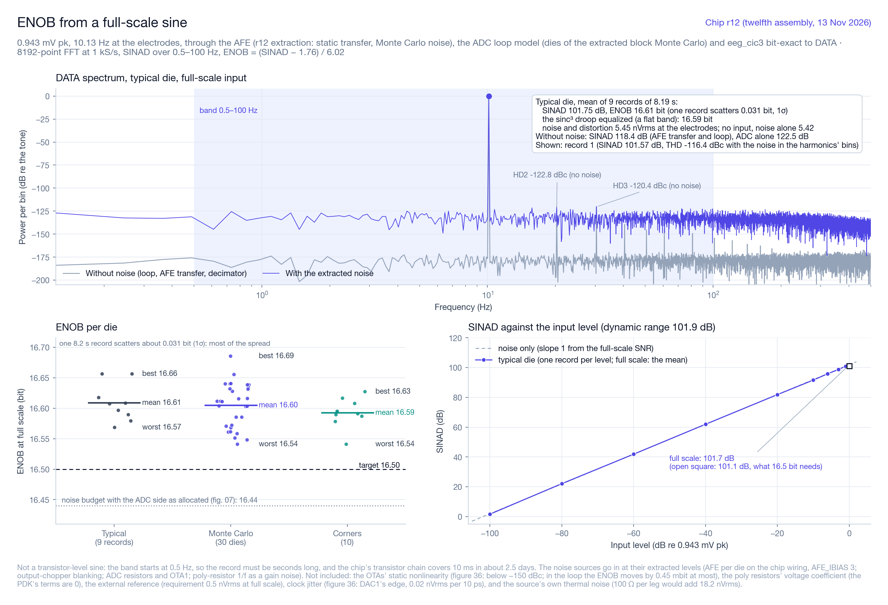
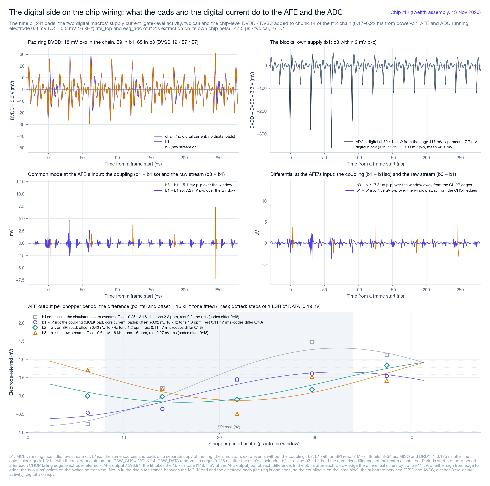
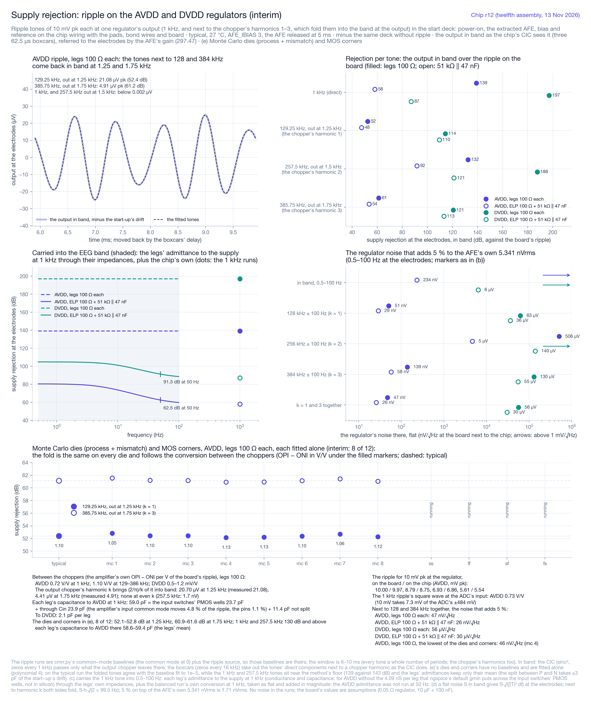
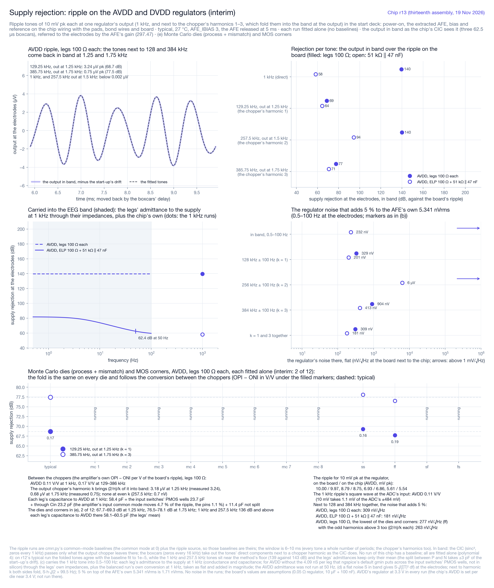
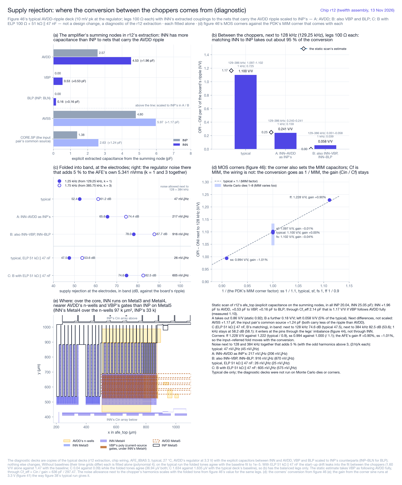
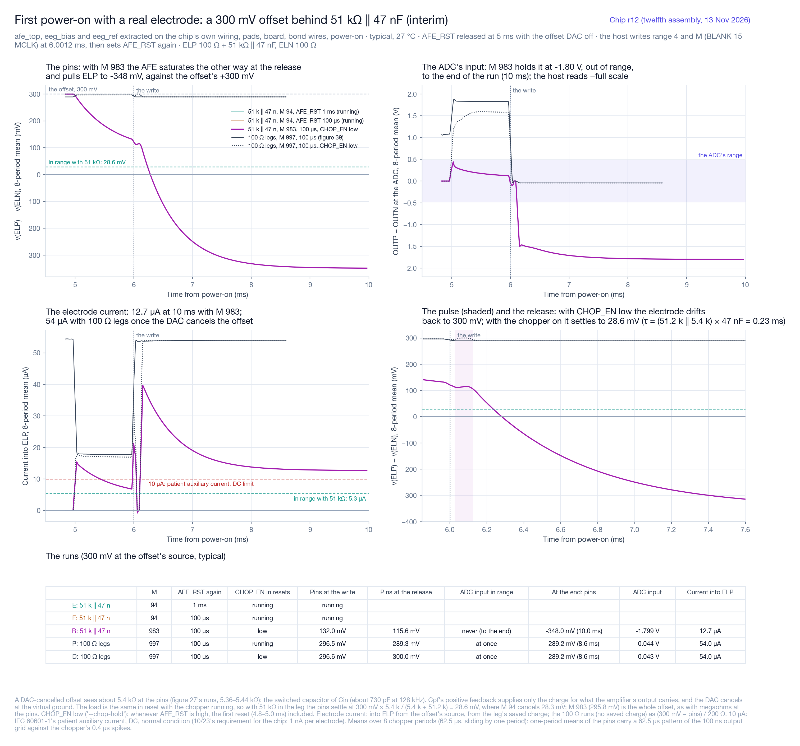

# 週次レポート 2026-11-13〜11-19（12 回目チップ（発注候補）・13 回目チップ（PSRR 対策）、正弦波入力による ENOB、起動、CMRR、PSRR、電極オフセット電流、デジタル制御の見直し）

## 今週の作業概要と前回からの差分

- **11 回目・12 回目チップの作成、12 回目を発注候補に決定**（11/12〜13）。
  - 11 回目：ADC の RIN、DAC1、R21 を ppolyf_u に変更（11/12、ユーザー判断）。フルスケール時のポリ抵抗フリッカは 0.29 nVrms、フルスケールでも 16.57 bit（予算値）。
  - 12 回目：外部からの指摘に基づき、敏感な網の下を通過するクロック線・データ線を除去（11/13、ユーザー判断）。
  - 12 回目は、穴埋め後の全 DRC で違反なし、チップ全体の LVS は KLayout と Magic／Netgen の双方で一致、最新の precheck（pre_20261113_r12）を `--slot 1x0p5 --cob` で通過。
- **ENOB を本来の定義（正弦波入力時の DATA の SINAD）で算出**（11/14、図 35）。typical で 16.61 bit（9 記録の平均）、ADC・AFE の 30 ダイで 16.54〜16.69 bit。ADC の OTA の非線形性はフルスケールで −150 dBc 未満であり、ENOB への影響なし（11/15、図 36）。
- **12 回目チップの起動評価を一通り実施**（11/15〜17）。
  - プロセスコーナーと電源立ち上がり時間（10 µs〜100 ms）の 20 条件で、バイアスはすべて立ち上がり（図 37）。コーナーでの AFE のリセット解除も問題なし（図 38）。
  - 電極 DC オフセットにより飽和した状態での初回電源投入（図 39）：DAC 書き込み後も増幅器は飽和状態に留まり、CIC 出力の平均値は 0 付近を示す。**DAC 書き込みのたびにホストが AFE_RST を 100 µs 印加する手順**を採用（11/16）。
  - ADC は過負荷状態から自律的に復帰（抽出で 64 µs、ダイと状態のばらつきを含め最大約 0.22 ms。図 40）。
  - 電源投入から CIC 出力までの通し解析は、12 回目の配線でも RTL とビット単位で一致（11/16、71 時間）。
- **AFE の HD3 の AVDD への 1 対 1 の依存**（11/16、図 41）。AVDD −5 % ではすべてのコーナーで要求（−111 dBc）を満たさない。**基板の AVDD は可変レギュレータによりダイごとに 3.40〜3.45 V に調整**することに決定（11/18、ユーザー判断）。BOOST_TRIM も試験時にダイごとに選定。typical の BOOST_TRIM は、雑音が AVDD に依存しない 4/2 を推奨（図 42）。
- PDK に記載のない係数（DAC1 の素子ばらつき、入力抵抗の電圧係数、オフセット DAC の MIM のばらつき）は、仮定値の 4 倍まで要求に影響なし（11/17、図 43）。
- **同相除去比（CMRR）の初回評価**（11/17〜18、図 44）。片側の電極に 51 kΩ ∥ 47 nF がある場合、50 Hz で 54.2 dB（体の同相 100 mV pk に対し電極換算 194 µV pk、フルスケールの 21 %）。ほぼ全量が電極側の要因であり、チップ自体は 151 dB。チップ修正は不要。
- **電源除去比（PSRR）の評価**（11/18〜19、図 46）。低周波のレギュレータリップルはチョッパにより除去（電極釣り合い時、AVDD 139 dB、DVDD 197 dB）。**AVDD の 128 kHz 奇数倍近傍のリップルは、チョッパ間で生じる変換成分が出力チョッパにより帯域内に戻り、除去比は 52 dB に留まる**（チップ単体、typical）。51 kΩ ∥ 47 nF の電極では、帯域内の AVDD が 50 Hz で 62.5 dB。基板要求として、AVDD は低雑音 LDO とし、128／384 kHz 近傍の雑音を約 40 nV/√Hz 以下、帯域内を約 225 nV/√Hz 以下（51 kΩ ∥ 47 nF）に設定。モンテカルロ 8 ダイでも 52.1〜52.8 dB でダイ依存性なし（ミスマッチではなく配置により決定）、MOS コーナーでは ff が最低の 51.5 dB。**変換の原因は、増幅器入力 INN の余分な配線容量（AVDD に +1.96 pF など）と判明**（11/19、図 47）。INP に揃えた診断デッキでは 128 kHz 近傍が 78 dB となり、51 kΩ ∥ 47 nF の電極でも 47.5 dB から 74.6 dB に改善。コーナーによる変動は、PDK のコーナーが MIM の帰還容量も変化させるため。**11/19 昼、r13 で INN の配線を修正することに決定。** 13 回目チップでは、増幅器の加算点 INP と INN の配線帯をコア全体で交互に配置し、抽出での AVDD、VBP、BLP への容量差が 2,647 → 256 fF に減少（チップは DRC、穴埋め後の全 DRC、KLayout によるチップ全体の LVS とコアの LVS、最新の precheck（`--slot 1x0p5 --cob`）を通過。Magic／Netgen による LVS と r13 の PSRR を実行中）。
- **DAC で相殺した電極オフセットにより、電極に DC 電流が流れ続けることが判明**（11/18）。オフセット / 5.4 kΩ（300 mV で 54 µA）であり、10/23 に定めた要求（電極 1 本あたり 1 nA 以下）を DAC の 1 段目から満たさない。**今回 rev ではチップを修正せず、制約事項として記録**（11/18、推奨に対するユーザーの回答「go」）。
- **電極に抵抗と容量がある場合の起動評価**（11/18、図 45）。M が電極に合わない場合、AFE は逆向きに飽和した状態に留まり、チップが電極を逆方向に引き込む（−349 mV、12.7 µA）。51 kΩ ∥ 47 nF では、解除後の電極電流が DAC で相殺した分により決まるため、**M の 1 段が増幅器入力換算で約 3 mV（ADC の範囲とほぼ同等）となる**（M 98〜100 で確認。範囲内に入るのは M 100 のみで、ホストの読み値は −0.79 mV。M 99 は範囲の端）。範囲内ではチップは電極から見て電流源として振る舞うため、**電極抵抗の変化に対する感度は電流そのもの（300 mV、51 kΩ で 5.3 µV/Ω）となり、午前の見積もりの約 10 倍**。アクティブ電極であれば問題なし。チップ修正の要否は、G の結果を受けて再度判断を仰いでいる。
- **クロック線と敏感な網の近接について、チップ全体を目視確認**（11/19、図 48、チェックリスト項目）。
  - コアの LVS データベースはブロック内部の網も平坦化して保持しているため、AFE・ADC 内部の敏感な網（加算点、積分器入力など）まで、チップのクロック線・データ線と照合。
  - r13 で新たに生じた近接はなし。afe_top の重なりは r12 と同一であり、増幅器コアの上にスイッチング網はなし。
  - r12 から存在するもの：AFE の南側・東側の配線通路で、出力チョッパのクロック NCDB が VCM の隣を 1.1 mm（抽出 94 fF）、VBCM の隣を 0.6 mm（51 fF）並走。AFE 端子の VCM は NCDB のエッジごとに約 10 mV、0.3 µs 変動。ADC 内部では SEL2 が 2 段目の入力 I2P／I2N の上を横断。
  - いずれも抽出とシミュレーションに含めた上で要求を満たしているため、修正しないことを推奨し、判断を仰いでいる。
- **デジタル部のシミュレーション**（11/19、ユーザーからの確認事項）
  - ADC をモデルとした通し試験、および遅延なしの論理シミュレーション（RTL、ゲートレベル）は 10/24 に実施済み。
  - 遅延込み（SDF）のゲートレベルは未実施であり、代表的な数本の実施を依頼された。SDF は外付け SSD（mukiebi）上のランに含まれるため、2 つのマクロを LibreLane で再実行。ネットリスト、DEF、SDF（日付行を除く）、GDS（XOR）は元のランと同一。その SDF で SPI、全体、通し試験の 21 サンプル区間を 3 コーナーで実行中（遅延込みは低速であり、100 サンプルでは 1 コーナーあたり約 12 時間を要するため短縮。ユーザーの回答「縮めて」）。
- **デジタル制御（SPI・レジスタ・起動手順）の見直し**（11/19、ユーザーと実務者からの指摘）。
  - 現状を状態遷移図（動作状態、SPI のトランザクション、CIC と FIFO）に整理し、問題点 42 項目を抽出。
  - 重大度の高いものは、オフセット DAC の M の 2 回書き込みによる中間値（256 の倍数の境界で約 80 mV の段差）、設定の即時反映、起動とオフセット調整の待ち時間のホスト依存、多チップでのデータ開始の位相、長さの異なる書き込みの無通知の破棄、ファームウェアを含めた試験の欠如。
  - 状態機械とフラグによる改善のたたき台を作成。今回 rev で改修する範囲の判断を仰いでいる。
  - 続いて要件定義の案と、模範の状態遷移図・状態表・状態遷移表を作成（11/19 夜、未決事項 8 件）。状態遷移表を仕様源として図と表を生成し、論理の穴を自動で検査する形に改訂（r2）。
- 外付け SSD（mukiebi）は内容を消去せずに保管することに決定（11/16、ユーザー判断）。移動用の道具と目録は `gf180/tools/archive/` に格納。

## 11 回目・12 回目チップの作成（11/12〜13、`gf180_chip_assembly_20261023.md`）

- **11 回目**：RIN、DAC1、R21 の 1 単位（300 kΩ）を、幅 0.8 µm の ppolyf_u 2 本の直列で構成（11/12 の案のとおり）。
  - 作成した抵抗でフリッカを再計算した結果、フルスケールで 0.29 nVrms、16.57 bit（小入力時と同等）。
  - 抵抗間隔を 0.4 µm とし、OTA1 と第 2 段を東側へ移動して、ADC の外形内に収容。
- **12 回目**：外部から「敏感な網の下をクロック線・データ線が通過している」との指摘を受領（11/13）。
  - r11 の抽出による見積もりでは、影響は雑音フロアより数桁小さく、寄生込みの計算にも既に含まれていたが、ユーザー判断により修正。
  - ADC：SEL1_0〜30 と DAC_CLK を、I1N／O1P の Metal5 幹線の下のみ Metal2 で通し、Metal4 の AVSS 板で遮蔽。
  - AFE：WN の Metal5 をクロックドライバ西側の行の上から除去し、入力チョッパのゲート通路に Metal4 の AVDD 遮蔽を配置（電極の DC リークは ±1.56 → ±1.71 nA。遮蔽はユーザー判断により維持）。
  - 敏感な網とスイッチング網の重なりを算出する `crossings.py` を作成（図 34）。
- **確認結果**（r11、r12 とも）：

| 確認項目 | 結果 |
| --- | --- |
| パッドリング込みの接続、GDS のみからの電源確認（タップ規則を含む）、DRC、穴埋め後の全 DRC | 問題なし |
| チップ全体の LVS（パッドリング込み） | KLayout で一致。r12 は Magic の抽出と Netgen でも一致 |
| precheck | 最新イメージを `--slot 1x0p5 --cob` で実行し、両方とも通過（pre_20261113_r11、pre_20261113_r12）。全項目 0 件、パッドマスク一致、Magic DRC は最後まで完走 |
| GDS（r12） | `gf180/tapeout/chip/gds/chip_top_fill_r12_20261113.gds.gz`（sha256 a89a5fb8…、展開後 6b832e0e…） |

- 回路図の書き出しで、m>1 の抵抗を 1 本ずつ出力するよう変更（Netgen の誤った不一致への対策）。
- r11 は r12 に置き換えたため、発注候補とはしない。

## 正弦波入力による ENOB の評価（11/14、図 35）と ADC の OTA の非線形性（11/15、図 36）

- 従来の「16.4x bit」は、電極換算雑音の二乗和を bit に換算した予算値。今週、**電極にフルスケールの正弦波（0.943 mV pk、10.13 Hz）を入力し、DATA の FFT の 0.5〜100 Hz における SINAD から ENOB を算出**（`enob_sine.py`）。
  - 抽出したブロックの結果を連結した評価系（AFE の静的伝達特性と雑音、抽出ブロックのモンテカルロのダイによる ADC の行動モデルのループ、ポリ抵抗の 1/f、ビット一致の CIC）。
- **typical で 16.61 bit**（9 記録の平均、SINAD 101.75 dB）。30 ダイで 16.54〜16.69 bit。
- ADC の OTA の非線形性（抽出した OTA の静的伝達特性をループに組み込み）はフルスケールで −150 dBc 未満であり、ENOB への影響なし。DAC1 の切り替えのジッタは、数十 ps までであればほぼ影響なし（チップ内のクロック経路のジッタは未見積もり）。
- ADC 自身の歪みとして残るのはポリ抵抗の電圧係数（PDK のモデルに未記載）であり、実機でのみ確認可能（許容値は vc2 で約 300 ppm/V²。図 43）。

## 起動評価（11/15〜17、図 37〜40、`gf180_realistic_eval_20261028.md`）

- **電源投入**（図 37）：プロセスコーナー ss／ff／fs／sf と typical × AVDD 3.135／3.3／3.465 V、電源立ち上がり時間 10 µs、10 ms、100 ms の 20 条件で、バイアスはすべて立ち上がり。AFE の VBN が 1 % 以内に収まるまで 0.82〜1.05 ms。
- **コーナーでの AFE のリセット解除**（図 38）：すべてのコーナーで動作を開始し、2 周期目以降の振幅は最終値。利得は typical に対し −2.2〜+0.9 %。
- **電極 DC オフセットにより飽和した状態での初回電源投入**（図 39）：
  - DAC 無効のまま解除すると、30 mV と 300 mV で AFE は飽和。DAC を書き込むと CIC 出力の平均値は 0 付近まで下がるが、増幅器は出力チョッパの後段で飽和したままであり、ADC 入力は ±1.2〜1.5 V の矩形波のまま。
  - 自律的な復帰は書き込み後 0.82 ms（30 mV）、2.82 ms（300 mV）。300 mV ではその後も約 −31 µV のずれが時定数約 47 ms で残留。
  - **書き込みから 20 µs 以上空けて AFE_RST を 100 µs 印加すると、0.5 µs で範囲内に復帰**。これをホストの手順として採用（11/16。ss でも復帰）。
- **ADC の過負荷からの復帰**（図 40）：抽出したループで、+2.5 V の過負荷終了から 64 µs で復帰。行動モデルの 42 ダイ × 300 状態で最大約 0.22 ms。1 bit 状態への遷移は、10〜20 kHz の大振幅入力時のみ。

## AFE の線形性の窓と雑音：AVDD と BOOST_TRIM（11/16、図 41、42）

- **AFE の HD3 は AVDD に 1 対 1 で依存。** 昇圧回路は AVDD から動作し、AFE への供給は 3.196 V に留まる。AVDD −5 % ではすべてのコーナーで要求（−111 dBc）を満たさず、10/22 のトリム表はチップ上では不整合。
- AVDD 3.40 V とコーナーごとに選定したトリム（typical 2/2、ss 2/2、ff 8/2、sf 8/2、fs 2/2）で、チップの窓は約 3.394〜3.456 V（2 kHz、27 °C）。
  - **ダイごとの調整（11/18 決定）**：ss のダイは 3.45 V（−113.1 dBc、余裕 2.1 dB）、その他は 3.40〜3.43 V。
  - 固定とする場合は 3.43 V を ±0.5 % に維持（±1 % の 3.40 V では ss の −1 % で −109.8 dBc となり不適合）。
- **雑音は AVDD とともに増加**（typical 2/2。PMOS 入力対の VSD の縮小による）。typical を 4/2 とすると、HD3 は −117.0 dBc で 2/2 と同等のまま、雑音は AVDD に依存せず一定（3.45 V で 5.349 nVrms、予算で 16.56 bit。2/2 では 5.725 nVrms、16.47 bit）。
- トリムは、試験時に THD と雑音から決定した値をダイごとに書き込む（ファームウェア）。

## デジタル回路動作によるアナログ部（AFE・ADC）への干渉評価（11/16、12 回目のチップ、図 31）

**目的**

- デジタルブロック（eeg_digital_top、eeg_adc_dig）のクロック同期の電源電流、およびデジタルパッド（bi_24t ×9）の入出力が、電源・基板・パッドを経由して AFE 出力と ADC 符号に与える影響の評価。
- 電源投入〜CIC 出力の通し解析（`e2e_startup.py`）では、デジタル信号をリングの DVDDC–DVSSC 間の理想源として扱い、ブロックの電源電流とデジタルパッドを含まないため、その補完として実施（`digital_noise.py`）。
- 経緯：11/8〜9 に 9 回目の通し（ADC は 7 回目の抽出）で実施、11/10〜11 に ADC を 10 回目の抽出に置換して再実施。11/16 に 12 回目の通し（AFE・ADC は 12 回目の抽出、チップ配線は `chipnets_r12`）で再実施。

**解析条件**

- 解析区間：通しのチャンク 14、6.17 ms から 47.3 µs（AFE_RST 解除後 1.17 ms、チョッパ 6 周期、ADC 48 フレーム）。AFE・ADC は変換動作中、入力は 16 kHz の正弦波（AFE 出力で 148.9 mV）。
- チップの DVDD／DVSS：リングから各ブロックまでの星形配線。抵抗は `supply_check.py` の値（デジタルブロック 0.19／1.12 Ω、ADC デジタル部 4.32／1.41 Ω、デカップリング 0.67／1.50 Ω）。
- ブロック電源間容量：PDK のセルネットリストより eeg_digital_top 92 pF、eeg_adc_dig 26 pF。n ウェル接合容量の見積もりを加算。
- ブロック電源電流：ゲートレベル電力解析（OpenSTA、VCD）より、MCLK エッジごとの電荷をフレーム内サイクルごとに算出。eeg_digital_top は平均 4.36 mA（立ち上がりエッジで 77.7〜94.0 pC）、eeg_adc_dig は 1.25 mA。各電荷は幅 2 ns の三角波として注入。
- デジタルパッド：bi_24t ×9（PDK のトランジスタネットリスト）と基板へのボンディングワイヤ。MCLK は 3.3 V 発振器（エッジ 1.5 ns）から供給。MISO、DRDY_N、RAW_DATA、RAW_CLK に基板負荷 8 pF。

**比較条件**（いずれも 47.3 µs、AFE 出力のチョッパ周期平均で比較）

| 条件 | 内容 | 差分の意味 |
|---|---|---|
| b1 | 通常測定（MCLK 動作、ホスト停止、RAW 出力停止） | b1 − b1iso：デジタル側からの結合 |
| b1iso | b1 と同一の源・パッドを、チップと非接続のリングの複製上に配置 | b1iso − 通し：シミュレータの数値誤差 |
| b2 | b1 ＋ ホストからの SPI 読み出し（2 MHz、48 ビット） | b2 − b1：SPI 読み出しの寄与 |
| b3 | b1 ＋ RAW 出力（RAW_CLK = MCLK／4、データはランダム） | b3 − b1：RAW 出力の寄与 |

**結果**（12 回目、電極換算）

| 比較 | 一定のずれ | 16 kHz 成分の差 | 周期ごとの残差 | ADC 符号 |
|---|---|---|---|---|
| b1iso − 通し（数値誤差） | +0.25 nV | 2.2 ppm | 0.21 nV rms | 48 フレーム全一致 |
| b1 − b1iso（結合） | +0.02 nV（ADC が 10 回目の抽出の時 +0.30、7 回目の抽出の時 +0.21） | 1.3 ppm | 0.11 nV rms | 48 フレーム全一致 |
| b2 − b1（SPI 読み出し） | +0.42 nV | 1.2 ppm | 0.11 nV rms | 48 フレーム全一致 |
| b3 − b1（RAW 出力） | +0.64 nV | 1.6 ppm | 0.27 nV rms | 48 フレーム全一致 |

- DATA の 1 LSB は電極換算 0.19 nV。結合による一定のずれ（0.02 nV）は数値誤差（0.25 nV）以下。
- 電源変動は 10 回目と同等。リングの DVDD は通しの 17.6 mV p-p に対し b1 で 59.3 mV p-p、b3 で 64.8 mV p-p（DVSS は 18.5／56.6／57.2 mV p-p）。ブロックのデジタル電源（DVDD − DVSS）の変動は、ADC デジタル部 417 mV p-p、デジタルブロック 190 mV p-p。
- AFE 入力の変動は、b1 − b1iso で同相 7.20 mV p-p、差動 7.59 µV p-p（CHOP エッジ後 50 ns を除く）。RAW 出力（b3 − b1）では同相 15.15 mV p-p、差動 17.3 µV p-p で、RAW_CLK のエッジ（61 ns 周期）に同期したスパイク状。
- 周期ごとの差は、数値誤差で −0.77〜+1.47 nV、その他の比較で 0.84 nV 以下。解析区間（47.3 µs）が 16 kHz の 1 周期（62.5 µs）より短く、一定のずれと 16 kHz 成分の分離は不十分。5 周期の差の単純平均では b2 − b1 が +0.18 nV、b3 − b1 が +0.27 nV で、いずれも数値誤差の範囲内。

**考察**

- チョッパ（MCLK／256）、ADC フレーム（MCLK／32）、デジタル電流はいずれも MCLK に同期しており、結合は一定のずれとしてのみ現れ、雑音とはならない。
- SPI 読み出し・RAW 出力のいずれでも ADC 符号の変化はなし。RAW 出力の残差 0.27 nV rms を周期ごとに独立な雑音とみなしても、0.5〜100 Hz への寄与は約 0.01 nV rms であり、総残差（6.14 nVrms、図 7）に対して無視できる。RAW 出力は試験用で、通常動作では停止。
- 4 条件は 11/16 3:49 に開始し、22:00〜23:44 に完了（「Timestep too small」の発生なし）。b2、b3 では、コアが出力するパッド信号のエッジをチップクロックの格子から 0.125 ns ずらして設定（10 回目の解析で、格子上で近接した区切り点により停止したことへの対策）。

**未考慮事項**

- パッドリングは単一節点として扱い、東側の MCLK パッドから西側の電極パッドまでのリングの抵抗・インダクタンスを含まない。そのため、MCLK から電極への結合は過大評価側。
- DVSS–AVSS 間の基板経由の結合。
- 電流は遅延なしの解析に基づくため、グリッチおよび符号依存成分を含まない。電荷の三角波の幅は仮定値で、1〜4 ns の範囲で変動量が約 2 倍変化。
- 解析は typical のみ。ただし結合の MCLK 同期性は角に依存しないため、一定のずれとしてのみ現れるという結論は不変。

## PDK 未記載の係数に対する余裕（11/17、図 43）

| 係数 | 仮定値に対する範囲 | 結果 |
| --- | --- | --- |
| DAC1 の素子ばらつき | 1〜8 倍 | ENOB の変化なし（16.600、16.594、16.601、16.601 bit。DWA とオーバーサンプリング比 5,120 による） |
| 入力抵抗の電圧係数 vc2 | 掃引 | HD3 が −111 dBc に達するのは約 370 ppm/V²、16.5 bit を保持するのは約 300 ppm/V² まで（入力抵抗は 641 µm の長い単位の並列であり、実際の値ははるかに小さいと推定） |
| オフセット DAC の MIM のばらつき | 1〜8 倍 | 2 倍まで単調。4 倍で範囲 3、4 の 0.2〜0.3 % が非単調となるが、残差は運転中の窓（±54 mV）の内側。8 倍で範囲 4 の 1.5 % が窓の外 |

- いずれも仮定値の 4 倍まで要求に影響なし。発注前のチップ修正は不要。

## 同相除去比（CMRR）の評価（11/17〜18、図 44、`cmrr.py`）

従来の評価は、電極を片側 100 Ω の釣り合った条件でのみ実施。12 回目チップの通し解析（電源投入から、typical）で、体を基板の VCM に対して 100 mV pk で駆動。

| 周波数 | 電極 | 電極換算の差動 | CMRR |
| --- | --- | --- | --- |
| 1 kHz | 釣り合い（片側 100 Ω） | 0.0038 µV pk（帯域内） | 148.1 dB |
| 1 kHz | ELP に 51 kΩ ∥ 47 nF | 285.8 µV pk | 50.7 dB |
| 50 Hz | 釣り合い | 0.0044 µV pk（帯域内） | 147.1 dB |
| 50 Hz | ELP に 51 kΩ ∥ 47 nF | 194.0 µV pk | 54.2 dB（gmin による見かけの成分を除くと 54.6 dB） |

- 不釣り合い時の出力は、シミュレーションのピン差動と 0.04 % で一致。ほぼ全量が、各脚の電流がそれぞれのインピーダンスで生じる差動（電極側の要因）。
- 釣り合い時の値は帯域内（チップの CIC が見る値）。11/18 夜まで記載していた 1 kHz の 0.522 µV（105.4 dB）は、チョッパ周期平均の折り返しによる見かけの値。体の同相は増幅器内部で差動に変換され、出力チョッパにより ADC 入力に矩形波として現れる（1 kHz で同相の 1.07 倍、50 Hz で 0.071 倍）。この矩形波は CIC により除去されるが、チョッパ周期平均では 1 kHz に折り返していた。不釣り合い時の値は 0.13 % 以内で同一。
- 脚 1 本から見た同相のアドミタンスは 50 Hz で 47.7 nS（大部分は約 140 pF の容量。半分が入力スイッチ、残りが Cin 経由）。スイッチを 4 分の 1 にしても、50 Hz での改善は約 3 dB に留まる。
- **CMRR のためのチップ修正は不要。** 基板側で体の同相を小さく保つこと（基準電極、右足駆動）と、電極インピーダンスの整合により決まる。体の 50 Hz 同相の想定値は未決定（フルスケールに達するのは約 490 mV pk）。

## 電源除去比（PSRR）の評価（11/18〜19、図 46、`psrr.py`）

AVDD または DVDD のレギュレータ出力に 10 mV pk の 4 トーン（1 kHz、およびチョッパの 1〜3 倍の高調波近傍の 129.25、257.5、385.75 kHz）を重畳し、帯域内（チップの CIC が見る値）の出力を電極換算で評価（typical、電源投入から）。PSRR は基板上のリップルに対する値。

| トーン | AVDD、釣り合い | AVDD、ELP に 51 kΩ ∥ 47 nF | DVDD、釣り合い | DVDD、ELP に 51 kΩ ∥ 47 nF |
| --- | --- | --- | --- | --- |
| 1 kHz | 139.1 dB | 58.1 dB | 197.1 dB | 87.0 dB |
| 129.25 kHz（1.25 kHz に折り返し） | 52.4 dB | 47.5 dB | 114.3 dB | 109.5 dB |
| 257.5 kHz（1.5 kHz） | 132.4 dB | 91.7 dB | 187.5 dB | 121.2 dB |
| 385.75 kHz（1.75 kHz） | 61.2 dB | 53.6 dB | 120.6 dB | 113.1 dB |
| 帯域内の 50 Hz（1 kHz から外挿） | 139.1 dB | 62.5 dB | 197.1 dB | 91.3 dB |

- 2 つのチョッパの間で、AVDD のリップルは増幅器出力に差動として 1.10 V/V で現れる（129〜386 kHz）。出力チョッパの奇数次高調波 k がその (2/π)/k を帯域内に戻すため、128 kHz と 384 kHz 近傍のリップルが帯域内に現れる（予測 20.70 µV に対し実測 21.08 µV）。偶数次は戻らない。この変換は、増幅器入力 INN の余分な配線容量に起因（後述）。
- 51 kΩ ∥ 47 nF では、脚 1 本の AVDD への容量 59 pF（入力スイッチの PMOS ウェル 24 pF、Cin 経由 24 pF、その他 11 pF）を流れる電流が、電極の不釣り合いにより差動となる（CMRR と同じ機構）。
- **基板への要求（AFE 雑音への寄与 5 % 相当）**：AVDD は 128 kHz と 384 kHz 近傍の雑音を約 40 nV/√Hz 以下（51 kΩ ∥ 47 nF の電極では約 22 nV/√Hz）、帯域内を約 225 nV/√Hz 以下（51 kΩ ∥ 47 nF）。11/19 8 時、モンテカルロとコーナーの最悪値から再設定（typical では 45、25、234）。低雑音 LDO とし、スイッチングレギュレータの直接使用は不可。DVDD は通常の LDO で十分（帯域内 6.4 µV/√Hz、128 kHz 近傍で 30 µV/√Hz）。
- モンテカルロ 8 ダイと MOS コーナー 4 条件（AVDD、釣り合い）を 11/19 1 時 8 分〜7 時 57 分に実行。8 ダイは 128 kHz 近傍で 52.1〜52.8 dB（標準偏差 0.24 dB）、384 kHz 近傍で 60.9〜61.6 dB、チョッパ間の変換は 1.05〜1.13 V/V で typical と同等（ミスマッチに起因するものではない）。コーナーでは ff が 51.5 dB（変換 1.23 V/V）、ss が 53.2 dB（0.99 V/V）、sf と fs は typical と同等。許容雑音は ff で 43 nV/√Hz（5 次より上の奇数次を含めると 41 nV/√Hz）であり、基板要求を約 40 nV/√Hz に再設定。
- 変換の発生源（図 47、`psrr_diag.py`）：抽出では、増幅器入力の INN が INP より AVDD に 1.96 pF、VBP に 0.53 pF、BLP に 0.16 pF 多く結合しており、実効帰還容量 2.14 pF で除すと 1.17 V/V（実測 1.10）。
  - この容量を INP に揃えた診断デッキ（設計変更ではない）では、AVDD のみで変換が 0.241 V/V（128 kHz 近傍 65.6 dB）、VBP と BLP も揃えると 0.058 V/V（78.0 dB、384 kHz 近傍 87.7 dB）に低下。**変換の約 95 % は INN の余分な配線容量に起因。** 発生箇所は増幅器コアの上であり、INN は Metal3 と Metal4、INP は Metal5 を通過するため、INN のみが下層の AVDD の n-well と電流源のゲート（VBP）に近接（図 47 の (e)）。揃えた場合、128 kHz 近傍の許容雑音は typical で 47 から約 900 nV/√Hz に緩和。
  - コーナーで変換が −10〜+12 % 変動するのは、PDK のコーナーが MIM のコーナー（ff 0.9 倍、ss 1.1 倍）も変化させ、変換が帰還容量 Cf（MIM）に反比例するため（ff 1.228 V/V、予測 1.222）。AFE の利得（Cin / Cf）の変動は 1 % 以内であり、F2 の (4) の値は変更なし。
  - ELP に 51 kΩ ∥ 47 nF の電極で揃えた C（12 時 34 分完了）：128 kHz 近傍は 47.5 → 74.6 dB、384 kHz 近傍は 53.6 → 82.5 dB、許容雑音は 26 → 605 nV/√Hz。1 kHz（58.1 → 58.2 dB）は、ピンにおける脚の不釣り合いによる成分のため変化なし。修正後の基板要求で最も厳しいのは、帯域内の約 225 nV/√Hz（51 kΩ ∥ 47 nF）。13 時、r13 で修正することに決定（後述の「現時点の判断」）。
  - INN の余分を INP 側に付加して差を解消した診断 D（17 時 45 分完了）：128 kHz 近傍 77.7 dB、384 kHz 近傍 87.4 dB、変換 0.060 V/V で、B（78.0 dB、87.7 dB、0.058 V/V）と同等。変換は加算点間の容量の差のみで決まり、両側に等しく付く結合は寄与しない。r13 の修正方針（INN の余分の除去）と整合。

- **13 回目のチップ（r13）の PSRR（11/19 夜、途中結果、図 46（r13））**：afe_top のみ r13 の抽出に置換した同一のデッキ（基準のランなし、単独の当てはめ）。
  - 128 kHz 近傍：typical 68.7 dB（r12 52.4 dB）、ff 67.7 dB（51.5 dB）、ss 69.3 dB（53.2 dB）、ELP に 51 kΩ ∥ 47 nF で 64.4 dB（47.5 dB）。384 kHz 近傍は typical 77.5 dB（61.2 dB）。いずれも約 16 dB の改善。
  - チョッパ間の変換は 0.169 V/V（r12 1.10 V/V）。残る差 256 fF と、診断 B・D の残り（0.058 V/V）からの見込み（約 0.17 V/V）と整合。
  - 128 kHz と 384 kHz の近傍に許せる AVDD の雑音は、ff で約 260 nV/√Hz（r12 約 40 nV/√Hz）、51 kΩ ∥ 47 nF で約 150 nV/√Hz（r12 約 22 nV/√Hz）の見込み。帯域内（51 kΩ ∥ 47 nF で 50 Hz 62.4 dB）は電極の不釣り合いで決まり、変化なし。
  - モンテカルロ 8 ダイと sf、fs は実行中。F2 の (4) の改訂はその結果のあと。

## DAC で相殺したオフセットによる電極電流と、電極込みの起動評価（11/18、図 45）

- **判明事項**：DAC で相殺した電極オフセットには、AFE が範囲内に入った後もピンから約 5.4 kΩ が負荷として見える（図 27 のランで 10〜300 mV のいずれも 5.36〜5.44 kΩ）。

| 電極オフセット | 電極電流 |
| --- | --- |
| 10 mV | 1.8 µA |
| 30 mV | 5.4 µA |
| 300 mV | 54 µA |

- **機構**：Cin（約 730 pF）を 128 kHz で切り替えるスイッチトキャパシタ電流。Cpf の正帰還は、増幅器出力に現れる分の電荷のみを補償。DAC は仮想接地でオフセットを相殺するため、相殺分の充電電流は電極から供給される。入力インピーダンス 3.54 MΩ は、増幅される信号に対する値。
- **要求との乖離**：10/23 に定めた要求（電極 1 本あたり 1 nA 以下）を、DAC の 1 段（56 nA）から満たさない。低抵抗の電極では、オフセット約 54 mV で患者補助電流の DC 上限（10 µA）に到達。
- **修正方法**：CHOP_FAST = 0（64 kHz）では半減に留まる。相殺分の電荷を Cin の入力側でも補償する回路（オフセット DAC の複製など）が必要となるが、容量の整合精度により 1 nA には届かず、入力容量の増加により CMRR も劣化。
- **決定事項（11/18）**：今回 rev ではチップを修正せず、制約事項として記録。電極側（オフセットの小さい湿式電極、アクティブ電極）で対処。G の結果（後述）を受け、夕方に再度判断を仰いでいる。
- **電極抵抗 R_e がある場合**、リセット中（チョッパ動作中）のピン電圧は 5.4 kΩ / (5.4 kΩ + R_e) 倍となる（51 kΩ で 300 mV → 約 30 mV）。ただし、M をこれに合わせても範囲内には入らない（後述の E、F）。
- **電極込みの起動**（300 mV、ELP に 51 kΩ ∥ 47 nF、図 45）：
  - B（M 983 はオフセット全量相当、AFE_RST の間 CHOP_EN を Low）：解除時のピンは 116 mV で、AFE は逆向きに飽和したまま残り、チップがピンを −349 mV へ引き込む（電極に 12.7 µA、ADC 入力 −1.80 V）。ホストは −フルスケールを読むため探索方向は正しいが、合わない M を残したまま待機しないこと。
  - 電極 100 Ω では、同じ書き込みとパルスにより、解除と同時に範囲内に入る（電流は 54 µA）。
  - E、F（M 94、パルス 1 ms と 100 µs、チョッパは動作させたまま）：いずれも増幅器入力 +5.0 mV（ADC 入力 +1.0 V、範囲外）に収束し、範囲内に復帰せず。パルス長は収束先に影響せず、収束先は M により決まる。F では ADC 入力の平均が一時的に範囲内に入ったように見えるが、増幅器は依然として飽和（仮想接地の誤差 14 mV）。
  - M 94 は、ピンの単純平均（28.4 mV）に合わせて選定。増幅器が取り込むのはチョッパ切り替え直前の値（約 1.3 mV 高い）であり、選定方法に誤り。
  - **解釈（G で確認）**：解除後は Cpf が残差の電荷を補償するため、電極電流は DAC で相殺した分（M × 0.301 mV / R_sc。R_sc はピン約 30 mV で 5.67 kΩ）により決まり、電極の電圧降下が M により変化。M の 1 段は増幅器入力換算で 0.301 mV × (1 + R_e / R_sc)、51 kΩ で 3.0 mV となり、ADC の範囲（増幅器入力換算 ±1.63 mV）とほぼ同等。最良の M でも最大 ±1.5 mV（ADC の範囲の 94 %）が残り、約 55 kΩ を超えると範囲内に入らないオフセットが生じる。10 kΩ であれば 1 段 0.84 mV。
  - G（M 98、99、100、パルス 1 ms）：範囲内に入るのは M 100 のみ。ホストの読み値（ADC 入力 / 297.5）は M 100 で −0.79 mV（−0.234 V）、M 99 で +1.63 mV（+0.485 V、範囲の端）、M 98 で +2.55 mV、M 94 で +3.33 mV に収束。範囲内ではチップは電極から見て電流源（電流 = M × 0.301 mV / 5.67 kΩ、電極は 51 kΩ × 47 nF = 2.4 ms で応答）であり、1 段は 3.0 mV（M 99 → 100 は範囲端での圧縮により 2.42 mV）。範囲外では Cpf が残差を補償しきれず、チップが電極を引き戻す（時定数 0.35〜0.40 ms）ため、読み値は圧縮されるが符号は M の向きと一致。10 ms（解除後 3 ms）では M 99 も範囲内に見えたため、ホストは電極が整定するまで（5 × R_e × C_e）待機して読み取る。
  - **電極抵抗の変化に対する感度**：チップが電流源であるため、電極抵抗が ΔR 変化すると入力は電流 × ΔR 変動（300 mV、51 kΩ で 5.3 µV/Ω。範囲中心から 0.3 kΩ の変化で範囲外）。午前の 0.50 µV/Ω はチップを 5.4 kΩ の抵抗とみなした値であり、約 10 倍の過小評価。オフセット 10 mV、電極 5 kΩ でも、1 % の変化で約 48 µV。
  - **まとめ**：アクティブ電極（チップから見て約 100 Ω）であれば 1 段は 0.31 mV のままであり、皮膚への電流も流れない。パッシブ電極を直接接続する場合、DC 抵抗が約 20 kΩ までであれば相殺は使用可能だが、電極抵抗の変化に対する感度が大きく、約 55 kΩ を超えると範囲内に入らないオフセットが生じる。

## デジタル制御（SPI・レジスタ・起動手順）の見直し（11/19、`gf180_digital_control_review_20261119.md`）

- 経緯：ユーザーおよび実務者からの指摘。
  - レジスタの構成が SPI の一般的な使い方に合致しない点、ビットの区切りと反映時刻（ラッチ）の不明確さ、アナログの起動に合わせた SPI とデータ開始の方法の未整備。
  - 実務では状態機械とフラグによる構成が一般的との助言。AD7386 などの既存品の参照の提案。
- 方法：
  - 現状の RTL（10/24 版、チップのマクロ f2／f3 と同一）とホストの手順書（`gf180_electrode_dc_20261022.md`、記録表 F4）を、状態遷移図（動作状態、SPI のトランザクション、CIC と FIFO）に整理。
  - チップ内に上位の状態機械はなく、動作状態はレジスタの値とホストの手順の組み合わせで決定。待ち時間とパルス幅はすべてホストが管理。
  - AD7386 はデータシート本文の取得不能（配布元 5 か所でタイムアウトまたは接続拒否）。目次・特長の一覧と、同系列の Linux ドライバの文書で確認できた範囲（ソフトウェアリセット、レジスタ書き込みの CRC、上限・下限のしきい値による ALERT、オーバーサンプリング）のみ比較。
- 結果：問題点 42 項目（SPI 9、レジスタと反映時刻 7、起動と運転の順序 9、状態と通知 5、ADC・AFE の制御 5、クロックとリセット 2、検証 3、データ経路 2）。重大度の高いものは次のとおり。
  - B1：オフセット DAC の M[9:0] が 2 つのレジスタに分割され、2 回の書き込みの間は中間値がアナログに出力。範囲 3、4 で 256 の倍数の境界をまたぐ変更では約 80 mV の段差となり、AFE の飽和の大きさ（約 4 mV）を大きく超過。運転中の 1 段の追従（AFE_RST を使わない規則）でも発生。
  - B2：アナログに影響する設定の即時反映（フレーム、CIC の窓、チョッパの相と非同期）。変更をまたいだサンプルに印なし。
  - C1、C2：起動（バイアス、VCM、AFE_IBIAS、AFE_RST の解除）とオフセット調整（AFE_RST のパルス、0.22 ms、3 ms）の待ち時間・パルス幅がすべてホスト任せ。
  - C6：データ開始（デシメーションの位相）が FILTER_CLEAR の書き込み時刻で決定。START／SYNC のピンなし。多チップでは最大 1 ms のずれ。全チップの CS_N を同時に下げる一斉書き込みで回避の見込み（未検証）。
  - A1：長さの異なる書き込みフレームを通知なしで破棄。
  - G3：ファームウェアを含めた試験（異常系を含む）の欠如。
- 改善のたたき台：上位の状態機械（POR、IDLE、WARMUP、RECOVER、SETTLE、RUN、APPLY）、命令レジスタと設定レジスタの分離、二重バッファと一括反映、固定長フレームと先頭でのステータス返送、フラグと ALERT の拡充。
- 判断事項（ユーザー）：今回 rev で改修する範囲（全面、最小限、改修なし）。改修の場合、マクロの再生成、チップの組み直し（14 回目）、検証一式の再実施が必要（12/9 スロット購入期限、12/16 GDS 提出）。改修しない項目はファームウェアでの回避方法を確定。
- 要件定義の案（11/19 夜、`gf180_digital_control_requirements_20261119.md`）：
  - シーケンサ：RESET、IDLE、WARMUP（T_WARM 既定 5 ms）、RECOVER（T_REC 既定 0.25 ms と、電極用の T_ELEC）、SETTLE（間引きの位相を保った CIC のクリア）、RUN、PRE（一括反映と T_PRE 20 µs）、PULSE（AFE_RST のワンショット、T_RST 既定 100 µs）。状態遷移図、状態表、状態遷移表（全欄）の 3 点を一組とする記法を模範として規定。
  - SPI：R/W とアドレスの先頭バイト、先頭バイトの間の STATUS の返送、2 バイト（CRC 有効時 3 バイト）に固定した書き込みと、長さと CRC の検査による確定、エラーのフラグ。
  - レジスタ：命令レジスタの分離、アナログに影響する設定のシャドウとアクティブの二重化、推奨値の既定値化（AFE_IBIAS 3 など）、禁止値の制限、CHOP_DLY の廃止（案）。
  - ピン：パッドリングを変えず、RAW_CLK と RAW_DATA を SYNC 入力と ALERT_N 出力に兼用（案）。デジタルの bi_24t 9 個は全て使用中であり、未使用は asig_5p0 の 33 個のみ。
  - 非機能：現行のマクロの外形（440 × 700 µm、使用率 75.8 %）に収めること。収まらない場合は FIFO を 4 段とし、CHOP_DLY の論理を除いて再評価。
  - 未決事項 D-1〜D-8 の判断を仰いでいる。日程の案では 11/21 に要件を確定し、12/10〜12 に提出版（r14、または現行のデジタルの r13）を判断。
- 要件定義の案 r2（11/19 夜、ユーザーの指摘「図は Mermaid、PlantUML などで」「論理的に穴がないように」）：
  - 状態遷移表を機械可読の仕様源（`gf180/tapeout/rtl/spec/fsm_spec.py`）とし、Mermaid の図、状態表、状態遷移表を仕様源から生成。手描きの図は廃止。
  - 自動検査：完全性、起こり得ない事象の正しさ、条件の排他性と網羅性、到達性、リセットを使わない行き止まりの不在、タイマの出口、同時の事象（シーケンサの 1 tick の全ての組み合わせ 5,376 通り）での安全性（AFE_RST の解除後は必ず RECOVER、格納は RUN のみ、印のない反映の不在、不整合な設定の不反映など）、SPI の確定と取り出しの条件（条件の全ての値で 3,264 通り）、FIFO の同時の操作（40 通り）。結果は違反 0。
  - 検査器の自己試験：もっともらしい仕様の誤り 27 種類を一つずつ入れ、全て検出。
  - r1 の論理の穴 19 件を修正（SETTLE の暗黙の副状態を ALIGN と FILL に分離、WAIT_E の新設、tick と優先順位の規定、STOP による同じ tick の START・SYNC の取り消し、整合の条件 cfg_ok の定義と APPLY での検査、範囲外の値の拒否、SEQ と CHANGED の定義、FIFO の同時の操作の順序など）。

## 現時点の判断

- **発注候補は r12**。DRC、LVS（2 種のツール）、最新の precheck を通過済み。
- **ENOB（正弦波、DATA の SINAD）は typical で 16.61 bit、30 ダイで 16.54〜16.69 bit。** 電極は片側 100 Ω（信号源の熱雑音は含めない定義）、オフセットが小さい場合。
- **11/18 の今回 rev の構成決定**：
  - DAC で相殺したオフセットの電流：チップは修正しない（午前に決定。G の結果を受け、夕方に再度判断を仰いでいる）。
  - AVDD：可変レギュレータによりダイごとに調整（決定。ss のダイは 3.45 V、その他は 3.40〜3.43 V。試験時に正弦波の THD を確認しながら BOOST_TRIM と併せて決定）。
  - BOOST_TRIM：AVDD と併せ、試験時に THD と雑音から決定した値をダイごとに書き込む。typical の初期値は 4/2（ファームウェア）。
  - 電極オフセットの手順：DAC 書き込みのたびに AFE_RST のパルスを印加し、パルス中もチョッパを動作させる。パルス長は収束先に影響しない（E、F）。高抵抗の電極では M の 1 段が約 3 mV となるため、M は探索により決定。G（M 98〜100）で確認し、範囲内に入るのは M 100 のみ。ホストは電極が整定するまで（5 × R_e × C_e）待機して読み取る。
- **PSRR**：128 kHz 奇数倍近傍の折り返しは、INN の余分な配線容量に起因。揃えれば 51 kΩ ∥ 47 nF の電極でも 74.6 dB（診断 C）。**r13 で INN の配線を修正（11/19 13 時決定）。** 13 回目チップで、INP と INN の配線帯を入力対の上と同様にコア全体で交互に配置（電流源、ブースタ、カスコード、出力帯の上も含む。その他の網の配線は r12 と同一）。抽出での INN − INP は AVDD +1,957 → +234 fF、VBP +535 → +18 fF、BLP +156 → +3 fF。チップは DRC、穴埋め後の全 DRC、KLayout によるチップ全体の LVS とコアの LVS、precheck（pre_20261119_r13）を通過。r13 の PSRR（typical、コーナー、モンテカルロ）と、Magic／Netgen によるチップ全体の LVS を実行中。INN の余分を INP に付加した診断 D（r12 のデッキ）は B と同等であり、変換が加算点間の容量差のみで決まることを確認。発注候補は、r13 が通過するまで r12 のまま。修正までの基板要求は F2 の (4)（約 40 nV/√Hz、51 kΩ ∥ 47 nF で約 22 nV/√Hz）。 11/19 夜の途中結果（typical、ff、ss、51 kΩ ∥ 47 nF）では、128 kHz 近傍が約 16 dB 改善（typical 52.4 → 68.7 dB）し、基板の AVDD に許せる雑音は ff で約 40 → 約 260 nV/√Hz の見込み。
- **クロック線と敏感な網**（11/19、図 48）：チップ全体を目視確認。NCDB が VCM／VBCM の隣を並走する箇所は、修正しないことを推奨し、判断を仰いでいる。
- **デジタル制御**（11/19）：現状の整理と問題点 42 項目の抽出、要件定義の案（模範の状態遷移図・状態表・状態遷移表を含む）まで完了。未決事項 D-1〜D-8（改修の範囲を含む）の判断を仰いでいる。
- 未確認事項：
  - 遅延込み（SDF）のゲートレベル（11/19、ユーザーからの依頼。マクロを再実行して SDF を作成し、3 コーナーで実行中）
  - PSRR の温度依存性とダイごとの AVDD（3.4 V 前後）での値、基板経由の結合
  - 電源投入順序（基板の規定としたのみ）
  - CMRR のモンテカルロとコーナー、湿式電極・乾式電極のモデル、体の同相の大きさの前提
  - 探索そのもの（M の 2 回目以降の書き換え）と、パルスを下げる時点のチョッパの位相
- 日程の変更なし：12/9 スロット購入期限、12/16 GDS 提出。

## 検証記録

- 文書（`documentation/`）：
  - `gf180_chip_assembly_20261023.md`：組み直し（11 回目、12 回目、13 回目）
  - `gf180_realistic_eval_20261028.md`：正弦波入力による ENOB、OTA の非線形性、電源投入のコーナー、コーナーでのリセット解除と AFE の線形性の窓、飽和状態での初回電源投入、ADC の過負荷、デジタル側（12 回目）、PDK 未記載の係数に対する余裕、CMRR、PSRR、電極に抵抗と容量がある場合の起動とオフセット電流
  - `gf180_electrode_dc_20261022.md`：ホストの手順（AFE_RST のパルス）、オフセット電流
  - `gf180_verification_coverage_20261029.md`：チップ動作の成立条件と検査の対応表
  - `gf180_digital_control_review_20261119.md`：デジタル制御（SPI・レジスタ・起動手順）の状態遷移図と問題点
  - `gf180_digital_control_requirements_20261119.md`：デジタル制御の要件定義の案（模範の状態遷移図・状態表・状態遷移表、未決事項）
  - `gf180_tapeout_tracker.md`：作業管理表
- 図：`documentation/figures/gf180/r12_20261113/`（可視化 47 枚、レイアウト 9 枚）、`documentation/figures/gf180/r13_20261119/`（13 回目、図 48 以降。`clocklines_fig.py`）
- 提出用 GDS：`gf180/tapeout/chip/gds/chip_top_fill_r12_20261113.gds.gz`（発注候補）、13 回目は `chip_top_fill_r13_20261119.gds.gz`
- 評価：
  - `gf180/tapeout/pex/`（`enob_sine.py`、`ota_static.py`、`ota_distortion.py`、`powerup_checks.py`、`afe_saturation.py`、`afe_trim_start.py`、`adc_overload.py`、`adc_overload_beh.py`、`cmrr.py`、`psrr.py`、`psrr_diag.py`、`afe_chip_noise.py`）
  - `gf180/tapeout/sim/afe/afe_margin_map.py`
  - `gf180/tapeout/layout/crossings.py`、`gf180/tapeout/layout/afecore_lay.py`（13 回目の `SYM_GATES`）
  - 図のスクリプトは `gf180/tapeout/viz/`
  - 計算結果は `runs/`（git 管理外）
- 外付け SSD の目録と道具：`gf180/tools/archive/`
