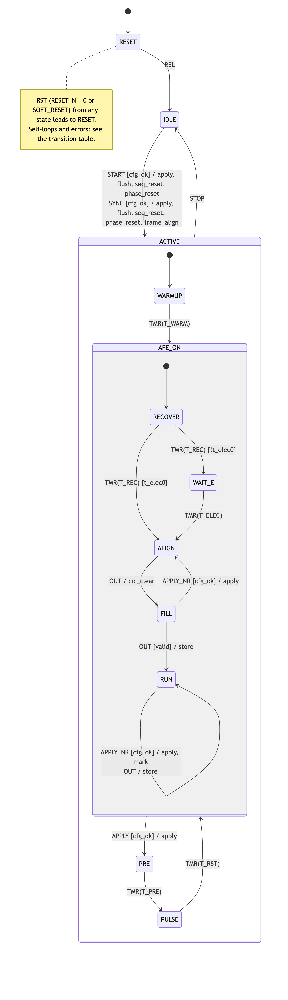
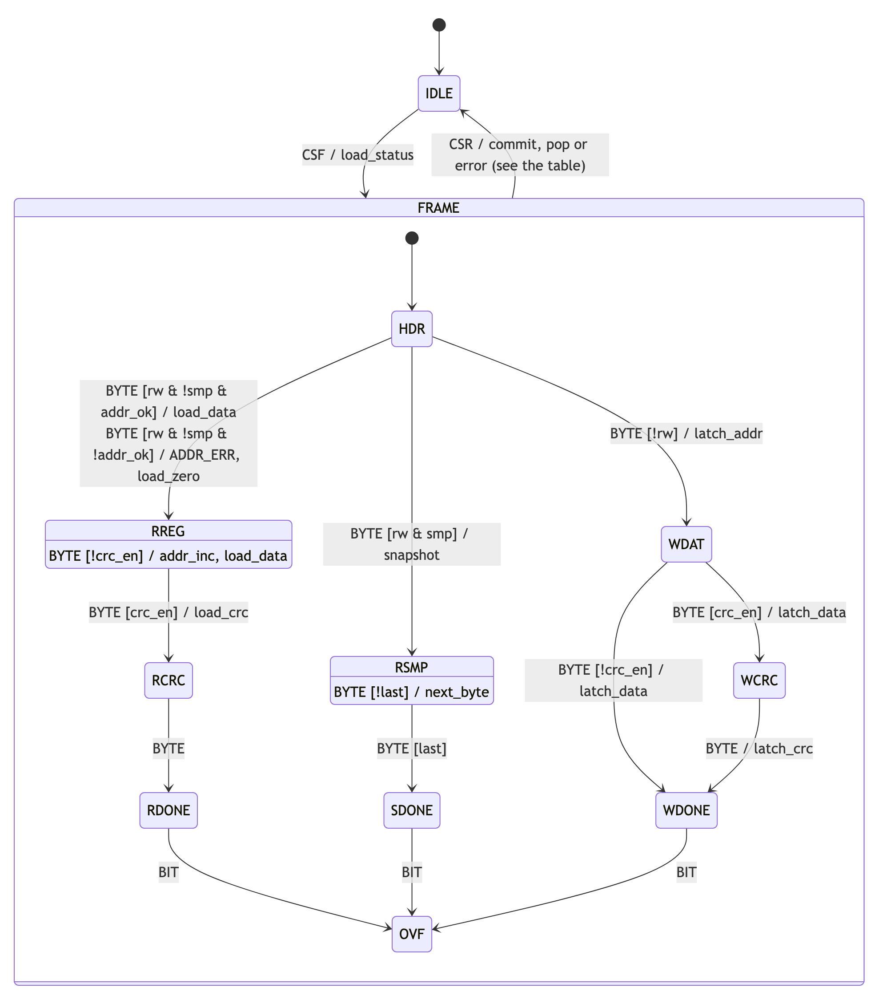

# 週次レポート 2026-11-20〜11-26（デジタル制御の要件定義と状態遷移図）

今週の主題は、デジタル制御の要件定義のやり直しと、状態遷移図の導入である。

## 概要

- デジタル制御（SPI、レジスタ、起動とデータ開始）の要件定義のやり直し。チップ内の状態機械とフラグを中心とする構成に改めた。
- 状態遷移図の導入。機械可読の状態遷移表（仕様源）から図と表を生成し、要件定義と詳細仕様に入れた。手描きの図は廃止。
- r14 の RTL のマクロ化と、14 回目のチップへの組み込み。precheck、LVS、ゲートレベルは全て合格。

## 1. 要件定義のやり直し

### 1.1 経緯

- 11/19、ユーザーと実務者からの指摘。レジスタが SPI の一般的な使い方に合わない、ビットの区切りが分かりにくい、値の反映時刻（ラッチ）の問題が大きい、アナログの起動に合わせた SPI とデータ開始の方法を検討すべき、状態機械とフラグで状態を示す形が実務の一般形、の 5 点。
- 現行の RTL（10/24 版、チップのマクロ f2／f3）を状態遷移図に整理し、問題点 42 件を抽出（[見直し](../gf180_digital_control_review_20261119.md)）。根本の問題は、チップ内に上位の状態機械がなく、動作状態がレジスタのビットの組み合わせとホストの書き込みの順序・時刻で決まる点。
- [要件定義](../gf180_digital_control_requirements_20261119.md)と[詳細仕様](../gf180_digital_control_spec_20261119.md)の作成。未決事項 D-1〜D-9 はユーザーの判断で決定（11/19 夜、11/21）。

### 1.2 主な変更

| 項目 | 現行（r13 まで） | 改修版（r14） |
|---|---|---|
| 動作状態 | 上位の状態機械なし。レジスタのビット（RUN、AFE_RST、CHOP_EN など）とホストの書き込みの順序・時刻で決まる | シーケンサ（10 状態）とタイマが、アナログの待ち時間、パルス幅、順序を保証 |
| ホストの手順 | ビットの書き込みと待ちの時刻をホストが管理 | 設定の書き込み → START → DRDY ごとの読み出し |
| SPI | 3 種のコマンド（READ_REG、WRITE_REG、READ_SAMPLE） | R/W とアドレスによるフレーム、命令と設定の分離、CRC（既定は無効） |
| 設定の反映 | 書き込みのフレームの終わりで即時 | 二重バッファ。シャドウに書き、START、APPLY、APPLY_NR で一斉に反映 |
| 状態と異常の通知 | STATUS 4 ビット、サンプルのステータス 3 ビット | STATUS、STATE（シーケンサの状態）、ERR（誤り 7 種とリセットの発生）、サンプルごとの状態のバイト |

- 要件は 81 項目（機能 63、非機能 8、検証 10）。

## 2. 状態遷移図

- 状態遷移表を機械可読の仕様源（`gf180/tapeout/rtl/spec/fsm_spec.py`）とし、Mermaid の遷移図、状態表、状態遷移表を生成。タイミング図 5 枚（起動、APPLY、フレーム、チョッパ、SPI）も仕様源（`wave.py`）から生成。
- 仕様源の自動の検査：抜け、矛盾、行き止まり、同時の事象、時刻の制約。検査器自身も、表に誤りを入れた写しで確かめる（自己試験）。
- RTL との照合：シーケンサと SPI の RTL の動きを、仕様源の遷移と事象ごとに突き合わせる試験（VER-09）。

### 2.1 シーケンサ（10 状態）

- 起動：RESET → IDLE（設定をシャドウへ）→ START → WARMUP（T_WARM、バイアスと VCM の整定）→ RECOVER（T_REC、ADC の過負荷からの戻り）→ WAIT_E（T_ELEC、電極の整定。T_ELEC > 0 のときのみ）→ ALIGN（次の出力の時刻に CIC をクリア）→ FILL（CIC の充填）→ RUN（有効な出力ごとに FIFO へ格納）。
- APPLY（AFE のリセットを伴う一括反映）：PRE（T_PRE）→ PULSE（AFE_RST のワンショット、T_RST）→ RECOVER。
- APPLY_NR（AFE のリセットを伴わない反映。許される変更に限る）：RUN のまま反映し、データを途切れさせない。
- STOP で IDLE へ。RESET_N または SOFT_RESET で、どの状態からも RESET へ。

### 2.2 SPI のトランザクション（11 状態）

- CS_N の立ち下がりで状態のバイトを用意し、先頭バイト（R/W とアドレス）により、レジスタの読み出し（RREG）、サンプルの読み出し（RSMP）、書き込み（WDAT）に分岐。CS_N の立ち上がりで確定し、長さや CRC の誤りは ERR に記録。

## 3. r14 の実装

- マクロ r14f5（440 × 900 µm、LibreLane）：9 コーナーで setup ＋0.752 ns、hold ＋0.195 ns、設計規則の警告 0。
- 14 回目のチップ：precheck（11/25、`--slot 1x0p5 --cob`）で全て 0 件、LVS 一致。
- ゲートレベル：遅延なしの全段の試験（42,850,655 サイクル）と遅延込みの 3 コーナーで RTL と一致。ADC のデジタル部（f3）との組も一致（11/26）。
- マクロの電力：tt で 14.4 → 23.1 mW。この電流による電源の雑音を r13 と同じデッキで比べた（[図 57](../figures/gf180/r14_20261124/viz/gf180_viz_r14_57_digital_noise.png)）。デジタル側の結合による AFE の出力の一定のずれは電極換算 ＋0.55 nV（r13 は 0.00 nV）で、MCLK に同期するので雑音にはならず、ADC の符号は 48 フレームとも同じ。
