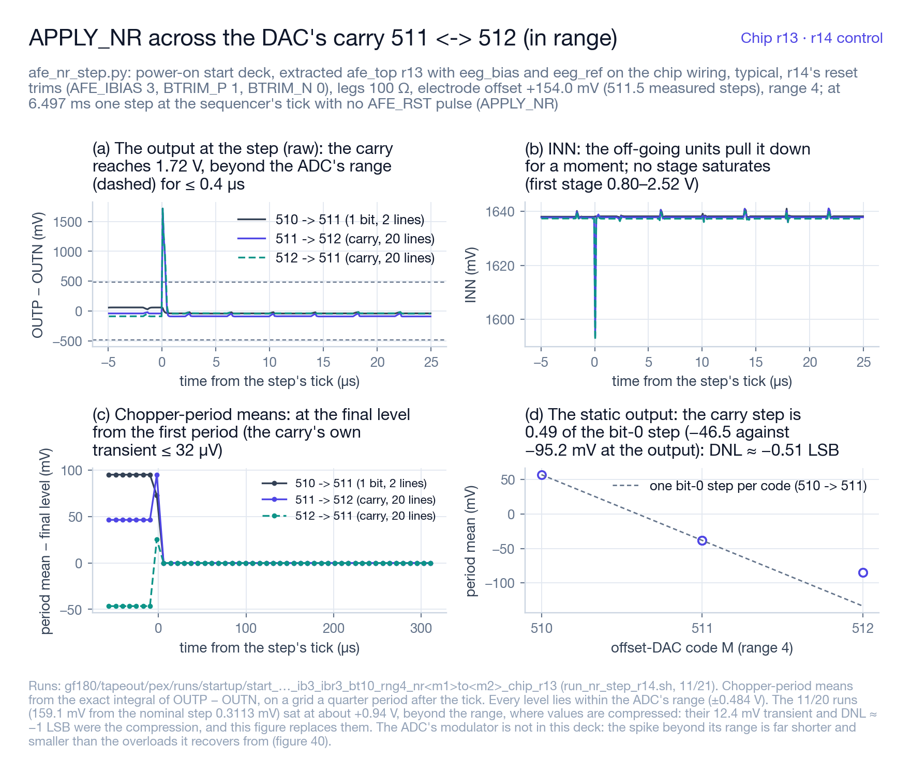

# 週次レポート 2026-11-20〜11-26（デジタル制御 r14 の監査、r14 のマクロ）

## 今週の作業概要と前回からの差分

- **デジタル制御（r14）の監査**（11/20〜、`gf180_digital_control_audit_20261120.md`）。ユーザーの指示「最新の遷移図をもとに，全く問題がないかきちんとチェックしてください。監査を行い，問題がなくなるまで続けてください。」による。
  - 第 1 回：自らの確認と独立の監査 2 件（シーケンサとアナログ側、SPI・レジスタ・FIFO・データの経路）で 20 件を指摘し、全て修正。
  - 第 2 回：新たな独立の監査 3 件（A：シーケンサとアナログ側、B：SPI・レジスタ・FIFO・データの経路、C：検証と文書）。A と B は通常の使用で誤る RTL の誤りはなしと判定。指摘はホスト手順（高抵抗の電極での探索、命令の完了の確認、DRDY_N の読み方）、仕様の検査器の穴（待ちを別の事象で切る表の誤りを検出しない）、CHANGED の上書き、文書の不一致。C は、RTL に誤りを入れた写し 15 種が全ての試験を通ることを示した（アナログの制御端子の値、RECOVER の長さとタイマの最大、cfg_ok の範囲、DFLAG.OVL の制限、FIFO の模型との照合、試験の実行器の判定）。全て対応し、端子の規則を仕様源に入れて RTL と試験の両方をそこから生成する形に改めた。
  - 第 3 回：独立の監査 3 件。RTL の論理の誤りはなし。安全側の変更 1 件（SPI の不正な状態の値を FRAME_ERR に）。RTL に誤りを入れた写しが全ての試験を通った穴 19 種を塞ぎ、ホスト手順（最初に CRC を有効に、SOFT_RESET の確認、APPLY_NR の歩み）を改めた。
  - 第 4 回：独立の監査 3 件。RTL の論理の誤りはなし。安全側の変更 1 件（SOFT_RESET の確定が tick と重なるとき、AFE_RST や反映の端子に出るリセットの木の遅れの間の短いパルスを除く）。写し 24 種が全ての試験を通った穴（M の上位を使う APPLY_NR の 1 段の規則、PULSE の CHOP_EN など）を塞ぎ、cfg_ok と nr_ok の仕様源との照合（9,266 組）、全ての出力がレジスタであることの構造の確認、仕様の検査器の分岐ごとの性質を加えた。ホスト手順（命令の前の設定の確認、SOFT_RESET の確認の改訂）。
  - 第 5 回：独立の監査 3 件。A と B は RTL の論理の誤りはなしと判定。先頭バイトの 1 ビットの化けでサンプルの読み出しが CRC の合う空の語となり、レベルのモードの読み出しが止まる穴（重大）に対し、サンプルの CRC に先頭バイト 0xC0 を含めた。SOFT_RESET の確定のサイクルの規則を RTL に合わせて訂正し、CIC のクリアの判断をそのサイクルで止めた。C は、命令の確認のサイクルに確定した命令を失う写しが全ての試験を通る穴（重大）、仕様の検査器が IGN の欄と tick の解決の結果を見ていない穴（重大）、変異の実行器の判定の穴などを指摘。17 件を全て修正。
  - 第 6 回：独立の監査 3 件。A と B は RTL の論理の誤りはなしと判定。OVL の印が過負荷の尾で両端の符号のない出力の間隔に及ぶこと（安全側）を、印を両端の符号のフレームに限る RTL の変更で解消。ホスト手順を一つの手順に整理し、チップの状態がホストの思うものと異なる場合の同期の回復と、全ての待ちとくり返しの上限を加えた。C は、全ての試験を通った写し 10 種、仕様の検査器が状態遷移表の 1 か所の書き換えを見逃す穴（シーケンサ 51 通り、SPI 174 通り → 0 通りと等価な 2 通り）、変異の実行器の判定の穴を指摘。14 件を全て修正。
  - 第 7 回：独立の監査 3 件。3 件とも RTL の論理の誤りはなしと判定（A は端子のみから判定する乱数の試験 5.6 s、B は SPI の全数の掃引 2,467 フレーム）。AFE_RST が ADC の積分器のリセットを兼ねることを境目の表と SEQ-13、RST-02 に明記。ホスト手順の穴（CRC の合うサンプルを捨てうる、1 ビットの化けで同期の回復に入る、RUN の APPLY の確かめが約 125 µs しか効かない）を修正。C は、全ての試験を通った写し 4 種（SEQ の計数の表、過負荷の閾値、FIFO_LEVEL、ガード）と仕様の表の書き換えの穴を指摘→ 検査器を固め、表の 1 か所の書き換えの全数（シーケンサ 1,931、SPI 1,159 通り）が全て捕まる。16 件を全て修正。
  - 第 8 回：独立の監査 3 件。3 件とも RTL の論理の誤りはなしと判定。第 7 回に入れた CHOP_STOP の説明の誤り（CHOP_EN ＝ 0 は出力チョッパも相 A に固定し、AFE はチョップされずに動く）を、A がクロックドライバのトランジスタのレベルの模擬で見つけて訂正。ホスト手順（RUN の APPLY の確かめの起点を命令の書き込みに、(a) を満たさない命令は効果で、W1C は読み直して書き戻す、サンプルのデータは CRC 有効で）。C の指摘：全ての試験を通った写し 5 種（ガードの判断の順、空の語の CHANGED、RAW_DATA が止まらない、MISO の遅れ）→ 試験を追加。STATUS とサンプルの状態のバイトを生成した定数で組み（形式の等価性で一致）、黄金の比較を全ての段に（118 サンプル）。18 件を全て修正。
  - 第 9 回：独立の監査 3 件。3 件とも RTL の論理の誤りはなしと判定。C は仕様の表の 1 か所の書き換え 6,267 通りの掃引で、整合する設定の APPLY と APPLY_NR を拒否とする 12 通りが仕様の検査を通る穴を示した → 命令の結果を要件から独立に書いた規則と照合する検査を加えた（修正のあとに通るのは等価な 28 通りのみ）。1 段の同期の写しが全ての試験を通った → yosys の構造の検査と遅れの下限を追加。仕様の自己試験は、各変異をその目的の違反の文で検出とし、全ての違反の文を固定（fsm_spec 152 種／101 文、regmap 37 種／35 文）。全ての試験を通った写し 3 種（SOFT_RESET の長さ、TH の取り込みのサイクル、RAW の読み込みのサイクル）→ 試験を追加し、V で各状態の APPLY と APPLY_NR を確かめる。ホスト手順（複数チップの SEQ の揃い、ホストだけの再起動、モードの判定を 2 回、CRC 無効の読み出しは 3 バイト以上）と文書。18 件を全て修正。
  - 第 10 回：独立の監査 3 件。B が RTL の弱点を見つけた：リセットの解除のときに走っているフレームを途中から拾い、CRC の書き込みの尾を CRC なしの書き込みとして確定する（ホストの起こしていないリセットで AFE_IBIAS が黙って 3 → 2 となる例） → SPI の CS_N の同期の初期値を Low とし、CS_N の High を見るまでフレームを取らない形に直し、W で確かめた（変異 2 種）。A：APPLY_NR の 1 段が二進の桁上がりをまたぐと多くのビットが同時に切り替わり、AFE の入力に過渡（511 → 512 で電極換算 約 159 mV）→ 16 の倍数をまたぐ 1 段は APPLY で行うと定め、トランジスタのレベルの評価を開始。C：regmap の検査が試験の設定の既定値を固定していない（CHOP_STOP の既定値を 1 とする書き換えが全てを通る）→ 全ての既定値を要件から書いた表と照合、フィールドの規則、仕様の検査にSPI-03 とその事象で分かる条件、BFM のフレームの始まりの時刻、V10。17 件を全て修正。
  - 第 11 回：独立の監査 3 件。3 件とも RTL の論理の誤りはなしと判定。B：ホスト手順で ERR の持ち主がなく、手順 6 と 8 のクリアが手順 3、4、9 の確かめの証拠を先に消す（化けがなくても、CFG_ERR で拒否された APPLY を実行済みと誤る）→ 共通の規則 (e)（確かめを終えるまで ERR を書かない）、手順 3 の読み戻し、手順 4 は効果で確かめる。A と C：過負荷の両端の符号の集合の境、不正な状態値と未処理の命令の組、読み出し専用と W1C のビットの位置、書き込み可能なフィールドの合法な値、SPI のバイトの事象の条件の試験と検査器の穴を塞いだ（RTL は手書きの集合と位置を生成した定数に置き換えるのみ、形式の等価性で一致）。11 件を全て修正（自らの確認 1 件を含む）。
  - 第 12 回：独立の監査 3 件。3 件とも RTL の論理の誤りはなしと判定。C：RST-01 の非同期のリセットを eeg_regs について何も確かめていなかった（リセットを同期とした写しが全てを通り、MCLK のない間は制御の端子が既定値に戻らない）→ tb_top_r14 に X（MCLK を止めて RESET_N）、全てのフリップフロップの非同期のリセットの構造の検査、変異 3 種。仕様の検査器の穴 3 件（標本の窓への書き込み、FILL から RUN、状態の表のタイマの欄）。B：ホスト手順 3 件（複数チップの SEQ の確かめを基準のチップで挟む、持続する過負荷の手順 8、手順 3 の読み戻しのマスク）と区画と SPI-06。A：文書 4 件。14 件を全て修正。
  - 第 13 回：独立の監査 3 件。3 件とも RTL の論理の誤りはなしと判定。B：レベルのモードで DRDY_N の立ち下がりを逃すと読み出しが止まったままとなる（重大：手順）→ レベルで読み、読まない区間のあとに見直す。C：全ての試験を通った RTL の写し 3 種（守りを広げる 2 種、窓への書き込みの CRC のバイト）→ J2 の守らないレジスタの全て、CRC 有効の窓への書き込み。検査器（確定しない書き込みの保持、コードとビットの固定、合成状態の所属）、サンプルの二重の記録。A：tick の位置を生成した定数に、手順 4 の APPLY の確かめの出口。12 件を全て修正。
  - 第 14 回：独立の監査 3 件。3 件とも RTL の論理の誤りはなしと判定。C：REG-03（反映は START、APPLY、APPLY_NR のみ）を検査が確かめず STOP で反映する表と RTL が全てを通った（重大）→ 検査と V12。格納したサンプルの OVERRUN ＝ 0 と空の語の ERR ＝ 0 を試験が確かめず、常に 1 の RTL が通った（重大）→ G と T4。B：空の FIFO への格納と同じサイクルの写しを試験が通らず、写しを 1 MCLK 遅らせる RTL が通った（重大）→ T13 の掃引。手順 4 の APPLY の確かめ（STATE_ERR だけで実行済み、(a) を満たしビットのある場合も出し直す）。A：状態のレジスタに fsm_encoding ＝ "none"、tick の位置の照合ほか。17 件を全て修正。
- **r14 のマクロ**（440 × 900 µm）：r14m1 で試したクロックツリーの束と配置密度の変更はセットアップを悪化させたため（ss で −0.436 ns）元に戻し、タイミングの修復の余裕を加えた r14m2 で、セットアップ ss ＋1.007 ns（r13 ＋1.096 ns）、ホールド ＋0.168 ns、全コーナーで違反 0、DRC・LVS・アンテナ 0。設計規則の警告（最大スルー 2、最大容量 9、最大ファンアウト 62）は r13（4、9、50）と同種で、RTL の確定ののちに解消する。
- **遅延込み（SDF）のゲートレベル**（r13 のマクロ）：tb_spi は 3 コーナーとも一致。tb_top は ff で一致（1,381,001 サイクル）。tt と ss は、試験台自身の判定（サンプルが黄金のモデルとビット単位で一致）は合格であるが、RTL との逐次の比較で ADC のデジタル部の選択信号（SEL2 など）が異なる。試験台の TH のモデル（e2 の前後 ±0.5 周期のみ有効）が、ADC のデジタル部の 2 サイクルの TH の経路より狭いことによる（設計の誤りではない）。試験台の修正は別の作業とする。

## デジタル制御（r14）の監査（11/20、`gf180_digital_control_audit_20261120.md`）

- 対象：仕様源（`fsm_spec.py`、`regmap.py`）、生成した遷移図（シーケンサ、SPI）と表、要件定義 r3、詳細仕様、r14 の RTL と試験。
- 方法：自らの確認（シーケンサの状態遷移表の全欄、模範のホスト手順）と、結論を渡さない独立の監査 2 件。全ての指摘は表とコードの読解、必要に応じた模擬で確認したうえで対応。修正のたびに、仕様の検査、仕様の自己試験、RTL の試験、変異の自己試験を全て実施。

### 第 1 回の指摘と対応

| 番号 | 重大度 | 指摘 | 対応 |
| --- | --- | --- | --- |
| 1 | 重大 | WARMUP の APPLY・APPLY_NR が T_WARM を数え直さず、オフセット DAC の変更と同じ tick に AFE_RST を解除しうる（11/16 の飽和の評価の結論に反する） | 反映で T_WARM を数え直し、同じ tick の満了を取り消す（動作 restart）。性質 2 件と要件 SEQ-16 を追加 |
| 2 | 重大 | サンプルの OVL が sinc³ の窓 3 ms のうち直前の 1 ms のみ（最も壊れたサンプルが OVL ＝ 0） | この出力と直前の 2 個の出力の間隔のいずれかでの検出とする |
| 3 | 重大 | SOFT_RESET がそのチップのみの格子・SEQ・CHOP1 を戻し、多チップの同期が崩れる | SOFT_RESET は制御のみを戻し、時刻とデータの経路は RESET_N から継続 |
| 4 | 重大 | 模範のホスト手順が記載どおりに動作しない（READY は命令の実行を示さない。APPLY のあとに旧い設定のサンプルが残る） | APPLY（パルスあり）で FIFO を空にする。全ての命令で CMD_PENDING ＝ 0 を待ってから ERR を確認 |
| 5 | 中 | 64 kHz では、未処理の命令の間に書いたシャドウをその命令が読む（M の上位のみ新しい値など） | 未処理の命令がある間のシャドウとタイマへの書き込みは STATE_ERR とし、書かない |
| 6 | 中 | 高抵抗の電極では APPLY_NR の 1 段の整定が CHANGED の 3 個を超え、RUN の前には待ちがない | CHANGED を 3 ＋ T_ELEC 個とし、RUN の前では電極の整定を待ち直す |
| 7 | 中 | オフセットの探索が点ごとに T_ELEC を待つ | 探索の間は T_ELEC ＝ 0 と手順に明記 |
| 8〜13 | 軽 | 先頭バイトの R/W の化け、フレームの種類の化けの CRC での見逃し、SOFT_RESET と RESET_N の直後の SPI の条件、SCLK の Low の余裕 15 ns、DRDY_N の組み合わせ出力、サンプルの MISO の化けでの消失 | 読み出しの MOSI を 0x00 と規定、CRC 有効時の短い読み出しを FRAME_ERR、時間の条件の規定、SCLK の Low を 5 MCLK 以上、DRDY_N をレジスタの出力、読み直しの規則 |
| 14、15、17 | 検証 | 検査器の主張が実際の検査より広い。STATUS の 4 ビット、OVL の経路、SEQ の折り返し、FIFO 4 段が未試験。シーケンサの照合がタイマの値を確かめていなかった | 意味の独立の定義との照合（SPI のフレーム 3,520 通り）、整数のタイマの丸め、語彙の検査、試験の J・K と FIFO 4 段、タイマの独立の模擬 |
| 16 | 文書 | 文書と仕様源の不一致 13 件 | 修正 |
| 18 | アナログ | IDLE と WARMUP も AFE_RST ＝ 1 でチョッパが動作（電極から見て約 5.4 kΩ。STOP は低電流の待機ではない） | 手順と未確認事項に記録 |
| 19 | 軽 | RUN を出ても CHANGED の残りが次の RUN のサンプルに付く | RUN 以外では計数を 0 とする |
| 20 | 試験 | 変異によっては試験が終わらずに待ち続ける | 待ちの上限と試験全体の監視（模擬時間 250 ms）を追加 |

### 第 1 回の修正のあとの検証

- 仕様の検査は違反 0（シーケンサの tick の組み合わせ 1,344 通り、SPI の分岐 13,056 通りとフレーム 3,520 通り、FIFO 144 通り）。自己試験は `fsm_spec.py` 50 種、`regmap.py` 15 種の全てを検出。
- tb_seq：262,496 事象で不一致 0、状態遷移表の 77 欄の全てを通過。タイマの独立の模擬と一致。
- tb_top_r14：A〜K で誤り 0（FIFO 8 段と 4 段）。サンプルは黄金の CIC とビット単位で一致。
- tb_spi_r14：乱数のフレームで不一致 0、表の 33 分岐の全てを通過。
- Verilator の -Wall（除外なし）で警告 0。
- 変異の自己試験（RTL に誤りを 1 個ずつ入れた写し）：ブロック全体の試験 38 種、SPI の照合 13 種、シーケンサの照合 8 種の全てを検出。誤りのない基準は不一致 0。

### 第 2 回（独立の監査 3 件）の指摘と対応、修正のあとの検証

- A（シーケンサとアナログ側）：ホスト手順のオフセットの探索を 4 段（粗い探索、整定を待つ仕上げ、必ず APPLY する確定、追従は小さい 1 段の電極のみ）に改訂。仕様の検査器に、状態を決めた事象と独立の出口の一覧の照合を追加（待ちを FLUSH などで切る表の誤り 9 種を検出しなかった穴）。CHANGED の印は長い方を保つ。SOFT_RESET の変更の表と文書への反映。状態遷移図を、状態を変えない遷移を状態の箱の中に書く UML の形に改め、安全に関わる数え直しを図に表示。
- B（SPI・レジスタ・FIFO・データの経路）：STATUS の確認のアドレス、書き込みの MISO の確認（CRC の位置を含む）、命令の完了の確認（全てのエラーのビットと CRC 付きの読み出し）、DRDY_N の読み方、SOFT_RESET のあとの設定のやり直しを手順に規定。サンプルの ERR、空の語、ALERT のマスク、SPI の時間の最小値の試験を追加。
- C（検証と文書）：RTL に誤りを入れた写し 15 種が全ての試験を通った穴に対し、端子の規則を仕様源（`regmap.pins_from_active`）に入れ、RTL の範囲の表と OFEN を生成に改め、全てのアナログの制御端子を生成した 31 通りの設定で確かめる試験、タイマの長さと限界、過負荷の旗の状態による制限、範囲をまたぐ APPLY_NR、FIFO の単体の照合（新設）、シーケンサの通しの照合、試験の実行器の判定の修正を加えた。
- 修正のあとの検証：試験 11 群が全て合格。変異の自己試験はブロック全体 59 種、SPI 13 種、シーケンサ 11 種、FIFO 5 種の全てを検出。Verilator の警告 0。

### 第 3 回（独立の監査 3 件）の指摘と対応、修正のあとの検証

- 3 件とも RTL の論理の誤りはなし（シーケンサは表と欄ごとに一致、cfg_ok と nr_ok は仕様源と 20,000 組の乱数で一致）。安全側の RTL の変更を 1 件：SPI の状態機械の不正な状態の値は、黙ってフレームを捨てず FRAME_ERR とする（NFR-05 を SPI にも拡大）。
- 試験と検査器の穴（RTL に誤りを入れた写しが全ての試験を通ったもの）を全て塞いだ：APPLY_NR の 1 段の規則（仕様源から生成した試験）、シャドウだけの書き込みでチョッパ・CHOP1・BLANK が変わらないこと、SOFT_RESET での FIFO の空化、W1C の同時の事象とビットごとのクリア（レジスタの単体の試験を新設）、全番地のリセット値の連続読み出し、ADC_ZERO と CHOP_STOP の区別、STATE、空の語の OVERRUN、捨てた出力にパルスがないこと、フレームの時刻の端子と RAW、実行器の判定（SPI の試験台の誤り、ブロック全体の基準）。仕様の検査器は自己試験 69 種（RESET の行、受け付けた反映、有効な出力での RUN など）。生成したファイルが仕様源と一致することを実行器で確かめる。
- ホスト手順：最初に CRC を有効に（CRC 無効では 1 ビットの化けで命令が別のレジスタへの書き込みになり黙って失われる）、SOFT_RESET の確認とオフセット DAC の書き直し、命令の確認と読み直しの FRAME_ERR の分離、APPLY_NR の歩みの規則。
- 修正のあとの検証：試験 13 群が全て合格。変異の自己試験はブロック全体 78 種、SPI 13 種、シーケンサ 11 種、FIFO 5 種、レジスタ 3 種の全てを検出し、全ての基準は不一致 0（訂正：第 4 回の C の指摘で、残した全数の実行の記録は 77／78 種で終わり、m36 の検出は記録を残さない個別の再実行によることが分かった。C の再実行で検出を確認。以後、全ての実行の結果を記録に残す）。

### 第 4 回（独立の監査 3 件）の指摘と対応、修正のあとの検証

- 3 件とも、シーケンサ、SPI、レジスタ、FIFO の RTL と表と図に論理の誤りはなし。
- RTL の安全側の変更 1 件：SOFT_RESET の確定のサイクルが tick と重なると、その縁で AFE_RST や反映の端子が新しい値を取り、直後の非同期リセットで戻る短いパルスとなる（NFR-06）。確定のサイクルでは tick と出力の時刻を取らず、DRDY_N を High とする。
- 試験の穴（RTL に誤りを入れた写しが全ての試験を通ったもの）を全て塞いだ：APPLY_NR の 1 段の規則を M の上位で試していない（重大。256 段の変化を AFE_RST なしで受け付ける写しが通った。仕様源から生成したベクトル 9,266 組で cfg_ok と nr_ok を照合）、CHOP_EN を IDLE と RUN でしか見ていない（重大。反映の端子をアクティブの写しの規則で常時確認）、拒否した命令と未処理の命令、SPI の不正な状態の全ての値、CHOP1 の 1 ms の境界、STATUS の READY、SOFT_RESET をまたぐ過負荷の検出と DAC_CLK、誤った鍵の再施錠、丸めと飽和、全ての出力がレジスタであることの構造の確認（yosys）。仕様の検査器は、拒否した命令がほかの動作を伴う表の誤り 7 種を検出しなかった穴を塞いだ（自己試験 78 種）。図の PNG に元の SHA-256 を記録し、起動と APPLY のタイミング図を状態遷移表と照合する。
- ホスト手順：命令の前に設定の書き込みを ERR で確かめる（書かれなかった OFF_CTRL のまま START し、ERR から誤って未実行と結論する穴）、IF_CFG を 1 回で書いて CRC 付きで読み戻す、SOFT_RESET の確認を CRC の有無によらず合法な IF_CFG の 3 バイトの読み出しでモードを判定する形に改訂、粗い探索では OVL のサンプルも符号に使う。
- 修正のあとの検証：試験 16 群が全て合格（tb_top_r14 A〜S、シーケンサの事象 35,210 個の通しの照合で不一致 0）。変異の自己試験は第 4 回で加えた 24 種と基準を全て検出・合格（記録を保存）。全数の再実行は第 5 回の修正のあとの版で行う。

### 第 5 回（独立の監査 3 件）の指摘と対応、修正のあとの検証

- A（シーケンサとアナログ側）と B（SPI・レジスタ・FIFO）は RTL の論理の誤りはなしと判定（B は仕様の文から独立に書いた模型と 308 通りのフレームで比べ不一致 0）。
- 先頭バイトの 1 ビットの化け（0xC0 → 0x40）や駆動されない MISO の全て 0 の応答が、CRC の合う空の語となり、レベルのモードでは DRDY_N が Low のまま縁が来ず読み出しが止まる（重大）。サンプルの CRC を、レジスタの読み出しと同じく先頭バイト 0xC0 から計算する形に改め（全て 0 の応答の正しい CRC は 0xCF）、手順 6 に空の語の受け入れの条件と DRDY_N の再確認を加えた。
- SOFT_RESET の確定のサイクルの規則（第 4 回）を RTL に合わせて訂正：状態の変化と制御の動作は取らず、データの経路（SEQ の計数）は続く。CIC のクリアの判断をそのサイクルで止める RTL の変更。
- ホスト手順：全てのフレームで先頭バイトの STATUS の固定のビットを確かめる（届かなかった書き込みの検出）、SOFT_RESET の確認を RESET_FLAG ＝ 1 を読むまでくり返す、CRC を有効にしたあと T_ELEC を必ず書く、IF_CFG の書き直しは判定したモードの形式で。r14 のマクロの STA でクリアの弧を有効にすることを記録。
- C（検証と文書）：RTL の論理の誤りはなし。命令の確認のサイクル（tick が未処理の命令を取るサイクル）に確定した命令を失う写し・拒む写しが全ての試験を通った（重大）→ tb_regs の確認のサイクルの 8 項目と tb_top_r14 の T7（64 kHz で開始を半 MCLK ずつずらす）。仕様の検査器が IGN の欄と tick の解決の結果を見ていない（重大。PRE と PULSE の APPLY を IGN とした表が全て通った）→ 命令の性質を tick の解決の結果で確かめ、IGN は IDLE の STOP のみ（自己試験 83 種）。RUN の FLUSH が CHANGED の残りを消す写し、CHOP_OUT ＝ CHOP の未確認（重大）→ T6、常時監視。ほかに全ての試験を通った写し 6 種 → T1〜T6。変異の実行器：時間切れを「TIMEOUT（未決）」で不合格、基準のない群は「未実行」、記録は終わった順に書き足す。
- 修正のあとの検証：試験 16 群が全て合格（tb_top_r14 A〜T、模擬時間 359.2 ms、シーケンサの事象 44,381 個の通しの照合で不一致 0）。変異の全数の実行（150 種と基準 8 本）は、第 6 回の RTL の変更のため 79 本で止めた（それまで全て検出・合格）。全数は第 6 回の修正のあとの版で実行した。

### 第 6 回（独立の監査 3 件）の指摘と対応、修正のあとの検証

- A（シーケンサとアナログ側）と B（SPI・レジスタ・FIFO）は RTL の論理の誤りはなしと判定（A：SOFT_RESET の確定を tick、出力の時刻、格納の各サイクルに置いて確認。B：サンプルの CRC の全ての 1 ビットの化けの拒否、手順 9 の判定の読み出しの全ての 1 ビットの化けでくり返しが収束）。
- OVL の印（安全側）：検出の窓の数は最後の両端の符号から 31 フレーム 1 のまま残り、出力の間隔の印をその状態から取っていたため、尾が間隔の区切りをまたぐと両端の符号のない間隔にも印が付いた（RUN の過負荷の終わりの約 3 % で 4 個目のサンプルに OVL、ALIGN の過負荷の尾で FILL の DFLAG.OVL）。→ RTL：印は両端の符号のフレームで規則が成り立つときのみ、間隔の OVL と DFLAG.OVL は印から取る。tb_ovl の全てのフレームを `regmap.OVL_RULE` からの計算と比べる `check_ovl.py`、T8〜T10。
- ホスト手順（要件 5.4）：各回の追記を一つの手順に整理。チップの状態がホストの思うものと異なる場合（CRC 付きの読み出しの不一致が 2 回続く、ALERT と RESET_FLAG、RUN のはずの READY ＝ 0、起動時の RESET_FLAG ＝ 0、1 個のチップだけの RESET_N、MCLK の停止）の同期の回復、全ての待ちとくり返しの上限、APPLY と FLUSH の実行の確かめ方、CRC が合い VALID ＝ 1 の語は先頭バイトの DATA によらず使うこと、APPLY_NR の追従は CHANGED の付いたサンプルより後の印のないサンプルで判断すること。
- C（検証と文書）：全ての試験を通った写し 10 種（OVL の履歴を格納ごとに進める、CHANGED を格納で数える・255 で飽和、READY を FILL でも 1、OVL_NOW を間隔の印から、RESET_FLAG を ALERT から隠せない、RAW を SOFT_RESET で戻す、パルスのモードの SOFT_RESET の DRDY_N など）→ T10、T11、T1・T2 のマスク、T2 の OVL_NOW、T4 の計数、N4 の FILL、R4b、R9。仕様の検査器が状態遷移表の 1 か所の書き換えを見逃す（シーケンサ 51 通り、SPI 174 通り）→ 分岐ごとの性質と動作の位置の一覧を加え、やり直して 0 通りと等価な 2 通り（自己試験 95 種）。変異の実行器：道具の誤りは「TOOL ERROR」、基準のない群があれば「INCOMPLETE」、記録に版と道具の版、群の長さを実行器と同じに。
- 修正のあとの検証：試験 16 群が全て合格（tb_top_r14 A〜T、模擬時間 423.2 ms、3,563 フレーム、43 サンプルが黄金の CIC と一致、シーケンサの事象 52,634 個の通しの照合で不一致 0）。Verilator の警告 0。変異の全数の実行（165 種と基準 9 本）は、第 7 回の修正のため 110 本で止めた（全て検出）。

### 第 7 回（独立の監査 3 件）の指摘と対応、修正のあとの検証

- 3 件とも RTL の論理の誤りはなしと判定。A は端子のみから判定する乱数の試験（14 種 × 400 ms、ホストの操作 5,179 回、端子の変化 870 回、AFE_RST のパルス 190 回、サンプル 2,482 個）で違反 0、B は SPI の全数の掃引（2,467 フレーム）を RTL に通して照合器と不一致 0。
- 文書：AFE_RST は ADC の積分器のリセット（C1、C2 の TG）も兼ねる（SEQ-13 の「SOFT_RESET では ADC は動作を続け」を訂正。ADC_ZERO と RAW の評価は AFE_RST ＝ 0 で）。PRE で受け付けた STOP では DAC の変化の 1〜2 tick 後に AFE_RST が上がる（害はない）。過負荷の検出の遅れ（両端の符号がまばらなら最大 31 フレーム、重み 1.3 × 10⁻⁶）。CHOP_EN ＝ 0 でも出力チョッパは止まらない（ANA-03）。ID の読み出しの R/W の化けだけは CRC を通り ADDR_ERR（第 6 回の記述の訂正）。
- ホスト手順：サンプルの読み出しは CRC が合えば届いたものとする（MISO の先頭バイトの化けで取り出し済みのサンプルを捨てない）。同期の回復の条件は CRC 付きの読み出しで確かめ、正常ならそのまま続ける（1 ビットの化けで探索のやり直しに入らない）。RESET_N を共有する場合は全てのチップをやり直す。RUN の APPLY は 3 ms 以内の STATE ≠ RUN で確かめる（PRE と PULSE は約 125 µs しか続かず、遅いホストでは 2 回目の AFE_RST のパルスを出していた）。
- C（検証と文書）：全ての試験を通った写し（SEQ を数えない表、過負荷の閾値 2、FIFO_LEVEL の最上位のビットの欠落、OFF_M_H をガードから外す）→ 出力の時刻の規則を全ての状態に、check_seq_trace で seq_inc と破棄を比べる、過負荷の規則を要件 FLG-04 と照合、G と T11 で満杯の FIFO_LEVEL、ガードの全 16 個のアドレスの試験（生成）、試験のレジスタの全てを施錠のまま書く。表の 1 か所の書き換えの全数が検査で捕まる（等価な書き方も一つに固定）。check_ovl はランごとに検出を求め、版の管理の外の入力は SHA-256 で固定。他のチップのフレーム（共有の SCLK）の試験。
- 修正のあとの検証：試験 16 群が全て合格（tb_top_r14 A〜T で誤り 0、模擬時間 424.2 ms、43 サンプルが黄金の CIC と一致、記録した出力の時刻 131 個の SEQ が 0 から 1 ずつ続く、シーケンサの事象 52,698 個の通しの照合で不一致 0、tb_spi_r14 1,788 フレームと他のチップのフレーム 223 個で不一致 0）、Verilator の警告 0、仕様の表の 1 か所の書き換えの全数が検査で捕まる。新しい変異 5 種を全て検出（等価な 1 種は除いた）。変異の全数の実行（170 種と基準 9 本）は全て検出・合格（128.3 分、549bdd94）。

### 第 8 回（独立の監査 3 件）の指摘と対応、修正のあとの検証

- 3 件とも RTL の論理の誤りはなしと判定。
- 文書の訂正：CHOP_EN ＝ 0 は入力と出力のチョッパをともに相 A に固定し、OFPH は 1 のまま、AFE はチョップされずにオフセットと 1/f 雑音が出力に現れる（第 7 回の説明は、ネットリストの冒頭の注記によった誤り。A がトランジスタのレベルの模擬で確認。ネットリストの注記と AFE のクロックドライバの文書も直した）。過負荷の検出の尾は最大 28 フレーム（窓 − 閾値）。
- ホスト手順：RUN の APPLY の確かめの窓を命令のフレームの CS_N の立ち上がりから 3 ms とし（CMD_PENDING ＝ 0 を見た時刻からでは遅いホストで誤る）、時間によらない確かめ（SEQ が 4 以上飛ぶ）を加えた。手順 7 は手順 4 による。規則 (a) を満たさない命令は ERR によらず効果で決める（R/W の化けた START は ERR を残さず実行されない）。W1C は読み直して書き戻す。サンプルのデータは CRC 有効で取る。
- 試験の穴：ガードの判断の順（範囲外と施錠の書き込みをちょうどの ERR で）、印の残る間の空の語、RAW のパッドが止まること、MISO の遅れ（BFM）、R/W の化けた命令（U）、APPLY のあとの SEQ の飛び。黄金の比較を全ての段に広げた（K を最後に。118 サンプル、432 の出力の時刻）。STATUS とサンプルの状態のバイトを regmap の生成した定数で組んだ（yosys の形式の等価性の検査で前の版と一致）。
- 修正のあとの検証：試験 16 群が全て合格（tb_top_r14 A〜U と K で誤り 0、模擬時間 446.0 ms、K を除く全ての段の 118 サンプルが黄金の CIC と一致、出力の時刻 432 個の SEQ が続く、シーケンサの事象 55,483 個の通しの照合で不一致 0、tb_spi_r14 1,788 フレームで不一致 0）、Verilator の警告 0、新しい変異と文言を合わせた変異の 20 種を全て検出。第 8 回の版の変異の全数の実行（175 種と基準 9 本）は、第 9 回の修正を移すため 112 本（ブロック全体、全て検出）で止めた。

### 第 9 回（独立の監査 3 件）の指摘と対応、修正のあとの検証

- 3 件とも RTL の論理の誤りはなしと判定。RTL の変更は注記のみ（注記を除いた全てのファイルが 28acf960 と同一）。
- 仕様の検査器：整合する設定の APPLY と APPLY_NR を CFG_ERR や STATE_ERR で拒否とする表が、検査と自己試験を通っていた（C の掃引で 12 通り。RTL を合わせた写しは 15 群を通った）。命令の結果（受け付け、CFG_ERR、STATE_ERR、無視）を、要件（SEQ-05、07、08、15）から表とは独立に書いた規則と、全ての状態と条件の値で照合する検査を加えた。修正のあとの同じ掃引で通るのは等価な 28 通りのみ。第 7 回の「1 か所の書き換えの全数が捕まる」は、その時の掃引の書き換えの種類についてのみ正しかった（訂正）。
- 自己試験：どの違反でも検出としていたので、検査が後の編集で空になっても気付かなかった（違反の文の 25 種はどの変異も生まなかった）。各変異はその目的の違反の文で検出とし、全ての違反の文（関数の構文木から取る）がいずれかの変異の目的の文であることを求める。`fsm_spec.py` 152 種／101 文、`regmap.py` 37 種／35 文（例外は検出としない）。
- 試験の穴：1 段の同期（RESET_N の解除、CS_N・SCLK・MOSI）が全ての試験を通った → yosys のネットリストで同期の連なりを確かめ、遅れの下限（RESET_N の解除から最初の CMP_STROBE まで 3 MCLK、MISO_OE と MISO の遅れ）を端子で確かめる。SOFT_RESET の制御のリセットの長さ（5 MCLK）、CODE を e2 で変える（TH の取り込みのサイクルを誤った CIC と過負荷の検出が通っていた）、T12、RAW のビットの時刻、V（IDLE の APPLY_NR と、RECOVER、WAIT_E、ALIGN、FILL の APPLY と APPLY_NR）、U3・U4（CRC 無効の読み出しの R/W の化け）。変異の実行器：選んだ群にない名前は FAIL、試験台の終わりの行がなければ SIM ERROR、検査器が判定の行で終わらなければ CHECKER ERROR、見出しに yosys の版。
- ホスト手順：複数チップでは、同じ出力の時刻のあとに各チップの最後の SEQ が等しいことを確かめる（1 個のチップのリセットと 1 ビットの化けが重なると、格子が 407.8 µs ずれたまま全ての確かめを通った）。手順 2 はモードの判定から、ホストの起動時に CRC 有効なら SOFT_RESET。モードの判定は 2 回続けて一致したときのみ。CRC 無効の読み出しは 3 バイト以上（2 バイトの R/W の化けは 0x00 の書き込みとして確定する）。手順 4 の SEQ の比較は 65,536 を法として、START は IDLE を確かめてから。
- 文書：CHOP_STOP の「CDB は開かない」は逆（常に開いたまま、切）、AFE_IBIAS ＝ 3 は通常の動作の値で 0〜2 は評価用（拒否はしない。拒否する形は判断を仰ぐ）、マクロの外形 440 × 900 µm（NFR-08、VER-08）、NFR-05 の未処理の命令、APPLY のタイミング図の DRDY_N の向き。
- 修正のあとの検証：試験 16 群が全て合格（tb_top_r14 A〜V と最後の K で誤り 0、模擬時間 464.0 ms、123 サンプルが黄金の CIC と一致、出力の時刻 450 個の SEQ が続く、シーケンサの事象 57,805 個の通しの照合で不一致 0（77 分岐のうち 41）、tb_spi_r14 1,788 フレームで不一致 0）、Verilator の警告 0、新しい変異 9 種を全て検出。第 9 回の版の変異の全数の実行（184 種と基準 9 本）は、第 10 回の修正のため 85 本（全て検出）で止めた。

### 第 10 回（独立の監査 3 件）の指摘と対応、修正のあとの検証

- RTL の変更 1 件（B、重大）：リセット（RESET_N、SOFT_RESET）の解除のときに CS_N が Low のフレームを、SPI が途中から新しいフレームとして受けていた（CS_N の同期の初期値が High）。リセットは CRC_EN を 0 に戻すので、CRC の書き込み [アドレス、データ、CRC] の解除が先頭バイトの終わりに落ちると、[データ、CRC] を CRC なしの 2 バイトの書き込みとして確定した（B の模擬：OFF_M_L ← 0x23 の尾で AFE_IBIAS ← 2、同期の回復の手順を経ても旗なしで残る。FLUSH の尾では IF_CFG ← 0xFB で CRC_EN が CRC なしに 1）。→ 同期の初期値を CS_N ＝ Low とし、同期した CS_N の High を見るまで縁もビットも取らない（そのフレームは CS_N の立ち上がりまで無視、MISO を駆動せず、何も確定しない）。tb_top_r14 の W で、RESET_N を CRC の書き込みと FLUSH の 48 点で解除し、SOFT_RESET の制御のリセットを次のフレームの途中で終わらせて確かめた。r13 の SPI も同じ初期値であるが、r13 の書き込みは 3 バイトちょうどのときのみ確定するので、途中から拾った尾は書き込みとならない。
- アナログの前提（A、重大）：APPLY_NR の 1 段が二進の桁上がりをまたぐ（511 → 512 で 10 ビット）と、切れるビットはクランプで直ちに、入るビットは抵抗で約 65 ns かけて変わり、AFE の入力の仮想接地に切れる単位の過渡が出る（電極換算で 511 → 512 は約 159 mV、tick は相 A の中ほどでブランキングの外）。根拠は 1 段の静的な残差のみであった。→ ホスト手順で、M[9:4] の変わる 1 段（16 の倍数をまたぐ）は APPLY（パルスあり）で行うと定めた（M[9:4] の変わらない 1 段の過渡は最大 8 単位、約 2.5 mV で、静的な飽和の約 4 mV より小さい。第 11 回で訂正：7 単位、2.2 mV）。過渡のトランジスタのレベルの評価（`pex/afe_nr_step.py`：511 → 512、512 → 511、桁上がりのない 510 → 511。r13、typical、100 Ω）を実行中。RTL で拒否する形（nr_ok に M[9:4] の一致）は、評価の結果をもって判断を仰ぐ。
- 検査器（C）：`regmap.check` が試験の設定の電源投入の値を固定していなかった（CHOP_STOP の既定値 1 で電源投入からチョッパが止まる、ADC_ZERO 1 で ADC の入力の短絡、いずれも 16 群を通った）→ 書き込み可能な全てのフィールドの既定値を要件から書いた表と照合し、アクセスと区分、RANGE と SIGN の合法な値、M の全範囲、REG-04 の並び、0x56 の未定義、BLANK_LEN ＝ 0 の禁止、T_ELEC の最大も確かめる。tb_top_r14 は RESET_N と SOFT_RESET のあとの端子を要件の値と直接比べる。仕様の検査に、全てのフレームの先頭の STATUS（SPI-03）と、その事象で分かる条件のみ（CS_N の立ち下がりでは条件なし、mid は CS_N の立ち上がりのみ）、途中のバイトで終わるフレームの MISO の読み込みの照合を加えた。自己試験は fsm_spec 155 種／103 文、regmap 48 種／45 文。
- 試験：BFM の CRC 無効の読み出しを 3 バイトに（ホスト手順）、フレームの始まりの時刻の上限（MISO_OE は 2 MCLK 以内、STATUS の bit 7 は 3 MCLK ＋ パッドの遅れ以内。1 段遅い写しが通っていた）、V10（T_ELEC ＝ 0 の ALIGN と FILL の APPLY_NR、PRE と PULSE の拒否）。T2 の時刻の余裕が 1 フレームであった（3 バイトの読み出しで次の間隔にずれた）ので、解除の条件を直した。
- 文書：tick の「e24」を「サイクル 24、出力は e25」に、AFE_RST の縁の例外に不正な状態値からの復帰を、同期の回復 (c) の既定値の前提とその理由、詳細仕様の自己試験の数と OVERRUN の文。
- 修正のあとの検証：試験 16 群が全て合格（tb_top_r14 A〜V、K、W で誤り 0、模擬時間 478.0 ms、123 サンプルが黄金の CIC と一致、出力の時刻 456 個の SEQ が続く、シーケンサの事象 59,492 個の通しの照合で不一致 0（77 分岐のうち 45）、W のリセットの解除 96 点と SOFT_RESET で確定 0、tb_spi_r14 1,788 フレームで不一致 0、仕様の自己試験 fsm_spec 155 種と regmap 58 種を全て目的の違反の文で検出、Verilator の警告 0、新しい変異 6 種を全て検出）。第 9 回の版の変異の全数の実行は、第 10 回の修正のため 85 本（全て検出）で止めた。第 10 回の版の全数の実行（190 種と基準 9 本）は実施中。

### 第 11 回（独立の監査 3 件）の指摘と対応、修正のあとの検証

- 3 件とも RTL の論理の誤りはなしと判定。RTL の変更は、手書きの集合と位置を生成した定数に置き換えるのみ（過負荷の両端の符号の集合、読み出し専用と W1C のビットの位置。yosys の形式の等価性の検査で前の版と一致）。
- ホスト手順（B、重大）：ERR の持ち主がなく、手順 6（FRAME_ERR の読み直し）と手順 8（ALERT で ERR と DFLAG を読んで書き戻す）のクリアが、手順 3、4、9 の確かめ（「クリアのあとに立ったビットがない」）の前に証拠を消していた（B の模擬：範囲 1 で M ＝ 256 の APPLY が CFG_ERR で拒否され、CMD_PENDING の待ちの先頭バイトの ALERT で手順 8 が ERR を書き戻し、手順 4 は実行済みと誤る。化けがなくても起こる。CRC の 1 ビットの化けで書かれなかった設定を、手順 6 の書き戻しのあと手順 3 が書けたと誤る例も）。→ 共通の規則 (e)：設定の書き込み、命令、SOFT_RESET の最初のフレームから、その確かめを終えるまでを一つの区切りとし、その間は手順 6 と 8 で ERR を書かない。区切りの外でも処理したビットのみを書き戻す。手順 3 は書いた値を CRC 付きで読み戻して確かめ、手順 4 は APPLY と APPLY_NR を ERR によらず効果で確かめる。
- 試験の穴（A、C）：過負荷の両端の符号の集合の境（1 と 30 も両端と数える写しが全てを通った）→ 両端の隣の符号の連なりを tb_ovl の符号列に。不正な状態値を tick と未処理の命令の組で試していなかった（命令を捨てる写しと、tick の分岐を先に置く写しが通った）→ tb_seq で 84 組。読み出し専用と W1C のビットの位置の移動が全てを通った → RTL で生成した定数から組む。
- 検査器（C）：書き込み可能なフィールドの合法な値を固定していなかった（CRC_EN ＝ [0]、CHOP1_RATE 0〜4、AFE_IBIAS ＝ [3]、タイマの範囲の穴などが検査を通った）→ 要件から書いた合法な値の表（REQUIRED_LEGAL）と照合し、マスクのレジスタが旗の全てのビットを覆うことも確かめる。SPI のバイトの事象の分岐に、CS_N の立ち上がりでのみ分かる busy などの条件を許していた（バイトで busy により書き込みの保持を落とす表が通った）→ 事象ごとに使える条件の一覧（SPI_EVENT_CONDS）。自己試験は fsm_spec 156 種／103 文、regmap 61 種／58 文。
- 文書：APPLY_NR の規則の許す最悪の 1 段は 8 単位、約 2.5 mV（第 10 回の「7 単位、2.2 mV」を訂正）と、実行中の評価の役割（最大の桁上がりの過渡が飽和を残すかを確かめ、残せば 16 の境を評価する）、SOFT_RESET のあとの短い CS_N の High（第 10 回の修正のあとは、そのフレームは全て無視される）、注記、詳細仕様の数、第 9 節の検査の一覧。
- 修正のあとの検証：試験 16 群が全て合格（15.3 分。tb_top_r14 A〜V、K、W で誤り 0、模擬時間 478.0 ms、123 サンプルが黄金の CIC と一致、出力の時刻 456 個の SEQ が続く、シーケンサの事象 59,492 個の通しの照合で不一致 0（77 分岐のうち 45）、tb_seq 262,497 事象と不正な状態値の 84 組、tb_ovl 305,649 フレーム、tb_spi_r14 1,788 フレームで不一致 0、仕様の自己試験 fsm_spec 156 種と regmap 61 種を全て目的の違反の文で検出、Verilator の警告 0）。RTL の変更の前後は yosys の形式の等価性の検査で一致（eeg_ovl 48 個、eeg_regs 338 個の比較点）。新しい変異 3 種と、文言を新しい行に合わせた 8 種を全て検出。第 10 回の版の変異の全数の実行は 45 本（全て検出）で止めた。第 11 回の版の全数の実行（193 種と基準 9 本）はこのあと開始。

### 第 12 回（独立の監査 3 件）の指摘と対応、修正のあとの検証

- 3 件とも RTL の論理の誤りはなしと判定。RTL の変更は注記 1 か所のみ。
- 検証の穴（C、重大）：RST-01 の非同期のリセットを `eeg_regs` について何も確かめていなかった。リセットを同期とした写しが 16 群の全てを通り、MCLK の止まった間に RESET_N を掛けても、オフセット DAC、トリム、CHOP_EN、TEST_CFG などの端子が既定値に戻らない（全ての試験台は MCLK の縁をまたいで RESET_N を保っていた）。→ tb_top_r14 に X（全ての制御の端子を既定値から外し、MCLK を止めて RESET_N を Low にし、縁なしに全ての端子が既定値であることを確かめる）、構造の検査に全てのフリップフロップの非同期のリセットの確認（762 ビット、リセットのない記憶は FIFO の記憶のみ）、変異 3 種。
- 検査器の穴（C）：標本の窓への書き込みの先頭バイトを一度も歩かない（フレームの列挙を R/W と窓の全ての組に、列挙の網羅も照合）、FILL から RUN へ入らない表が通る（死んだ分岐の禁止、FILL の有効な出力は格納して RUN へ）、状態の表のタイマの欄の入れ違いが通る（要件から書いた一覧と照合、照合器は表からタイマを取る）。自己試験は fsm_spec 162 種／108 文、regmap 62 種／59 文。
- ホスト手順（B）：複数チップの SEQ の確かめを基準のチップで挟む形に（1 MHz で約 5〜8 個を超えると出力の時刻をまたぎ、揃ったチップに RESET_N をくり返した）、持続する過負荷では ALERT_MASK_D の OVL のビットを外してサンプルの OVL で扱い、サンプルの読み出しを先に（書いたとおりの手順 8 は毎フレームくり返し、FIFO が溜まった）、手順 3 の読み戻しに ALERT のマスク。文書：試験のレジスタの写し 0x70、0x71 を試験の区画（0x60〜0x7F）に（検査も追加）、SPI-06 の先頭バイトだけのフレーム。
- 文書（A）：RAW の注記、要件 5.0 の自己試験の数、T_REC の最小値 0.22 ms、nr_ok は「±1 段以内」（変化なしと M ＝ 0 の符号のみの変化も受け付け、RUN では CHANGED が付く）。
- 修正のあとの検証：試験 16 群が全て合格（12.9 分。tb_top_r14 A〜V、K、W、X で誤り 0、模擬時間 486.8 ms、123 サンプルが黄金の CIC と一致、出力の時刻 456 個の SEQ が続く、シーケンサの事象 60,636 個の通しの照合で不一致 0（77 分岐のうち 45）、X で MCLK を止めた 1 µs の間に全ての端子が既定値、構造の検査で全てのフリップフロップ 762 ビットが RESET_N の解除からの非同期のリセット、仕様の自己試験 fsm_spec 162 種と regmap 62 種を全て目的の違反の文で検出、Verilator の警告 0）。eeg_regs のリセットを同期とした写しは X で 5 件の誤り、4 つの区画の同期のリセットの写しは構造の検査で全て捕まる。新しい変異 3 種を全て検出。第 11 回の版の変異の全数の実行は 45 本（全て検出）で止めた。第 12 回の版の全数の実行（196 種と基準 9 本）はこのあと開始。

### 第 13 回（独立の監査 3 件）の指摘と対応、修正のあとの検証

- 3 件とも RTL の論理の誤りはなしと判定。RTL の変更は eeg_clkgen の tick の位置を生成した定数とするのみ（形式の等価性で一致）。
- ホスト手順（B、重大）：レベルのモードで DRDY_N の立ち下がりを逃すと、手順のどこも FIFO を読み直さず読み出しが止まる（B の模擬：命令の確かめや規則 (e) の区切りの中の格納が唯一の立ち下がりで、そのあと FIFO は満杯、DRDY_N は Low のまま。最後の取り出しが次の格納の直前なら、DRDY_N の High は 1 MCLK しか続かないか、現れない）→ レベルのモードは縁でなくレベルで読み、読まない区間のあとにレベルを見直す。2 ms の規則で DATA ＝ 1 なら読み切る、OVERRUN への対処は読み切り。手順 4 の時間によらない APPLY の確かめでサンプルを失った場合、SCLK の余分な縁による再送の語を二度使わないこと。
- 試験と検査器の穴（C）：守らないレジスタへの未処理の命令の間の書き込み（守りを広げる写し 2 種が全てを通った）→ J2 で全ての守らない書き込み可能なレジスタ。確定しない書き込みの保持（窓への書き込みで CRC のバイトを保持しない写しが全てを通った）→ 検査と、CRC 有効の窓への書き込みの試験。要件の名指すコードとビット（SOFT_RESET のコードの書き換えが検査を通った）→ 命令のコード、試験の鍵、ERR と DFLAG のビット、サンプルの状態のバイト、読み出し専用の値、ODR、QBITS を固定。合成状態の所属。J7 のサンプルの二重の記録（123 個は異なる 118 個）と J3 の確かめのない取り出し → 記録を直し、同じ SEQ の 2 度の記録を不合格に。自己試験は fsm_spec 165 種／111 文、regmap 70 種／65 文。
- 手順と文書（A）：tick の位置を TIMING から生成した定数で RTL と試験台が使う（AFE_RST の縁を 64 kHz でも確かめる）、手順 4 の APPLY の確かめで区別できない場合は 1 回だけ出し直し、出し直しの STATE_ERR と PRE／PULSE は実行済みを示す。詳細仕様の RECOVER の文と eeg_clkgen の行。
- 修正のあとの検証：試験 16 群が全て合格（12.1 分。tb_top_r14 A〜V、K、W、X で誤り 0、模擬時間 487.8 ms、118 サンプル（重複なし）が黄金の CIC と一致、出力の時刻 457 個の SEQ が続く、シーケンサの事象 60,723 個の通しの照合で不一致 0（77 分岐のうち 45）、生成した確認 529 個、AFE_RST の縁は 128 kHz で 57 MCLK・64 kHz で 121 MCLK、仕様の自己試験 fsm_spec 165 種と regmap 70 種を全て目的の違反の文で検出、Verilator の警告 0）。eeg_clkgen の変更の前後は形式の等価性の検査で一致（94 個の比較点）。新しい変異 4 種と文言を合わせた 1 種を全て検出。第 12 回の版の変異の全数の実行は 54 本で全て検出 で止めた。第 13 回の版の全数の実行（200 種と基準 9 本）はこのあと開始。

### 第 14 回（独立の監査 3 件）の指摘と対応、修正のあとの検証

- 3 件とも RTL の論理の誤りはなしと判定。RTL の変更は状態のレジスタの fsm_encoding ＝ "none" の属性のみ（シミュレーションは同一）。
- 検査器の穴（C、重大）：REG-03（反映は START、APPLY、APPLY_NR のみ）をどの検査も確かめず、WARMUP と PULSE の STOP で反映する表と RTL が全てを通った（全ての STOP はシャドウとアクティブが等しいときに送られていた）→ apply を START、APPLY、APPLY_NR の欄に限る検査と性質、V12（シャドウが異なるときの STOP は何も反映しない）。数え直しは受け付ける全ての分岐で。端子の欄は各フィールドを変えて動く端子と照合、読み出し専用の定数は既定値のみ。FIFO の群の基準は試験台の PASS も求める。タイミング図の文を TIMING から。
- 試験の穴（B、C、重大）：空の FIFO への格納と同じサイクルのサンプルの写し（写しを 1 MCLK 遅らせる RTL がサンプルを黙って失い、全てを通った）→ T13 の掃引。格納したサンプルの OVERRUN ＝ 0 と空の語の ERR ＝ 0（常に 1 とする RTL が全てを通った）→ G と T4 で確かめる。
- ホスト手順（A、B）：出し直しの STATE_ERR だけで前の APPLY の実行とする（STATE は 125 µs しか PRE／PULSE でなく、1 MHz では RECOVER を読んだ）、(a) を満たしビットのある場合も 1 回だけ出し直す、RECOVER〜FILL の APPLY もアクティブの写しで区別できる。V11（1 MHz の出し直し）。
- 合成と試験（A）：不正な状態値からの復帰（NFR-05）が合成を経て残るよう状態のレジスタに fsm_encoding ＝ "none"、構造の検査で確かめ、VER-05 に不正な値の注入を追加。tick の位置を SEQ-13 の値と照合。AFE_RST の縁の監視は実際の速さで。詳細仕様の過負荷の解除の内訳（63.1 µs ＋ 27.3 µs）。
- 自らの確認：T13 の初版の時刻の予測が模擬の MCLK の 1 ps の丸めでずれ、試験の働きの確かめが捕まえた。
- 修正のあとの検証：試験 16 群が全て合格（12.9 分。tb_top_r14 A〜V、K、W、X で誤り 0、模擬時間 529.8 ms、145 サンプル（重複なし）が黄金の CIC と一致、出力の時刻 499 個の SEQ が続く、シーケンサの事象 66,141 個の通しの照合で不一致 0（77 分岐のうち 46）、T13 で欠番 0、構造の検査で状態のレジスタの属性、仕様の自己試験 fsm_spec 169 種と regmap 73 種を全て目的の違反の文で検出、Verilator の警告 0）。新しい変異 5 種を全て検出・基準は合格。第 13 回の版の変異の全数の実行は 66 本（全て検出）で止めた。第 14 回の版の全数の実行（205 種と基準 9 本）はこのあと開始。

### 第 15 回（独立の監査 3 件）の指摘と対応、修正のあとの検証

- 3 件とも RTL の論理の誤りはなしと判定。RTL の変更はなし（試験台、生成器、仕様源、検査器、実行器、文書のみ）。A の指摘は文書の 1 件のみ。
- ホスト手順（B、重大）：手順 5 の SEQ の比較は、1 個のチップにだけ余分な RESET_N のパルスがあると、約 0.7 ms までずれた格子を「揃った」と判じた（B の模擬で 0.4078 ms のずれが 5 回とも通った）→ 番号と位相（各チップの DRDY_N の立ち下がりを一つのタイマで時刻付け、または基準の出力の時刻の前後の STATUS の DATA）で比べる。RST-04 に、RESET_N を一つの駆動元から同時の単調な 1 回の立ち上がりで解除する基板の要件。CRC の合わない語のあった回は数えない。手順 6 の読まない区間を訂正。
- 試験の穴（C、重大）：SOFT_RESET による全てのレジスタと旗の復帰を数個でしか確かめず、タイマ、ALERT のマスク、DFLAG、DRDY_MODE を SOFT_RESET で戻さない RTL が全てを通った → Y（全てのレジスタを既定値から外した RUN からの SOFT_RESET を CRC 無効と有効で、全体の連続読み出しで確かめる）。書き込み専用のレジスタの読み戻し、RANGE の 6 を通す手での復号、READY と DATA の入れ違い、待つ間の鍵の捨ても全てを通った → 書き込み専用の読み出し、合法でない全ての値（56 個）、READY ≠ DATA の場面の STATUS、鍵の効果を確かめる。
- 検査器（B、C）：SPI のタイミング図を SPI の表とサンプルのフレームの一つの定義（SAMPLE_BYTES）から生成し、`wave.py selftest` を加えた。STATUS のほかの 6 ビット、命令と鍵の 1 バイト、読み出し専用の定数の読み値、SAMPLE の既定値を要件と照合。
- 文書と試験（A、B、C）：§4.10 の PRE の STOP の時間、NFR-05 と VER-05 の CS_N の立ち上がりの条件（フレームの間の注入を追加）、詳細仕様の第 7 節の段と内部の信号、番犬、構造の検査の記録。V13（速さを変える APPLY のあとの PRE の STOP）を追加。
- 修正のあとの検証：試験 16 群が全て合格（14.0 分。tb_top_r14 A〜V、K、W、X、Y で誤り 0、模擬時間 596.7 ms、145 サンプル（重複なし）が黄金の CIC と一致、出力の時刻 520 個の SEQ が続く、シーケンサの事象 71,913 個の通しの照合で不一致 0（77 分岐のうち 47）、生成した確認 599 個、V13 の 2 組が設計どおり、Y の 2 回で全てのレジスタと旗が既定値、仕様の自己試験 fsm_spec 170 種・regmap 78 種・wave 5 種を全て目的の違反の文で検出、Verilator の警告 0）。新しい変異 8 種を全て検出・基準は合格。第 14 回の版の変異の全数の実行は 63 本（全て検出）で止めた。第 15 回の版の全数の実行（213 種と基準 9 本）はこのあと開始。

### 第 16 回（独立の監査 3 件）の指摘と対応、修正のあとの検証

- 3 件とも RTL の論理の誤りはなしと判定。RTL の変更はなし（`eeg_seq.sv` の注記のみ）。
- アナログの検証（A、重大）：VER-07 の 5 本のうち 4 本が 11/20 に終わっていたが結果を記録しておらず、オフセットの書き込みの 3 本は M を公称の 1 段（0.3113 mV）から決めたため ADC の入力が範囲の外（＋1.18 V、＋1.10 V）か端（＋0.31 V）で、r13 の既定のトリムのままであった（起動の 1 本はよい：−0.09 mV）。同じ原因が図 49 の桁上がりのランにも当たり、ADC の入力は約 ＋0.94 V（範囲の外、圧縮）であった。→ デッキに r14 の既定のトリムと範囲の選択肢を加え（既定は従来と同じ）、VER-07 の 3 本（M 997、100）と桁上がりの 3 本（154.0 mV、範囲 4）を範囲の中で再実行中。起動と電極に R・C のある 1 本も r14 の既定のトリムで再実行中。公称の値を「公称」とし、実測の約 0.301 mV／段と範囲 4 の約 ±308 mV を書いた。APPLY_NR の直後の STOP の AFE_RST（CRC 無効で 15.6 µs）を 20 µs の例外に加えた。
- ホスト手順と基板（B）：ID、T_WARM、TEST_MUX の CRC 付きの読み出しは先頭バイトの 1 ビットの化けでサンプルの窓となり、256 通りの 1 通りで誤った値が CRC を通る → 2 回読む（窓の隣のアドレスの一覧は regmap が確かめる）。MISO に基板で引き上げか保持（PIN-04。引き下げでは届かなかったフレームが固定のビットを持つように見えうる）、RESET_N は基板が能動的に Low に。サンプルの読み直しは 1 バイト分の SCLK（1 回では、チップが SCLK を取りこぼしたとき黙って取り出された）。再送を捨てる規則は RESET_N ごとに忘れる。
- 試験と検査器（C）：SOFT_RESET を越えて残る未処理の命令が全てを通った（重大）→ I で START を残して確かめる。鍵と命令の 1 バイトの比べ（7 ビットで比べる写しが通った、または偶然でのみ捕まった）→ A で直接。合成状態の始まりの状態と SPI の所属、SEQ_PRIORITY の完全性を検査に。優先順位の文と STATE の値の文を生成に。変異の実行器は始めに共有の生成物を作り直す。
- 修正のあとの検証：試験 16 群が全て合格（14.3 分。tb_top_r14 A〜V、K、W、X、Y で誤り 0、模擬時間 597.7 ms、145 サンプル（重複なし）が黄金の CIC と一致、出力の時刻 520 個の SEQ が続く、シーケンサの事象 71,977 個の通しの照合で不一致 0（77 分岐のうち 47）、仕様の自己試験 fsm_spec 174 種・regmap 79 種・wave 5 種を全て目的の違反の文で検出、Verilator の警告 0）。新しい変異 4 種を全て検出・基準は合格。第 15 回の版の変異の全数の実行は 42 本（全て検出）で止めた。第 16 回の版の全数の実行（217 種と基準 9 本）はこのあと開始。

### 第 17 回（独立の監査 3 件）の指摘と対応、修正のあとの検証

- 3 件とも RTL の論理の誤りはなしと判定。RTL の変更は、サンプルの窓の先頭バイトの CRC の手書きの定数を生成した定義に置き換えるのみ（形式の等価性の検査で一致）。
- 試験の穴（C、重大）：CHOP_BLANK の端子が CHOP_OUT の縁に対してどこにあるかを何も確かめておらず、端子をフリップフロップにした写し（立ち上がりが縁の 1 MCLK 前から縁そのものに動き、AFE の CDA／CDB の切ってから入れる順が失われる）が全てを通った → 端子の監視（縁の前の MCLK から長さ ＋ 1 MCLK のパルス）。CHOP1 の端子の縁（e17 に動かした写しが通った）→ e16 の監視。O の DBG_SEL 3 の比べが CHOP1 の縁を見なかった → 両方が変わるまで。Y0 の取りこぼしの確かめ、V13 を 2 MHz に（3.6 MHz で仕様の外だった）、リセットのあとの波形の既定値。検査器：tick の列挙を別に書いた集合と照合、同じ動作の二つの分岐を拒む、regmap.check のクラッシュを報告に。
- シーケンサとアナログ側（A）：APPLY のあとの CHOP1 の新しい速さが、最初に格納する窓の最初のフレームから始まりうる（害はないが、第 16 回の記録と第 4.10 節が違うことを書いていた）、R_sc の二つの値（ピン約 30 mV で 5.67 kΩ、約 300 mV で 5.56 kΩ）、nr_ok の生成した文の欠け。
- ホスト手順（B）：手順 2 の理由の文の訂正、RESET_FLAG のクリアの確かめ（書き戻しの 1 ビットの化けで消えないまま (a) を通る）と、手順 3 に現れた RESET_FLAG の持ち主、(c) のやり直しのモード。サンプルの窓の先頭バイト（0xC0）と CRC（0x4E）を regmap から生成し、RTL、BFM、試験台、照合器が使う（窓を移す案に備える）。
- 修正のあとの検証：試験 16 群が全て合格（15.1 分。tb_top_r14 A〜V、K、W、X、Y で誤り 0、模擬時間 599.7 ms、145 サンプル（重複なし）が黄金の CIC と一致、出力の時刻 521 個の SEQ が続く、シーケンサの事象 72,266 個の通しの照合で不一致 0（77 分岐のうち 47）、端子の監視で CHOP_OUT の縁 143,258 個と CHOP1 の縁 4,449 個に誤りなし、仕様の自己試験 fsm_spec 176 種・regmap 82 種・wave 5 種を全て目的の違反の文で検出、Verilator の警告 0）。新しい変異 3 種を全て検出・基準は合格。第 16 回の版の変異の全数の実行は 63 本（全て検出）で止めた。第 17 回の版の全数の実行（220 種と基準 9 本）はこのあと開始。

## r14 のマクロ（11/20、`gf180/tapeout/digital/eeg_digital_top_r14/`）

- r14m1（11/19 夜〜11/20）：クロックツリーの束を 10 個・0.2 pF 以下、配置の目標密度 80 % とした設定。クロックのバッファが約 3 倍となり、セットアップが max_ss で −0.436 ns。
- r14m2（11/20 1 時 13 分〜、ターミナルのタブ）：クロックツリーと密度を r13 の値（55 %）に戻し、配置後と GRT 後のタイミングの修復にセットアップの余裕（1.0 ns、1.5 ns）、GRT 後の設計の修復にスルーの余裕（30 %）を加えた設定。比較は `compare_trial.py`（`R14_TAG`）。
- r14m2 の結果：セットアップ ss ＋1.007 ns、ホールド ＋0.168 ns、違反 0、DRC・LVS・アンテナ 0。設計規則の警告はクロックツリー（最大容量 9、最大ファンアウト 62）と最大スルー 2 で、r13 のマクロと同種。
- r14m3（クロックツリーの束 10 個・0.2 pF を r14m2 の設定に追加）：セットアップ ss ＋0.979 ns、ホールド ＋0.133 ns、違反 0。最大容量と最大ファンアウトの警告は 9 → 1、62 → 1（残りはクロックの根のバッファ：0.61 pF、ファンアウト 16）、最大スルー 2（ss で 0.066 ns 超過、フリップフロップから出力のバッファへの 2 本）。クロックのバッファの面積は約 3 倍。残りの警告は、RTL の確定ののちに解消する。

## 遅延込み（SDF）のゲートレベル（r13 のマクロ）

- tb_spi は 3 コーナーとも全 999,408 サイクルで RTL と一致（11/19 夜）。
- tb_top の max_ss の不一致：Icarus は SDF の経路の遅延を適用し、タイミングの検査は行わない。試験台の TH のモデル（e2 の前後 ±0.5 周期のみ有効）が、ADC のデジタル部の 2 サイクルの TH の経路（SDC では入力遅延 15 ns、2 サイクルのマルチサイクル）より狭いことによる。設計の誤りではない。試験台の TH のモデルの修正は別の作業として提案済み。
- tt と ff の tb_top、通しの試験の区間は実行中。

## 13 回目のチップ（r13）の PSRR（11/20 未明、図 46（r13））

- 11/19 から実行していた全 14 本（typical の釣り合いと ELP に 51 kΩ ∥ 47 nF、モンテカルロ 1〜8、MOS の角 4 つ）が完走し、図 46（r13）を最終の版とした。
- 128 kHz 近傍：モンテカルロ 68.4〜69.3 dB、角 67.7（ff）〜69.3 dB（ss）。384 kHz 近傍：76.5〜78.1 dB。12 本の全てで r12 より 16 dB 以上改善。ダイによる差は ±0.5 dB で、配置で決まる（ミスマッチではない）。
- 基板の AVDD に許せる雑音（128／384 kHz 近傍）：釣り合いで約 277 nV/√Hz（ff、奇数次を含め 263）、51 kΩ ∥ 47 nF で約 181 nV/√Hz（r12 は約 40、約 22 nV/√Hz）。帯域内は 232 nV/√Hz で r12 と同じ。

## APPLY_NR の桁上がりの過渡（11/21、図 49）

- 第 10 回の監査（A1）で、M[9:4] の変わる APPLY_NR の 1 段（16 の倍数をまたぐ桁上がり）は、切れるビットが直ちに、入るビットが約 65 ns かけて変わって AFE の入力に過渡（電極換算 約 159 mV と見積もった）を生むとして、APPLY と定めた。これをトランジスタのレベルで評価した（`pex/afe_nr_step.py`、11/20 18 時 17 分〜23 時 45 分、3 本を並列、各約 5.4 時間）：起動のデッキ（電源投入、パッド、ボンドワイヤ、基板、r13 の afe_top・eeg_bias・eeg_ref の抽出をチップの配線に）、typical、脚 100 Ω、電極のオフセット ＋159.1 mV、範囲 4。6.497 ms の tick で AFE_RST なしに 1 段。
- 結果：桁上がり（511 → 512、512 → 511、DAC の線 20 本）では、INN が約 39 mV 一瞬下がり、AFE の出力（OUTP − OUTN）の生の波形は通常の最大約 1.0 V に対し約 1.7 V に達するが、どの段も飽和しない（初段の出力は 0.65〜2.38 V）。チョッパの周期の平均で、512 → 511 と 510 → 511（同じ符号で終わる）の差は、最初の周期 12.4 mV、1 mV 未満まで 18 µs、0.1 mV 未満まで 25 µs（1 単位は出力で 29.0 mV）。見積もりより大幅に小さく、CHANGED の印（3 ＋ T_ELEC 個）の窓の中で消える。
- 別に、オフセット DAC の最上位の桁上がりで、コード 512 の出力が 511 とほぼ同じ（＋0.41 mV、1 単位の −0.014。DNL ≈ −1 LSB）であることが分かった。この符号の近くでは、電極のオフセットの打ち消しの残りが最大約 2 単位（約 0.6 mV）となりうる（AFE の飽和の約 4 mV に対し小さい）。
- 訂正（11/21、監査の第 16 回）：上の 3 本は、電極のオフセットを公称の 1 段（0.3113 mV）の 511 倍（159.1 mV）としたため、実測の 1 段（約 0.301 mV）では ADC の入力が約 ＋0.94 V（範囲 ±0.484 V の外、値は圧縮される）の動作点であった。上の値と DNL の観察は範囲の外のものであり、範囲の中（154.0 mV、範囲 4、r14 の既定のトリム）で再実行中である。図 49 にもその旨を記した。
- 範囲の中の再実行（11/21 6 時〜10 時半、`pex/runs/nr_step/run_nr_step_r14.sh`、各約 4.5 時間。図 49 を描き直した）：桁上がり（511 ↔ 512、DAC の線 20 本）では AFE の出力の生の波形が 1.72 V に達し、ADC の範囲 ±0.484 V を 0.3〜0.4 µs 超える（超えた分の面積 0.25 V·µs、ADC のフレームの 1 個未満）が、どの段も飽和せず（初段の出力 0.80〜2.52 V。桁上がりのない 510 → 511 では 0.85〜2.41 V）、チョッパの周期の平均は最初の周期から終わりの値にある（桁上がりそのものの過渡は 32 µV 以下）。桁上がりの段は bit 0 の段（510 → 511、ADC の入力で 95.2 mV）の 0.49（46.5 mV。DNL ≈ −0.5 LSB で、抽出のビットの重みによる範囲 4 の段 100〜332 µV の内）。11/20 の 12.4 mV と DNL ≈ −1 LSB は範囲の外の圧縮であった。過渡は飽和を残さず、CHANGED の印（3 ＋ T_ELEC 個）の窓の外に影響しない。アナログの過渡からは、M[9:4] の変わる 1 段を APPLY とする規則は要らない。
- 判断を仰ぐ点（範囲の中の結果をもって）：(1) M[9:4] の変わる 1 段を APPLY とする規則を保つか緩めるか（緩めれば電極の追従の 1 段が全て APPLY_NR となり、データが途切れない。範囲の中の評価では緩めてよい）。(2) 保つなら RTL で強制するか（nr_ok に M[9:4] の不変を加える）。(3) DAC の最上位の桁上がりの DNL を、ほかの群の境（127／128、255／256）とコーナーでも確かめるか。

## 現時点の判断

- 発注候補は r12（変更なし）。r13 は PSRR の評価がそろった（128 kHz 近傍で 16 dB 以上の改善、基板の要求が約 6.5 倍緩和）。発注の候補を r13 に替えるかは判断を仰ぐ。
- デジタル制御：第 1〜17 回の監査の指摘と確認（計 281 項目）を修正・記録。第 15〜17 回は 3 件とも RTL の論理の誤りなし。第 16 回はアナログの検証の穴（VER-07 と桁上がりのランが公称の 1 段で範囲の外）を見つけ、範囲の中で再実行中。第 17 回は試験の穴（CHOP_BLANK の端子の位置）ほか 14 件。第 18 回の監査を実施し、新たな問題が出なくなるまで続ける。APPLY_NR の桁上がりの過渡の評価を終えた（図 49：過渡は小さく飽和なし）。16 の倍数をまたぐ 1 段を APPLY とする規則の扱い（保つ、緩める、RTL で強制する）と、DAC の最上位の桁上がりの DNL ≈ −1 LSB の追加の確認を判断に諮る。
- 日程の変更なし：12/9 スロット購入期限、12/16 GDS 提出。

## 検証記録

- 文書：`gf180_digital_control_audit_20261120.md`（監査の記録）、`gf180_digital_control_requirements_20261119.md`、`gf180_digital_control_spec_20261119.md`、`gf180_tapeout_tracker.md`
- 仕様源：`gf180/tapeout/rtl/spec/`（`fsm_spec.py`、`regmap.py`）
- r14 の RTL と試験：`gf180/tapeout/rtl_r14/`（`run_tests_r14.sh`、`tb/mutate_top_r14.py`）
- r14 のマクロ：`gf180/tapeout/digital/eeg_digital_top_r14/`（`config.yaml`、`run_r14_macro.sh`、`compare_trial.py`）
- 計算結果は `runs/`（git 管理外）
